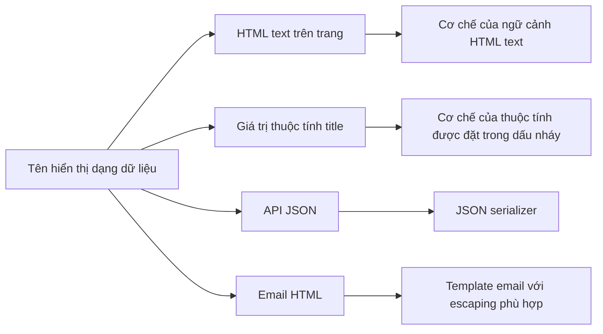

# Output encoding requirement

## 1. Yêu cầu cần bảo đảm điều gì?

Output encoding là biểu diễn dữ liệu theo quy tắc của ngữ cảnh đầu ra để dữ liệu không bị bộ phân tích phía nhận hiểu thành cấu trúc hoặc mã ngoài ý muốn.

Ví dụ, một tên hiển thị chứa dấu nhỏ hơn không được tự tạo một phần tử HTML mới. Một ghi chú chứa dấu nháy không được thoát khỏi giá trị thuộc tính. Một giá trị tìm kiếm không được tự thêm tham số khác vào URL.

Nhóm lỗi encoding hoặc escaping đầu ra không phù hợp được mô tả tại [CWE-116](https://cwe.mitre.org/data/definitions/116.html). Với giao diện web, rủi ro thường liên quan tới XSS, nhưng hợp đồng đầu ra còn xuất hiện ở nhiều định dạng và kênh khác.

Trong đặc tả yêu cầu bảo mật, câu “mọi dữ liệu phải được escape” chưa đủ. Cần xác định:

- Dữ liệu nào có thể chịu ảnh hưởng từ bên không tin cậy.
- Nó được đưa vào ngữ cảnh nào tại thời điểm xuất.
- Parser nào sẽ xử lý đầu ra.
- Cơ chế nào giữ dữ liệu ở đúng vị trí dữ liệu.
- Những ngữ cảnh nào không cho phép chèn trực tiếp.
- Bằng chứng nào chứng minh cả tính an toàn và ý nghĩa hiển thị.

Bài học dùng một cổng hỗ trợ khách hàng giả định. Tên hiển thị, tiêu đề yêu cầu và ghi chú có thể đến từ người dùng, hệ thống tích hợp hoặc dữ liệu đã lưu. Các giá trị này xuất hiện trên trang khách hàng, trang quản trị, email HTML và API JSON.

## 2. Không đánh đồng các cơ chế khác nhau

| Cơ chế | Câu hỏi được giải quyết | Không tự bảo đảm |
| --- | --- | --- |
| Input validation | Giá trị có đúng hợp đồng nghiệp vụ không? | An toàn cho mọi ngữ cảnh đầu ra |
| Character encoding như UTF-8 | Ký tự được biểu diễn thành byte như thế nào? | Ký tự không bị hiểu là cú pháp HTML hoặc script |
| Output encoding theo ngữ cảnh | Dữ liệu có giữ đúng vai trò tại parser đích không? | Quyền truy cập hoặc tính hợp lệ của URL |
| Serialization | Đối tượng có được biểu diễn đúng định dạng trao đổi không? | An toàn khi nhúng định dạng đó vào ngữ cảnh khác |
| HTML sanitization | Markup nào được giữ lại theo policy? | Phù hợp để dùng trong mọi ngữ cảnh khác |
| Encryption | Ai có thể đọc dữ liệu nếu không có khóa? | Dữ liệu sau giải mã an toàn tại điểm render |

Ví dụ, tên người có dấu nháy hoặc ký tự & có thể hoàn toàn hợp lệ về nghiệp vụ. Chặn mọi ký tự đặc biệt không phải yêu cầu mặc định phù hợp cho trường tên.

Ngược lại, dùng UTF-8 để trả response không làm chuỗi có dấu nhỏ hơn tự trở thành HTML text an toàn. Character encoding và contextual output encoding giải quyết hai tầng khác nhau.

Requirement nên ghi rõ cả hai khi cần: response dùng charset nhất quán, và từng giá trị được đưa vào đúng ngữ cảnh dữ liệu của định dạng.

## 3. Mô hình nguồn, điểm xuất và bộ phân tích

### 3.1. Dữ liệu đã lưu vẫn có thể không tin cậy

Trong cổng hỗ trợ, các nguồn cần xét gồm:

- Tên và ghi chú do khách hàng nhập.
- Nội dung từ webhook hoặc đối tác.
- Tên tệp upload.
- Dữ liệu import từ hệ thống cũ.
- Thông báo lỗi có chứa một phần request.
- Dữ liệu cấu hình có thể sửa qua công cụ quản trị.

Một giá trị nằm trong database không tự trở thành markup đáng tin. Nếu được lưu hôm nay và render trên trang quản trị tuần sau, nó vẫn cần kiểm soát tại điểm xuất tuần sau.

Cũng không coi dữ liệu do một nhân viên nhập là an toàn cho mọi đồng nghiệp. Quyền chỉnh sửa nội dung không mặc nhiên bao gồm quyền chạy mã trong phiên của người xem.

### 3.2. Một giá trị có thể đi tới nhiều ngữ cảnh



Không có một chuỗi “đã an toàn” dùng chung cho tất cả các nhánh. Kết quả encode cho HTML text không nên tự động đi vào JavaScript, URL hoặc JSON.

Hợp đồng cần theo dõi cả điểm xuất ở phía server và các lần sử dụng dữ liệu về sau trên browser.

## 4. Chọn cơ chế theo ngữ cảnh

OWASP phân biệt HTML text, thuộc tính, JavaScript, CSS, URL và các vị trí nguy hiểm; xem [XSS Prevention Cheat Sheet](https://cheatsheetseries.owasp.org/cheatsheets/Cross_Site_Scripting_Prevention_Cheat_Sheet.html).

Bảng dưới đây là policy minh họa của cổng hỗ trợ. Nó ưu tiên giảm các ngữ cảnh có thể chứa mã thay vì mở rộng một hàm escape tổng quát.

| Vị trí sử dụng | Yêu cầu của hệ thống ví dụ | Điểm cần tránh |
| --- | --- | --- |
| Text trong p, span, td | Template escape HTML text hoặc DOM API tạo text | Ghép dữ liệu vào HTML string rồi parse |
| title hoặc value thông thường | Tên thuộc tính cố định; giá trị đặt trong dấu nháy và encode theo attribute | Thuộc tính không có dấu nháy |
| Nội dung một input text trên DOM | Gán vào value bằng API phù hợp | Dựng cả đoạn input bằng chuỗi chưa kiểm soát |
| Tham số URL tìm kiếm | Dựng URL từ phần cấu trúc tin cậy và giá trị được biểu diễn đúng component | Ghép nguyên dữ liệu vào chuỗi URL |
| Toàn bộ URL do người dùng nhập | Parse, áp policy scheme/đích, rồi xử lý tại ngữ cảnh sử dụng | Coi percent-encoding là kiểm tra URL |
| JavaScript hoặc event handler | Dùng code cố định và dữ liệu tách riêng | Chèn dữ liệu thành biểu thức hoặc thân mã |
| CSS động | Mapping lựa chọn nghiệp vụ sang lớp hoặc giá trị được duyệt | Nhận nguyên đoạn CSS tùy ý |
| Rich HTML có chủ đích | Sanitizer với policy markup riêng | Render raw chỉ vì editor xuất HTML |
| API JSON | Serializer và media type phù hợp | Tự nối chuỗi JSON hoặc dùng HTML escape thay serializer |

Tên tag, tên thuộc tính, tên hàm và cấu trúc stylesheet là những vị trí có thể điều khiển cách parse. Hệ thống ví dụ không cho dữ liệu tùy ý quyết định chúng.

Nếu cần ngoại lệ, phải có requirement riêng cho use case và bộ phân tích liên quan; không ghi một nhãn safe chung rồi bỏ qua ngữ cảnh.

## 5. Ví dụ về giữ nguyên ý nghĩa văn bản

Giả sử tên hiển thị là:

```text
Lan & <team> "QA"
```

Khi đưa vào nội dung một đoạn văn HTML, một biểu diễn hợp lệ có thể là:

```html
<p class="display-name">Lan &amp; &lt;team&gt; "QA"</p>
```

Sau khi browser parse, người dùng phải nhìn thấy tên với các ký tự gốc. Không được có một phần tử team phát sinh từ dữ liệu.

Đầu ra cụ thể của thư viện có thể dùng các character reference tương đương. Requirement không nên khóa vào một cách viết entity duy nhất nếu mục tiêu là ngữ nghĩa DOM và văn bản sau parse.

Trong một thuộc tính có dấu nháy, các ký tự liên quan đến dấu phân cách phải được xử lý theo contract của attribute encoder. Không lấy ví dụ encode HTML text ở trên làm bằng chứng tự động cho mọi thuộc tính.

Một tên đã chứa chuỗi ký tự `&lt;` cần được hiểu theo hợp đồng dữ liệu. Nếu nó là văn bản gốc, người dùng phải nhìn thấy chính chuỗi đó; không tự giải mã nhiều lần để biến nó thành ký tự khác hoặc markup.

## 6. Encode tại ranh giới xuất, không dùng một bộ lọc toàn cục

### 6.1. Dữ liệu nghiệp vụ và biểu diễn đầu ra

Trong hệ thống ví dụ, dữ liệu văn bản được quản lý ở dạng nghiệp vụ đã qua validation. Khi render, thành phần biết ngữ cảnh đích áp cơ chế tương ứng.

```text
Giá trị nghiệp vụ
    -> HTML text: biểu diễn cho HTML text
    -> JSON response: JSON serializer
    -> URL query value: biểu diễn cho component URL
```

Không HTML-encode toàn bộ trường trước khi lưu rồi coi mọi consumer đã được bảo vệ. Cách đó có thể:

- Làm API JSON trả biểu diễn HTML thay vì giá trị nghiệp vụ.
- Tạo double encoding khi template tiếp tục escape.
- Không bảo vệ consumer đưa dữ liệu vào một ngữ cảnh khác.
- Khiến lớp sau phải tự decode để sửa hiển thị, tạo thêm điểm diễn giải.

Nếu phải lưu một tài liệu render sẵn hoặc rich HTML đã sanitize, nó cần loại dữ liệu, policy và contract riêng. Không trộn tài liệu đã xử lý với trường plain text mà không phân biệt.

### 6.2. Autoescape cần được xác minh đúng phạm vi

Template engine có thể giúp escape theo mặc định, nhưng nhóm triển khai vẫn phải biết:

- Cơ chế nào bật theo loại template.
- Những API nào xuất raw hoặc bypass escaping.
- Framework có xử lý URL scheme hay chỉ biểu diễn ký tự.
- Component bên thứ ba có chuyển dữ liệu thành HTML không.
- Client có lấy dữ liệu đã render rồi parse lại không.

Không vô hiệu hóa autoescape toàn trang để sửa một trường bị hiển thị entity. Cần tìm đúng ranh giới đã encode lặp và sửa contract ở đó.

### 6.3. Không tự xây một chuỗi replace dùng cho mọi nơi

Thay vài ký tự bằng entity có thể bỏ sót ngữ cảnh, Unicode hoặc thứ tự xử lý. Thư viện đã được lựa chọn vẫn cần dùng đúng API và đúng contract.

Tài liệu OWASP Java Encoder mô tả các phương thức theo parser đích và yêu cầu giữ đúng ranh giới; xem [Output contexts and boundaries](https://raw.githubusercontent.com/OWASP/owasp-java-encoder/main/docs/contexts.md).

Requirement nên chỉ rõ nhóm cơ chế được duyệt, không chỉ yêu cầu tên một thư viện xuất hiện trong dependency list.

## 7. Ví dụ Java: HTML text và thuộc tính thông thường

Đoạn code dưới đây minh họa một điểm xuất HTML có cấu trúc cố định. Nó dùng Writer để thể hiện rõ giá trị đi vào ngữ cảnh nào.

```java
import java.io.IOException;
import java.io.Writer;
import java.util.Objects;
import org.owasp.encoder.Encode;

public final class ProfileHtmlWriter {
    private ProfileHtmlWriter() {
    }

    public static void writeProfile(
            Writer html,
            String displayName,
            String note
    ) throws IOException {
        Objects.requireNonNull(html, "html");
        Objects.requireNonNull(displayName, "displayName");
        Objects.requireNonNull(note, "note");

        html.write("<section><p class='display-name'>");
        Encode.forHtmlContent(html, displayName);
        html.write("</p>");

        html.write(
                "<input type='text' name='note' value='"
        );
        Encode.forHtmlAttribute(html, note);
        html.write("'></section>");
    }
}
```

Các API forHtmlContent và forHtmlAttribute cùng overload Writer được minh họa trong [tài liệu sử dụng chính thức của OWASP Java Encoder](https://raw.githubusercontent.com/OWASP/owasp-java-encoder/main/docs/usage.md).

Những giả định của ví dụ:

- html là luồng đang tạo tài liệu HTML đúng charset và media type.
- Phần cấu trúc cố định do ứng dụng quản lý.
- displayName và note là dữ liệu nghiệp vụ, chưa được HTML-encode sẵn.
- Tên tag, tên thuộc tính và dấu nháy không đến từ người dùng.
- Dữ liệu không được chuyển sang event handler, CSS hoặc URL chỉ bằng cách đổi tên thuộc tính.
- Lớp tích hợp không tiếp tục escape toàn bộ đoạn HTML để rồi mở raw ở một vị trí khác.

Đây là ví dụ render thủ công tại ranh giới cụ thể. Nếu hệ thống dùng template autoescape phù hợp, nên giữ contract của template và truyền dữ liệu nghiệp vụ vào đó, tránh encode lặp.

Code không kiểm tra quyền xem hồ sơ, giới hạn độ dài nghiệp vụ hoặc chính sách nội dung ghi chú. Output encoding không thay các yêu cầu đó.

## 8. DOM phía client: chọn điểm gán giữ dữ liệu là text

Một API JSON có thể trả displayName an toàn về định dạng JSON. Frontend vẫn phải sử dụng giá trị đó tại đúng ngữ cảnh.

Với phần tử hiển thị văn bản thông thường:

```javascript
const nameNode = document.querySelector("#display-name");
nameNode.textContent = profile.displayName;
```

textContent trên một phần tử nội dung thông thường thay nội dung bằng text; ngữ nghĩa được quy định tại [DOM Standard](https://dom.spec.whatwg.org/#dom-node-textcontent).

Không cần HTML-encode giá trị trước khi gán textContent chỉ để hiển thị ký tự. Nếu truyền chuỗi entity đã encode, người dùng có thể thấy chính entity thay vì văn bản mong muốn.

Điểm quan trọng là ngữ cảnh phần tử. Gán text vào một phần tử script hoặc style có ý nghĩa khác với p hoặc span. Không khái quát rằng mọi thao tác có chữ text đều bảo vệ mọi cách sử dụng.

Với trường nhập liệu:

```javascript
const noteInput = document.querySelector("#note");
noteInput.value = profile.note;
```

Đối chiếu với một phản ví dụ:

```javascript
// Phản ví dụ: dữ liệu được đưa vào parser HTML.
container.innerHTML = profile.displayName;
```

Một bước render server an toàn không bảo vệ được lần parse HTML mới ở client. Requirement phải đi theo dữ liệu tới lần sử dụng cuối, kể cả component quản trị, tooltip, preview và thông báo lỗi.

## 9. URL cần kiểm tra ngữ nghĩa và biểu diễn đúng thành phần

### 9.1. Giá trị query khác toàn bộ URL

Với chức năng tìm kiếm nội bộ, cấu trúc URL có thể do server hoặc frontend giữ cố định; chỉ giá trị q là dữ liệu.

Ví dụ dùng API URL phía browser:

```javascript
const url = new URL(
  "/people/search",
  window.location.origin
);
url.searchParams.set("q", query);

searchLink.href = url.href;
searchLink.textContent = "Tìm trong danh bạ";
```

Ở đây đường dẫn và origin được chọn theo contract của ứng dụng. query không tự quyết định scheme hoặc đích điều hướng.

Nếu URL được chèn vào HTML source thay vì gán qua DOM API, nó còn phải được biểu diễn cho thuộc tính HTML có dấu nháy. Nếu template đã làm việc đó, không tự HTML-encode lại từ trước.

### 9.2. Toàn bộ URL cần policy riêng

Một chuỗi được percent-encode không tự trở thành URL được phép. Với liên kết do người dùng nhập, requirement phải xác định scheme, host, port, dạng relative và các hạn chế đích theo use case.

Parsing thành công chỉ chứng minh chuỗi được parser chấp nhận. Nó không chứng minh đích được phép hoặc một scheme có tác dụng thực thi đã bị loại bỏ.

Trong Java, URLEncoder có contract application/x-www-form-urlencoded và biểu diễn khoảng trắng bằng dấu cộng. Nó không phải bộ kiểm tra hay encoder chung cho nguyên URL; xem [Java SE 17 URLEncoder](https://docs.oracle.com/en/java/javase/17/docs/api/java.base/java/net/URLEncoder.html).

Không percent-encode nguyên cả URL rồi kỳ vọng cấu trúc vẫn được giữ đúng, cũng không ghép các phần đã encode nhiều lần mà không biết contract từng phần.

## 10. JavaScript, JSON và các ngữ cảnh lồng nhau

### 10.1. JSON hợp lệ không tự an toàn trong HTML

Một JSON serializer chịu trách nhiệm tạo dữ liệu theo định dạng JSON. JSON và quy tắc trao đổi UTF-8 được mô tả trong [RFC 8259](https://www.rfc-editor.org/rfc/rfc8259.html).

Nếu JSON được trả như một response dữ liệu riêng, consumer parse nó rồi dùng safe sink cho từng giá trị. Đây là lựa chọn của cổng hỗ trợ trong ví dụ.

Nếu nhúng JSON vào tài liệu HTML, xuất hiện thêm parser HTML bao quanh. Một serializer chỉ bảo đảm JSON hợp lệ chưa chắc đã xử lý ranh giới của phần tử chứa nó.

Ngay cả data block không thực thi trong phần tử script vẫn có quy tắc tokenization của HTML. HTML Standard mô tả các hạn chế nội dung phần tử script tại [Restrictions for contents of script elements](https://html.spec.whatwg.org/multipage/scripting.html#restrictions-for-contents-of-script-elements).

Vì vậy, nếu có nhúng, requirement phải chọn cơ chế serialization được cấu hình cho ngữ cảnh đó và kiểm chứng toàn bộ template. Không chỉ thay một dấu nháy trong từng trường rồi coi tài liệu là an toàn.

### 10.2. Dữ liệu không được trở thành mã

Policy của hệ thống ví dụ ưu tiên:

- JavaScript cố định được quản lý như mã ứng dụng.
- Dữ liệu được trao đổi qua API hoặc cơ chế dữ liệu đã được duyệt.
- Event handler được đăng ký bằng code cố định.
- Không dùng dữ liệu người dùng làm tên hàm, biểu thức hoặc thân event handler.
- Không đưa dữ liệu vào eval hoặc các API nhận chuỗi làm mã.

Nếu một hệ thống cũ phải đưa giá trị vào một JavaScript string, cần contract cho đúng literal, phần bao quanh và parser HTML nếu có. “JavaScript-escape” không cho phép chèn tùy ý vào mọi vị trí của chương trình.

### 10.3. Encoding nhiều lớp phải theo cấu trúc thực tế

Không dùng một chuỗi encoder cố định cho mọi output. Với ngôn ngữ lồng nhau, cần xác định parser trong và parser ngoài, biểu diễn đúng lớp và giữ ranh giới đã được duyệt.

Một ví dụ dễ nhận biết là URL nằm trong thuộc tính HTML: giá trị query cần biểu diễn như URL component, sau đó URL hoàn chỉnh cần được đặt đúng trong thuộc tính HTML source.

Điều này khác double encoding nhầm cùng một lớp HTML hai lần. Requirement cần mô tả chính xác ngữ cảnh thay vì chỉ đếm số lần gọi encode.

## 11. Rich HTML là use case riêng

Nếu ghi chú chỉ là plain text, output encoding giữ các ký tự như dữ liệu hiển thị. Nếu sản phẩm cho tác giả tạo đoạn HTML có định dạng, encoding toàn bộ markup sẽ làm mất chức năng hiển thị mong muốn.

Khi đó cần HTML sanitizer với policy rõ:

- Tag và attribute nào được giữ.
- URL scheme và đích nào được phép.
- Có cho phép style hoặc nội dung nhúng không.
- Ai được sửa policy.
- Khi policy hoặc thư viện thay đổi, nội dung cũ được đánh giá lại thế nào.

OWASP Java HTML Sanitizer là một ví dụ thư viện áp policy lên HTML không tin cậy; xem [trang dự án chính thức](https://owasp.org/projects/java-html-sanitizer).

Không dùng regex xóa một vài tag để thay một HTML parser và sanitizer. Cũng không sanitize xong rồi nối thêm markup không tin cậy trước khi render.

Kết quả được chấp nhận như rich HTML trong một container đã định không tự phù hợp để nhúng vào thuộc tính, script, email có contract khác hoặc một template engine có ngôn ngữ biểu thức riêng.

Requirement nên có kiểu dữ liệu hoặc API phân biệt plain text với rich content đã đi qua policy. Một biến tên safeHtml nhưng nhận mọi chuỗi không tạo ra bảo đảm.

## 12. Bộ yêu cầu bảo mật minh họa

| ID | Yêu cầu của cổng hỗ trợ | Owner | Bằng chứng dự kiến |
| --- | --- | --- | --- |
| OE-01 | Lập danh sách các điểm xuất và ngữ cảnh parser tương ứng | UI và architecture team | Mapping từ nguồn tới điểm render |
| OE-02 | Plain text được render như text, không tạo markup ngoài template | UI team | DOM và text sau parse |
| OE-03 | Attribute có tên cố định, dấu nháy và cơ chế đúng ngữ cảnh | Template owner | Không phát sinh attribute mới từ dữ liệu |
| OE-04 | URL có policy ngữ nghĩa và cơ chế dựng thành phần phù hợp | UI và domain team | Các scheme/đích ngoài policy bị từ chối |
| OE-05 | Không chèn dữ liệu tùy ý vào vị trí mã hoặc cấu trúc | UI platform team | Danh sách API/ngữ cảnh bị cấm |
| OE-06 | JSON dùng serializer; consumer bảo vệ ngữ cảnh sử dụng tiếp | API và frontend team | Response hợp lệ và DOM an toàn |
| OE-07 | Rich HTML có sanitizer và policy riêng | Content team | Tag, attribute và URL sau xử lý |
| OE-08 | Không lưu HTML-encoded thay cho plain text để bảo vệ mọi consumer | Data và API team | Contract dữ liệu qua các consumer |
| OE-09 | Autoescape mặc định và mọi bypass có owner, phạm vi, lý do | Template platform team | Inventory các điểm raw output |
| OE-10 | Trang quản trị, email và nhánh lỗi áp dụng cùng nguyên tắc theo ngữ cảnh | Các channel owner | Ca kiểm chứng trên từng kênh |
| OE-11 | Charset, Unicode và dữ liệu sai encoding có contract nhất quán | API và UI team | Văn bản hợp lệ giữ đúng ý nghĩa |
| OE-12 | Thư viện và policy được quản lý, thay đổi có kiểm chứng | Platform và security team | Phiên bản, phạm vi dùng và kết quả kiểm chứng |

Các requirement phải áp dụng cả dữ liệu trực tiếp từ request và dữ liệu đã lưu hoặc lấy từ đối tác.

Một framework có escape mặc định không làm OE-01 hoặc OE-09 trở nên không cần thiết. Những vị trí bypass, raw fragment và component thay đổi cách render thường quyết định phần rủi ro còn lại.

Các header như Content-Type và CSP là kiểm soát liên quan. Chúng không thay cơ chế đúng ngữ cảnh tại điểm xuất dữ liệu.

## 13. Một yêu cầu đầy đủ có thể được giao triển khai

Ví dụ OE-02 cho tên hiển thị:

```yaml
id: OE-02-PROFILE
title: Tên hiển thị không thay đổi cấu trúc trang
scope:
  - Trang hồ sơ khách hàng
  - Trang quản trị xem hồ sơ
data:
  field: displayName
  type: Plain text
  sources:
    - Người dùng nhập
    - Import từ đối tác
    - Dữ liệu đã lưu
destinations:
  - HTML text của phần tử hiển thị tên
  - DOM text của component cập nhật hồ sơ
requiredBehavior:
  - Dùng autoescape đúng ngữ cảnh hoặc DOM text API được duyệt
  - Không dùng raw HTML sink cho trường này
  - Không decode entity để sửa hiển thị trước khi parse HTML
  - Bảo toàn văn bản hợp lệ theo contract Unicode
  - Không thêm tag hoặc attribute từ dữ liệu
evidence:
  - Văn bản có dấu nhỏ hơn, dấu nháy và ampersand hiển thị đúng
  - Chuỗi trông như markup vẫn chỉ tạo text
  - Luồng cập nhật client không parse lại thành HTML
owner: Profile UI team
```

Đây là nội dung requirement minh họa, không phải một cấu hình tự áp dụng cho framework.

Yêu cầu không chỉ nói “không có JavaScript chạy”. Nó còn đòi cấu trúc trang không bị dữ liệu thay đổi. Một lớp CSP có thể ngăn mã thực thi trong khi HTML vẫn bị chèn sai; vì vậy phải quan sát đúng thuộc tính cần bảo vệ.

## 14. Thiết kế tiêu chí kiểm chứng

Chuẩn bị dữ liệu thử nghiệm không có bí mật thật, gồm văn bản thông thường, dấu nháy, dấu nhỏ hơn, ampersand, Unicode và chuỗi trông như markup.

Một marker phù hợp để kiểm tra plain text:

```text
<b data-probe="text-only">marker</b>
```

Nếu trường là plain text, người xem phải thấy chính chuỗi đó. Không được xuất hiện một phần tử b mới có attribute data-probe do dữ liệu tạo ra.

| Mã | Tình huống | Kết quả yêu cầu | Bằng chứng |
| --- | --- | --- | --- |
| V-01 | Văn bản chứa & và dấu nhỏ hơn | Hiển thị đúng ký tự gốc | Text sau parse và cấu trúc DOM |
| V-02 | Marker trông như HTML tại displayName | Chỉ tạo text | Không có phần tử mới từ marker |
| V-03 | Dấu nháy tại attribute value | Không thoát khỏi attribute đã định | Số và tên attribute thực tế |
| V-04 | Input đã chứa chuỗi entity | Giữ đúng contract plain text | Không tự decode ngoài ý muốn |
| V-05 | Dữ liệu lưu rồi render trên trang quản trị | Áp cùng cơ chế tại điểm xuất | DOM của trang quản trị |
| V-06 | Frontend cập nhật từ API JSON | Dùng safe sink theo contract | Không có lần parse HTML mới |
| V-07 | URL query chứa & hoặc ký tự phân cách | Vẫn là một giá trị query | URL được parse theo contract |
| V-08 | Toàn URL có scheme/đích ngoài policy | Không trở thành liên kết được phép | Quyết định URL policy |
| V-09 | Rich HTML có tag hoặc attribute bị cấm | Bị loại hoặc từ chối theo policy | Cấu trúc sau sanitizer |
| V-10 | Dữ liệu đi tới email HTML | Biểu diễn đúng ngữ cảnh email | Output và client được hỗ trợ |
| V-11 | JSON có dấu nháy, gạch chéo ngược và Unicode | JSON hợp lệ, giá trị đúng khi parse | Serializer output và dữ liệu sau parse |
| V-12 | Trường hợp nhúng JSON vào HTML nếu được hỗ trợ | Không phá ranh giới phần tử chứa | Cả parser HTML và parser JSON |
| V-13 | Thông báo lỗi phản chiếu một phần input | Không tạo markup hoặc lộ dữ liệu nhạy cảm | Response lỗi và giao diện |
| V-14 | Template có raw-output bypass | Chỉ những ngoại lệ đã được duyệt được dùng | Inventory và call site |
| V-15 | Một giá trị dùng ở nhiều ngữ cảnh | Từng điểm có cơ chế tương ứng | Mapping và kết quả theo consumer |

Không chỉ tìm một chuỗi entity trong response rồi coi ca kiểm chứng đã đạt. Các biểu diễn khác nhau có thể tạo cùng văn bản, còn một chuỗi “đã escape” vẫn có thể ở sai ngữ cảnh.

Không chỉ dựa vào ảnh chụp giao diện. Một trang nhìn bình thường vẫn có thể có attribute hoặc node ngoài dự kiến. Bằng chứng phải phù hợp: source, DOM, giá trị sau parse và hành vi consumer.

Cũng không vô hiệu hóa CSP trên môi trường vận hành để thử. Việc tách bằng chứng cho encoding và CSP phải được thiết kế trong môi trường kiểm chứng có kiểm soát.

Bảng trên là kế hoạch kiểm chứng cho requirement, không phải tuyên bố rằng một deployment đã chạy và đạt các ca này.

## 15. Ownership, ngoại lệ và vận hành

Output encoding thường bị bỏ sót ở ranh giới giữa API team và frontend team:

```text
API team: JSON đã serialize đúng.
Frontend team: Dữ liệu từ API nội bộ nên có thể render HTML.
Kết quả: Không bên nào chịu trách nhiệm cho lần parse HTML cuối.
```

Requirement cần chỉ định owner cho từng điểm xuất. Một hợp đồng API có thể ghi trường là plain text, nhưng consumer vẫn cần thực thi contract đó tại giao diện.

Với ngoại lệ raw HTML, tối thiểu phải có:

- Chức năng và trường dữ liệu cụ thể.
- Nguồn dữ liệu và chủ thể được sửa.
- Policy sanitizer hoặc cơ chế tạo trusted markup.
- Container và ngữ cảnh được phép.
- Owner cùng cách kiểm chứng.
- Hành vi khi thư viện hoặc policy không khả dụng.

Không dùng nhãn “nội bộ” để bỏ escaping cho trang quản trị. Người dùng có thể đi qua dữ liệu của khách hàng hoặc đối tác trước khi dữ liệu tới người vận hành có quyền cao hơn.

Khi phát hiện một điểm xuất sai:

1. Xác định nguồn dữ liệu và mọi consumer dùng cùng trường.
2. Chặn hoặc sửa sink có vấn đề theo đúng ngữ cảnh.
3. Kiểm tra dữ liệu đã lưu có thể tiếp tục ảnh hưởng các trang khác.
4. Sửa contract hoặc bypass khiến lỗi xuất hiện.
5. Bổ sung bằng chứng tại cả server render và client update.
6. Đánh giá phiên hoặc dữ liệu bị ảnh hưởng theo bằng chứng của sự cố.

Không sửa bằng cách HTML-encode toàn database nếu chưa có kế hoạch dữ liệu và consumer. Việc đó có thể phá ý nghĩa nội dung mà vẫn để lại sink sai ngữ cảnh.

## 16. Những kết luận cần tránh

| Kết luận thiếu chính xác | Yêu cầu còn thiếu |
| --- | --- |
| “Input đã validate nên render raw được” | Cơ chế tại parser đầu ra |
| “Dùng UTF-8 là đã encode an toàn” | Phân biệt byte encoding với cú pháp |
| “HTML escape dùng cho mọi ngữ cảnh” | Mapping HTML, attribute, URL, script và định dạng khác |
| “JSON hợp lệ thì đưa vào HTML đâu cũng được” | Parser HTML bao quanh và consumer tiếp theo |
| “setAttribute luôn an toàn” | Tên thuộc tính và ngữ nghĩa giá trị phải được kiểm soát |
| “URL đã encode nên scheme nào cũng được” | Policy về scheme và đích |
| “Đã có sanitizer thì có thể nối thêm HTML” | Bảo đảm còn giữ sau mọi bước biến đổi |
| “Autoescape bật thì không cần xem raw API” | Phạm vi mặc định và ngoại lệ |
| “CSP chặn script nên encoding không cần nữa” | Tính toàn vẹn cấu trúc và kiểm soát tại sink |
| “Encode càng nhiều lần càng an toàn” | Mỗi lớp phải đúng ngữ cảnh, không encode lặp mù quáng |

Một yêu cầu output encoding hoàn chỉnh xác định rõ dữ liệu, điểm xuất, parser, cơ chế, ngoại lệ và bằng chứng. Mục tiêu là giữ dữ liệu ở vai trò dữ liệu tại từng ranh giới sử dụng, đồng thời bảo toàn ý nghĩa nội dung mà sản phẩm cho phép.
