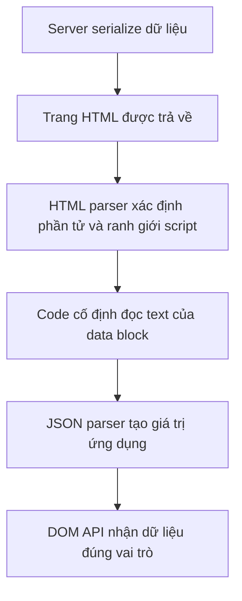

# JavaScript encoding

## 1. Dữ liệu phải giữ vai trò dữ liệu khi đi vào browser

JavaScript encoding trong thiết kế bảo mật là việc biểu diễn dữ liệu đúng với ngữ cảnh JavaScript mà nó đi vào, để dữ liệu không làm thay đổi cấu trúc chương trình ngoài ý muốn. Tuy nhiên, cách bảo vệ dễ kiểm chứng hơn trong nhiều luồng là không tạo JavaScript source bằng dữ liệu ngoài biên tin cậy ngay từ đầu.

Ví dụ, ứng dụng muốn hiển thị tên người dùng. Nếu server tạo một đoạn mã như sau bằng cách thay placeholder trực tiếp, tên người dùng đang được đặt vào cú pháp JavaScript:

```javascript
// Minh họa một vị trí chèn source, không phải mẫu triển khai an toàn.
const displayName = '<USER_VALUE>';
```

Một giá trị có dấu nháy, backslash hoặc xuống dòng có thể làm đoạn source không còn cấu trúc dự định. Chỉ kiểm tra tên không chứa một từ khóa quen thuộc không tạo ra bảo đảm giữ nguyên ngữ pháp của chương trình.

Nếu cùng tên đó được lấy qua JSON API rồi gán bằng `textContent`, dữ liệu không cần trở thành source JavaScript. Đây là một khác biệt kiến trúc quan trọng khi viết yêu cầu bảo mật.

Yêu cầu không nên dừng ở câu “escape input cho JavaScript”. Cần chỉ rõ dữ liệu đi vào đâu, parser nào sẽ đọc nó trước, serializer hoặc API nào bảo vệ ranh giới và bằng chứng nào cho thấy dữ liệu không trở thành mã thực thi.

## 2. Các ngữ cảnh khác nhau không dùng chung một encoder

| Vị trí dữ liệu | Những lớp diễn giải liên quan | Hướng thiết kế |
| --- | --- | --- |
| Response JSON riêng | JSON parser | Serialize JSON chuẩn, trả media type phù hợp, dùng parser JSON |
| Dữ liệu runtime được gán vào DOM text | JavaScript thực thi code cố định rồi DOM nhận text | Dùng API như `textContent` cho nội dung plain text |
| String literal trong script inline | HTML parser rồi JavaScript parser | Ưu tiên chuyển dữ liệu sang kênh riêng; nếu giữ lại phải bảo vệ cả hai ngữ cảnh |
| Template literal JavaScript | Cú pháp backtick và nội suy biểu thức | Không dùng dữ liệu để dựng source; encoder cho string thường không tự bảo vệ được vị trí này |
| Inline event handler | HTML attribute rồi JavaScript | Dùng event listener với code cố định, tách dữ liệu khỏi handler source |
| URL có khả năng thực thi mã | URL policy và cơ chế browser xử lý | Không cho dữ liệu không tin cậy quyết định một URL thực thi mã |
| Data block `application/json` trong HTML | HTML parser rồi JSON parser khi ứng dụng đọc | Serialize JSON và bảo vệ ranh giới phần tử script của HTML |
| `data-*` attribute | HTML attribute rồi giá trị String trong DOM | Encode theo thuộc tính HTML; không tự coi giá trị đọc lại là source JavaScript |

Tên “JavaScript encoding” không làm mọi hàng trong bảng trở thành cùng một bài toán. Một encoder cho string JavaScript không tự bảo vệ HTML attribute. JSON đúng cú pháp cũng không tự an toàn khi được nhúng vào mọi vị trí trong một trang HTML.

## 3. HTML parser có thể kết thúc script trước JavaScript parser

Một trang HTML có script inline được HTML parser xác định ranh giới phần tử trước khi nội dung script được thực thi như JavaScript. Chuỗi trông như thẻ kết thúc script có ý nghĩa ở lớp HTML, ngay cả khi tác giả nghĩ nó chỉ nằm trong một string JavaScript.

Điều đó tạo ra hai trách nhiệm khác nhau:

1. Giữ giá trị không thoát khỏi cấu trúc dữ liệu hoặc string mà JavaScript sẽ hiểu.
2. Giữ nội dung không kết thúc hoặc làm thay đổi vùng mà HTML parser đang xử lý.

Chỉ escape dấu nháy cho JavaScript chưa chứng minh trách nhiệm thứ hai. Ngược lại, HTML-encode toàn bộ JSON hoặc source không tự tạo ra một chương trình hoặc một giá trị JSON đúng nghĩa.

Thẻ script chứa JSON không thực thi cũng vẫn nằm trong tài liệu HTML. Việc đặt `type="application/json"` thay đổi cách nội dung được dùng, nhưng không loại bỏ trách nhiệm bảo vệ ranh giới phần tử khỏi nội dung dữ liệu.



Nếu dữ liệu đã phá ranh giới tại bước HTML parser, một JSON parser chạy sau đó không thể đảo ngược việc tài liệu đã được phân tích khác dự định.

## 4. Thiết kế ưu tiên: JavaScript cố định và JSON API riêng

Một cấu trúc dễ kiểm chứng là đặt code trong asset JavaScript do ứng dụng quản lý, còn dữ liệu được lấy qua endpoint JSON. Response dữ liệu không được ghép vào chương trình.

Ví dụ server trả:

```http
Content-Type: application/json
```

với body được tạo bằng JSON serializer. JavaScript phía client dùng JSON parser và kiểm tra hợp đồng dữ liệu trước khi dùng:

```javascript
async function loadProfile() {
  const response = await fetch('/api/profile', {
    credentials: 'same-origin',
    headers: { Accept: 'application/json' }
  });

  if (!response.ok) {
    throw new Error('PROFILE_LOAD_FAILED');
  }

  const profile = await response.json();
  if (profile === null || typeof profile !== 'object' ||
      typeof profile.displayName !== 'string' ||
      profile.displayName.length > 256) {
    throw new Error('PROFILE_CONTRACT_INVALID');
  }

  const target = document.getElementById('display-name');
  if (target === null) {
    throw new Error('DISPLAY_TARGET_MISSING');
  }

  target.textContent = profile.displayName;
}
```

Đoạn code không dùng `eval()`, không dựng hàm từ chuỗi và không đưa tên người dùng vào một lời gọi parse HTML. Một tên có dấu nháy hoặc chuỗi giống mã vẫn là String được gán vào text của phần tử.

Giới hạn `length` trong ví dụ là số UTF-16 code unit của JavaScript, không phải số ký tự người dùng cảm nhận. Chính sách tên đầy đủ và giới hạn response phía server phải được đặc tả riêng; kiểm tra phía client không thay thế kiểm soát tại server.

JSON parser chỉ xử lý cú pháp dữ liệu. Nếu code phía sau lấy một field JSON rồi truyền vào `innerHTML`, `eval()` hoặc một API nhạy cảm khác, rủi ro xuất hiện lại tại điểm sử dụng đó. Kênh JSON riêng không làm mọi String trong response trở thành an toàn cho mọi sink.

## 5. Khi cần dữ liệu khởi tạo ngay trong HTML

Một số trang cần dữ liệu cùng response HTML để khởi tạo giao diện. Có thể dùng một data block có ID cố định, sau đó để code cố định đọc và parse dữ liệu.

```html
<script type="application/json" id="profile-data">
{"displayName":"Minh","notice":"A \u003C B"}
</script>
<script src="/assets/profile.js" defer></script>
```

Code trong asset có thể đọc:

```javascript
const dataBlock = document.getElementById('profile-data');
if (dataBlock === null) {
  throw new Error('PROFILE_DATA_MISSING');
}

const profile = JSON.parse(dataBlock.textContent);
if (profile === null || typeof profile !== 'object' ||
    typeof profile.displayName !== 'string') {
  throw new Error('PROFILE_CONTRACT_INVALID');
}

const target = document.getElementById('display-name');
if (target === null) {
  throw new Error('DISPLAY_TARGET_MISSING');
}
target.textContent = profile.displayName;
```

Trong mẫu HTML, `\u003C` là escape của JSON. Sau `JSON.parse()`, giá trị `notice` là `A < B`. Escape này giữ nguyên giá trị dữ liệu nhưng không đưa ký tự `<` literal vào nội dung data block.

Để dùng mô hình này, hợp đồng serializer dành cho data block cần bảo đảm không có ký tự `<` literal xuất phát từ dữ liệu trong JSON được nhúng. Điều đó ngăn dữ liệu tạo dấu mở của một thẻ kết thúc script hoặc các cấu trúc HTML liên quan trong vùng này.

Không nên HTML-encode JSON thành các chuỗi như `&quot;` rồi mặc định JSON parser sẽ hiểu chúng là dấu nháy. Nội dung script không có cùng quy tắc giải mã entity như một đoạn text HTML thông thường. Cần tạo đúng artifact JSON cho data block, không nối thêm một vòng HTML entity decoding để sửa một artifact sai ngữ cảnh.

Nếu template engine bật autoescape mặc định, cần một điểm tích hợp có phạm vi rõ để chèn đúng artifact do serializer data block tạo ra. Không mở quyền “raw HTML” cho mọi String trong model chỉ để giải quyết trường hợp này.

## 6. Minh họa Java: hai loại output có hợp đồng riêng

Ví dụ sau dùng API JSON serializer phổ biến của Jackson để minh họa; giả định dự án đã cung cấp và cấu hình `ObjectMapper` phù hợp. Bài học không yêu cầu thay dependency của dự án.

DTO chỉ có dữ liệu String. Serializer phải sinh JSON chuẩn từ DTO, không dùng raw serializer hoặc cơ chế chèn source do người dùng điều khiển.

```java
import com.fasterxml.jackson.core.JsonProcessingException;
import com.fasterxml.jackson.databind.ObjectMapper;
import java.util.Objects;

public final class ProfileJsonOutput {
    private final ObjectMapper json;

    public ProfileJsonOutput(ObjectMapper json) {
        this.json = Objects.requireNonNull(json);
    }

    public String forJsonResponse(ProfileView view)
            throws JsonProcessingException {
        return json.writeValueAsString(view);
    }

    public String forHtmlJsonDataBlock(ProfileView view)
            throws JsonProcessingException {
        String serialized = json.writeValueAsString(view);

        // Escape cho JSON được đặt trong nội dung script data block.
        // Kết quả này không phải encoder chung cho mọi vị trí HTML/JS.
        return serialized.replace("<", "\\u003C");
    }

    public record ProfileView(String displayName, String notice) {
    }
}
```

Thứ tự ở đây có ý nghĩa:

1. JSON serializer xử lý cấu trúc object và escape đúng cho các String.
2. Phép thay thế diễn ra trên JSON đã serialize, đưa mọi `<` literal thành JSON escape `\u003C`.
3. JSON đó chỉ được chèn vào nội dung của data block theo mẫu đã công bố.
4. Client đọc text và dùng `JSON.parse()` đúng một lần.

Trong JSON chuẩn, ký tự `<` literal chỉ có thể nằm trong nội dung String, không phải là token cấu trúc JSON. Việc thay nó bằng escape tương đương sau serialization giữ nguyên giá trị khi parse lại. Đây là một phép biến đổi có phạm vi cụ thể, không phải cách tự viết lại toàn bộ JSON serializer.

Nếu biến đổi String đầu vào thành các ký tự `\u003C` trước rồi mới đưa vào serializer, serializer có thể escape backslash để giữ nó là văn bản literal. Khi đó kết quả dữ liệu có thể khác với mục đích ban đầu. Vì vậy cần xác định rõ thao tác nào chạy trên giá trị và thao tác nào chạy trên artifact đã serialize.

Implementation thực tế còn cần giới hạn DTO, kích thước output sau biến đổi, xử lý lỗi và kiểm thử với cấu hình serializer đang triển khai. Nếu thay serializer, thêm custom serializer hoặc đổi kiểu DTO, cần xác minh lại hợp đồng.

Kết quả của `forHtmlJsonDataBlock()` không được tái sử dụng như một HTML attribute đã encode, một event handler hoặc một đoạn source JavaScript bất kỳ. Tên phương thức cố ý gắn với đúng ngữ cảnh được bảo vệ.

## 7. Các vị trí nên tránh đưa dữ liệu vào source

### 7.1. Inline event handler

Một thuộc tính như `onclick` tạo ra ngữ cảnh lồng giữa HTML attribute và JavaScript. Chỉ encode dấu nháy cho HTML không chứng minh dữ liệu bên trong đã an toàn như source của handler.

Thiết kế dễ kiểm chứng hơn là dùng phần tử với ID hoặc khóa cố định, rồi đăng ký handler bằng code do ứng dụng quản lý:

```javascript
const button = document.getElementById('show-profile');
button.addEventListener('click', () => {
  const target = document.getElementById('display-name');
  target.textContent = currentProfile.displayName;
});
```

Ví dụ giả định các phần tử đã tồn tại và `currentProfile` đã đạt hợp đồng dữ liệu. Dữ liệu không được ghép vào body của handler. Nếu cần một ID cho thao tác tiếp theo, giữ nó trong trạng thái ứng dụng hoặc thuộc tính dữ liệu có hợp đồng, rồi xử lý như giá trị.

### 7.2. Template literal và nội suy

Template literal dùng backtick có cú pháp nội suy biểu thức. Một cơ chế chỉ escape dấu nháy đơn hoặc dấu nháy kép không tự bảo vệ được dữ liệu chèn vào source dạng này.

Yêu cầu nên cấm tạo code bằng cách thay dữ liệu vào template literal của chương trình. Nếu chỉ cần tạo văn bản ở runtime, nối hoặc nội suy các String đã là giá trị trong code cố định không giống với việc compile lại kết quả thành chương trình.

### 7.3. `eval`, constructor tạo hàm và timer nhận source

Không dùng JSON hoặc field dữ liệu làm đầu vào cho cơ chế thực thi source. JSON phải được parse bằng JSON parser, không được dùng như một lý do để gọi `eval()`.

Timer hoặc callback nên nhận function do code quản lý, thay vì chuỗi chứa mã. Khi dữ liệu cần ảnh hưởng hành vi, dùng các lựa chọn được ánh xạ rõ ràng sang những thao tác đã định nghĩa, không cho dữ liệu quyết định source của thao tác.

### 7.4. URL có thể mang chỉ thị thực thi

Gán một String vào thuộc tính URL không chỉ là bài toán escape dấu nháy. Cần chính sách scheme và đích phù hợp. Một giá trị vẫn có thể không phù hợp dù nó không thoát khỏi dấu nháy của thuộc tính HTML.

Đối với các liên kết do dữ liệu cung cấp, phải xác định URL nào được phép và cách tạo, parse, serialize chúng. Không dùng khái niệm “đã JavaScript-encode” như bằng chứng cho tính hợp lệ của URL.

## 8. Dữ liệu từ database, API và third-party vẫn cần đúng sink

Một chuỗi được lưu không tự có bảo đảm an toàn cho JavaScript. Dữ liệu đó có thể đến từ hồ sơ người dùng, import cũ, CMS hoặc đối tác, rồi được hiển thị trong một trang quản trị có quyền cao hơn.

Validation đầu vào giữ miền giá trị của field, còn output encoding bảo vệ cách field được diễn giải tại nơi xuất. Không nên cấm mọi dấu nháy trong tên chỉ để làm việc chèn tên vào script source thuận tiện hơn.

Response từ service nội bộ cũng không tự là source được phép thực thi. Một endpoint có thể trả dữ liệu đúng JSON nhưng code phía client vẫn dùng sai sink. Cần theo dõi giá trị đến thao tác DOM, URL hoặc execution cuối cùng.

Nếu một thư viện UI có API nhận HTML hoặc template, phải phân biệt nó với API nhận plain text. Tên phương thức như `render()` hoặc `setContent()` chưa đủ để biết dữ liệu có được parse thành nội dung chủ động hay không.

## 9. Chuyển thiết kế thành yêu cầu bảo mật

Một bộ yêu cầu cho trang hồ sơ có thể viết như sau:

```text
SEC-JS-01: Dữ liệu người dùng không được nối vào JavaScript source.
SEC-JS-02: Code phía client lấy dữ liệu qua JSON parser và kiểm tra schema cần thiết.
SEC-JS-03: Không dùng eval hoặc cơ chế compile source để xử lý dữ liệu JSON.
SEC-JS-04: Plain text được gán bằng text sink phù hợp, không qua API parse HTML.
SEC-JS-05: Script data block dùng serializer có hợp đồng không đưa < literal từ dữ liệu vào block.
SEC-JS-06: Không chèn dữ liệu vào inline event handler hoặc source của template literal.
SEC-JS-07: Encoder hoặc serializer được lựa chọn theo đúng ngữ cảnh cuối.
SEC-JS-08: Dữ liệu đã serialize cho một ngữ cảnh không được đánh dấu an toàn chung.
SEC-JS-09: URL được kiểm tra theo chính sách scheme và đích độc lập với escaping.
SEC-JS-10: Lỗi serialization hoặc parse không dẫn tới fallback thực thi source.
SEC-JS-11: Giới hạn dữ liệu và output được thực thi với đơn vị được công bố.
SEC-JS-12: Các đường preview, admin và dữ liệu đã lưu giữ cùng ranh giới dữ liệu/mã.
```

Các yêu cầu cần có chủ sở hữu: server serializer bảo vệ artifact dữ liệu; template tích hợp artifact đúng vị trí; code client dùng parser và sink đúng; application service xác định quyền đọc dữ liệu; nền tảng cung cấp các lớp bảo vệ bổ sung theo chính sách.

Một field xuất vào nhiều nơi cần nhiều mapping ngữ cảnh. Ví dụ `displayName` dùng trong HTML text, thuộc tính dữ liệu và một file JSON không nên dùng chung một giá trị đã encode trước theo cách mơ hồ.

## 10. Thiết kế bằng chứng kiểm thử

Phần này mô tả tiêu chí để kiểm chứng yêu cầu, không phải một vòng thực thi QA nội dung hoặc chạy bộ kiểm thử của dự án.

### 10.1. Kiểm thử serializer và round trip

Cần các trường hợp có dấu nháy đơn, dấu nháy kép, backslash, xuống dòng, chữ có dấu và code point ngoài BMP. Với JSON riêng, parse output phải khôi phục đúng giá trị dữ liệu theo hợp đồng.

Với data block HTML, cần thêm các chuỗi giống ranh giới script và cấu trúc mà HTML parser có thể nhận diện. Có thể dùng sentinel vô hại như một chuỗi thẻ kết thúc script kèm một phần tử đánh dấu không thực thi, trong môi trường kiểm thử được kiểm soát.

| Tình huống | Thuộc tính mong đợi |
| --- | --- |
| Tên chứa dấu nháy và backslash | JSON đúng cú pháp, khôi phục đúng String |
| Dữ liệu có xuống dòng | Không làm hỏng cấu trúc JSON hoặc source cố định |
| Dữ liệu giống cú pháp nội suy | Giữ vai trò dữ liệu, không được compile thành expression |
| Dữ liệu chứa thẻ kết thúc script với biến thể hoa thường | Không kết thúc data block hoặc tạo phần tử ngoài dự định |
| Dữ liệu chứa `<` và chuỗi giống mở comment HTML | Không đưa `<` literal từ dữ liệu vào block theo hợp đồng |
| Dữ liệu đã lưu rồi đọc lên trang quản trị | Vẫn đi qua serializer và sink tương ứng |
| JSON hoặc schema không hợp lệ | Lỗi có kiểm soát, không fallback sang eval hoặc chèn HTML |

Nếu hỗ trợ các code point có hành vi khác nhau giữa môi trường JavaScript hoặc công cụ xử lý source, bộ kiểm thử phải phản ánh các môi trường được sản phẩm hỗ trợ. Không dùng một giả định chung về mọi parser thay cho ma trận tương thích thực tế.

### 10.2. Kiểm thử bằng browser cho ngữ cảnh HTML

Một unit test chỉ gọi `JSON.parse()` trên String chưa chứng minh HTML parser giữ đúng ranh giới data block. Cần kiểm tra trang HTML hoàn chỉnh trong browser để xác nhận cấu trúc DOM không bị thay đổi ngoài ý muốn.

Các thuộc tính cần quan sát gồm số phần tử script dự kiến, sự vắng mặt của phần tử sentinel ngoài dữ liệu, nội dung hiển thị đúng và không có hành vi thực thi phát sinh từ field dữ liệu.

Không chỉ dựa vào việc “không có alert” hoặc “console không báo lỗi”. Dữ liệu có thể làm sai cấu trúc tài liệu mà chưa tạo một hiệu ứng hiển thị rõ ràng. Kiểm thử phải khẳng định đúng ranh giới và sink.

### 10.3. Kiểm thử các đường đi thực tế

Cần kiểm tra trang thường, preview, giao diện quản trị và các component dùng chung. Một đường dùng `textContent` đúng không chứng minh một component khác đã tránh `innerHTML` cho cùng dữ liệu.

Nếu template engine có cơ chế raw output, xác nhận chỉ artifact được serializer có hợp đồng tạo ra mới đi qua điểm tích hợp đó. Một kiểu wrapper hoặc tên biến `safeJson` không tự ngăn lập trình viên gói một String tùy ý vào cùng đường raw output.

Khi thay thư viện, custom serializer hoặc cơ chế hydration, cần kiểm tra lại giả định về ngữ cảnh. Dữ liệu từ API có thể được một lớp phía sau đưa vào template source nếu không theo dõi tới sink cuối.

## 11. Các lớp bảo vệ bổ sung và giới hạn của chúng

Chính sách browser như CSP có thể giảm một số đường thực thi ngoài dự kiến khi được thiết kế và triển khai phù hợp. Nó không thay thế việc giữ dữ liệu khỏi source, chọn đúng serializer hoặc tránh sink nguy hiểm.

Tương tự, một nonce hoặc một asset được phép tải không biến dữ liệu được nối vào code của asset đó thành an toàn. Kiểm soát nguồn script và kiểm soát nội dung dữ liệu là các trách nhiệm cần phối hợp.

Các cơ chế kiểm soát sink của nền tảng hoặc framework có thể hỗ trợ ngăn một số thao tác nhạy cảm, nhưng cần có chính sách cụ thể và kiểm thử integration. Không chỉ dựa vào tên “safe”, “trusted” hoặc “sanitized” mà bỏ qua provenance của giá trị.

Authorization cũng độc lập với JavaScript encoding. Một response JSON được serialize hoàn hảo vẫn có thể làm lộ dữ liệu nếu endpoint trả hồ sơ ngoài quyền. Output encoding bảo vệ cách dữ liệu được diễn giải, không quyết định ai được đọc dữ liệu đó.

## 12. Vận hành và review thay đổi

Trong review, cần tìm những vị trí chèn dữ liệu vào script inline, inline handler, template literal hoặc lời gọi execution API. Đồng thời theo dõi các điểm dữ liệu JSON được chuyển sang DOM, URL hay template UI.

Những thay đổi tưởng như trình bày đơn giản có thể đổi ngữ cảnh: chuyển một tên từ text node sang thuộc tính, chuyển dữ liệu từ JSON API sang inline script, hoặc thay một component text bằng component rich HTML. Mỗi thay đổi cần cập nhật yêu cầu encoding và bằng chứng tương ứng.

Lỗi serialization và parse nên có mã ổn định cùng correlation ID khi phù hợp. Không ghi nguyên model nhạy cảm hoặc phản chiếu payload chưa được xử lý vào một trang lỗi HTML. Đường quan sát và lỗi cũng là các điểm xuất dữ liệu cần hợp đồng.

Một thiết kế JavaScript encoding tốt giữ code do ứng dụng quản lý và dữ liệu ở các kênh có ngữ nghĩa rõ. Khi cần nhúng dữ liệu vào HTML, thiết kế chỉ ra cả ranh giới HTML và JSON hoặc JavaScript liên quan, rồi kiểm chứng rằng browser vẫn nhận dữ liệu đúng vai trò tại sink cuối cùng.
