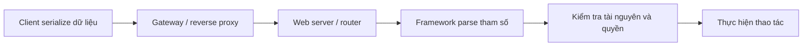

# URL encoding

## 1. Vì sao URL encoding là một yêu cầu bảo mật?

Một URL vừa chứa cấu trúc điều hướng vừa chứa dữ liệu. Các ký tự như `/`, `?`, `&`, `=` và `#` có vai trò cú pháp ở những vị trí nhất định. Nếu ứng dụng ghép trực tiếp dữ liệu không tin cậy vào URL, dữ liệu có thể bị hiểu thành cấu trúc mới.

Giả sử chức năng tìm kiếm tạo đường dẫn bằng cách nối chuỗi:

```text
/search?q= + nội_dung_tìm_kiếm
```

Người dùng nhập:

```text
máy chủ & sort=admin
```

Nếu ghép nguyên văn, dấu `&` có thể mở đầu một tham số khác thay vì thuộc nội dung tìm kiếm. Vấn đề không nằm ở việc chuỗi có “trông nguy hiểm” hay không, mà ở chỗ ứng dụng chưa bảo toàn ranh giới giữa dữ liệu và cú pháp.

URL encoding giúp biểu diễn dữ liệu trong thành phần URL phù hợp. Trong thiết kế yêu cầu bảo mật, phát biểu “hệ thống phải encode URL” vẫn chưa đủ. Yêu cầu cần chỉ rõ:

- Dữ liệu thuộc path segment, query name, query value hay fragment.
- Thành phần nào nhận dữ liệu thô và chịu trách nhiệm encode.
- Charset và quy ước serialize, đặc biệt cách xử lý dấu cách và dấu cộng.
- Những tầng nào parse, decode, chuẩn hóa và kiểm tra quyền.
- Kết quả mong đợi khi gặp dữ liệu không hợp lệ hoặc biểu diễn nhập nhằng.

Mục tiêu của bài học là chuyển các quyết định đó thành hợp đồng đầu ra và tiêu chí chấp nhận có thể kiểm chứng. URL encoding không phải cơ chế mã hóa bí mật, xác thực hay phân quyền.

## 2. Percent-encoding hoạt động trên byte

### 2.1. Dạng biểu diễn

Percent-encoding biểu diễn một byte bằng dấu phần trăm và hai chữ số hexadecimal:

```text
%HH
```

Ví dụ:

| Dữ liệu | Biểu diễn percent-encoded khi cần coi là dữ liệu |
|---|---|
| Dấu cách | `%20` |
| Dấu cộng `+` | `%2B` |
| Dấu phần trăm `%` | `%25` |
| Dấu và `&` | `%26` |
| Dấu bằng `=` | `%3D` |
| Dấu thăng `#` | `%23` |
| Dấu gạch chéo `/` | `%2F` |

Bảng này minh họa cách biểu diễn ký tự khi nó cần nằm trong dữ liệu. Nó không có nghĩa mọi ký tự trên luôn phải được encode ở mọi vị trí URL. Chẳng hạn, dấu `/` phân tách các segment của path phải giữ vai trò phân tách.

`%2F` và `%2f` biểu diễn cùng một byte. Tuy nhiên, hệ thống ký request, tạo khóa cache hoặc so sánh chuỗi vẫn cần một quy ước biểu diễn thống nhất; tính tương đương sau decode không tự làm hai chuỗi byte giống nhau.

### 2.2. Unicode phải được chuyển thành byte trước

Với dữ liệu văn bản sử dụng UTF-8:

```text
Ký tự Unicode → byte UTF-8 → percent-encoding những byte cần encode
```

Ví dụ:

```text
đ → C4 91 → %C4%91
```

Không thể coi `%HH` là mã Unicode của một ký tự bất kỳ. Một ký tự có thể cần nhiều byte, vì vậy cũng có nhiều nhóm `%HH`.

Khi đặc tả API, nên xác định rõ văn bản query do ứng dụng sinh được serialize bằng UTF-8 và phía nhận diễn giải theo cùng hợp đồng. Tránh phụ thuộc charset mặc định của máy chạy hoặc để các dịch vụ tự chọn charset khác nhau.

### 2.3. Tập ký tự unreserved

Các ký tự sau được gọi là unreserved trong cú pháp URI:

```text
A-Z a-z 0-9 - . _ ~
```

Một encoder cho giá trị thành phần có thể giữ nguyên nhóm này và percent-encode các byte còn lại. Tuy nhiên, thư viện dành cho form có quy tắc serialize riêng; không nên suy ra mọi hàm mang tên “URL encode” đều trả về cùng một chuỗi.

Quan trọng hơn, encoder không quyết định dữ liệu có hợp lệ theo nghiệp vụ hay không. Chuỗi `..` chỉ chứa dấu chấm nhưng vẫn có thể mang ý nghĩa đặc biệt khi xuất hiện trong path. Đây là vấn đề của hợp đồng đường dẫn và validation, không được giải quyết chỉ bằng việc chạy encoder.

## 3. Encode thành phần, không encode toàn bộ URL đã ghép

Xét URL:

```text
https://portal.example/catalog/items?q=java&lang=vi#results
```

Có thể phân biệt:

| Thành phần | Ví dụ | Quyết định thiết kế |
|---|---|---|
| Scheme | `https` | Thường do cấu hình tin cậy quyết định |
| Authority/host | `portal.example` | Kiểm soát đích; không lấy từ query encoder |
| Path | `/catalog/items` | Ghép bằng các segment có hợp đồng rõ ràng |
| Query name | `q`, `lang` | Ưu tiên tên tham số cố định |
| Query value | `java`, `vi` | Encode giá trị độc lập bằng cơ chế phù hợp |
| Fragment | `results` | Do client xử lý; không tự gửi lên server trong HTTP request |

Cách làm không phù hợp:

```text
encode("https://portal.example/search?q=" + userInput)
```

Cách làm mong muốn:

```text
base URL tin cậy + tên tham số cố định + serialize(userInput như một query value)
```

Nếu encode cả URL bằng encoder cho một giá trị, dấu hai chấm, gạch chéo và dấu hỏi của cấu trúc cũng bị biến đổi. Nếu không encode gì, dữ liệu có thể thay đổi cấu trúc. Để tránh hai lỗi này, dùng API xây dựng URL hoặc URI có tham số thành phần rõ ràng.

Tên hàm chưa đủ để bảo đảm an toàn. Cần biết API nhận chuỗi thô hay chuỗi đã encoded. Một constructor nhận thành phần thô có thể encode lại dấu phần trăm nếu được truyền chuỗi đã encoded trước đó.

### 3.1. Path segment không giống cả path

Nếu một trường nghiệp vụ đại diện cho tên một đối tượng, cần xác định nó là:

- Một định danh opaque trong đúng một segment.
- Một đường dẫn phân cấp gồm nhiều segment.
- Một tên hiển thị chỉ dùng làm query value.

Không được sử dụng encoder cho cả path rồi vô tình giữ lại dấu `/` trong dữ liệu vốn phải ở một segment.

Ngược lại, percent-encode dấu gạch chéo cũng chưa bảo đảm một segment được giữ nguyên qua mọi tầng. Reverse proxy, web server và router có thể có chính sách khác nhau đối với encoded slash. Hợp đồng phải quy định rõ cho phép hay từ chối và xác minh hành vi trên toàn tuyến.

Với ID đối tượng, một lựa chọn dễ kiểm soát hơn là giới hạn định dạng ID, chẳng hạn chữ và số cùng dấu gạch ngang, thay vì cho phép dữ liệu đường dẫn tùy ý.

### 3.2. Query value cần giữ nguyên một giá trị

Ví dụ, dữ liệu thô:

```text
A+B & C=1
```

Có thể được serialize theo quy ước query dùng percent-encoding dấu cách:

```text
q=A%2BB%20%26%20C%3D1
```

Phía nhận phải khôi phục đúng một giá trị:

```text
A+B & C=1
```

Dấu `&` và `=` trong dữ liệu không được tạo thêm cặp name/value. Dấu cộng trong dữ liệu không được biến thành dấu cách.

Một query cũng có thể có tham số lặp, như `tag=a&tag=b`. Nếu API cho phép, hãy mô hình hóa rõ thành danh sách. Nếu API không cho phép, phải quyết định từ chối hoặc xử lý ra sao; encoding không giải quyết xung đột giữa “lấy giá trị đầu” và “lấy giá trị cuối”.

## 4. Phân biệt percent-encoding và form encoding

### 4.1. Vì sao có cả %20 và dấu cộng?

Trong percent-encoding, dấu cách được biểu diễn bằng `%20`.

Trong quy ước `application/x-www-form-urlencoded`, dấu cách thường được serialize thành `+`, còn dấu cộng thực sự trong dữ liệu phải được encode thành `%2B`.

Với chuỗi thô:

```text
A+B C
```

Hai biểu diễn có thể gặp:

| Quy ước | Biểu diễn |
|---|---|
| Encode giá trị theo cách dùng `%20` cho dấu cách | `A%2BB%20C` |
| Form encoding | `A%2BB+C` |

Không có quy tắc chung rằng dấu `+` ở mọi vị trí URL đều là dấu cách. Việc diễn giải đó gắn với bộ phân tích form/query áp dụng quy ước form; dấu cộng trong path không tự mang cùng ý nghĩa.

Nếu encoder và decoder khác quy ước, dữ liệu có thể bị thay đổi. Những trường thường chịu ảnh hưởng gồm từ khóa tìm kiếm, mã có dấu cộng, số điện thoại và token do một hệ thống khác cấp.

### 4.2. Không sửa chuỗi bằng thay thế tùy tiện

Những cách xử lý như:

```text
replace(" ", "%20")
replace("&", "%26")
```

không phải một encoder đầy đủ. Chúng bỏ sót Unicode, dấu phần trăm, dấu cộng, dấu thăng và nhiều trường hợp khác. Thứ tự thay thế còn có thể encode lại chính dấu phần trăm vừa tạo.

Tương tự, không thay mọi `+` thành dấu cách trong một URL hoàn chỉnh. Thao tác đó làm hỏng dữ liệu ở những thành phần không dùng form encoding.

Yêu cầu nên chọn một API serializer rõ ràng và ghi lại quy ước, thay vì mô tả một chuỗi thao tác thay thế ký tự.

## 5. Ranh giới encode và decode

### 5.1. “Encode một lần” cần hiểu theo ngữ cảnh

Một quy tắc hữu ích là: mỗi thành phần dữ liệu có đúng một chủ thể chịu trách nhiệm encode trước khi serialize nó vào URL.

Quy tắc này không có nghĩa một dữ liệu không bao giờ được encode qua nhiều lớp biểu diễn. Ví dụ, một URL đầy đủ có thể là giá trị của tham số `returnUrl` trong URL khác:

```text
URL bên trong: /orders?id=10&view=summary

URL bên ngoài:
/login?returnUrl=%2Forders%3Fid%3D10%26view%3Dsummary
```

Dấu `?` và `&` của URL bên trong phải trở thành dữ liệu của query bên ngoài. Mỗi lớp có một hợp đồng riêng và chỉ được tháo đúng lớp khi diễn giải.

Vấn đề cần ngăn là encode lại ngoài ý muốn ở cùng một lớp, hoặc decode lặp đến khi chuỗi “không còn phần trăm”.

### 5.2. Double encoding

Nếu dữ liệu đã chứa:

```text
%2F
```

rồi được encode lại như dữ liệu thô, dấu phần trăm trở thành `%25`:

```text
%252F
```

Điều này có thể là kết quả đúng nếu người dùng thực sự nhập ba ký tự `%`, `2`, `F`. Nhưng nó là lỗi nếu code đã encode một dấu gạch chéo, rồi thư viện encode lần nữa ngoài dự kiến.

Do đó, không thể kết luận chỉ từ chuỗi `%252F` rằng request là độc hại. Cần biết dữ liệu đầu vào, lớp biểu diễn và hợp đồng ở mỗi ranh giới.

Các mô hình dữ liệu nên dùng tên có ý nghĩa:

```text
rawSearchTerm
serializedQuery
parsedQueryValue
validatedRedirectTarget
```

Tránh một biến chung `url` được dùng lẫn cho URL hoàn chỉnh, một query value và chuỗi đã encoded.

### 5.3. Double decoding

Xét dữ liệu:

```text
%252e%252e%252f
```

Một lần percent-decode cho ra:

```text
%2e%2e%2f
```

Một lần nữa có thể cho ra:

```text
../
```

Nếu tầng kiểm tra quyền nhìn biểu diễn thứ nhất, còn tầng đọc file nhìn biểu diễn cuối, hai tầng có thể đưa ra kết luận khác nhau về tài nguyên được yêu cầu.

Thiết kế cần quy định biểu diễn chuẩn mà kiểm tra tài nguyên và phân quyền sử dụng. Không gọi decoder bổ sung trên giá trị mà framework đã decode, trừ khi hợp đồng dữ liệu có một lớp lồng nhau được thiết kế rõ ràng.

Đối với đường dẫn file, còn phải có kiểm soát ánh xạ tài nguyên và giới hạn thư mục. URL decoding không thay thế các kiểm soát đó.

### 5.4. Dữ liệu malformed

Các chuỗi như `%`, `%G1` hoặc `%2` không phải một nhóm percent-encoding hợp lệ. Chuỗi có percent-encoding hợp lệ về hexadecimal vẫn có thể tạo ra byte không hợp lệ theo UTF-8.

Đối với đầu vào được định nghĩa là văn bản UTF-8, hợp đồng nên xác định:

- Ranh giới chịu trách nhiệm kiểm tra percent-encoding và UTF-8.
- Cách từ chối đầu vào malformed bằng lỗi có kiểm soát.
- Không tiếp tục diễn giải bằng một charset khác một cách im lặng.
- Không dùng kết quả decode khác nhau cho phân quyền và truy cập tài nguyên.

Nếu có thành phần bắt buộc hỗ trợ giá trị byte không phải văn bản, phải mô hình hóa riêng thay vì áp dụng tùy tiện yêu cầu UTF-8 cho mọi loại dữ liệu.

## 6. URL encoding không thay thế các kiểm soát khác

### 6.1. Kiểm soát scheme và đích điều hướng

Một chuỗi có thể được encode đúng về mặt cú pháp nhưng vẫn chỉ đến đích không được phép.

Ví dụ, hệ thống có tính năng chuyển hướng sau đăng nhập. Chỉ encode `returnUrl` thành query value không bảo đảm đích chuyển hướng an toàn. Khi sử dụng giá trị đã parse, hệ thống vẫn phải kiểm tra hợp đồng đích: đường dẫn nội bộ hợp lệ hoặc origin trong danh sách cho phép.

Tương tự, URL encoding không ngăn SSRF nếu server được phép gọi một URL do người dùng kiểm soát. Kiểm soát scheme, host, cổng, địa chỉ đích và các lần redirect thuộc yêu cầu riêng của tính năng gọi ra ngoài.

Không viết yêu cầu:

> Mọi URL được encode nên không thể dẫn tới open redirect hoặc SSRF.

Nên viết:

> Hệ thống serialize từng giá trị query bằng serializer đã chọn; trước khi điều hướng hoặc gọi ra ngoài, áp dụng chính sách đích theo chức năng.

### 6.2. URL đặt trong HTML có thêm ngữ cảnh HTML

Khi đặt URL vào thuộc tính `href`, có hai việc khác nhau:

1. Xây dựng URL đúng cú pháp và đúng chính sách đích.
2. Biểu diễn URL đó an toàn trong thuộc tính HTML.

Ví dụ URL logic:

```text
/search?q=A%26B&lang=vi
```

Trong HTML source, dấu `&` phân tách tham số thường được biểu diễn thành `&amp;` bởi HTML attribute encoder hoặc template engine:

```html
<a href="/search?q=A%26B&amp;lang=vi">Tìm kiếm</a>
```

Trình duyệt diễn giải HTML entity để lấy giá trị URL. `%26` nằm trong giá trị `q`; `&amp;` phục vụ ngữ cảnh HTML. Hai cơ chế không thể thay thế cho nhau.

Không xây dựng chuỗi HTML bằng cách chèn URL tùy ý vào dấu nháy. Ưu tiên template tự escape thuộc tính hoặc API DOM với dữ liệu đã qua chính sách URL phù hợp. Việc gán thuộc tính bằng API DOM cũng không tự xác nhận scheme hoặc đích là an toàn.

### 6.3. URL encoding không bảo vệ bí mật

Percent-encoding là biểu diễn có thể đảo ngược, không phải encryption. Đổi:

```text
token=abc+123
```

thành:

```text
token=abc%2B123
```

không làm token bí mật hơn. Query có thể xuất hiện trong lịch sử trình duyệt, log, hệ thống giám sát hoặc những nơi ghi nhận URL. Yêu cầu về truyền credential, giới hạn thời gian sống và che dữ liệu nhạy cảm cần được thiết kế riêng.

URL encoding cũng không làm một URL có thể được ghi nguyên vẹn vào log mà không cần kiểm soát dữ liệu nhạy cảm và định dạng log.

## 7. Ví dụ Java: serialize một query value

### 7.1. Dùng URLEncoder đúng mục đích

Trong Java, `URLEncoder` tạo biểu diễn theo quy ước form encoding. Nó phù hợp khi phía nhận query dùng quy ước tương ứng; không nên coi nó là encoder chung cho path hoặc toàn bộ URI.

Ví dụ dưới đây dùng overload nhận `Charset` trên Java 10 trở lên. Base URL và tên tham số là hằng do ứng dụng kiểm soát.

```java
import java.net.URI;
import java.net.URLEncoder;
import java.nio.charset.StandardCharsets;
import java.util.Objects;

public final class SearchUrls {
    private SearchUrls() {
    }

    public static URI search(String rawSearchTerm) {
        Objects.requireNonNull(rawSearchTerm, "rawSearchTerm");

        String encodedValue = URLEncoder.encode(
                rawSearchTerm,
                StandardCharsets.UTF_8
        );

        return URI.create(
                "https://portal.example/search?q=" + encodedValue
        );
    }

    public static void main(String[] args) {
        URI uri = search("A+B & C=1");
        System.out.println(uri.toASCIIString());
    }
}
```

Kết quả mong đợi:

```text
https://portal.example/search?q=A%2BB+%26+C%3D1
```

Phía nhận áp dụng parser form/query tương ứng sẽ khôi phục một giá trị `q` bằng `A+B & C=1`.

Những điểm của hợp đồng:

- Hàm `search` nhận dữ liệu thô, chưa percent-encode.
- Chỉ encode giá trị của tham số `q`.
- Charset được chỉ rõ là UTF-8.
- Dấu cộng thật trở thành `%2B`; dấu cách trở thành `+`.
- `URI.create` nhận chuỗi URL đã được serialize, không phải công cụ tự sửa dữ liệu query thô.

Giới hạn độ dài, tập ký tự nghiệp vụ và chính sách cho trường rỗng phải được xác định ở yêu cầu đầu vào. Ví dụ này minh họa ranh giới serialization, không thay thế toàn bộ xử lý request.

### 7.2. Không decode hai lần ở phía nhận

Với framework đã parse query thành tham số, giá trị trả về cho controller thường đã được decode theo cấu hình của framework.

Ví dụ minh họa lỗi:

```java
// parsedValue đã do framework parse/decode từ query.
// Gọi thêm URLDecoder tại đây có thể thay đổi nghĩa dữ liệu.
String value = java.net.URLDecoder.decode(
        parsedValue,
        StandardCharsets.UTF_8
);
```

Nếu client gửi dữ liệu thô là `%2F`, serializer đúng có thể tạo `%252F`. Parser phía server khôi phục `%2F` là kết quả mong muốn của lớp query. Decode thêm có thể biến nó thành dấu `/`, làm mất dữ liệu gốc.

Cách sửa yêu cầu không phải “cấm dấu phần trăm trong mọi dữ liệu”. Cần quy định controller nhận giá trị đã parse và không tự percent-decode lần nữa, trừ trường dữ liệu có lớp encoding lồng nhau được mô tả rõ.

### 7.3. Thư viện builder cũng cần hợp đồng

Khi thay nối chuỗi bằng URI builder, hãy xác định một trong hai chế độ:

| Chế độ đầu vào | Trách nhiệm |
|---|---|
| Builder nhận thành phần thô | Caller truyền dữ liệu thô; builder encode |
| API nhận chuỗi URL đã serialize | Caller xây dựng đúng chuỗi; API parse theo hợp đồng |
| API nhận thành phần đã encoded | Caller phải bảo đảm đã encode đúng ngữ cảnh và không encode lại |

Không truyền `encodedValue` từ ví dụ trên vào một phương thức builder được tài liệu hóa là nhận query value thô. Thư viện có thể biến `%` thành `%25`, tạo double encoding ngoài dự kiến.

## 8. Ví dụ JavaScript: phân biệt URLSearchParams và encodeURIComponent

### 8.1. Dùng URL và searchParams

```javascript
const rawSearchTerm = "A+B & C=1";

const url = new URL("/search", "https://portal.example");
url.searchParams.set("q", rawSearchTerm);

console.log(url.href);
// https://portal.example/search?q=A%2BB+%26+C%3D1

console.log(url.searchParams.get("q"));
// A+B & C=1
```

`URLSearchParams` serialize theo quy ước form, nên dấu cách có thể xuất hiện dưới dạng `+`. Dữ liệu truyền cho `.set()` là dữ liệu thô.

Cách làm có nguy cơ encode hai lần:

```javascript
url.searchParams.set("q", encodeURIComponent(rawSearchTerm));
```

`encodeURIComponent` đã tạo chuỗi encoded, sau đó `URLSearchParams` lại coi dấu phần trăm là dữ liệu.

### 8.2. encodeURIComponent không phải công cụ kiểm tra URL an toàn

```javascript
const encodedValue = encodeURIComponent("A+B C");
// A%2BB%20C
```

Hàm này hữu ích khi biểu diễn một giá trị thành phần theo hợp đồng phù hợp, nhưng nó không parse và xác nhận một URL đầy đủ, không xác nhận origin và cũng không thay thế encoder cho thuộc tính HTML.

Ngoài ra, các serializer có thể khác nhau ở một số ký tự được giữ nguyên. Nếu request cần chữ ký hoặc đối chiếu byte chính xác, chọn một thuật toán canonicalization cụ thể thay vì giả định kết quả của mọi thư viện là đồng nhất.

## 9. Thiết kế nhất quán qua proxy, router và ứng dụng

Một request thường đi qua nhiều tầng:



Rủi ro xuất hiện khi các tầng nhìn hai tài nguyên khác nhau từ cùng một request. Ví dụ:

- Gateway giữ nguyên encoded slash nhưng router decode trước khi chọn route.
- Bộ lọc kiểm tra chuỗi còn `%2e`, trong khi thành phần truy cập file sử dụng chuỗi đã decode.
- Bộ kiểm tra chữ ký sắp xếp hoặc encode query khác với phía sinh chữ ký.
- Proxy và backend xử lý tham số lặp theo hai quy tắc khác nhau.
- Cache xem hai URL là tương đương, trong khi backend diễn giải chúng khác nhau.

Yêu cầu cần mô tả chính sách chung và điểm thực thi. Không bắt buộc mọi tầng phải decode theo cùng một thao tác kỹ thuật; điều cần bảo đảm là không có khác biệt làm thay đổi tài nguyên, quyền hoặc dữ liệu nghiệp vụ.

### 9.1. Canonicalization và phân quyền

Canonicalization là chọn biểu diễn chuẩn phục vụ một mục đích cụ thể. Không nên chuẩn hóa bằng cách decode mọi ký tự reserved trong toàn bộ URL, bởi thao tác đó có thể thay đổi cấu trúc.

Một hợp đồng có thể quy định:

1. Parser phân tách thành phần theo quy tắc đã chọn.
2. Thành phần dữ liệu được decode theo đúng lớp và charset.
3. Validation áp dụng lên giá trị đã parse.
4. Tài nguyên nghiệp vụ được xác định từ giá trị đã validation.
5. Phân quyền và thực thi cùng sử dụng định danh tài nguyên đó.

Với query tìm kiếm, giá trị sau parse có thể dùng trực tiếp làm chuỗi tìm kiếm sau validation. Với path dẫn đến file, phải thêm các kiểm soát ánh xạ và truy cập file; không suy rộng một công thức chuẩn hóa cho mọi chức năng.

### 9.2. URL được ký hoặc dùng làm cache key

Hai URL trả về cùng dữ liệu chưa chắc có cùng chuỗi byte:

```text
?q=A%20B
?q=A+B
```

Nếu parser query dùng quy ước form, chúng có thể cho cùng giá trị `A B`. Nhưng cơ chế ký URL so sánh chuỗi thô có thể coi chúng khác nhau.

Hợp đồng chữ ký phải xác định thuật toán serialize, thứ tự tham số, cách xử lý tham số lặp, percent-encoding và representation dùng để ký. Không tự sửa URL sau khi ký nếu thuật toán không cho phép.

Cache cũng cần chính sách tương thích với backend; không tùy tiện xóa hoặc sắp xếp tham số mà chưa xác định ảnh hưởng đến ý nghĩa request.

## 10. Chuyển quyết định thành yêu cầu có thể kiểm chứng

### 10.1. Yêu cầu mơ hồ và yêu cầu cụ thể

Yêu cầu mơ hồ:

> Hệ thống phải encode URL để chống injection.

Yêu cầu cụ thể cho chức năng tìm kiếm:

> Thành phần tạo liên kết tìm kiếm phải nhận từ khóa ở dạng văn bản thô và serialize nó thành đúng một query value của tham số q bằng UTF-8 theo quy ước form. Tên tham số và base URL do ứng dụng kiểm soát. Sau khi parser phía nhận xử lý, giá trị q phải bằng dữ liệu đầu vào được chấp nhận, bao gồm dấu cộng, dấu và, dấu bằng và Unicode.

Yêu cầu về giải mã:

> Controller nhận tham số đã parse từ framework và không percent-decode bổ sung giá trị q. Đầu vào malformed phải được xử lý bằng lỗi có kiểm soát tại ranh giới đã quy định, không chuyển sang một charset dự phòng một cách im lặng.

Yêu cầu về đường dẫn:

> Với route đối tượng dùng ID trong một path segment, ID phải tuân theo định dạng đã công bố. Gateway, router và ứng dụng phải áp dụng chính sách nhất quán đối với encoded slash và dot segment; request không hợp lệ không được ánh xạ sang một tài nguyên khác.

Những phát biểu này có điều kiện và kết quả quan sát được. Chúng không hứa rằng URL encoding tự giải quyết mọi loại injection.

### 10.2. Bảng truy vết rủi ro, yêu cầu và bằng chứng

| Rủi ro | Yêu cầu | Bằng chứng chấp nhận |
|---|---|---|
| Giá trị query tạo tham số mới | Serialize mỗi giá trị độc lập | Đầu vào chứa `&`, `=` vẫn cho đúng một giá trị logic |
| Dấu cộng bị đổi thành dấu cách | Encoder và parser dùng cùng quy ước | Round trip giữ nguyên `A+B C` |
| Unicode bị lỗi ký tự | Charset UTF-8 được chỉ rõ | Giá trị tiếng Việt khôi phục nguyên vẹn |
| Double decoding đổi tài nguyên | Không decode lại tham số đã parse | Chuỗi gốc `%2F` vẫn là chuỗi `%2F` sau lớp query |
| Khác biệt proxy/backend | Chính sách parse và route được kiểm chứng toàn tuyến | Các lớp không ánh xạ request sang tài nguyên khác nhau |
| Chuyển hướng tới đích ngoài ý muốn | Kiểm tra đích độc lập với serialization | Đích không được phép bị từ chối dù encoding hợp lệ |
| URL nhúng vào HTML sai ngữ cảnh | Encode thuộc tính bằng template/API phù hợp | Dữ liệu không thoát khỏi thuộc tính hoặc tạo thuộc tính mới |
| Chữ ký không ổn định | Canonicalization được mô tả thống nhất | Cùng đầu vào logic cho representation ký đã định nghĩa |

### 10.3. Phân công trách nhiệm

Không nên giao chung “mọi bên tự encode URL”, vì caller, SDK và server có thể cùng encode một giá trị.

Có thể phân công:

- Lớp nghiệp vụ cung cấp giá trị thô đã qua validation phù hợp.
- Lớp tạo request chịu trách nhiệm serialize các thành phần.
- Lớp HTTP/parser phía nhận chịu trách nhiệm parse và decode theo hợp đồng.
- Lớp xác định tài nguyên dùng giá trị đã parse, áp dụng validation và phân quyền.
- Lớp template chịu trách nhiệm encode thêm cho ngữ cảnh HTML khi hiển thị liên kết.

SDK và API nên ghi rõ input là dữ liệu thô hay đã encoded. Với codebase lớn, có thể dùng kiểu dữ liệu hoặc wrapper phân biệt giá trị thô với URL hoàn chỉnh để giảm nhầm lẫn.

## 11. Bộ tình huống chấp nhận cho URL encoding

Các tình huống dưới đây là tiêu chí có thể dùng khi triển khai yêu cầu, không phải kết quả kiểm thử của một hệ thống cụ thể.

| Dữ liệu hoặc tình huống | Kết quả mong đợi theo hợp đồng |
|---|---|
| Từ khóa `java security` | Một query value; khôi phục đúng dấu cách |
| Từ khóa `A+B C` | Dấu cộng thật và dấu cách được phân biệt |
| Từ khóa `a&role=admin` | Không sinh tham số `role` mới |
| Từ khóa `x#details` | Dấu thăng thuộc giá trị, không vô tình tạo fragment |
| Từ khóa `đăng nhập` | Round trip UTF-8 giữ nguyên văn bản |
| Chuỗi gốc `%2F` | Sau một lớp query vẫn là ba ký tự `%2F` |
| Query có `%`, `%G1`, `%2` | Xử lý malformed theo chính sách tại ranh giới đã chọn |
| Byte decode không hợp lệ theo UTF-8 | Không âm thầm đổi charset hoặc tạo hai cách hiểu khác nhau |
| Tham số lặp trái hợp đồng | Từ chối hoặc xử lý đúng quy tắc đã công bố |
| Encoded slash trong route ID | Không tạo khác biệt tài nguyên giữa proxy và backend |
| URL lồng trong `returnUrl` | Tháo đúng lớp query, rồi kiểm tra đích chuyển hướng |
| URL hiển thị trong HTML | Tuân thủ cả hợp đồng URL lẫn ngữ cảnh thuộc tính |
| Query quá dài | Từ chối có kiểm soát theo giới hạn đã định nghĩa |

### 11.1. Round trip là cần nhưng chưa đủ

Một tính chất hữu ích cho những giá trị văn bản được chấp nhận:

```text
parseQuery(serializeQuery(rawValue)) = rawValue
```

Tính chất này cần áp dụng với đúng serializer và parser đã chọn, không phải một decoder tùy ý.

Tuy nhiên, round trip thành công chưa chứng minh:

- Đích URL được phép.
- Người dùng có quyền truy cập tài nguyên.
- URL không chứa thông tin nhạy cảm.
- Proxy và backend thống nhất về route.
- Liên kết được nhúng an toàn vào HTML.

Do đó, nên kiểm tra thêm cấu trúc query, định danh tài nguyên và hành vi trên toàn tuyến khi chức năng có gateway/router.

### 11.2. Chọn dữ liệu theo ranh giới

Thay vì chỉ thử một chuỗi “đặc biệt”, chọn dữ liệu đại diện cho từng ranh giới:

- Dấu phân tách query: `&`, `=`.
- Dấu phân tách URL: `?`, `#`, `/`.
- Khác biệt form: dấu cách và `+`.
- Encoding: `%`, chuỗi giống percent-encoded và Unicode.
- Chuẩn hóa đường dẫn: dot segment và encoded slash theo phạm vi route.
- Chính sách nghiệp vụ: trường rỗng, độ dài tối đa và ID sai định dạng.

Cách chọn này giúp liên kết từng dữ liệu thử với một yêu cầu cụ thể, thay vì đánh giá chung rằng “đã thử ký tự nguy hiểm”.

## 12. Những sai lầm thường gặp

### 12.1. Encode ở đầu vào rồi lưu lâu dài

Lưu `A%26B` vào cơ sở dữ liệu thay cho giá trị nghiệp vụ `A&B` khiến dữ liệu gắn với một ngữ cảnh đầu ra. Khi xuất sang HTML, JSON hoặc một API khác, ứng dụng có thể hiển thị sai hoặc encode lại.

Thông thường, lưu biểu diễn nghiệp vụ gốc đã qua validation; encode sát thời điểm serialize vào URL. Nếu hệ thống phải lưu nguyên một URL đã serialize hoặc một chuỗi phục vụ chữ ký, hãy mô hình hóa đó là loại dữ liệu riêng.

### 12.2. Coi mọi encoder là tương đương

`URLEncoder`, `URLSearchParams`, `encodeURIComponent` và URI builder có hợp đồng khác nhau. Việc chúng đều “làm được URL” không bảo đảm dùng hoán đổi được trong path, query hoặc thuật toán chữ ký.

Hãy xác định đầu vào, ngữ cảnh đầu ra và quy tắc decoder tương ứng trước khi chọn API.

### 12.3. Decode đến khi hết dấu phần trăm

Đây là cách phá vỡ lớp biểu diễn và có thể thay đổi tài nguyên sau validation. Không thiết kế vòng lặp decode theo điều kiện “chuỗi còn %”.

Nếu dữ liệu có lớp lồng nhau, mô tả số lớp và mục đích của từng lớp; mỗi thành phần chỉ diễn giải lớp do nó sở hữu.

### 12.4. Kiểm tra quyền trước khi xác định đúng tài nguyên

Kiểm tra một path còn encoded rồi mở file từ path đã decode theo quy tắc khác có thể làm kiểm tra và thực thi nói về hai tài nguyên khác nhau.

Yêu cầu cần gắn phân quyền với định danh tài nguyên cuối cùng mà thao tác nghiệp vụ sử dụng, đồng thời kiểm soát các bước biến đổi trước đó.

### 12.5. Cho rằng percent-encoding làm URL tin cậy

Chuỗi encoded vẫn là dữ liệu không tin cậy cho đến khi được parse và kiểm tra theo chức năng. Encoding bảo toàn cú pháp; validation xác định giá trị được chấp nhận; kiểm tra đích và phân quyền quyết định thao tác được phép. Cần giữ rõ ba trách nhiệm này.

## 13. Kết luận

URL encoding là cách biểu diễn dữ liệu ở ranh giới URL, không phải một thao tác “làm sạch” tổng quát. Thiết kế tốt xác định đúng thành phần, charset, serializer, parser và chủ thể chịu trách nhiệm cho từng lớp.

Một yêu cầu bảo mật có thể kiểm chứng phải chứng minh dữ liệu không làm thay đổi cấu trúc ngoài ý muốn, round trip giữ đúng giá trị và các tầng xử lý không diễn giải thành những tài nguyên khác nhau. Khi URL được điều hướng, gọi từ server hoặc nhúng vào HTML, các chính sách tương ứng vẫn phải được thực thi bên cạnh URL encoding.
