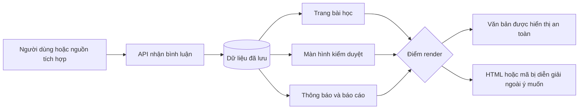

# Stored XSS

## 1. Từ dữ liệu được lưu đến mã chạy trong trình duyệt

Stored XSS, hay persistent cross-site scripting, xảy ra khi hệ thống lưu dữ liệu do một bên không đáng tin cậy kiểm soát, sau đó đưa dữ liệu đó vào một ngữ cảnh trình duyệt có thể diễn giải thành mã hoặc nội dung chủ động. Thời điểm nhập dữ liệu và thời điểm mã chạy có thể cách nhau nhiều giờ, nằm ở hai chức năng khác nhau và liên quan đến hai nhóm người dùng khác nhau.

Ví dụ, một học viên gửi bình luận vào khóa học. Bình luận được lưu trong cơ sở dữ liệu rồi xuất hiện trên trang bài học, trang thông báo và màn hình kiểm duyệt. Nếu một trong các màn hình ghép bình luận vào HTML mà không xử lý đúng ngữ cảnh, nội dung của học viên có thể chạy với quyền của trang khi người khác xem. Đặc biệt, người nhập bình luận không cần có quyền truy cập màn hình kiểm duyệt để tác động đến trình duyệt của người kiểm duyệt.

Trong thiết kế yêu cầu bảo mật, mục tiêu không dừng ở câu “ngăn Stored XSS”. Cần xác định rõ dữ liệu nào có thể bị kiểm soát, được lưu ở đâu, đi qua những đường hiển thị nào, và bằng chứng nào chứng minh dữ liệu vẫn là dữ liệu tại từng điểm hiển thị.

Sau bài này, người học có thể:

- Nhận diện đường đi từ nguồn nhập, nơi lưu trữ đến điểm diễn giải trong trình duyệt.
- Phân biệt output encoding, kiểm tra đầu vào, HTML sanitization và kiểm soát bổ sung.
- Chuyển rủi ro Stored XSS thành yêu cầu có phạm vi, chủ thể thực hiện và tiêu chí nghiệm thu.
- Thiết kế cách lưu và hiển thị cho văn bản thuần, nội dung định dạng, API và giao diện quản trị.
- Xác định bằng chứng kiểm thử, vận hành và phục hồi khi dữ liệu nguy hiểm đã tồn tại.

## 2. Cơ chế và ranh giới tin cậy

### 2.1. Bốn thành phần của một đường Stored XSS

Một đường tấn công thường có bốn thành phần:

1. **Nguồn có thể bị kiểm soát:** biểu mẫu bình luận, tên hiển thị, dữ liệu nhập từ tệp, phản hồi của hệ thống tích hợp hoặc metadata của tài liệu.
2. **Nơi lưu:** bảng dữ liệu, tài liệu tìm kiếm, hàng đợi, cache, bản nháp hoặc hệ thống sự kiện.
3. **Đường phân phối:** API, trình dựng template, dịch vụ thông báo, bộ xuất báo cáo hoặc tác vụ đồng bộ.
4. **Điểm diễn giải:** HTML do server dựng, thao tác DOM trên client, thuộc tính URL hoặc ngữ cảnh mã trong trình duyệt.

Không phải chỉ cơ sở dữ liệu quan hệ mới tạo ra Stored XSS. Dữ liệu được giữ trong chỉ mục tìm kiếm rồi hiển thị trên trang kết quả cũng có thể tạo cùng rủi ro. Điều kiện quan trọng là dữ liệu được giữ lại và sau đó vượt qua ranh giới từ dữ liệu sang nội dung có thể thực thi.



Sơ đồ là mô hình luồng dữ liệu, không có nghĩa ba màn hình phải dùng chung một hàm render. Mỗi đường ra cần được xác định và kiểm soát riêng.

### 2.2. “Đã lưu” không đồng nghĩa với “đáng tin”

Một lỗi thiết kế phổ biến là coi dữ liệu đọc từ cơ sở dữ liệu nội bộ đã được hệ thống xác nhận an toàn. Cơ sở dữ liệu chứng minh dữ liệu được lưu ở đâu, không chứng minh dữ liệu phù hợp với ngữ cảnh HTML, JavaScript hay URL.

Những thuộc tính sau cũng không đủ để bỏ qua xử lý đầu ra:

- Người nhập đã đăng nhập hoặc đã được phân quyền tạo nội dung.
- Bản ghi được tạo bởi quản trị viên hoặc được người kiểm duyệt chấp thuận.
- Dữ liệu đi qua API nội bộ hay hệ thống tích hợp có xác thực.
- Nội dung đã được kiểm tra độ dài và chuẩn hóa Unicode.
- Câu lệnh SQL đã được tham số hóa.

Các kiểm soát này giải quyết những vấn đề khác nhau. Tham số hóa SQL bảo vệ ranh giới câu lệnh SQL; nó không bảo vệ ranh giới HTML khi dữ liệu được đọc ra.

### 2.3. Stored, reflected và DOM-based là các góc nhìn khác nhau

| Cách nhìn | Điều được mô tả | Ví dụ |
| --- | --- | --- |
| Stored XSS | Dữ liệu được giữ lại trước khi tới nạn nhân | Bình luận lưu trong cơ sở dữ liệu rồi hiển thị cho giảng viên |
| Reflected XSS | Dữ liệu từ yêu cầu được phản hồi mà không cần lưu bền vững | Tham số tìm kiếm được ghép vào trang kết quả |
| DOM-based XSS | Cơ chế xử lý phía client đưa dữ liệu vào điểm diễn giải nguy hiểm | Client lấy nội dung từ API rồi gán vào `innerHTML` |

Một trường hợp có thể vừa là Stored XSS vừa là DOM-based XSS: dữ liệu được lưu trên server, trả qua API, rồi client đưa vào `innerHTML`. Không nên dùng nhãn phân loại để bỏ qua phần đường đi còn lại.

## 3. Tình huống của một nền tảng học tập

Giả sử nền tảng có chức năng bình luận bài học. Bình luận là văn bản thuần, tối đa 2.000 ký tự. Học viên chỉ được sửa bình luận của mình; giảng viên và kiểm duyệt viên có thể xem mọi bình luận thuộc phạm vi quản lý.

Một bản ghi có thể có dạng:

```json
{
  "id": "comment-1842",
  "lessonId": "lesson-27",
  "authorDisplayName": "Học viên A",
  "body": "Ví dụ trong bài giúp mình hiểu rõ hơn.",
  "contentType": "PLAIN_TEXT"
}
```

Tên hiển thị và nội dung bình luận đều có nguồn gốc từ người dùng. Chúng cần được xử lý đúng ngay cả khi `id`, `lessonId` và quyền truy cập bản ghi đã được kiểm tra chính xác.

### 3.1. Đường nguy hiểm phía client

Đoạn sau minh họa một cách render không phù hợp với yêu cầu văn bản thuần:

```javascript
// Minh họa lỗi: body được diễn giải như HTML.
const bodyElement = document.createElement("div");
bodyElement.innerHTML = comment.body;
document.querySelector("#comments").append(bodyElement);
```

Trong môi trường thử nghiệm cô lập, có thể dùng chuỗi đánh dấu không đánh cắp dữ liệu để quan sát sự diễn giải ngoài ý muốn:

```html

```

Nếu trình duyệt dựng chuỗi này thành phần tử có event handler và handler được phép chạy, biến đánh dấu sẽ thay đổi. Đây chỉ là một tín hiệu kiểm thử của một đường render; không phải bộ kiểm chứng đầy đủ cho mọi dạng XSS. Chính sách CSP có thể chặn handler trong khi việc diễn giải HTML ngoài ý muốn vẫn còn tồn tại.

### 3.2. Đường an toàn cho văn bản thuần

```javascript
const bodyElement = document.createElement("div");
bodyElement.className = "comment-body";
bodyElement.textContent = comment.body;
document.querySelector("#comments").append(bodyElement);
```

`textContent` đưa dữ liệu vào một text node. Dấu `<`, `>`, dấu nháy và các ký tự còn lại được hiển thị như văn bản tại vị trí đó, thay vì được dùng để tạo phần tử HTML từ nội dung bình luận.

Để giữ xuống dòng, có thể định nghĩa giao diện bằng CSS:

```css
.comment-body {
  white-space: pre-wrap;
  overflow-wrap: anywhere;
}
```

Không cần thay xuống dòng bằng chuỗi `<br>` rồi chuyển toàn bộ sang `innerHTML`. Quyết định trình bày có thể được thực hiện mà vẫn giữ dữ liệu trong text node.

### 3.3. Màn hình quản trị là một đường ra độc lập

Nếu trang bài học dùng `textContent` nhưng màn hình kiểm duyệt ghép cùng trường vào HTML thô, rủi ro vẫn tồn tại. Màn hình quản trị thường có quyền cao hơn và có khả năng truy cập dữ liệu rộng hơn, nên hậu quả có thể lớn hơn.

Stored XSS không bắt buộc phải đọc được cookie. Kể cả cookie phiên có `HttpOnly`, mã chạy trong origin của ứng dụng vẫn có thể thực hiện các thao tác mà giao diện và phiên hiện tại cho phép, tùy kiến trúc và các kiểm soát liên quan. Vì vậy, “cookie không đọc được” không phải tiêu chí chứng minh đã xử lý Stored XSS.

## 4. Chuyển mối đe dọa thành yêu cầu có thể kiểm chứng

### 4.1. Phát biểu yêu cầu cần nêu cả điều kiện và kết quả

Yêu cầu yếu:

> Hệ thống phải lọc XSS trong bình luận.

Câu này không cho biết bình luận có được phép chứa HTML hay không, “lọc” diễn ra ở đâu, bao phủ màn hình nào và thế nào là đạt.

Yêu cầu rõ hơn:

> Trường nội dung bình luận được định nghĩa là văn bản thuần. Mọi giao diện web hiển thị trường này phải đưa dữ liệu vào text node hoặc sử dụng cơ chế escape HTML của template trong ngữ cảnh văn bản. Dữ liệu không được chuyển thành HTML thô hoặc mã thực thi. Quy định áp dụng cho trang bài học, trang cá nhân, màn hình kiểm duyệt, thông báo web và báo cáo HTML.

Yêu cầu này liên kết được với mô hình dữ liệu, danh sách nơi sử dụng và bằng chứng kiểm thử.

### 4.2. Bộ yêu cầu minh họa

Các mã dưới đây là ví dụ để đặc tả một tính năng; không phải mã tiêu chuẩn áp dụng tự động cho mọi hệ thống.

| Mã | Yêu cầu bảo mật | Bằng chứng nghiệm thu dự kiến |
| --- | --- | --- |
| SXSS-01 | Mỗi trường nội dung do người dùng hoặc tích hợp cung cấp phải được phân loại là văn bản thuần, HTML được phép có giới hạn, URL hoặc kiểu dữ liệu xác định khác | Hợp đồng dữ liệu chỉ rõ loại và nguồn của trường |
| SXSS-02 | Mọi nơi hiển thị văn bản thuần phải dùng text node hoặc escape phù hợp với ngữ cảnh, kể cả màn hình quản trị | Danh mục đường render và kết quả kiểm thử trên từng đường |
| SXSS-03 | Không đưa dữ liệu bình luận vào tên thẻ, tên thuộc tính, event handler, mã JavaScript, mã CSS hoặc template có thể thực thi | Rà soát thiết kế và điểm sử dụng chứng minh các vị trí này không nhận dữ liệu bình luận |
| SXSS-04 | Liên kết do người dùng nhập chỉ được chấp nhận theo chính sách scheme, đích đến và mục đích; khi dựng HTML phải xử lý thuộc tính đúng ngữ cảnh | Các trường hợp scheme hợp lệ và không hợp lệ được kiểm tra |
| SXSS-05 | Nội dung HTML được phép phải đi qua sanitizer theo allowlist đã phê duyệt trước khi được render dưới dạng HTML | Chính sách sanitizer, cấu hình phiên bản và ca kiểm thử chính sách |
| SXSS-06 | Bản ghi cũ, dữ liệu nhập hàng loạt và dữ liệu đồng bộ phải chịu cùng chính sách render như dữ liệu tạo mới | Kiểm thử qua các nguồn này và qua các giao diện tiêu thụ tương ứng |
| SXSS-07 | Cache và kết quả biến đổi không được làm mất bảo đảm của cơ chế encoding hoặc sanitization | Thiết kế key, phiên bản chính sách và cơ chế vô hiệu hóa cache |
| SXSS-08 | Khi phát hiện nội dung Stored XSS, đội vận hành phải có khả năng cô lập bản ghi, vô hiệu hóa bản sao hiển thị và xác định phạm vi phơi nhiễm | Quy trình ứng phó và diễn tập trên dữ liệu thử nghiệm |

“Mọi nơi hiển thị” cần được chuyển thành một tập hữu hạn có người chịu trách nhiệm, không để thành lời cam kết chung. Khi bổ sung màn hình mới, danh mục đó phải được cập nhật trong cùng thay đổi thiết kế.

### 4.3. Liên kết yêu cầu với rủi ro và chủ sở hữu

Ví dụ một chuỗi truy vết:

```text
Tài sản: quyền thao tác của kiểm duyệt viên
    ↓
Mối đe dọa: bình luận được lưu rồi chạy mã trên màn hình kiểm duyệt
    ↓
Yêu cầu: SXSS-02 + SXSS-03
    ↓
Quyết định thiết kế: trường body là PLAIN_TEXT; render bằng text node
    ↓
Bằng chứng: kiểm thử lưu → mở trang kiểm duyệt → quan sát text/DOM
    ↓
Chủ sở hữu: nhóm giao diện quản trị; phối hợp nhóm API về hợp đồng dữ liệu
```

Kiểm soát đầu ra thuộc về nơi biết ngữ cảnh render. Nhóm API vẫn phải công bố loại dữ liệu và giữ hợp đồng nhất quán, nhưng không thể bảo đảm mọi client an toàn chỉ bằng cách “escape một lần” trong JSON.

## 5. Lưu dữ liệu và xử lý ở đầu ra

### 5.1. Lưu giá trị theo mô hình dữ liệu, không lưu một bản escape dùng cho mọi nơi

Đối với văn bản thuần, nên giữ giá trị nghiệp vụ sau các kiểm tra cần thiết, chẳng hạn kiểu, độ dài và quy tắc ký tự của chức năng. Mỗi đường ra áp dụng xử lý phù hợp tại điểm sử dụng.

Ví dụ, chuỗi `A < B & C` có thể cần:

- Hiển thị như đúng chuỗi đó trong một text node.
- Được escape khi server đưa vào HTML text.
- Được bộ tuần tự hóa JSON biểu diễn trong phản hồi API.
- Được xử lý theo quy tắc của định dạng khác khi xuất ra một sản phẩm khác.

Nếu lưu sẵn `A &lt; B &amp; C` rồi một template tiếp tục escape, người dùng có thể thấy `&lt;` và `&amp;` thay vì ký tự gốc. Tệ hơn, nhóm khác có thể thêm bước “giải mã cho dễ đọc” trước khi gọi `innerHTML`, tạo đường diễn giải nguy hiểm mới.

Output encoding không phải thao tác khử độc vĩnh viễn. Kết quả đã encode chỉ có ý nghĩa trong ngữ cảnh mà encoder được thiết kế để phục vụ.

### 5.2. Phân biệt các loại kiểm soát

| Kiểm soát | Mục đích chính | Giới hạn đối với Stored XSS |
| --- | --- | --- |
| Kiểm tra đầu vào | Xác nhận dữ liệu phù hợp hợp đồng nghiệp vụ | Không thay thế xử lý đầu ra của một trường văn bản tự do |
| Output encoding | Biểu diễn dữ liệu để parser không coi nó là cấu trúc hay mã trong ngữ cảnh cụ thể | Phải chọn đúng ngữ cảnh; không biến vị trí nguy hiểm thành vị trí an toàn phổ quát |
| HTML sanitization | Loại bỏ hoặc biến đổi HTML ngoài chính sách khi tính năng cho phép HTML | Cần chính sách, thư viện phù hợp và duy trì; kết quả có thể mất an toàn nếu bị biến đổi sai sau đó |
| Phân quyền | Giới hạn ai được tạo, sửa, đọc dữ liệu và thao tác gì | Người có quyền nhập nội dung vẫn có thể gửi dữ liệu nguy hiểm |
| CSP | Giới hạn những cách trình duyệt được phép nạp hoặc thực thi nội dung theo chính sách | Là lớp bổ sung, không sửa lỗi render và không thay thế encoding/sanitization |
| Cookie `HttpOnly` | Hạn chế JavaScript đọc trực tiếp cookie | Không ngăn toàn bộ thao tác mà mã trong trang có thể thực hiện với phiên hiện tại |

Với một số trường có cấu trúc rất hẹp, allowlist đầu vào có thể loại bỏ nhiều khả năng biểu diễn nguy hiểm. Tuy nhiên, yêu cầu render đúng ngữ cảnh vẫn cần tồn tại để tránh phụ thuộc vào giả định mong manh về mọi nguồn dữ liệu hiện tại và tương lai.

## 6. Chọn kiểm soát theo ngữ cảnh đầu ra

### 6.1. Không có một hàm escape dùng đúng cho mọi vị trí

| Vị trí sử dụng | Hướng thiết kế phù hợp | Điều cần tránh |
| --- | --- | --- |
| Văn bản bên trong phần tử HTML | Escape HTML text ở server hoặc tạo text node ở client | Ghép trực tiếp dữ liệu vào HTML thô |
| Giá trị thuộc tính HTML thông thường | Tên thuộc tính cố định, đặt giá trị trong dấu nháy và encode cho thuộc tính khi dựng chuỗi HTML | Cho dữ liệu điều khiển tên thuộc tính hoặc bỏ dấu nháy |
| Địa chỉ liên kết | Kiểm tra chính sách URL và xử lý thuộc tính khi dựng HTML | Cho rằng escape dấu nháy đã làm mọi scheme URL trở nên an toàn |
| Nội dung JavaScript | Thiết kế để dữ liệu đi qua kênh dữ liệu và API an toàn thay vì ghép mã | Đưa dữ liệu vào event handler, `eval` hoặc chuỗi mã |
| Nội dung CSS | Hạn chế bằng các giá trị có cấu trúc hoặc lựa chọn cố định | Cho trường bình luận tự do điều khiển chuỗi CSS |
| HTML định dạng được cho phép | Sanitizer theo allowlist và điểm render được kiểm soát | Dùng encoder văn bản rồi giải mã lại để “khôi phục HTML” |

Các thuộc tính như `onclick` chứa mã; chúng không thuộc nhóm thuộc tính văn bản thông thường. Tương tự, giá trị trong `href` và `src` có ngữ nghĩa URL. Việc dùng một API DOM thay vì nối chuỗi giảm một số rủi ro cú pháp nhưng không tự bảo đảm ý nghĩa an toàn cho mọi loại thuộc tính.

### 6.2. Server-side template

Với một template engine có cơ chế escape mặc định trong ngữ cảnh HTML text, trường bình luận thuần văn bản nên dùng chế độ đó. Chế độ xuất HTML thô chỉ dành cho một hợp đồng dữ liệu khác, có sanitizer và điểm sử dụng được kiểm soát.

Mã giả dưới đây thể hiện sự khác nhau về hợp đồng, không phải API của một thư viện cụ thể:

```text
renderText(comment.body)           // body là văn bản thuần
renderSanitizedHtml(approvedHtml)  // HTML đã qua chính sách xác định
```

Không nên thiết kế một helper chung tên `renderSafe(value)` nhưng bên trong tự đoán kiểu từ việc chuỗi có chứa `<` hay không. Kiểu nội dung phải đến từ hợp đồng chức năng, không từ suy đoán cú pháp của giá trị hiện tại.

Nếu dùng template escape ở server, cần xác định chính xác ngữ cảnh mà template bảo vệ. Khả năng escape HTML text không có nghĩa cùng biểu thức đó an toàn khi đặt vào một khối JavaScript, CSS hoặc một URL có ý nghĩa đặc biệt.

### 6.3. API JSON và client

Một API có thể trả bình luận bằng JSON với `Content-Type` phù hợp và dùng bộ tuần tự hóa chuẩn. Điều này bảo đảm cấu trúc JSON được tạo đúng, nhưng giá trị trong JSON vẫn là dữ liệu không đáng tin cậy đối với các bước sử dụng tiếp theo.

Ví dụ:

```javascript
const response = await fetch("/api/comments/comment-1842", {
  headers: { "Accept": "application/json" }
});

if (!response.ok) {
  throw new Error("Không lấy được bình luận");
}

const comment = await response.json();
document.querySelector("#comment-body").textContent = comment.body;
```

Đoạn này minh họa việc phân tích JSON rồi hiển thị một trường như văn bản. Nó không bao gồm đầy đủ xử lý lỗi, xác thực, phân quyền hay vòng đời giao diện của một ứng dụng hoàn chỉnh.

Một yêu cầu kiến trúc hữu ích là: API công bố `body` là văn bản thuần; mọi client web phải giữ ngữ nghĩa đó. Không gọi `innerHTML` chỉ vì dữ liệu “đã đi qua backend”.

### 6.4. Liên kết do người dùng cung cấp

Giả sử bình luận có thêm liên kết tài liệu. Trường liên kết cần chính sách riêng, chẳng hạn chỉ chấp nhận URL tuyệt đối với scheme `https:` và chỉ dùng cho điều hướng do người dùng chủ động thực hiện. Nếu chức năng chỉ cho liên kết đến một số miền, cần thêm quy tắc kiểm tra host đã được phân tích; không dùng kiểm tra tiền tố chuỗi để thay việc phân tích URL.

Mã minh họa phía client:

```javascript
function parseReferenceUrl(rawValue) {
  let parsed;
  try {
    parsed = new URL(rawValue);
  } catch {
    return null;
  }

  if (parsed.protocol !== "https:") {
    return null;
  }

  if (parsed.username !== "" || parsed.password !== "") {
    return null;
  }

  return parsed;
}

const parsed = parseReferenceUrl(comment.referenceUrl);

if (parsed !== null) {
  const link = document.createElement("a");
  link.href = parsed.href;
  link.textContent = "Tài liệu tham khảo";
  document.querySelector("#reference").append(link);
}
```

Ví dụ chỉ thể hiện chính sách scheme và thông tin xác thực trong URL. Nó không chứng minh website đích đáng tin cậy hay đáp ứng chính sách chống lừa đảo. Phía server cũng phải thực thi hợp đồng dữ liệu cần thiết; kiểm tra phía client chỉ bảo vệ đường sử dụng đang được minh họa.

Nếu dựng liên kết bằng chuỗi HTML ở server, ngoài chính sách URL còn cần encode cho giá trị thuộc tính được đặt trong dấu nháy. URL encoding một thành phần query cũng không thay thế HTML attribute encoding của toàn bộ giá trị khi đưa vào HTML.

### 6.5. Tránh ngữ cảnh lồng nhau

Ví dụ một template ghép bình luận vào chuỗi JavaScript, rồi JavaScript ghép chuỗi đó vào HTML, tạo ít nhất hai lớp parser. Chọn một encoder duy nhất không giải quyết được toàn bộ đường đi này.

Thiết kế dễ kiểm chứng hơn là:

1. Server trả dữ liệu qua API JSON riêng.
2. Client phân tích JSON bằng cơ chế của nền tảng.
3. Client đưa trường văn bản vào `textContent`.
4. Mọi điểm tạo HTML có chủ đích nằm trong một API render riêng, có chính sách được xác định.

Việc nhúng JSON vào một phần tử trong tài liệu HTML cũng cần chú ý ranh giới parser HTML; “JSON hợp lệ” không tự chứng minh cách nhúng đó an toàn. Khi không cần nhúng, kênh JSON riêng giúp giảm sự phức tạp của yêu cầu và kiểm thử.

## 7. Khi chức năng thật sự cần nội dung định dạng

### 7.1. Định nghĩa tập khả năng trước khi chọn sanitizer

Một bài thảo luận có thể cần chữ đậm, danh sách và liên kết. Yêu cầu nên liệt kê chính xác khả năng đó, thay vì cho phép “HTML an toàn” mà không định nghĩa.

Ví dụ chính sách chức năng:

- Cho phép đoạn văn, xuống dòng, chữ đậm, chữ nghiêng và danh sách.
- Cho phép liên kết theo chính sách URL của hệ thống.
- Không cho phép script, thuộc tính sự kiện, style tùy ý, form hoặc frame.
- Không nhận SVG, MathML và các namespace khác trong tính năng đơn giản này.
- Không cho người nhập điều khiển các thuộc tính ảnh hưởng đến định danh DOM nếu chức năng không cần chúng.

Đây là lựa chọn cho một tính năng cụ thể. Một sản phẩm có nhu cầu rộng hơn phải đánh giá và đặc tả riêng; không mở rộng allowlist chỉ vì một editor phát sinh thêm markup.

### 7.2. Chuỗi xử lý nội dung

```text
Nội dung người dùng hoặc bản nhập
    → kiểm tra hợp đồng và giới hạn tài nguyên
    → phân tích định dạng đầu vào nếu có
    → chuyển sang HTML nếu tính năng dùng Markdown
    → sanitizer theo chính sách HTML đích
    → lưu hoặc tạo bản render đã gắn phiên bản chính sách
    → điểm render HTML đã được kiểm soát
```

Nếu dùng Markdown, cần quyết định có cho HTML nhúng hay không. Tắt HTML nhúng không có nghĩa bỏ qua chính sách liên kết và mọi bước chuyển đổi khác. Đầu ra HTML sau các phép biến đổi vẫn phải đáp ứng hợp đồng an toàn của tính năng.

Một thư viện sanitizer chuyên dụng cần được dùng đúng theo thiết kế và chính sách đã chọn. Regex thay thế một vài thẻ hoặc xóa chuỗi `script` không phải cơ chế phân tích và giới hạn HTML đáng tin cậy.

### 7.3. Giá trị đã sanitize không phải giá trị an toàn ở mọi nơi

Kết quả sanitize để dùng làm HTML fragment không được tự động đem chèn vào JavaScript, CSS, URL hay giá trị thuộc tính HTML. Nếu di chuyển sang ngữ cảnh khác, cần một hợp đồng khác.

Ngoài ra, những thao tác sau sanitizer có thể phá vỡ bảo đảm ban đầu:

- Ghép thêm HTML từ một trường chưa được xử lý.
- Chạy thao tác thay thế chuỗi để khôi phục thẻ hoặc thuộc tính đã loại bỏ.
- Đưa fragment qua một thư viện biến đổi DOM có hành vi chưa nằm trong mô hình.
- Giải mã thực thể rồi phân tích lại như HTML.

Yêu cầu nên chỉ rõ điểm mà sanitizer được áp dụng so với các phép biến đổi và điểm render cuối cùng. Không chỉ kiểm tra rằng trong mã nguồn “có gọi sanitizer”.

### 7.4. Phiên bản chính sách và dữ liệu cũ

Nếu lưu bản HTML đã sanitize, cần biết bản đó được tạo theo chính sách nào. Khi thay đổi chính sách hoặc khắc phục lỗi của cơ chế xử lý, phải có cách tạo lại hoặc vô hiệu hóa bản cũ.

Một mô hình khái niệm có thể gồm:

```text
sourceContent
sourceFormat
renderedHtml
renderPolicyVersion
renderedAt
```

Đây là gợi ý mô hình hóa, không bắt buộc lưu đủ năm trường trong mọi ứng dụng. Nếu lưu nguồn gốc chưa sanitize để hỗ trợ chỉnh sửa hoặc tạo lại, nguồn đó phải bị giới hạn truy cập và tuyệt đối không được coi là một đường render dự phòng.

Khi sanitizer lỗi, hệ thống cần hành vi suy giảm rõ ràng: từ chối cập nhật, không hiển thị rich text hoặc hiển thị như văn bản thuần theo quyết định sản phẩm. Không tự động chuyển sang xuất HTML thô để giữ chức năng hoạt động.

## 8. Những đường lan truyền thường bị bỏ sót

### 8.1. Search, preview và trích đoạn

Kết quả tìm kiếm thường tô đậm từ khóa bằng markup. Nếu backend trả một chuỗi ghép nội dung gốc với thẻ đánh dấu rồi client đưa thẳng vào HTML, phần nội dung gốc có thể đi qua đường nguy hiểm.

Một thiết kế dễ kiểm soát là trả nội dung cùng vị trí cần đánh dấu, sau đó client tạo text node và phần tử đánh dấu bằng DOM. Nếu dịch vụ tìm kiếm trả HTML fragment, phải có hợp đồng rõ ràng về nguồn, các thẻ được cho phép và cơ chế xử lý trước khi render.

Tương tự, tooltip, hộp xem trước, toast và thông báo không nên mặc nhiên có ngoại lệ vì chỉ hiển thị ít ký tự. Cắt ngắn chuỗi không phải cơ chế chống XSS; việc cắt còn có thể làm thay đổi cách parser hiểu cấu trúc khi dữ liệu bị ghép sai.

### 8.2. Báo cáo và bản xuất

Một bình luận có thể xuất hiện trong báo cáo HTML dành cho giảng viên. Nếu báo cáo dùng template khác, đường đó vẫn phải xử lý văn bản thuần đúng ngữ cảnh.

Nếu hệ thống dùng HTML trung gian để tạo một định dạng xuất khác, cần đánh giá công cụ render và quyền tài nguyên của nó. Các rủi ro phía công cụ xuất có thể khác với XSS trong trình duyệt; không dùng kết quả kiểm thử giao diện web để kết luận toàn bộ chuỗi xuất đã an toàn.

### 8.3. Nhật ký và trang xem nhật ký

Log có thể chứa tên người dùng, tiêu đề hoặc một phần bình luận. Trang web xem log cũng là một consumer của dữ liệu đó. Cần escape theo ngữ cảnh hiển thị, đồng thời giới hạn dữ liệu nhạy cảm và kích thước bản ghi.

Một dashboard bảo mật không được tin cậy chuỗi chỉ vì chuỗi được dịch vụ logging ghi lại. Dữ liệu nguy hiểm có thể được giữ trong log rồi trở thành Stored XSS đối với người trực vận hành.

### 8.4. Cache và dữ liệu lịch sử

Sửa một component chưa chắc loại bỏ ngay bản HTML đã tạo trước đó trong cache, thông báo đã lưu hoặc snapshot báo cáo. Thiết kế khắc phục cần liệt kê những bản sao có thể tiếp tục phân phối nội dung.

Dữ liệu cũ cũng cần đi qua cơ chế render mới. Chỉ áp dụng kiểm tra cho bản ghi tạo từ ngày triển khai có thể để lại cùng lỗ hổng trên những bình luận trước đó.

## 9. Tiêu chí nghiệm thu và bằng chứng

Phần này mô tả bằng chứng mà yêu cầu nên đòi hỏi trong vòng đời phát triển. Việc có danh sách này trong đặc tả không thay thế thực thi kiểm thử trên hệ thống.

### 9.1. Kiểm tra toàn bộ đường lưu rồi đọc

Một ca nghiệm thu cho bình luận văn bản thuần cần bao gồm ít nhất:

1. Tạo dữ liệu bằng tài khoản được phép nhập bình luận.
2. Xác nhận dữ liệu đi qua đường lưu thật của tính năng trong môi trường kiểm thử.
3. Đóng ngữ cảnh nhập và đọc lại bằng phiên khác hoặc tài khoản có vai trò xem phù hợp.
4. Mở từng nơi hiển thị nằm trong phạm vi yêu cầu.
5. Xác nhận nội dung được giữ như văn bản, không tạo phần tử hay handler do nội dung điều khiển.
6. Kiểm tra các đường đọc lại sau sửa, nhập hàng loạt hoặc khôi phục cache nếu tính năng có những đường đó.

Chỉ dán chuỗi vào một trang demo không đi qua hệ thống lưu trữ chưa chứng minh yêu cầu Stored XSS của tính năng đã được đáp ứng.

### 9.2. Ma trận trường hợp minh họa

| Trường hợp | Dữ liệu hoặc thao tác | Kết quả mong đợi |
| --- | --- | --- |
| Ký tự cú pháp | Văn bản có `<`, `>`, `&`, dấu nháy đơn và kép | Hiển thị nguyên nghĩa văn bản tại đúng vị trí |
| HTML trong trường thuần văn bản | Chuỗi có thẻ định dạng | Hiển thị chữ của chuỗi; không tạo thẻ từ trường đó |
| Probe có handler | Chuỗi đánh dấu trong môi trường cô lập | Không tạo handler từ dữ liệu, không làm thay đổi dấu đánh dấu do thực thi |
| Đọc bằng vai trò khác | Học viên tạo, kiểm duyệt viên mở | Giữ cùng hợp đồng văn bản thuần trên màn hình quản trị |
| Dữ liệu qua API | API trả chuỗi có cú pháp HTML | JSON được phân tích như dữ liệu; client render bằng cơ chế phù hợp |
| Bản ghi cũ | Hiển thị nội dung được tạo trước thay đổi | Đi qua cùng chính sách render hiện hành |
| Rich text | Nội dung có thẻ được phép và thành phần ngoài allowlist | Giữ định dạng được phép, loại bỏ hoặc từ chối thành phần ngoài chính sách theo đặc tả |
| URL ngoài chính sách | Scheme không được cho phép | Không tạo liên kết hoạt động trái với chính sách |
| Nhiều lần tải | Lưu, đọc, sửa và đọc lại chuỗi có thực thể HTML | Không sinh double encoding hoặc chuỗi decode rồi thực thi |
| Sanitizer không sẵn sàng | Lỗi xử lý rich text trong môi trường kiểm thử | Thực hiện đúng hành vi suy giảm đã đặc tả |

Đối với rich text, kết quả mong đợi cần kiểm tra cấu trúc đầu ra theo allowlist, không chỉ kiểm tra chuỗi đã mất một từ khóa. Đối với văn bản thuần, cần kiểm tra cả cách hiển thị và DOM để phát hiện trường hợp đã tạo HTML nhưng mã tạm thời bị một kiểm soát khác chặn.

### 9.3. Những bằng chứng không đủ

- Một request lưu bình luận trả mã thành công chỉ chứng minh thao tác lưu được xử lý.
- Không xuất hiện hộp thoại không chứng minh mọi dạng XSS đã bị loại bỏ.
- CSP chặn một handler không chứng minh điểm render đã dùng đúng ngữ cảnh.
- Một unit test của encoder không chứng minh mọi màn hình đều gọi encoder.
- Kiểm thử bằng tài khoản học viên không thay thế kiểm thử đường hiển thị của quản trị viên.
- Một kết quả quét tự động không thay thế danh mục đầy đủ các nguồn lưu và consumer.

Kết quả nghiệm thu nên ghi phiên bản ứng dụng, chính sách render, đường đi dữ liệu, vai trò sử dụng và các giới hạn phạm vi. Nhờ đó, khi thêm một consumer mới có thể biết phần bằng chứng nào cần bổ sung.

## 10. Các sai lầm thiết kế cần nhận diện

### 10.1. Chỉ chặn thẻ script

HTML có nhiều dạng nội dung chủ động và nhiều vị trí có ngữ nghĩa đặc biệt. Chỉ xóa một tên thẻ hoặc một từ khóa không tạo được chính sách an toàn. Với văn bản thuần, chọn điểm render văn bản; với HTML, dùng cơ chế phân tích và allowlist phù hợp.

### 10.2. Escape toàn bộ ở API

API có thể được dùng bởi nhiều client với các ngữ cảnh khác nhau. Lưu hoặc trả một bản HTML-escaped chung làm mơ hồ hợp đồng dữ liệu và có thể sinh double encoding. Trách nhiệm xử lý đầu ra cần gắn với consumer biết ngữ cảnh; API công bố rõ kiểu và nguồn của dữ liệu.

### 10.3. Dùng quyền kiểm duyệt thay cho chính sách render

Kiểm duyệt nội dung là một quy trình nghiệp vụ. Người kiểm duyệt có thể bỏ sót chuỗi nguy hiểm, tài khoản có thể bị chiếm quyền, hoặc dữ liệu có thể đến từ nguồn nhập khác. Việc chấp thuận không biến chuỗi văn bản thành mã được tin cậy.

### 10.4. Coi editor là ranh giới bảo mật

Một trình soạn thảo chỉ tạo HTML giới hạn trên giao diện không có nghĩa request gửi tới server cũng giới hạn như vậy. Server phải thực thi hợp đồng và chính sách xử lý, vì người gửi có thể tạo request bằng công cụ khác.

### 10.5. Bật CSP rồi bỏ qua lỗi gốc

CSP có thể giảm khả năng khai thác theo chính sách và khả năng hỗ trợ của môi trường. Tuy nhiên, nội dung HTML ngoài ý muốn vẫn có thể gây tác động khác, và chính sách có thể thay đổi. Yêu cầu gốc vẫn là dữ liệu không được đi vào điểm diễn giải ngoài hợp đồng đã định nghĩa.

### 10.6. Sửa trang chính nhưng bỏ màn hình phụ

Một trường được dùng bởi nhiều giao diện cần một danh mục consumer có thể duy trì. Chỉ tìm ở trang nhiều người xem nhất thường bỏ sót nơi có quyền cao hơn như kiểm duyệt, hỗ trợ hoặc vận hành.

## 11. Vận hành và phục hồi khi đã có dữ liệu nguy hiểm

Stored XSS có đặc điểm là sửa mã chưa chắc loại bỏ dữ liệu hoặc bản render đã tồn tại. Yêu cầu ứng phó cần bao phủ cả đường gây lỗi lẫn các bản sao nội dung.

Một quy trình có thể gồm:

1. Xác định trường dữ liệu, đường render và phiên bản ứng dụng bị ảnh hưởng.
2. Cô lập bản ghi hoặc tạm thời vô hiệu hóa chức năng render liên quan bằng cơ chế đã chuẩn bị.
3. Khắc phục điểm diễn giải và xác nhận hợp đồng dữ liệu đúng với mục đích chức năng.
4. Vô hiệu hóa cache, fragment, thông báo hoặc bản xuất vẫn có thể phân phối nội dung nguy hiểm.
5. Đánh giá phạm vi người đã xem, dữ liệu có thể bị tác động và các thao tác đáng ngờ.
6. Thực hiện xử lý phiên, thông báo và phục hồi theo bằng chứng và quy trình sự cố của tổ chức.
7. Bổ sung đường đi còn thiếu vào danh mục consumer và bằng chứng hồi quy.

Không mặc định xóa mọi nội dung nghi ngờ trước khi bảo toàn bằng chứng cần thiết. Bản sao phục vụ điều tra phải được quản lý như dữ liệu không đáng tin cậy, hạn chế truy cập và hiển thị bằng cơ chế an toàn.

Các chỉ số vận hành hữu ích có thể là số đường render đã được kiểm kê, số đường đã có bằng chứng nghiệm thu, số bản render còn dùng chính sách cũ và thời gian vô hiệu hóa bản sao bị ảnh hưởng. Những chỉ số này chỉ có ý nghĩa khi mẫu số và phạm vi được định nghĩa rõ.

## 12. Mẫu đặc tả ngắn cho bình luận văn bản thuần

```text
Yêu cầu: SEC-COMMENT-STORED-XSS

Mục tiêu:
Ngăn nội dung bình luận do người dùng kiểm soát được diễn giải thành
HTML chủ động hoặc mã trong các giao diện web của nền tảng.

Phạm vi dữ liệu:
body và authorDisplayName, kể cả dữ liệu tạo mới, bản nhập và bản ghi cũ.

Phạm vi hiển thị:
Trang bài học, trang cá nhân, màn hình kiểm duyệt, thông báo web
và báo cáo HTML có sử dụng các trường trên.

Hợp đồng:
Các trường trên là văn bản thuần.
Giới hạn kiểu và độ dài được thực thi theo hợp đồng nghiệp vụ.
Việc lưu trữ không làm thay đổi mức tin cậy của nội dung.

Thiết kế bắt buộc:
Server render bằng cơ chế escape phù hợp với HTML text, hoặc client
đưa dữ liệu vào text node. Không đưa dữ liệu vào HTML thô, handler,
chuỗi mã hoặc vị trí cấu trúc của template.

Bằng chứng nghiệm thu:
Lưu rồi đọc lại bằng vai trò khác trên từng đường hiển thị.
Kiểm tra văn bản và DOM với ký tự cú pháp, chuỗi có thẻ và probe kiểm thử.
Xác nhận không xuất hiện phần tử hay hành vi chủ động từ các trường đó.

Hành vi khi lỗi:
Không chuyển sang render HTML thô. Thực hiện hành vi suy giảm đã
định nghĩa và ghi sự kiện vận hành theo chính sách dữ liệu.

Chủ sở hữu:
Nhóm API quản lý hợp đồng trường; từng nhóm giao diện chịu trách nhiệm
cho điểm render của mình; nhóm vận hành quản lý khả năng cô lập nội dung.
```

Mẫu này biến một mục tiêu an toàn thông tin thành các nghĩa vụ cụ thể đối với dữ liệu, kiến trúc, giao diện và vận hành. Điểm quyết định của Stored XSS là ranh giới diễn giải ở mỗi đường ra: dữ liệu được lưu không được tự động trở thành nội dung được tin cậy khi một người khác mở nó.
