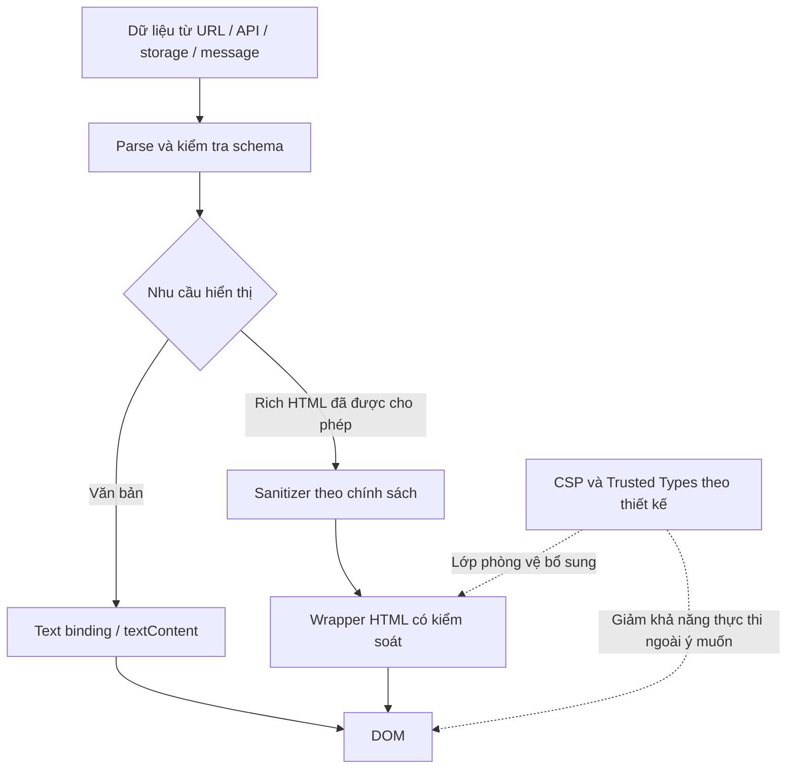

# DOM-based XSS

## 1. DOM-based XSS là gì?

DOM-based Cross-Site Scripting là tình huống mã JavaScript phía trình duyệt đưa dữ liệu không tin cậy vào một điểm sử dụng có khả năng diễn giải dữ liệu đó thành HTML hoặc mã thực thi. Khi ranh giới giữa dữ liệu và mã bị phá vỡ, nội dung do bên khác kiểm soát có thể chạy trong ngữ cảnh trang của ứng dụng.

Một trang có thể nhận HTML ban đầu từ server hoàn toàn bình thường nhưng phát sinh lỗi khi JavaScript xử lý URL, dữ liệu lưu trong trình duyệt hoặc thông điệp từ cửa sổ khác. Vì vậy, chỉ kiểm tra HTML response từ server không đủ để đánh giá DOM-based XSS.

Trong thiết kế yêu cầu bảo mật, câu hỏi chính là:

> Dữ liệu nào có thể bị kiểm soát từ ngoài thành phần, nó đi qua những phép biến đổi nào, và tại điểm nào trình duyệt được phép diễn giải nó thành nội dung có khả năng thực thi?

Bài học này tập trung vào việc chuyển câu trả lời thành yêu cầu cụ thể cho giao diện web: phân loại source và sink, chọn API phù hợp, kiểm soát các ngoại lệ cần rich HTML, đồng thời xác định bằng chứng chấp nhận.

### 1.1. Tác động xuất phát từ quyền của trang

Khi JavaScript ngoài ý muốn chạy trong origin của ứng dụng, nó có thể thao tác DOM, đọc dữ liệu mà script trong trang được quyền đọc và gửi request trong ngữ cảnh phiên người dùng.

Cookie có thuộc tính HttpOnly không thể bị đọc trực tiếp bằng JavaScript. Tuy nhiên, thuộc tính này không ngăn script độc hại thực hiện hành động từ trang đang có phiên đăng nhập hoặc đọc dữ liệu hiển thị trong giao diện. Vì vậy, không thể dùng việc “cookie đã HttpOnly” để kết luận XSS không còn tác động.

Phạm vi tác động cụ thể phụ thuộc chức năng, quyền người dùng, chính sách trình duyệt và những cơ chế bảo vệ khác. Yêu cầu cần gắn với tài sản thực tế, chẳng hạn tính toàn vẹn của màn hình thanh toán, dữ liệu cá nhân trong dashboard hoặc thao tác quản trị.

### 1.2. DOM-based không đồng nghĩa với chỉ phản chiếu từ URL

Hai cách phân loại thường bị trộn lẫn:

| Câu hỏi phân loại | Một số khả năng |
|---|---|
| Dữ liệu đến từ đâu và có được lưu lại không? | Phản chiếu từ request, lưu trong hệ thống, lưu ở client |
| Thành phần nào đưa dữ liệu vào ngữ cảnh nguy hiểm? | Rendering phía server, JavaScript thao tác DOM phía client |

Một bình luận được lưu trong cơ sở dữ liệu có thể đến trình duyệt qua JSON rồi bị đưa vào innerHTML. Trường hợp đó có nguồn dữ liệu được lưu và điểm chèn phía DOM.

Ngược lại, dữ liệu fragment trong URL có thể được JavaScript xử lý hoàn toàn tại client; fragment không tự được gửi trong HTTP request. Server có thể không nhìn thấy dữ liệu gây lỗi trong request thông thường.

Do đó, không nên đặt yêu cầu rằng DOM-based XSS “chỉ cần kiểm tra tham số query” hoặc “chỉ xảy ra với dữ liệu chưa lưu”.

## 2. Mô hình source → biến đổi → sink

### 2.1. Source: nơi dữ liệu không tin cậy đi vào

Source là điểm mã phía client nhận dữ liệu có thể chịu ảnh hưởng từ bên ngoài ranh giới tin cậy của thành phần.

Ví dụ:

| Source | Vì sao cần xem xét |
|---|---|
| Query và fragment của URL | Có thể được người khác tạo thành liên kết |
| Nội dung biểu mẫu | Người dùng nhập; có thể được chia sẻ hoặc lưu lại |
| Response API | Có thể chứa dữ liệu do người dùng khác tạo |
| localStorage, sessionStorage, IndexedDB | Là nơi lưu dữ liệu, không tự bảo đảm dữ liệu đáng tin |
| Thông điệp postMessage | Có thể đến từ cửa sổ hoặc frame khác |
| document.referrer | Phụ thuộc trang điều hướng đến và chính sách referrer |
| Giá trị từ thuộc tính DOM hoặc data-* | Mức tin cậy phụ thuộc nguồn đã tạo thuộc tính |
| Dữ liệu thư viện, widget hoặc script tích hợp trả về | Có ranh giới tin cậy giữa ứng dụng và thành phần ngoài |

Không phải mọi giá trị đọc từ các API trên đều là dữ liệu nguy hiểm. Điều cần làm là xác định khả năng kiểm soát và ngữ cảnh sử dụng, thay vì coi tên API như một kết luận tự động.

Một response JSON từ API nội bộ vẫn có thể chứa tên hiển thị, mô tả hoặc bình luận do người dùng khác nhập. “Đến từ server của mình” không đồng nghĩa “được phép diễn giải thành HTML”.

### 2.2. Phép biến đổi không tự tạo độ tin cậy

Dữ liệu có thể đi qua:

- Parse query bằng URLSearchParams.
- Giải mã JSON.
- Percent-decoding.
- Ghép chuỗi hoặc template literal.
- Chuyển chữ hoa, chữ thường hoặc cắt độ dài.
- Ghi vào state của component.
- Lưu rồi đọc lại từ bộ nhớ trình duyệt.

Những bước này có thể thay đổi biểu diễn nhưng không tự làm dữ liệu an toàn cho HTML hoặc JavaScript.

Chẳng hạn, JSON.parse xác nhận một chuỗi có cấu trúc JSON hợp lệ và tạo giá trị JavaScript tương ứng. Nó không có nhiệm vụ loại bỏ HTML nguy hiểm trong một trường string. Tương tự, dữ liệu đã qua URL decoding vẫn cần được sử dụng bằng API phù hợp với ngữ cảnh đích.

### 2.3. Sink: nơi dữ liệu được diễn giải

Sink là điểm dữ liệu được đưa vào một cơ chế diễn giải có ý nghĩa bảo mật.

Một số nhóm cần chú ý:

| Nhóm sink | Ví dụ | Nguy cơ cần kiểm soát |
|---|---|---|
| Phân tích HTML | innerHTML, outerHTML, insertAdjacentHTML | Dữ liệu bị biến thành cấu trúc DOM |
| Ghi tài liệu | document.write | Chèn nội dung vào luồng phân tích tài liệu |
| Biên dịch hoặc đánh giá JavaScript | eval, new Function | Dữ liệu trở thành mã |
| Timer nhận chuỗi | setTimeout hoặc setInterval với đối số string | Chuỗi được đánh giá như mã |
| Thuộc tính xử lý sự kiện | Gán chuỗi vào thuộc tính on* | Dữ liệu trở thành event handler |
| URL điều hướng hoặc tải tài nguyên | href, src, location tùy phần tử và cách dùng | Scheme hoặc đích có thể không được phép |
| API escape hatch của framework | API render HTML thô | Bỏ qua cơ chế escape mặc định |

Các sink không có cùng cách xử lý. textContent có thể giải quyết nhu cầu hiển thị văn bản, nhưng không xác nhận một URL là đích được phép. Một HTML sanitizer có thể hỗ trợ rich HTML, nhưng không biến eval thành lựa chọn tốt để chạy dữ liệu.

Điều quan trọng là phân loại chính xác chức năng của điểm đích.

## 3. Ví dụ: query parameter đi vào innerHTML

### 3.1. Cách viết làm mất ranh giới dữ liệu

Giả sử một màn hình hiển thị từ khóa lấy từ URL:

```javascript
const params = new URL(window.location.href).searchParams;
const query = params.get("q") ?? "";

const resultTitle = document.querySelector("#result-title");
resultTitle.innerHTML = "Kết quả cho: " + query;
```

Ở đây:

```text
Source: tham số q
Biến đổi: parse query và nối chuỗi
Sink: innerHTML
```

Nếu query chứa markup, trình duyệt có thể tạo phần tử thay vì chỉ hiển thị ký tự. Khả năng dẫn đến thực thi phụ thuộc cấu trúc được chèn và ngữ cảnh, nhưng lỗi thiết kế đã xuất hiện ngay khi một trường chỉ cần văn bản được chuyển sang parser HTML.

Không nên dùng việc “script tag chèn bằng innerHTML không chạy trong một trường hợp thử” để kết luận sink an toàn. Những cấu trúc HTML và thuộc tính khác cũng có thể tạo hành vi ngoài ý muốn.

### 3.2. Cách viết phù hợp với nhu cầu văn bản

```javascript
const params = new URL(window.location.href).searchParams;
const query = params.get("q") ?? "";

const resultTitle = document.querySelector("#result-title");
if (!resultTitle) {
    throw new Error("Missing result-title element");
}

resultTitle.textContent = "Kết quả cho: " + query;
```

textContent đặt nội dung dạng văn bản. Nếu query là:

```text
<b>ví dụ</b>
```

người dùng nhìn thấy các ký tự của chuỗi đó; một phần tử b mới không được tạo bởi thao tác gán textContent.

Yêu cầu bảo mật có thể viết:

> Thành phần hiển thị từ khóa tìm kiếm phải đưa giá trị q đã parse vào DOM bằng API văn bản. Dữ liệu q không được truyền tới HTML parser hoặc bộ đánh giá JavaScript. Các chuỗi có dấu ngoặc nhọn phải được hiển thị nguyên dạng dữ liệu.

Yêu cầu này mô tả cả phương pháp dự kiến lẫn kết quả quan sát được, thay vì chỉ nói “chống XSS”.

### 3.3. Khi cần cả cấu trúc cố định và dữ liệu động

Nếu cần nhấn mạnh từ khóa, không nhất thiết phải nối một chuỗi HTML:

```javascript
function renderSearchTitle(container, rawQuery) {
    const prefix = document.createTextNode("Kết quả cho: ");
    const strong = document.createElement("strong");
    strong.textContent = rawQuery;

    container.replaceChildren(prefix, strong);
}
```

Cấu trúc strong do ứng dụng tạo bằng tên phần tử cố định; dữ liệu người dùng được gán như văn bản. Không có bước biến rawQuery thành markup.

API tạo DOM chỉ giúp giữ ranh giới khi tên phần tử, thuộc tính và giá trị có ý nghĩa thực thi cũng được kiểm soát. Ví dụ, tạo phần tử script hoặc gán URL không được kiểm tra vẫn có rủi ro dù không dùng innerHTML.

## 4. Chọn biện pháp theo ngữ cảnh thực tế

### 4.1. Văn bản: ưu tiên API văn bản

Các nhu cầu như tên người dùng, trạng thái, thông báo và từ khóa tìm kiếm thường chỉ cần văn bản.

Yêu cầu nên ưu tiên:

- textContent cho một vùng hiển thị văn bản.
- createTextNode khi xây dựng cây DOM gồm nhiều phần tử.
- Binding văn bản mặc định của framework đã được xác định rõ.
- Thuộc tính dữ liệu có mục đích cụ thể, không tự ghép thành mã hoặc markup sau đó.

Tránh quy tắc “encode một lần lúc nhập rồi mọi nơi dùng được”. Một giá trị có thể được hiển thị trong HTML, đưa vào URL, JSON hoặc log; các ngữ cảnh có yêu cầu khác nhau.

### 4.2. Thuộc tính: xét ý nghĩa của thuộc tính

Gán thuộc tính bằng setAttribute không tự làm mọi thuộc tính an toàn.

Ví dụ:

```javascript
element.setAttribute("title", userText);
```

có mục đích hiển thị văn bản trong thuộc tính title. Nhưng:

```javascript
element.setAttribute("onclick", userText);
```

đưa dữ liệu vào một thuộc tính có ý nghĩa thực thi.

Yêu cầu cần kiểm soát tên thuộc tính, không để người dùng tùy ý chọn tên và giá trị của mọi thuộc tính. Những thuộc tính nhận URL, CSS hoặc mã phải có chính sách riêng.

Khi tạo event handler, gắn một hàm do ứng dụng định nghĩa:

```javascript
button.addEventListener("click", () => {
    showDetails(itemId);
});
```

itemId vẫn cần validation và kiểm tra quyền ở chức năng showDetails, nhưng nó không được nối thành một chuỗi JavaScript để thực thi.

### 4.3. URL: parse và kiểm tra chính sách đích

Đối với href hoặc các thao tác điều hướng, HTML encoding hay gán property không tự loại bỏ scheme không mong muốn.

Một ví dụ chính sách cho liên kết tài liệu chỉ cho phép HTTPS cùng origin:

```javascript
function parseAllowedDocumentUrl(rawValue) {
    const target = new URL(rawValue, window.location.origin);

    if (target.protocol !== "https:") {
        throw new Error("Unsupported document URL scheme");
    }

    if (target.origin !== window.location.origin) {
        throw new Error("Document URL must stay within the application origin");
    }

    if (target.username !== "" || target.password !== "") {
        throw new Error("User information is not allowed in document URLs");
    }

    return target;
}

function renderDocumentLink(anchor, rawLabel, rawUrl) {
    const allowedUrl = parseAllowedDocumentUrl(rawUrl);

    anchor.textContent = rawLabel;
    anchor.href = allowedUrl.href;
}
```

Ví dụ này có chính sách cố ý hẹp: môi trường HTTPS, cùng origin. Một sản phẩm cần liên kết ngoài phải có danh sách đích hoặc quy tắc được thiết kế riêng. Cùng origin cũng không tự có nghĩa mọi route bên trong được phép; cần bổ sung giới hạn route nếu chức năng yêu cầu.

Điểm cốt lõi là parse URL bằng API, kiểm tra các thành phần có ý nghĩa rồi sử dụng giá trị đã kiểm tra. Không lấy một chuỗi đã HTML-encode làm bằng chứng URL có thể điều hướng an toàn.

### 4.4. JavaScript: dùng dữ liệu và hàm, tránh tạo mã từ chuỗi

Nếu server trả về hành động cần thực hiện, nên dùng một tập hành động hữu hạn:

```javascript
const actions = new Map([
    ["openHelp", () => openHelpPanel()],
    ["refreshList", () => refreshList()]
]);

function dispatchAction(actionName) {
    const action = actions.get(actionName);

    if (!action) {
        throw new Error("Unknown action");
    }

    action();
}
```

Không dùng eval để chạy tên hàm hoặc đoạn code do API trả về. Dữ liệu phải lựa chọn trong hợp đồng hành vi được ứng dụng định nghĩa, không trở thành chương trình tùy ý.

Tương tự, timer nên nhận hàm:

```javascript
setTimeout(() => refreshList(), 1000);
```

thay vì một chuỗi code.

## 5. Rich HTML: ngoại lệ phải có chính sách rõ ràng

### 5.1. Escape và sanitize giải quyết hai nhu cầu khác nhau

Nếu yêu cầu chỉ là hiển thị văn bản, hãy giữ nó là văn bản.

Nếu sản phẩm cho phép một tập con HTML, chẳng hạn đoạn văn, danh sách và liên kết trong mô tả khóa học, cần sanitization theo chính sách rich HTML. Sanitization phân tích nội dung và chỉ giữ những cấu trúc được phép.

| Nhu cầu | Biện pháp phù hợp |
|---|---|
| Hiển thị ký tự do người dùng nhập | API văn bản hoặc escaping theo ngữ cảnh |
| Giữ một tập con định dạng HTML | HTML sanitizer với chính sách cụ thể |
| Cho chạy JavaScript do người dùng nhập | Không thuộc cùng mô hình bảo vệ; cần kiến trúc cách ly riêng |
| Hiển thị HTML hoàn chỉnh từ bên ngoài | Cần đánh giá cách ly, quyền và nguồn; không coi sanitizer là lời giải mặc định cho mọi tài liệu |

Một regex xóa chuỗi script không phải một HTML sanitizer đáng tin cậy. HTML có nhiều cách biểu diễn, nhiều thuộc tính và quy tắc phân tích không thể được kiểm soát bằng vài phép thay thế chuỗi đơn giản.

### 5.2. Chính sách rich HTML cần mô tả gì?

Một chính sách nên xác định:

- Tập phần tử được phép và mục đích của chúng.
- Tập thuộc tính được phép trên từng loại phần tử.
- Chính sách URL của href hoặc src nếu cho phép.
- Cách xử lý event handler, style, SVG, MathML, form, iframe và custom element.
- Cách xử lý nội dung không phù hợp: loại bỏ, giữ như văn bản hoặc từ chối.
- Giới hạn kích thước và độ sâu nếu cần bảo vệ khả dụng.
- Thành phần chịu trách nhiệm sanitize, nơi chèn kết quả và cách quản lý cập nhật.

Không phải ứng dụng nào cũng phải cho phép ảnh, SVG hoặc CSS tùy ý. Một tập định dạng nhỏ đáp ứng đủ nghiệp vụ sẽ dễ xác định yêu cầu và kiểm chứng hơn.

### 5.3. Minh họa ranh giới sanitizer

```javascript
function renderRichDescription(container, rawHtml, richHtmlSanitizer) {
    const sanitizedHtml = richHtmlSanitizer.sanitize(rawHtml);
    container.innerHTML = sanitizedHtml;
}
```

Đây là minh họa kiến trúc, không phải cài đặt sanitizer. Đối tượng richHtmlSanitizer phải là thành phần đã được lựa chọn, cấu hình và duy trì theo chính sách của sản phẩm.

Ngoại lệ innerHTML ở đây phải được giới hạn trong một wrapper có chủ sở hữu. Không cho phép các màn hình khác tự bỏ qua wrapper bằng cách gắn nhãn “đã sanitize” lên chuỗi tùy ý.

Nếu ứng dụng áp dụng Trusted Types, wrapper cần tích hợp kiểu giá trị được chính sách Trusted Types chấp nhận, thay vì giả định một string sẽ luôn được phép truyền vào sink.

### 5.4. Không làm mất bảo đảm sau sanitization

Sau khi sanitize, những phép biến đổi tiếp theo có thể phá vỡ giả định ban đầu. Ví dụ:

- Nối thêm một đoạn HTML chưa kiểm soát.
- Decode entity hoặc percent-encoding ngoài hợp đồng.
- Đưa nội dung sang một ngữ cảnh khác.
- Để một thư viện khác viết lại thuộc tính hoặc markup.
- Parse rồi serialize lại theo cách tạo cấu trúc khác.

Yêu cầu cần xác định đường đi từ sanitizer đến sink và những phép biến đổi được phép. Không coi kết quả sanitize là dữ liệu “an toàn ở mọi nơi”.

Nội dung rich HTML được lưu trong cơ sở dữ liệu cũng cần có chính sách phiên bản và cập nhật. Một nhãn “đã sanitize” từ quá khứ không tự chứng minh nó đáp ứng chính sách hiện hành.

## 6. Framework giúp gì và giới hạn nằm ở đâu?

Nhiều framework có binding văn bản tự escape theo ngữ cảnh của template. Điều này giảm rủi ro khi nhà phát triển dùng đúng API mặc định.

Nhưng bảo đảm đó có thể bị bỏ qua bởi:

- API render HTML thô.
- Chức năng bypass hoặc đánh dấu dữ liệu là trusted.
- Component dùng ref để thao tác DOM trực tiếp.
- Thư viện bên thứ ba nhận chuỗi HTML.
- Template được tạo động từ dữ liệu.
- Event handler hoặc URL được xây dựng bằng chuỗi không có chính sách.
- Logic hydrate hoặc tích hợp server/client có những giả định khác nhau về dữ liệu.

Không nên viết yêu cầu:

> Ứng dụng dùng framework có auto-escape nên không cần kiểm soát DOM-based XSS.

Nên viết:

> Mọi trường văn bản phải dùng binding mặc định hoặc API văn bản. Các điểm render HTML thô phải được kiểm kê, giới hạn vào wrapper rich HTML được phê duyệt và có chủ sở hữu, chính sách sanitization cùng tiêu chí chấp nhận.

Khi tích hợp thư viện ngoài, cần biết API nhận text hay HTML. Tên tham số như label, title hoặc content không đủ để kết luận cách thư viện render.

Một component dùng textContent ở đầu vào nhưng truyền cùng chuỗi cho thư viện dựng tooltip bằng innerHTML vẫn có luồng dữ liệu cần kiểm soát ở sink cuối.

## 7. Dữ liệu postMessage và storage

### 7.1. postMessage có hai ranh giới độc lập

Một thông điệp từ cửa sổ khác cần được kiểm tra nguồn gửi và cấu trúc dữ liệu trước khi sử dụng.

Ví dụ cho widget đã biết cửa sổ và origin:

```javascript
const trustedWidgetOrigin = "https://widget.example";
const widgetFrame = document.querySelector("#widget-frame");
const statusElement = document.querySelector("#widget-status");

if (!widgetFrame || !statusElement) {
    throw new Error("Missing widget elements");
}

window.addEventListener("message", (event) => {
    if (event.origin !== trustedWidgetOrigin) {
        return;
    }

    if (event.source !== widgetFrame.contentWindow) {
        return;
    }

    const message = event.data;

    if (
        message === null ||
        typeof message !== "object" ||
        message.type !== "status" ||
        typeof message.text !== "string" ||
        message.text.length > 500
    ) {
        return;
    }

    statusElement.textContent = message.text;
});
```

Kiểm tra origin không có nghĩa mọi trường của thông điệp được phép trở thành HTML. Kiểm tra schema cũng không tự làm nội dung text phù hợp với innerHTML.

Ngược lại, dùng textContent không thay thế kiểm tra origin nếu một thông điệp có thể điều khiển hành vi nghiệp vụ. Hai ranh giới giải quyết hai câu hỏi khác nhau: ai được gửi dữ liệu và dữ liệu được diễn giải như thế nào.

Ở phía gửi, chọn targetOrigin cụ thể theo hợp đồng thay vì dùng wildcard cho thông điệp nhạy cảm.

### 7.2. Storage không phải điểm kết thúc validation

Dữ liệu có thể được ghi vào storage từ phiên bản giao diện cũ, tiện ích tích hợp, thao tác người dùng hoặc một luồng dữ liệu khác. Khi đọc lại, ứng dụng phải diễn giải theo schema và ngữ cảnh sử dụng hiện tại.

Ví dụ:

```javascript
const savedLabel = localStorage.getItem("saved-label") ?? "";
labelElement.textContent = savedLabel;
```

Không có lý do để đổi sang innerHTML chỉ vì chuỗi “đã nằm trong localStorage”.

Đối với state JSON trong storage, parse cấu trúc và kiểm tra schema vẫn cần thiết, nhưng sink cuối cũng phải phù hợp. Validation dữ liệu và an toàn rendering là những yêu cầu bổ sung cho nhau.

## 8. CSP và Trusted Types trong thiết kế phòng vệ

### 8.1. CSP là lớp giảm thiểu tác động

Content Security Policy có thể hạn chế nguồn script và một số hình thức thực thi. Một thiết kế hạn chế script tùy ý, quản lý nonce hoặc hash đúng cách có thể làm nhiều chuỗi tấn công khó hoạt động hơn.

Tuy nhiên:

- CSP không sửa một luồng dữ liệu đang dùng sai sink.
- DOM injection không thực thi script vẫn có thể làm thay đổi nội dung, giao diện hoặc liên kết.
- Script đã được phép có thể có chức năng nguy hiểm nếu nhận dữ liệu ngoài kiểm soát.
- Chính sách quá rộng hoặc có ngoại lệ không được kiểm soát làm giảm hiệu quả.

Yêu cầu CSP cần được xây dựng cho kiến trúc tải tài nguyên thực tế, có cách triển khai và theo dõi vi phạm. Không nên chép một policy mẫu rồi coi đó là bằng chứng mọi sink đã an toàn.

Report-only hữu ích để quan sát ảnh hưởng trước khi enforce, nhưng chế độ báo cáo không tự chặn hành vi. Báo cáo có thể chứa dữ liệu nhạy cảm và cần được thu thập theo chính sách phù hợp.

### 8.2. Trusted Types quản lý quyền đi vào sink

Trusted Types hỗ trợ giới hạn việc truyền string vào một số sink DOM có nguy cơ, khi được trình duyệt và cấu hình triển khai hỗ trợ.

Ý tưởng là tạo một ranh giới rõ ràng: chỉ những giá trị đi qua policy được kiểm soát mới được chuyển tới sink được bảo vệ.

Trusted Types không tự xác định một chuỗi HTML có an toàn hay không. Nếu policy trả về nguyên đầu vào mà không kiểm tra, policy chỉ đổi nhãn dữ liệu.

Yêu cầu nên mô tả:

- Những điểm được phép tạo policy và tên policy được cho phép.
- Cách policy tạo giá trị trusted từ dữ liệu.
- Sanitizer hoặc validation được gọi trong policy theo từng loại nội dung.
- Cách ngăn policy tùy tiện trả lại chuỗi thô.
- Hành vi đối với môi trường không thực thi được cơ chế này.
- Cách xử lý, giám sát và triage vi phạm.

Một thiết kế vẫn phải dùng text API và sanitizer phù hợp khi Trusted Types không có hiệu lực. Khả năng tương thích của cơ chế bổ sung không được trở thành lý do cho phép raw HTML ở luồng chính.

### 8.3. Defense in depth không được che mất yêu cầu gốc

Có thể hình dung:



Mỗi lớp có trách nhiệm và giới hạn riêng. Không dùng sự tồn tại của CSP, validation hoặc sanitizer để cho phép bỏ qua những lớp còn lại ở các ngữ cảnh khác.

## 9. Chuyển threat model thành yêu cầu bảo mật

### 9.1. Xác định tài sản và tình huống lạm dụng

Ví dụ một dashboard có thông báo lấy từ API:

```text
Tài sản:
- Dữ liệu tài khoản đang hiển thị.
- Quyền thực hiện hành động của người dùng.
- Tính toàn vẹn của nội dung dashboard.

Dữ liệu có thể bị kiểm soát:
- Tiêu đề và nội dung thông báo do người dùng khác tạo.

Luồng:
- API JSON → state giao diện → component thông báo.

Tình huống cần ngăn:
- Nội dung thông báo được diễn giải thành markup có hành vi ngoài hợp đồng.
```

Từ đó, nếu thông báo chỉ cần văn bản, yêu cầu đơn giản hơn nhiều so với việc cố sanitize mọi HTML có thể có.

### 9.2. Mẫu yêu cầu cho văn bản

> Component NotificationTitle phải render trường title từ API như văn bản, kể cả khi giá trị có cú pháp giống HTML. Luồng dữ liệu từ title không được đi qua innerHTML, insertAdjacentHTML, thuộc tính xử lý sự kiện hoặc cơ chế đánh giá JavaScript. Khi cập nhật state hoặc mở lại thông báo đã lưu, ràng buộc này vẫn áp dụng.

Các yếu tố có thể kiểm chứng:

- Tên component và trường dữ liệu.
- Các đường cập nhật phải được bao phủ.
- Cách trình bày mong đợi.
- Các sink không phù hợp cần tránh.

### 9.3. Mẫu yêu cầu cho rich HTML

> Trường description cho phép định dạng phải đi qua wrapper RichDescription trước khi chèn vào DOM. Wrapper áp dụng chính sách phần tử, thuộc tính và URL đã công bố. Mọi kết quả từ API, storage hoặc bản nháp đều sử dụng cùng ranh giới kiểm soát. Không có thao tác nối HTML chưa kiểm soát sau sanitization.

Để yêu cầu hoàn chỉnh, đặc tả chính sách phải có danh sách cấu trúc được phép và hành vi với phần không phù hợp, thay vì để từ “sanitize” không có định nghĩa.

### 9.4. Mẫu yêu cầu cho URL động

> Thành phần tạo liên kết hỗ trợ phải parse giá trị bằng URL parser, kiểm tra scheme và đích theo chính sách liên kết hỗ trợ, sau đó gán URL đã chấp nhận vào property của phần tử. Nhãn liên kết được render như văn bản. Dữ liệu không hợp lệ không được gán tạm vào DOM trước khi kiểm tra.

Yêu cầu này tách nhãn văn bản khỏi đích URL. Hai trường không được xử lý bằng cùng một hàm “escape” chung.

### 9.5. Mẫu yêu cầu về quản lý ngoại lệ

> Mọi điểm sử dụng sink phân tích HTML phải có mục đích nghiệp vụ, chủ sở hữu, luồng dữ liệu đầu vào, chính sách xử lý và tiêu chí chấp nhận. Ngoại lệ chỉ được phép trong wrapper đã kiểm soát; các component khác không gọi trực tiếp sink tương ứng.

Không nhất thiết cấm mọi innerHTML trong toàn bộ codebase, vì có thể tồn tại nội dung cố định do ứng dụng sở hữu. Nhưng phải phân biệt hằng đáng tin với dữ liệu động và tránh để ngoại lệ mở rộng thành quyền chèn chuỗi tùy ý.

## 10. Ma trận truy vết yêu cầu và bằng chứng

| Rủi ro | Quyết định thiết kế | Bằng chứng chấp nhận |
|---|---|---|
| Query biến thành HTML | Dùng text API | Chuỗi giống markup hiển thị nguyên dạng, không tạo phần tử mới |
| API JSON chứa nội dung của người dùng khác | Duy trì mức tin cậy qua state | Các đường render đều áp dụng chính sách của trường |
| Double decoding thay đổi dữ liệu trước sink | Chỉ decode theo hợp đồng từng lớp | Không có bước decode bổ sung ngoài thiết kế |
| Rich HTML có thuộc tính ngoài chính sách | Sanitize qua wrapper | Chỉ cấu trúc cho phép xuất hiện trong DOM cuối |
| URL động có scheme không được phép | Parse và kiểm tra URL | URL bị từ chối trước khi gán vào đích điều hướng |
| postMessage giả mạo hoặc sai cấu trúc | Kiểm tra origin, source và schema | Thông điệp không phù hợp không thay đổi trạng thái được bảo vệ |
| Dữ liệu storage quay lại sink nguy hiểm | Rendering theo schema hiện tại | Khôi phục dữ liệu không bỏ qua ranh giới kiểm soát |
| Framework escape hatch bị dùng tùy tiện | Giới hạn API render HTML thô | Mỗi ngoại lệ có chủ sở hữu và luồng kiểm soát |
| Policy Trusted Types không kiểm tra | Policy hẹp, có xử lý thực tế | Không có policy trả thẳng đầu vào không tin cậy |
| Chỉ dựa vào CSP | Sửa luồng source-sink | Dữ liệu vẫn không trở thành HTML hay mã ngoài hợp đồng |

Bảng này giúp liên kết từng kiểm soát với một vấn đề cụ thể. “Đã bật CSP” hoặc “đã dùng framework” không đủ thay cho bằng chứng về luồng dữ liệu.

## 11. Tiêu chí chấp nhận và cách quan sát

Các tình huống dưới đây mô tả cách kiểm chứng khi triển khai hệ thống; chúng không phải kết quả kiểm thử đã chạy cho một ứng dụng cụ thể.

### 11.1. Kiểm tra một trường văn bản

Với trường chỉ cho phép text, dùng dữ liệu có cấu trúc giống HTML nhưng có thể quan sát an toàn:

```text
<b data-marker="dom-text-check">Nội dung thử</b>
```

Kết quả mong đợi:

- Nội dung hiển thị dưới dạng ký tự.
- Không xuất hiện phần tử b có data-marker tương ứng do dữ liệu đó tạo ra.
- Các lần cập nhật, lọc, sắp xếp hoặc mở lại component giữ cùng hành vi.
- Không có thay đổi thuộc tính hoặc cấu trúc DOM ngoài phần được thiết kế.

Ví dụ minh họa assertion cho một vùng được dựng riêng:

```javascript
const container = document.createElement("div");
const rawValue = '<b data-marker="dom-text-check">Nội dung thử</b>';

renderSearchTitle(container, rawValue);

if (!container.textContent.endsWith(rawValue)) {
    throw new Error("Text value was not preserved");
}

if (container.querySelector('[data-marker="dom-text-check"]') !== null) {
    throw new Error("Untrusted text was parsed as HTML");
}
```

Marker không thực thi này kiểm tra một ranh giới cơ bản. Nó không thay thế toàn bộ đánh giá XSS, nhất là khi hệ thống có rich HTML, URL động hoặc thư viện dựng DOM phức tạp.

### 11.2. Kiểm tra các đường dữ liệu, không chỉ một màn hình

Một trường có thể đi tới nhiều vị trí:

```text
Tên người dùng từ API
    → tiêu đề hồ sơ
    → tooltip
    → danh sách tìm kiếm
    → hộp thoại xác nhận
    → dữ liệu lưu tạm rồi khôi phục
```

Một vị trí dùng text API không chứng minh các vị trí còn lại an toàn. Tiêu chí chấp nhận nên bao phủ các component tiêu thụ dữ liệu và những lần cập nhật bất đồng bộ.

Cần xem xét trạng thái khởi tạo, cập nhật sau API, điều hướng client-side, mở lại modal và phục hồi bản nháp nếu những đường đó có trong chức năng.

### 11.3. Kiểm tra rich HTML theo chính sách

Các tình huống cần xác minh gồm:

| Nhóm dữ liệu | Kết quả mong đợi |
|---|---|
| Phần tử và thuộc tính được phép | Giữ định dạng cần thiết |
| Thuộc tính sự kiện ngoài chính sách | Không tồn tại như hành vi thực thi trong DOM cuối |
| URL không đúng chính sách | Bị loại bỏ hoặc từ chối theo hợp đồng |
| Cấu trúc lồng hoặc markup lỗi | Được xử lý ổn định, không mở rộng quyền sau parse |
| Nội dung sau khi thư viện xử lý lại | Vẫn tuân thủ chính sách |
| Nội dung cũ được đọc từ storage | Không bỏ qua wrapper |
| Dữ liệu vượt giới hạn | Xử lý lỗi có kiểm soát |

Kiểm tra kết quả DOM và hành vi, không chỉ tìm kiếm chuỗi bị cấm trong output. Parser HTML có thể thay đổi cấu trúc so với văn bản ban đầu.

### 11.4. Kiểm tra điều kiện chặn và điều kiện cho phép

Một chính sách phải vừa ngăn điều không được phép vừa giữ chức năng hợp lệ:

- Văn bản tiếng Việt, dấu nháy, dấu và và ký tự giống HTML hiển thị đúng.
- Rich HTML hợp lệ giữ định dạng đã công bố.
- Liên kết được phép vẫn hoạt động.
- Dữ liệu sai chính sách không được gán trước rồi mới thu hồi.
- Lỗi parse hoặc sanitizer không dẫn đến fallback render chuỗi thô.
- Trạng thái rỗng và lỗi API có cách render an toàn như trạng thái bình thường.

Một lỗi thường gặp là trong đường thành công dùng wrapper, nhưng trong catch lại gọi innerHTML với dữ liệu gốc để “hiển thị tạm”. Yêu cầu phải áp dụng cả đường lỗi.

### 11.5. Phân biệt loại bằng chứng

Các loại bằng chứng bổ sung cho nhau:

| Loại bằng chứng | Điều có thể chứng minh | Giới hạn |
|---|---|---|
| Kiểm kê source-sink | Biết những điểm cần kiểm soát | Không tự chứng minh runtime đúng |
| Rà soát wrapper và binding | Biết thiết kế giữ ranh giới ở đâu | Có thể bỏ sót đường gọi động |
| Kiểm tra DOM trong trình duyệt | Quan sát kết quả parse/render thực tế | Chỉ bao phủ tình huống đã chạy |
| Kiểm tra chính sách CSP hoặc Trusted Types | Biết cơ chế bổ sung có hiệu lực | Không thay thế an toàn dữ liệu |
| Quan sát vi phạm sau triển khai | Phát hiện đường sử dụng ngoài dự kiến | Có thể có nhiễu và không bao phủ mọi lỗi |

Không có một công cụ đơn lẻ nào chứng minh toàn bộ ứng dụng không còn DOM-based XSS. Phạm vi bằng chứng cần khớp với phạm vi yêu cầu và tài sản cần bảo vệ.

## 12. Những sai lầm trong đặc tả và triển khai

### 12.1. Chỉ cấm chuỗi script

Một danh sách từ khóa hoặc regex chặn một vài tag không mô hình hóa được parser HTML và các ngữ cảnh thực thi. Quy tắc phù hợp là giữ dữ liệu ở text sink hoặc áp dụng chính sách rich HTML qua thành phần chuyên dụng.

### 12.2. Escape ở đầu vào rồi decode trước khi render

Nếu dữ liệu được encode khi lưu rồi lại decode trước innerHTML, ranh giới có thể bị phá vỡ ở bước cuối. Encoding phải phù hợp với ngữ cảnh sử dụng; không coi “đã escape ở đâu đó” là thuộc tính tin cậy toàn cục.

Việc encode lặp còn có thể làm hiển thị sai. Không nên xử lý lỗi hiển thị bằng cách thêm các bước decode tùy tiện.

### 12.3. Cho rằng JSON không thể dẫn đến XSS

JSON là định dạng trao đổi dữ liệu. Một string lấy từ JSON vẫn có thể tới HTML sink. Đảm bảo response JSON đúng kiểu nội dung và parse đúng là cần thiết, nhưng không giải quyết việc render trường string sai ngữ cảnh.

### 12.4. Tin dữ liệu vì nó thuộc tài khoản hiện tại

Dữ liệu tự người dùng nhập vẫn có thể được chia sẻ, đồng bộ, nhập từ nguồn khác hoặc xuất hiện trong tài khoản quản trị. Ngoài ra, một luồng chỉ ảnh hưởng chính người nhập hôm nay có thể được tái sử dụng thành luồng nhiều người dùng sau này.

Ràng buộc rendering nên gắn với kiểu dữ liệu và sink, không chỉ dựa vào suy đoán ai nhập nội dung.

### 12.5. Dùng sanitizer rồi bỏ qua những sink khác

Một HTML sanitizer không xác nhận chuỗi là đoạn JavaScript an toàn, CSS an toàn ở mọi vị trí hoặc URL được phép cho mọi mục đích. Mỗi ngữ cảnh vẫn cần chính sách riêng.

### 12.6. Tạo policy trusted cho tiện

Một API bypass hoặc policy Trusted Types trả nguyên chuỗi thô có thể làm mất ý nghĩa của cơ chế bảo vệ. Ngoại lệ phải có mục đích, phạm vi, chủ sở hữu và cách kiểm chứng.

### 12.7. Chỉ kiểm tra HTML response của server

DOM-based XSS có thể phát sinh sau khi JavaScript chạy, sau điều hướng trong SPA hoặc khi nhận thông điệp. Cần quan sát DOM và hành vi phía trình duyệt trên đúng các đường dữ liệu.

## 13. Vận hành và thay đổi hệ thống

Yêu cầu phòng chống DOM-based XSS không kết thúc ở lần phát hành đầu tiên. Một thay đổi nhỏ ở component hoặc thư viện có thể đổi cách dữ liệu được diễn giải.

Những thay đổi cần xem xét lại ranh giới gồm:

- Chuyển một trường text thành rich HTML.
- Thêm tooltip, Markdown renderer hoặc thư viện hiển thị nội dung.
- Tích hợp widget bằng postMessage.
- Mở rộng danh sách URL được phép.
- Thay sanitizer hoặc cấu hình của nó.
- Thêm API bypass escaping của framework.
- Đưa dữ liệu cũ từ storage vào một component mới.
- Thay đổi CSP hoặc policy Trusted Types.

Với mỗi thay đổi, cần xác định source mới, sink cuối, trách nhiệm kiểm soát và tiêu chí chấp nhận bị ảnh hưởng.

Sự kiện hoặc báo cáo vi phạm nên chứa đủ thông tin định vị component và đường gọi, nhưng tránh thu thập nguyên văn nội dung nhạy cảm nếu không cần thiết. Thu thập log để xử lý lỗi không được tạo thêm nơi phát tán dữ liệu người dùng.

## 14. Điểm cần ghi nhớ

DOM-based XSS phát sinh khi mã phía client đưa dữ liệu không tin cậy vào một cơ chế có thể diễn giải nó thành HTML hoặc mã ngoài hợp đồng.

Với nhu cầu văn bản, lựa chọn API văn bản giữ được ranh giới đơn giản nhất. Với rich HTML, cần một chính sách sanitization cụ thể và đường đi có kiểm soát đến sink. URL, event handler và mã JavaScript có các ràng buộc riêng, không dùng chung một hàm escape tổng quát.

Yêu cầu bảo mật tốt chỉ rõ source, sink, ngữ cảnh, chủ sở hữu và kết quả có thể quan sát. Framework, CSP và Trusted Types hỗ trợ thiết kế này khi được áp dụng đúng, còn bằng chứng chấp nhận phải cho thấy dữ liệu thực tế vẫn giữ vai trò dữ liệu qua toàn bộ luồng phía trình duyệt.
