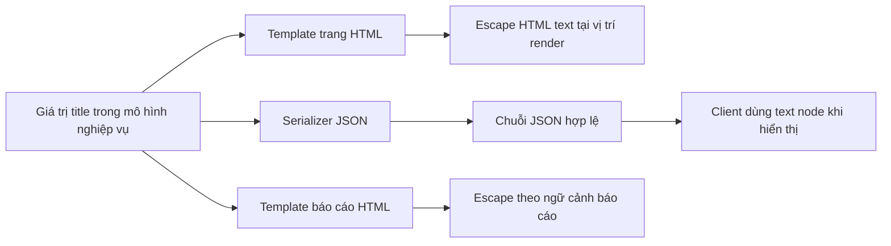

# Encode tại output boundary

## 1. Ranh giới đầu ra là nơi dữ liệu đổi cách được hiểu

Encode tại output boundary là nguyên tắc xử lý dữ liệu ở điểm ứng dụng đưa nó vào một ngữ cảnh đầu ra cụ thể, ngay trước khi thành phần nhận có thể diễn giải nó theo cú pháp của ngữ cảnh đó. Mục tiêu là giữ dữ liệu ở vai trò dữ liệu, thay vì để ký tự trong dữ liệu thay đổi cấu trúc hoặc trở thành mã ngoài ý muốn.

Một tên khóa học như `Java < Cơ bản & Nâng cao >` có thể đi tới trang HTML, phản hồi JSON, thông báo web và tệp văn bản. Giá trị nghiệp vụ vẫn là tên khóa học đó, nhưng cách biểu diễn hợp lệ và an toàn ở mỗi đầu ra khác nhau. Encode trước rồi dùng một bản chung cho mọi nơi làm mất thông tin về ngữ cảnh và thường tạo lỗi hiển thị hoặc lỗ hổng.

Trong module yêu cầu bảo mật, nguyên tắc này cần được chuyển thành những nghĩa vụ cụ thể: ai biết ngữ cảnh cuối cùng, dữ liệu đi qua những parser nào, cơ chế nào bảo vệ từng vị trí và bằng chứng nào cho thấy không có đường ra bị bỏ sót.

Sau bài này, người học có thể:

- Xác định output boundary trong ứng dụng render ở server, ứng dụng client và hệ thống có nhiều consumer.
- Phân biệt giá trị nghiệp vụ với biểu diễn đã encode hoặc đã tuần tự hóa.
- Chọn kiểm soát cho HTML text, thuộc tính HTML, URL và các đường xử lý dữ liệu khác.
- Nhận diện encode quá sớm, encode sai ngữ cảnh, double encoding và biến đổi sau encoding.
- Viết yêu cầu bảo mật có tiêu chí nghiệm thu và trách nhiệm rõ ràng tại từng điểm xuất dữ liệu.

## 2. Dữ liệu, biểu diễn và parser

### 2.1. Một giá trị có nhiều biểu diễn

Xét giá trị nghiệp vụ:

```text
An & Bình <Nhóm A>
```

Nếu cần đưa vào HTML text, một biểu diễn có thể là:

```html
An &amp; Bình &lt;Nhóm A&gt;
```

Khi trình duyệt phân tích biểu diễn này trong đúng ngữ cảnh văn bản HTML, người dùng vẫn thấy tên gốc. Các ký tự cấu trúc được biểu diễn để không tạo một phần tử `Nhóm A` từ dữ liệu.

Nếu giá trị đi qua JSON, bộ tuần tự hóa JSON phải tạo một chuỗi JSON hợp lệ. Chuỗi JSON đó không cần được coi là bản HTML text đã encode. Khi client nhận giá trị rồi đưa vào HTML, client vẫn phải sử dụng cơ chế phù hợp với ngữ cảnh hiển thị.

Ba khái niệm cần tách biệt:

| Khái niệm | Ý nghĩa | Ví dụ |
| --- | --- | --- |
| Giá trị nghiệp vụ | Nội dung mà chức năng muốn lưu hoặc xử lý | Tên hiển thị của một người dùng |
| Biểu diễn truyền tải | Dạng mã hóa hoặc tuần tự hóa để chuyển giá trị qua một giao thức | Một trường chuỗi trong JSON UTF-8 |
| Biểu diễn theo ngữ cảnh đầu ra | Dạng bảo toàn dữ liệu tại một vị trí có parser cụ thể | Chuỗi đã escape cho HTML text |

UTF-8 xác định cách ký tự được biểu diễn thành byte. HTML entity encoding xác định cách một số ký tự được biểu diễn trong cú pháp HTML. Dùng UTF-8 không thay thế việc xử lý ký tự có ý nghĩa cấu trúc của HTML.

### 2.2. Đặt câu hỏi “ai sẽ đọc chuỗi này như một ngôn ngữ?”

Để nhận diện ranh giới, lần theo chuỗi xử lý và hỏi:

1. Thành phần tiếp theo nhận dữ liệu có parser hay không?
2. Parser đó đọc ngôn ngữ hoặc định dạng gì?
3. Dữ liệu được đặt vào vị trí nào trong cấu trúc?
4. Dữ liệu có thể điều khiển cấu trúc, tên thuộc tính, mã hoặc đích điều hướng không?
5. Sau khi parser này xử lý, có parser khác diễn giải tiếp không?

Ví dụ, một phản hồi JSON được client phân tích rồi gán vào `innerHTML` có hai giai đoạn khác nhau. Tuần tự hóa đúng bảo vệ cấu trúc JSON. Nó không tự bảo vệ lần phân tích HTML tiếp theo.

### 2.3. Boundary không nhất thiết là biên mạng

Trong một ứng dụng, có thể có các ranh giới sau:

- Server đưa dữ liệu vào template HTML trước khi trả phản hồi.
- Client đưa trường nhận từ API vào DOM.
- Dịch vụ báo cáo đưa dữ liệu vào template HTML riêng.
- Trình xem log đưa một bản ghi vào giao diện web.
- Tác vụ thông báo đưa tiêu đề hoặc tên người dùng vào nội dung HTML.

Một lời gọi DOM diễn ra hoàn toàn trong trình duyệt vẫn có thể là output boundary quan trọng. Ngược lại, một lần ghi cơ sở dữ liệu không tự trở thành ranh giới HTML chỉ vì dữ liệu sẽ được hiển thị trong tương lai.

## 3. Nguyên tắc đặt kiểm soát tại nơi biết ngữ cảnh

### 3.1. Encode muộn theo ngữ cảnh, không trì hoãn mọi kiểm tra

“Encode tại đầu ra” không có nghĩa đợi tới cuối mới xác thực dữ liệu. Ngay khi nhận dữ liệu, hệ thống vẫn cần kiểm tra kiểu, độ dài, phạm vi và quyền thao tác theo hợp đồng nghiệp vụ.

Điểm khác biệt là không ép một biểu diễn đầu ra cụ thể thành giá trị dùng chung trong toàn hệ thống. Một tên hiển thị có thể hợp lệ về nghiệp vụ nhưng vẫn chứa ký tự có ý nghĩa với HTML. Kiểm tra đầu vào và encode đầu ra thực hiện hai nhiệm vụ riêng.

```text
Nhận dữ liệu
    → xác thực cấu trúc và quy tắc nghiệp vụ
    → lưu hoặc xử lý giá trị theo mô hình dữ liệu
    → xác định consumer và ngữ cảnh đầu ra
    → encode, tuần tự hóa hoặc dùng API an toàn phù hợp
    → đưa vào thành phần nhận
```

### 3.2. Một mô hình miền không nên mang ngữ cảnh của một màn hình

Giả sử đối tượng khóa học có trường `title`. Nếu tầng nghiệp vụ thay `title` bằng bản HTML-escaped, mọi consumer khác sẽ phải biết chi tiết đó. API JSON có thể trả `&amp;`; ứng dụng di động có thể hiển thị thực thể HTML; giao diện web có thể escape lần nữa.

Một thiết kế rõ hơn giữ `title` là tên khóa học và để adapter đầu ra chịu trách nhiệm biểu diễn:



Sơ đồ thể hiện sự phân công trách nhiệm. Nó không yêu cầu tự viết một encoder khác nhau cho từng màn hình; những màn hình cùng ngữ cảnh nên dùng cơ chế chuẩn, nhất quán của nền tảng.

### 3.3. Tập trung cơ chế, giữ quyết định theo ngữ cảnh

Có thể quản lý tập trung thư viện encoding, cấu hình template và quy tắc sử dụng. Tuy nhiên, lựa chọn ngữ cảnh vẫn phải nằm ở điểm biết dữ liệu đang được đưa vào đâu.

Một hàm chung `makeSafe(value)` không thể tự suy ra liệu giá trị sẽ đi vào HTML text, URL, thuộc tính hay JavaScript. Tên hàm che giấu ngữ cảnh còn khiến người dùng hàm nghĩ rằng kết quả có thể dùng ở mọi vị trí.

Một hợp đồng minh họa rõ hơn là:

```text
writeHtmlText(value)
writeQuotedHtmlAttribute(value)
writeJsonDocument(document)
buildUrlFromValidatedComponents(components)
```

Đây là tên thao tác khái niệm, không phải API của một thư viện cụ thể. Khi triển khai, nên dùng cơ chế chuẩn đã được chọn cho nền tảng và giới hạn các điểm bỏ qua cơ chế đó.

## 4. Chọn xử lý theo vị trí đầu ra

### 4.1. HTML text

Khi dữ liệu chỉ là văn bản hiển thị trong phần tử, yêu cầu cần bảo đảm các ký tự của dữ liệu không tạo cấu trúc HTML.

Ở server, sử dụng cơ chế escape của template đúng với ngữ cảnh HTML text. Ở client, tạo text node hoặc sử dụng `textContent` trên phần tử thông thường dùng để hiển thị văn bản.

```javascript
const heading = document.createElement("h2");
heading.textContent = course.title;
document.querySelector("#course-header").append(heading);
```

Không cần tự HTML-escape `course.title` trước khi gán vào `textContent`. API này tạo nội dung văn bản tại vị trí đó. Nếu truyền chuỗi đã escape, người dùng có thể thấy chính các ký tự `&lt;` hoặc `&amp;`.

So sánh với một đường không phù hợp cho văn bản tự do:

```javascript
// Không dùng cách này cho title là văn bản do người dùng kiểm soát.
document.querySelector("#course-header").innerHTML =
  "<h2>" + course.title + "</h2>";
```

Điểm nguy hiểm ở đây là `innerHTML` yêu cầu trình duyệt phân tích chuỗi như HTML. Dữ liệu tên khóa học được ghép vào ngôn ngữ HTML thay vì được đưa vào text node.

### 4.2. Giá trị thuộc tính HTML

Khi server dựng HTML bằng template, thuộc tính văn bản cần có tên cố định, giá trị đặt trong dấu nháy và cơ chế encode đúng cho ngữ cảnh thuộc tính. Không cho dữ liệu điều khiển tên thuộc tính.

Ở client, có thể dùng API DOM với thuộc tính thông thường đã xác định:

```javascript
const label = document.createElement("span");
label.textContent = course.shortTitle;
label.setAttribute("title", course.fullTitle);
```

Ví dụ này dùng `title` là một thuộc tính văn bản cố định. Nó không chứng minh `setAttribute` an toàn cho mọi tên thuộc tính. Những thuộc tính như event handler chứa mã; các thuộc tính URL có quy tắc ý nghĩa riêng. Không truyền tên thuộc tính do người dùng lựa chọn vào một helper chung rồi coi mọi kết quả là an toàn.

### 4.3. URL có hai vấn đề riêng: ý nghĩa và biểu diễn

Với một liên kết, cần trả lời cả hai câu hỏi:

- URL có được phép theo chính sách chức năng không?
- URL được đưa vào HTML hoặc DOM bằng cách nào?

HTML attribute encoding có thể giữ dấu nháy trong dữ liệu không phá cú pháp thuộc tính, nhưng không biến một scheme ngoài chính sách thành đích điều hướng được chấp nhận.

Ngược lại, percent-encode một thành phần URL không thay thế việc encode thuộc tính HTML khi toàn bộ URL được đưa vào chuỗi HTML.

Ví dụ tạo liên kết nội bộ từ một định danh:

```javascript
const link = document.createElement("a");
const url = new URL(
  "/courses/" + encodeURIComponent(course.id),
  window.location.origin
);

link.href = url.href;
link.textContent = course.title;
document.querySelector("#course-link").append(link);
```

Đoạn này minh họa hai vị trí khác nhau: `course.id` được dùng như một thành phần đường dẫn; `course.title` đi vào text node. Định danh vẫn phải đáp ứng hợp đồng của chức năng. Việc xử lý đường dẫn thực tế còn phải phù hợp với cách router và server giải mã; encoding không thay thế thiết kế định danh hoặc phân quyền tài nguyên.

Không percent-encode toàn bộ một URL rồi mong dấu `:`, `/`, `?` và `&` vẫn giữ đúng vai trò cấu trúc. Hãy dùng bộ dựng URL và xử lý từng thành phần theo API dành cho thành phần đó.

### 4.4. JavaScript và CSS

Dữ liệu tự do không nên được ghép trực tiếp vào event handler, chuỗi mã, tên hàm hoặc đoạn CSS. Một encoder cho HTML text không bảo vệ các vị trí này.

Thiết kế ưu tiên đưa dữ liệu qua kênh dữ liệu riêng rồi dùng API thực hiện hành vi đã định nghĩa. Ví dụ, dùng một ID khóa học trong dữ liệu và một listener cố định, thay vì tạo một chuỗi `onclick` có dữ liệu được ghép vào.

```javascript
const button = document.createElement("button");
button.type = "button";
button.textContent = "Xem chi tiết";
button.addEventListener("click", () => {
  openCourseDetails(course.id);
});
```

Trong ví dụ, hàm `openCourseDetails` là mã ứng dụng đã xác định; nó nhận ID như dữ liệu. Bản thân hàm đó vẫn phải xử lý ID đúng ở các ranh giới tiếp theo và kiểm tra quyền truy cập ở server.

Với lựa chọn giao diện như màu nhãn hoặc kích thước, có thể ánh xạ giá trị nghiệp vụ vào một tập class cố định. Không cần cho người dùng nhập tùy ý một đoạn CSS để đạt một yêu cầu trình bày hẹp.

### 4.5. JSON không phải HTML

Bộ tuần tự hóa JSON bảo vệ cấu trúc JSON khi tạo tài liệu JSON. Sau khi client phân tích tài liệu, từng giá trị có thể tiếp tục đi vào một ngữ cảnh khác.

```javascript
const response = await fetch("/api/courses/current", {
  headers: { "Accept": "application/json" }
});

if (!response.ok) {
  throw new Error("Không đọc được dữ liệu khóa học");
}

const course = await response.json();
document.querySelector("#course-title").textContent = course.title;
```

Yêu cầu nên quy định API dùng serializer chuẩn và phản hồi với kiểu nội dung phù hợp. Yêu cầu phía client phải quy định tiếp cách sử dụng trường `title`. Không dùng một trong hai yêu cầu để thay thế yêu cầu còn lại.

## 5. Ngữ cảnh lồng nhau và thứ tự parser

### 5.1. Một biểu thức có thể đi qua nhiều ngôn ngữ

Xét thiết kế ghép tên người dùng vào chuỗi JavaScript nằm trong một tài liệu HTML; JavaScript sau đó ghép chuỗi đó thành HTML. Đường đi này liên quan tới parser HTML, cú pháp JavaScript và một lần phân tích HTML tiếp theo.

Sai lầm là chọn một encoder quen thuộc rồi áp dụng một lần cho toàn bộ chuỗi. Đúng cú pháp ở lớp bên trong chưa chắc giữ được ranh giới của lớp bên ngoài.

Đặc biệt, một chuỗi JSON hợp lệ không tự chứng minh nó an toàn khi được nhúng vào nội dung một phần tử `script` trong HTML. Parser HTML vẫn quyết định ranh giới của phần tử trước khi mã hoặc dữ liệu bên trong được xử lý theo ngôn ngữ tương ứng.

### 5.2. Giảm số parser thay vì tăng số phép escape thủ công

Một thiết kế dễ kiểm chứng hơn có thể là:

1. Trả dữ liệu qua một endpoint JSON riêng.
2. Client dùng cơ chế phân tích JSON của nền tảng.
3. Dữ liệu văn bản đi vào text node.
4. Hành vi giao diện được gắn bằng mã ứng dụng cố định.

Nếu kiến trúc cần nhúng dữ liệu vào HTML, phải dùng phương thức được nền tảng hỗ trợ đúng cho cách nhúng đó và nêu rõ các parser tham gia. Không tự suy luận “đã dùng serializer” nghĩa là có thể chèn kết quả ở mọi vị trí.

### 5.3. Encode đúng rồi biến đổi tiếp vẫn có thể mất an toàn

Giả sử tầng đầu đã escape chuỗi cho HTML text. Tầng sau giải mã thực thể vì muốn “hiển thị đẹp”, rồi gán vào `innerHTML`. Bảo đảm của bước encode ban đầu không còn áp dụng cho đường đi mới.

Những phép biến đổi cần được xem xét gồm:

- Decode thực thể hoặc percent-encoding.
- Nối thêm dữ liệu chưa được xử lý vào một fragment đã xử lý.
- Thay thế chuỗi để chèn thẻ đánh dấu, icon hoặc liên kết.
- Chuyển qua Markdown, template hoặc bộ biến đổi DOM.
- Đưa giá trị đã xử lý sang một vị trí có ngữ cảnh khác.

Yêu cầu “encode ngay trước điểm render” cần đi cùng yêu cầu không thực hiện biến đổi làm thay đổi ngữ nghĩa an toàn giữa encoding và điểm diễn giải. Nếu có biến đổi cần thiết, chính điểm ra sau biến đổi phải được đánh giá lại.

## 6. HTML có chủ đích: sanitization và hợp đồng riêng

### 6.1. Khi mục tiêu là văn bản, encode; khi mục tiêu là HTML giới hạn, cần chính sách HTML

Nếu một mô tả khóa học được định nghĩa là văn bản thuần, việc hiển thị thẻ `<strong>` như chữ là kết quả đúng. Không nên tắt escaping để chiều theo một dữ liệu vô tình chứa markup.

Nếu tính năng cần nội dung định dạng, cần một hợp đồng khác: tập thẻ, thuộc tính và URL nào được phép; định dạng nguồn là gì; cơ chế sanitization nào bảo đảm đầu ra phù hợp chính sách.

Encode HTML text sẽ làm markup trở thành văn bản. Sanitization có mục tiêu giữ một phần cấu trúc HTML được cho phép và loại bỏ hoặc biến đổi phần ngoài chính sách. Hai thao tác này không thể thay nhau một cách tùy ý.

### 6.2. Một giá trị “đã xử lý” phải chỉ rõ xử lý cho đâu

Tên như `safeDescription` quá mơ hồ nếu nhóm phát triển không biết giá trị an toàn trong ngữ cảnh nào. Một mô hình tốt hơn biểu diễn hợp đồng rõ ràng, ví dụ:

```text
descriptionText: văn bản nghiệp vụ
approvedDescriptionHtml: HTML fragment theo chính sách mô tả khóa học
descriptionPolicyVersion: phiên bản chính sách tạo fragment
```

Đây là ví dụ khái niệm, không phải đề xuất bắt buộc lưu cả ba trường. Dù dùng mô hình lưu nào, kết quả sanitizer cho HTML fragment không được tự động coi là phù hợp cho JavaScript, CSS hay giá trị thuộc tính.

Nếu dùng kiểu dữ liệu chuyên biệt để biểu diễn fragment, constructor và điểm tạo giá trị cần bị kiểm soát. Một wrapper mang tên `TrustedHtml` nhưng cho mọi caller bọc chuỗi bất kỳ chỉ chuyển chỗ của lỗi.

### 6.3. Không fallback sang đầu ra thô

Khi encoder hoặc sanitizer không thể xử lý dữ liệu theo hợp đồng, hệ thống cần hành vi thất bại rõ ràng. Có thể từ chối tạo nội dung, hiển thị thông báo hoặc suy giảm sang văn bản thuần theo quyết định chức năng.

Không được bắt lỗi rồi xuất nguyên chuỗi để “giữ trang chạy được”. Hành vi đó biến sự cố xử lý thành đường bỏ qua kiểm soát.

## 7. Đặc tả yêu cầu bảo mật theo boundary

### 7.1. Từ câu chung sang nghĩa vụ đo được

Yêu cầu yếu:

> Tất cả dữ liệu phải được escape.

Câu này không nêu ngữ cảnh, thời điểm, đường ra và trách nhiệm. Nó còn có thể được triển khai thành escape đầu vào cho mọi dữ liệu, gây hỏng hợp đồng dùng chung.

Yêu cầu rõ hơn:

> Trường tên khóa học là văn bản thuần. Mọi giao diện web hiển thị trường này phải dùng cơ chế tạo văn bản hoặc escape đúng ngữ cảnh tại điểm render. Giá trị nghiệp vụ không được thay bằng bản HTML-escaped trong mô hình dùng chung. Mọi ngoại lệ render HTML phải có hợp đồng riêng và điểm tạo được kiểm soát.

Để đo được “mọi giao diện”, cần một danh mục consumer có phạm vi và chủ sở hữu, không chỉ một tuyên bố trong tài liệu.

### 7.2. Bộ yêu cầu minh họa

| Mã | Yêu cầu | Bằng chứng dự kiến |
| --- | --- | --- |
| OEB-01 | Mỗi trường có thể do người dùng hoặc hệ thống tích hợp kiểm soát phải có loại dữ liệu và danh mục đường ra | Hợp đồng trường và danh mục consumer |
| OEB-02 | Mỗi điểm xuất dữ liệu phải xác định parser, vị trí chèn và cơ chế bảo vệ tương ứng | Hồ sơ boundary gắn với component hoặc template |
| OEB-03 | Mô hình nghiệp vụ dùng chung không được thay văn bản gốc bằng bản HTML-escaped chỉ để phục vụ một màn hình | Thiết kế luồng dữ liệu và kiểm thử qua nhiều consumer |
| OEB-04 | Văn bản thuần phải được render bằng text node hoặc cơ chế escape phù hợp của template | Bằng chứng trên từng đường hiển thị thuộc phạm vi |
| OEB-05 | Tên thẻ, tên thuộc tính, handler và mã thực thi không được hình thành từ trường văn bản tự do | Kiểm tra điểm sử dụng và thiết kế API render |
| OEB-06 | Thành phần URL phải được xử lý theo cấu trúc; URL phải tuân thủ chính sách ý nghĩa trước khi được dùng | Kiểm thử hợp đồng URL và cách đưa vào đầu ra |
| OEB-07 | Không được giải mã hoặc biến đổi kết quả encoding rồi đưa vào parser mới mà không đánh giá boundary mới | Sơ đồ thứ tự biến đổi và kiểm thử hồi quy tương ứng |
| OEB-08 | HTML có chủ đích phải có chính sách sanitization và chỉ được render ở các điểm đã định vị | Chính sách, điểm tạo fragment và điểm render |
| OEB-09 | Lỗi xử lý đầu ra không được dẫn đến xuất dữ liệu thô vào ngữ cảnh có thể thực thi | Kiểm thử hành vi lỗi và kết quả hiển thị |
| OEB-10 | Khi thêm consumer hoặc đổi ngữ cảnh, phải cập nhật hồ sơ boundary và bằng chứng nghiệm thu | Thay đổi thiết kế kèm tiêu chí kiểm thử của consumer mới |

Các mã này dùng để minh họa cách đặc tả. Mức bao phủ, công cụ và quy trình phê duyệt cần được chọn cho hệ thống cụ thể.

### 7.3. Hồ sơ một boundary

Một hồ sơ ngắn có thể chứa:

```text
BOUNDARY: course-title-on-detail-page
SOURCE: course.title từ API khóa học
DATA CONTRACT: văn bản thuần, có giới hạn độ dài theo nghiệp vụ
DESTINATION: nội dung h2 của trang chi tiết
PARSER/CONTEXT: text node trong DOM
CONTROL: textContent trên phần tử h2 do ứng dụng tạo
POST-PROCESSING: không phân tích lại nội dung như HTML
OWNER: nhóm giao diện khóa học
EVIDENCE: kiểm thử từ dữ liệu lưu tới trang chi tiết
```

Nếu cùng trường xuất hiện ở thuộc tính tooltip và email HTML, đó là những điểm sử dụng riêng cần được ghi nhận. Có thể nhóm các điểm dùng chung component khi chứng minh được chúng thực sự đi qua cùng cơ chế và cùng ngữ cảnh.

## 8. Phân công trách nhiệm trong kiến trúc nhiều tầng

### 8.1. Nhóm API và mô hình dữ liệu

Nhóm này chịu trách nhiệm định nghĩa loại trường, giữ hợp đồng rõ ràng, dùng serializer đúng cho định dạng phản hồi và kiểm tra quyền thao tác. Một API trả `title` là văn bản thuần không nên thỉnh thoảng trả HTML chỉ vì một consumer muốn định dạng.

Nhóm API cũng cần chỉ rõ nguồn dữ liệu. Dữ liệu từ cơ sở dữ liệu nội bộ không mặc nhiên đáng tin hơn dữ liệu vừa nhận nếu nguồn ban đầu có thể do người dùng kiểm soát.

### 8.2. Nhóm giao diện và template

Nhóm giao diện biết vị trí cuối cùng của giá trị. Họ phải chọn text node, thuộc tính thông thường, API URL hoặc đường HTML có kiểm soát theo ngữ cảnh thực tế.

Các API bỏ qua escaping mặc định cần được giới hạn, có tên rõ và có lý do sử dụng. Không đưa một đường xuất HTML thô vào component phổ thông chỉ để mọi caller tự hứa rằng dữ liệu đã an toàn.

### 8.3. Nhóm nền tảng

Nhóm nền tảng có thể cung cấp cơ chế chuẩn, cấu hình escape mặc định và hướng dẫn sử dụng theo ngữ cảnh. Các công cụ phân tích mã có thể hỗ trợ tìm điểm nguy hiểm như xuất HTML thô hoặc ghép chuỗi vào handler.

Sự hiện diện của thư viện chung chưa chứng minh mọi consumer sử dụng nó. Trách nhiệm và bằng chứng vẫn phải gắn với từng boundary trong phạm vi.

### 8.4. Nhóm báo cáo, thông báo và vận hành

Những nhóm này sở hữu các đường ra thường nằm ngoài trang chính: email HTML, trang xem log, báo cáo, bản xem trước và dashboard quản trị. Nếu tiêu thụ cùng một trường, họ phải thực hiện cùng hợp đồng dữ liệu nhưng chọn cơ chế theo ngữ cảnh của đầu ra riêng.

Không thể tuyên bố module đã an toàn chỉ vì nhóm giao diện chính đã sửa trang chi tiết. Các consumer độc lập cần bằng chứng độc lập hoặc bằng chứng dùng chung có phạm vi rõ.

## 9. Các lỗi thường gặp khi đặt encoding sai chỗ

### 9.1. Encode khi nhận request rồi lưu vào cơ sở dữ liệu

Cách này gắn dữ liệu với một biểu diễn chưa biết có đúng cho mọi consumer hay không. Nó thường gây double encoding, hiển thị thực thể trong client khác hoặc tạo nhu cầu decode thủ công.

Kiểm tra đầu vào vẫn phải thực hiện ở nơi nhận. Tuy nhiên, không dùng HTML escaping như một quy tắc lưu trữ chung cho mọi trường văn bản.

### 9.2. Encode hai lần

Chuỗi `A & B` có thể được chuyển thành `A &amp; B`, rồi lần tiếp theo thành `A &amp;amp; B` khi cùng biểu diễn tiếp tục đi qua HTML escaping.

Không sửa bằng cách decode tất cả trước render. Cần xác định hợp đồng tại từng tầng, giữ giá trị đúng trong mô hình dùng chung và bỏ bước encoding sai vị trí.

### 9.3. Encode đúng cho ngữ cảnh khác

HTML text encoding không thay JavaScript string escaping. URL component encoding không thay HTML attribute encoding. Một bản HTML fragment đã sanitize không phải chuỗi được phép nhúng vào mã.

Tiêu chí lựa chọn không phải “hàm này có chữ escape” mà là “parser kế tiếp và vị trí chèn có đúng với hợp đồng của cơ chế này không”.

### 9.4. Đặt middleware escape toàn bộ response

Một response có thể chứa cấu trúc HTML hợp lệ, dữ liệu JSON, tài nguyên khác hoặc nhiều ngữ cảnh. Middleware sửa ký tự trên toàn response thường không biết đâu là dữ liệu và đâu là cấu trúc ứng dụng.

Kiểm soát cần gắn với lúc dữ liệu được đưa vào cấu trúc. Một phép thay thế toàn bộ response không thể thay trách nhiệm theo ngữ cảnh của template và client.

### 9.5. Chỉ xử lý dữ liệu “bên ngoài”

Dữ liệu do người dùng nhập có thể đi qua hàng đợi, cache, cơ sở dữ liệu, hệ thống tìm kiếm hoặc bản xuất rồi quay lại. Vị trí lưu trung gian không làm thay đổi mức tin cậy.

Ngay cả dữ liệu do quản trị viên tạo cũng cần đúng ngữ cảnh đầu ra. Quyền tạo dữ liệu không đồng nghĩa với quyền đưa mã tùy ý vào trình duyệt của mọi người đọc.

### 9.6. Dùng CSP hoặc kiểm tra đầu vào để bỏ boundary

Các kiểm soát bổ sung có thể giảm khả năng khai thác hoặc giới hạn dữ liệu, nhưng không thay thế việc giữ đúng ranh giới dữ liệu và cấu trúc. Nếu một trường văn bản tự do được render thành HTML, mô hình vẫn sai dù một payload thử nghiệm bị chính sách trình duyệt chặn.

## 10. Tiêu chí nghiệm thu và kiểm thử thiết kế

Phần này mô tả bằng chứng cần có khi triển khai yêu cầu, không tuyên bố một hệ thống đã được kiểm thử chỉ vì có các ca dưới đây trong tài liệu.

### 10.1. Kiểm thử theo đường đi thật của dữ liệu

Với tên khóa học, ca nghiệm thu cần đi từ nguồn tạo hoặc cập nhật, qua lưu trữ và API, tới từng consumer thuộc phạm vi. Chỉ kiểm thử hàm escape riêng không chứng minh trang thật gọi đúng hàm tại đúng vị trí.

Một tập dữ liệu nên bao gồm ký tự cú pháp, ký tự Unicode, dấu nháy, chuỗi giống thực thể và chuỗi giống markup. Không chỉ dùng một chuỗi có thẻ `script` làm đại diện cho mọi lỗi.

### 10.2. Ma trận kiểm thử minh họa

| Boundary | Dữ liệu hoặc thao tác | Điều cần quan sát |
| --- | --- | --- |
| HTML text | Tên có `<`, `>`, `&` và dấu nháy | Hiển thị giá trị nghiệp vụ, không tạo cấu trúc do dữ liệu điều khiển |
| Thuộc tính văn bản | Chuỗi có dấu nháy và ký tự cú pháp | Giá trị thuộc tính giữ đúng nội dung; không tạo thuộc tính bổ sung |
| URL nội bộ | ID có ký tự cần xử lý theo hợp đồng | URL được dựng đúng thành phần và được server hiểu đúng định danh |
| URL do người dùng cung cấp | Scheme hoặc đích ngoài chính sách | Không tạo liên kết hoạt động trái chính sách |
| JSON tới DOM | JSON có trường trông giống HTML | JSON được đọc như dữ liệu; trường được render theo hợp đồng text |
| Nhiều consumer | Cùng tên xuất hiện trên web và API | Không consumer nào nhận bản escape của consumer khác như giá trị nghiệp vụ |
| Lặp lưu và đọc | Giá trị có `&amp;` như một phần nội dung người dùng thực sự nhập | Không sinh chuỗi encode/decode ngoài hợp đồng |
| HTML có chủ đích | Fragment chứa cấu trúc được phép và cấu trúc bị cấm | Đầu ra phù hợp chính sách sanitizer tại điểm render đã định vị |
| Lỗi xử lý | Cơ chế đầu ra không xử lý được trong môi trường thử nghiệm | Không fallback sang đầu ra thô |
| Biến đổi sau encode | Tô đậm từ khóa, tạo preview hoặc chuyển định dạng | Không đưa dữ liệu chưa bảo vệ vào lần phân tích mới |

Khi dùng DOM API cho văn bản, có thể kiểm tra text hiển thị và cấu trúc DOM mong đợi. Khi server tạo HTML, có thể cần kiểm tra cả phản hồi và DOM sau khi trình duyệt phân tích. Kết quả chỉ quan sát chuỗi response có thể bỏ sót các bước xử lý phía client.

### 10.3. Kiểm tra bảo toàn ý nghĩa dữ liệu

Yêu cầu bảo mật cũng phải tránh làm hỏng nội dung hợp lệ. Nếu người dùng thật sự đặt tên `A &amp; B`, chuỗi đó có thể là văn bản nghiệp vụ hợp lệ và phải được hiển thị theo hợp đồng, không bị tự động coi là chỉ thị decode.

Các ca hồi quy cần xác nhận:

- Không mất ký tự hợp lệ hoặc đổi nội dung ngoài quy tắc chức năng.
- Không xuất hiện thực thể do encode lặp không chủ đích.
- Không đưa HTML-escaped data vào các consumer mong đợi văn bản gốc.
- Không thêm bước decode để bù cho hợp đồng dữ liệu không rõ ràng.

### 10.4. Những bằng chứng chưa đủ

“Đã dùng thư viện encoding” chưa chứng minh ngữ cảnh phù hợp. “Không có popup” chưa chứng minh không có cấu trúc HTML ngoài ý muốn. “API trả JSON hợp lệ” chưa chứng minh client không dùng `innerHTML`.

Bằng chứng tốt liên kết được nguồn, consumer, ngữ cảnh, cơ chế, phiên bản và kết quả. Khi một phần của chuỗi thay đổi, nhóm phát triển biết cần cập nhật kiểm thử nào.

## 11. Quản lý thay đổi và dữ liệu đã encode từ trước

### 11.1. Chuyển hợp đồng có kế hoạch

Nếu hệ thống cũ lưu sẵn HTML-escaped text, không nên áp dụng decode hàng loạt chỉ dựa vào việc thấy chuỗi `&lt;`. Người dùng có thể thực sự nhập chuỗi đó; nhiều nguồn dữ liệu có thể đã được xử lý khác nhau.

Cần xác định nguồn gốc, đường tạo và hợp đồng lịch sử trước khi chuyển đổi. Có thể cần tách phiên bản dữ liệu hoặc chuyển đổi theo nhóm bản ghi có bằng chứng rõ. Bất kỳ giá trị sau chuyển đổi vẫn phải đi qua boundary đầu ra hiện hành.

### 11.2. Cache cần đúng hợp đồng của bản được lưu

Cache giá trị nghiệp vụ và cache HTML đã render là hai sản phẩm khác nhau. Nếu cache HTML, key và cơ chế vô hiệu hóa cần phản ánh các yếu tố có thể ảnh hưởng tới kết quả an toàn, như template hoặc phiên bản chính sách render phù hợp với kiến trúc.

Không lấy fragment HTML của một màn hình làm dữ liệu dùng chung cho API văn bản. Khi thay đổi cơ chế bảo vệ, cần tính tới bản render cũ còn được phân phối bởi cache hoặc snapshot.

### 11.3. Consumer mới tạo thêm nghĩa vụ

Thêm tooltip, dashboard hoặc bản báo cáo không chỉ là thay đổi giao diện. Nếu chúng tiêu thụ dữ liệu hiện có theo một ngữ cảnh mới, chúng tạo thêm boundary phải được xác định.

Một điều kiện hoàn thành phù hợp cho thay đổi có thể là: mọi consumer mới đều có hợp đồng ngữ cảnh và bằng chứng nghiệm thu, đồng thời không làm thay đổi giá trị dùng chung để phục vụ riêng consumer đó.

## 12. Mẫu yêu cầu hoàn chỉnh

```text
ID: SEC-OUTPUT-BOUNDARY-COURSE-TITLE

Mục tiêu:
Tên khóa học phải được giữ là dữ liệu tại mọi nơi xuất ra, đồng thời
bảo toàn nội dung hợp lệ của người dùng theo hợp đồng nghiệp vụ.

Phạm vi:
course.title trên trang chi tiết, danh sách, dashboard quản trị,
API JSON và báo cáo HTML đang nằm trong danh mục consumer.

Hợp đồng dữ liệu:
title là văn bản thuần. Tầng nghiệp vụ và API không thay giá trị này
bằng bản HTML-escaped dùng chung.

Kiểm soát tại boundary:
- HTML text: dùng template escaping phù hợp hoặc text node.
- Thuộc tính văn bản: tên cố định và xử lý theo ngữ cảnh thuộc tính.
- JSON: dùng serializer chuẩn cho tài liệu JSON.
- Client đọc JSON: áp dụng tiếp kiểm soát tại điểm đưa vào DOM.

Ràng buộc:
Không đưa title vào handler, mã, tên thuộc tính hay HTML thô.
Không decode kết quả encoding rồi phân tích lại như HTML.
Không xuất dữ liệu thô khi cơ chế xử lý đầu ra gặp lỗi.

Bằng chứng:
Kiểm thử từ đường tạo dữ liệu tới từng consumer, kiểm tra cả bảo toàn
nội dung và việc không tạo cấu trúc ngoài hợp đồng. Ghi nhận phiên bản
component, ngữ cảnh và cơ chế bảo vệ được dùng.

Trách nhiệm:
Nhóm API giữ hợp đồng dữ liệu; mỗi nhóm consumer chịu trách nhiệm
cho ngữ cảnh đầu ra của mình; nhóm nền tảng cung cấp cơ chế chuẩn.

Quản lý thay đổi:
Consumer mới hoặc thay đổi ngữ cảnh phải cập nhật danh mục boundary
và bằng chứng nghiệm thu trong cùng thay đổi chức năng.
```

Nguyên tắc encode tại output boundary giúp yêu cầu bảo mật bám sát nơi rủi ro thực sự xuất hiện: điểm dữ liệu được đưa vào một ngôn ngữ hoặc bộ diễn giải cụ thể. Thiết kế giữ giá trị nghiệp vụ rõ ràng, giảm ngữ cảnh lồng nhau và giao trách nhiệm cho consumer biết vị trí đầu ra sẽ dễ triển khai, kiểm chứng và duy trì hơn một lời hứa chung rằng dữ liệu đã được “làm an toàn” từ trước.
