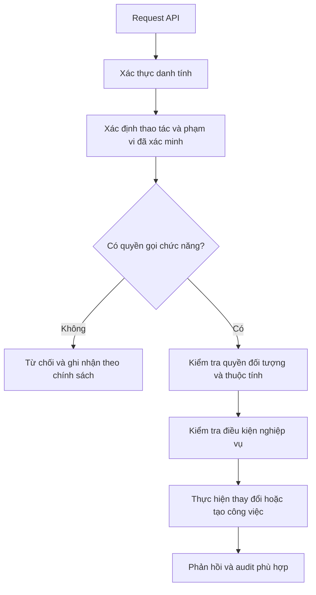

# Function-level authorization

## 1. Quyền gọi một chức năng API

Function-level authorization là việc quyết định một chủ thể có được thực hiện một chức năng cụ thể của API hay không. Chức năng ở đây là một hành động nghiệp vụ hoặc kỹ thuật có ý nghĩa, chẳng hạn xuất bản khóa học, hoàn tiền, mời quản trị viên, xem nhật ký kiểm toán hoặc khởi chạy tác vụ xuất dữ liệu.

Một request đã được xác thực chỉ giúp hệ thống biết ai hoặc dịch vụ nào đang gọi. Nó chưa chứng minh chủ thể được phép gọi chức năng đang yêu cầu. Nếu API chỉ kiểm tra token hợp lệ rồi cho mọi tài khoản gọi chức năng quản trị, hệ thống vẫn có lỗi phân quyền.

Trong thiết kế yêu cầu bảo mật, mục tiêu không dừng ở việc gắn nhãn “admin” cho một nhóm endpoint. Cần xác định từng thao tác, quyền cần có, phạm vi hiệu lực, nguồn của thông tin phân quyền, điểm thực thi và bằng chứng chứng minh các đường gọi đều chịu cùng chính sách.

Sau bài này, người học có thể:

- Phân biệt xác thực, quyền gọi chức năng, quyền trên đối tượng và quyền trên thuộc tính.
- Xây dựng danh mục thao tác API và ánh xạ sang quyền nghiệp vụ.
- Đặc tả chính sách mặc định từ chối, phạm vi tenant và quyền của người dùng lẫn tài khoản dịch vụ.
- Xác định điểm thực thi trong controller, service, gateway và luồng bất đồng bộ.
- Viết tiêu chí nghiệm thu cho các trường hợp được phép, bị từ chối và bị thay đổi quyền.

## 2. Phân biệt các lớp kiểm soát

### 2.1. Xác thực trả lời một câu hỏi khác

Xác thực trả lời: “Danh tính đã được chứng minh theo cơ chế nào?”. Phân quyền chức năng trả lời: “Danh tính này có được thực hiện thao tác này trong phạm vi hiện tại không?”.

Một token hợp lệ có thể thuộc về học viên, giảng viên, kiểm toán viên hoặc dịch vụ đồng bộ. Các danh tính đó không được mặc nhiên có cùng tập chức năng. Việc token có chữ ký đúng và chưa hết hạn không đủ để cho phép xuất dữ liệu toàn bộ tenant hoặc thay đổi vai trò người dùng.

### 2.2. Chức năng, đối tượng và thuộc tính bổ sung cho nhau

| Lớp kiểm soát | Câu hỏi | Ví dụ trên nền tảng học tập |
| --- | --- | --- |
| Authentication | Ai đang gọi và bằng chứng danh tính có hợp lệ không? | Request mang token hợp lệ của một giảng viên |
| Function-level authorization | Chủ thể có được thực hiện hành động này không? | Giảng viên có quyền `course.publish` trong tenant đang chọn không? |
| Object-level authorization | Chủ thể có được thực hiện hành động trên đối tượng này không? | Giảng viên có được xuất bản khóa học cụ thể đang phụ trách không? |
| Property-level authorization | Chủ thể được đọc hoặc sửa những trường nào? | Giảng viên có được đổi trạng thái kiểm duyệt hay chỉ sửa nội dung? |

Các lớp không thay thế nhau. Có quyền gọi chức năng xuất bản không đồng nghĩa được xuất bản mọi khóa học. Ngược lại, sở hữu một bản nháp không tự tạo quyền phê duyệt cuối cùng nếu chức năng đó chỉ dành cho một vai trò khác.

Lỗi function-level authorization thường cho phép người có quyền thấp gọi thao tác dành cho vai trò cao hơn hoặc một vai trò khác. Tuy nhiên, không nên giới hạn mô hình chỉ vào hai nhãn “user” và “admin”; tài khoản dịch vụ, đối tác và nhân viên hỗ trợ cũng có các tập chức năng riêng.

### 2.3. Quyền chức năng không phải quy tắc trạng thái nghiệp vụ

Một quản trị viên có quyền gọi `course.publish` vẫn có thể bị từ chối nếu khóa học chưa đạt điều kiện xuất bản. Ngược lại, một khóa học đã đủ nội dung không cho phép học viên gọi chức năng xuất bản.

Có thể mô hình hóa:

```text
Cho phép thực hiện
    = danh tính hợp lệ
    AND quyền chức năng hợp lệ trong phạm vi đã xác minh
    AND quyền trên đối tượng hợp lệ
    AND điều kiện nghiệp vụ và các ràng buộc bổ sung được đáp ứng
```

Tách rõ các lớp giúp đặt kiểm soát đúng nơi và tránh dùng một lỗi nghiệp vụ tình cờ làm hàng rào bảo mật. Ví dụ, “khóa học chưa sẵn sàng nên lệnh publish thất bại” không chứng minh tài khoản gọi đã bị kiểm tra quyền.

## 3. Mối đe dọa: gọi được đường mà giao diện không cho thấy

Giả sử giao diện học viên không có nút xuất bản. API lại cung cấp:

```http
POST /api/courses/course-27/publish
Authorization: Bearer <token>
```

Nếu backend chỉ kiểm tra người dùng đã đăng nhập, một học viên có thể gọi trực tiếp thao tác đó. Việc ẩn nút chỉ điều khiển trải nghiệm giao diện, không phải ranh giới bảo mật.

Những tình huống tương tự gồm:

- Chức năng xóa chỉ được bảo vệ ở giao diện quản trị nhưng API chấp nhận mọi token.
- `GET` được kiểm tra quyền nhưng `POST`, `PATCH` hoặc `DELETE` trên cùng tài nguyên bị bỏ sót.
- Đường mới đã có kiểm soát, đường phiên bản cũ hoặc alias vẫn gọi cùng service mà không kiểm tra.
- Một thao tác batch bỏ qua điều kiện mà phiên bản thao tác đơn lẻ có thực hiện.
- Resolver GraphQL hoặc phương thức RPC gọi service đặc quyền mà không áp dụng chính sách tương ứng.
- Endpoint “nội bộ” chỉ dựa vào vị trí mạng hoặc tên đường dẫn để cho phép hành động quản trị.

Không cần một tên URL dễ đoán mới phát sinh rủi ro. Người gọi có thể biết thao tác từ tài liệu, mã client, lưu lượng hợp lệ hoặc thông tin vận hành. Tính bí mật của đường dẫn không thay được quyết định phân quyền.

### 3.1. Tài sản và hậu quả

Một chức năng đặc quyền có thể ảnh hưởng tới tính toàn vẹn, tính bí mật hoặc khả năng hoạt động của hệ thống:

| Chức năng | Tài sản bị ảnh hưởng | Hậu quả nếu thiếu phân quyền |
| --- | --- | --- |
| Xuất bản khóa học | Nội dung chính thức và uy tín nền tảng | Nội dung chưa phê duyệt được công khai |
| Xuất danh sách học viên | Dữ liệu cá nhân | Người không có nhiệm vụ nhận được dữ liệu hàng loạt |
| Cấp vai trò quản trị | Mô hình quyền | Leo thang đặc quyền và duy trì quyền truy cập |
| Khởi chạy đồng bộ toàn phần | Tài nguyên và dữ liệu vận hành | Tạo chi phí, tải lớn hoặc thay đổi hàng loạt |
| Đọc audit log | Thông tin vận hành nhạy cảm | Lộ hành vi và cấu trúc kiểm soát của hệ thống |

Mô hình đe dọa cần nêu chủ thể nào có thể gửi request, chức năng nào vượt quá nhiệm vụ của họ và tác dụng phụ nào phải được ngăn trước khi xảy ra.

## 4. Lập danh mục chức năng thay vì chỉ liệt kê URL

### 4.1. Một chức năng có thể có nhiều đường gọi

`course.publish` là quyền nghiệp vụ. `POST /api/courses/{id}/publish` là một đường gọi có thể ánh xạ tới quyền đó. Một phiên bản API khác, tác vụ quản trị hoặc phương thức RPC có thể thực hiện cùng hành động.

Danh mục nên liên kết:

```text
Thao tác nghiệp vụ
    → quyền cần có
    → phạm vi hiệu lực
    → các đường gọi
    → điểm thực thi chính sách
    → chủ sở hữu và bằng chứng nghiệm thu
```

Không nên suy ra quyền chỉ từ việc đường dẫn có tiền tố `/admin`. Các thao tác quản trị có thể nằm ngoài tiền tố đó, và không phải mọi thao tác trong một khu vực quản trị đều cần cùng quyền.

### 4.2. Ánh xạ minh họa

| Thao tác | Quyền | Đường gọi minh họa | Điều kiện bổ sung |
| --- | --- | --- | --- |
| Đọc nội dung đã được phép truy cập | `course.read` | `GET /api/courses/{id}` | Chính sách hiển thị và quyền trên khóa học |
| Sửa bản nháp | `course.edit` | `PATCH /api/courses/{id}` | Phạm vi tenant, quan hệ phụ trách và các trường được phép |
| Xuất bản | `course.publish` | `POST /api/courses/{id}/publish` | Quyền trên đối tượng và trạng thái hợp lệ |
| Xuất danh sách học viên | `learner.export` | `POST /api/learner-exports` | Phạm vi dữ liệu và chính sách truy cập tệp kết quả |
| Mời quản trị viên tenant | `tenant.admin.invite` | `POST /api/admin-invitations` | Tenant hợp lệ, loại vai trò có thể cấp |
| Đọc nhật ký kiểm toán | `audit.read` | `GET /api/audit-events` | Phạm vi tenant, bộ lọc và thuộc tính được phép đọc |

Đường dẫn trong bảng là ví dụ thiết kế. Hệ thống thực tế phải kiểm kê các đường thật, bao gồm phương thức HTTP, phiên bản, alias và các kênh gọi khác.

### 4.3. Mặc định từ chối với thao tác chưa ánh xạ

Một yêu cầu mạnh là mọi thao tác được công bố đều có quyết định rõ ràng: công khai theo chính sách đã định nghĩa, hoặc yêu cầu quyền xác định. Thao tác mới chưa có ánh xạ không được tự động thừa hưởng trạng thái “đăng nhập là được gọi”.

Nếu hệ thống có nhóm endpoint công khai, tính công khai cũng phải là lựa chọn được chỉ rõ. Không dùng “không tìm thấy rule” để suy ra công khai.

Mặc định từ chối cần được kiểm chứng ở cấu hình thực tế. Chỉ có một dòng tài liệu nói “deny by default” không chứng minh các route mới, resolver mới hoặc phương thức service mới đều bị chặn khi thiếu chính sách.

## 5. Thiết kế chính sách quyền và phạm vi

### 5.1. RBAC là cách tổ chức quyền, không phải toàn bộ quyết định

Role-based access control có thể ánh xạ vai trò sang quyền. Ví dụ, vai trò giảng viên có `course.edit`; vai trò người xuất bản có `course.publish`; kiểm toán viên có `audit.read`.

Quyền hiệu lực còn có thể phụ thuộc vào tenant, quan hệ với đối tượng, loại danh tính, thời hạn ủy quyền và điều kiện xác thực bổ sung. Các thuộc tính đó phải có nguồn tin cậy và được đánh giá theo chính sách đã định nghĩa.

Không cần chọn duy nhất RBAC hoặc ABAC cho mọi hệ thống. Điều quan trọng là quyết định cuối cùng trả lời được ai, làm gì, ở phạm vi nào và dưới điều kiện nào.

### 5.2. Ma trận quyền minh họa

Giả sử nền tảng chọn các vai trò sau trong một tenant:

| Vai trò | Đọc khóa học được phép | Sửa khóa học phụ trách | Xuất bản | Xuất học viên | Đọc audit |
| --- | --- | --- | --- | --- | --- |
| Học viên | Có, theo chính sách truy cập | Không | Không | Không | Không |
| Giảng viên | Có | Có, nếu được phân công | Không | Không | Không |
| Người xuất bản | Có | Theo quyền được cấp riêng | Có, trong phạm vi được giao | Không | Không |
| Quản trị viên tenant | Có, theo chính sách tenant | Có, theo chính sách tenant | Có | Có | Theo quyền được cấp |
| Kiểm toán viên | Theo nhiệm vụ được giao | Không | Không | Không | Có |
| Dịch vụ đồng bộ nội dung | Theo hợp đồng tích hợp | Chỉ thao tác được ủy quyền | Không mặc định | Không | Không |

Đây là chính sách ví dụ, không phải thứ bậc vai trò bắt buộc. Tên “quản trị viên” không nên tự tạo quyền toàn nền tảng. Một vai trò có thể được cấp trong tenant A mà không có hiệu lực ở tenant B.

### 5.3. Tenant là một phần của quyết định

Các giá trị tenant từ URL, header hoặc body là dữ liệu đầu vào cần được xác minh. Chúng có thể giúp chọn ngữ cảnh yêu cầu, nhưng không tự chứng minh chủ thể là thành viên hoặc có quyền trong tenant đó.

Một quyết định có thể được mô hình hóa như sau:

```text
allow(subject, operation, tenant)
    khi danh tính subject hợp lệ
    và tenant đã được xác minh theo chính sách
    và subject được cấp quyền cho operation trong tenant
    và các điều kiện bổ sung được đáp ứng
```

Quyền trên đối tượng vẫn phải bảo đảm đối tượng thật sự thuộc tenant đang xét. Không dùng tenant do người gọi gửi làm bằng chứng duy nhất về quyền sở hữu của khóa học.

### 5.4. Scope trong token và quyền nghiệp vụ

Scope có thể giới hạn những chức năng mà một token được dùng để yêu cầu. Tuy nhiên, hệ thống phải xác định quan hệ giữa scope, quyền của chủ thể và chính sách hiện tại.

Một thiết kế thường cần cả quyền nghiệp vụ thích hợp và giới hạn của token thích hợp. Ví dụ, người có quyền xuất dữ liệu nhưng dùng token chỉ dành cho đọc nội dung không được tự động xuất học viên. Ngược lại, token có scope mang tên xuất dữ liệu không đủ nếu chủ thể hoặc phạm vi tenant không được cấp quyền tương ứng theo mô hình đã chọn.

Không có một quy tắc ánh xạ scope áp dụng nguyên xi cho mọi hệ thống. Hợp đồng phải chỉ rõ bên cấp quyền, bên phát hành token, đối tượng nhận token và dịch vụ chịu trách nhiệm thực thi.

### 5.5. Dịch vụ gọi thay người dùng

Khi một service gọi service khác, cần phân biệt danh tính dịch vụ với người dùng mà nó đại diện. Quyền của service không được vô tình biến mọi yêu cầu do người dùng khởi tạo thành quyền đặc quyền của service.

Ví dụ, service báo cáo có quyền đọc dữ liệu để tạo báo cáo không có nghĩa mọi người dùng gọi service báo cáo đều được tạo mọi loại báo cáo. Điểm nhận yêu cầu phải kiểm tra quyền của người khởi tạo, phạm vi công việc và cách truyền ngữ cảnh ủy quyền theo cơ chế đã chọn.

Các header như `X-Role`, `X-User` hoặc `X-Tenant` không đáng tin chỉ vì có tên quen thuộc. Nếu gateway tạo chúng, kiến trúc phải xác thực nguồn, ngăn client giả mạo và bảo đảm backend không thể bị gọi qua đường bỏ qua ranh giới đó.

## 6. Đặt điểm thực thi trước tác dụng phụ

### 6.1. Luồng xử lý cần thể hiện rõ quyền



Luồng là mô hình trách nhiệm, không phải yêu cầu mọi triển khai phải có đúng số lớp hoặc đúng thứ tự kỹ thuật cho mọi phép đọc. Một số thông tin tối thiểu cần được tra cứu để xác định phạm vi. Việc tra cứu đó không được làm lộ dữ liệu cho người gọi hoặc tạo tác dụng phụ đặc quyền trước quyết định cho phép.

### 6.2. Controller và service

Controller hoặc framework routing biết request ánh xạ tới thao tác nào. Service thường sở hữu hành động nghiệp vụ và có thể được gọi từ nhiều kênh. Cần chọn một điểm thực thi có khả năng bao phủ mọi đường gọi hợp lệ tới hành động.

Một thiết kế có thể có kiểm tra thô ở lớp API và kiểm tra quyết định tại service. Tuy nhiên, các lớp phải dùng cùng hợp đồng quyền, tránh mỗi lớp tự suy diễn một chính sách khác nhau. Nhiều lớp không tự động tốt hơn nếu chúng tạo khoảng trống hoặc làm lệch chính sách.

Mã giả kiểu Java sau minh họa trách nhiệm, không phải API của một framework cụ thể:

```java
PublishResult publishCourse(PublishCommand command) {
    VerifiedPrincipal principal = authentication.currentPrincipal();
    AuthorizedTenant tenant = tenantContext.currentAuthorizedTenant();

    authorization.requireAllowed(
        principal,
        Operation.COURSE_PUBLISH,
        tenant
    );

    Course course = repository.loadInTenant(command.courseId(), tenant.id());
    courseAccess.requireMayPublish(principal, course);
    publicationRules.requireReady(course);

    return publicationService.publish(course, principal);
}
```

`currentAuthorizedTenant()` trong ví dụ biểu diễn ngữ cảnh đã được xác minh theo chính sách, không phải một wrapper cho header tùy ý. `loadInTenant` giới hạn đối tượng theo phạm vi; `requireMayPublish` kiểm tra quyền trên đối tượng; `requireReady` kiểm tra điều kiện nghiệp vụ. Các tên này làm rõ nghĩa vụ cần có, không chứng minh triển khai bên trong đã đúng.

### 6.3. Gateway không tự bao phủ mọi hành động nghiệp vụ

Gateway có thể xác thực, giới hạn route và thực hiện một phần chính sách. Nhưng nếu backend có nhiều đường vào, có thể được gọi trực tiếp hoặc service có hành động nội bộ không thể mô hình hóa chỉ từ đường dẫn, cần điểm thực thi phù hợp ở phía backend.

Nếu kiến trúc chọn gateway là ranh giới bảo mật cho một quyết định cụ thể, yêu cầu phải bao gồm điều kiện để mọi đường gọi buộc đi qua ranh giới đó, nguồn danh tính được bảo vệ và backend không tin dữ liệu giả mạo. Tính “nội bộ” cần được chứng minh bằng cơ chế, không phải tên môi trường.

### 6.4. Từ chối trước khi tạo công việc

Với thao tác bất đồng bộ, phản hồi chấp nhận công việc không phải vùng miễn phân quyền. Người không có quyền không được tạo job xuất dữ liệu rồi dựa vào worker phía sau để từ chối muộn, nếu việc tạo job đã chiếm tài nguyên hoặc phát sinh thông tin nhạy cảm.

Yêu cầu cần nêu rõ những tác dụng phụ bị cấm trước khi cho phép: ghi dữ liệu nghiệp vụ, phát sự kiện hành động, đưa công việc vào hàng đợi hoặc tạo tệp có thể truy cập. Sự kiện audit từ chối là một hoạt động vận hành riêng được thiết kế có chủ đích.

## 7. Bao phủ các đường gọi đặc biệt

### 7.1. Phương thức HTTP, phiên bản và alias

Quyền phải gắn với thao tác mà router thực sự thực hiện. Hai request cùng đường dẫn nhưng khác phương thức có thể có mức đặc quyền khác nhau. Một phiên bản cũ hoặc alias cũng có thể tạo tác dụng phụ giống phiên bản hiện tại.

Nếu hệ thống hỗ trợ cơ chế đổi phương thức hoặc viết lại đường dẫn ở proxy, gateway hay framework, các thành phần phải thống nhất về thao tác cuối cùng. Không kiểm tra quyền cho một cách hiểu request rồi thực thi theo cách hiểu khác.

Danh mục nghiệm thu cần bao phủ các đường thực sự được hỗ trợ. Phương thức hoặc đường không được hỗ trợ phải bị xử lý theo hợp đồng routing; không được rơi vào một handler đặc quyền ngoài dự kiến.

### 7.2. Batch và thao tác tổng hợp

Một chức năng `publishMany` không chỉ là lặp lại nhiều lần việc ghi dữ liệu. Nó cần quyền gọi chức năng batch nếu chính sách có phân biệt, và quyền thích hợp trên từng đối tượng bên trong.

Hợp đồng phải chỉ rõ hành vi khi một phần tử không được phép:

- Từ chối toàn bộ mà không thay đổi đối tượng nào.
- Hoặc cho phép xử lý một phần theo chính sách được công bố, với kết quả không làm lộ thông tin ngoài quyền.

Không chọn hành vi ngẫu nhiên theo thứ tự lặp. Nếu API cam kết nguyên tử, bằng chứng phải cho thấy một phần tử bị từ chối không để lại các thay đổi đã thực hiện trước đó.

Tương tự, một chức năng xuất dữ liệu phải kiểm tra phạm vi truy vấn. Có quyền gọi `learner.export` không có nghĩa bộ lọc rỗng được hiểu là toàn nền tảng nếu quyền chỉ có hiệu lực trong một tenant.

### 7.3. GraphQL, RPC và các giao diện ngoài REST

Trong GraphQL, cùng một endpoint truyền tải có thể phục vụ nhiều query, mutation và trường dữ liệu. Kiểm tra quyền một lần cho URL chung không đủ nếu các thao tác có mức đặc quyền khác nhau.

Trong RPC, mỗi phương thức có thể cần một quyền riêng. Với message hoặc event, danh tính bên gửi, nguồn sự kiện và quyền thực hiện hành động cũng cần hợp đồng rõ.

Mục tiêu là ánh xạ mọi thao tác được hỗ trợ sang chính sách nghiệp vụ, thay vì chỉ áp dụng kiểm tra cho các route REST dễ nhìn thấy.

### 7.4. Tác vụ bất đồng bộ và tác vụ theo lịch

Quyền có thể thay đổi giữa lúc tạo yêu cầu và lúc công việc chạy. Đặc tả cần quyết định dựa trên rủi ro và mô hình ủy quyền, không để worker tự chọn.

Với tác vụ xuất dữ liệu nhạy cảm do người dùng khởi tạo, một chính sách ví dụ là:

1. Kiểm tra quyền khi nhận yêu cầu tạo job.
2. Gắn job với chủ thể khởi tạo, tenant, loại thao tác và phạm vi được chấp thuận.
3. Kiểm tra lại các quyền cần thiết trước khi thực hiện công việc hoặc công bố kết quả theo chính sách đã định nghĩa.
4. Kiểm tra quyền riêng khi xem trạng thái và tải tệp kết quả.

Nếu hệ thống dùng một ủy quyền bền vững có thời hạn thay cho quyền người dùng hiện tại, cần định nghĩa ai được cấp ủy quyền, phạm vi, thời hạn và cách thu hồi. Một snapshot quyền không có thời hạn hoặc nguồn gốc rõ ràng có thể duy trì đặc quyền sau khi người dùng đã mất nhiệm vụ.

Tác vụ theo lịch của một dịch vụ cũng cần danh tính và quyền riêng. Không sử dụng tài khoản có mọi quyền chỉ vì công việc chạy không có người dùng tương tác trực tiếp.

### 7.5. Endpoint hỗ trợ và vận hành

Chức năng đổi cấu hình, chạy lại job, giả lập người dùng hoặc đọc thông tin chẩn đoán có thể có tác động lớn. Chúng cần được đưa vào danh mục chức năng và có cơ chế phân quyền phù hợp.

Một endpoint không xuất hiện trong tài liệu công khai vẫn có thể tồn tại trong hệ thống triển khai. Việc bỏ nó khỏi tài liệu không phải kiểm soát truy cập. OpenAPI hoặc tài liệu tương tự giúp biểu diễn hợp đồng, nhưng mô tả quyền trong tài liệu không tự thực thi quyền ở runtime.

## 8. Quyền thay đổi theo thời gian

### 8.1. Đặc tả hiệu lực thu hồi

Khi quản trị viên thu hồi quyền `learner.export`, hệ thống phải xác định bao lâu sau thay đổi đó các request mới không còn được phép. Nếu quyền nằm trong token hoặc cache, hiệu lực có thể phụ thuộc vào thời hạn và cơ chế cập nhật.

Một yêu cầu đo được có thể là:

> Với các chức năng quản trị thuộc phạm vi đã liệt kê, thay đổi thu hồi quyền phải có hiệu lực đối với request mới trong khoảng thời gian tối đa do chính sách vận hành quy định. Thiết kế phải nêu cách xử lý token còn hạn, cache quyết định và các job đã được tạo.

Tài liệu triển khai cần thay khoảng thời gian bằng một giá trị đã được lựa chọn và có bằng chứng. Không đưa một con số tùy ý vào mọi hệ thống rồi coi đó là đặc tính mặc định của token.

### 8.2. Cache quyết định phân quyền

Nếu cache kết quả, key và điều kiện hiệu lực phải bao gồm những yếu tố ảnh hưởng tới quyết định, chẳng hạn danh tính, thao tác, phạm vi tenant và phiên bản quyền hoặc chính sách theo thiết kế.

Một cache chỉ theo `userId` có thể tái sử dụng kết quả cho thao tác khác hoặc tenant khác. Một cache cho phép không có cơ chế hết hạn hay vô hiệu hóa phù hợp có thể giữ quyền sau khi bị thu hồi.

Không nhất thiết mọi hệ thống phải cache quyết định. Nếu có, đặc tả phải nêu rõ điều kiện tái sử dụng, cách vô hiệu hóa và hành vi khi dữ liệu quyền không còn xác minh được.

### 8.3. Dịch vụ chính sách không sẵn sàng

Với chức năng đặc quyền, không được mặc định cho phép chỉ vì dịch vụ phân quyền bị lỗi hoặc timeout. Hành vi thất bại cần được xác định: từ chối thực hiện, trả lỗi tạm thời phù hợp hoặc sử dụng một quyết định có hiệu lực theo cơ chế đã phê duyệt.

Cần phân biệt “chính sách quyết định không được phép” với “hệ thống không thể đưa ra quyết định”. Cả hai có thể dẫn đến không thực hiện chức năng, nhưng có ý nghĩa khác nhau đối với quan sát vận hành, phản hồi lỗi và cảnh báo.

### 8.4. Khoảng cách giữa kiểm tra và thực hiện

Trong một số thao tác rủi ro cao, điều kiện có thể đổi sau khi kiểm tra nhưng trước lúc ghi dữ liệu. Thiết kế cần xác định mức nhất quán cần thiết, thời điểm quyết định có hiệu lực và cách phối hợp với transaction hoặc cơ chế đồng thời.

Không phải mọi request đều cần khóa quyền trong toàn bộ thời gian chạy. Tuy nhiên, nếu yêu cầu cam kết thu hồi tức thời hoặc thao tác không thể đảo ngược, kiến trúc phải chứng minh được cam kết đó thay vì chỉ gọi hàm kiểm tra ở đầu request.

## 9. Chuyển rủi ro thành yêu cầu bảo mật

### 9.1. Viết đúng chủ thể, hành động và phạm vi

Yêu cầu yếu:

> API quản trị phải bảo mật và chỉ admin được dùng.

Yêu cầu này không cho biết chức năng nào là quản trị, admin ở tenant nào, dịch vụ tích hợp được làm gì và hành vi khi thiếu thông tin quyền ra sao.

Yêu cầu rõ hơn:

> Thao tác xuất bản khóa học yêu cầu quyền `course.publish` có hiệu lực trong tenant đã được xác minh. Mọi đường gọi thao tác, bao gồm API hiện hành, alias được hỗ trợ và tác vụ quản trị, phải thực thi chính sách trước khi tạo thay đổi hoặc công việc xuất bản. Sau quyết định chức năng, hệ thống tiếp tục kiểm tra quyền trên khóa học và điều kiện xuất bản.

Câu này có thể liên kết với danh mục route, mô hình cấp quyền và tiêu chí nghiệm thu.

### 9.2. Bộ yêu cầu minh họa

Các mã dưới đây là ví dụ đặc tả, không phải mã tiêu chuẩn áp dụng sẵn cho mọi sản phẩm.

| Mã | Yêu cầu | Bằng chứng dự kiến |
| --- | --- | --- |
| FLA-01 | Mọi thao tác được công bố phải ánh xạ tới quyền xác định hoặc được đánh dấu công khai có chủ đích | Danh mục thao tác và kiểm tra cấu hình tương ứng |
| FLA-02 | Thao tác thiếu chính sách không được mặc nhiên cho phép vì người gọi đã đăng nhập | Ca kiểm thử đường mới hoặc cấu hình thiếu quyền |
| FLA-03 | Quyết định phải dựa trên danh tính và dữ liệu quyền có nguồn đã xác minh | Sơ đồ nguồn danh tính, cấu hình tin cậy và ca giả mạo dữ liệu đầu vào |
| FLA-04 | Quyền phải được đánh giá trong phạm vi tenant hoặc phạm vi nghiệp vụ được xác định | Ma trận quyền theo tenant và các ca chéo phạm vi |
| FLA-05 | Kiểm tra chức năng phải xảy ra trước tác dụng phụ đặc quyền | Quan sát dữ liệu, queue, sự kiện và tệp kết quả khi bị từ chối |
| FLA-06 | Mọi đường gọi cùng thao tác phải chịu cùng chính sách, gồm batch, phiên bản và kênh được hỗ trợ | Danh mục đường gọi và bằng chứng từng đường |
| FLA-07 | Quyền chức năng không được thay thế kiểm tra đối tượng hoặc thuộc tính | Ca có quyền chức năng nhưng không có quyền trên tài nguyên hoặc trường |
| FLA-08 | Thu hồi quyền và cache phải có giới hạn hiệu lực được công bố cho các chức năng thuộc phạm vi | Kiểm thử trước, trong và sau khoảng hiệu lực đã chọn |
| FLA-09 | Lỗi nguồn quyền không được làm chức năng đặc quyền tự động được phép | Ca lỗi và timeout của cơ chế chính sách |
| FLA-10 | Quyết định và thao tác nhạy cảm phải có audit phù hợp, không ghi bí mật xác thực | Schema sự kiện và bằng chứng truy vết |
| FLA-11 | Job bất đồng bộ phải có ngữ cảnh ủy quyền, chính sách kiểm tra lại và quyền đọc kết quả | Kiểm thử tạo, thực hiện, thu hồi quyền và tải kết quả |

Để yêu cầu “mọi thao tác” có thể kiểm chứng, danh mục cần có phạm vi hữu hạn, người sở hữu và cách phát hiện thao tác mới. Mức bao phủ chỉ có ý nghĩa khi biết mẫu số là những thao tác nào đang được triển khai.

### 9.3. Truy vết từ tài sản tới bằng chứng

```text
Tài sản: trạng thái công khai của khóa học
    ↓
Mối đe dọa: tài khoản học viên gọi chức năng xuất bản
    ↓
Yêu cầu: FLA-03, FLA-04, FLA-05 và quyền course.publish
    ↓
Thiết kế: kiểm tra chính sách tại điểm thực thi hành động
    ↓
Bằng chứng: request trực tiếp bị từ chối; không đổi trạng thái,
không tạo job xuất bản; có sự kiện audit theo chính sách
```

Một yêu cầu tốt nêu cả hành vi được phép và bị cấm. Chỉ chứng minh người xuất bản gọi thành công không chứng minh học viên hoặc dịch vụ không liên quan bị chặn.

## 10. Phản hồi API và audit

### 10.1. Phân biệt lỗi danh tính và lỗi quyền

Thông thường, API sử dụng phản hồi yêu cầu xác thực khi thiếu hoặc không có bằng chứng danh tính hợp lệ, và phản hồi cấm truy cập khi đã có danh tính nhưng không đủ quyền. Việc chọn mã cụ thể phải tuân thủ cơ chế xác thực và hợp đồng HTTP của hệ thống.

Trong một số chức năng, hệ thống chọn phản hồi không tìm thấy để hạn chế tiết lộ sự tồn tại của tài nguyên. Nếu chọn như vậy, cần thực hiện nhất quán và vẫn kiểm tra quyền thực sự ở phía server. Việc đổi mã phản hồi không thay thế kiểm soát truy cập.

Thông báo cho client không nên chứa toàn bộ cấu hình quyền, token hoặc thông tin nội bộ không cần thiết. Có thể cung cấp mã lỗi ổn định và mã tương quan để hỗ trợ điều tra.

### 10.2. Audit phải đủ giải thích quyết định

Với thao tác nhạy cảm, sự kiện có thể gồm:

```text
actorId
actorType
operation
verifiedScope
resourceReference, nếu phù hợp
outcome: ALLOWED / DENIED / DECISION_ERROR
policyVersion hoặc dấu vết chính sách phù hợp
correlationId
jobId, nếu có
timestamp
```

Đây là schema khái niệm. Việc lưu dữ liệu phải tuân theo chính sách truy cập, thời hạn lưu và giới hạn dữ liệu của hệ thống. Không ghi nguyên access token, session secret hoặc thông tin bí mật vào log.

Cũng cần phân biệt quyết định cho phép với kết quả nghiệp vụ. Một request được phép có thể thất bại do xung đột trạng thái. Audit chỉ ghi `ALLOWED` không chứng minh khóa học đã được xuất bản thành công.

### 10.3. Quan sát việc bị từ chối

Nhiều lần gọi chức năng ngoài quyền có thể là tín hiệu dò tìm hoặc tích hợp sai. Tuy nhiên, không phải mọi lần từ chối đều là tấn công. Cảnh báo cần có ngữ cảnh, giới hạn tài nguyên ghi log và cơ chế điều tra phù hợp.

Quyền xem audit cũng là một chức năng cần phân quyền. Dashboard vận hành không được trở thành đường đọc dữ liệu ngoài phạm vi chỉ vì nó phục vụ bảo mật.

## 11. Tiêu chí nghiệm thu

Phần này mô tả bằng chứng nên đòi hỏi khi triển khai yêu cầu, không phải tuyên bố đã chạy kiểm thử cho một hệ thống cụ thể.

### 11.1. Kiểm thử trực tiếp đường API

Đối với `course.publish`, ca nghiệm thu cần gọi đường API hoặc kênh thực tế mà người dùng có thể tiếp cận. Không chỉ kiểm tra nút có bị ẩn trên giao diện.

Một quy trình có thể gồm:

1. Chuẩn bị các danh tính và quyền theo ma trận đã định nghĩa.
2. Chuẩn bị khóa học trong trạng thái đủ điều kiện nghiệp vụ để lỗi trạng thái không che lỗi quyền.
3. Gửi cùng thao tác bằng từng danh tính trong các phạm vi thích hợp.
4. Kiểm tra phản hồi và các tác dụng phụ thực tế.
5. Kiểm tra audit và các đường gọi khác của cùng thao tác.
6. Lặp lại với các tình huống thay đổi quyền, lỗi cơ chế chính sách và job nếu có.

Tài khoản không đủ quyền nên được kiểm tra trên đối tượng mà các điều kiện khác đã được kiểm soát. Nếu đối tượng không tồn tại hoặc không hợp lệ, kết quả thất bại chưa chứng minh chính sách chức năng hoạt động.

### 11.2. Ma trận trường hợp minh họa

| Trường hợp | Điều kiện | Kết quả mong đợi |
| --- | --- | --- |
| Không có danh tính hợp lệ | Gọi thao tác được bảo vệ | Không thực hiện chức năng; phản hồi theo cơ chế xác thực |
| Có danh tính, thiếu quyền | Học viên gọi xuất bản | Từ chối trước thay đổi và trước tạo job |
| Có quyền trong tenant A | Gọi thao tác tại tenant B | Không dùng quyền của A để cho phép trong B |
| Có quyền chức năng, thiếu quyền đối tượng | Người xuất bản không được giao khóa học đó | Bị chặn ở lớp kiểm tra đối tượng |
| Có quyền và đối tượng hợp lệ | Khóa học đạt điều kiện xuất bản | Được xử lý theo hợp đồng nghiệp vụ |
| Giả mạo dữ liệu quyền | Body hoặc header tự khai vai trò cao hơn | Không làm thay đổi danh tính hoặc quyền hiệu lực |
| Đổi đường gọi được hỗ trợ | Dùng phiên bản, alias hoặc batch cùng thao tác | Vẫn áp dụng chính sách tương ứng |
| Tài khoản dịch vụ ngoài nhiệm vụ | Dịch vụ đồng bộ gọi xuất học viên | Không được thừa hưởng đặc quyền không có trong hợp đồng |
| Thu hồi quyền | Token hoặc cache còn tồn tại | Tuân thủ thời gian và cơ chế thu hồi đã đặc tả |
| Cơ chế chính sách lỗi | Timeout hoặc lỗi truy vấn quyền | Không thực hiện chức năng theo mặc định cho phép |
| Job đã tạo, quyền thay đổi | Thu hồi trước khi chạy hoặc tải kết quả | Tuân thủ chính sách ủy quyền và kiểm tra lại đã chọn |
| Thao tác chưa ánh xạ | Thêm handler nhưng thiếu rule | Không trở thành chức năng công khai ngoài chủ đích |

### 11.3. Kiểm tra không có tác dụng phụ

Một phản hồi từ chối không đủ nếu hành động đã xảy ra trước đó. Cần kiểm tra những tác dụng phụ thuộc phạm vi yêu cầu, chẳng hạn:

- Trạng thái khóa học và bản ghi nghiệp vụ không thay đổi.
- Không có job xuất bản hoặc xuất dữ liệu trái phép trong queue.
- Không phát sự kiện hành động khiến một consumer khác thực hiện công việc.
- Không tạo tệp kết quả có thể tải bằng một đường khác.
- Không làm rò rỉ nội dung nhạy cảm qua response hoặc lỗi chi tiết.

Không phải mọi sự kiện được ghi khi từ chối đều là vi phạm; audit từ chối là một hành vi có chủ đích. Đặc tả cần phân biệt sự kiện vận hành với sự kiện yêu cầu thực hiện hành động nghiệp vụ.

### 11.4. Bằng chứng chưa đủ

- Người có quyền gọi thành công không chứng minh người không có quyền bị chặn.
- Token hợp lệ không chứng minh quyền nghiệp vụ hợp lệ.
- Endpoint có tiền tố `/admin` không chứng minh có kiểm tra quyền.
- Unit test của hàm chính sách không chứng minh mọi đường gọi đều đi qua hàm đó.
- HTTP response bị từ chối không chứng minh không có tác dụng phụ.
- Một bộ quét API không thay thế ma trận vai trò, phạm vi và hành động của nghiệp vụ.

Bằng chứng nên ghi phiên bản ứng dụng, chính sách, danh tính thử nghiệm, quyền và phạm vi, đường gọi, kết quả và giới hạn. Nhờ đó, khi đổi mô hình quyền hoặc thêm API, nhóm phát triển biết phần nào cần xác minh lại.

## 12. Các sai lầm thiết kế thường gặp

### 12.1. “Đã đăng nhập thì được gọi”

Đây là nhầm xác thực với phân quyền. Các chức năng tác động khác nhau cần chính sách khác nhau ngay cả khi cùng dùng một cơ chế token.

### 12.2. Chỉ kiểm tra ở frontend

Ẩn nút và giới hạn menu giúp người dùng thao tác thuận tiện, nhưng request có thể được tạo bằng client khác. Quyết định có thẩm quyền phải được thực thi ở phía server hoặc ranh giới được kiến trúc bảo đảm tương đương.

### 12.3. Cho vai trò một thứ bậc quá rộng

Một điều kiện kiểu “vai trò từ mức X trở lên” có thể cấp quyền xuất dữ liệu hoặc cấp quyền cho vai trò không có nhiệm vụ đó. Quyền nên phản ánh thao tác cụ thể; quan hệ bao hàm vai trò phải được thiết kế có chủ đích.

### 12.4. Tin header nội bộ mà không xác minh nguồn

Nếu backend tin mọi giá trị `X-Role` nhận được, người gọi có thể tự khai quyền. Cần ranh giới tin cậy thực sự: xác thực danh tính, bảo vệ kênh, xử lý dữ liệu do client gửi và kiểm soát các đường vào theo kiến trúc đã chọn.

### 12.5. Kiểm tra quyền sau khi thay đổi dữ liệu

Một kiểm tra đúng nhưng diễn ra muộn vẫn có thể để lại tác dụng phụ. Hợp đồng phải xác định thời điểm kiểm tra và cơ chế bảo đảm các thay đổi không xảy ra trước quyết định thích hợp.

### 12.6. Dùng tài khoản dịch vụ có mọi quyền

Một service nhận yêu cầu của nhiều người có thể trở thành trung gian thực hiện hành động vượt quyền của họ. Cần tách quyền vận hành của service, quyền của người khởi tạo và phạm vi ủy quyền cho mỗi công việc.

### 12.7. Chỉ bảo vệ endpoint mới

Alias, phiên bản cũ, batch, resolver và công cụ hỗ trợ có thể tạo cùng hành động. Cần quản lý danh mục và điểm thực thi theo thao tác, đồng thời đóng các đường không còn được hỗ trợ theo quy trình thay đổi.

## 13. Mẫu đặc tả cho chức năng xuất bản

```text
ID: SEC-API-COURSE-PUBLISH

Tài sản:
Trạng thái xuất bản và nội dung chính thức của khóa học.

Chủ thể được phép:
Danh tính đã xác thực, được cấp quyền course.publish trong tenant
đã được xác minh theo mô hình quyền của nền tảng.

Phạm vi:
Mọi đường gọi thao tác xuất bản đang được hỗ trợ: API, alias,
batch và công cụ quản trị có cùng hành động nghiệp vụ.

Điều kiện:
Quyền chức năng phải hợp lệ; khóa học phải thuộc phạm vi được phép;
quyền trên đối tượng, trường dữ liệu và điều kiện nghiệp vụ phải đạt.

Thời điểm thực thi:
Trước khi thay đổi trạng thái, phát yêu cầu xuất bản hoặc tạo job.
Thông tin tối thiểu để xác định phạm vi không được làm lộ dữ liệu
cho người gọi hoặc gây tác dụng phụ đặc quyền.

Nguồn quyền:
Danh tính và quyền đến từ cơ chế đã xác minh; không tin vai trò
hoặc tenant chỉ vì chúng xuất hiện trong body hay header của client.

Hành vi từ chối hoặc lỗi quyết định:
Không xuất bản, không tạo công việc xuất bản trái phép.
Phản hồi theo hợp đồng API và ghi audit theo chính sách.
Không mặc định cho phép khi nguồn chính sách không sẵn sàng.

Thu hồi và bất đồng bộ:
Quy định giới hạn hiệu lực thu hồi đối với request mới; xác định
cách xử lý cache, token còn hạn và công việc đã được tạo.

Bằng chứng nghiệm thu:
Ca cho phép và từ chối theo vai trò, tenant và quyền đối tượng;
kiểm tra mọi đường gọi; xác nhận phản hồi, trạng thái, queue và audit.

Chủ sở hữu:
Nhóm quản lý quyền định nghĩa chính sách; nhóm API và service thực thi;
nhóm vận hành theo dõi lỗi quyết định, thu hồi và sự kiện nhạy cảm.
```

Function-level authorization tạo ranh giới giữa việc một chủ thể có thể gửi request và việc họ được phép thực hiện hành động mà request yêu cầu. Yêu cầu bảo mật có giá trị khi ranh giới đó được gắn với thao tác cụ thể, phạm vi đã xác minh, điểm thực thi trước tác dụng phụ và bằng chứng bao phủ những đường gọi thực sự tồn tại.
