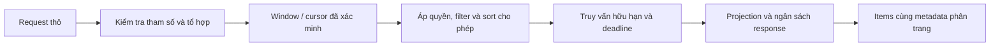

# Pagination limit

## 1. Pagination limit là một yêu cầu bảo mật

Phân trang chia một tập kết quả thành những phần nhỏ hơn. Trong API, pagination limit thường là giới hạn số phần tử mà một request được yêu cầu hoặc được trả về trong một trang.

Ví dụ:

```http
GET /api/documents?limit=25&offset=0
```

Nếu server dùng nguyên giá trị limit do client cung cấp, một request có thể yêu cầu hàng triệu bản ghi. Tác động có thể xuất hiện ở nhiều tầng:

- Cơ sở dữ liệu đọc, sắp xếp hoặc join quá nhiều dữ liệu.
- Ứng dụng giữ một tập đối tượng lớn trong bộ nhớ.
- Quá trình mapping và serialization sử dụng nhiều CPU.
- Response tiêu tốn băng thông, thời gian kết nối và tài nguyên proxy.
- Những request khác bị chậm do dùng chung connection pool, thread hoặc quota.

Vì vậy, pagination limit không chỉ là tiện ích giao diện. Nó là một phần của kiểm soát tiêu thụ tài nguyên và bảo vệ tính sẵn sàng.

Tuy nhiên, “mỗi trang tối đa 100 bản ghi” vẫn chưa đủ để chứng minh một API có chi phí hữu hạn phù hợp. Một trăm bản ghi lớn, nhiều quan hệ lồng nhau hoặc một truy vấn phải quét hàng triệu hàng vẫn có thể gây áp lực lớn.

Yêu cầu bảo mật tốt cần xác định cả kích thước trang, kiểu phân trang, độ sâu được phép, chi phí liên quan và cách xử lý khi chạm giới hạn.

### 1.1. Giới hạn do server quyết định

Client có thể đề nghị kích thước trang, nhưng server phải quyết định giới hạn thực tế.

Một hợp đồng minh họa:

```text
Kích thước mặc định: 25 phần tử
Kích thước tối thiểu: 1 phần tử
Kích thước tối đa: 100 phần tử
Offset tối đa: 10.000
Giá trị ngoài phạm vi: trả lỗi validation trước khi truy vấn dữ liệu
```

Các con số trên chỉ minh họa cách đặc tả. Giá trị của một sản phẩm phải dựa trên cấu trúc response, dữ liệu thực tế, năng lực hệ thống và mục tiêu độ trễ của endpoint.

Không mặc định cùng một giới hạn cho danh sách tên tài liệu, báo cáo tổng hợp và danh sách có file nhúng. Chi phí một phần tử có thể rất khác nhau.

### 1.2. Pagination limit khác rate limit

| Kiểm soát | Câu hỏi |
|---|---|
| Pagination limit | Một request được lấy bao nhiêu phần tử? |
| Response size limit | Một response được tạo tối đa bao nhiêu byte? |
| Query budget | Truy vấn được dùng bao nhiêu tài nguyên hoặc thời gian? |
| Rate limit | Một chủ thể được gửi bao nhiêu request trong một khoảng thời gian? |
| Concurrency limit | Có bao nhiêu công việc được chạy đồng thời? |

Một request rất lớn có thể gây vấn đề dù rate limit chưa bị vượt. Ngược lại, hàng nghìn request có limit nhỏ vẫn có thể làm cạn tài nguyên.

Các kiểm soát bổ sung cho nhau. Không dùng sự tồn tại của rate limit để cho phép limit tùy ý, và không coi limit nhỏ là bằng chứng đã ngăn được việc duyệt hàng loạt toàn bộ dữ liệu.

## 2. Những yếu tố làm chi phí một trang tăng

### 2.1. Số hàng trả về không bằng số hàng phải đọc

Một truy vấn có LIMIT 100 có thể vẫn phải:

- Quét một tập dữ liệu lớn để tìm 100 hàng phù hợp.
- Sắp xếp nhiều hàng trước khi lấy kết quả.
- Bỏ qua một offset rất sâu.
- Tính toán biểu thức hoặc join có chi phí cao.
- Kiểm tra quyền trên nhiều bản ghi.
- Chạy một truy vấn count riêng trên toàn bộ tập.

LIMIT là giới hạn đầu ra của truy vấn, không phải một cam kết chung rằng cơ sở dữ liệu chỉ làm việc trên đúng số hàng đó.

Yêu cầu cần gắn pagination với điều kiện lọc, thứ tự sắp xếp, index phù hợp và ngân sách thực thi của endpoint.

### 2.2. Một phần tử có thể chứa nhiều dữ liệu

Ví dụ một document chứa:

```json
{
  "id": "doc-example",
  "title": "Tài liệu",
  "content": "...",
  "comments": [],
  "attachments": [],
  "history": []
}
```

Nếu mỗi phần tử có nội dung dài và nhiều collection con, giới hạn 100 document không giới hạn tổng số comment, attachment hoặc độ dài content.

Một endpoint danh sách nên xác định projection: những trường nào được trả về cho mỗi phần tử. Nội dung lớn hoặc quan hệ nhiều phần tử có thể cần endpoint riêng và phân trang độc lập.

### 2.3. Fan-out làm ngân sách nhân lên

Nếu mỗi tài liệu khiến service gọi thêm một API hoặc thực hiện một truy vấn lấy chi tiết, 100 tài liệu có thể dẫn tới 100 công việc phụ.

Với dữ liệu lồng nhau:

```text
50 dự án × 100 tài liệu mỗi dự án × 50 bình luận mỗi tài liệu
```

số phần tử con có thể lớn hơn nhiều so với giới hạn ở cấp cao nhất.

Yêu cầu nên giới hạn cả số phần tử mỗi collection, chiều sâu mở rộng và tổng chi phí của request. Trong GraphQL hoặc API cho phép chọn trường, một giới hạn ở root list không tự giới hạn tất cả nhánh con.

## 3. Hợp đồng đầu vào cho tham số phân trang

### 3.1. Xác định tên và ngữ nghĩa

Những kiểu thường gặp:

| Kiểu | Ví dụ | Điểm cần đặc tả |
|---|---|---|
| Limit và offset | limit=25&offset=50 | Giới hạn kích thước và độ sâu |
| Page và size | page=3&size=25 | Trang bắt đầu từ 0 hay 1; phép nhân có kiểm soát |
| Cursor | limit=25&cursor=... | Cấu trúc, tính toàn vẹn, phạm vi và vòng đời cursor |
| Forward/backward | first, after, last, before | Tổ hợp nào được phép và giới hạn ở mỗi chiều |

Không nên cho phép mọi kiểu cùng lúc nếu không có quy tắc giải quyết xung đột. Ví dụ request có cả offset và cursor phải bị từ chối hoặc được xử lý theo một quy tắc đã công bố.

Sự khác nhau giữa page bắt đầu từ 0 và từ 1 có thể tạo request ngoài dự kiến. Đặc tả phải nhất quán giữa API, SDK và tài liệu.

### 3.2. Mặc định phải hữu hạn

Thiếu limit nên dẫn đến một mặc định có giới hạn, không phải “trả tất cả”.

Cần phân biệt:

- Không có tham số: dùng mặc định.
- Tham số có giá trị rỗng: lỗi hay mặc định.
- Giá trị 0: được phép hay bị từ chối.
- Giá trị âm: bị từ chối.
- Giá trị quá lớn: bị từ chối hay được giảm xuống.
- Giá trị không phải số nguyên: bị từ chối.

Ví dụ, một API có thể quy định limit=0 không hợp lệ, trong khi một API khác dùng nó để chỉ lấy metadata. Cả hai đều cần đặc tả rõ; không để ý nghĩa của 0 vô tình trở thành “không giới hạn” do cách thư viện hoạt động.

### 3.3. Chọn reject hoặc clamp

Hai hợp đồng có thể sử dụng:

| Cách xử lý | Ví dụ khi limit=1000 và trần là 100 |
|---|---|
| Reject | Trả lỗi validation, không thực hiện truy vấn dữ liệu |
| Clamp | Xử lý với effectiveLimit=100 và công bố giá trị thực tế |

Reject giúp phát hiện client sai và giữ hợp đồng nghiêm ngặt. Clamp có thể thuận tiện cho một số API nhưng phải được triển khai nhất quán.

Nếu clamp:

- Giá trị rất lớn hoặc malformed vẫn phải được parse an toàn.
- Response nên cho biết kích thước thực tế hoặc cung cấp next link đúng.
- Truy vấn, prefetch và serialization đều phải dùng effectiveLimit.
- Không được tạo công việc theo giá trị gốc rồi mới cắt response xuống 100.

Dù chọn cách nào, giới hạn nội bộ phải luôn có hiệu lực.

### 3.4. Tham số lặp và kiểu dữ liệu bất thường

Request:

```http
GET /api/documents?limit=10&limit=1000000
```

có thể được các lớp diễn giải khác nhau: lấy giá trị đầu, giá trị cuối hoặc danh sách. Cần xác định một chính sách thống nhất, chẳng hạn từ chối tham số phân trang lặp.

Tương tự, khi tham số nằm trong JSON, không chấp nhận tùy tiện:

```json
{
  "limit": [10, 1000000],
  "offset": {"value": 0}
}
```

Một số framework hỗ trợ binding linh hoạt; hợp đồng bảo mật nên yêu cầu đúng kiểu, đúng số lượng và không có ép kiểu làm thay đổi ý nghĩa.

### 3.5. Tràn số và phép tính offset

Với page và size:

```text
offset = page × size
```

cần kiểm tra cả hai toán hạng và phép nhân. Một giá trị được parse thành số nguyên lớn có thể làm tràn khi chuyển sang kiểu nhỏ hơn hoặc nhân trước khi kiểm tra.

Không nên xử lý theo thứ tự:

```text
parse → nhân không kiểm tra → ép kiểu → mới kiểm tra offset
```

Thay vào đó, giới hạn miền giá trị trước, dùng phép toán có kiểm tra hoặc kiểu đủ rộng và xác minh kết quả trước khi gọi repository.

Những biểu diễn như số thực, số dạng mũ, dấu cộng ở đầu hoặc chuỗi có khoảng trắng cần có quy tắc rõ ràng. Chấp nhận hay từ chối là lựa chọn hợp đồng; không nên phụ thuộc ngẫu nhiên vào parser của từng lớp.

## 4. Ví dụ Java: chuyển đầu vào thô thành một window có giới hạn

Ví dụ dưới đây dùng Java 17 trở lên, chọn chính sách reject và chỉ chấp nhận số thập phân ASCII không có dấu, không có khoảng trắng và không có số 0 ở đầu, ngoại trừ chính giá trị 0.

```java
public final class Pagination {
    public static final int DEFAULT_LIMIT = 25;
    public static final int MAX_LIMIT = 100;
    public static final int MAX_OFFSET = 10_000;

    private Pagination() {
    }

    public record Window(int limit, int offset) {
        public Window {
            if (limit < 1 || limit > MAX_LIMIT) {
                throw new IllegalArgumentException("Invalid limit");
            }
            if (offset < 0 || offset > MAX_OFFSET) {
                throw new IllegalArgumentException("Invalid offset");
            }
        }

        public int fetchLimit() {
            return limit + 1;
        }
    }

    public static Window parse(String rawLimit, String rawOffset) {
        int limit = rawLimit == null
                ? DEFAULT_LIMIT
                : parseDecimal(rawLimit, "limit", 3);

        int offset = rawOffset == null
                ? 0
                : parseDecimal(rawOffset, "offset", 5);

        return new Window(limit, offset);
    }

    private static int parseDecimal(
            String raw,
            String parameter,
            int maxDigits
    ) {
        if (raw.isEmpty() || raw.length() > maxDigits) {
            throw new IllegalArgumentException(
                    "Invalid " + parameter
            );
        }

        if (raw.length() > 1 && raw.charAt(0) == '0') {
            throw new IllegalArgumentException(
                    "Invalid " + parameter
            );
        }

        int result = 0;

        for (int i = 0; i < raw.length(); i++) {
            char current = raw.charAt(i);

            if (current < '0' || current > '9') {
                throw new IllegalArgumentException(
                        "Invalid " + parameter
                );
            }

            result = Math.addExact(
                    Math.multiplyExact(result, 10),
                    current - '0'
            );
        }

        return result;
    }
}
```

Hành vi theo hợp đồng:

| Đầu vào | Kết quả |
|---|---|
| Không có limit và offset | limit=25, offset=0 |
| limit=1 | Chấp nhận |
| limit=100 | Chấp nhận |
| limit=101 | Từ chối |
| limit=0 | Từ chối |
| limit=-1 | Từ chối |
| limit rỗng | Từ chối |
| limit=01 | Từ chối theo quy ước biểu diễn của ví dụ |
| offset=10000 | Chấp nhận |
| offset=10001 | Từ chối |
| Chuỗi số rất dài | Từ chối trước truy vấn |

Ví dụ kiểm tra độ dài trước khi parse và kiểm tra phạm vi trong kiểu Window. fetchLimit tối đa là 101 nên phép cộng không chạm giới hạn số nguyên trong hợp đồng này.

Có những trách nhiệm không nằm trong hàm parse:

- HTTP adapter phải từ chối tham số lặp trước khi chọn rawLimit.
- Lỗi validation cần được chuyển thành response client error có kiểm soát.
- Repository phải dùng Window, không đọc lại giá trị thô từ request.
- Hệ thống vẫn cần giới hạn độ dài URL và request tại ranh giới phù hợp.
- Con số MAX_OFFSET phải được đánh giá trên dữ liệu và truy vấn thực tế.

Không trả nguyên chuỗi đầu vào khổng lồ trong thông báo lỗi hoặc log. Chỉ ghi mã lỗi và thông tin cần thiết theo chính sách vận hành.

## 5. Áp giới hạn tại tầng truy vấn

### 5.1. Không tải tất cả rồi cắt danh sách

Cách xử lý không đáp ứng mục tiêu tài nguyên:

```text
allRows = repository.findAllMatching(...)
return allRows.take(validatedLimit)
```

Dù response có 100 phần tử, ứng dụng và cơ sở dữ liệu có thể đã xử lý toàn bộ tập.

Cách mong muốn:

```text
window = validatePagination(request)
rows = repository.findVisiblePage(
    trustedContext,
    validatedFilters,
    window
)
return buildPage(rows, window)
```

Giới hạn phải đi vào thao tác truy vấn hoặc cơ chế đọc dữ liệu phía dưới, không chỉ tầng trình bày.

### 5.2. Ví dụ truy vấn có phạm vi

Một ví dụ đơn giản cho danh sách tài liệu mà người gọi sở hữu:

```sql
SELECT id, title, created_at
FROM document
WHERE tenant_id = :trusted_tenant_id
  AND owner_id = :authenticated_user_id
ORDER BY created_at DESC, id DESC
LIMIT :fetch_limit
OFFSET :validated_offset;
```

Các giá trị phải được bind bằng cơ chế tham số của lớp truy cập dữ liệu, không nối vào SQL từ chuỗi request.

Điều kiện owner_id chỉ minh họa một chính sách quyền đơn giản. Nếu sản phẩm có chia sẻ theo nhóm hoặc grant, truy vấn phải phản ánh phạm vi thực tế đó.

Phân quyền cần được áp dụng trước khi phân trang và tính metadata. Lọc quyền sau khi đã lấy một trang toàn cục có thể gây lộ count, trả trang không ổn định hoặc đưa dữ liệu ngoài phạm vi vào các lớp trung gian.

### 5.3. Thứ tự phải ổn định

ORDER BY created_at mà không có khóa phân định có thể không tạo thứ tự duy nhất nếu nhiều bản ghi cùng thời điểm.

Thêm một tie-breaker ổn định, chẳng hạn id, giúp xác định ranh giới trang:

```text
created_at DESC, id DESC
```

Cột sắp xếp phải được chọn từ tập được phép. Không nhận một đoạn ORDER BY hoặc tên cột tùy ý từ cursor hay request rồi ghép trực tiếp vào truy vấn.

Ngay cả khi có thứ tự duy nhất, dữ liệu thêm hoặc xóa giữa các request vẫn có thể làm thay đổi kết quả offset pagination. Nếu chức năng cần snapshot nhất quán, phải có thiết kế riêng; thứ tự ổn định không tự tạo snapshot.

### 5.4. Lấy thêm một phần tử để xác định hasNext

Nếu client yêu cầu L phần tử, server có thể truy vấn tối đa L+1 phần tử:

```text
fetchLimit = L + 1
hasNext = số phần tử đã lấy > L
items = tối đa L phần tử đầu
```

Phần tử thăm dò không được trả ra ngoài hoặc bị tính là phần tử của trang hiện tại.

Đối với cursor, next cursor nên gắn với phần tử cuối cùng thực sự đã trả, không phải phần tử thăm dò. Nếu lấy vị trí của phần tử thăm dò làm ranh giới, trang tiếp theo có thể bỏ sót nó.

Kỹ thuật này có thể tránh một count toàn cục chỉ để biết còn trang sau, nhưng không làm truy vấn nền tự rẻ. Vẫn cần phạm vi, index và ngân sách phù hợp.

## 6. Offset sâu và cursor pagination

### 6.1. Vì sao phải giới hạn offset?

Một offset rất lớn có thể buộc hệ thống bỏ qua nhiều kết quả trước khi trả một trang nhỏ. Chi phí cụ thể phụ thuộc engine, index và kế hoạch truy vấn, nhưng không nên giả định limit nhỏ khiến offset sâu luôn rẻ.

Hợp đồng có thể:

- Giới hạn offset tối đa.
- Chỉ hỗ trợ offset cho danh sách có kích thước vừa phải.
- Chuyển sang cursor cho luồng duyệt dài.
- Cung cấp export bất đồng bộ có quota cho nhu cầu tải khối lượng lớn.

Khi vượt trần offset, response nên hướng client tới cách truy cập được hỗ trợ theo tài liệu. Không tự bỏ giới hạn vì client muốn “trang cuối”.

### 6.2. Keyset pagination

Với thứ tự giảm dần theo created_at và id, trang sau có thể dùng vị trí cuối đã trả:

```sql
SELECT id, title, created_at
FROM document
WHERE tenant_id = :trusted_tenant_id
  AND owner_id = :authenticated_user_id
  AND (
      created_at < :last_created_at
      OR (
          created_at = :last_created_at
          AND id < :last_id
      )
  )
ORDER BY created_at DESC, id DESC
LIMIT :fetch_limit;
```

Đây là ví dụ cho dữ liệu có các cột không null và kiểu id hỗ trợ so sánh theo thứ tự đã chọn. Thiết kế thực tế phải thống nhất thứ tự, precision thời gian, kiểu dữ liệu và index.

Keyset tránh biểu diễn vị trí bằng một offset lớn, nhưng không tự bảo đảm mọi filter đều hiệu quả. Filter không phù hợp index hoặc có join phức tạp vẫn cần đánh giá chi phí.

### 6.3. Cursor là dữ liệu không tin cậy

Một cursor thường mang trạng thái phân trang. Có thể gồm:

```json
{
  "version": 1,
  "tenant": "tenant-reference",
  "filterFingerprint": "fingerprint-of-normalized-query",
  "sort": "createdAtDesc",
  "lastCreatedAt": "2026-01-01T10:00:00Z",
  "lastId": "object-reference",
  "expiresAt": "2026-01-01T10:15:00Z"
}
```

Cấu trúc này chỉ minh họa payload logic, không phải token hoàn chỉnh.

Yêu cầu cần xác định:

- Độ dài cursor tối đa trước khi decode hoặc parse.
- Schema, version và kiểu dữ liệu được chấp nhận.
- Cách bảo vệ tính toàn vẹn hoặc lưu trạng thái ở server.
- Phạm vi tenant, filter và sort mà cursor thuộc về.
- Thời hạn nếu cursor có vòng đời hữu hạn.
- Cách xử lý cursor sai, cũ hoặc không phù hợp request.

Base64 không tạo tính toàn vẹn và không tạo bí mật. Nếu cursor có nội dung nhạy cảm, chữ ký chỉ chống sửa đổi chứ không che nội dung. Có thể cần mã hóa hoặc dùng token ngẫu nhiên tham chiếu trạng thái phía server, tùy mô hình.

Không tự viết một thuật toán token mới chỉ để làm cursor. Hãy sử dụng thành phần mật mã hoặc cơ chế trạng thái đã được thiết kế và quản lý khóa phù hợp.

### 6.4. Cursor không thay thế authorization

Ngay cả cursor có chữ ký hợp lệ cũng không tự là quyền đọc tài nguyên.

Mỗi trang phải áp dụng quyền hiện hành theo hợp đồng của chức năng. Nếu membership bị thu hồi, cursor cũ không được tiếp tục mở quyền ngoài chính sách.

Nếu response phụ thuộc riêng vào subject, cần ràng buộc cursor hoặc truy vấn với subject phù hợp. Một cursor không được biến thành cách chuyển kết quả đã phân quyền của người A cho người B.

Nếu hệ thống chủ ý dùng một capability token để cấp quyền, đó là một cơ chế ủy quyền riêng có phạm vi, thời hạn, khả năng thu hồi và yêu cầu bảo mật tương ứng; không mặc định mọi cursor có vai trò đó.

### 6.5. Không để cursor điều khiển truy vấn tùy ý

Sau khi xác minh cursor, server vẫn phải ánh xạ dữ liệu vào những cấu trúc cho phép:

- Sort là một lựa chọn hữu hạn, không phải đoạn SQL.
- Vị trí cuối có kiểu dữ liệu cố định.
- Limit luôn được kiểm tra theo policy hiện tại.
- Tenant vẫn đến từ context đáng tin.
- Filter phải khớp ngữ cảnh cursor hoặc được kiểm tra lại.

Một cursor đã ký nhưng chứa page size lớn được cấp từ cấu hình cũ không được vô hiệu hóa trần an toàn hiện hành một cách ngoài dự kiến.

## 7. Count, projection và giới hạn response

### 7.1. Total count có ngân sách riêng

Một API trả:

```json
{
  "items": [],
  "total": 1234567
}
```

có thể phải chạy một truy vấn count đáng kể dù items rất nhỏ.

Cần quyết định:

- Có thực sự cần exact total trên mọi request không.
- Count có áp dụng cùng phạm vi quyền và filter không.
- Có cho phép bỏ count và chỉ trả hasNext không.
- Có dùng ước lượng hoặc count giới hạn không, và client được thông báo thế nào.
- Count có timeout hoặc cache phù hợp không.

Không trả ước lượng như thể là số chính xác. Không dùng count toàn tenant nếu người gọi chỉ được xem một tập con, trừ khi có quyền thống kê riêng.

### 7.2. Projection giúp giới hạn chi phí mỗi phần tử

Endpoint danh sách có thể chỉ trả:

```json
{
  "id": "doc-example",
  "title": "Tên tài liệu",
  "updatedAt": "2026-01-01T10:00:00Z"
}
```

Nội dung tài liệu, lịch sử và file được lấy qua những thao tác riêng có kiểm soát.

Nếu client được chọn fields hoặc include, phải có allowlist và ngân sách tương ứng. Không để include=all mở toàn bộ quan hệ lồng nhau dù limit ở root vẫn nhỏ.

Một giới hạn độ dài trường hoặc số phần tử con có thể cần thiết để giữ tổng kích thước response có thể dự đoán.

### 7.3. Số byte cần được định nghĩa rõ

Nếu đặt response budget, cần nói rõ đang đo:

- JSON UTF-8 trước nén.
- Dữ liệu đã nén trên đường truyền.
- Tổng dung lượng được đọc từ nguồn.
- Hay một kết hợp các giới hạn.

Một response nén nhỏ có thể vẫn cần nhiều bộ nhớ và CPU để dựng trước khi nén. Vì vậy, chỉ giới hạn byte sau nén không đáp ứng mọi mục tiêu.

Nếu quá ngân sách, API cần có hành vi đã thiết kế. Không ghi một nửa JSON rồi bất ngờ đổi status code. Có thể cần buffer hữu hạn, cơ chế đo sớm hoặc giao thức streaming có cách biểu diễn lỗi riêng.

Nếu cho phép trả ít hơn requestedLimit vì ngân sách byte, next cursor phải dựa trên phần tử cuối thực sự đã trả để tránh mất dữ liệu giữa các trang.

## 8. Ngân sách thời gian, hủy công việc và tải đồng thời

### 8.1. Timeout ở client không đủ

Client ngừng chờ không có nghĩa query ở database hoặc các request downstream đã dừng.

Yêu cầu nên xác định:

- Timeout truy vấn hoặc statement ở tầng dữ liệu.
- Deadline của request.
- Timeout cho lời gọi downstream.
- Cách truyền tín hiệu hủy và giới hạn tài nguyên khi việc hủy chưa có hiệu lực.
- Giới hạn concurrency cho tác vụ nặng.

Những ngân sách này cần phù hợp với nhau để không giữ công việc chạy lâu sau khi request đã thất bại.

Không hứa việc hủy có hiệu lực tức thời ở mọi tầng. Cần bảo đảm công việc còn lại bị giới hạn và có quan sát được.

### 8.2. Giới hạn theo loại endpoint

Có thể một endpoint metadata cho phép 100 phần tử, còn một endpoint tổng hợp chỉ cho 20. Quyền gọi API không tự cấp quyền bỏ qua trần tài nguyên.

Nếu có quota cao hơn cho một loại service account, phải có policy cụ thể và giới hạn hữu hạn. Tránh một nhánh “admin không giới hạn” làm mất bảo vệ tính sẵn sàng.

### 8.3. Export không phải pagination không giới hạn

Nhu cầu lấy nhiều dữ liệu nên được thiết kế như một workflow riêng khi phù hợp:

```text
Yêu cầu export
    → kiểm tra quyền và quota
    → xếp hàng có giới hạn
    → xử lý theo từng chunk hữu hạn
    → lưu artifact có thời hạn
    → kiểm tra quyền khi tải kết quả
```

Export vẫn cần giới hạn số hàng hoặc dung lượng, thời gian, concurrency và lưu trữ. Không chuyển endpoint đồng bộ sang limit=-1 để đáp ứng xuất dữ liệu lớn.

Phân trang cũng không phải cơ chế chống trích xuất toàn bộ dữ liệu. Một người có quyền có thể gọi nhiều trang; việc hạn chế harvesting cần quota, phát hiện hành vi và chính sách truy cập phù hợp.

## 9. Kiến trúc thực thi nhất quán

Một luồng request có thể được tổ chức:



Giới hạn tại proxy hoặc gateway hữu ích nhưng service không nên phụ thuộc hoàn toàn vào đó. Một caller nội bộ, job hoặc đường gọi mới có thể không đi qua cùng gateway.

Có thể đặt policy chung cho cách parse và giới hạn cơ bản, đồng thời cho phép từng endpoint có trần thấp hơn theo chi phí.

Những điểm cần đồng nhất:

| Thành phần | Trách nhiệm |
|---|---|
| HTTP adapter | Đúng kiểu, tham số lặp, tổ hợp không hợp lệ |
| Pagination policy | Mặc định, min, max, trần offset, version |
| Cursor component | Xác minh tính toàn vẹn, schema và phạm vi |
| Service | Quyền, filter, lựa chọn query và deadline |
| Repository | Giới hạn thực tế ở nguồn dữ liệu |
| Mapper/serializer | Projection, số phần tử và ngân sách byte |
| Response builder | next cursor, hasNext và effective limit chính xác |
| Vận hành | Theo dõi vi phạm, thời gian, số hàng và tài nguyên |

Không để controller dùng max=100 nhưng repository helper lại có chế độ “0 là không giới hạn”. Giá trị đã chuẩn hóa phải giữ cùng ngữ nghĩa suốt luồng.

## 10. Chuyển rủi ro thành yêu cầu có thể kiểm chứng

### 10.1. Yêu cầu mơ hồ và yêu cầu cụ thể

Yêu cầu mơ hồ:

> API phải hỗ trợ pagination để tránh quá tải.

Yêu cầu cụ thể cho một endpoint danh sách:

> Endpoint danh sách tài liệu dùng limit mặc định 25 và chỉ chấp nhận số nguyên từ 1 đến 100. Offset nằm trong khoảng 0 đến 10.000. Tham số rỗng, lặp, sai kiểu hoặc ngoài phạm vi bị từ chối trước khi thực hiện truy vấn dữ liệu. Không có giá trị đặc biệt nào được hiểu là trả toàn bộ kết quả.

Yêu cầu thực thi:

> Service phải truyền window đã validation xuống repository. Repository chỉ lấy tối đa limit+1 bản ghi cho mục đích xác định hasNext; response trả tối đa limit bản ghi. Không tải toàn bộ tập rồi cắt ở tầng ứng dụng.

Yêu cầu về quyền:

> Điều kiện truy vấn, count và cursor phải áp dụng phạm vi dữ liệu hiện hành của người gọi. Cursor không được dùng làm bằng chứng thay thế membership hoặc quyền đọc.

Yêu cầu về chi phí:

> Các filter, sort, projection và expansion được hỗ trợ phải có ngân sách thực thi xác định. Mỗi collection con có trần riêng; tổng response và lời gọi phụ phải nằm trong ngân sách của endpoint.

Các mức thời gian, dung lượng và chi phí cần được điền từ quyết định kiến trúc đã đánh giá. Không để những cụm từ “hữu hạn hợp lý” thay cho con số hoặc cơ chế có thể đo.

### 10.2. Mẫu yêu cầu truy vết

```text
ID: API-PAGE-01
Tài sản: tính sẵn sàng của API và hệ thống dữ liệu
Endpoint: danh sách tài liệu
Đầu vào:
    limit, offset
Quy tắc:
    mặc định 25
    1 <= limit <= 100
    0 <= offset <= 10.000
    không tham số lặp
    không chế độ trả tất cả
Điểm thực thi:
    adapter + kiểu Window + repository
Response:
    tối đa limit phần tử
    hasNext đúng theo phần tử thăm dò
Bằng chứng:
    giá trị biên, đầu vào bất thường và quan sát truy vấn
Chủ sở hữu:
    nhóm phụ trách API danh sách tài liệu
```

Đây là mẫu ghi yêu cầu, không phải cấu hình bắt buộc cho mọi API.

### 10.3. Bảng rủi ro và bằng chứng

| Rủi ro | Kiểm soát | Bằng chứng chấp nhận |
|---|---|---|
| Client yêu cầu trang rất lớn | Trần server hữu hạn | Không có truy vấn dữ liệu với giá trị ngoài phạm vi |
| Tràn khi tính offset | Parse và phép toán có kiểm soát | Đầu vào lớn không tạo offset âm hoặc bypass |
| Offset sâu gây chi phí lớn | Trần offset hoặc cursor | Request vượt trần có hành vi đã công bố |
| Tải mọi hàng rồi cắt | Giới hạn tại repository | Số hàng được materialize có giới hạn phù hợp |
| Count vượt quyền hoặc quá đắt | Phạm vi quyền và ngân sách count | Metadata không tính ngoài phạm vi được phép |
| Nested expansion nhân dữ liệu | Trần từng nhánh và tổng chi phí | Không có collection con vô hạn |
| Cursor bị sửa | Kiểm tra tính toàn vẹn hoặc trạng thái server | Cursor không hợp lệ bị từ chối trước query |
| Cursor chéo tenant hoặc filter | Ràng buộc phạm vi | Không tái sử dụng để đổi ngữ cảnh trái hợp đồng |
| Response quá lớn | Projection và ngân sách byte | Không tạo response vượt mức đã định nghĩa |
| Nhiều request nhỏ làm cạn pool | Rate và concurrency limit | Tải đồng thời không vượt quota đã thiết kế |

## 11. Tình huống chấp nhận

Những tình huống dưới đây mô tả cách kiểm chứng khi triển khai, không phải kết quả kiểm thử đã chạy cho một hệ thống cụ thể.

### 11.1. Giá trị biên

Với hợp đồng minh họa 1..100:

- Thiếu limit dùng 25.
- limit=1 và limit=100 được chấp nhận.
- limit=0, limit=-1 và limit=101 bị từ chối.
- Chuỗi số dài bị xử lý có kiểm soát.
- Giá trị rỗng, dấu cách, số thực và số dạng mũ tuân thủ đúng quy tắc.
- Tham số limit lặp không được mỗi tầng hiểu một cách.
- Offset ở trần được xử lý đúng; vượt trần bị từ chối.
- Nếu dùng page × size, kết quả không tràn số.

Khi kiểm tra request bị từ chối, cần xác nhận không có truy vấn danh sách hoặc count tốn kém đã được thực hiện trước validation. Những thao tác xác thực hoặc ghi log có thể vẫn xảy ra theo kiến trúc, nhưng không được khởi chạy công việc dữ liệu không hợp lệ.

### 11.2. Kết quả và metadata

| Trạng thái dữ liệu | Kết quả mong đợi |
|---|---|
| Không có phần tử phù hợp | items rỗng; metadata nhất quán |
| Có ít hơn limit | Trả đúng phần tử được phép |
| Có đúng limit và không còn dữ liệu | hasNext=false theo cơ chế đã chọn |
| Có nhiều hơn limit | Trả tối đa limit, hasNext=true |
| Nhiều hàng cùng sort key | Tie-breaker giữ thứ tự xác định |
| Có phần tử thăm dò | Không trả phần tử đó trong trang hiện tại |
| Trang bị giảm vì ngân sách byte | Cursor tiếp theo không bỏ sót phần tử chưa trả |
| Dữ liệu thay đổi giữa hai trang | Hành vi phù hợp cam kết nhất quán của API |

### 11.3. Cursor và thay đổi quyền

Cần bao phủ:

- Cursor bị cắt ngắn, quá dài hoặc sai định dạng.
- Cursor có version không hỗ trợ.
- Cursor có tính toàn vẹn không hợp lệ.
- Cursor hết hạn nếu hợp đồng có thời hạn.
- Cursor dùng với filter hoặc sort khác.
- Cursor của tenant khác.
- Cursor được dùng sau khi quyền bị thu hồi.
- Cursor cũ khi trần limit hiện hành đã giảm.
- Hai request dùng lại cursor theo chính sách đã công bố.

Không mặc định cursor phải dùng một lần. Replay có thể là hành vi hợp lệ cho phân trang đọc; nếu cần ngăn replay, phải có lý do và thiết kế trạng thái riêng.

### 11.4. Kiểm chứng chi phí

Không chỉ đếm số phần tử trong JSON. Cần xem xét:

- Số hàng hoặc dữ liệu được đọc, materialize và serialize.
- Query plan trên kích thước dữ liệu đại diện.
- Chi phí count và filter khó nhất trong tập được hỗ trợ.
- Số truy vấn hoặc lời gọi downstream trên một trang.
- Bộ nhớ và CPU khi các trường có kích thước lớn.
- Kích thước response theo định nghĩa trước hoặc sau nén.
- Thời gian giữ connection khi query timeout hoặc client ngắt.
- Tải đồng thời trong ngân sách đã thiết kế.

Một phép thử trên bảng có vài hàng không đủ để kết luận trần an toàn cho dữ liệu sản xuất lớn hơn nhiều.

## 12. Lỗi thường gặp và vận hành

### 12.1. Chỉ giới hạn ở frontend

Client có thể gọi API trực tiếp và bỏ qua lựa chọn page size trong giao diện. Server phải thực thi độc lập.

### 12.2. Mặc định nhỏ nhưng không có max

Một mặc định 25 không có tác dụng với request gửi limit=1000000 nếu server vẫn chấp nhận. Mặc định và trần là hai quyết định riêng.

### 12.3. Giới hạn response sau khi đã làm hết công việc

Cắt danh sách sau findAll hoặc cắt JSON sau khi dựng toàn bộ không bảo vệ chi phí ở các tầng trước. Giới hạn phải đi vào nguồn dữ liệu và workflow.

### 12.4. Tin cursor vì đã Base64

Base64 chỉ là biểu diễn. Dữ liệu cursor vẫn cần schema, giới hạn độ dài và cơ chế bảo vệ phù hợp.

### 12.5. Đếm toàn bộ để trả một trang nhỏ

Nếu count không cần cho chức năng, có thể tránh hoặc tách riêng. Nếu cần, phải có ngân sách, phạm vi quyền và cách thông báo độ chính xác.

### 12.6. Bỏ qua phần tử lồng nhau

Giới hạn root list không giới hạn content, history hoặc comments bên trong. Projection và expansion cần chính sách riêng.

### 12.7. Giám sát và điều chỉnh

Những chỉ số hữu ích gồm:

- Phân bố requestedLimit và effectiveLimit.
- Tỷ lệ request bị từ chối vì tham số phân trang.
- Độ sâu offset được sử dụng.
- Kích thước response.
- Thời gian query, count và serialization.
- Số lời gọi phụ trên mỗi trang.
- Timeout, cancellation và số công việc còn chạy sau deadline.
- Cursor không hợp lệ theo nhóm nguyên nhân.

Không ghi nguyên cursor nếu nó chứa dữ liệu nhạy cảm hoặc có vai trò token. Có thể ghi loại lỗi, endpoint và correlation ID theo chính sách log.

Khi thay trần, cần cập nhật đồng bộ policy, tài liệu, SDK và cursor nếu bị ảnh hưởng. Việc tăng max để giải quyết một yêu cầu nghiệp vụ phải dựa trên đánh giá chi phí mới, không chỉ sửa một hằng số.

## 13. Điểm cần ghi nhớ

Pagination limit là một phần của hợp đồng sử dụng tài nguyên: server kiểm soát kích thước trang, cách duyệt dữ liệu và lượng công việc cần làm.

Một thiết kế đầy đủ kết hợp validation đầu vào, truy vấn có giới hạn, thứ tự ổn định, trần offset hoặc cursor phù hợp, phạm vi phân quyền, projection, ngân sách response và deadline. Rate limit, concurrency limit và export có kiểm soát giải quyết những nhu cầu bổ sung.

Yêu cầu có thể kiểm chứng phải chỉ rõ giá trị mặc định, trần, hành vi vượt giới hạn, điểm thực thi và bằng chứng tài nguyên. Số phần tử ít trong response chỉ có ý nghĩa bảo vệ khi toàn bộ luồng xử lý cũng tuân theo ngân sách đã thiết kế.
