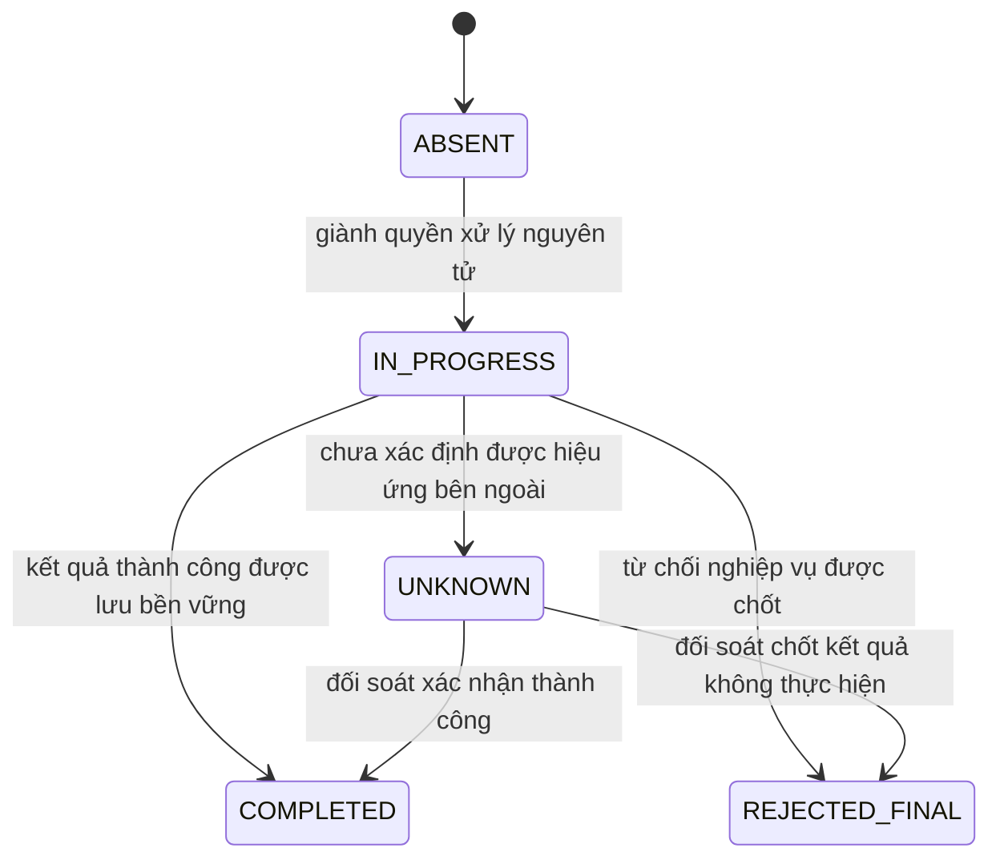

# Idempotency key

## 1. Khi client không biết request trước đã thành công hay chưa

Một học viên bấm đăng ký khóa học. Server ghi nhận đăng ký, tạo yêu cầu gửi thông báo rồi trả phản hồi. Kết nối bị ngắt trước khi client nhận được phản hồi. Nếu client gửi lại một lệnh mới, hệ thống có thể tạo đăng ký, giảm chỗ trống hoặc phát thông báo thêm lần nữa.

Vấn đề không chỉ là người dùng bấm hai lần. Timeout, mất kết nối, client khởi động lại, proxy retry và tác vụ nền đều có thể khiến cùng một ý định nghiệp vụ được gửi nhiều lần. Client thường không thể suy ra từ lỗi kết nối rằng server chưa thực hiện hành động.

Idempotency key là một định danh do giao thức ứng dụng sử dụng để liên kết các lần gửi lại với cùng một ý định thao tác. Server nhận diện các request trong cùng phạm vi, kiểm tra chúng có thực sự đại diện cùng nội dung và tránh thực hiện lại tác dụng phụ đã được chấp nhận theo hợp đồng.

Trong thiết kế yêu cầu bảo mật, mục tiêu là bảo vệ tính toàn vẹn và khả năng phục hồi của thao tác: retry không được tùy tiện tạo hiệu ứng lặp, nhưng key cũng không được trở thành cách đọc kết quả của người khác hoặc bỏ qua phân quyền.

Sau bài này, người học có thể:

- Phân biệt idempotency của thao tác, deduplication và cam kết xử lý đúng một lần.
- Đặc tả phạm vi key, fingerprint của request và thời hạn bảo đảm.
- Thiết kế hành vi cho request hoàn tất, đang chạy, khác payload và có kết quả chưa xác định.
- Xác định các yêu cầu transaction, đồng thời và xử lý tác dụng phụ bên ngoài.
- Viết tiêu chí nghiệm thu cho retry, lỗi mạng, đổi quyền và giới hạn tài nguyên.

## 2. Key giải quyết vấn đề gì và không giải quyết vấn đề gì?

### 2.1. Một ý định, nhiều lần truyền

Phải phân biệt:

- **Ý định nghiệp vụ:** học viên đăng ký một khóa học trong một đợt cụ thể.
- **Lần truyền request:** lần gửi ban đầu và những lần retry để nhận kết quả của ý định đó.
- **Thao tác mới:** một yêu cầu khác, dù trông giống yêu cầu trước về dữ liệu.

Client tạo key khi hình thành một ý định mới và giữ key đó cho các lần retry. Nếu tạo key mới mỗi lần nhận timeout, server sẽ thấy các ý định khác nhau và không thể dựa vào key để chống thực hiện lặp.

Ngược lại, dùng một key cố định cho mọi hành động của người dùng làm các thao tác độc lập bị gộp hoặc xung đột với nhau.

### 2.2. Idempotency không yêu cầu mọi phản hồi giống nhau ở mức byte

Một thao tác có tính idempotent khi việc thực hiện lặp lại có hiệu ứng dự kiến tương đương với việc thực hiện một lần theo hợp đồng. Điều này không tự yêu cầu mọi header, dấu thời gian hoặc mã tương quan của các phản hồi giống nhau.

Với cơ chế key, API có thể cam kết trả lại kết quả nghiệp vụ đã lưu, hoặc trả một tham chiếu ổn định để truy vấn kết quả. Hợp đồng phải chỉ rõ phần nào được lặp lại và phần nào có thể được tạo mới cho mỗi lần truyền.

Không nên hứa “trả nguyên mọi thứ” nếu phản hồi chứa cookie, liên kết ngắn hạn hoặc dữ liệu chỉ được đọc khi quyền hiện tại còn hiệu lực.

### 2.3. Không phải bảo đảm exactly-once cho toàn bộ hệ thống

Một kho key có thể giúp tránh lặp tác dụng phụ trong phạm vi được thiết kế. Nó không tự tạo transaction chung giữa cơ sở dữ liệu, hàng đợi và một dịch vụ bên ngoài.

Nếu server gọi dịch vụ thông báo, dịch vụ đó đã nhận việc nhưng phản hồi bị mất, server vẫn cần cơ chế xác định hoặc giới hạn lặp ở phía tích hợp. Cũng không thể suy ra “chưa thực hiện” chỉ vì tiến trình xử lý đã dừng.

Yêu cầu cần nói rõ hiệu ứng nào được bảo đảm, ở đâu, trong khoảng thời gian nào và dựa trên cơ chế nào. Cụm từ “xử lý đúng một lần” không đủ nếu chưa xác định ranh giới và điều kiện thất bại.

### 2.4. Không thay xác thực, phân quyền hay ràng buộc nghiệp vụ

Key không phải mật khẩu, quyền truy cập hoặc bằng chứng người gọi được phép thực hiện chức năng. Mỗi request, kể cả retry chỉ để đọc kết quả cũ, vẫn cần xác thực và phân quyền phù hợp.

Key cũng không thay thế ràng buộc nghiệp vụ. Hai request dùng hai key khác nhau vẫn có thể cố tạo hai đăng ký trái với quy tắc chỉ có một đăng ký trong cùng đợt. Ràng buộc duy nhất hoặc cơ chế nhất quán của nghiệp vụ phải ngăn trường hợp đó nếu chính sách yêu cầu.

## 3. Ví dụ hợp đồng API

Giả sử nền tảng cung cấp thao tác đăng ký khóa học:

```http
POST /api/enrollments
Authorization: Bearer <access-token>
Content-Type: application/json
Idempotency-Key: 8bdca4c3d9624bbd9b90f2da789a64c72

{
  "courseId": "course-27",
  "learnerId": "learner-184",
  "enrollmentCycle": "cycle-3"
}
```

Tên header và cấu trúc trên là một profile minh họa của ứng dụng. Không giả định mọi API hoặc mọi hạ tầng đều hỗ trợ cùng hành vi chỉ vì dùng cùng tên header.

Profile này có thể quy định:

1. Key bắt buộc cho thao tác tạo đăng ký.
2. Các lần truyền cùng ý định phải dùng cùng key và cùng nội dung theo quy tắc fingerprint đã công bố.
3. Key có hiệu lực trong phạm vi danh tính ổn định, tenant đã xác minh và thao tác nghiệp vụ.
4. Cùng phạm vi, cùng key, cùng fingerprint: không tạo lại tác dụng phụ đã hoàn tất trong thời hạn bảo đảm.
5. Cùng phạm vi, cùng key, khác fingerprint: trả lỗi xung đột; không thực hiện nội dung mới.
6. Mọi lần gọi đều kiểm tra quyền hiện tại theo chính sách trước khi trả dữ liệu kết quả.

Phản hồi lần đầu có thể là:

```http
HTTP/1.1 201 Created
Content-Type: application/json

{
  "enrollmentId": "enrollment-542",
  "status": "CONFIRMED"
}
```

Lần retry hợp lệ nhận lại cùng kết quả nghiệp vụ theo profile, thay vì tạo `enrollmentId` mới. Nếu quyền đã bị thu hồi hoặc kết quả không còn được phép đọc, API phải thực hiện chính sách truy cập hiện tại; key không buộc hệ thống phát lại dữ liệu trái quyền.

## 4. Thiết kế phạm vi key

### 4.1. Không dùng key trần làm không gian dùng chung toàn hệ thống

Nếu tra cứu chỉ theo key do client gửi, hai người dùng vô tình dùng cùng giá trị có thể xung đột hoặc đọc nhầm kết quả. Một người biết key cũng có thể tác động đến thao tác của người khác nếu hệ thống thiếu ranh giới.

Một khóa định danh logic có thể là:

```text
(
  verifiedTenantId,
  stableActorId,
  operationId,
  clientIdempotencyKey
)
```

Đây là một lựa chọn thiết kế, không phải cấu trúc bắt buộc cho mọi hệ thống. API tích hợp có thể cần thêm định danh ứng dụng hoặc phạm vi ủy quyền. Phạm vi phải phù hợp với việc ai có thể retry và ai được phép đọc kết quả.

### 4.2. Dùng danh tính ổn định, không dùng chuỗi token làm danh tính

Access token có thể được làm mới trong khi ý định nghiệp vụ vẫn còn. Nếu phạm vi phụ thuộc vào nguyên chuỗi token, lần retry sau làm mới token có thể trở thành một thao tác mới ngoài dự kiến.

Ngược lại, dùng một tài khoản dịch vụ chung mà không phân biệt phạm vi đại diện có thể gộp yêu cầu của nhiều bên. Hợp đồng cần xác định chủ thể ổn định và ngữ cảnh ủy quyền từ nguồn đã xác minh.

Tenant từ body hoặc header chỉ là một đầu vào lựa chọn phạm vi. Server phải xác minh quyền trong tenant và dùng dữ liệu đáng tin cậy để hình thành phạm vi thực thi.

### 4.3. Operation ID cần có ngữ nghĩa rõ

Một key dùng cho `enrollment.create` không nên vô tình khóa luôn `enrollment.cancel`. Việc dùng lại key giữa các thao tác được xử lý theo phạm vi đã công bố.

Nếu nhiều phiên bản hoặc alias thực hiện cùng một ý định, cần quyết định chúng dùng chung operation ID hay tách riêng. Không để một lần đổi URL làm retry vượt qua cơ chế chống lặp mà không có quyết định thiết kế.

Nếu thay đổi phiên bản làm nội dung hoặc ngữ nghĩa không còn tương thích, quy tắc fingerprint và phạm vi cũng phải phản ánh sự thay đổi đó.

### 4.4. Key khó đoán vẫn không thay phân quyền

Key nên có xác suất trùng thấp và được tạo theo cơ chế phù hợp, chẳng hạn một giá trị ngẫu nhiên đủ dài cho quy mô sử dụng. Không đặt dữ liệu cá nhân, bí mật hoặc thông tin nghiệp vụ không cần thiết trực tiếp vào key.

Ví dụ tạo 16 byte ngẫu nhiên rồi biểu diễn bằng hex trong môi trường trình duyệt có API tương ứng:

```javascript
function newIdempotencyKey() {
  const bytes = new Uint8Array(16);
  crypto.getRandomValues(bytes);
  return Array.from(bytes, value => value.toString(16).padStart(2, "0"))
    .join("");
}
```

Đây chỉ là phần tạo key. Client còn cần gắn key với ý định và giữ nó đủ lâu để retry, kể cả khi ứng dụng khởi động lại nếu hợp đồng yêu cầu. Không dùng độ khó đoán của key làm điều kiện duy nhất để cho phép xem kết quả.

## 5. Fingerprint: cùng key có thật sự là cùng request?

### 5.1. Vì sao chỉ nhận diện key chưa đủ?

Giả sử lần đầu key K dùng để đăng ký `course-27`, lần sau cùng key lại gửi `course-91`. Nếu server bỏ qua nội dung mới và trả kết quả cũ mà không báo xung đột, client có thể hiểu sai rằng yêu cầu mới đã được thực hiện. Nếu server thực hiện nội dung mới, key lại mất tác dụng chống lặp.

Vì vậy, server cần quy tắc so sánh request. Fingerprint là biểu diễn hoặc dấu vết xác định những phần làm nên ý định nghiệp vụ theo hợp đồng.

### 5.2. Xác định những phần có ý nghĩa

Với ví dụ đăng ký, fingerprint có thể dựa trên:

```text
operationId
courseId
effectiveLearnerId
enrollmentCycle
requestSchemaVersion
```

`effectiveLearnerId` là đối tượng thực sự được yêu cầu theo quy tắc API. Nếu API tự lấy học viên từ danh tính đã xác thực, không dùng một trường giả do client gửi làm nguồn quyền.

Những giá trị thay đổi theo lần truyền như trace ID hoặc thời điểm gửi thường không thuộc ý định. Ngược lại, bỏ sót một trường có thể thay đổi hiệu ứng nghiệp vụ làm hai request khác nhau bị coi là giống nhau.

### 5.3. So sánh byte và so sánh ngữ nghĩa là hai profile khác nhau

Một profile có thể băm nguyên body và yêu cầu retry giữ nguyên byte. Khi đó, khác khoảng trắng hoặc thứ tự thuộc tính JSON cũng có thể bị coi là khác request. Đây có thể là lựa chọn hợp lệ nếu được công bố và client giữ nguyên body.

Profile khác phân tích request, kiểm tra schema rồi tạo biểu diễn chuẩn hóa của các trường có ý nghĩa. Cách này phải định nghĩa cẩn thận thứ tự mảng, giá trị mặc định, trường vắng mặt, `null`, kiểu số và phiên bản schema.

Không gọi một lần `stringify` bất kỳ là chuẩn hóa ngữ nghĩa cho mọi hệ thống. Quy tắc phải xác định được và được áp dụng thống nhất trong các instance xử lý cùng phạm vi.

### 5.4. Fingerprint không phải cơ chế giữ bí mật

Băm nội dung không tự làm dữ liệu nhạy cảm trở nên vô hại. Những giá trị có miền nhỏ vẫn có thể bị suy đoán nếu dấu vết bị lộ. Kho fingerprint, key và kết quả cần được bảo vệ như dữ liệu vận hành có thể gắn với hành động của người dùng.

Có thể sử dụng dấu vết được bảo vệ bằng cơ chế phù hợp với mô hình đe dọa, nhưng việc đó không thay thế kiểm soát truy cập, giới hạn lưu trữ và tránh ghi nguyên dữ liệu nhạy cảm vào log.

## 6. Trạng thái xử lý và hành vi retry

### 6.1. Không mô hình hóa bằng một cờ đã thấy

Một tập hợp chỉ ghi “key này đã xuất hiện” không đủ. Nó không cho biết request đang chạy, đã hoàn tất, đã thất bại chắc chắn hay có tác dụng phụ chưa xác định.

Có thể dùng mô hình khái niệm:



`UNKNOWN` biểu diễn trạng thái cần đối soát, không phải giấy phép cho một tiến trình khác thực hiện lại. Trong một thiết kế hoàn toàn dựa trên một transaction cơ sở dữ liệu, một số trạng thái có thể không cần lưu tách riêng. Mô hình phải phù hợp với cơ chế thực tế, không thêm trạng thái chỉ để làm sơ đồ đẹp.

### 6.2. Bảng quyết định minh họa

| Tình trạng trong cùng phạm vi | Fingerprint | Hành vi |
| --- | --- | --- |
| Chưa có bản ghi | Hợp lệ | Giành quyền xử lý bằng cơ chế nguyên tử |
| Đã hoàn tất | Trùng | Kiểm tra quyền hiện tại và trả kết quả theo hợp đồng |
| Đã hoàn tất | Khác | Trả lỗi xung đột; không thực hiện nội dung mới |
| Đang chạy | Trùng | Chờ có giới hạn hoặc trả trạng thái đang xử lý theo profile |
| Đang chạy | Khác | Từ chối xung đột; không thay nội dung đang xử lý |
| Kết quả chưa xác định | Trùng | Đối soát hoặc trả trạng thái chưa xác định; không chạy lại mù quáng |
| Đã từ chối nghiệp vụ cuối cùng | Trùng | Trả lại kết quả đã chốt nếu profile lưu loại kết quả này |

Ví dụ profile có thể dùng `409` với mã lỗi `KEY_PAYLOAD_MISMATCH` cho khác fingerprint, và `409` với mã khác `REQUEST_IN_PROGRESS` cho request đang chạy. Một profile bất đồng bộ có thể dùng phản hồi chấp nhận kèm URL trạng thái. Các lựa chọn này phải được công bố; không giả định một mã HTTP tự mô tả toàn bộ hành vi idempotency.

### 6.3. Phân biệt từ chối nghiệp vụ và sự cố kỹ thuật

Một lỗi kiểm tra schema trước khi nhận thao tác có thể không tạo bản ghi key. Một từ chối nghiệp vụ sau khi server đã chấp nhận ý định có thể được lưu như kết quả cuối cùng, tùy profile.

Ví dụ, yêu cầu đăng ký bị từ chối vì không đạt điều kiện khóa học. Nếu profile chốt kết quả này, retry cùng key vẫn nhận kết quả đó ngay cả khi điều kiện sau này thay đổi. Muốn tạo một ý định mới sau khi đã thay đổi điều kiện, client thực hiện theo hợp đồng thao tác mới.

Không suy ra từ một mã lỗi kỹ thuật rằng không có hiệu ứng. Một phản hồi lỗi hoặc kết nối đứt sau commit vẫn có thể đi kèm hành động đã hoàn tất. Quyết định cho retry phải dựa trên trạng thái bền vững và cơ chế đối soát, không chỉ dựa trên nhóm mã phản hồi.

## 7. Xử lý đồng thời và tính nguyên tử

### 7.1. Check rồi insert có thể tạo hai người thắng

Thiết kế sau không an toàn khi nhiều instance xử lý đồng thời:

```text
Nếu chưa tìm thấy key:
    thực hiện thao tác
    lưu kết quả key
```

Hai request có thể cùng đọc “chưa có”, rồi cùng thực hiện tác dụng phụ trước khi một bản ghi được lưu. Khóa trong bộ nhớ của một instance cũng không bao phủ instance khác.

Cần một điểm phân xử nguyên tử trong phạm vi chia sẻ thực sự: ràng buộc duy nhất, thao tác so sánh và ghi phù hợp hoặc cơ chế tương đương có bảo đảm được xác định. Ràng buộc phải bao phủ toàn bộ phạm vi logic của key.

### 7.2. Thiết kế với một cơ sở dữ liệu cho hiệu ứng cục bộ

Nếu đăng ký, điều chỉnh chỗ trống, outbox và kết quả key nằm trong cùng một cơ sở dữ liệu có transaction phù hợp, có thể chọn thiết kế:

1. Xác thực, kiểm tra quyền chức năng và kiểm tra cấu trúc request.
2. Bắt đầu transaction.
3. Giành quyền tạo hoặc đọc bản ghi key bằng cơ chế dựa trên ràng buộc duy nhất và xử lý xung đột nhất quán.
4. Nếu đã có, kiểm tra fingerprint và xử lý theo trạng thái; không thực hiện lại thao tác hoàn tất.
5. Nếu là người xử lý mới, kiểm tra quyền đối tượng và điều kiện nghiệp vụ cần thiết.
6. Tạo đăng ký, điều chỉnh dữ liệu liên quan và ghi outbox trong transaction.
7. Lưu kết quả nghiệp vụ hoặc tham chiếu kết quả vào bản ghi key trong cùng transaction.
8. Commit trước khi trả thành công.

Trong cách này, bản ghi xử lý mới có thể chưa hiển thị cho transaction khác cho tới commit. Request cạnh tranh có thể phải chờ ràng buộc duy nhất hoặc khóa, rồi đọc kết quả. Không được giả định mọi request khác đều nhìn thấy `IN_PROGRESS` chỉ vì sơ đồ logic có trạng thái đó.

Nếu chờ vượt giới hạn, API phải trả hành vi đã đặc tả và client giữ nguyên key khi tiếp tục theo dõi. Giới hạn chờ giúp tránh giữ kết nối và tài nguyên vô hạn.

### 7.3. Mã giả cho ranh giới transaction

Đoạn sau mô tả nghĩa vụ của thiết kế, không phải API của một thư viện cụ thể:

```text
principal = authenticate(request)
command = validateAndParse(request)
scope = deriveVerifiedScope(principal, operation, command)
authorizeFunction(principal, operation, scope)
fingerprint = fingerprintOfMeaningfulRequest(command)

result = transaction:
    entry = acquireOrReadAtomically(scope, key)

    if entry already existed:
        requireSameFingerprint(entry, fingerprint)
        requireCurrentAccessToResult(principal, entry)
        return resultAccordingToState(entry)

    attachFingerprint(entry, fingerprint)
    authorizeTarget(principal, command, scope)
    outcome = applyLocalBusinessCommand(command)
    writeOutboxForCommittedOutcome(outcome)
    saveFinalOutcome(entry, outcome)
    commit

return permittedRepresentation(result)
```

`acquireOrReadAtomically` cần một triển khai thực sự xử lý cạnh tranh; tên hàm không tạo ra bảo đảm. `applyLocalBusinessCommand` ở đây chỉ bao gồm các thay đổi thuộc ranh giới transaction đã chọn. Không âm thầm gọi hệ thống bên ngoài rồi coi nó sẽ rollback cùng cơ sở dữ liệu.

Nếu một kết quả từ chối nghiệp vụ được lưu, cách biểu diễn lỗi và transaction phải cho phép lưu kết quả đó có chủ đích. Một exception làm rollback toàn bộ không tự để lại bản ghi từ chối như thiết kế mong đợi.

### 7.4. Claim riêng, lease và tiến trình cũ

Một thiết kế khác commit bản ghi claim trước, rồi xử lý công việc trong một transaction hoặc tiến trình khác. Khi đó cần quy tắc phục hồi khi người giữ claim dừng hoạt động.

Hết lease chỉ chứng minh quyền giữ claim đã hết theo cơ chế đó, không chứng minh tác dụng phụ chưa xảy ra. Nếu cho người mới tiếp tục, phải ngăn tiến trình cũ quay lại commit trái với quyền sở hữu hiện tại, chẳng hạn bằng phiên bản sở hữu hoặc fencing token được kiểm tra tại nơi ghi hiệu ứng.

Với hiệu ứng bên ngoài không chấp nhận fencing, cần thêm cơ chế ở phía tích hợp hoặc đối soát. Không dùng mỗi một khóa phân tán có thời hạn rồi tuyên bố mọi trường hợp đều được xử lý đúng một lần.

### 7.5. Không được mất liên kết giữa hiệu ứng và kết quả

Hai khoảng trống nguy hiểm là:

- Hiệu ứng đã commit nhưng bản ghi key chưa được lưu: retry có thể thực hiện lại.
- Bản ghi key ghi thành công nhưng hiệu ứng chưa commit: retry có thể trả thành công giả.

Thiết kế phải loại bỏ hoặc xử lý rõ hai khoảng trống đó trong phạm vi cam kết. Cùng một transaction là một cách cho dữ liệu cục bộ; những hiệu ứng ngoài transaction cần một chiến lược khác.

## 8. Outbox và tác dụng phụ bên ngoài

### 8.1. Transaction cơ sở dữ liệu không rollback một request mạng

Nếu sau khi tạo đăng ký, ứng dụng gửi thông báo tới dịch vụ khác ngay trong transaction, dịch vụ ngoài có thể đã nhận yêu cầu dù transaction cục bộ sau đó thất bại. Giữ transaction mở trong lúc gọi mạng không tạo tính nguyên tử liên hệ thống.

Một mẫu thiết kế là ghi sự kiện outbox trong cùng transaction với đăng ký. Sau commit, worker gửi sự kiện tới hệ thống nhận. Cách này giúp không phát hành sự kiện cho một thay đổi cục bộ đã rollback nếu được triển khai đúng.

Tuy nhiên, worker có thể gửi cùng sự kiện nhiều lần khi không biết hệ thống nhận đã xử lý hay chưa. Outbox không tự loại bỏ việc giao lặp.

### 8.2. Dùng định danh ổn định qua các lần giao

Nếu hệ thống nhận hỗ trợ idempotency hoặc deduplication, worker dùng một định danh ổn định của cùng sự kiện hoặc lệnh, không tạo định danh mới cho mỗi lần gửi.

Nếu hệ thống nhận không có cơ chế đó, yêu cầu cần xác định mức lặp có thể chấp nhận, cách phát hiện và đối soát hoặc cách thay đổi quy trình. Không hứa không gửi lặp chỉ dựa vào kho key của API đầu vào.

### 8.3. Kết quả chưa xác định cần có đường phục hồi

Giả sử worker đã gửi yêu cầu, kết nối mất trước phản hồi. Lúc này có thể cần truy vấn theo định danh ổn định hoặc đối chiếu trạng thái phía nhận. Nếu không xác định được, giữ trạng thái cần xử lý theo quy trình thay vì tự tạo một ý định mới.

Điểm cần bảo vệ là sự thật nghiệp vụ, không phải làm cho bảng key nhanh chóng chuyển sang trạng thái đẹp. Công cụ vận hành phục hồi phải có phân quyền, audit và cơ chế tránh tạo thêm hiệu ứng lặp.

## 9. Client phải giữ ý định qua các lần retry

### 9.1. Tạo key và body một lần cho một ý định

Ví dụ minh họa client:

```javascript
const intent = {
  key: newIdempotencyKey(),
  body: JSON.stringify({
    courseId: "course-27",
    learnerId: "learner-184",
    enrollmentCycle: "cycle-3"
  })
};

async function sendEnrollmentIntent(intent) {
  return fetch("/api/enrollments", {
    method: "POST",
    headers: {
      "Content-Type": "application/json",
      "Idempotency-Key": intent.key
    },
    body: intent.body
  });
}
```

Thông tin xác thực và cơ chế bảo vệ request phải được bổ sung theo kiến trúc ứng dụng. Ví dụ chỉ nhấn mạnh key và nội dung được giữ ổn định; nó không phải một client hoàn chỉnh.

Nếu lần gọi bị timeout ở client, điều đó không tự hủy transaction server hoặc chứng minh không có đăng ký. Client tiếp tục với cùng ý định theo hợp đồng, hoặc truy vấn trạng thái nếu API hỗ trợ.

### 9.2. Retry có giới hạn

Client cần phân biệt xung đột payload với trạng thái đang xử lý, lỗi tạm thời và lỗi quyền. Không retry vô hạn mọi lỗi.

Chính sách có thể gồm giới hạn số lần, deadline tổng, khoảng chờ tăng dần có dao động và việc tôn trọng hướng dẫn chờ của API. Những giới hạn cụ thể thuộc hợp đồng vận hành của sản phẩm.

Khi đã thay đổi nội dung có ý nghĩa nghiệp vụ, client không tiếp tục dùng key cũ như một retry. Đồng thời, trước khi tạo ý định mới sau lỗi không rõ kết quả, cần xác định kết quả ý định trước để tránh vô tình yêu cầu hai hành động độc lập.

### 9.3. Giữ key sau khi ứng dụng khởi động lại

Nếu sản phẩm yêu cầu tiếp tục retry sau khi đóng ứng dụng, client cần lưu liên kết giữa key, nội dung và trạng thái ý định bằng cơ chế phù hợp. Chỉ giữ trong một biến bộ nhớ không đáp ứng yêu cầu này.

Dữ liệu lưu phía client cũng phải được bảo vệ theo độ nhạy và thời hạn cần thiết. Không cần lưu token hoặc bí mật cùng key chỉ để hỗ trợ retry.

## 10. Thời hạn và vòng đời dữ liệu

### 10.1. Nêu rõ cửa sổ bảo đảm

Kho key không thể tăng vô hạn. API cần công bố thời hạn giữ kết quả và điều kiện mà retry còn được bảo đảm nhận diện.

Ví dụ profile chọn một khoảng T kể từ khi có kết quả cuối cùng. Retry đọc kết quả không tự gia hạn T vô hạn. Giá trị T phải được chọn theo thời gian retry thực tế, khả năng gián đoạn và yêu cầu vận hành; không có một con số chung đúng cho mọi hệ thống.

Bản ghi đang xử lý hoặc chưa xác định hiệu ứng cần quy tắc khác. Không xóa chúng như kết quả cuối cùng chỉ vì TTL thông thường đã hết, rồi cho phép một request mới chạy khi công việc cũ vẫn có thể tiếp tục.

### 10.2. Sau khi hết hạn

Nếu server đã xóa bản ghi, cùng key có thể không còn được nhận diện như thao tác trước. Hợp đồng phải chỉ rõ điều này và hướng dẫn client xử lý các ý định quá cũ.

Với hiệu ứng không được phép lặp ngay cả sau thời hạn key, cần ràng buộc nghiệp vụ hoặc định danh lệnh lâu bền phù hợp. Ví dụ, quy tắc duy nhất cho đăng ký phải phản ánh đúng tenant, học viên, khóa học và chu kỳ mà nghiệp vụ định nghĩa, không mặc định cấm mọi lần đăng ký lại trong tương lai.

### 10.3. Dữ liệu kết quả tối thiểu

Có thể lưu mã kết quả, định danh tài nguyên và các trường cần thiết để tạo phản hồi theo hợp đồng, thay vì lưu toàn bộ phản hồi có dữ liệu nhạy cảm.

Không phát lại mù quáng `Set-Cookie`, token hoặc liên kết tải ngắn hạn từ một snapshot cũ. Nếu phản hồi cần liên kết mới, việc tạo lại biểu diễn phải tuân thủ quyền hiện tại và không thực hiện lại hành động nghiệp vụ.

Quyền truy cập, mã hóa theo chính sách, thời hạn lưu và cleanup của kho key cần được thiết kế như với dữ liệu vận hành khác. Xóa dữ liệu kết quả vì yêu cầu vòng đời không đồng nghĩa được phép thực hiện lại lệnh trong thời hạn chống lặp đã cam kết; có thể cần giữ một dấu vết tối thiểu theo chính sách đã chọn.

## 11. Các yêu cầu bảo mật quanh kho key

### 11.1. Không biến replay kết quả thành đường bỏ qua quyền

Mỗi lần retry phải kiểm tra danh tính và quyền thích hợp trước khi trả dữ liệu. Nếu người dùng đã mất quyền xem đăng ký, tệp kết quả hoặc thao tác quản trị, việc biết key cũ không cho phép tiếp tục đọc dữ liệu đó.

Bản ghi phải được tra cứu trong phạm vi đã xác minh. Nếu người khác gửi cùng chuỗi key, phản hồi không được tiết lộ bản ghi, payload hoặc trạng thái công việc của chủ thể ban đầu.

Các lỗi khác fingerprint cũng không nên trở thành cơ chế dò xem key của người khác đã tồn tại. Việc tách phạm vi và thực thi quyền phải xảy ra trước khi đưa thông tin kết quả ra ngoài.

### 11.2. Key không phải cơ chế chống mọi hình thức replay

Idempotency key giúp nhận diện lặp trong hợp đồng đã định nghĩa. Nó không tự chứng minh request còn mới, không phải chữ ký chống sửa đổi và không ngăn một chủ thể được xác thực gửi nhiều key khác nhau.

Nếu hệ thống cần chống phát lại theo thời gian hoặc chứng minh nguồn request, cần cơ chế và yêu cầu riêng phù hợp với mô hình đe dọa. Không gọi key là token bảo mật rồi dựa vào nó để thay xác thực hoặc kiểm tra tính toàn vẹn.

### 11.3. Giới hạn đầu vào của key

Profile cần quy định độ dài tối đa, tập ký tự, tính phân biệt hoa thường và cách xử lý header trùng hoặc không hợp lệ. Mục tiêu là tránh khóa quá lớn, khác cách hiểu giữa các tầng và chi phí lưu trữ không có giới hạn.

Nếu profile coi key là một chuỗi phân biệt hoa thường, không để một tầng tự chuyển về chữ thường trong khi tầng khác giữ nguyên. Không cắt ngắn im lặng vì có thể làm hai key khác nhau trở thành cùng giá trị.

Phạm vi nên được biểu diễn bằng các trường có cấu trúc hoặc cơ chế ghép không mơ hồ. Nối các chuỗi không có quy tắc phân tách rõ có thể làm những tổ hợp khác nhau trùng nhau ngoài ý muốn.

### 11.4. Giới hạn tài nguyên và hành vi khi kho key lỗi

Một người dùng có thể gửi nhiều key mới hợp lệ để làm đầy kho trạng thái hoặc tạo nhiều công việc đang chạy. Cần có giới hạn theo danh tính hoặc tenant, giới hạn số thao tác đồng thời và chính sách dọn dẹp phù hợp.

Xác thực, kiểm tra schema và các giới hạn thích hợp nên được thực hiện trước khi tạo bản ghi không cần thiết. Tuy nhiên, người dùng hợp lệ vẫn có thể tiêu thụ nhiều tài nguyên, nên các bước đó không thay thế quota.

Với thao tác bắt buộc idempotency, khi không thể ghi hoặc kiểm chứng trạng thái một cách đáng tin cậy, không được tự chuyển sang xử lý không có theo dõi. Hành vi có thể là trả lỗi tạm thời theo hợp đồng và không tạo tác dụng phụ.

### 11.5. Nhiều instance và nhiều vùng triển khai

Kho key phải tạo ra điểm phân xử chung cho mọi nơi có thể thực hiện cùng thao tác. Nếu hai vùng ghi độc lập mà không có cơ chế bảo đảm phù hợp, chúng có thể cùng coi một key là mới.

Đọc từ bản sao chậm rồi quyết định thực hiện không thay thế kiểm tra nguyên tử tại nguồn có thẩm quyền. Thiết kế có thể chọn một miền xử lý cho mỗi phạm vi, cơ chế nhất quán chia sẻ hoặc phương án khác, nhưng phải nêu hành vi khi phân vùng mạng.

Không cam kết chống lặp liên vùng chỉ vì mỗi vùng đều có một bảng mang tên idempotency.

### 11.6. Tách kho idempotency khỏi HTTP cache

Kết quả lưu để điều phối thao tác và cache phản hồi HTTP phục vụ mục tiêu khác nhau. Một cache dùng chung chỉ theo URL có thể phát dữ liệu của người này cho người khác nếu bỏ qua danh tính hoặc chính sách cache.

Phản hồi nhạy cảm cần chính sách cache HTTP phù hợp. Việc vận hành kho idempotency ở server không phải lý do cho phép intermediary lưu và phát lại mọi phản hồi. Cũng không dùng cache HTTP như nơi duy nhất chứng minh một hành động đã được thực hiện.

## 12. Chuyển thành yêu cầu có thể kiểm chứng

### 12.1. Từ câu chung sang hợp đồng cụ thể

Yêu cầu yếu:

> API phải hỗ trợ idempotency để không bị trùng.

Câu này chưa cho biết key thuộc ai, giữ bao lâu, cùng key khác dữ liệu thì sao và hiệu ứng nào được bảo vệ.

Yêu cầu rõ hơn:

> Thao tác tạo đăng ký phải nhận diện cùng ý định trong phạm vi tenant đã xác minh, chủ thể ổn định và thao tác nghiệp vụ. Trong thời hạn được công bố, các request có cùng key và fingerprint không được tạo thêm đăng ký hoặc outbox cho cùng ý định đã hoàn tất. Cùng key khác fingerprint phải bị từ chối. Việc trả kết quả vẫn chịu quyền hiện tại.

Yêu cầu này còn cần được hoàn thiện bằng quy tắc fingerprint, thời hạn, cơ chế đồng thời và hành vi lỗi cụ thể của sản phẩm.

### 12.2. Bộ yêu cầu minh họa

| Mã | Yêu cầu | Bằng chứng nghiệm thu dự kiến |
| --- | --- | --- |
| IDEM-01 | Mỗi thao tác yêu cầu key phải công bố phạm vi, cú pháp và trường hợp bắt buộc | Hợp đồng API và kiểm thử key thiếu hoặc không hợp lệ |
| IDEM-02 | Key phải được ràng buộc với danh tính, phạm vi và operation đã xác minh theo thiết kế | Ca cùng key giữa các chủ thể và tenant |
| IDEM-03 | Cùng key khác fingerprint phải bị từ chối mà không thực hiện nội dung mới | Ca đổi từng trường có ý nghĩa |
| IDEM-04 | Quyền xử lý phải được giành bằng cơ chế nguyên tử dùng chung giữa các instance liên quan | Kiểm thử cạnh tranh đa instance và ràng buộc lưu trữ |
| IDEM-05 | Hiệu ứng cục bộ và kết quả key phải có tính nguyên tử hoặc cơ chế phục hồi tương đương đã xác định | Ca dừng tiến trình ở các ranh giới commit |
| IDEM-06 | Trạng thái đang xử lý hoặc chưa xác định không được tự động coi là chưa thực hiện | Ca timeout, hết lease và tiến trình cũ quay lại |
| IDEM-07 | Mỗi retry và lần đọc kết quả phải chịu xác thực, phân quyền hiện tại theo chính sách | Ca đổi hoặc thu hồi quyền sau lần đầu |
| IDEM-08 | Tác dụng phụ bên ngoài phải có cơ chế xử lý giao lặp hoặc đối soát riêng | Ca mất phản hồi phía nhận và giao lại outbox |
| IDEM-09 | Thời hạn lưu và hành vi sau hết hạn phải được công bố; retry không gia hạn vô hạn ngoài chính sách | Kiểm thử vòng đời và cleanup |
| IDEM-10 | Kết quả lưu phải tối thiểu và không phát lại bí mật hoặc dữ liệu trái quyền | Kiểm tra schema lưu và cách tạo phản hồi replay |
| IDEM-11 | Phải giới hạn số key mới, dung lượng, công việc đồng thời và thời gian chờ theo phạm vi | Kiểm thử quota và tải trong môi trường có kiểm soát |
| IDEM-12 | Khi kho trạng thái không bảo đảm quyết định, thao tác bắt buộc key không được tự chạy thiếu bảo vệ | Ca lỗi kho dữ liệu và phân vùng mạng theo thiết kế |

Các mã là ví dụ để tổ chức đặc tả, không phải mã tiêu chuẩn. Mỗi yêu cầu cần gắn với owner và giới hạn phạm vi thật của hệ thống.

### 12.3. Truy vết từ rủi ro tới kiểm soát

```text
Tài sản: số đăng ký, chỗ trống và sự kiện thông báo
    ↓
Mối đe dọa hoặc lỗi: request bị truyền lại sau timeout
    ↓
Yêu cầu: cùng ý định không tạo lại hiệu ứng trong cửa sổ cam kết
    ↓
Thiết kế: scope + fingerprint + phân xử nguyên tử + transaction/outbox
    ↓
Bằng chứng: nhiều request cùng key, lỗi trước/sau commit,
kiểm tra trạng thái nghiệp vụ và số sự kiện được ghi
```

Một bảng key tồn tại trong cơ sở dữ liệu chưa chứng minh yêu cầu đã đạt. Bằng chứng phải quan sát chính hiệu ứng mà người dùng hoặc hệ thống cần bảo vệ.

## 13. Tiêu chí nghiệm thu và điểm tiêm lỗi

Phần này mô tả kiểm thử cần thực hiện khi triển khai, không tuyên bố đã chạy kiểm thử trên một sản phẩm cụ thể.

### 13.1. Ma trận hành vi

| Trường hợp | Thiết lập | Kết quả cần chứng minh |
| --- | --- | --- |
| Request đầu tiên | Key mới, quyền hợp lệ, dữ liệu hợp lệ | Tạo đúng kết quả và lưu liên kết key với ý định |
| Retry sau thành công | Cùng scope, key và fingerprint | Không tạo lại hiệu ứng; trả kết quả theo profile |
| Mất phản hồi sau commit | Chặn phản hồi nhưng cho commit hoàn tất | Retry cùng key tìm được kết quả đã có |
| Khác payload | Cùng key, đổi khóa học hoặc học viên | Xung đột; không thực hiện nội dung mới |
| Request đồng thời | Nhiều instance nhận cùng key | Chỉ một hiệu ứng nghiệp vụ trong phạm vi cam kết |
| Cùng key, người khác | Hai danh tính ổn định khác nhau | Không đọc nhầm kết quả hoặc khóa thao tác của nhau ngoài hợp đồng |
| Cùng key, tenant khác | Hai phạm vi đã được xác minh | Quyết định đúng theo scope, không rò rỉ chéo tenant |
| Token được làm mới | Cùng danh tính ổn định và ý định | Không vô tình tạo thao tác mới chỉ vì token đổi |
| Quyền bị thu hồi | Sau lần đầu, trước retry | Không dùng kết quả cũ để vượt quyền hiện tại |
| Tiến trình dừng trước commit | Dừng trong transaction cục bộ | Không để lại hiệu ứng một phần trái với thiết kế |
| Lease hết, tiến trình cũ trở lại | Có khả năng tiếp quản claim | Không có hai người ghi hiệu ứng trái cơ chế sở hữu |
| Giao lại outbox | Phía nhận đã xử lý nhưng phản hồi bị mất | Xử lý theo cơ chế chống lặp hoặc đối soát đã đặc tả |
| Key hết hạn | Sau cửa sổ bảo đảm | Hành vi đúng hợp đồng; ràng buộc nghiệp vụ vẫn được duy trì |
| Quota hoặc kho key lỗi | Không thể chấp nhận an toàn | Không fallback sang xử lý không có kiểm soát |

Đối với profile băm byte, thay đổi khoảng trắng có thể phải bị coi là khác request. Đối với profile chuẩn hóa ngữ nghĩa, cần các ca chứng minh những thay đổi được xem là tương đương thật sự có cùng fingerprint. Không trộn hai kỳ vọng trong cùng bộ nghiệm thu.

### 13.2. Quan sát hiệu ứng, không chỉ response

Với đăng ký khóa học, bằng chứng có thể cần kiểm tra:

- Số bản ghi đăng ký theo ý định và ràng buộc nghiệp vụ.
- Số lần điều chỉnh chỗ trống hoặc dữ liệu liên quan.
- Số outbox được tạo cho cùng kết quả đã commit.
- Trạng thái và fingerprint của bản ghi key.
- Số lần giao sang hệ thống ngoài và cách phía nhận xử lý lặp.
- Phản hồi và dữ liệu mà từng danh tính được phép đọc.

Hai response giống nhau không chứng minh chỉ có một hiệu ứng. Ngược lại, hai trace ID khác nhau không chứng minh đã có hai thao tác nghiệp vụ; chúng có thể là hai lần truyền của cùng ý định.

### 13.3. Các ranh giới lỗi cần phân biệt

```text
Trước khi giành quyền xử lý
    ↓
Sau khi giành quyền, trước thay đổi nghiệp vụ
    ↓
Sau thay đổi, trước commit cục bộ
    ↓
Sau commit, trước khi gửi phản hồi
    ↓
Sau khi gửi tác dụng phụ ngoài, trước khi biết kết quả
```

Mỗi điểm có trạng thái phục hồi khác nhau. Tiêm lỗi chỉ ở đầu request bỏ sót những khoảng trống quan trọng nhất. Việc thử nghiệm phải được thực hiện trong môi trường kiểm soát và có dữ liệu quan sát phù hợp.

### 13.4. Bằng chứng chưa đủ

- Chỉ gửi hai request tuần tự không chứng minh an toàn khi đồng thời.
- Một instance chạy đúng không chứng minh kho key có hiệu lực trên mọi instance.
- Một khóa có TTL không chứng minh tiến trình cũ đã dừng tạo hiệu ứng.
- Một bản ghi `COMPLETED` không chứng minh hiệu ứng và kết quả đã commit cùng nhau.
- Không thấy bản ghi key ở một replica không chứng minh key chưa tồn tại ở nguồn có thẩm quyền.
- Outbox được ghi đúng một lần không chứng minh hệ thống ngoài chỉ xử lý một lần.

## 14. Vận hành, audit và phục hồi

### 14.1. Sự kiện cần quan sát

Có thể ghi nhận các sự kiện tạo ý định, replay kết quả, xung đột fingerprint, chờ xử lý, hết giới hạn và cần đối soát. Trường quan sát có thể gồm operation, phạm vi đã được rút gọn theo chính sách, request correlation ID, command ID, trạng thái và phiên bản profile.

Không nhất thiết ghi nguyên key, body hoặc kết quả nhạy cảm vào log. Nếu cần liên kết các lần truyền, dùng định danh hoặc dấu vết phù hợp với chính sách dữ liệu và quyền truy cập.

### 14.2. Chỉ số có ý nghĩa

Các chỉ số hữu ích gồm tỷ lệ retry được replay, xung đột payload, thời gian chờ của request cạnh tranh, số bản ghi chưa xác định, độ tuổi của công việc đang xử lý và lỗi kho trạng thái.

Một lượng replay tăng có thể phản ánh lỗi mạng hoặc client retry sai, không nhất thiết là tấn công. Một lượng key mới tăng mạnh có thể phản ánh tải hợp lệ hoặc lạm dụng tài nguyên. Cảnh báo cần gắn với ngữ cảnh và giới hạn đã thiết kế.

### 14.3. Công cụ phục hồi không được tạo đường lặp mới

Khi hỗ trợ viên xử lý một ý định chưa rõ kết quả, công cụ phải hiển thị thông tin đã xác minh và giới hạn hành động. Không nên có nút “chạy lại” chỉ đơn giản xóa key rồi gửi lệnh mới mà không kiểm tra hiệu ứng trước đó.

Nếu cần can thiệp thủ công, phải có quyền, audit, định danh hành động phục hồi và quy trình đối soát. Mục tiêu là xác nhận hoặc hoàn thiện cùng ý định theo chính sách, không làm mất dấu vết khiến lần retry tiếp theo thực hiện lại.

## 15. Mẫu đặc tả ngắn

```text
ID: SEC-API-ENROLLMENT-IDEMPOTENCY

Mục tiêu:
Các lần truyền lại của cùng ý định tạo đăng ký không tạo thêm hiệu ứng
nghiệp vụ trong phạm vi và thời hạn được cam kết.

Phạm vi key:
Tenant đã xác minh + chủ thể ổn định + enrollment.create + client key.
Không dùng nguyên token xác thực làm định danh ổn định.

Fingerprint:
Bao gồm khóa học, học viên thực tế, chu kỳ và phiên bản schema theo
quy tắc chuẩn hóa hoặc so sánh byte đã được lựa chọn, công bố.

Hành vi:
Cùng key và fingerprint: đọc hoặc chờ kết quả theo trạng thái.
Cùng key khác fingerprint: từ chối xung đột, không thực hiện nội dung mới.
Kết quả chưa xác định: đối soát, không tự chạy lại vì timeout.

Tính nguyên tử:
Giành quyền xử lý dựa trên cơ chế chung giữa các instance.
Các hiệu ứng cục bộ, outbox và kết quả key nằm trong ranh giới
transaction hoặc cơ chế phục hồi đã được chứng minh tương đương.

Quyền truy cập:
Mỗi lần gọi và trả kết quả đều kiểm tra danh tính, quyền và phạm vi.
Key không cấp quyền đọc dữ liệu hoặc thực hiện chức năng.

Tích hợp bên ngoài:
Định danh giao lặp phải ổn định; phía nhận có cơ chế xử lý lặp hoặc
quy trình đối soát. Không suy ra exactly-once từ outbox đơn thuần.

Vòng đời và giới hạn:
Nêu rõ thời hạn kết quả, hành vi sau hết hạn, cách xử lý bản ghi đang
chạy hoặc chưa xác định, quota và thời gian chờ tối đa.

Hành vi khi lỗi:
Không xử lý thiếu bảo vệ khi kho trạng thái không thể đưa ra quyết định.
Không phát lại bí mật hoặc dữ liệu đã mất quyền truy cập.

Bằng chứng:
Retry, request cạnh tranh đa instance, mất phản hồi sau commit,
khác payload, thu hồi quyền, lỗi tích hợp, cleanup và phục hồi.

Chủ sở hữu:
Nhóm API quản lý profile và phạm vi; nhóm dữ liệu bảo đảm nguyên tử;
nhóm tích hợp xử lý giao lặp; nhóm vận hành quản lý đối soát và vòng đời.
```

Idempotency key có giá trị khi nó gắn các lần truyền với cùng ý định, được thực thi bằng trạng thái bền vững và cơ chế phân xử nhất quán. Yêu cầu bảo mật cần đi xa hơn một header: bảo vệ quyền truy cập kết quả, ràng buộc payload, xác định hiệu ứng được cam kết và chuẩn bị cách phục hồi khi hệ thống chưa biết một hành động đã xảy ra hay chưa.
