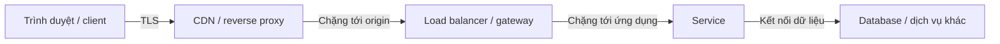

# HTTPS bắt buộc

## 1. HTTPS bắt buộc có nghĩa là gì?

HTTPS là HTTP được truyền qua một kết nối được bảo vệ bằng TLS. Khi được thiết lập và xác minh đúng, kết nối này giúp bảo vệ tính bí mật, tính toàn vẹn của dữ liệu trên đường truyền và xác thực máy chủ đối với phía client.

Yêu cầu “HTTPS bắt buộc” không chỉ có nghĩa trang đăng nhập có biểu tượng kết nối an toàn. Nó cần trả lời rõ:

- Những endpoint, hostname và luồng giao tiếp nào phải dùng HTTPS.
- Dữ liệu có thể đi qua những chặng mạng nào sau khi TLS được giải mã.
- Thành phần nào xác minh chứng thư và danh tính phía bên kia.
- Request HTTP thuần được xử lý ra sao.
- Khi handshake, chứng thư hoặc cấu hình có lỗi, hệ thống có dừng an toàn hay chuyển sang kết nối yếu hơn.
- Ai chịu trách nhiệm cấu hình, gia hạn và kiểm chứng.

Trong một module về yêu cầu bảo mật, điều cần đạt là một hợp đồng triển khai có thể kiểm tra được, thay vì chỉ phát biểu “hệ thống sử dụng SSL”.

### 1.1. Ba mục tiêu chính

| Mục tiêu | Ý nghĩa |
|---|---|
| Bí mật trên đường truyền | Bên quan sát mạng không đọc được nội dung HTTP được bảo vệ chỉ bằng cách bắt lưu lượng |
| Toàn vẹn trên đường truyền | Dữ liệu bị can thiệp trong kết nối được phát hiện bởi cơ chế bảo vệ của TLS |
| Xác thực máy chủ | Client kiểm tra đang kết nối với máy chủ có danh tính phù hợp chứng thư và chính sách tin cậy |

Đây là bảo vệ ở lớp truyền tải. Nếu máy client, máy server hoặc điểm TLS termination bị xâm nhập, dữ liệu có thể bị đọc tại nơi nó tồn tại ở dạng rõ.

HTTPS cũng không che giấu mọi metadata mạng. Địa chỉ IP, thời điểm, kích thước và những thông tin kết nối khác vẫn có thể quan sát được tùy giao thức và hạ tầng. Không nên đặc tả rằng HTTPS làm lưu lượng hoàn toàn vô hình.

### 1.2. Những việc HTTPS không thay thế

HTTPS không tự:

- Xác nhận người gọi có quyền đọc một đối tượng.
- Ngăn SQL injection hoặc XSS.
- Xác nhận một website không lừa đảo.
- Bảo vệ dữ liệu đã bị ghi vào log.
- Mã hóa dữ liệu trong cơ sở dữ liệu.
- Làm token có thời hạn hoặc có thể thu hồi.
- Kiểm soát URL đích để ngăn SSRF.

Một máy chủ không đáng tin vẫn có thể sở hữu chứng thư hợp lệ cho tên miền của nó. Xác thực tên miền và độ tin cậy nghiệp vụ là hai vấn đề khác nhau.

## 2. Từ mô hình đe dọa đến phạm vi HTTPS

### 2.1. Các tình huống cần ngăn

Ví dụ các tài sản:

- Credential, cookie phiên và access token.
- Dữ liệu cá nhân trong response API.
- Nội dung tài liệu hoặc thông tin thanh toán.
- Lệnh quản trị và thay đổi cấu hình.
- Tính toàn vẹn của JavaScript, CSS và tài nguyên giao diện.

Các tình huống đe dọa điển hình:

| Tình huống | Điều kiện gây rủi ro | Yêu cầu cần suy ra |
|---|---|---|
| Quan sát credential trên mạng | Client gửi đăng nhập qua HTTP | Không gửi credential trước khi kết nối HTTPS được xác minh |
| Can thiệp nội dung trang | HTML hoặc script tải qua HTTP | Tài liệu và tài nguyên phải đi qua kênh phù hợp được bảo vệ |
| Chặn giữa khi gọi API | Client bỏ kiểm tra chứng thư | Xác minh chuỗi tin cậy và tên máy chủ |
| Dữ liệu rõ sau load balancer | TLS chỉ bảo vệ chặng ngoài | Xác định và bảo vệ chặng nội bộ theo threat model |
| Giả mạo dấu hiệu HTTPS | Backend tin header từ client bất kỳ | Chỉ tin metadata do proxy đã xác minh cung cấp |
| Hạ cấp khi có lỗi | Client fallback sang HTTP | Không fallback đối với luồng yêu cầu HTTPS |

Ngay cả một response không chứa dữ liệu bí mật cũng có thể cần HTTPS để bảo vệ tính toàn vẹn. Ví dụ, JavaScript bị thay đổi trên đường truyền có thể thao tác trong phiên người dùng về sau.

### 2.2. Kiểm kê theo luồng, không chỉ theo trang

Phạm vi cần xem xét gồm:

- Website chính và toàn bộ API.
- Trang đăng nhập, đăng xuất, phục hồi tài khoản và callback.
- Endpoint quản trị, health hoặc diagnostic có dữ liệu nhạy cảm.
- Tải lên, tải xuống và liên kết tới object storage.
- Webhook nhận vào và gửi ra.
- Mobile app, CLI, SDK và tích hợp server-to-server.
- Redirect qua các dịch vụ danh tính hoặc thanh toán.
- Các subdomain và hostname phụ.
- Môi trường staging hoặc công cụ nội bộ dùng dữ liệu thật.

Một route không xuất hiện trên giao diện vẫn có thể được gọi trực tiếp. Yêu cầu không nên chỉ dựa vào những liên kết mà frontend hiện đang tạo.

### 2.3. Dữ liệu nào không được gửi qua HTTP?

Một quy tắc rõ có thể là:

> Client không được gửi credential, token, cookie phiên hoặc dữ liệu nghiệp vụ nhạy cảm qua HTTP thuần. Quy tắc áp dụng trước request đầu tiên, trước khi gửi body và trước khi tự động làm theo redirect.

Điểm “trước request đầu tiên” rất quan trọng. Nếu client đã gửi mật khẩu qua HTTP rồi mới nhận redirect sang HTTPS, dữ liệu ban đầu đã đi qua mạng dưới dạng rõ. Redirect không thu hồi được việc lộ dữ liệu đó.

## 3. Chính sách đối với HTTP thuần

### 3.1. Website công khai và API có nhu cầu khác nhau

Với website, một hostname HTTP có thể được giữ để chuyển người dùng tới bản HTTPS.

Với API, client nên được cấu hình HTTPS ngay từ đầu. Tự động chuyển một request API không an toàn sang HTTPS có thể tạo cảm giác rằng gửi credential qua HTTP là chấp nhận được.

Một hợp đồng minh họa:

| Loại request | Chính sách |
|---|---|
| Điều hướng GET/HEAD công khai, không có dữ liệu nhạy cảm | Có thể chuyển hướng tới hostname HTTPS cố định |
| Request đăng nhập hoặc có credential qua HTTP | Không xử lý nghiệp vụ; client phải dùng HTTPS từ đầu |
| POST/PUT/PATCH/DELETE qua HTTP | Không chuyển tiếp tới service nghiệp vụ |
| API nội bộ không cần cổng HTTP | Chặn đường truy cập hoặc không mở listener HTTP |
| Health check có ngoại lệ hạ tầng | Giới hạn riêng, dữ liệu tối thiểu, không dùng làm đường vào ứng dụng |

Đây là ví dụ chính sách, không phải một quy định HTTP duy nhất cho mọi hệ thống. Điều bắt buộc là xác định hành vi phù hợp và bảo đảm HTTP thuần không trở thành đường sử dụng ứng dụng nhạy cảm.

Server nhận một request HTTP nhạy cảm rồi từ chối chỉ ngăn xử lý tiếp; nó không làm dữ liệu đã truyền tới server trở nên bí mật. Client cũng phải tuân thủ yêu cầu.

### 3.2. Redirect không phải kiểm soát duy nhất

Redirect hữu ích cho điều hướng nhưng có giới hạn:

- Request đầu tiên có thể đã bị quan sát hoặc can thiệp.
- Client API có thể không theo redirect.
- Một số client thay đổi method hoặc body tùy mã redirect và cấu hình.
- Credential có thể bị chuyển tiếp ngoài ý muốn nếu client xử lý không đúng.
- Redirect có thể bị tạo từ Host header hoặc tham số không tin cậy.

Do đó, không nên viết:

> Mọi HTTP request được redirect nên dữ liệu luôn được mã hóa.

Nên viết:

> Các client được cấu hình sử dụng HTTPS trực tiếp. Listener HTTP, nếu được giữ, chỉ thực hiện hành vi chuyển hướng công khai hoặc từ chối theo chính sách; không phục vụ luồng nhạy cảm.

### 3.3. Đích redirect phải được kiểm soát

Đích HTTPS nên dựa trên origin cấu hình hoặc danh sách hostname hợp lệ. Không ghép nguyên Host header không được xác minh thành Location.

Ví dụ ý tưởng:

```text
Đích cố định:
https://portal.example + đường dẫn hợp lệ theo chính sách

Không dùng tùy tiện:
"https://" + mọi giá trị Host do request gửi
```

Cần kiểm soát cả các tham số redirect lồng nhau. Chuyển sang một URL HTTPS bất kỳ vẫn có thể dẫn người dùng tới một đích ngoài chính sách.

Nếu URL chứa dữ liệu nhạy cảm trong query, chuyển hướng không giải quyết rủi ro dữ liệu xuất hiện trong log, lịch sử hoặc các nơi ghi nhận URL.

## 4. TLS termination và những chặng sau đó

### 4.1. HTTPS kết thúc ở đâu?

Một kiến trúc thường gặp:



TLS có thể được giải mã ở CDN, load balancer hoặc ứng dụng. Mỗi điểm termination nhìn thấy nội dung HTTP rõ để thực hiện chức năng của nó.

Vì vậy, phát biểu “end-to-end HTTPS” cần được định nghĩa. Một kết nối HTTPS từ browser đến CDN không có nghĩa dữ liệu được mã hóa xuyên suốt đến ứng dụng mà CDN không thể đọc.

### 4.2. Đặc tả từng chặng

Có thể dùng bảng:

| Chặng | Yêu cầu truyền tải | Danh tính cần xác minh | Chủ sở hữu |
|---|---|---|---|
| Client → edge | HTTPS bắt buộc | Hostname công khai và chuỗi tin cậy | Nhóm edge và ứng dụng |
| Edge → origin | Kênh được bảo vệ theo chính sách | Danh tính origin phù hợp | Nhóm hạ tầng |
| Gateway → service | TLS hoặc cơ chế được đánh giá cho ranh giới đó | Danh tính service | Nhóm nền tảng |
| Service → API đối tác | HTTPS và xác minh endpoint | Tên máy chủ đối tác | Nhóm tích hợp |
| Service → hệ dữ liệu | Chính sách truyền tải riêng của giao thức dữ liệu | Danh tính hệ dữ liệu | Nhóm dữ liệu |

Đối với hệ thống yêu cầu mã hóa trên mọi liên kết mạng, bảng phải ghi rõ TLS hoặc bảo vệ tương đương được phê duyệt ở từng chặng, không để một ô chung “nội bộ”.

Nếu threat model cho phép một chặng rõ trong cùng một ranh giới rất hẹp, ngoại lệ cần nêu vị trí, lý do, quyền truy cập và kiểm soát bù. Không tự suy ra rằng mạng private luôn đáng tin.

### 4.3. Không mở đường vòng tới origin

Nếu origin vẫn công khai qua HTTP hoặc listener khác không có cùng kiểm soát, người gọi có thể bỏ qua edge HTTPS.

Yêu cầu có thể gồm:

- Origin chỉ nhận lưu lượng từ thành phần được phép.
- Listener và port không cần thiết bị đóng hoặc giới hạn.
- Không có hostname phụ phục vụ cùng dữ liệu qua HTTP.
- Health check không trở thành đường gọi API thông thường.
- Cấu hình môi trường không tự tạo route không được bảo vệ.

Cần kiểm chứng bằng đường mạng thực tế, không chỉ xem một file cấu hình của proxy.

### 4.4. TLS nội bộ vẫn cần xác minh peer

Một kết nối có mã hóa nhưng bỏ kiểm tra chứng thư không cung cấp bảo đảm danh tính mong muốn. Với origin hoặc service nội bộ, cần trust anchor phù hợp, tên service hợp lệ và chính sách cấp chứng thư.

mTLS có thể xác thực cả client và server khi thiết kế yêu cầu. Nó không tự thay thế authorization: một service có chứng thư hợp lệ chưa chắc được phép gọi mọi chức năng hoặc đọc mọi tenant.

## 5. Chứng thư và xác minh danh tính

### 5.1. Mã hóa không đủ nếu không biết đang nói chuyện với ai

Client cần xác minh theo stack và policy đã chọn, bao gồm:

- Chứng thư phù hợp với tên endpoint dự định kết nối.
- Chuỗi chứng thư kết thúc ở trust anchor được chấp nhận.
- Thời hạn hiệu lực phù hợp.
- Mục đích sử dụng và các ràng buộc chứng thư theo cơ chế xác minh.
- Những kiểm tra bổ sung mà chính sách hệ thống yêu cầu.

Việc xử lý thu hồi chứng thư phụ thuộc môi trường, thư viện và chính sách. Nếu có yêu cầu cụ thể về revocation, phải đặc tả cách thực thi và hành vi khi không lấy được trạng thái, không giả định mọi client mặc định đều xử lý giống nhau.

### 5.2. Những cấu hình phá vỡ bảo đảm

Các cách làm cần được kiểm soát nghiêm ngặt:

- Trust manager chấp nhận mọi chứng thư.
- Hostname verifier luôn trả về true.
- Bỏ kiểm tra lỗi chứng thư trong SDK.
- Dùng tùy chọn bỏ xác minh khi gọi endpoint thật.
- Tự động chuyển sang HTTP khi TLS handshake lỗi.
- Thêm một CA hoặc chứng thư không rõ nguồn vào trust store chung.

Yêu cầu không nên cho phép các cấu hình này hoạt động với dữ liệu thật dưới tên gọi “tạm thời để tích hợp”.

Nếu môi trường thử nghiệm dùng CA nội bộ, cách phù hợp là cấp và tin cậy CA thử nghiệm theo phạm vi, vẫn kiểm tra hostname và thời hạn. Không cần tắt toàn bộ xác minh chỉ vì không dùng CA công khai.

### 5.3. Tên máy chủ, địa chỉ IP và URL

Chứng thư được xác minh theo danh tính mà client dự định kết nối. Đổi URL từ hostname sang địa chỉ IP có thể khiến danh tính không còn khớp.

Không xử lý bằng cách bỏ hostname verification. Cần dùng tên đúng hoặc chứng thư có danh tính phù hợp với hợp đồng kết nối.

Nếu client tự resolve DNS hoặc gắn một Host header riêng, phải hiểu cách thư viện dùng hostname cho SNI, xác minh chứng thư và định tuyến. Không coi thay Host header là cách sửa lỗi chứng thư.

### 5.4. Quản lý vòng đời chứng thư

HTTPS bắt buộc tạo ra yêu cầu vận hành:

- Theo dõi thời hạn và cảnh báo trước khi hết hạn.
- Tự động hoặc có quy trình gia hạn được kiểm chứng.
- Cài đủ chuỗi trung gian cần thiết.
- Phân phối chứng thư mới đến mọi điểm termination.
- Giữ private key trong cơ chế quản lý bí mật phù hợp.
- Giới hạn người và tiến trình có quyền đọc key.
- Có quy trình thay key hoặc chứng thư khi nghi bị lộ.
- Kiểm tra hostname mới được thêm có được bao phủ đúng không.

Một chứng thư đã gia hạn trong kho bí mật nhưng chưa được nạp ở một node vẫn có thể làm một phần request thất bại. Bằng chứng vận hành cần quan sát endpoint phục vụ thực tế, không chỉ trạng thái tác vụ gia hạn.

## 6. Chính sách TLS cần được quản lý

Yêu cầu HTTPS phải gắn với một baseline TLS của tổ chức hoặc sản phẩm:

- Các phiên bản giao thức được phép.
- Các nhóm thuật toán và cấu hình được chấp nhận.
- Chính sách khóa và chứng thư.
- Mức tương thích client cần hỗ trợ.
- Quy trình cập nhật và loại bỏ cấu hình yếu.
- Ngoại lệ có chủ sở hữu và thời hạn.

Không nên ghi “dùng cấu hình mạnh” mà không có baseline để đối chiếu. Ngược lại, không sao chép một danh sách thuật toán cố định vào nhiều ứng dụng rồi không cập nhật khi chính sách thay đổi.

Nếu sản phẩm cần hỗ trợ client cũ, phải đánh giá tác động và có kế hoạch thay thế. Không để một client hiếm gặp kéo mọi endpoint nhạy cảm xuống cấu hình không đạt chính sách.

Khả năng thương lượng một phiên TLS thành công cũng chưa chứng minh đúng baseline. Cần kiểm tra những cấu hình bị cấm không còn được chấp nhận.

### 6.1. Không fallback khi kết nối an toàn thất bại

Một client có thể xử lý lỗi theo dạng:

```text
Thử https://...
Nếu lỗi thì thử http://...
```

Với luồng yêu cầu HTTPS, đây là vi phạm dù mục tiêu ban đầu là tăng khả dụng.

Hành vi đúng là dừng request, báo lỗi có kiểm soát và quan sát nguyên nhân. Cần xử lý sự cố chứng thư hoặc mạng mà không âm thầm làm mất bảo vệ truyền tải.

TLS bảo vệ kết nối, nhưng một số khả năng tối ưu như gửi dữ liệu sớm có thể có đặc tính replay riêng. Nếu hạ tầng bật những khả năng đó, các thao tác thay đổi trạng thái cần được đánh giá theo chính sách chống replay; không giả định HTTPS tự làm mọi request không thể bị lặp.

## 7. HSTS và hành vi của trình duyệt

### 7.1. HSTS bổ sung cho redirect

HTTP Strict Transport Security cho phép server thông báo cho trình duyệt hỗ trợ rằng hostname phải được truy cập qua HTTPS trong khoảng thời gian nhất định.

Header minh họa cho một giai đoạn thăm dò có thời hạn ngắn:

```http
Strict-Transport-Security: max-age=300
```

Con số này chỉ minh họa cơ chế và không phải cấu hình production mặc định.

Khi policy đã có hiệu lực, trình duyệt có thể nâng cấp việc truy cập HTTP của hostname theo chính sách HSTS thay vì gửi request HTTP trước rồi chờ redirect.

### 7.2. Những giới hạn cần hiểu

- HSTS phải được nhận qua kết nối HTTPS hợp lệ để tạo bảo đảm mong muốn.
- Một HTTP response mang HSTS không thay thế bước thiết lập tin cậy đó.
- Lần truy cập đầu có thể chưa được bảo vệ bởi policy đã lưu.
- Không phải mọi HTTP client hoặc SDK đều thực thi HSTS.
- Policy thường gắn với hostname và trạng thái phía client, không thay thế cấu hình mạng của origin.

Có cơ chế preload để hỗ trợ một số trình duyệt biết trước chính sách cho tên miền. Việc tham gia cần được đánh giá theo quy trình và điều kiện hiện hành của hệ sinh thái liên quan; không nên coi đó là một tùy chọn thêm vào tùy ý.

### 7.3. includeSubDomains có phạm vi rộng

Một header có thể yêu cầu áp dụng tới subdomain:

```http
Strict-Transport-Security: max-age=31536000; includeSubDomains
```

Đây là ví dụ cú pháp, không phải chỉ thị áp dụng ngay.

Trước khi dùng includeSubDomains, phải kiểm kê các subdomain và bảo đảm chúng có thể đáp ứng HTTPS theo chính sách. Một subdomain legacy chưa sẵn sàng có thể không còn truy cập được với client đã nhận policy.

Thời hạn dài cũng làm thay đổi khó đảo ngược ngay đối với client đã lưu chính sách. Cần có kế hoạch triển khai, quan sát và xử lý sự cố trước khi tăng phạm vi.

### 7.4. HSTS không thay thế yêu cầu phía API client

Một ứng dụng backend gọi URL HTTP không được coi là an toàn chỉ vì hostname có HSTS cho trình duyệt.

API client phải được cấu hình HTTPS trực tiếp và xác minh endpoint. HSTS là một lớp bổ sung cho những client hỗ trợ, không phải cơ chế ép buộc chung cho mọi phần mềm.

## 8. Proxy headers và nhận biết request an toàn

### 8.1. Backend có thể không trực tiếp nhận TLS

Nếu TLS kết thúc ở gateway, backend có thể nhìn thấy một kết nối khác và cần metadata cho biết request ngoài đã dùng HTTPS.

Các hệ thống thường có header chuyển tiếp chứa thông tin protocol hoặc host. Vấn đề bảo mật là ai được quyền đặt các giá trị đó.

Một request từ bên ngoài có thể tự gửi header trông như:

```http
X-Forwarded-Proto: https
```

Nếu backend tin nguyên giá trị này từ mọi nguồn, người gọi có thể giả mạo nhận định “request an toàn”.

### 8.2. Hợp đồng trust proxy

Yêu cầu cần xác định:

- Những proxy nào được tin và qua đường mạng nào.
- Proxy loại bỏ hoặc ghi đè header chuyển tiếp từ client ra sao.
- Backend có thể bị gọi trực tiếp ngoài proxy hay không.
- Cách xử lý chuỗi nhiều proxy.
- Cách tạo absolute URL và redirect từ host/protocol đã xác minh.

Không chỉ bật một tùy chọn “trust proxy” trên toàn bộ địa chỉ mà chưa đối chiếu kiến trúc triển khai.

Các metadata này có thể ảnh hưởng đến cookie Secure, callback URL, redirect và kiểm tra scheme. Sai cấu hình có thể gây redirect loop hoặc làm ứng dụng sinh liên kết không an toàn.

### 8.3. Cookie và tài nguyên trang

Cookie phiên nên có thuộc tính Secure theo chính sách để không được gửi qua HTTP thông thường. Các thuộc tính HttpOnly và SameSite giải quyết những mục tiêu khác và cần được thiết kế riêng.

Secure không mã hóa giá trị cookie trong kho lưu trữ, không kiểm soát quyền đối tượng và không thay thế HTTPS.

Trang HTTPS cũng phải tránh tải tài nguyên qua HTTP. Script, stylesheet, ảnh hoặc API không an toàn có thể gây mixed content hoặc tạo rủi ro tính toàn vẹn tùy loại tài nguyên và cách trình duyệt xử lý.

Không dựa vào hành vi chặn hoặc nâng cấp mặc định của một trình duyệt để làm hợp đồng ứng dụng. Các URL do ứng dụng tạo phải phù hợp ngay từ cấu hình.

## 9. Ví dụ Java: gọi đối tác bằng HTTPS mà không bỏ xác minh

Ví dụ dưới đây minh họa Java HttpClient trên Java 17 trở lên. Endpoint là hằng do ứng dụng kiểm soát, không nhận URL tùy ý từ request.

```java
import java.io.IOException;
import java.net.URI;
import java.net.http.HttpClient;
import java.net.http.HttpRequest;
import java.net.http.HttpResponse;
import java.nio.charset.StandardCharsets;
import java.time.Duration;

public final class PartnerEventsClient {
    private static final URI ENDPOINT =
            URI.create("https://partner.example/api/events");

    private final HttpClient client = HttpClient.newBuilder()
            .connectTimeout(Duration.ofSeconds(5))
            .followRedirects(HttpClient.Redirect.NEVER)
            .build();

    public int sendEvent(String json)
            throws IOException, InterruptedException {
        requireHttpsEndpoint(ENDPOINT);

        HttpRequest request = HttpRequest.newBuilder(ENDPOINT)
                .timeout(Duration.ofSeconds(10))
                .header("Content-Type", "application/json")
                .POST(HttpRequest.BodyPublishers.ofString(
                        json,
                        StandardCharsets.UTF_8
                ))
                .build();

        HttpResponse<Void> response = client.send(
                request,
                HttpResponse.BodyHandlers.discarding()
        );

        int status = response.statusCode();

        if (status >= 300 && status < 400) {
            throw new IOException("Unexpected partner redirect");
        }

        return status;
    }

    private static void requireHttpsEndpoint(URI endpoint) {
        if (!endpoint.isAbsolute()
                || !"https".equalsIgnoreCase(endpoint.getScheme())
                || endpoint.getHost() == null
                || endpoint.getRawUserInfo() != null
                || endpoint.getRawFragment() != null) {
            throw new IllegalArgumentException(
                    "Invalid HTTPS endpoint configuration"
            );
        }
    }
}
```

Các điểm thiết kế:

- Scheme HTTPS được kiểm tra trước khi gửi body.
- Không có trust manager chấp nhận mọi chứng thư.
- Không thay hostname verifier bằng một hàm luôn cho phép.
- Không tự theo redirect tới một đích khác.
- Không thử HTTP khi gửi thất bại.
- Có timeout kết nối và request theo cấu hình minh họa.

Client vẫn phụ thuộc cấu hình trust store, chứng thư và môi trường chạy. Những cấu hình này phải được quản lý đúng; chỉ nhìn vào đoạn code không đủ chứng minh endpoint thực tế được xác minh theo policy mong muốn.

Ví dụ chưa triển khai toàn bộ retry, xác thực đối tác hoặc xử lý nghiệp vụ theo status. Nếu gửi sự kiện có tác dụng phụ, retry cần chính sách idempotency hoặc chống trùng phù hợp.

Nếu URL được lấy từ người dùng hoặc cấu hình động, còn cần chính sách đích, redirect và kiểm soát SSRF. Hàm requireHttpsEndpoint chỉ xác định một số thuộc tính cú pháp, không xác nhận đích có được phép gọi hay không.

### 9.1. Redirect của client tích hợp

Một request gửi tới HTTPS có thể nhận Location là HTTP hoặc một host khác. Không được mặc định mọi redirect đều được phép chỉ vì request đầu dùng HTTPS.

Nếu chức năng thực sự cần redirect, phải kiểm tra từng đích theo chính sách trước khi gửi credential hoặc body, bao gồm scheme, origin được phép và giới hạn số lần chuyển.

Không chuyển tiếp credential sang origin khác ngoài hợp đồng. Đối với một số tích hợp, cách đơn giản và dễ kiểm chứng hơn là không hỗ trợ redirect và yêu cầu endpoint cấu hình chính xác.

## 10. Chuyển quyết định thành yêu cầu bảo mật

### 10.1. Từ phát biểu mơ hồ đến hợp đồng rõ

Phát biểu mơ hồ:

> Website phải dùng HTTPS.

Phát biểu cụ thể:

> Tất cả route phục vụ nội dung ứng dụng, xác thực, API và tài nguyên giao diện trên các hostname đã kiểm kê phải được sử dụng qua HTTPS. Client không được gửi credential hoặc dữ liệu nhạy cảm trước khi TLS được xác minh. Listener HTTP, nếu tồn tại, không chuyển tiếp request nghiệp vụ nhạy cảm tới origin và chỉ thực hiện hành vi công khai đã định nghĩa.

Yêu cầu về chứng thư:

> Client phải xác minh danh tính endpoint và chuỗi chứng thư theo trust policy. Khi xác minh thất bại, request dừng với lỗi có kiểm soát; không có chế độ trust-all, bỏ kiểm tra hostname hoặc fallback HTTP trong luồng sử dụng dữ liệu thật.

Yêu cầu về các chặng nội bộ:

> Mỗi liên kết sau TLS termination phải được ghi trong sơ đồ luồng dữ liệu cùng chính sách bảo vệ, danh tính cần xác minh và chủ sở hữu. Origin không được có đường truy cập không kiểm soát để bỏ qua edge.

Yêu cầu về proxy:

> Backend chỉ sử dụng protocol/host chuyển tiếp từ proxy đã xác minh; edge ghi đè metadata đầu vào theo chính sách và backend không nhận trực tiếp lưu lượng ngoài đường đã định nghĩa.

### 10.2. Mẫu yêu cầu truy vết

```text
ID: HTTP-TLS-01
Tài sản: credential, phiên và dữ liệu nghiệp vụ
Phạm vi:
    website, API, callback và hostname đã kiểm kê
Quy tắc:
    client dùng HTTPS từ request đầu
    xác minh danh tính máy chủ
    không fallback HTTP
Điểm thực thi:
    cấu hình client, edge, origin và service tích hợp
HTTP thuần:
    không thực thi nghiệp vụ nhạy cảm
Chứng thư:
    có chủ sở hữu, cảnh báo và quy trình gia hạn
Bằng chứng:
    kiểm tra kết nối, lỗi chứng thư, HTTP và đường origin
Chủ sở hữu:
    nhóm hạ tầng cùng nhóm ứng dụng theo từng chặng
```

Mẫu phải được điền theo kiến trúc thực tế. Một yêu cầu không có danh sách hostname hoặc đầu mối quản lý sẽ khó kiểm chứng đầy đủ.

### 10.3. Ma trận rủi ro, yêu cầu và bằng chứng

| Rủi ro | Yêu cầu | Bằng chứng chấp nhận |
|---|---|---|
| Credential đi qua HTTP ban đầu | Client dùng HTTPS trước khi gửi dữ liệu | Không có credential/body nhạy cảm trên chặng rõ |
| Chứng thư giả hoặc sai tên | Xác minh chuỗi và endpoint | Kết nối bị từ chối trước request ứng dụng |
| HTTP origin bỏ qua edge | Chặn đường vòng | Không truy cập được nghiệp vụ qua listener ngoài policy |
| Chặng nội bộ không được bảo vệ | Kiểm kê và bảo vệ từng liên kết | Kết nối thực tế khớp kiến trúc đã duyệt |
| Giả X-Forwarded-Proto | Trust proxy có phạm vi | Header tự đặt từ client không đổi quyết định an toàn |
| Redirect tới HTTP | Kiểm tra từng đích | Client không gửi tiếp dữ liệu tới đích không được phép |
| Chứng thư hết hạn | Quản lý vòng đời và cảnh báo | Gia hạn được triển khai tới mọi node đúng hạn |
| Mixed content | URL tài nguyên phù hợp | Giao diện không tạo request HTTP ngoài policy |
| Fallback giảm bảo vệ | Fail closed khi TLS lỗi | Lỗi TLS không dẫn đến thử HTTP |
| Cấu hình yếu còn được chấp nhận | Baseline TLS có version quản lý | Kết nối bị cấm không thương lượng thành công |

## 11. Tiêu chí chấp nhận

Các tình huống dưới đây là cơ sở thiết kế kiểm thử, không phải kết quả kiểm thử đã chạy cho một hệ thống cụ thể.

### 11.1. Kiểm tra đường thành công

Cần xác minh:

- Các hostname và route trong phạm vi đều sử dụng HTTPS.
- Chứng thư đang phục vụ khớp endpoint và chuỗi tin cậy.
- Client thật có thể kết nối mà không tắt xác minh.
- Các redirect hợp lệ vẫn giữ scheme và đích theo chính sách.
- Cookie phiên và URL tài nguyên được sinh phù hợp.
- Luồng callback, tải file và API không quay về HTTP.
- Các node, vùng hoặc đường CDN khác nhau cùng đáp ứng policy.

Một lần gọi thành công tới trang chủ không chứng minh các endpoint phụ đã được bao phủ.

### 11.2. Kiểm tra trường hợp phải bị từ chối

Trong môi trường kiểm soát phù hợp, cần bao phủ:

| Tình huống | Kết quả mong đợi |
|---|---|
| Chứng thư không được tin cậy | Client từ chối theo policy |
| Chứng thư không khớp tên endpoint | Client từ chối |
| Chứng thư ngoài thời hạn hiệu lực | Client từ chối theo policy xác minh |
| HTTP request tới API nhạy cảm | Không thực hiện nghiệp vụ |
| HTTPS redirect sang HTTP | Client không gửi tiếp dữ liệu ngoài policy |
| Host chuyển tiếp không hợp lệ | Không tạo redirect hoặc callback tùy ý |
| Header protocol do client giả | Không làm backend tin request đã được bảo vệ |
| Origin được gọi qua đường không được phép | Bị chặn hoặc từ chối |
| TLS thất bại | Không có fallback HTTP |
| Cấu hình giao thức bị cấm | Không thương lượng thành công |

Các kiểm tra chứng thư âm tính nên dùng endpoint hoặc môi trường thử nghiệm được kiểm soát. Không sửa client production thành trust-all để “xác nhận chức năng vẫn chạy”.

### 11.3. Kiểm tra HTTP không dùng credential thật

Có thể kiểm tra hành vi listener HTTP bằng một request công khai không có token, cookie hoặc body nhạy cảm.

Ví dụ lệnh minh họa, không được thực thi trong bài học này:

```bash
curl --head --max-redirs 0 http://portal.example/
curl --head --max-redirs 0 https://portal.example/
```

Lệnh HTTPS phải giữ xác minh chứng thư. Không thêm tùy chọn bỏ xác minh rồi dùng kết quả làm bằng chứng yêu cầu đã đạt.

HEAD chỉ phản ánh đường xử lý HEAD tại endpoint đó. Nếu chính sách khác nhau theo method, cần có tình huống riêng cho các method và route liên quan bằng dữ liệu thử phù hợp.

### 11.4. Quan sát đường đi thực tế

Bằng chứng có thể gồm:

- Cấu hình listener và routing có phiên bản.
- Kết quả bắt tay TLS từ các loại client được hỗ trợ.
- Chứng thư thực tế trên từng điểm termination.
- Kiểm tra khả năng gọi trực tiếp origin.
- Quan sát request giữa edge và backend trong môi trường kiểm thử.
- Kiểm tra URL, cookie và header được sinh sau proxy.
- Kết quả kiểm tra vòng đời gia hạn và nạp lại chứng thư.

Ảnh chụp biểu tượng khóa trên một trình duyệt chỉ chứng minh rất ít về toàn bộ kiến trúc. Cần kết hợp bằng chứng cấu hình và hành vi.

## 12. Vận hành, sự cố và ngoại lệ

### 12.1. Quan sát những lỗi có ý nghĩa

Chỉ số và cảnh báo hữu ích:

- Lỗi handshake theo endpoint và loại nguyên nhân.
- Thời hạn còn lại của chứng thư đang phục vụ.
- Lỗi hostname hoặc chain trong các client tích hợp.
- Request HTTP tới route nhạy cảm.
- Redirect bất thường hoặc scheme không mong muốn.
- Cấu hình TLS lệch baseline giữa node.
- Lỗi gia hạn hoặc nạp lại key/certificate.
- Truy cập origin ngoài đường đã cho phép.

Không ghi access token, private key hoặc toàn bộ dữ liệu HTTP nhạy cảm để phục vụ chẩn đoán TLS. Cần đủ thông tin định vị lỗi mà không tạo thêm nơi lộ dữ liệu.

### 12.2. Khi HTTPS gặp sự cố

Nếu chứng thư hết hạn hoặc cấu hình sai, phản ứng không nên là mở lại HTTP cho toàn bộ người dùng.

Quy trình nên bao gồm:

1. Xác định endpoint và phạm vi bị ảnh hưởng.
2. Kiểm tra chứng thư, chuỗi, hostname và thời gian hệ thống.
3. Khôi phục cấu hình đạt policy hoặc triển khai chứng thư hợp lệ.
4. Xác minh các node và client thực tế.
5. Theo dõi lỗi còn lại và cập nhật nguyên nhân gốc.

Nếu cần một ngoại lệ khẩn cấp, nó phải được xử lý theo cơ chế quản trị rủi ro của hệ thống, có phạm vi và thời hạn. Không để một tùy chọn bỏ xác minh tồn tại âm thầm sau sự cố.

### 12.3. Môi trường phát triển và kiểm thử

Một ứng dụng local không dùng dữ liệu thật có thể có cách chạy khác production. Tuy nhiên, ngoại lệ đó phải có ranh giới:

- Không được tự động áp dụng sang staging hoặc production.
- Không dùng credential hoặc dữ liệu nhạy cảm thật qua HTTP.
- Không commit cấu hình trust-all làm mặc định chung.
- Có kiểm tra để ngăn endpoint không an toàn lọt vào môi trường thật.
- Các bài thử bảo mật cần đại diện được cấu hình TLS production.

Nếu chỉ kiểm thử qua HTTP local, những vấn đề về Secure cookie, redirect sau proxy, chứng thư và callback có thể không được phát hiện.

## 13. Những sai lầm cần tránh

### 13.1. Chỉ bảo vệ trang đăng nhập

Sau đăng nhập, cookie, token và dữ liệu vẫn cần được bảo vệ. Toàn bộ phiên và tài nguyên liên quan phải tuân theo chính sách HTTPS.

### 13.2. Có redirect thì coi request ban đầu an toàn

Dữ liệu đã gửi qua HTTP không được bảo vệ hồi tố. Client phải dùng HTTPS trước khi gửi dữ liệu.

### 13.3. Mã hóa nhưng bỏ xác minh máy chủ

Kết nối có mã hóa tới một đầu cuối không được xác thực không đạt mục tiêu danh tính. Không tắt hostname hoặc chain validation để vượt lỗi.

### 13.4. Tin mọi thứ trong mạng nội bộ

Ranh giới mạng nội bộ có thể chứa nhiều hệ thống, quyền quản trị và điểm bị xâm nhập. Cần đánh giá từng chặng và danh tính peer thay vì chỉ dựa vào nhãn private network.

### 13.5. Coi HSTS áp dụng cho mọi client

HSTS phụ thuộc client hỗ trợ và trạng thái chính sách. SDK và ứng dụng backend vẫn phải dùng HTTPS trực tiếp.

### 13.6. Tin header chuyển tiếp từ mọi nguồn

Metadata về scheme chỉ đáng tin khi được đưa qua một chuỗi proxy đã xác minh. Giá trị do request ngoài tự khai không chứng minh bảo vệ truyền tải.

### 13.7. Dùng HTTPS làm bằng chứng API an toàn toàn diện

HTTPS bảo vệ đường truyền, không chứng minh đúng authentication, authorization, validation hoặc quản lý bí mật. Mỗi yêu cầu cần bằng chứng riêng.

## 14. Điểm cần ghi nhớ

“HTTPS bắt buộc” là một yêu cầu trên toàn bộ luồng dữ liệu: client dùng kết nối được bảo vệ từ đầu, xác minh đúng endpoint, không fallback và không có đường HTTP bỏ qua kiểm soát.

Thiết kế phải xác định các điểm TLS termination, từng chặng phía sau, trust proxy, chính sách chứng thư và trách nhiệm vận hành. Redirect, HSTS và cookie Secure hỗ trợ những mục tiêu cụ thể nhưng không thay thế toàn bộ hợp đồng.

Bằng chứng chấp nhận cần cho thấy cả kết nối hợp lệ hoạt động và kết nối không đạt policy bị từ chối trước khi dữ liệu hoặc nghiệp vụ nhạy cảm được truyền tiếp. Một yêu cầu rõ phạm vi và có chủ sở hữu sẽ giúp việc cấu hình, gia hạn và xử lý sự cố duy trì đúng mức bảo vệ đã thiết kế.
