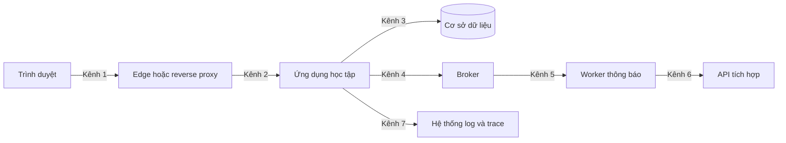

# Encryption in transit

## 1. Dữ liệu cần được bảo vệ trên những đường truyền nào?

Encryption in transit là bảo vệ dữ liệu trong quá trình truyền giữa các thành phần bằng cơ chế mật mã phù hợp. Mục tiêu không chỉ là làm cho một gói tin khó đọc, mà còn bảo vệ tính toàn vẹn và xác thực đối tác theo mô hình giao thức được chọn.

Một nền tảng học tập có thể dùng HTTPS cho trang đăng nhập nhưng vẫn gửi credential từ backend tới dịch vụ thông báo qua kết nối không được bảo vệ. Hệ thống cũng có thể mã hóa chặng từ trình duyệt tới edge, rồi chuyển dữ liệu dưới dạng rõ từ edge tới ứng dụng. Câu “website đã có HTTPS” không mô tả đủ phạm vi dữ liệu đang được bảo vệ.

Trong thiết kế yêu cầu bảo mật, cần đi từ tài sản và luồng dữ liệu tới từng kết nối cụ thể: ai gửi, ai nhận, qua ranh giới nào, giao thức gì, ai xác minh đối tác và hành vi khi không thiết lập được kết nối an toàn.

Sau bài này, người học có thể:

- Phân biệt mã hóa đường truyền với encoding, hashing, mã hóa lưu trữ và mã hóa end-to-end ở lớp ứng dụng.
- Kiểm kê các chặng dữ liệu và xác định nơi kết thúc bảo vệ của mỗi kênh.
- Đặc tả profile giao thức, danh tính, nguồn tin cậy và chính sách không hạ cấp ngoài chủ đích.
- Nhận diện rủi ro của TLS termination, kết nối nội bộ, tác vụ nền và đường truyền phụ.
- Xây dựng bằng chứng nghiệm thu cho bảo mật, khả năng phục hồi và vận hành thay đổi.

## 2. Mục tiêu bảo vệ và giới hạn

### 2.1. Bí mật, toàn vẹn và xác thực không nên tách rời

TLS là một cơ chế phổ biến để bảo vệ giao tiếp client-server trước nghe lén, sửa đổi và giả mạo thông điệp. Việc xác thực đối tác và cấu hình giao thức đúng là điều kiện quan trọng để kênh phục vụ mục tiêu đó. [RFC 8446 về TLS 1.3](https://www.rfc-editor.org/rfc/rfc8446.html).

Nếu client mã hóa nhưng chấp nhận bất kỳ chứng thư nào, dữ liệu có thể được gửi tới một đối tác giả. Nếu chỉ xác minh một hash không có nguồn tin cậy hoặc không có cơ chế xác thực phù hợp, kẻ trung gian có thể thay cả nội dung lẫn giá trị đi kèm.

Một yêu cầu đầy đủ phải mô tả bảo vệ nào cần có và danh tính nào được phép nhận dữ liệu. Không dùng mỗi từ “encrypted” để suy ra tất cả thuộc tính an toàn.

### 2.2. Không nhầm với những thao tác khác

| Cơ chế | Mục tiêu điển hình | Vì sao không thay bảo vệ đường truyền |
| --- | --- | --- |
| Base64 hoặc encoding khác | Biểu diễn dữ liệu theo định dạng | Không cung cấp bí mật trước người biết cách giải mã biểu diễn |
| Hash không khóa | Tạo dấu vết của dữ liệu | Không mã hóa nội dung và không tự xác thực nguồn gửi |
| Mã hóa lưu trữ | Bảo vệ dữ liệu trên phương tiện lưu | Không tự bảo vệ bản sao đang được gửi qua mạng |
| Chữ ký thông điệp | Bảo vệ nguồn gốc và tính toàn vẹn theo mô hình khóa | Không tự làm nội dung trở nên bí mật |
| Mã hóa payload | Bảo vệ một nội dung giữa các điểm giải mã được chọn | Cần hợp đồng riêng; không tự che mọi header hoặc metadata truyền tải |
| Kênh TLS được xác thực | Bảo vệ dữ liệu giữa các endpoint của kênh | Không bảo vệ dữ liệu sau khi endpoint hợp lệ đã giải mã |

Các cơ chế có thể được kết hợp, nhưng không nên dùng tên của cơ chế này để tuyên bố đã có thuộc tính của cơ chế khác.

### 2.3. Kênh kết thúc ở đâu, quyền đọc bắt đầu ở đó

Nếu một proxy kết thúc TLS, proxy có khả năng xử lý dữ liệu rõ theo chức năng của nó. Nếu proxy mở một kết nối TLS mới tới backend, đó là hai kênh được mã hóa, với proxy là một điểm có quyền truy cập nội dung.

Mã hóa từng chặng có thể là kiến trúc phù hợp. Tuy nhiên, không nên gọi đó là mã hóa end-to-end chống lại chính proxy nếu proxy phải đọc nội dung.

Nếu yêu cầu là trung gian không được đọc một loại payload, cần thiết kế bảo vệ payload hoặc thông điệp giữa các điểm cuối thực sự được tin cậy, cùng cơ chế quản lý khóa và chức năng xử lý tương ứng. Không chỉ đổi nhãn của TLS termination.

### 2.4. Những gì vẫn cần kiểm soát ngoài đường truyền

Encryption in transit không tự giải quyết:

- Quyền của ứng dụng hoặc người dùng tại endpoint đã được xác thực.
- Dữ liệu rõ trong bộ nhớ, log, trace, cache hoặc tệp xuất sau giải mã.
- Mã độc trên client hoặc server đang có quyền đọc dữ liệu.
- Nội dung sai nghiệp vụ do một đối tác hợp lệ trả về.
- Mọi dạng metadata như địa chỉ mạng, thời điểm và kích thước trao đổi.
- Request lặp do client retry hoặc một luồng nghiệp vụ thực hiện nhiều lần.

Phạm vi còn lại cần được ghi nhận trong mô hình đe dọa và được giao cho các yêu cầu phù hợp khác.

## 3. Kiểm kê luồng dữ liệu trước khi chọn cấu hình

### 3.1. Bắt đầu từ tài sản

Với nền tảng học tập, dữ liệu thuộc phạm vi có thể gồm credential, token, hồ sơ người học, bài nộp, kết quả kiểm tra, nội dung chưa công bố và dữ liệu quản trị.

Không chỉ kiểm kê các API người dùng thấy. Bản sao dữ liệu có thể đi qua queue, dịch vụ tìm kiếm, hệ thống quan sát, công cụ xuất báo cáo và tác vụ đồng bộ. Mỗi đường có thể tạo ra một kết nối không nằm trong cấu hình ingress của website.

### 3.2. Một luồng nhiều chặng



Các nhãn kênh không khẳng định tất cả đã có TLS. Chúng là những quan hệ truyền dữ liệu cần đánh giá, chọn cơ chế bảo vệ và có người chịu trách nhiệm.

### 3.3. Danh mục kết nối minh họa

| Chặng | Dữ liệu đi qua | Quyết định cần đặc tả |
| --- | --- | --- |
| Trình duyệt tới edge | Phiên, thông tin đăng nhập, hồ sơ | HTTPS, policy trình duyệt và danh tính website |
| Edge tới ứng dụng | Header và body đã giải mã ở edge | Kênh bảo vệ, danh tính upstream và nguồn tin cậy |
| Ứng dụng tới cơ sở dữ liệu | Credential và bản ghi nghiệp vụ | Chế độ mã hóa bắt buộc và xác minh server của driver |
| Producer tới broker | Sự kiện và dữ liệu người học | Kênh bảo vệ và danh tính broker |
| Broker tới consumer | Cùng hoặc biến thể của sự kiện | Kết nối consumer riêng, không suy từ producer |
| Worker tới API ngoài | Credential tích hợp và nội dung thông báo | Client profile, danh tính đích và failover |
| Ứng dụng tới hệ thống quan sát | Log và trace có thể chứa dữ liệu nhạy cảm | Bảo vệ đường truyền và giảm dữ liệu ngay từ nguồn |

Với mỗi chặng, bổ sung môi trường, host hoặc danh tính dịch vụ, port, client thư viện, cấu hình trust, owner và cách nghiệm thu. Port quen thuộc hoặc tên giao thức trong tài liệu không đủ chứng minh trạng thái triển khai.

### 3.4. Ranh giới mạng không phải bằng chứng tin cậy

Một kết nối nằm trong VPC, subnet hoặc cluster vẫn có thể đi qua hạ tầng chia sẻ và những thành phần có mức tin cậy khác nhau. Nguồn tấn công cũng có thể đã ở bên trong môi trường.

Nếu một chặng được miễn mã hóa theo quyết định rủi ro của tổ chức, phải chỉ rõ chặng, loại dữ liệu, điều kiện kiểm soát và thời hạn ngoại lệ. Không coi mọi kết nối có nhãn “internal” là tự động nằm ngoài phạm vi yêu cầu.

## 4. Chọn một profile bảo vệ được quản lý

### 4.1. Profile phải xác định hơn một tên thuật toán

Một profile có thể quy định:

- Phiên bản giao thức được phép và thứ tự ưu tiên.
- Tập cơ chế mật mã được chấp thuận theo nền tảng và mục tiêu bảo vệ.
- Cách xác thực server, và xác thực client khi có yêu cầu.
- Nguồn trust anchor, reference identity và vòng đời chứng thư.
- Chính sách không tiếp tục bằng plaintext hoặc chế độ không xác thực.
- Resumption, early data và giới hạn áp dụng cho dữ liệu nhạy cảm.
- Cách cấu hình được triển khai, theo dõi và thay đổi trên các instance.

Không nên hard-code một danh sách cipher rồi coi đó là toàn bộ yêu cầu mật mã cho nhiều năm. Profile cần được phiên bản hóa và cập nhật theo nền tảng, khả năng tương tác và đánh giá bảo mật.

### 4.2. Phiên bản TLS

Một profile triển khai có thể ưu tiên TLS 1.3 và chỉ giữ TLS 1.2 với cấu hình phù hợp khi cần tương thích. SSL cũ, TLS 1.0 và TLS 1.1 không thuộc profile này. RFC 9325 đưa ra hướng dẫn sử dụng TLS an toàn, bao gồm phiên bản và việc tránh fallback về phiên bản đã bị loại bỏ. [RFC 9325, khuyến nghị phiên bản](https://www.rfc-editor.org/rfc/rfc9325.html#section-3.1).

Đây là điểm xuất phát để đặc tả một profile cụ thể, không phải tuyên bố mọi client tự có cấu hình đúng. Cần kiểm tra những gì thực sự được thương lượng và những gì endpoint vẫn chấp nhận khi bị yêu cầu dùng cấu hình ngoài policy.

Không dùng cú pháp mơ hồ như “TLS 1.2+” rồi cho rằng nó tự mô tả mọi phiên bản tương lai, cipher hoặc hành vi hạ cấp. Liệt kê profile được chấp thuận và quy trình cập nhật nó.

### 4.3. Cơ chế mã hóa và toàn vẹn

Một profile web hiện đại cần tránh cipher không mã hóa, không xác thực hoặc đã bị loại bỏ. OWASP cũng nhấn mạnh lựa chọn cơ chế AEAD và tránh cấu hình cũ không cung cấp thuộc tính bảo vệ phù hợp. [OWASP Transport Layer Security Cheat Sheet](https://cheatsheetseries.owasp.org/cheatsheets/Transport_Layer_Security_Cheat_Sheet.html#only-support-strong-ciphers).

Nhóm ứng dụng nên dùng thư viện giao thức đã được duy trì thay vì tự ghép thuật toán, nonce, MAC và key exchange để thay TLS. Khi dùng một giao thức khác hoặc cơ chế bảo vệ payload bổ sung, phải có profile và đánh giá riêng cho cơ chế đó.

### 4.4. Xác minh đối tác

Chứng thư phải được kiểm tra theo chính sách tin cậy và danh tính đích cần khớp với dịch vụ ứng dụng định gọi. Tin CA không đồng nghĩa tin mọi tên dịch vụ mà CA đó cấp. [RFC 9525 về danh tính dịch vụ TLS](https://www.rfc-editor.org/rfc/rfc9525.html).

Profile cần nêu nguồn reference identity, trust material và hành vi khi không xác minh được. Không bật mã hóa rồi vô hiệu hóa kiểm tra hostname hoặc chấp nhận mọi chuỗi chứng thư để giải quyết lỗi kết nối.

### 4.5. Ví dụ profile khái niệm

```yaml
profileId: learning-sensitive-transit-v1
encryptionMode: required
protocolPolicy:
  allowedVersions:
    - TLSv1.3
    - TLSv1.2
  preferredVersion: TLSv1.3
  cipherPolicyRef: approved-platform-ciphers-v1
peerAuthentication:
  verifyTrustPath: true
  verifyServiceIdentity: true
  trustPolicyRef: approved-service-pki-v3
plaintextFallback: forbidden
unverifiedPeerFallback: forbidden
earlyDataPolicy: disabled-for-sensitive-commands
configurationOwner: platform-security
```

YAML này minh họa các quyết định cần có, không phải schema có thể đưa thẳng vào một proxy hay driver. Các giá trị tham chiếu phải dẫn tới chính sách thật có cấu hình, owner và bằng chứng, không được dùng như tên đẹp thay cho nội dung còn thiếu.

## 5. TLS termination và quan hệ tin cậy giữa các thành phần

### 5.1. Bảo vệ từng chặng có thể hợp lệ nhưng phải gọi đúng phạm vi

Edge thường cần giải mã để định tuyến, kiểm tra hoặc áp dụng chính sách. Sau đó edge có thể tạo một kênh được xác thực mới tới backend. Yêu cầu cần nêu cả hai kênh và quyền của edge đối với dữ liệu rõ.

Một bảng trách nhiệm có thể là:

| Quan hệ | Ai xác minh đối tác? | Danh tính cần biết | Điểm đọc được dữ liệu rõ |
| --- | --- | --- | --- |
| Client tới edge | Client xác minh edge | Tên dịch vụ công khai | Client và edge |
| Edge tới backend | Edge xác minh backend | Danh tính dịch vụ backend | Edge và backend |
| Backend tới kho dữ liệu | Client thư viện tại backend | Danh tính server kho dữ liệu | Backend và kho dữ liệu |
| Worker tới đối tác | HTTP client của worker | Endpoint tích hợp được chấp thuận | Worker và đối tác |

Nếu chọn mTLS, thêm trách nhiệm xác minh phía client ở bên nhận. Không chỉ có server trình bày chứng thư là đã đủ cho yêu cầu xác thực hai chiều.

### 5.2. Mạng riêng, VPN và service mesh

VPN hoặc service mesh có thể bảo vệ một phạm vi truyền cụ thể. Cần xác định chính xác phạm vi đó: từ node nào tới node nào, từ proxy nào tới proxy nào, và đoạn giữa ứng dụng với proxy có nằm trong ranh giới được tin cậy không.

Không tự suy ra rằng bật một tính năng ở control plane đã làm mọi workload dùng nó. Workload ngoại lệ, port không được quản lý, công việc tạm thời hoặc đường đi trực tiếp có thể nằm ngoài cơ chế bảo vệ.

Nếu mesh xác thực danh tính workload, ứng dụng vẫn cần phân quyền nghiệp vụ và cách tiếp nhận danh tính được xác minh. Một kết nối có danh tính service không tự đại diện cho mọi quyền của người dùng mà service đang xử lý.

### 5.3. Truyền danh tính qua proxy

Sau termination, backend có thể nhận thông tin nguồn qua header hoặc metadata. Những thông tin đó chỉ đáng tin trong ranh giới đã được thiết kế: ai tạo, kênh nào bảo vệ, client ngoài có thể tự gửi không và có đường gọi bỏ qua proxy không.

Encryption in transit bảo vệ kênh được thiết lập; nó không tự biến mọi trường `Forwarded`, `X-Forwarded-*` hoặc tên người dùng trong body thành khẳng định danh tính đáng tin cậy.

### 5.4. Khi cần bảo vệ payload khỏi trung gian

Nếu broker, gateway hoặc nhà cung cấp lưu chuyển không được phép đọc một nội dung, cần xét mã hóa thông điệp với các bên giải mã được xác định. Thiết kế phải giải quyết cách cấp và thu hồi khóa, xác thực nguồn, ràng buộc ngữ cảnh và xử lý dữ liệu lỗi.

Kênh TLS vẫn có thể cần để bảo vệ credential, metadata và các phần khác trên từng chặng. Mã hóa payload không mặc nhiên cho phép chuyển credential qua plaintext hoặc bỏ xác minh đích.

Việc mã hóa payload có thể ảnh hưởng tới tìm kiếm, kiểm duyệt, routing và khôi phục. Đây là quyết định kiến trúc có chi phí chức năng, không nên áp dụng chỉ để đạt một nhãn “end-to-end” không rõ mục tiêu.

## 6. Cưỡng chế kênh bảo vệ và tránh plaintext ngoài dự kiến

### 6.1. Bắt buộc khác với ưu tiên

Một cấu hình “ưu tiên TLS nhưng cho phép không mã hóa nếu không hỗ trợ” không đáp ứng yêu cầu bắt buộc mã hóa. Điều cần kiểm chứng là hành vi khi kết nối an toàn không thiết lập được.

Profile bắt buộc phải không gửi credential và dữ liệu thuộc phạm vi qua một kết nối không đạt điều kiện. Server cũng cần giới hạn listener và các đường xử lý để không cung cấp nghiệp vụ nhạy cảm qua một cổng plaintext ngoài chủ đích.

Server không thể ngăn một client tùy ý phát dữ liệu lên mạng trước khi tới nó. Vì vậy, yêu cầu phải bao gồm cả cấu hình client gửi đúng từ đầu và hành vi server từ chối xử lý trên đường không được phép. Phản hồi từ chối không làm dữ liệu đã truyền rõ trở nên bí mật trở lại.

### 6.2. Không fallback khi lỗi chứng thư hoặc thương lượng

Cần phân biệt thương lượng một phiên bản đã được profile cho phép với việc lùi sang một chế độ ngoài profile. Chọn TLS 1.2 trong một profile cho phép nó không giống việc tiếp tục bằng HTTP sau lỗi TLS.

Không bắt exception chứng thư rồi tạo client bỏ kiểm tra để retry. Không đổi endpoint sang IP hoặc tên khác chỉ nhằm tránh lỗi đối chiếu danh tính.

Retry phải giữ nguyên chính sách bảo vệ. Nếu lỗi không thể khắc phục trong ngân sách cho phép, chức năng cần hành vi suy giảm hoặc báo lỗi đã định nghĩa thay vì tự giảm mức bảo vệ.

### 6.3. Giao thức nâng cấp kết nối

Một số giao thức bắt đầu từ kênh chưa được bảo vệ rồi nâng cấp sang TLS. Nếu dùng chúng cho dữ liệu cần bảo vệ, phải cấu hình chế độ bắt buộc nâng cấp và không gửi credential trước khi đạt điều kiện an toàn.

Không coi thông báo “server có hỗ trợ TLS” là bằng chứng client sẽ từ chối khi khả năng nâng cấp bị mất hoặc bị can thiệp. Ca nghiệm thu phải tạo đúng tình huống thiếu nâng cấp và quan sát dữ liệu ứng dụng.

### 6.4. Driver và thư viện có thể tách các mức bảo vệ

Một client cơ sở dữ liệu có thể có những tùy chọn riêng cho mã hóa, kiểm tra trust và kiểm tra danh tính server. Không giả định tên một tùy chọn như “require” hoặc “ssl” có cùng nghĩa trên mọi driver.

Yêu cầu cần chỉ rõ kết quả bảo vệ và ánh xạ tới tài liệu của đúng sản phẩm, phiên bản và provider đang triển khai. Chỉ thấy một tham số có chữ TLS trong connection string chưa chứng minh profile đã được áp dụng.

## 7. Bảo vệ luồng trình duyệt

### 7.1. HTTPS phải bao phủ cả ứng dụng thuộc phạm vi

Một trang đăng nhập dùng HTTPS nhưng sau đó chuyển phiên hoặc dữ liệu sang HTTP làm mất bảo vệ ở phần còn lại. Tài nguyên thực thi, lời gọi API, tải lên và tải xuống có thể là những đường khác cần được kiểm kê.

Không cho nội dung thực thi hoặc dữ liệu nhạy cảm phụ thuộc vào một tài nguyên plaintext trong luồng được tuyên bố là an toàn. Kiểm tra này cần xét cả URL được tạo động và endpoint dự phòng.

### 7.2. Redirect không bảo vệ lần truyền trước redirect

Nếu client đã gửi mật khẩu tới HTTP, một phản hồi chuyển hướng HTTPS không thu hồi được dữ liệu đã đi qua đường chưa mã hóa. Ứng dụng phải hình thành URL an toàn trước khi gửi credential hoặc body nhạy cảm.

Với API, cần quy định rõ có theo redirect không, đích nào được phép và credential có được chuyển tiếp không. Chứng thư hợp lệ của đích mới vẫn chưa chứng minh đích đó có quyền nhận dữ liệu theo nghiệp vụ.

### 7.3. HSTS hỗ trợ trình duyệt duy trì chính sách HTTPS

HSTS cho phép website khai báo chính sách chỉ truy cập an toàn với user agent hỗ trợ. Chính sách được tiếp nhận qua kết nối an toàn; không nên giả định một trình duyệt chưa biết policy đã được bảo vệ cho mọi lần truy cập ban đầu. [RFC 6797 về HTTP Strict Transport Security](https://www.rfc-editor.org/rfc/rfc6797.html).

Ví dụ header:

```http
Strict-Transport-Security: max-age=31536000
```

Thời hạn trên chỉ là ví dụ cấu hình. Việc thêm phạm vi subdomain cần đánh giá toàn bộ các host chịu ảnh hưởng và khả năng vận hành HTTPS của chúng. Không bật một phạm vi rộng rồi phát hiện dịch vụ phụ không thể đáp ứng.

HSTS không thay mã hóa cho chặng backend và không tự cấu hình mọi server-to-server client. Đặc tả phải xác định user agent và đường kết nối được bảo vệ bởi cơ chế này.

### 7.4. Cookie và dữ liệu trong URL

Cookie phiên cần thuộc tính phù hợp để không đi qua kênh không được phép, cùng những kiểm soát phiên khác theo mô hình ứng dụng. Các thuộc tính như HttpOnly và SameSite giải quyết những khía cạnh khác; chúng không thay mã hóa kênh.

Dữ liệu trong URL vẫn nằm trong phần được TLS bảo vệ trên kênh HTTPS tương ứng, nhưng có thể xuất hiện ở lịch sử, log hoặc các điểm xử lý sau giải mã. Không đặt token hoặc dữ liệu nhạy cảm vào URL chỉ vì đường truyền đã mã hóa.

## 8. Session, forward secrecy và early data

### 8.1. Khóa dài hạn không nên mở lại mọi lưu lượng quá khứ

Forward secrecy nhằm hạn chế việc lộ khóa xác thực dài hạn dẫn tới giải mã các phiên quá khứ khi các điều kiện giao thức và quản lý bí mật tương ứng được bảo đảm. Profile cần xét cả resumption và vòng đời bí mật phiên, không chỉ chứng thư. [RFC 9325 về forward secrecy](https://www.rfc-editor.org/rfc/rfc9325.html#section-7.3).

Thuộc tính này không bảo vệ dữ liệu mà kẻ tấn công đã đọc tại một endpoint bị kiểm soát, hoặc những bí mật phiên bị lấy trực tiếp theo một tình huống khác. Cần mô tả đúng giả định khi ghi yêu cầu.

### 8.2. Tái sử dụng kết nối không phải bỏ bảo mật

Pool kết nối và resumption có thể giảm chi phí thiết lập. Nhưng trạng thái xác thực, bí mật ticket, thời hạn và thời điểm policy mới có hiệu lực cần được quản lý.

Một thay đổi trust hoặc thu hồi danh tính không nhất thiết được áp dụng lại trên mọi request đang đi qua kết nối có sẵn. Nếu tổ chức yêu cầu thay đổi có hiệu lực trong một khoảng thời gian cụ thể, cần cơ chế cho pool, session, ticket và các instance liên quan.

### 8.3. 0-RTT và replay

TLS 1.3 early data có những giới hạn liên quan tới replay. Không nên coi mã hóa early data là bằng chứng một hành động nghiệp vụ chỉ được thực hiện một lần. [RFC 8446, rủi ro replay của 0-RTT](https://www.rfc-editor.org/rfc/rfc8446.html#appendix-E.5).

Một profile cho thao tác nhạy cảm có thể tắt early data hoặc chỉ cho phép theo một đặc tả đã đánh giá an toàn. Nếu hạ tầng không thể phân biệt các thao tác trước khi xử lý, có thể cần tắt trên toàn listener thuộc phạm vi.

Idempotency và kiểm soát replay ở lớp nghiệp vụ vẫn có vai trò riêng. Chúng không làm mọi kiểu early data tự động an toàn, cũng không thay thế xác thực và phân quyền.

### 8.4. Giới hạn hiệu lực cần đo được

Yêu cầu như “thu hồi danh tính có hiệu lực trong T” phải cho biết T áp dụng cho kết nối mới, kết nối đang dùng hay mọi thao tác nhạy cảm. Giá trị T phải được chọn và có cơ chế thực hiện.

Không hứa hiệu lực tức thời chỉ dựa trên việc đã thay chứng thư ở một server hoặc cập nhật một truststore. Bằng chứng phải quan sát đường truyền và trạng thái thực tế theo phạm vi cam kết.

## 9. Chuyển mục tiêu thành yêu cầu bảo mật

### 9.1. Một yêu cầu yếu chưa tạo được nghĩa vụ cụ thể

Yêu cầu yếu:

> Mọi dữ liệu phải được mã hóa bằng thuật toán mạnh khi truyền.

Câu này không định nghĩa dữ liệu nào, các đường nào, ai xác minh người nhận và điều gì xảy ra khi mã hóa không thể thiết lập. Nó có thể được hiểu thành chỉ bật HTTPS ở ingress.

Yêu cầu rõ hơn:

> Mọi kết nối trong danh mục truyền credential và dữ liệu người học phải sử dụng profile bảo vệ đường truyền đã được phê duyệt, có xác thực đối tác phù hợp. Các chặng sau TLS termination được đánh giá độc lập. Client không gửi dữ liệu thuộc phạm vi qua kết nối không đạt profile và không tự fallback sang plaintext hoặc đối tác chưa được xác thực.

Để nghiệm thu, danh mục và profile phải là tài liệu có nội dung, owner, phiên bản và ánh xạ tới cấu hình triển khai.

### 9.2. Bộ yêu cầu minh họa

| Mã | Yêu cầu | Bằng chứng dự kiến |
| --- | --- | --- |
| EIT-01 | Mỗi luồng dữ liệu thuộc phạm vi phải có danh mục chặng, endpoint và owner | Sơ đồ dữ liệu và danh mục kết nối |
| EIT-02 | Mỗi chặng phải dùng cơ chế bảo vệ bắt buộc theo profile, hoặc có ngoại lệ rủi ro được quản lý riêng | Cấu hình và hồ sơ phạm vi áp dụng |
| EIT-03 | Profile phải xác định phiên bản, cơ chế mật mã và cập nhật theo nền tảng | Hồ sơ profile cùng bằng chứng cấu hình thực |
| EIT-04 | Client phải xác minh danh tính đối tác và nguồn tin cậy theo chính sách | Ca đúng đích, sai đích và không được tin |
| EIT-05 | Không được gửi credential hoặc dữ liệu thuộc phạm vi qua plaintext khi kết nối an toàn thất bại | Thử lỗi và quan sát hành vi client |
| EIT-06 | Mỗi TLS termination phải nêu điểm đọc dữ liệu rõ và chính sách cho chặng tiếp theo | Bản đồ trust boundary và trách nhiệm proxy |
| EIT-07 | Đường dự phòng, retry, công việc nền và kênh phụ phải tuân thủ cùng yêu cầu theo phạm vi | Ca failover, job và các tuyến thay thế |
| EIT-08 | Client và server phải từ chối cấu hình ngoài profile thay vì chỉ ưu tiên cấu hình mạnh khi thuận lợi | Kiểm thử thương lượng âm tính |
| EIT-09 | Early data, resumption và trạng thái phiên phải có chính sách phù hợp với thao tác nhạy cảm | Cấu hình và ca thử vòng đời tương ứng |
| EIT-10 | Key material và trust material phải có nguồn quản trị, quyền và quy trình thay đổi rõ | Hồ sơ cấp phát, rotation và thu hồi |
| EIT-11 | Thay đổi bảo mật phải có giới hạn hiệu lực cho instance, pool và tuyến kết nối liên quan | Bằng chứng hội tụ trong phạm vi đã công bố |
| EIT-12 | Không ghi bí mật hoặc dữ liệu rõ không cần thiết vào log để chẩn đoán kết nối | Schema log, quyền truy cập và kiểm tra dữ liệu |
| EIT-13 | Cấu hình triển khai phải được kiểm tra qua đường thật từ phía consumer | Bằng chứng client/runtime và endpoint thực trong môi trường nghiệm thu |
| EIT-14 | Không tự xây giao thức mật mã thay cơ chế chuẩn mà không có thiết kế và đánh giá phù hợp | Hồ sơ thành phần và quyết định kiến trúc |

Các mã là ví dụ tổ chức yêu cầu, không phải mã tiêu chuẩn. Ngoại lệ phải là quyết định có phạm vi và vòng đời, không phải một cờ bỏ kiểm tra mà mọi service có thể tự bật.

### 9.3. Truy vết rủi ro tới cơ chế và bằng chứng

```text
Tài sản: credential và nội dung thông báo có dữ liệu người học
    ↓
Mối đe dọa: backend kết nối tới peer giả hoặc tự lùi về plaintext
    ↓
Yêu cầu: EIT-04 + EIT-05 + EIT-07
    ↓
Thiết kế: profile bắt buộc cho client; xác minh đích; failover có danh mục
    ↓
Bằng chứng: endpoint sai danh tính bị từ chối; không có retry nới lỏng;
dữ liệu ứng dụng không được gửi tới peer không đạt
```

Một bằng chứng khác cần cho chặng edge-backend. Không lấy kết quả từ kết nối người dùng tới edge để bao phủ mặc định chặng đó.

## 10. Tiêu chí nghiệm thu

Phần này mô tả bằng chứng cần thu thập khi triển khai yêu cầu. Danh sách trong bài không có nghĩa đã chạy các kiểm thử trên một hệ thống cụ thể.

### 10.1. Kiểm tra cả cho phép và từ chối

Một endpoint thương lượng được TLS mạnh với client hiện đại chưa chứng minh nó từ chối phiên bản hoặc cấu hình ngoài profile. Tương tự, một client gọi server hợp lệ thành công chưa chứng minh nó từ chối chứng thư sai.

Ca positive chứng minh tính tương thích của đường hợp lệ. Ca negative chứng minh ranh giới bảo vệ vẫn tồn tại khi gặp điều kiện không được phép.

### 10.2. Ma trận trường hợp

| Trường hợp | Thiết lập trong môi trường thử | Kết quả cần chứng minh |
| --- | --- | --- |
| Đường hợp lệ | Client, đích và profile phù hợp | Dữ liệu được trao đổi qua kênh đạt yêu cầu |
| Phiên bản ngoài profile | Chỉ đề nghị một phiên bản đã loại bỏ | Không thương lượng thành kết nối nghiệp vụ được chấp nhận |
| Cơ chế mật mã ngoài profile | Giới hạn thử vào cơ chế không được chấp thuận | Không âm thầm chọn cấu hình ngoài policy |
| Sai danh tính đích | Chuỗi được tin nhưng không đại diện dịch vụ cần gọi | Client từ chối và không gửi dữ liệu thuộc phạm vi |
| Không có trust phù hợp | Danh tính đúng nhưng nguồn tin cậy không đáp ứng | Không dùng trust-all để tiếp tục |
| Mất khả năng bảo vệ | Giao thức hoặc endpoint không cung cấp kênh theo yêu cầu | Không fallback sang plaintext |
| TLS termination | Quan sát từng chặng sau edge | Mỗi chặng đạt policy riêng, không chỉ ingress |
| Failover | Endpoint chính lỗi, chuyển sang dự phòng | Đích mới đã được chấp thuận và được xác minh |
| Công việc nền | Worker, broker và dịch vụ ngoài | Không có đường phụ không được bảo vệ |
| Chế độ nâng cấp | Không thể hoàn tất nâng cấp theo giao thức | Không gửi credential trước hoặc thay vì nâng cấp bắt buộc |
| Early data | Luồng thuộc phạm vi nhạy cảm | Không xử lý ngoài chính sách replay đã chọn |
| Rotation | Thay khóa, chứng thư hoặc trust policy | Bảo vệ được duy trì trong triển khai và rollback |
| Cấu hình lỗi | Thiếu trust material hoặc profile | Không tự tạo cấu hình nới lỏng |
| Nhiều instance | Một instance hoặc tuyến có cấu hình khác | Phát hiện sai lệch và xử lý theo giới hạn hiệu lực |

Nếu sản phẩm yêu cầu mTLS trên một chặng, bổ sung ca thiếu danh tính client, danh tính không được tin và danh tính hợp lệ nhưng không đủ quyền nghiệp vụ. Đây là ba thuộc tính khác nhau cần phân biệt.

### 10.3. Quan sát đường truyền một cách đúng phạm vi

Trong môi trường có kiểm soát, có thể dùng dữ liệu thử nhận diện được để kiểm tra không đi qua đoạn plaintext ngoài policy. Việc quan sát cần có quyền, giới hạn phạm vi và không thu thập bí mật thật không cần thiết.

Không thấy chuỗi đọc được trong một bản capture không đủ chứng minh mọi yêu cầu. Dữ liệu có thể đã bị nén, không đi qua điểm quan sát hoặc được mã hóa tới sai đối tác. Cần kết hợp cấu hình, tham số thực tế và kiểm thử danh tính.

Ngược lại, thấy dữ liệu rõ tại một điểm sau termination có thể phù hợp với kiến trúc đã công bố. Cần đối chiếu điểm đó có nằm trong tập endpoint được phép giải mã hay không, thay vì kết luận chỉ dựa vào hình thức gói tin.

### 10.4. Dùng client và runtime thật

Một trình duyệt, một JVM, một driver và một agent có thể sử dụng nguồn trust hoặc policy khác nhau. Kết quả của công cụ chẩn đoán không tự chứng minh ứng dụng có hành vi giống nó.

Bằng chứng cần ghi thư viện client, runtime/provider, profile, endpoint, tuyến proxy và điều kiện kết nối mới hay tái sử dụng. Với cấu hình do mesh hoặc edge quản lý, cũng cần phiên bản và phạm vi workload thực sự nhận cấu hình.

### 10.5. Những bằng chứng chưa đủ

- Website có biểu tượng HTTPS không chứng minh backend, queue và kho dữ liệu được bảo vệ.
- Dùng port 443 không chứng minh đã xác thực đúng đối tác.
- Có chứng thư còn hạn không chứng minh toàn profile được áp dụng.
- Một lần thương lượng TLS 1.3 thành công không chứng minh endpoint đã tắt giao thức cũ.
- Một file cấu hình đúng chưa chứng minh các instance đang chạy đã dùng file đó.
- Một đường chính đạt yêu cầu không chứng minh đường retry và failover cũng đạt.
- Mã hóa payload không chứng minh credential và metadata khác đã được bảo vệ.

## 11. Vận hành và quản lý thay đổi

### 11.1. Có owner cho cả hai đầu kết nối

Bên server chịu trách nhiệm cung cấp cấu hình và danh tính phù hợp. Bên client chịu trách nhiệm yêu cầu profile, xác minh đối tác và xử lý lỗi. Hai bên cần một hợp đồng tương thích rõ.

Không chỉ giao việc cho đội cấp chứng thư rồi coi các client tự thích nghi. Truststore, runtime cũ, proxy và pool có thể làm rollout thất bại dù chứng thư mới đáp ứng mục tiêu.

### 11.2. Vòng đời khóa và cấu hình

Quy trình có thể gồm:

1. Kiểm kê dữ liệu, chặng và profile hiện hành.
2. Đánh giá thay đổi giao thức, thư viện hoặc danh tính cần thiết.
3. Chuẩn bị key material và trust material từ nguồn đã quản lý.
4. Thử tương thích trên các consumer và tuyến được hỗ trợ.
5. Triển khai có quan sát và giới hạn phạm vi khi phù hợp.
6. Kiểm tra hội tụ, xử lý trạng thái kết nối cũ và hoàn tất thu hồi.
7. Gỡ cấu hình cũ hoặc ngoại lệ đã hết hạn theo kế hoạch.

Private key, bí mật phiên và nguồn trust cần quyền quản lý phù hợp. Không đưa private key vào repository hoặc log để đơn giản hóa triển khai.

### 11.3. Phục hồi vẫn giữ mức bảo vệ

Khi không thể kết nối an toàn, sản phẩm có thể chọn tạm hoãn, trả lỗi hoặc dùng một đường dự phòng đã được chấp thuận. Nếu giữ dữ liệu để gửi lại, cơ chế lưu tạm phải chịu yêu cầu lưu trữ và quyền truy cập riêng.

Không khôi phục bằng cách bật plaintext hoặc bỏ xác minh mà không có một quyết định rủi ro được quản lý đúng phạm vi. Những cờ khẩn cấp có thể trở thành cấu hình lâu dài nếu thiếu thời hạn và kiểm tra.

### 11.4. Quan sát sai lệch và vòng đời

Các chỉ số hữu ích có thể gồm số chặng đã kiểm kê, số chặng có bằng chứng đạt profile, lỗi xác minh danh tính, lỗi thương lượng, sử dụng cấu hình ngoài policy và thời gian còn lại của chứng thư theo nhu cầu vận hành.

Mẫu số phải rõ. “100% endpoint có cert” không phải “100% luồng dữ liệu thuộc phạm vi được bảo vệ”. Một endpoint có thể phục vụ nhiều tuyến hoặc client với mức bảo vệ khác nhau.

Cảnh báo cần đủ ngữ cảnh để tìm owner nhưng không chứa token, private key hoặc payload nhạy cảm. Mục tiêu là điều tra được lỗi kênh mà không tạo một đường lộ dữ liệu mới qua hệ thống quan sát.

### 11.5. Kiểm tra sau thay đổi kiến trúc

Thêm proxy, broker, worker hoặc nhà cung cấp tạo thêm điểm kết thúc hoặc chặng truyền mới. Cần cập nhật danh mục, profile và bằng chứng trong cùng thay đổi chức năng.

Không tái sử dụng một báo cáo kiểm tra ingress từ trước khi kiến trúc thay đổi để kết luận toàn hệ thống hiện tại vẫn đạt yêu cầu.

## 12. Các sai lầm thiết kế thường gặp

### 12.1. Chỉ mã hóa chặng Internet

Chặng nội bộ vẫn có thể mang cùng dữ liệu nhạy cảm và có đối tượng đe dọa riêng. Cần đánh giá theo luồng và ranh giới tin cậy, không chỉ theo vị trí public/private.

### 12.2. Có mã hóa nhưng không xác minh người nhận

Kênh tới peer giả vẫn có thể được mã hóa. Phải giữ kiểm tra nguồn tin cậy và danh tính đối tác theo profile.

### 12.3. Mã hóa thủ công một trường rồi bỏ bảo vệ kênh

Cách này có thể để lộ credential, cấu trúc khác hoặc tạo lỗi toàn vẹn. Nếu cần bảo vệ payload, thiết kế nó như một cơ chế bổ sung có hợp đồng rõ.

### 12.4. Cho plaintext khi TLS lỗi

Đây là thất bại đúng vào lúc bảo vệ cần phát huy tác dụng. Yêu cầu bắt buộc phải được kiểm chứng ở nhánh lỗi, không chỉ đường kết nối thành công.

### 12.5. Đánh đồng transport encryption với end-to-end encryption

Mỗi trung gian kết thúc kênh có thể đọc dữ liệu theo kiến trúc. Nếu mục tiêu là loại trung gian khỏi tập được đọc payload, phải thay đổi mô hình bảo vệ và quản lý khóa tương ứng.

### 12.6. Sửa hiệu năng bằng cách bỏ kiểm tra

Chi phí handshake, kết nối và xác minh cần được giải quyết bằng thiết kế pool, khả năng mở rộng và tối ưu được đánh giá. Không tắt xác thực hoặc hạ profile để đạt một chỉ số độ trễ.

### 12.7. Coi kiểm tra cấu hình một lần là đủ

Thư viện, chứng thư, endpoint và tuyến mạng thay đổi. Yêu cầu cần gắn với vòng đời triển khai và phát hiện drift, không chỉ thời điểm đưa hệ thống vào hoạt động.

## 13. Mẫu đặc tả cho luồng thông báo

```text
ID: SEC-TRANSIT-LEARNER-NOTIFICATION

Tài sản:
Credential tích hợp và dữ liệu người học trong thông báo.

Phạm vi:
Ứng dụng → broker → worker → API thông báo, gồm retry, failover,
các proxy kết thúc kênh và đường quan sát có dữ liệu thuộc phạm vi.

Bảo vệ bắt buộc:
Mỗi chặng sử dụng profile đã được phê duyệt và ánh xạ tới cấu hình thật.
Có xác thực đối tác phù hợp với danh tính đích và nguồn trust đã quản lý.
Không dùng nhãn nội bộ để tự loại chặng khỏi yêu cầu.

Điểm giải mã:
Liệt kê các thành phần được phép nhận dữ liệu rõ. Nếu cần bảo vệ payload
khỏi một trung gian, có thiết kế thông điệp và quản lý khóa riêng.

Hành vi lỗi:
Không gửi dữ liệu qua plaintext hoặc tới peer chưa đáp ứng profile.
Retry không giảm yêu cầu xác minh. Endpoint dự phòng phải được chấp thuận.
Dữ liệu tạm giữ để gửi lại chịu chính sách lưu trữ và quyền riêng.

Vòng đời:
Quy định rotation, thu hồi, resumption, early data và giới hạn hiệu lực
thay đổi trên các instance, pool và tuyến mạng thuộc phạm vi.

Bằng chứng:
Kiểm thử đường hợp lệ và từ chối cấu hình ngoài profile trên từng chặng;
kiểm tra sai danh tính, lỗi trust, thiếu bảo vệ, failover và rotation.
Dùng dữ liệu thử, quan sát đúng điểm và client/runtime thật.

Chủ sở hữu:
Nhóm ứng dụng quản lý luồng và dữ liệu; nhóm nền tảng quản lý profile;
owner từng client/server quản lý cấu hình; vận hành quản lý hội tụ và sự cố.
```

Encryption in transit cần được mô tả bằng những kênh cụ thể và các điểm cuối được phép tin cậy. Khi yêu cầu bao phủ từng chặng, xác thực đối tác, nhánh thất bại và vòng đời thay đổi, hệ thống mới có cơ sở để chứng minh dữ liệu được bảo vệ trên đường đi thực tế thay vì chỉ có một nhãn HTTPS ở bên ngoài.
