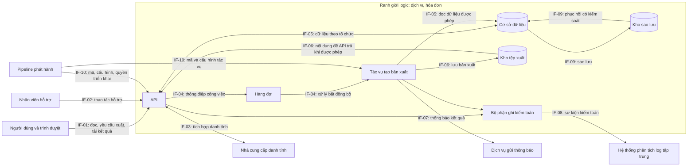

# Xác định system boundary

## 1. Vì sao phải xác định ranh giới hệ thống?

Trước khi viết yêu cầu bảo mật, nhóm cần thống nhất hệ thống đang được xem xét là gì, phục vụ mục đích nào, gồm những thành phần nào và tương tác với ai. Nếu phạm vi này mơ hồ, cùng một yêu cầu có thể được mỗi nhóm hiểu theo một cách.

Ví dụ, yêu cầu “chỉ cho phép người có quyền tải hóa đơn” sẽ thiếu hiệu lực nếu nhóm chỉ xem API là hệ thống, trong khi tệp hóa đơn được tạo bởi tác vụ nền và tải trực tiếp từ kho tệp. Đường API có thể kiểm tra quyền đầy đủ nhưng đường tải tệp lại nằm ngoài danh sách được thiết kế và kiểm thử.

**System boundary**, hay **ranh giới hệ thống**, là đường phân định những thành phần được coi là thuộc hệ thống đang xét với các tác nhân, hệ thống và môi trường bên ngoài, trong một mục đích phân tích và mức chi tiết đã xác định.

Ranh giới giúp trả lời ba câu hỏi liên quan:

1. Những hành vi, dữ liệu và thành phần nào phải được mô tả trực tiếp trong đặc tả hệ thống?
2. Những tương tác nào đi qua giao diện với bên ngoài và cần yêu cầu bảo vệ?
3. Ai chịu trách nhiệm thực hiện, cung cấp bằng chứng và xử lý rủi ro cho từng phần?

Trong thiết kế yêu cầu bảo mật, kết quả xác định ranh giới phải đủ rõ để liên kết mục tiêu bảo vệ, mô hình đe dọa, yêu cầu, kiến trúc và kiểm thử. Một đường bao trên sơ đồ chỉ là điểm bắt đầu.

Sau bài học này, người học có thể xác định đối tượng phân tích, lập sơ đồ bối cảnh, mô tả giao diện qua ranh giới, phân chia trách nhiệm và viết yêu cầu có thể kiểm chứng cho các tương tác quan trọng.

## 2. Ranh giới hệ thống khác ranh giới tin cậy như thế nào?

### 2.1. Ranh giới hệ thống xác định đối tượng phân tích

Ranh giới hệ thống phụ thuộc vào câu hỏi đang cần giải quyết. Khi thiết kế dịch vụ quản lý hóa đơn, nhóm có thể xem API, tác vụ nền, hàng đợi, cơ sở dữ liệu và kho tệp là một hệ thống logic. Khi phân tích riêng dịch vụ tạo tệp, API và cơ sở dữ liệu có thể trở thành các thành phần bên ngoài đối với phạm vi hẹp hơn đó.

Cả hai cách nhìn đều có thể hợp lý nếu nêu rõ mục đích, phạm vi và quan hệ với bức tranh lớn hơn. Vấn đề xuất hiện khi nhóm thay đổi cách nhìn nhưng vẫn dùng cùng một từ “hệ thống” mà không giải thích.

### 2.2. Ranh giới tin cậy xác định nơi phải đánh giá lại độ tin cậy

**Trust boundary**, hay **ranh giới tin cậy**, là nơi dữ liệu, danh tính hoặc quyền hạn đi giữa các miền có giả định tin cậy và cơ chế kiểm soát khác nhau.

Ví dụ:

- Dữ liệu từ trình duyệt đi vào API do máy chủ kiểm soát.
- API gửi thông điệp để tác vụ nền xử lý bằng một danh tính dịch vụ khác.
- Nhân viên hỗ trợ đi từ công cụ nội bộ vào chức năng quản trị dữ liệu khách hàng.
- Bản sao lưu được đưa từ kho lưu trữ sang môi trường phục hồi.
- Pipeline phát hành thay đổi mã và cấu hình của ứng dụng đang vận hành.

Ranh giới tin cậy có thể nằm **bên trong** ranh giới hệ thống. Hàng đợi và tác vụ nền cùng thuộc một dịch vụ logic nhưng thông điệp vẫn cần được xác thực nguồn, giới hạn quyền và kiểm tra nội dung theo mô hình đe dọa.

### 2.3. Các loại đường phân định không tự thay thế cho nhau

| Loại ranh giới | Điều được phân định | Điểm cần chú ý khi đặc tả bảo mật |
|---|---|---|
| Ranh giới hệ thống | Thành phần thuộc đối tượng phân tích và thành phần bên ngoài | Phải nêu mục đích và mức chi tiết |
| Ranh giới tin cậy | Miền có giả định tin cậy hoặc quyền hạn khác nhau | Cần xác định dữ liệu, danh tính và quyền được kiểm tra ở đâu |
| Ranh giới mạng | Mạng, vùng mạng hoặc đường kết nối | Cùng một mạng vẫn có thể có các miền tin cậy khác nhau |
| Ranh giới triển khai | Tiến trình, máy ảo, cụm hoặc môi trường | Một hệ thống logic có thể trải qua nhiều nơi triển khai |
| Ranh giới tổ chức | Nhóm, công ty hoặc nhà cung cấp chịu trách nhiệm | Cần làm rõ giao diện trách nhiệm và bằng chứng |
| Ranh giới dữ liệu của khách hàng | Dữ liệu và quyền thuộc các khách hàng hoặc tổ chức khác nhau | Có thể cần cách ly ngay trong cùng một ứng dụng và cơ sở dữ liệu |

Việc đặt hai thành phần trong cùng một cụm triển khai không đủ để kết luận rằng chúng có thể tin mọi dữ liệu của nhau. Tương tự, một dịch vụ do nhà cung cấp vận hành vẫn có thể thuộc kiến trúc logic của sản phẩm và tạo ra trách nhiệm cấu hình cho nhóm sử dụng.

## 3. Chọn mục đích và mức chi tiết trước khi vẽ

Một mô tả ranh giới nên bắt đầu bằng một đoạn tuyên bố ngắn:

> Phạm vi phân tích là dịch vụ quản lý hóa đơn cho nhiều tổ chức, từ lúc tiếp nhận yêu cầu đọc hoặc xuất hóa đơn đến khi cung cấp kết quả, ghi nhận kiểm toán và phục hồi dữ liệu. Phân tích bao gồm các thành phần xử lý và lưu trữ do nhóm sản phẩm cấu hình; các dịch vụ danh tính, gửi thông báo và công cụ phát hành được mô tả qua giao diện phụ thuộc.

Tuyên bố này giúp tránh hai sai lệch:

- Phạm vi quá hẹp khiến tác vụ nền, dữ liệu xuất, logging hoặc sao lưu bị bỏ sót.
- Phạm vi quá rộng khiến sơ đồ không còn thể hiện được nơi nhóm có thể đặt yêu cầu và thu thập bằng chứng.

Có thể duy trì nhiều góc nhìn liên kết với nhau:

| Góc nhìn | Câu hỏi chính | Đầu ra điển hình |
|---|---|---|
| Bối cảnh | Hệ thống phục vụ ai và tương tác với hệ thống nào? | Sơ đồ tác nhân và phụ thuộc bên ngoài |
| Logic | Thành phần nào xử lý, lưu trữ và truyền dữ liệu? | Sơ đồ API, tác vụ nền, hàng đợi, kho dữ liệu |
| Triển khai | Thành phần chạy ở đâu và dưới danh tính nào? | Môi trường, vùng mạng, tài khoản dịch vụ |
| Vận hành | Ai có thể thay đổi hoặc phục hồi hệ thống? | Luồng quản trị, CI/CD, giám sát và phục hồi |
| Dữ liệu | Dữ liệu đi đâu và tồn tại bao lâu? | Luồng dữ liệu, bản sao, nơi xuất và thời hạn giữ |

Không cần dồn mọi chi tiết vào một hình. Các góc nhìn cần dùng tên và mã định danh nhất quán để người đọc theo được cùng một thành phần hoặc giao diện.

## 4. Thu thập đầu vào theo tài sản và luồng sử dụng

### 4.1. Xác định mục tiêu nghiệp vụ và tài sản

Bắt đầu từ các chức năng mà hệ thống thực hiện và hậu quả nếu chức năng hoặc dữ liệu bị xâm hại.

Với hệ thống hóa đơn, những tài sản cần quan tâm gồm:

- Nội dung hóa đơn, tệp đính kèm và bản xuất.
- Danh tính người dùng, quan hệ thành viên tổ chức và quyền truy cập.
- Khóa tích hợp, thông tin xác thực của tài khoản dịch vụ và cấu hình.
- Sự kiện kiểm toán phục vụ truy vết.
- Bản sao lưu và khả năng tiếp tục cung cấp dịch vụ.

Đối với mỗi tài sản, cần hiểu yêu cầu bí mật, toàn vẹn, sẵn sàng và người có thẩm quyền quyết định cách sử dụng nó. Không phải mọi tài sản đều là một bảng dữ liệu; quyền phát hành ứng dụng cũng có thể ảnh hưởng trực tiếp đến các mục tiêu bảo vệ.

### 4.2. Liệt kê tác nhân và các loại danh tính

Tác nhân không chỉ gồm người dùng cuối. Cần xem xét:

- Người dùng của từng tổ chức.
- Quản trị viên tổ chức.
- Nhân viên hỗ trợ và người vận hành.
- Tài khoản dịch vụ, tác vụ định kỳ và đối tác tích hợp.
- Hệ thống danh tính, gửi thông báo, thu thập log và công cụ phát hành.

Nhân viên thuộc cùng công ty vẫn cần được mô tả theo quyền và đường truy cập thực tế. Nhãn “nội bộ” không giải thích được người đó có được đọc hóa đơn khách hàng hay không.

Mô hình đe dọa còn phải xem xét việc một danh tính hợp lệ bị lạm dụng hoặc chiếm quyền. Sơ đồ bối cảnh mô tả tương tác dự kiến; các tình huống lạm dụng được bổ sung khi phân tích rủi ro trên những tương tác đó.

### 4.3. Đi theo cả luồng bình thường và luồng đặc biệt

Ngoài hành vi đọc, ghi và xuất dữ liệu thông thường, cần tìm các luồng:

- Nhập dữ liệu từ đối tác, xử lý webhook hoặc tải tệp lên.
- Chạy lại tác vụ lỗi, xử lý thông điệp tồn đọng và làm sạch dữ liệu tạm.
- Cấp quyền, thu hồi quyền, hỗ trợ khách hàng và truy cập khẩn cấp.
- Xuất log, gửi thông báo và thu thập thông tin chẩn đoán.
- Sao lưu, khôi phục, chuyển môi trường và xóa dữ liệu.
- Cập nhật phần mềm, cấu hình và bí mật.

Một luồng ít được sử dụng vẫn có thể mang quyền hạn lớn hoặc đi qua một giao diện khác với đường sử dụng thường ngày.

## 5. Quy trình xác định system boundary

### Bước 1: Đặt tên đối tượng và kết quả nghiệp vụ

Viết rõ hệ thống nào đang được phân tích, phiên bản hoặc thay đổi nào được xét và kết quả nghiệp vụ cần bảo vệ. Tránh các mô tả như “toàn bộ backend” nếu chúng chưa cho biết thành phần và luồng dữ liệu.

### Bước 2: Lập danh sách thành phần và nơi lưu dữ liệu

Liệt kê những thành phần thực sự tiếp nhận, biến đổi, quyết định quyền hoặc lưu dữ liệu. Với mỗi thành phần, ghi mục đích, dữ liệu xử lý, người chịu trách nhiệm và mức kiểm soát của nhóm.

Có thể dùng ba nhãn hỗ trợ:

- **Trực tiếp quản lý:** nhóm kiểm soát mã hoặc cấu hình và vận hành theo trách nhiệm đã thống nhất.
- **Quản lý được ủy thác:** chức năng do nền tảng hoặc nhà cung cấp vận hành; nhóm vẫn có các trách nhiệm cấu hình và sử dụng.
- **Phụ thuộc bên ngoài:** hệ thống tương tác qua giao diện và có chủ sở hữu riêng.

Các nhãn giúp phân công; quyết định thành phần nằm trong hay ngoài sơ đồ vẫn phải dựa trên mục đích phân tích.

### Bước 3: Xác định thành phần bên trong và phụ thuộc bên ngoài

Ghi rõ cả phần được đưa vào lẫn phần được loại khỏi phân tích chi tiết. Với mỗi phần bị loại, cần có lý do và cách quản lý phụ thuộc.

Ví dụ:

> Cơ chế vận hành nội bộ của nhà cung cấp danh tính không được phân tích chi tiết trong tài liệu này. Giao diện đăng nhập, thông tin danh tính được chấp nhận, hành vi khi nhà cung cấp lỗi và trách nhiệm cấu hình tích hợp vẫn thuộc phạm vi yêu cầu của dịch vụ hóa đơn.

Phần nằm ngoài đường bao vẫn có thể tạo ra rủi ro và nghĩa vụ cần quản lý.

### Bước 4: Đánh số giao diện và mô tả luồng qua ranh giới

Mỗi giao diện quan trọng cần nêu:

- Nguồn, đích và bên chủ động tạo kết nối hoặc công việc.
- Dữ liệu, danh tính và quyền hạn được truyền.
- Cách xác thực nguồn và nơi quyết định quyền.
- Hành vi thành công, bị từ chối, hết hạn hoặc lỗi.
- Nơi có thể tồn tại bản sao dữ liệu.
- Người chịu trách nhiệm và cách kiểm chứng.

Giao diện bao gồm cả thông điệp hàng đợi, tệp trao đổi, thao tác quản trị và phục hồi; không chỉ có HTTP API.

### Bước 5: Đánh dấu các miền tin cậy

Xem xét nơi thay đổi chủ thể, quyền thực thi, tổ chức sở hữu dữ liệu hoặc mức kiểm soát môi trường. Với mỗi điểm chuyển, hỏi:

> Thành phần nhận đang tin điều gì, căn cứ nào cho phép tin và điều gì xảy ra nếu dữ liệu hoặc danh tính bị giả mạo?

Câu trả lời tạo đầu vào cho mô hình đe dọa và yêu cầu kiểm tra.

### Bước 6: Ghi giả định, phần chưa biết và trách nhiệm

Một giả định cần có người xác nhận và cách kiểm chứng. “Nhà cung cấp sẽ bảo vệ mọi dữ liệu” quá rộng để sử dụng.

Một cách ghi cụ thể hơn:

> Nền tảng lưu trữ cung cấp khả năng giới hạn truy cập theo danh tính dịch vụ. Nhóm vận hành chịu trách nhiệm cấu hình quyền và cung cấp bằng chứng rằng kho tệp không cho truy cập công khai.

Các thông tin chưa được xác nhận cần được ghi thành vấn đề mở, có người xử lý và mốc cần giải quyết trước công việc phụ thuộc.

### Bước 7: Liên kết với rủi ro, yêu cầu và bằng chứng

Mỗi giao diện hoặc tài sản có rủi ro đáng kể cần liên kết tới yêu cầu phù hợp. Người đọc phải tìm được kiểm chứng nào xác nhận yêu cầu và bằng chứng nào áp dụng cho phiên bản hệ thống đang xét.

Kết quả được xác nhận với các nhóm sản phẩm, phát triển, bảo mật, kiểm thử và vận hành có liên quan. Mức tham gia có thể thay đổi theo quy mô nhóm, nhưng trách nhiệm phải rõ ràng.

## 6. Ví dụ: dịch vụ hóa đơn cho nhiều tổ chức

### 6.1. Mục đích và phạm vi logic

Hệ thống phục vụ nhiều tổ chức dùng chung một dịch vụ. Người dùng được đọc và xuất hóa đơn theo quyền của mình. Việc xuất dữ liệu được thực hiện bất đồng bộ.

Trong ví dụ này, ranh giới logic gồm:

- API đọc hóa đơn và tiếp nhận yêu cầu xuất.
- Hàng đợi công việc và tác vụ tạo bản xuất.
- Cơ sở dữ liệu hóa đơn và quan hệ tổ chức.
- Kho tệp xuất, bộ phận ghi nhận kiểm toán và kho sao lưu thuộc cấu hình của dịch vụ.

Những thành phần được mô tả như tác nhân hoặc phụ thuộc bên ngoài gồm trình duyệt người dùng, công cụ của nhân viên hỗ trợ, nhà cung cấp danh tính, dịch vụ gửi thông báo, hệ thống phân tích log tập trung và pipeline phát hành.

Pipeline nằm ngoài đường bao chạy ứng dụng trong sơ đồ dưới đây nhưng vẫn có giao diện đặc quyền đi vào hệ thống. Các yêu cầu bảo vệ quyền phát hành thuộc phạm vi đánh giá bảo mật.

Trình duyệt chạy trong môi trường người dùng kiểm soát. Nếu sản phẩm có mã giao diện do nhóm phát triển cung cấp, trách nhiệm bảo vệ quá trình tạo và phân phối mã đó cần được mô tả thêm; dữ liệu gửi từ trình duyệt vẫn cần kiểm tra tại máy chủ.

### 6.2. Sơ đồ bối cảnh và thành phần



Sơ đồ lựa chọn cách tải tệp thông qua API. Nếu hệ thống chuyển sang tải trực tiếp bằng liên kết từ kho tệp, cần bổ sung giao diện người dùng với kho tệp và xem xét lại cách phân quyền, hết hạn và thu hồi.

Kho sao lưu trong hình chỉ minh họa dữ liệu cơ sở dữ liệu. Nếu phục hồi còn phụ thuộc vào tệp, khóa, cấu hình hoặc trạng thái công việc, các thành phần và luồng tương ứng phải được bổ sung trong góc nhìn phục hồi.

Các cạnh nội bộ vẫn có thể đi qua ranh giới tin cậy. Sơ đồ chi tiết về danh tính dịch vụ và quyền truy cập cần làm rõ điều đó.

### 6.3. Sổ giao diện minh họa

| Mã | Nguồn và đích | Dữ liệu hoặc quyền đi qua | Câu hỏi bảo mật cần giải quyết |
|---|---|---|---|
| IF-01 | Trình duyệt với API | Danh tính, mã tổ chức, mã hóa đơn, yêu cầu xuất và dữ liệu trả về | Máy chủ xác thực ai và kiểm tra quyền tài nguyên thế nào? |
| IF-02 | Công cụ hỗ trợ với API | Quyền hỗ trợ, thao tác với dữ liệu khách hàng | Nhân viên được làm gì, trong điều kiện nào và có dấu vết gì? |
| IF-03 | API với nhà cung cấp danh tính | Thông tin và bằng chứng xác thực | Nguồn nào được chấp nhận, thông tin có còn hiệu lực và đúng mục đích sử dụng không? |
| IF-04 | API qua hàng đợi đến tác vụ nền | Mã công việc, tổ chức, chủ thể và phạm vi xuất | Ai được gửi thông điệp, nội dung nào đáng tin và khi nào cần kiểm tra lại quyền? |
| IF-05 | API hoặc tác vụ với cơ sở dữ liệu | Truy vấn, nội dung hóa đơn và quan hệ tổ chức | Cách ly dữ liệu và giới hạn quyền tài khoản dịch vụ ở đâu? |
| IF-06 | Tác vụ, kho tệp và API | Bản xuất và định danh đối tượng lưu trữ | Ai được đọc tệp, tệp tồn tại bao lâu và đường tải thực thi quyền ra sao? |
| IF-07 | Tác vụ với dịch vụ thông báo | Địa chỉ nhận, trạng thái và tham chiếu công việc | Có cần gửi nội dung hóa đơn không và dữ liệu nào được phép ra ngoài? |
| IF-08 | Bộ phận kiểm toán với hệ thống log | Chủ thể, hành động, kết quả và mã tương quan | Trường nào bị cấm ghi, ai được đọc và khi truyền lỗi thì xử lý thế nào? |
| IF-09 | Kho dữ liệu với kho sao lưu | Bản sao dữ liệu và khả năng khôi phục | Ai được sao lưu, ai được phục hồi và cách chứng minh phục hồi đạt mục tiêu? |
| IF-10 | Pipeline với môi trường ứng dụng | Mã, cấu hình và quyền thay đổi hệ thống | Ai được phát hành, quyền được giới hạn thế nào và bản phát hành truy về đâu? |

Một mã có thể đại diện một nhóm luồng ở sơ đồ bối cảnh. Khi đặc tả chi tiết, cần tách thành các giao diện con nếu khác dữ liệu, quyền, người chịu trách nhiệm hoặc tiêu chí kiểm chứng.

## 7. Phân chia trách nhiệm với thành phần được quản lý bên ngoài

Một cơ sở dữ liệu được cung cấp dưới dạng dịch vụ vẫn chứa dữ liệu của hệ thống. Nhóm cần làm rõ phần nhà cung cấp chịu trách nhiệm và phần sản phẩm phải cấu hình, kiểm tra hoặc giám sát.

| Hạng mục | Trách nhiệm của nhóm sử dụng | Phần cần xác nhận với bên cung cấp |
|---|---|---|
| Tích hợp danh tính | Chọn nguồn danh tính được chấp nhận, kiểm tra thông tin, ánh xạ quyền và xử lý lỗi | Khả năng cung cấp danh tính, quản lý vòng đời và cam kết dịch vụ cần thiết |
| Kho dữ liệu | Phân loại dữ liệu, cấu hình truy cập, giới hạn tài khoản và kiểm tra sử dụng | Khả năng bảo vệ và vận hành lớp nền tảng theo dịch vụ đã chọn |
| Kho tệp | Chính sách truy cập, cách cung cấp tệp, thời hạn lưu và dọn dữ liệu | Khả năng thực thi chính sách và cung cấp bằng chứng cần thiết |
| Logging | Chọn sự kiện, loại bỏ bí mật, phân quyền và đặt thời hạn giữ | Cách nhận, lưu, bảo vệ và truy xuất sự kiện |
| Sao lưu | Chọn dữ liệu, mục tiêu phục hồi, quyền và tổ chức diễn tập | Khả năng sao lưu, giữ bản sao và khôi phục mà dịch vụ hỗ trợ |

Bảng này là khung phân tích, không phải cam kết của một nhà cung cấp cụ thể. Trách nhiệm thực tế phải được xác nhận theo cấu hình, hợp đồng và cách sử dụng.

Nếu không thể có bằng chứng trực tiếp, cần xác định loại xác nhận có thể chấp nhận, người đánh giá và rủi ro còn lại. Việc ghi tên một dịch vụ bên ngoài trên sơ đồ chưa giải quyết được những câu hỏi đó.

## 8. Từ ranh giới đến yêu cầu bảo mật cụ thể

Ranh giới cho biết nơi đặt câu hỏi; mô hình đe dọa giải thích vì sao cần kiểm soát; yêu cầu mô tả hành vi bắt buộc và bằng chứng cần có.

### 8.1. Xác thực tại giao diện danh tính

**Rủi ro:** API chấp nhận thông tin danh tính không đến từ nguồn được phép, không còn hiệu lực hoặc không dành cho dịch vụ.

**Yêu cầu minh họa — SEC-ID-01:** API chỉ thiết lập ngữ cảnh người dùng sau khi xác minh bằng chứng danh tính theo cơ chế tích hợp đã chọn, gồm nguồn được chấp nhận, hiệu lực và bên nhận dự kiến. Khi không xác minh được, API không cung cấp dữ liệu được bảo vệ.

**Kiểm chứng:** gửi các bằng chứng hợp lệ, hết hạn, sai nguồn, sai bên nhận và không thể xác minh. Kiểm tra phản hồi, dữ liệu trả về và sự kiện liên quan. Cách xác minh cụ thể cần được đặc tả theo cơ chế danh tính thực tế.

### 8.2. Phân quyền xuyên qua xử lý bất đồng bộ

**Rủi ro:** yêu cầu được phép ban đầu nhưng tác vụ chạy với phạm vi rộng hơn hoặc người dùng mất quyền trước khi tải kết quả.

**Yêu cầu minh họa — SEC-AUTHZ-01:** API và tác vụ xuất phải xác định tổ chức, chủ thể và phạm vi dữ liệu từ nguồn đáng tin cậy. Tác vụ chỉ được đọc dữ liệu thuộc phạm vi đã cho phép. Khi cung cấp tệp, hệ thống phải kiểm tra quyền tải theo chính sách hiệu lực quyền đã thống nhất.

**Kiểm chứng:** tạo yêu cầu từ tổ chức A, thay đổi dữ liệu đầu vào thuộc B, gửi thông điệp từ danh tính không được phép và thu hồi quyền giữa các giai đoạn. Kiểm tra nội dung tệp, phản hồi tải và các đường lỗi.

Nếu hệ thống chấp nhận độ trễ thu hồi quyền, yêu cầu phải nêu giới hạn thời gian và cơ chế thực thi. “Kiểm tra quyền khi cần” chưa đủ để xác định hành vi.

### 8.3. Bảo vệ dữ liệu khi đi ra ngoài

**Rủi ro:** thông báo hoặc thông tin chẩn đoán đưa nội dung hóa đơn sang hệ thống ngoài phạm vi lưu trữ đã thống nhất.

**Yêu cầu minh họa — SEC-DATA-01:** thông báo xuất thành công chỉ được chứa các trường thuộc danh sách cho phép, gồm trạng thái và tham chiếu công việc không tự trao quyền đọc dữ liệu. Không gửi nội dung hóa đơn, token phiên hoặc bí mật truy cập cho dịch vụ thông báo trong luồng này.

**Kiểm chứng:** quan sát dữ liệu gửi qua IF-07 ở cả trường hợp thành công và lỗi; đối chiếu từng trường với danh sách cho phép.

Nếu nghiệp vụ thực sự cần gửi dữ liệu hóa đơn qua một bên ngoài, phải thay đổi phạm vi xử lý dữ liệu, đánh giá rủi ro và đặc tả lại yêu cầu tương ứng.

### 8.4. Logging qua một miền quản lý khác

**Rủi ro:** thiếu dấu vết cho xuất dữ liệu hoặc bí mật bị sao chép vào kho log có phạm vi truy cập rộng hơn.

**Yêu cầu minh họa — SEC-LOG-01:** mỗi yêu cầu xuất và lần tải kết quả phải tạo sự kiện kiểm toán theo chính sách, xác định được chủ thể, tổ chức, công việc, thời điểm và kết quả. Sự kiện không chứa nội dung hóa đơn hoặc thông tin xác thực. Quyền đọc và sửa dữ liệu kiểm toán phải được giới hạn theo vai trò đã phê duyệt.

**Kiểm chứng:** thực hiện xuất, tải, truy cập bị từ chối và lỗi gửi sự kiện; kiểm tra trường dữ liệu, khả năng truy vết, phân quyền và hành vi lưu đệm hoặc xử lý lỗi đã đặc tả.

Thời hạn giữ, thời gian chuyển sự kiện tối đa và hành vi khi mất kênh logging cần được xác định riêng theo nhu cầu điều tra và rủi ro nghiệp vụ.

### 8.5. Phục hồi qua ranh giới vận hành

**Rủi ro:** bản sao lưu tồn tại nhưng thiếu khóa hoặc cấu hình cần thiết, hoặc việc khôi phục đưa dữ liệu vào nơi có quyền truy cập quá rộng.

**Yêu cầu minh họa — SEC-REC-01:** quá trình phục hồi phải có người được ủy quyền, môi trường đích được kiểm soát và kiểm tra tính toàn vẹn trước khi đưa dữ liệu vào phục vụ. Phạm vi phục hồi phải bao gồm các phụ thuộc cần thiết để dịch vụ hoạt động theo mức đã thống nhất.

Có thể đặt RPO không quá 15 phút và RTO không quá 2 giờ cho một kịch bản minh họa:

- **RPO** là giới hạn mất dữ liệu được chấp nhận, thường thể hiện bằng khoảng thời gian dữ liệu có thể bị mất.
- **RTO** là thời gian mục tiêu để khôi phục dịch vụ tới mức hoạt động đã thống nhất, với mốc bắt đầu và kết thúc rõ ràng.

Các con số trên chỉ phục vụ ví dụ. Hệ thống thực tế phải chọn mục tiêu và kịch bản theo nhu cầu nghiệp vụ.

**Kiểm chứng:** diễn tập trong môi trường cô lập; đo điểm dữ liệu phục hồi, thời gian, tính toàn vẹn và quyền truy cập. Kiểm tra cả khả năng tiếp cận khóa, cấu hình và dữ liệu phụ thuộc cần thiết.

## 9. Lưu quan hệ truy vết giữa giao diện, rủi ro và kiểm thử

Có thể sử dụng một bảng liên kết nhỏ:

| Giao diện | Rủi ro | Yêu cầu | Quyết định thiết kế cần ghi | Bằng chứng |
|---|---|---|---|---|
| IF-03 | Chấp nhận danh tính không phù hợp | SEC-ID-01 | Cơ chế xác minh và nguồn danh tính được phép | Kết quả kiểm thử bằng chứng danh tính |
| IF-04, IF-05, IF-06 | Xuất hoặc tải dữ liệu chéo tổ chức | SEC-AUTHZ-01 | Nguồn ngữ cảnh tổ chức và các mốc kiểm tra quyền | Kiểm thử API, thông điệp, tác vụ và tệp |
| IF-07 | Gửi dữ liệu ngoài phạm vi cho phép | SEC-DATA-01 | Danh sách trường được gửi và xử lý thông báo lỗi | Kết quả kiểm tra nội dung gửi |
| IF-08 | Lộ bí mật hoặc thiếu sự kiện | SEC-LOG-01 | Cấu trúc sự kiện, quyền và xử lý gián đoạn | Sự kiện mẫu đã che dữ liệu và kiểm tra truy cập |
| IF-09 | Không khôi phục được hoặc khôi phục thiếu kiểm soát | SEC-REC-01 | Phụ thuộc, quyền và quy trình phục hồi | Báo cáo diễn tập theo phiên bản cấu hình |

Ví dụ một kịch bản kiểm chứng quyền tải:

```text
Điều kiện:
- Người dùng U thuộc tổ chức A và có quyền xuất hóa đơn.
- Một bản xuất của A đã được tạo thành công.
- Chính sách yêu cầu kiểm tra quyền hiện tại ở mỗi lần tải.

Thao tác:
1. Thu hồi quyền tải hoặc quan hệ thành viên cần thiết của U.
2. Đợi tới thời điểm việc thu hồi phải có hiệu lực theo đặc tả.
3. U yêu cầu tải tệp qua mọi giao diện tải thuộc phạm vi.

Kết quả mong đợi:
- Không nhận được nội dung tệp qua bất kỳ giao diện nào.
- Phản hồi tuân theo chính sách xử lý truy cập bị từ chối.
- Sự kiện kiểm toán xác định được yêu cầu và kết quả.
- Không xuất hiện token hoặc nội dung hóa đơn trong sự kiện.
```

Bằng chứng phải gắn với phiên bản mã, cấu hình, mô hình ranh giới và môi trường được kiểm tra. Khi đổi đường tải tệp hoặc cơ chế quyền, cần đánh giá lại khả năng áp dụng của bằng chứng cũ.

## 10. Xử lý vòng đời và các bản sao dữ liệu

Một bản ghi có thể xuất hiện tại nhiều nơi: cơ sở dữ liệu chính, hàng đợi, tệp xuất, bộ nhớ đệm, log, bản sao lưu và môi trường phục hồi. Vì vậy, ranh giới cần thể hiện cách dữ liệu tồn tại qua thời gian.

Với mỗi nơi chứa bản sao, cần xác định:

- Mục đích lưu và những trường dữ liệu cần thiết.
- Danh tính có quyền đọc, ghi, xuất và xóa.
- Thời hạn giữ và cơ chế thực thi.
- Cách xử lý khi tác vụ dọn dữ liệu thất bại.
- Cách dữ liệu được xử lý khi người dùng mất quyền hoặc dịch vụ ngừng hoạt động.
- Chính sách áp dụng cho bản sao lưu và việc phục hồi dữ liệu đã được yêu cầu xóa.

Việc xóa bản ghi chính không tự chứng minh rằng mọi bản sao đã biến mất. Cần xác định phạm vi giữ, xóa hoặc hạn chế phục hồi phù hợp với mục đích, nghĩa vụ áp dụng và khả năng kỹ thuật đã được chấp thuận.

Cũng cần bảo vệ tính toàn vẹn của dữ liệu khi qua nhiều thành phần. Mã tổ chức trong thông điệp, định danh tệp và điều kiện truy vấn phải cùng gắn với một ngữ cảnh đã được cho phép; lỗi liên kết giữa chúng có thể phá vỡ cách ly dữ liệu ngay cả khi từng kết nối đã được mã hóa.

## 11. Quản lý giả định và thay đổi ranh giới

### 11.1. Ghi giả định thành thông tin có thể kiểm tra

| Giả định minh họa | Người xác nhận | Cách kiểm tra | Khi nào cần xem xét lại? |
|---|---|---|---|
| Chỉ danh tính dịch vụ được phép mới gửi được công việc xuất | Nhóm vận hành | Kiểm tra quyền hàng đợi và thử gửi từ danh tính không được cấp quyền | Thêm bên gửi hoặc đổi chính sách truy cập |
| Mọi lần tải tệp đều đi qua API | Nhóm phát triển | Đối chiếu thiết kế, cấu hình kho tệp và các đường tải | Thêm liên kết tải trực tiếp hoặc tích hợp mới |
| Log không cần chứa nội dung hóa đơn | Chủ sở hữu dữ liệu và nhóm điều tra | Đối chiếu nhu cầu điều tra với cấu trúc sự kiện | Thay đổi nhu cầu giám sát hoặc xử lý sự cố |
| Phục hồi cần một số khóa và cấu hình riêng | Nhóm vận hành | Diễn tập và kiểm tra danh sách phụ thuộc | Đổi cơ chế mã hóa hoặc môi trường |

Nếu giả định không đúng, phải cập nhật mô hình, yêu cầu và kiểm chứng liên quan. Một dòng ghi chú chưa được kiểm tra không nên được dùng như bằng chứng rằng kiểm soát đã tồn tại.

### 11.2. Những thay đổi thường làm ranh giới dịch chuyển

- Mở API cho đối tác hoặc thêm webhook.
- Đưa dữ liệu sang công cụ phân tích, hỗ trợ hoặc thông báo mới.
- Tách xử lý thành tác vụ nền, thêm hàng đợi hoặc bộ nhớ đệm.
- Thay đổi cách phân phối tệp, nơi lưu dữ liệu hoặc nhà cung cấp danh tính.
- Cấp quyền hỗ trợ mới, thêm truy cập khẩn cấp hoặc đổi pipeline.
- Di chuyển môi trường, thay đổi sao lưu và cách phục hồi.
- Ngừng một chức năng nhưng vẫn giữ tệp, tài khoản hoặc tích hợp của nó.

Đánh giá thay đổi cần tìm giao diện, tài sản, giả định và yêu cầu bị tác động. Một thay đổi không làm xuất hiện máy chủ mới vẫn có thể mở rộng phạm vi bảo mật, chẳng hạn thêm trường dữ liệu nhạy cảm vào một thông báo đang có.

## 12. Mẫu hồ sơ ranh giới có thể sử dụng

Mẫu dưới đây dùng để ghi kết quả phân tích cho một hệ thống cụ thể. Các mục cần được điền bằng quyết định đã xác nhận hoặc vấn đề mở có người chịu trách nhiệm.

```text
Tên hệ thống và phiên bản mô hình:
Mục đích nghiệp vụ:
Mục đích phân tích và mức chi tiết:
Chủ sở hữu phạm vi:

Tài sản và mục tiêu bảo vệ:
Tác nhân và loại danh tính:

Thành phần bên trong:
- Mã, chức năng, dữ liệu, mức kiểm soát, chủ sở hữu.

Phụ thuộc bên ngoài:
- Mã, mục đích, dữ liệu trao đổi, trách nhiệm và bằng chứng cần có.

Phần không phân tích chi tiết:
- Nội dung, lý do và cách quản lý rủi ro tại giao diện.

Giao diện:
- Mã, nguồn, đích, dữ liệu, danh tính, quyền và xử lý lỗi.

Miền và ranh giới tin cậy:
- Giả định thay đổi ở đâu, cách xác thực và kiểm tra quyền.

Luồng quản trị, phát hành, logging, sao lưu và phục hồi:
Bản sao dữ liệu, thời hạn giữ và xử lý khi ngừng hoạt động:

Giả định và vấn đề mở:
- Nội dung, người xác nhận, cách kiểm tra và mốc giải quyết.

Liên kết:
- Giao diện -> rủi ro -> yêu cầu -> thiết kế -> kiểm chứng.

Người xác nhận, thời điểm và điều kiện xem xét lại:
```

Hồ sơ cần liên kết được với sơ đồ và danh sách yêu cầu. Nhóm có thể lưu chúng trong cùng tài liệu hoặc công cụ quản lý sẵn có, miễn là thay đổi được theo dõi nhất quán.

## 13. Những sai lệch thường gặp

| Sai lệch | Hệ quả | Cách điều chỉnh |
|---|---|---|
| Lấy ranh giới kho mã làm ranh giới hệ thống | Bỏ sót kho dữ liệu, nền tảng và công cụ vận hành | Đi theo chức năng, tài sản và luồng dữ liệu |
| Xem dịch vụ bên ngoài là hoàn toàn ngoài phạm vi bảo mật | Không đặc tả dữ liệu trao đổi và hành vi lỗi | Ghi rõ giao diện, giả định, trách nhiệm và bằng chứng |
| Đồng nhất mạng nội bộ với miền tin cậy | Chấp nhận dữ liệu hoặc quyền quá rộng | Xác định chủ thể, nguồn dữ liệu và quyền ở từng điểm chuyển |
| Chỉ vẽ luồng người dùng bình thường | Bỏ sót hỗ trợ, quản trị, tác vụ nền và phục hồi | Bổ sung các góc nhìn vận hành và xử lý lỗi |
| Không thể hiện cách ly giữa các tổ chức | Kiểm thử chỉ theo vai trò, bỏ qua chủ sở hữu tài nguyên | Đặc tả cả tổ chức, tài nguyên và ngữ cảnh xử lý |
| Xem bản sao lưu hoặc log là phần phụ | Dữ liệu nhạy cảm thoát khỏi chính sách truy cập và giữ dữ liệu | Đưa các bản sao và vòng đời vào phạm vi phân tích |
| Vẽ đường bao nhưng không có người chịu trách nhiệm | Không ai xác nhận cấu hình hoặc cung cấp bằng chứng | Gắn chủ sở hữu với từng thành phần và giao diện |
| Giữ nguyên mô hình khi thay đổi tích hợp | Yêu cầu và kiểm thử không còn bao phủ thực tế | Xem xét lại theo thay đổi và quản lý phiên bản mô hình |

## 14. Bài tập thực hành

Một ứng dụng cho phép nhân viên tải tài liệu nội bộ lên kho tệp. Tài liệu được quét bởi dịch vụ xử lý tệp, lập chỉ mục để tìm kiếm và sao lưu định kỳ. Nhân viên hỗ trợ có công cụ quản trị riêng.

Hãy thực hiện:

1. Viết một đoạn tuyên bố mục đích, phạm vi và mức chi tiết của hệ thống.
2. Liệt kê tài sản, tác nhân, thành phần bên trong và phụ thuộc bên ngoài.
3. Vẽ sơ đồ bối cảnh có đường tải lên, tìm kiếm, tải xuống, hỗ trợ, logging và phục hồi.
4. Chọn ba nơi cần đánh giá lại độ tin cậy, giải thích dữ liệu và quyền đi qua.
5. Viết một yêu cầu về xác thực, một yêu cầu về phân quyền và một yêu cầu về bảo vệ dữ liệu qua giao diện.
6. Bổ sung yêu cầu logging và phục hồi cùng cách kiểm chứng.
7. Nêu một giả định cần xác nhận và một thay đổi khiến ranh giới phải được cập nhật.

Để đánh giá hồ sơ, hãy kiểm tra xem một người mới có thể chỉ ra dữ liệu đi đâu, ai có quyền tác động, nơi nào quyết định quyền và bằng chứng nào xác nhận yêu cầu hay chưa. Những câu hỏi chưa trả lời được cần trở thành thông tin phải làm rõ trong đặc tả.
