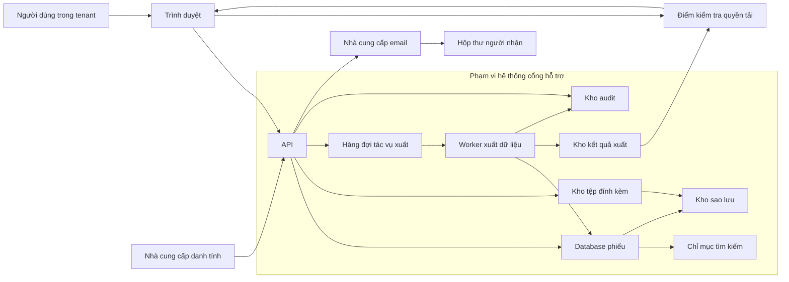

# Xác định asset boundary

## Mục tiêu bài học

Trước khi viết “phải xác thực”, “phải mã hóa” hoặc “phải có bản sao lưu”, nhóm phát triển cần biết đang bảo vệ tài sản nào, tài sản đó xuất hiện ở đâu và ai có thể tác động đến nó. Nếu chỉ nhìn cơ sở dữ liệu chính, yêu cầu bảo mật có thể bỏ sót cùng một dữ liệu đã đi vào tệp xuất, chỉ mục tìm kiếm, log hoặc bản sao lưu.

Trong chương Bối cảnh và phạm vi, **asset boundary** được dùng để chỉ ranh giới xác định phạm vi của một tài sản cần bảo vệ cùng các điểm mà điều kiện bảo vệ, quyền truy cập hoặc trách nhiệm quản lý thay đổi. Đây là cách làm việc phục vụ đặc tả yêu cầu; không nên mặc định mọi tổ chức đều dùng thuật ngữ này theo một khuôn mẫu duy nhất.

Bài học giúp bạn:

- Nhận diện tài sản nghiệp vụ, tài sản hỗ trợ và các bản biểu diễn của dữ liệu.
- Phân biệt ranh giới tài sản với ranh giới hệ thống, ranh giới tin cậy và ranh giới mạng.
- Theo dấu tài sản từ lúc tạo đến khi chia sẻ, sao lưu, phục hồi và xóa.
- Ghi rõ chủ sở hữu, bên lưu giữ, phạm vi quyền và các giả định tại mỗi ranh giới.
- Chuyển kết quả xác định ranh giới thành yêu cầu về xác thực, phân quyền, dữ liệu, logging và phục hồi có thể kiểm chứng.

Ví dụ xuyên suốt là một cổng hỗ trợ khách hàng phục vụ nhiều doanh nghiệp. Các tên, mốc thời gian và chính sách trong ví dụ là giả định minh họa, cần được chủ nghiệp vụ xác nhận trước khi dùng trong sản phẩm thực tế.

## 1. Ranh giới tài sản trả lời những câu hỏi nào?

### 1.1. Asset không chỉ là máy chủ hoặc bảng dữ liệu

**Asset — tài sản** là điều có giá trị đối với tổ chức và cần được bảo vệ trong bối cảnh đang xét. Có thể bắt đầu bằng hai nhóm:

| Nhóm | Ví dụ | Vì sao cần đưa vào phân tích? |
|---|---|---|
| Tài sản nghiệp vụ | Nội dung yêu cầu hỗ trợ, tệp đính kèm, danh sách khách hàng, khả năng tiếp nhận yêu cầu | Gắn trực tiếp với mục tiêu phục vụ khách hàng và hậu quả kinh doanh |
| Tài sản hỗ trợ | Tài khoản dịch vụ, khóa giải mã, cấu hình quyền, kho lưu trữ, bản sao lưu, dấu vết audit | Quyết định khả năng truy cập, xử lý, phục hồi hoặc chứng minh hoạt động đối với tài sản nghiệp vụ |

Một tài sản có thể là thông tin hoặc khả năng cung cấp dịch vụ. Ví dụ, “khả năng tiếp nhận yêu cầu hỗ trợ” đòi hỏi quan tâm đến tính khả dụng, không thể mô tả đầy đủ chỉ bằng danh sách trường trong cơ sở dữ liệu.

Cũng cần phân biệt tài sản với hậu quả. Uy tín khách hàng bị suy giảm là một hậu quả cần cân nhắc khi đánh giá rủi ro; một sơ đồ luồng dữ liệu thường biểu diễn nội dung yêu cầu hỗ trợ hoặc tệp xuất cụ thể để tìm nơi có thể gây ra hậu quả ấy.

### 1.2. Mô tả ranh giới bằng những điều có thể kiểm tra

Một mô tả asset boundary hữu ích cần làm rõ:

1. **Đối tượng:** tài sản gồm những dữ liệu hoặc khả năng nào, có biến thể và bản sao nào?
2. **Phạm vi sử dụng:** tài sản thuộc khách hàng, tenant, dự án hoặc quy trình nào?
3. **Chủ thể và hành động:** ai được đọc, tạo, sửa, xuất, chia sẻ, phục hồi hoặc xóa?
4. **Vị trí và luồng chuyển:** tài sản đi qua thành phần, dịch vụ và bên nhận nào?
5. **Vòng đời:** lúc nào tài sản được tạo, thay đổi, hết hiệu lực, lưu giữ hoặc loại bỏ?
6. **Trách nhiệm:** ai quyết định cách bảo vệ và ai thực thi, vận hành, kiểm chứng?
7. **Điểm thay đổi điều kiện bảo vệ:** khi nào tài sản rời miền kiểm soát hiện tại hoặc cần chính sách khác?

Ví dụ “dữ liệu hỗ trợ nằm trong database của chúng ta” chưa đủ. Cần biết dữ liệu có đi vào email không, tệp xuất nằm ở đâu, người dùng bị thu hồi quyền còn tải được không và bản phục hồi có tái đưa dữ liệu đã xóa trở lại không.

## 2. Phân biệt các loại ranh giới

Một sơ đồ có thể chứa nhiều loại ranh giới chồng lên nhau. Không nên dùng một đường bao duy nhất để kết luận tất cả thành phần bên trong đều có cùng quyền hoặc mức tin cậy.

| Loại ranh giới | Câu hỏi chính | Ví dụ trong cổng hỗ trợ |
|---|---|---|
| Ranh giới tài sản | Phạm vi của tài sản và điều kiện bảo vệ thay đổi ở đâu? | Nội dung phiếu hỗ trợ có thêm một bản trong tệp xuất |
| Ranh giới hệ thống | Nhóm đang thiết kế hoặc thay đổi thành phần nào? | Cổng hỗ trợ gồm API, worker, database và kho tệp |
| Ranh giới tin cậy | Dữ liệu hoặc danh tính đi giữa các miền có giả định tin cậy khác nhau ở đâu? | Trình duyệt gửi yêu cầu sang API; dịch vụ gọi nhà cung cấp email |
| Ranh giới mạng | Kết nối đi qua vùng mạng nào? | Từ mạng công cộng vào cổng API |
| Ranh giới tenant | Quyền và dữ liệu của những khách hàng nào phải được cách ly? | Tenant A và B cùng dùng một database nhưng không được đọc dữ liệu của nhau |
| Ranh giới trách nhiệm | Bên nào quyết định chính sách và bên nào vận hành? | Đội sản phẩm quyết định nội dung email, nhà cung cấp thực hiện chuyển phát |

Hai tenant có thể dùng chung một máy chủ, một bảng và một vùng mạng nhưng vẫn có ranh giới phân quyền bắt buộc. Ngược lại, hai dịch vụ nằm ở hai vùng mạng không tự động tạo thành hai tài sản nghiệp vụ khác nhau.

Mã hóa dữ liệu khi truyền qua mạng chỉ xử lý một phần điều kiện bảo vệ tại đường truyền. Nó không chứng minh bên nhận có quyền đọc dữ liệu. Tương tự, một kho tệp nằm trong cùng tài khoản hạ tầng với API không có nghĩa mọi tài khoản dịch vụ đều nên đọc được mọi đối tượng.

## 3. Đặt phạm vi từ quy trình nghiệp vụ

### 3.1. Bối cảnh ví dụ

Cổng hỗ trợ phục vụ nhiều doanh nghiệp; mỗi doanh nghiệp là một **tenant**, tức một phạm vi dữ liệu và quyền riêng. Nhân viên doanh nghiệp tạo phiếu hỗ trợ, tải tệp đính kèm, trao đổi với bộ phận hỗ trợ và xuất danh sách phiếu thành tệp.

Trong phạm vi đang thiết kế có:

- Giao diện web và API xử lý phiếu.
- Worker thực hiện tác vụ xuất dữ liệu bất đồng bộ.
- Database, chỉ mục tìm kiếm và kho tệp đính kèm/kết quả xuất.
- Chức năng gửi email thông báo qua một nhà cung cấp bên ngoài.
- Log vận hành, audit, cơ chế sao lưu và quy trình phục hồi.
- Các tài khoản dịch vụ, bí mật truy cập và giao diện quản trị liên quan.

Nhà cung cấp danh tính và nhà cung cấp email là các phụ thuộc bên ngoài. Nhóm không thiết kế toàn bộ nội bộ của họ, nhưng các giao diện, dữ liệu trao đổi, quyền cấp cho họ và hành vi khi họ lỗi vẫn thuộc phần cần đặc tả.

### 3.2. Kết quả nghiệp vụ cần bảo vệ

Chủ sản phẩm trong ví dụ xác nhận bốn mục tiêu:

1. Người dùng chỉ truy cập dữ liệu trong tenant và phạm vi công việc được phép.
2. Việc xuất hoặc thông báo không làm lộ nội dung sang người nhận không được phép.
3. Có thể điều tra ai đã đọc, xuất hoặc thay đổi dữ liệu nhạy cảm theo các sự kiện được lựa chọn.
4. Có thể phục hồi dịch vụ và dữ liệu mà không phá vỡ cách ly tenant hoặc tái mở quyền đã bị thu hồi.

Từ các mục tiêu này mới xác định những tài sản và luồng cần xem xét. Cách làm đó tránh hai cực đoan: chỉ liệt kê máy chủ đang có hoặc mở phạm vi thành toàn bộ tài sản của doanh nghiệp mà không gắn với quy trình cụ thể.

## 4. Lập danh mục tài sản và quan hệ giữa các bản sao

### 4.1. Tách tài sản logic khỏi nơi lưu vật lý

“Nội dung phiếu hỗ trợ” là một tài sản thông tin logic. Nó có thể được biểu diễn thành bản ghi trong database, tài liệu trong chỉ mục tìm kiếm, dòng trong tệp xuất hoặc một đoạn văn trong log lỗi.

Mỗi biểu diễn có thể cần yêu cầu khác nhau về quyền, thời gian tồn tại, xóa và phục hồi. Điều kiện bảo vệ không được tự động giảm đi chỉ vì dữ liệu đã được sao chép hoặc đổi định dạng. Tuy vậy, có thể gộp các bản biểu diễn có cùng chính sách nếu vẫn truy vết được nơi lưu và đường truy cập.

Một danh mục ban đầu cho ví dụ:

| Mã | Tài sản | Bản biểu diễn hoặc nơi sử dụng | Người quyết định chính sách trong ví dụ | Thuộc tính cần chú ý |
|---|---|---|---|---|
| AS-01 | Nội dung phiếu và thông tin liên hệ | Database, API, tìm kiếm | Chủ dữ liệu dịch vụ khách hàng | Bí mật giữa tenant, nội dung chính xác, truy cập đúng quyền |
| AS-02 | Tệp đính kèm | Kho đối tượng, luồng tải lên/tải xuống | Chủ dữ liệu dịch vụ khách hàng | Quyền theo phiếu, không công khai ngoài ý muốn |
| AS-03 | Kết quả xuất dữ liệu | Tệp tạm, kho kết quả, liên kết tải | Chủ dữ liệu dịch vụ khách hàng | Phạm vi xuất, người tải, thời hạn, xóa bản tạm |
| AS-04 | Danh tính và chính sách quyền | Thông tin phiên, quan hệ thành viên tenant, cấu hình quyền | Chủ quy trình quản lý truy cập | Tính toàn vẹn, thu hồi quyền, không tự khai báo quyền |
| AS-05 | Dấu vết audit | Kho audit và công cụ tra cứu | Chủ dịch vụ phối hợp đầu mối an toàn thông tin | Đủ bằng chứng, hạn chế sửa/xóa, tối thiểu hóa dữ liệu |
| AS-06 | Bản sao lưu và khả năng phục hồi | Kho sao lưu, môi trường phục hồi, hướng dẫn vận hành | Chủ dịch vụ | Khôi phục được, bảo vệ bản sao, giữ đúng chính sách truy cập |
| AS-07 | Bí mật và khóa phục vụ hệ thống | Kho bí mật, khóa mã hóa, thông tin xác thực tích hợp | Đầu mối quản lý khóa và vận hành | Chỉ đúng danh tính được dùng, kiểm soát cấp và thu hồi |

Vai trò trong bảng là giả định phân công của bài học, không phải kết luận về quyền sở hữu pháp lý của dữ liệu. Trong dự án thật cần phân biệt bên quyết định chính sách, bên giữ dữ liệu và bên vận hành kỹ thuật.

### 4.2. Ghi quan hệ nguồn và dữ liệu dẫn xuất

Với mỗi bản sao, cần biết:

- Nó lấy dữ liệu từ đâu, tại thời điểm nào và theo phạm vi quyền nào?
- Nó chứa toàn bộ hay một phần tài sản gốc; có thêm trường hoặc gộp dữ liệu từ nhiều nguồn không?
- Thay đổi hoặc xóa tài sản gốc có được phản ánh sang bản sao không, trong thời gian nào?
- Nó có được coi là nguồn có thẩm quyền hay chỉ là bản dẫn xuất?

Ví dụ, chỉ mục tìm kiếm giúp truy vấn nhanh nhưng có thể cập nhật chậm hơn database. Nếu quyền được kiểm tra chỉ bằng dữ liệu quyền trong chỉ mục đã cũ, một thay đổi quyền có thể không có hiệu lực như mong đợi. Khi đó phải đặc tả thời điểm quyền cần có hiệu lực và kiểm tra tại điểm truy cập phù hợp.

Tệp xuất có thể tập hợp hàng nghìn phiếu vào một đối tượng dễ tải xuống. Dù các trường không thay đổi, phạm vi tập hợp và khả năng sao chép khiến hậu quả rò rỉ khác với việc đọc một phiếu. Không nên bỏ qua đánh giá rủi ro của dữ liệu tổng hợp.

## 5. Theo dấu tài sản qua luồng và vòng đời

### 5.1. Sơ đồ bối cảnh để tìm đường đi



Sơ đồ này chỉ biểu diễn các đường chính để đặt câu hỏi. Mũi tên không có nghĩa mọi chiều truy cập đều được cho phép. Đường bao hệ thống cũng không khẳng định các thành phần bên trong có cùng mức tin cậy. Khóa, cấu hình, cache, quản trị và môi trường phục hồi vẫn phải được bổ sung vào danh mục dù không vẽ tất cả trên một hình.

### 5.2. Các điểm cần đánh dấu ranh giới

| Mã | Điểm chuyển hoặc thay đổi | Điều phải làm rõ |
|---|---|---|
| B-01 | Trình duyệt → API | Danh tính được xác minh thế nào, dữ liệu nào do client khai báo, tenant được xác định từ đâu? |
| B-02 | Tenant A ↔ dữ liệu tenant B trong hạ tầng dùng chung | Quyền gắn với đối tượng ở đâu, mọi đường truy vấn có giữ cách ly không? |
| B-03 | API → hàng đợi → worker | Ngữ cảnh tenant, phạm vi tác vụ và danh tính người yêu cầu được bảo toàn thế nào? |
| B-04 | Worker → tệp xuất → điểm tải | Ai được tải, thời hạn nào áp dụng, thu hồi quyền ảnh hưởng ra sao? |
| B-05 | Hệ thống → nhà cung cấp email → hộp thư | Những trường nào được gửi, người nhận từ đâu, bản sao bên ngoài được quản lý thế nào? |
| B-06 | Luồng nghiệp vụ → log/audit | Dữ liệu nào được ghi, ai được đọc, có bí mật nào đi vào log không? |
| B-07 | Dữ liệu đang hoạt động → bản sao lưu → môi trường phục hồi | Ai được phục hồi, khóa còn dùng được không, quyền và trạng thái xóa được áp dụng lại thế nào? |

B-02 là ranh giới logic dù có thể không có kết nối mạng riêng. B-03 liên quan việc chuyển ngữ cảnh qua thời gian: lúc worker chạy, quyền hoặc trạng thái đối tượng có thể đã khác lúc người dùng tạo tác vụ.

### 5.3. Đừng dừng ở trạng thái đang hoạt động

Vòng đời cần xét ít nhất các giai đoạn:

> Tạo/thu thập → xử lý → lưu giữ → chia sẻ/xuất → lưu trữ dài hạn/sao lưu → phục hồi → hết hạn/xóa.

Tại mỗi giai đoạn hãy hỏi về dữ liệu **đang truyền**, **đang lưu** và **đang xử lý** khi có liên quan. Một tệp xuất có thể xuất hiện tạm trong ổ đĩa của worker trước khi được đưa vào kho kết quả. Một lỗi xử lý có thể tạo bản dump chứa nội dung phiếu hoặc token. Những bản này cần được nhận diện nếu luồng thực tế có tạo ra chúng.

Tương tự, xóa bản ghi chính không tự chứng minh mọi bản sao đã biến mất. Cần định nghĩa xử lý đối với chỉ mục, cache, tệp xuất, bản sao lưu và những bản đã được người dùng tải ra khỏi hệ thống. Mỗi loại có giới hạn kiểm soát và chính sách vòng đời khác nhau.

## 6. Quy trình xác định asset boundary

### Bước 1: Chọn quy trình và kết quả cần bảo vệ

Viết một câu phạm vi cụ thể, chẳng hạn: “Xác định ranh giới tài sản cho việc tạo, đọc, đính kèm tệp và xuất phiếu hỗ trợ giữa các tenant, gồm quản trị, audit và phục hồi liên quan”.

Nêu phiên bản hoặc mốc thiết kế đang xét. Những yêu cầu chỉ áp dụng cho phiên bản tương lai phải được đánh dấu, tránh để sơ đồ mô tả một kiến trúc chưa tồn tại như thể nó đã được triển khai.

### Bước 2: Liệt kê tài sản và chủ thể có thể tác động

Bắt đầu từ tài sản nghiệp vụ rồi lần tới tài sản hỗ trợ. Bao gồm người dùng, nhân viên hỗ trợ, quản trị viên, worker, tài khoản tích hợp và người vận hành phục hồi.

Phân biệt **chủ sở hữu chính sách** với **danh tính có quyền truy cập kỹ thuật**. Một tài khoản dịch vụ có thể đọc database để làm công việc được giao, nhưng không vì vậy mà được quyền quyết định chia sẻ dữ liệu với bên khác.

### Bước 3: Theo dấu đường đi và các bản biểu diễn

Với từng luồng, ghi nguồn, nơi nhận, trường dữ liệu, định dạng, phương thức truyền và nơi lưu tạm. Theo dấu cả chiều phản hồi và các luồng lỗi liên quan, thay vì chỉ vẽ yêu cầu đầu vào.

Ví dụ, với luồng xuất dữ liệu: API nhận yêu cầu → tạo tác vụ → worker đọc dữ liệu → tạo tệp tạm → lưu kết quả → thông báo hoàn thành → người dùng tải xuống → hết hạn/xóa. Mỗi bước có thể tạo một bản sao hoặc một quyết định quyền mới.

### Bước 4: Đánh dấu nơi chính sách hoặc quyền thay đổi

Đặt ranh giới khi có thay đổi về tenant, chủ thể, mục đích sử dụng, mức nhạy cảm, nơi lưu giữ, bên chịu trách nhiệm hoặc giai đoạn vòng đời. Không cần tách một tài sản thành từng byte hay mọi hàm xử lý; mức chi tiết phải đủ để chỉ ra yêu cầu và nơi kiểm chứng.

Nếu hai bản sao dùng quyền, thời hạn và cơ chế xóa khác nhau, chúng nên có mục riêng hoặc có biến thể được ghi rõ. Nếu mọi thuộc tính bảo vệ giống nhau, có thể gộp nhưng vẫn phải nêu các nơi xuất hiện.

### Bước 5: Phân biệt sự thật, giả định và điều chưa quyết định

Một ghi nhận như “bucket không công khai” cần bằng chứng cấu hình hoặc kiểm tra truy cập trong giai đoạn xác minh. Khi mới thiết kế, hãy ghi nó là điều kiện phải đạt, không phải sự thật đã được chứng minh.

Những câu hỏi chưa có đáp án cần có người xử lý, ví dụ: “Nhân viên hỗ trợ có được xem mọi tenant không?”, “Email có chứa nội dung phiếu không?”, “Bản sao lưu giữ bao lâu?”. Không tự chọn câu trả lời thuận tiện chỉ để hoàn tất sơ đồ.

### Bước 6: Gắn kịch bản rủi ro và yêu cầu vào từng điểm chuyển

Tại B-03, đặt câu hỏi: nếu worker nhận tenant bị sửa thì tài sản nào bị lộ? Tại B-07: nếu phục hồi cấu hình quyền cũ thì ai lấy lại quyền đã bị thu hồi? Từ đó viết yêu cầu về hành vi máy chủ, phạm vi dữ liệu và kết quả khi điều kiện kiểm tra không có sẵn.

Không cần biến mọi mũi tên thành một yêu cầu độc lập. Có thể dùng một yêu cầu bao phủ nhiều điểm, miễn có danh sách phạm vi và bằng chứng cho từng đường quan trọng.

### Bước 7: Chốt trách nhiệm và điều kiện xem xét lại

Chủ nghiệp vụ xác nhận tài sản và hậu quả; kiến trúc sư và nhóm phát triển xác nhận đường đi; vận hành xác nhận log, sao lưu và phục hồi; người kiểm thử xác định cách thu thập bằng chứng. Bên có thẩm quyền chấp nhận phần rủi ro còn lại phải được nêu rõ.

Kết quả bàn giao nên gồm danh mục tài sản, sơ đồ luồng, bảng ranh giới, giả định, phạm vi loại trừ, yêu cầu liên quan và danh sách điều chưa quyết định. Đây là mô tả phạm vi có phiên bản, không phải bằng chứng rằng mọi kiểm soát đã hoạt động.

## 7. Mô tả đầy đủ một ranh giới: tác vụ xuất dữ liệu

Một dòng “export phải an toàn” không đủ để thiết kế và kiểm thử B-03/B-04. Có thể đặc tả ranh giới bằng bản ghi sau:

```text
Boundary ID: B-EXPORT
Quy trình: Xuất danh sách phiếu hỗ trợ
Tài sản nguồn: AS-01, dữ liệu phiếu được phép xuất
Tài sản tạo mới: AS-03, tệp kết quả và bản tạm liên quan
Nguồn / nơi nhận: API -> hàng đợi -> worker -> kho kết quả -> điểm tải
Người quyết định chính sách: Chủ dữ liệu dịch vụ khách hàng
Chủ thể kỹ thuật: Người yêu cầu, API, worker, dịch vụ tải
Phạm vi dữ liệu: Một tenant và tập phiếu thuộc quyền xuất hợp lệ
Ngữ cảnh phải giữ: ID tác vụ, danh tính người yêu cầu, tenant, bộ lọc đã kiểm tra
Các thời điểm quyết định quyền: Tạo tác vụ, bắt đầu thực thi, bắt đầu mỗi yêu cầu tải
Chính sách minh họa:
  - Không chấp nhận tenant hoặc quyền chỉ do client tự khai báo.
  - Worker không được mở rộng tập dữ liệu ngoài phạm vi đã được cho phép.
  - Nếu quyền bị thu hẹp, tác vụ không được tiếp tục với phạm vi cũ rộng hơn.
  - Liên kết kết quả hết hạn sau 15 phút từ khi phát hành.
  - Một yêu cầu tải mới phải bị từ chối sau khi việc thu hồi quyền đã cam kết.
  - Tệp tạm và tệp kết quả phải được xóa trong 60 phút từ khi tác vụ kết thúc.
Hành vi khi lỗi: Không phát hành tệp khi không xác minh được phạm vi quyền
Bằng chứng cần có: Kiểm thử hai tenant, thu hồi quyền, hết hạn, xóa và đối chiếu audit
```

Các mốc 15 phút và 60 phút là quyết định minh họa. Chúng đo hai việc khác nhau: thời hạn sử dụng liên kết và thời hạn giữ bản sao trên hệ thống. Tệp còn tồn tại không có nghĩa liên kết vẫn phải dùng được; liên kết đã hết hạn cũng không chứng minh tệp đã được xóa.

Trong ví dụ, nếu quyền thay đổi trước khi worker chạy, worker phải hủy tác vụ hoặc thu hẹp theo một quy tắc đã được chấp thuận và thông báo rõ kết quả. Không được giữ tập dữ liệu cũ rộng hơn quyền hiện tại. Tệp đã tạo cũng phải qua kiểm tra quyền tại điểm tải; chỉ ghi danh tính vào metadata của tệp chưa thực thi được chính sách này.

Yêu cầu thu hồi áp dụng cho **yêu cầu tải mới bắt đầu sau thời điểm thay đổi quyền đã được cam kết**. Việc chấm dứt luồng tải đang chạy hoặc kiểm soát bản đã tải xuống là phạm vi khác cần quyết định riêng. Cách định nghĩa thời điểm này giúp nhóm không hứa một mức kiểm soát mà cơ chế tải thực tế không cung cấp.

Nếu dùng liên kết truy cập trực tiếp vào kho tệp, nhóm phải chứng minh cơ chế đó đáp ứng điều kiện thu hồi đã nêu. Nếu không đáp ứng, cần thay đổi kiến trúc, chẳng hạn đi qua điểm kiểm tra quyền, hoặc đưa đề xuất thay đổi chính sách cho người có thẩm quyền quyết định. Không tự coi một URL khó đoán hoặc có chữ ký là tương đương với quyền hiện tại của người dùng.

## 8. Chuyển ranh giới thành yêu cầu và tiêu chí kiểm chứng

Ranh giới chỉ ra **ở đâu** và **trên tài sản nào** cần bảo vệ. Yêu cầu phải nêu thêm **điều kiện**, **hành vi bắt buộc**, **kết quả khi lỗi** và **bằng chứng chấp nhận**.

| Mã yêu cầu | Ranh giới và rủi ro | Hành vi bắt buộc minh họa | Bằng chứng chấp nhận |
|---|---|---|---|
| AB-REQ-01 | B-01/B-02: giả mạo phạm vi hoặc đọc chéo tenant | Máy chủ xác thực danh tính và kiểm tra quyền theo tenant, đối tượng, hành động; khi thiếu căn cứ quyền thì từ chối truy cập | Dùng danh tính tenant A gọi trực tiếp API, tìm kiếm và tải tệp của tenant B; không trả dữ liệu B |
| AB-REQ-02 | B-03/B-04: worker hoặc liên kết tải vượt quyền | Giữ ngữ cảnh tác vụ tin cậy; kiểm tra quyền tại các thời điểm đã nêu ở B-EXPORT; thực thi thời hạn liên kết và thời hạn xóa | Thay tenant trong đầu vào, thu hồi quyền trước khi chạy/tải, kiểm tra ranh giới thời gian và sự tồn tại của bản tạm |
| AB-REQ-03 | B-05: rò rỉ qua thông báo ra bên ngoài | Theo chính sách ví dụ, email chỉ chứa mã thông báo và liên kết về cổng; không chứa nội dung phiếu hay tệp đính kèm; liên kết không thay thế xác thực và phân quyền | Bắt payload tại giao diện gửi email, kiểm tra mẫu thông báo và thử mở liên kết bằng danh tính không có quyền |
| AB-REQ-04 | B-06: thiếu bằng chứng hoặc lộ dữ liệu qua log | Audit sự kiện tạo/tải kết quả xuất, thay đổi quyền và phục hồi; ghi tác nhân, tenant, đối tượng, hành động, kết quả, thời điểm và mã liên kết; không ghi token hoặc nội dung phiếu đầy đủ | Đối chiếu thao tác với sự kiện, kiểm tra trường bắt buộc và tìm dữ liệu mẫu/bí mật không được phép ghi |
| AB-REQ-05 | B-07: phục hồi tái mở quyền hoặc dữ liệu đã hết hiệu lực | Trước khi mở truy cập vào bản phục hồi, áp dụng các thay đổi quyền và trạng thái xóa đã xác nhận theo quy trình đối soát | Phục hồi bản sao cũ, đối soát với nguồn thay đổi còn giữ được và thử lại danh tính đã bị thu hồi |
| AB-REQ-06 | AS-06/AS-07: bản sao và khóa bị dùng ngoài mục đích | Tài khoản ứng dụng thông thường không được tải/xóa bản sao lưu; chỉ vai trò phục hồi được cấp quyền cần thiết đối với bản sao và khóa, có audit thao tác | Thử quyền bằng từng danh tính và diễn tập phục hồi bằng vai trò được cấp phép |

Các yêu cầu trong bảng là điểm khởi đầu để phân rã tiếp theo kiến trúc thật. Ví dụ AB-REQ-05 cần xác định nguồn ghi nhận thay đổi quyền và xóa còn tồn tại khi hệ thống chính bị mất. Nếu nguồn đó cũng bị mất, nhóm phải nêu giới hạn phục hồi, tác động và quyết định xử lý; không thể chỉ ghi “khôi phục quyền mới nhất” rồi xem như vấn đề đã được giải quyết.

Đối với tính khả dụng, asset boundary còn giúp xác định tập thành phần cần phục hồi. Khôi phục database nhưng thiếu kho đính kèm, khóa giải mã hoặc cấu hình quyền có thể khiến quy trình hỗ trợ vẫn không sử dụng được. Mục tiêu thời gian phục hồi và điểm dữ liệu phục hồi phải gắn với khả năng nghiệp vụ đã thống nhất, rồi được kiểm chứng qua diễn tập.

## 9. Ghi rõ phạm vi bao gồm, loại trừ và phụ thuộc

### 9.1. Ngoài hệ thống vẫn có thể nằm trong phạm vi yêu cầu

Nhà cung cấp email ở ngoài đường bao hệ thống nhưng giao diện gửi, nội dung được gửi, danh tính tích hợp và cách xử lý lỗi vẫn cần yêu cầu. Nếu chỉ ghi “email do bên thứ ba chịu trách nhiệm”, nhóm sẽ bỏ sót quyết định quan trọng nhất của mình: gửi dữ liệu gì và gửi cho ai.

Đối với từng phụ thuộc, cần nêu:

- Tài sản hoặc trường dữ liệu nào được đưa sang bên đó.
- Quyền nào bên đó được cấp, cấp bằng danh tính nào và được thu hồi ra sao.
- Cam kết hoặc bằng chứng nào cần có về lưu giữ, truy cập và xử lý sự cố.
- Hệ thống hành xử thế nào khi phụ thuộc không phản hồi hoặc trả kết quả không hợp lệ.
- Ai theo dõi những thay đổi có thể ảnh hưởng giả định bảo mật.

### 9.2. Phạm vi loại trừ phải có lý do và người chịu trách nhiệm

| Hạng mục | Cách ghi phạm vi hợp lý | Phần vẫn cần xử lý |
|---|---|---|
| Nội bộ nền tảng email của nhà cung cấp | Không do nhóm sản phẩm trực tiếp thiết kế; theo dõi qua đầu mối quản lý nhà cung cấp | Tối thiểu hóa payload, quyền tích hợp, bằng chứng và hành vi lỗi |
| Bản tệp người dùng đã tải về thiết bị | Ngoài khả năng xóa trực tiếp của cổng sau khi tải hoàn tất | Điều kiện cấp quyền xuất/tải, giới hạn tập dữ liệu, ghi nhận sự kiện và chính sách sử dụng |
| Môi trường thử nghiệm | Có thể là hệ thống khác với nhóm vận hành riêng | Nếu nhận dữ liệu sản xuất, phải có phân công và yêu cầu riêng cho bản sao được chuyển sang |
| Chức năng tương lai chưa được phát hành | Không đánh giá như chức năng đang tồn tại | Ghi điều kiện xem xét lại khi chức năng được đưa vào phạm vi |

Loại trừ một phần triển khai không có nghĩa loại trừ hậu quả kinh doanh. Nếu không có bên nhận trách nhiệm, phần đó là một khoảng trống cần giải quyết, không phải một ngoại lệ đã được chấp nhận.

## 10. Những sai lầm thường làm mất ranh giới tài sản

### Chỉ đếm bảng và máy chủ

Cách này bỏ qua dịch vụ nghiệp vụ, tài khoản đặc quyền, khóa, tác vụ nền, tệp xuất và các bản dữ liệu dẫn xuất. Hãy bắt đầu từ tài sản nghiệp vụ rồi theo dấu nơi chúng xuất hiện.

### Coi cùng mạng là cùng quyền

Một worker nội bộ có thể có phạm vi quyền quá rộng hoặc nhận tác vụ bị sửa. Địa chỉ nội bộ không thay thế xác thực danh tính dịch vụ, kiểm tra phạm vi tác vụ và phân quyền dữ liệu.

### Coi một mã tenant trong request là bằng chứng

Mã tenant do client gửi chỉ là đầu vào. Máy chủ phải xác minh quan hệ của danh tính với tenant và đối tượng. Quy tắc này cần tiếp tục được duy trì khi dữ liệu đi vào hàng đợi, tìm kiếm và xuất tệp.

### Đánh giá dữ liệu gốc nhưng bỏ qua log và bản sao lưu

Một kho audit hoặc bản sao lưu có thể tập hợp dữ liệu của nhiều tenant dưới một quyền quản trị khác. Chính việc tập hợp và thay đổi chủ thể truy cập làm xuất hiện ranh giới cần đặc tả thêm.

### Mã hóa rồi bỏ qua nơi giữ khóa

Nếu cùng một danh tính có quyền lấy cả bản sao và khóa giải mã mà không cần thiết cho nhiệm vụ, phạm vi truy cập thực tế có thể rộng hơn ý định thiết kế. Tài sản khóa và cách cấp quyền sử dụng khóa phải được phân tích cùng dữ liệu được bảo vệ.

### Ghi “đã xóa” mà không chỉ ra bản nào

Cần phân biệt xóa khỏi dữ liệu hoạt động, vô hiệu hóa liên kết, xóa bản tạm, hết thời hạn sao lưu và xử lý khi phục hồi. Không dùng việc một bản không còn đọc được để mặc định tất cả bản sao đã bị loại bỏ.

### Chốt sơ đồ một lần rồi không cập nhật

Một tính năng mới như tìm kiếm tập trung, xuất hàng loạt, thêm nhà cung cấp hoặc dùng dữ liệu thật trong thử nghiệm có thể làm thay đổi đường đi tài sản. Danh mục và yêu cầu liên quan phải được xem xét theo thay đổi thực tế.

## 11. Bài tập vận dụng

Một nhóm muốn thêm tính năng tải tệp đính kèm hàng loạt. API nhận danh sách mã phiếu, worker gom các tệp thành một tệp nén, lưu trong kho kết quả rồi gửi email thông báo.

Hãy thực hiện:

1. Liệt kê tài sản gốc, tài sản tạo mới và tài sản hỗ trợ cần xem xét.
2. Vẽ luồng từ lúc tạo tác vụ tới lúc tải và xóa tệp nén; bổ sung các nơi có bản tạm.
3. Đánh dấu ranh giới tenant, quyền người dùng, quyền worker và nhà cung cấp email.
4. Viết yêu cầu cho tình huống danh sách mã phiếu có một phần thuộc tenant khác.
5. Chọn chính sách khi người dùng mất quyền sau khi tác vụ bắt đầu nhưng trước khi tải. Nêu chính xác thời điểm hiệu lực và cách kiểm chứng.
6. Nêu điều phải làm khi phục hồi một bản sao có tệp kết quả đã hết hạn trước thời điểm sự cố.

**Gợi ý tự đối chiếu:** AS-02 là tài sản nguồn, tệp nén và bản tạm là biến thể mới của AS-03. Worker phải kiểm tra phạm vi trên từng đối tượng được gom, không chỉ kiểm tra người dùng có quyền dùng tính năng. Nhóm cần quyết định từ chối toàn bộ tác vụ hay tạo một tập kết quả được phép và thông báo rõ; cả hai cách đều không được đưa dữ liệu trái quyền vào tệp.

Email thông báo tiếp tục tuân theo AB-REQ-03. Điểm tải phải giữ được chính sách thu hồi quyền đã chọn. Tệp hết hạn không được tái công khai chỉ vì nó có mặt trong một bản sao lưu được phục hồi. Các quyết định này cần gắn với yêu cầu và tình huống kiểm thử, thay vì chỉ được ghi bằng một đường bao trên sơ đồ.

## 12. Checklist bàn giao asset boundary

- [ ] Có quy trình, mục tiêu bảo vệ và mốc thiết kế đang xét.
- [ ] Có tài sản nghiệp vụ, tài sản hỗ trợ và người quyết định chính sách.
- [ ] Đã nhận diện bản gốc, dữ liệu dẫn xuất, tệp tạm, log và bản sao lưu liên quan.
- [ ] Mỗi luồng ghi được nguồn, nơi nhận, dữ liệu chuyển và chủ thể thực hiện.
- [ ] Ranh giới tenant, quyền, tin cậy và trách nhiệm được phân biệt rõ.
- [ ] Các thời điểm quyết định quyền trong tác vụ bất đồng bộ được xác định.
- [ ] Có điều kiện hết hạn, xóa và phục hồi cho từng loại bản sao cần quản lý.
- [ ] Bí mật, khóa và quyền quản trị được xem như tài sản cần bảo vệ.
- [ ] Phụ thuộc ngoài hệ thống có đầu mối trách nhiệm và yêu cầu tại giao diện.
- [ ] Giả định, điều chưa quyết định và phạm vi loại trừ được ghi riêng.
- [ ] Mỗi ranh giới quan trọng liên kết được với rủi ro, yêu cầu và bằng chứng kiểm chứng.
- [ ] Có người xác nhận phạm vi và điều kiện bắt buộc xem xét lại khi hệ thống thay đổi.

Kết quả cần đạt là một mô tả có thể dùng để trả lời: tài sản nào đang được bảo vệ, nó đi đâu, ai được tác động, chính sách thay đổi tại đâu và làm thế nào chứng minh từng ranh giới được giữ đúng. Từ đó, yêu cầu bảo mật mới có phạm vi rõ để thiết kế, triển khai và kiểm thử trong toàn bộ vòng đời phát triển.
