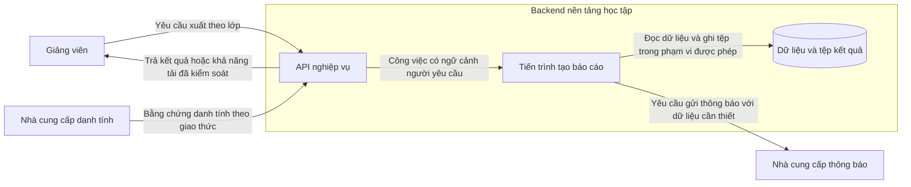

# Xác định actor

## 1. Vì sao xác định actor là bước của yêu cầu bảo mật?

Khi viết “chỉ người được phép mới được xem dữ liệu”, nhóm phát triển vẫn chưa biết **người nào**, **được phép trong phạm vi nào** và **hành động qua kênh nào**. Nếu actor chưa rõ, yêu cầu xác thực dễ bỏ sót một đường truy cập, yêu cầu phân quyền dễ dựa vào một vai trò quá rộng, còn logging có thể không xác định được ai thực sự yêu cầu hành động.

**Actor — tác nhân — là một người, hệ thống hoặc thực thể bên ngoài phạm vi hệ thống đang xét, có tương tác với hệ thống trong một luồng nghiệp vụ, quản trị hoặc tích hợp.** Actor có thể khởi tạo yêu cầu, cung cấp đầu vào, nhận kết quả hoặc tham gia thực hiện một mục tiêu. Khái niệm “bên ngoài” phụ thuộc ranh giới đã chọn, không chỉ phụ thuộc vị trí mạng hay đơn vị sở hữu.

Xác định actor trong thiết kế bảo mật nhằm trả lời:

- Ai có thể yêu cầu hệ thống thực hiện một hành động?
- Ai hoặc hệ thống nào cung cấp dữ liệu mà hệ thống sẽ sử dụng?
- Ai nhận dữ liệu, thông báo hoặc kết quả do hệ thống tạo ra?
- Actor hành động dưới danh tính nào và trong phạm vi quyền nào?
- Nếu actor nhầm lẫn, lạm dụng quyền hoặc bị chiếm quyền, tài sản nào có thể bị ảnh hưởng?

Kết quả cần đạt không chỉ là một danh sách tên người dùng. Đó là **danh mục actor gắn với tương tác, tài sản, điều kiện quyền và nguồn rủi ro**, làm đầu vào cho yêu cầu bảo mật có thể triển khai và kiểm chứng.

Bài này dùng ví dụ một nền tảng học tập phục vụ nhiều trường. Học viên xem kết quả và nộp bài; giảng viên chấm điểm trong lớp được giao; quản trị viên trường quản lý thành viên; hệ thống đào tạo của trường đồng bộ danh sách lớp. Các quyền cụ thể dưới đây là giả định minh họa, phải được nghiệp vụ xác nhận khi áp dụng vào sản phẩm thực tế.

## 2. Actor khác gì với người dùng, role và principal?

Những từ sau liên quan chặt chẽ nhưng không thể dùng thay thế nhau trong mọi trường hợp.

| Khái niệm | Câu hỏi nó trả lời | Ví dụ |
| --- | --- | --- |
| Người dùng | Con người nào sử dụng hoặc quản trị sản phẩm? | Một giảng viên nhập điểm. |
| Actor | Bên nào tương tác với hệ thống trong phạm vi đang xét? | Giảng viên, nhà cung cấp danh tính, hệ thống đào tạo của trường. |
| Role — vai trò | Nhóm hành động hoặc trách nhiệm nào được định nghĩa? | Giảng viên của lớp A, quản trị viên trường B. |
| Security principal — chủ thể bảo mật | Thực thể nào được hệ thống nhận diện để đánh giá quyền? | Tài khoản cá nhân hoặc danh tính dịch vụ của bộ đồng bộ. |
| Stakeholder — bên liên quan | Ai có lợi ích, trách nhiệm hoặc chịu tác động? | Người phụ trách đào tạo quyết định quy tắc sử dụng bảng điểm. |
| Chủ thể dữ liệu | Người mà dữ liệu đang đề cập đến là ai? | Học viên có hồ sơ trong danh sách lớp được đồng bộ. |

Một stakeholder có thể không trực tiếp tương tác nên chưa chắc là actor của một luồng. Một học viên có tên trong tệp nhập nhưng chưa sử dụng hệ thống là chủ thể dữ liệu; actor gửi tệp có thể là hệ thống đào tạo. Nếu người phụ trách đào tạo còn đăng nhập để phê duyệt báo cáo, họ đồng thời là actor trong luồng phê duyệt đó.

Một người cũng có thể thực hiện nhiều vai trò. Cô Lan là giảng viên tại trường A và học viên tại trường B. Hệ thống vẫn có thể nhận diện cô bằng một tài khoản, nhưng mỗi hành động phải được đánh giá trong quan hệ giữa tài khoản, trường, lớp và tài nguyên tương ứng. Không nên tạo một kết luận toàn cục rằng “tài khoản này là giảng viên nên được sửa mọi điểm”.

Ngược lại, một actor hệ thống có thể dùng nhiều principal kỹ thuật để phân tách môi trường hoặc chức năng. Danh mục actor mô tả quan hệ và tương tác nghiệp vụ; danh mục principal mô tả các danh tính cụ thể thực hiện quyền. Hai danh mục cần liên kết, nhưng không bắt buộc có quan hệ một-một.

## 3. Chọn ranh giới trước khi liệt kê actor

### 3.1. Actor luôn được xác định tương đối với hệ thống đang xét

Giả sử phạm vi phân tích là **backend của nền tảng học tập**, gồm API nghiệp vụ, tác vụ nền, cơ sở dữ liệu và kho tệp do đội nền tảng quản lý. Các thành phần này là bên trong phạm vi. Học viên, giảng viên, hệ thống đào tạo của trường và nhà cung cấp danh tính nằm ngoài phạm vi, tương tác với backend nên là các actor cần xem xét.

Nếu phạm vi chỉ là dịch vụ xuất báo cáo, API nhận yêu cầu xuất có thể trở thành actor bên ngoài dịch vụ đó. Nếu phạm vi mở rộng thành toàn bộ giải pháp của trường, một số hệ thống trước đây là actor ngoài có thể trở thành thành phần nội bộ.

Thay đổi này không làm mất nhu cầu bảo mật. Nó chỉ thay đổi cấp độ mô tả. **Một thành phần nội bộ không phải actor ngoài ở sơ đồ bối cảnh vẫn có thể có danh tính kỹ thuật, quyền hạn và ranh giới tin cậy cần phân tích trong thiết kế chi tiết.**

### 3.2. Không đồng nhất ranh giới hệ thống với mạng nội bộ

Một hệ thống đồng bộ thuộc cùng tổ chức nhưng do đội khác quản lý có thể là actor ngoài của backend. Một nhà cung cấp lưu trữ được thuê có thể được mô tả như phụ thuộc bên ngoài hoặc nằm trong phạm vi thành phần lưu trữ, tùy mục tiêu phân tích. Điều quan trọng là ghi rõ lựa chọn và trách nhiệm tương ứng.

Trong ví dụ của bài, kho tệp được coi là thành phần trong phạm vi backend để tập trung vào actor nghiệp vụ và tích hợp. Các nghĩa vụ bảo vệ dữ liệu, quản trị quyền và phụ thuộc nhà cung cấp vẫn cần được đặc tả khi thiết kế lưu trữ.

Một bản mô tả phạm vi ngắn có thể viết:

```text
Hệ thống đang xét:
Backend nền tảng học tập cho nhiều trường.

Bên trong:
API nghiệp vụ, tiến trình xử lý báo cáo, cơ sở dữ liệu, kho tệp.

Bên ngoài có tương tác:
Người học, giảng viên, người quản trị, nhân viên vận hành,
nhà cung cấp danh tính, hệ thống đào tạo của trường,
nhà cung cấp gửi thông báo.

Điểm cần xác nhận:
Kênh vận hành nào được phép truy cập trực tiếp vào dữ liệu;
quyền hỗ trợ có bao gồm đọc dữ liệu học tập hay không.
```

Phạm vi không nên được viết để loại bỏ một đường truy cập khó phân tích. Nếu vận hành có thể sửa trực tiếp dữ liệu, sự thật đó phải xuất hiện như một tương tác có trách nhiệm và yêu cầu kiểm soát rõ ràng, hoặc phải được thay đổi bằng một quyết định thiết kế được xác nhận.

## 4. Tìm actor theo nhiều nhóm tương tác

### 4.1. Actor là con người

Bắt đầu từ mục tiêu nghiệp vụ: ai xem, tạo, sửa, phê duyệt, chia sẻ, xuất hoặc xóa thông tin? Với nền tảng học tập, các actor thường thấy gồm học viên, giảng viên và quản trị viên trường.

Tiếp theo, xét các luồng ít xuất hiện trong màn hình chính: nhân viên hỗ trợ điều tra lỗi, người vận hành khôi phục dữ liệu, người có thẩm quyền cấp hoặc thu hồi quyền. Những actor này có thể tiếp cận lượng dữ liệu lớn hoặc chức năng đặc quyền nên không được bỏ qua chỉ vì họ không phải khách hàng trực tiếp.

Chức danh tổ chức chỉ là đầu mối tìm kiếm, chưa phải đặc tả quyền. “Nhân viên hỗ trợ” cần được tách thành các tương tác như xem trạng thái xử lý, mở yêu cầu truy cập hỗ trợ hoặc thực hiện thao tác đã được phê duyệt. Không nên mặc định họ được xem toàn bộ hồ sơ.

### 4.2. Actor là hệ thống hoặc dịch vụ bên ngoài

Không phải actor nào cũng có một người ngồi thao tác tại thời điểm yêu cầu. Ví dụ:

| Actor hệ thống | Tương tác với nền tảng | Câu hỏi bảo mật cần đặt |
| --- | --- | --- |
| Nhà cung cấp danh tính | Cung cấp kết quả xác thực theo giao thức tích hợp | Kết quả đến từ nguồn nào, dành cho bên nhận nào và được kiểm tra thế nào? |
| Hệ thống đào tạo của trường | Gửi thay đổi thành viên và lớp | Được đồng bộ trường nào, loại dữ liệu nào và có được thay đổi quyền không? |
| Nhà cung cấp gửi thông báo | Nhận địa chỉ người nhận và nội dung thông báo | Dữ liệu nào thực sự cần gửi và ai chịu trách nhiệm với phản hồi lỗi? |
| Công cụ vận hành ngoài backend | Gọi giao diện quản trị hoặc kích hoạt phục hồi | Dùng danh tính nào, được phép trên môi trường nào và lưu bằng chứng ở đâu? |

Một bên chỉ nhận dữ liệu vẫn là actor đáng quan tâm trong luồng đó. Nhà cung cấp thông báo có thể không khởi tạo yêu cầu nghiệp vụ, nhưng là bên nhận dữ liệu khi nền tảng gửi thông báo. Nếu chỉ tìm các bên gọi API vào, nhóm sẽ bỏ sót các yêu cầu hạn chế dữ liệu gửi ra ngoài.

### 4.3. Bên chưa xác thực và actor trong kịch bản lạm dụng

“Chưa đăng nhập” cũng là một trạng thái cần mô tả. Bên chưa xác thực có thể xem trang công khai, yêu cầu đăng nhập hoặc gửi dữ liệu tới một điểm tiếp nhận được công bố. Không vì chưa có tài khoản mà xem như họ không tương tác với hệ thống.

Khi phân tích đe dọa, có thể mô tả thêm tác nhân tấn công ngoài hệ thống, người dùng hợp lệ cố truy cập sai đối tượng hoặc người chiếm được tài khoản. Đây là các góc nhìn lạm dụng, không phải các vai trò được cấp quyền hợp lệ trong sản phẩm.

Không cần biến mọi kiểu tấn công thành một actor nghiệp vụ riêng. Ví dụ, “học viên thay mã bài nộp để tải bài của bạn” là một kịch bản lạm dụng của actor học viên. Nếu tài khoản bị chiếm, bằng chứng kỹ thuật có thể chỉ cho biết principal nào được sử dụng; không được tự kết luận người sở hữu tài khoản đã trực tiếp thực hiện hành vi.

## 5. Tạo danh mục actor có thể sử dụng

### 5.1. Thông tin cần ghi cho mỗi actor

Tên actor chỉ là bước đầu. Một bản ghi đủ dùng nên có những thông tin sau:

| Thông tin | Mục đích |
| --- | --- |
| Mã và tên | Tham chiếu ổn định từ yêu cầu, sơ đồ và kiểm thử. |
| Loại actor | Con người, hệ thống tích hợp hoặc bên chưa xác thực. |
| Quan hệ với hệ thống | Nội bộ tổ chức, khách hàng, đối tác hoặc nhà cung cấp; thông tin này giúp tìm trách nhiệm, không tự xác định quyền. |
| Mục tiêu và tương tác | Actor khởi tạo, cung cấp hoặc nhận những gì. |
| Tài sản liên quan | Dữ liệu, chức năng, bằng chứng và khả năng dịch vụ có thể bị tác động. |
| Kênh và chiều tương tác | Giao diện, API, nhận tệp, callback, công cụ quản trị; chiều vào hoặc ra. |
| Danh tính và phạm vi quyền | Principal được dùng, tenant, lớp, tài nguyên và điều kiện ủy quyền. |
| Vòng đời | Tạo, kích hoạt, đổi quyền, tạm khóa, chấm dứt quan hệ và thu hồi truy cập. |
| Trách nhiệm | Bên quản lý actor hoặc tích hợp và bên xác nhận quyền nghiệp vụ. |
| Giả định và điều chưa rõ | Những gì cần xác nhận trước khi chốt yêu cầu. |

Không cần đưa mật khẩu, token, khóa bí mật hay định danh cá nhân thực vào danh mục. Mô tả loại danh tính và cách quản lý là đủ cho mục tiêu xác định actor; dữ liệu bí mật phải được quản lý qua cơ chế phù hợp riêng.

### 5.2. Danh mục minh họa cho nền tảng học tập

| Mã | Actor | Tương tác chính | Phạm vi cần kiểm tra |
| --- | --- | --- | --- |
| ACT-01 | Học viên | Nộp bài, đọc kết quả, tải bài nộp được phép | Hồ sơ cá nhân, lớp đã tham gia, quy tắc chia sẻ tài liệu. |
| ACT-02 | Giảng viên | Đọc bài, chấm và sửa điểm | Phân công còn hiệu lực trong đúng lớp và trường. |
| ACT-03 | Quản trị viên trường | Quản lý thành viên và phân công | Trường được giao quản trị; quyền đọc điểm được quyết định riêng. |
| ACT-04 | Nhân viên hỗ trợ | Xem trạng thái xử lý và hỗ trợ theo quy trình | Chức năng hỗ trợ được cấp; không mặc định có quyền đọc dữ liệu học tập. |
| ACT-05 | Người vận hành phục hồi | Kích hoạt và theo dõi khôi phục | Môi trường, bản sao, quyền đọc dữ liệu và điều kiện thực hiện được phê duyệt. |
| ACT-06 | Nhà cung cấp danh tính | Cung cấp kết quả xác thực | Nguồn danh tính được chấp nhận, đối tượng nhận và thuộc tính được sử dụng. |
| ACT-07 | Hệ thống đào tạo của trường | Đồng bộ thành viên và lớp | Tenant được liên kết với danh tính tích hợp, loại thay đổi được phép. |
| ACT-08 | Nhà cung cấp thông báo | Nhận dữ liệu để gửi thông báo | Trường dữ liệu được gửi, người nhận và cách xử lý kết quả. |
| ACT-09 | Bên chưa xác thực | Truy cập công khai, bắt đầu đăng nhập | Chức năng công khai được công bố; không được đọc tài nguyên riêng. |

Danh mục này không tuyên bố rằng đã bao phủ mọi actor của một nền tảng thực tế. Nó cho thấy cách mô tả actor theo các quan hệ có ảnh hưởng đến yêu cầu bảo mật.

Ví dụ một bản ghi chi tiết:

```text
Mã: ACT-07
Tên: Hệ thống đào tạo của trường
Loại: Hệ thống tích hợp bên ngoài backend

Mục tiêu:
Đồng bộ danh sách thành viên và quan hệ tham gia lớp.

Tương tác:
Gửi thay đổi qua API tích hợp và nhận kết quả xử lý.

Danh tính:
Principal dịch vụ riêng của tích hợp; trường được phép phải được
xác định từ quan hệ cấu hình phía máy chủ với principal đó.

Tài sản:
Thông tin thành viên, lớp, quan hệ ghi danh, dấu vết đồng bộ.

Được phép theo giả định ví dụ:
Tạo hoặc cập nhật các trường dữ liệu đã thỏa thuận trong đúng tenant.

Không được phép:
Tự đổi sang tenant khác bằng nội dung yêu cầu;
sửa điểm hoặc tự cấp quyền quản trị nền tảng.

Vòng đời cần đặc tả:
Kích hoạt kết nối, thay thông tin xác thực, tạm dừng và thu hồi tích hợp.

Trách nhiệm cần xác nhận:
Bên quản lý hệ thống đào tạo và bên phê duyệt ánh xạ dữ liệu của trường.

Điểm còn mở:
Xóa thành viên ở nguồn có đồng nghĩa vô hiệu hóa truy cập ngay không?
Công việc đang chờ được xử lý thế nào sau khi tích hợp bị thu hồi?
```

Các điểm còn mở không nên bị biến thành giả định ngầm trong mã. Chúng phải được bên có trách nhiệm quyết định và chuyển thành yêu cầu hoặc ràng buộc rõ ràng trước khi nghiệm thu hành vi liên quan.

## 6. Quy trình xác định actor từ một chức năng

### Bước 1: Mô tả mục tiêu và tài sản trong phạm vi

Chọn một hành động đủ cụ thể, chẳng hạn “giảng viên xuất bảng điểm của lớp được phân công”. Tài sản gồm bảng điểm, tệp xuất, quyền tải và bằng chứng của lần xuất.

Nếu bắt đầu từ toàn bộ sản phẩm, danh sách actor thường quá chung. Khi đi theo chức năng, ta nhìn rõ actor nào yêu cầu, ai phê duyệt, dịch vụ nào thực thi và ai nhận kết quả.

### Bước 2: Theo dõi cả đầu vào, đầu ra và đường quản trị

Với chức năng xuất bảng điểm, cần hỏi:

- Ai gửi yêu cầu xuất và gửi qua kênh nào?
- Ai nhận tệp, đường dẫn tải hoặc thông báo hoàn tất?
- Có hệ thống khác tự động yêu cầu xuất không?
- Ai có thể thay đổi quyền xuất, hủy công việc hoặc can thiệp khi xử lý lỗi?
- Có công cụ quản trị hoặc cách truy cập trực tiếp nào khác không?

Câu trả lời giúp phát hiện actor phụ trợ và actor quản trị. Người chỉ phê duyệt chính sách nhưng không tương tác với hệ thống có thể là stakeholder; nếu họ trực tiếp bấm phê duyệt một công việc, họ là actor của luồng đó.

### Bước 3: Xác định danh tính thực hiện và quan hệ đại diện

Một giảng viên gửi yêu cầu, API tạo công việc, rồi tiến trình nền đọc dữ liệu. Ở sơ đồ bối cảnh backend, giảng viên là actor; tiến trình nền là thành phần nội bộ. Trong phân tích bảo mật chi tiết, tiến trình nền vẫn có principal kỹ thuật và quyền cần được giới hạn.

Cần ghi rõ quan hệ “thực hiện thay ai”. Danh tính người yêu cầu không được biến mất chỉ vì công việc chuyển sang chạy bất đồng bộ. Đồng thời, cũng không được giả vờ rằng tiến trình nền đang trực tiếp sử dụng danh tính cá nhân nếu thực tế nó truy cập bằng danh tính dịch vụ.

### Bước 4: Làm rõ phạm vi và trạng thái có ảnh hưởng đến quyền

Cùng một actor giảng viên có thể được phép ở lớp A nhưng không được phép ở lớp B. Tài khoản còn tồn tại nhưng phân công đã hết hiệu lực cũng có thể không còn quyền xuất dữ liệu.

Hãy xác định các điều kiện như tenant, quan hệ thành viên, phân công, sở hữu đối tượng, trạng thái tài khoản và thời hạn ủy quyền. Không nhất thiết tạo actor mới cho từng lớp hay từng trạng thái. Có thể giữ actor giảng viên và mô tả các thuộc tính làm thay đổi quyết định quyền.

### Bước 5: Xem xét nhánh lỗi và hành vi lạm dụng

Thử các giả định trái với luồng thành công: người dùng thay mã lớp, tích hợp gửi tenant khác, người hỗ trợ tải nội dung ngoài quyền, tài khoản bị khóa trong khi công việc còn chờ.

Mục đích là phát hiện nghĩa vụ bảo vệ, không phải gán động cơ xấu cho từng người dùng. Một actor nhập nhầm mã và một actor cố tình vượt quyền đều có thể đi đến cùng một yêu cầu: hệ thống phải kiểm tra quyền với tài nguyên đích.

### Bước 6: Xác nhận trách nhiệm và liên kết với yêu cầu

Bên nghiệp vụ xác nhận hành động hợp lệ; đội tích hợp làm rõ danh tính và giao thức; vận hành xác nhận đường quản trị; phát triển và kiểm thử làm rõ điểm thực thi, bằng chứng. Mỗi quyền hoặc điều kiện quan trọng cần có người chịu trách nhiệm trả lời, thay vì chỉ dựa vào tên actor.

## 7. Dùng ma trận actor – hành động để tìm chỗ còn mơ hồ

Ma trận giúp đặt các actor cạnh nhau để thấy quyền nào đang bị hiểu quá rộng. Dưới đây là một chính sách minh họa cho các luồng nghiệp vụ; nó không bao phủ toàn bộ quyền vận hành hạ tầng.

| Actor | Đọc điểm | Sửa điểm | Quản lý thành viên | Xuất bảng điểm |
| --- | --- | --- | --- | --- |
| Học viên | Điểm của chính mình theo quy tắc công bố | Không | Không | Chỉ bản kết quả cá nhân nếu chức năng được cung cấp. |
| Giảng viên | Lớp được phân công | Lớp được phân công và còn quyền sửa | Không mặc định | Lớp được phân công và có quyền xuất. |
| Quản trị viên trường | Không tự có quyền từ vai trò quản trị thành viên | Không tự có quyền | Trong trường được giao | Cần quyền xuất được cấp riêng. |
| Nhân viên hỗ trợ | Không trong chính sách ví dụ | Không | Chỉ thao tác hỗ trợ đã được đặc tả | Không. |
| Hệ thống đào tạo | Không qua tích hợp đồng bộ này | Không | Các trường dữ liệu và quan hệ đồng bộ đã thỏa thuận | Không. |

“Không mặc định” là lời nhắc rằng vai trò hiện tại chưa cấp quyền đó, không phải một tiêu chí nghiệm thu hoàn chỉnh. Khi đưa ma trận vào đặc tả chính thức, phải thống nhất một quy tắc rõ: trường hợp chưa có quyền cho phép phải bị từ chối; các quyền bổ sung cần được định nghĩa riêng.

Nếu một tài khoản có nhiều vai trò, nhóm phải xác định cách kết hợp quyền, giới hạn theo phạm vi và cách xử lý quy tắc phủ định nếu có. Không nên để từng API tự quyết định thứ tự ưu tiên khác nhau.

Ma trận cũng chưa thay thế kiểm tra theo đối tượng. Ô “giảng viên được sửa điểm” phải dẫn đến quy tắc với lớp và bản ghi cụ thể. Nếu chỉ kiểm tra tên vai trò, quyền ở lớp A có thể bị dùng nhầm để sửa điểm lớp B.

## 8. Nhìn rõ actor qua luồng thực hiện thay

Xét một giảng viên yêu cầu xuất bảng điểm. Sơ đồ sau phân biệt actor ngoài với các thành phần bên trong backend:



Sơ đồ minh họa quan hệ ở mức khái niệm, không mô tả đầy đủ các bước của một giao thức đăng nhập hoặc tất cả đường truyền thực tế. Đặc biệt, bằng chứng danh tính vẫn cần được kiểm tra theo thiết kế tích hợp; một mũi tên từ nhà cung cấp không có nghĩa là mọi dữ liệu nhận được đều được chấp nhận.

Trong luồng này có ít nhất ba câu hỏi riêng:

1. **Ai yêu cầu?** Giảng viên đã được nhận diện bởi hệ thống.
2. **Ai thực thi kỹ thuật?** API và tiến trình nền dùng các principal kỹ thuật được cấu hình.
3. **Ai được nhận kết quả?** Chủ thể có quyền nhận bảng điểm hoặc khả năng tải trong phạm vi đã cho phép.

Nếu chỉ ghi actor “hệ thống” cho lần xuất, audit có thể mất người khởi tạo. Nếu chỉ ghi tên giảng viên mà không biết thành phần nào thực thi, việc điều tra lỗi dịch vụ cũng khó khăn. Yêu cầu truy vết có thể cần phân biệt người khởi tạo, thành phần thực thi, phạm vi tenant và mã công việc.

Không nên suy ra rằng quyền của người yêu cầu được giữ vô hạn sau khi công việc được tạo. Cần quyết định quyền được đánh giá khi tiếp nhận, khi thực thi và khi tải kết quả như thế nào. Với ví dụ này, giả sử hệ thống kiểm tra lại quyền xuất hiện tại trước khi tiến trình nền đọc dữ liệu và kiểm tra quyền tải khi người dùng nhận tệp. Chính sách khác cũng có thể tồn tại, nhưng phải được đặc tả rõ cùng cơ chế ủy quyền và thu hồi tương ứng.

## 9. Chuyển actor thành yêu cầu bảo mật

Một tên actor không tự tạo thành yêu cầu. Có thể dùng cấu trúc sau để chuyển thông tin nhận diện thành nghĩa vụ của hệ thống:

> Khi **[actor hoặc principal tương ứng]** thực hiện **[hành động]** qua **[kênh]** đối với **[tài sản trong phạm vi]**, hệ thống phải **[hành vi bảo vệ]**; nếu **[điều kiện không được đáp ứng]**, hệ thống phải **[kết quả xử lý]**.

Sau đó bổ sung mã yêu cầu, nguồn rủi ro, tiêu chí chấp nhận và nơi thực hiện. Ví dụ:

| Actor và rủi ro | Yêu cầu minh họa | Bằng chứng phù hợp |
| --- | --- | --- |
| ACT-09: Bên chưa xác thực gọi API dữ liệu riêng | **SR-AUTH-01:** Trước khi trả hồ sơ hoặc điểm qua API riêng, hệ thống phải xác minh ngữ cảnh xác thực còn hiệu lực; yêu cầu không đáp ứng phải bị từ chối và không trả dữ liệu riêng. | Gọi API khi thiếu thông tin xác thực, khi thông tin hết hiệu lực và khi thông tin hợp lệ. |
| ACT-01: Học viên thay mã bài nộp | **SR-STUDENT-01:** Mỗi lần tải bài qua API dành cho học viên phải kiểm tra quyền của chủ thể đối với đúng bài nộp; không có quyền thì không được cung cấp nội dung hoặc đường dẫn tải dùng được. | Hai học viên có bài riêng; thử thay mã đối tượng trên cả luồng tải và luồng cấp đường dẫn. |
| ACT-02: Giảng viên truy cập lớp ngoài phân công | **SR-TEACHER-01:** Khi sửa điểm, hệ thống phải kiểm tra quyền sửa còn hiệu lực đối với lớp chứa bản ghi điểm, trong đúng trường; nếu không có quyền phải từ chối và không thay đổi điểm. | Sửa trong lớp được giao, thử lớp khác và thử sau khi quyền bị thu hồi. |
| ACT-07: Tích hợp tự chọn một trường khác | **SR-SYNC-01:** API đồng bộ phải giới hạn cập nhật trong tenant được liên kết phía máy chủ với principal tích hợp; yêu cầu ngoài phạm vi phải bị từ chối và không thay đổi dữ liệu tenant đích. | Dùng danh tính tích hợp của trường A để gửi dữ liệu tham chiếu trường B; đối chiếu dữ liệu trước và sau. |
| ACT-08: Nhà cung cấp nhận quá nhiều dữ liệu | **SR-NOTIFY-01:** Luồng thông báo điểm mới trong ví dụ chỉ được gửi địa chỉ nhận, mã mẫu và nội dung thông báo có kết quả mới; không gửi điểm cụ thể, bài nộp hoặc token đăng nhập. | Kiểm tra nội dung gửi ra ở các nhánh thông báo, kể cả lỗi và thử gửi lại. |
| ACT-02 và thành phần thực thi: Không truy vết được lần xuất | **SR-AUDIT-01:** Mỗi công việc xuất phải có dấu vết liên kết người yêu cầu, tenant, mã công việc, thành phần thực thi và kết quả xử lý; không ghi token truy cập nguyên giá trị vào dấu vết. | Đối chiếu yêu cầu với lần thực thi và kết quả; kiểm tra trường dữ liệu trong audit. |
| ACT-05: Khôi phục dữ liệu sai môi trường hoặc không đủ quyền | **SR-RESTORE-01:** Trước khi thực hiện khôi phục, hệ thống quản trị phải kiểm tra quyền khôi phục của người vận hành với nguồn bản sao và môi trường đích đã chọn; trường hợp không được phép phải bị từ chối trước khi ghi dữ liệu phục hồi. | Thử môi trường và bản sao được phép, không được phép; xác nhận từ chối không làm thay đổi đích. |

Yêu cầu thông báo ở trên chọn cách không đưa điểm vào nhà cung cấp gửi tin. Đó là một lựa chọn nghiệp vụ của ví dụ. Nếu sản phẩm cần gửi điểm cụ thể, phải đánh giá lại dữ liệu tiết lộ, người nhận, kênh gửi và trách nhiệm của các bên; không được giữ nguyên yêu cầu rồi âm thầm gửi thêm dữ liệu.

Yêu cầu kiểm tra quyền khôi phục cũng không thay thế yêu cầu phục hồi thành công. Cần đặc tả riêng tập dữ liệu, giới hạn mất dữ liệu và thời gian phục hồi, cùng bằng chứng từ diễn tập. Xác định đúng actor giúp làm rõ ai được khởi tạo và ai chịu trách nhiệm, còn chất lượng phục hồi phải có tiêu chí riêng.

### Ví dụ tiêu chí chấp nhận cho actor tích hợp

Với `SR-SYNC-01`, có thể mô tả một tình huống như sau:

```gherkin
Feature: Giới hạn phạm vi của actor đồng bộ

  Scenario: Tích hợp trường A cố cập nhật thành viên của trường B
    Given principal tích hợp được máy chủ liên kết với trường A
    And trường B có một thành viên với dữ liệu ban đầu đã biết
    When tích hợp gửi yêu cầu cập nhật thành viên của trường B
    Then hệ thống từ chối yêu cầu do ngoài phạm vi được phép
    And dữ liệu của thành viên trường B không thay đổi
```

Mô tả này chưa phải bộ kiểm thử chạy được. Khi triển khai, cần dữ liệu thử, thao tác cụ thể, kết quả giao thức và cách quan sát tác động. Điểm quan trọng là bằng chứng bám vào **principal thực tế, phạm vi được cấp và tài nguyên đích**, thay vì chỉ nhìn tên actor trên tài liệu.

## 10. Theo dõi vòng đời và thay đổi của actor

Actor không chỉ xuất hiện trong trạng thái “đang hoạt động bình thường”. Một người nghỉ việc, học viên rời trường hoặc hệ thống tích hợp chấm dứt kết nối đều làm thay đổi yêu cầu truy cập.

| Sự kiện | Câu hỏi cần đưa vào đặc tả |
| --- | --- |
| Tạo hoặc kích hoạt tài khoản | Ai được tạo, bằng chứng danh tính nào được dùng, ai phê duyệt quan hệ với trường? |
| Thêm vai trò hoặc đổi phân công | Quyền có hiệu lực khi nào và giới hạn ở tenant, lớp hay tài nguyên nào? |
| Tạm khóa hoặc thu hồi quyền | Phiên hiện có, yêu cầu mới, công việc đang chờ và kết quả đã tạo được xử lý thế nào? |
| Thay danh tính kỹ thuật của tích hợp | Cách chuyển đổi và thu hồi thông tin cũ có để lại khoảng truy cập ngoài kiểm soát không? |
| Chấm dứt quan hệ với trường | Quyền nào bị thu hồi; dữ liệu và audit nào vẫn cần giữ theo quy tắc đã xác định? |
| Thêm kênh truy cập mới | Actor hiện tại có dùng kênh mới không; có cần kiểm tra hay giới hạn bổ sung không? |

Việc một tài khoản vẫn tồn tại không chứng minh mọi quan hệ quyền của tài khoản còn hiệu lực. Xóa tài khoản cũng không nhất thiết đồng nghĩa xóa toàn bộ bằng chứng giao dịch liên quan. Yêu cầu cần phân biệt quản lý truy cập, lưu giữ dữ liệu và khả năng truy vết.

Danh mục actor nên có người phụ trách cập nhật và được xem lại khi thay đổi nghiệp vụ, tích hợp hoặc kiến trúc. Ví dụ, cho phép giảng viên dùng API tự động tạo báo cáo có thể vẫn là cùng actor nghiệp vụ, nhưng thêm kênh, loại thông tin xác thực và cách ủy quyền cần đặc tả. Nếu bổ sung một hệ thống đối tác tự vận hành độc lập, có thể cần một actor hệ thống mới.

## 11. Những sai lầm thường gặp khi xác định actor

| Sai lầm | Hệ quả | Cách sửa trong phân tích |
| --- | --- | --- |
| Chỉ liệt kê người có màn hình đăng nhập | Bỏ sót tích hợp, tác vụ quản trị và bên nhận dữ liệu. | Theo dõi cả đầu vào, đầu ra và đường quản trị của từng chức năng. |
| Dùng chức danh làm đặc tả quyền | Một chức danh có thể bị cấp quyền vượt nhu cầu hoặc sai phạm vi. | Mô tả hành động, tài nguyên, quan hệ và điều kiện cụ thể. |
| Coi mọi thành phần phần mềm là actor ngoài | Ranh giới bối cảnh bị mờ, khó nhận ra bên tương tác thực sự. | Chốt phạm vi; ghi principal và trách nhiệm của thành phần nội bộ ở cấp thiết kế phù hợp. |
| Coi hệ thống cùng tổ chức là hoàn toàn đáng tin | Bỏ qua lỗi, thông tin giả mạo hoặc quyền của tích hợp bị chiếm. | Xác định danh tính, nguồn dữ liệu và quyền cho từng tương tác. |
| Gộp mọi quyền vào actor “admin” | Khó giới hạn quyền và phân biệt trách nhiệm. | Tách quản trị trường, hỗ trợ, vận hành và những quyền đặc biệt cần thiết. |
| Tạo actor mới cho mọi tổ hợp lớp và trạng thái | Danh mục phình to và khó duy trì. | Dùng actor ổn định cùng các thuộc tính, quan hệ và trạng thái ảnh hưởng đến quyền. |
| Ghi một dịch vụ là người thực hiện rồi bỏ mất người yêu cầu | Audit không nối được hành động nghiệp vụ với nguồn khởi tạo. | Mô tả chuỗi thực hiện thay và liên kết các danh tính cần thiết. |
| Xem tên tài khoản trong log là bằng chứng tuyệt đối về con người | Dễ kết luận sai khi tài khoản bị chia sẻ hoặc bị chiếm. | Phân biệt danh tính kỹ thuật được sử dụng với kết luận về người thực sự thao tác. |

## 12. Khi nào danh mục actor đã đủ để viết yêu cầu?

Danh mục có thể dùng làm đầu vào khi nhóm trả lời được những điểm sau cho các luồng trong phạm vi:

1. Đã chốt đâu là hệ thống đang xét và đâu là bên ngoài.
2. Đã tìm cả người dùng, hệ thống tích hợp, bên nhận dữ liệu và actor quản trị.
3. Mỗi actor có tương tác, tài sản và chiều dữ liệu rõ ràng.
4. Đã phân biệt actor, vai trò, principal và bên chịu trách nhiệm nghiệp vụ.
5. Đã nêu các yếu tố làm thay đổi quyền như tenant, lớp, sở hữu, trạng thái và ủy quyền.
6. Đã làm rõ chuỗi thực hiện thay ở những luồng bất đồng bộ hoặc tích hợp liên quan.
7. Các quyết định còn mở có người chịu trách nhiệm xác nhận.
8. Những tương tác quan trọng nối được với rủi ro, yêu cầu và bằng chứng xác minh.

Không có một số lượng actor chuẩn cho mọi hệ thống. Danh mục tốt có độ chi tiết đủ để tránh nhầm quyền và bỏ sót luồng, đồng thời vẫn theo được khi hệ thống thay đổi.

Xác định actor là cách đặt đúng câu hỏi **“ai đang yêu cầu, ai đang thực thi, ai được nhận và trong phạm vi nào?”**. Khi các câu trả lời rõ ràng, yêu cầu xác thực, phân quyền, dữ liệu, logging và phục hồi mới có thể gắn với trách nhiệm thực tế, được thực hiện trong kiến trúc và kiểm chứng bằng hành vi quan sát được.
