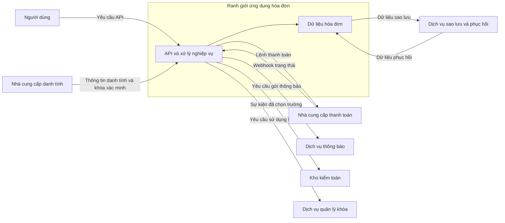

# Xác định external dependency

## 1. Vì sao phải xác định phụ thuộc bên ngoài?

Một dịch vụ có thể kiểm tra quyền rất chặt trong mã nguồn nhưng vẫn gặp sự cố bảo mật khi nhà cung cấp danh tính phát hành thông tin không phù hợp, thư viện cập nhật bị thay thế, kho log thu thập token hoặc bản sao lưu không thể giải mã sau sự cố.

Các thành phần này có một điểm chung: dịch vụ dựa vào chúng để thực hiện một phần chức năng, duy trì một thuộc tính bảo vệ hoặc phục hồi hoạt động. Nếu chỉ đặc tả bảo mật cho API và cơ sở dữ liệu của nhóm phát triển, nhiều giả định quan trọng sẽ bị bỏ ngoài phạm vi.

Trong chương **Bối cảnh và phạm vi**, xác định external dependency nhằm trả lời:

- Hệ thống đang dựa vào những thành phần, dịch vụ hoặc tổ chức nào bên ngoài ranh giới đã chọn?
- Dữ liệu, thông tin xác thực và quyền quyết định nào đi qua ranh giới đó?
- Điều gì xảy ra nếu phụ thuộc không hoạt động, trả dữ liệu sai, thay đổi hoặc bị xâm phạm?
- Bên nào chịu trách nhiệm thực hiện và chứng minh từng nghĩa vụ bảo mật?

Kết quả mong đợi là **danh mục phụ thuộc có căn cứ, sơ đồ tương tác và các yêu cầu bảo mật liên kết được với rủi ro**. Đây không chỉ là danh sách tên nhà cung cấp.

Các tình huống, mã định danh và ngưỡng trong bài là ví dụ giả định để học cách đặc tả, không mô tả một hệ thống thực tế đã được khảo sát.

## 2. External dependency là gì?

**External dependency — phụ thuộc bên ngoài** là thành phần, dịch vụ, nguồn dữ liệu, nền tảng hoặc năng lực do một bên khác quản lý mà hệ thống cần dựa vào, nằm ngoài ranh giới phân tích hoặc ranh giới kiểm soát đã xác định.

“Bên ngoài” có ý nghĩa tương đối với ranh giới:

- Dịch vụ danh tính do một nhóm khác trong cùng công ty quản lý có thể là external dependency của dịch vụ hóa đơn.
- Một dịch vụ đám mây được thuê dùng có thể có cấu hình do nhóm ứng dụng quản lý, còn hạ tầng nền do nhà cung cấp quản lý.
- Một thư viện chạy ngay trong tiến trình ứng dụng vẫn có nguồn cung và chuỗi cập nhật bên ngoài nhóm.
- Một dịch vụ thuộc cùng tổ chức không tự trở thành đáng tin cho mọi dữ liệu và mọi hành động.

### 2.1. Ranh giới hệ thống và ranh giới tin cậy

**Ranh giới hệ thống** xác định những thành phần đang được coi là phần bên trong của đối tượng phân tích.

**Ranh giới tin cậy** xuất hiện khi dữ liệu hoặc quyết định chuyển giữa các miền có giả định, danh tính, quyền hoặc cơ chế kiểm soát khác nhau.

Hai ranh giới có liên quan nhưng không luôn trùng nhau. Bên trong một hệ thống vẫn có thể có nhiều ranh giới tin cậy, chẳng hạn giữa tầng nhận yêu cầu công khai và tầng xử lý dữ liệu nhạy cảm.

Không nên dùng địa chỉ mạng làm tiêu chí duy nhất. “Ở cùng mạng riêng” không trả lời được ai vận hành thành phần, thành phần được cấp quyền gì và dữ liệu của nó được kiểm tra thế nào.

### 2.2. Phụ thuộc, bên tương tác và tác nhân đe dọa

Không phải mọi đối tượng trong sơ đồ đều là dependency cùng một nghĩa.

| Đối tượng | Cách nhìn phù hợp |
| --- | --- |
| Nhà cung cấp danh tính | Phụ thuộc nếu hệ thống dựa vào kết quả xác thực hoặc khóa xác minh của bên đó |
| Khách hàng gọi API | Bên tương tác; yêu cầu đầu vào phải được kiểm tra |
| Kẻ gửi yêu cầu giả mạo | Tác nhân đe dọa, không phải một dịch vụ hệ thống chủ động dựa vào |
| Nhà cung cấp thanh toán gửi webhook | Vừa là phụ thuộc nghiệp vụ vừa là nguồn thông điệp đi vào hệ thống |
| Nhóm vận hành dùng công cụ phục hồi | Phụ thuộc vận hành nếu khả năng phục hồi dựa vào công cụ hoặc năng lực đó |

Một đối tượng có thể giữ nhiều vai trò. Quan trọng là ghi rõ **hệ thống dựa vào điều gì ở đối tượng đó**, thay vì chỉ gắn một nhãn.

### 2.3. Phụ thuộc không có nghĩa là trao quyền vô hạn

Nếu dùng nhà cung cấp danh tính để xác nhận người dùng, hệ thống vẫn cần xác định thông tin nào được chấp nhận, cho ứng dụng nào và quyền nghiệp vụ nào do hệ thống tự quyết định.

Tin cậy một bên thực hiện một nhiệm vụ không có nghĩa chấp nhận mọi dữ liệu hoặc mọi yêu cầu từ bên đó. Đặc tả phải thể hiện phạm vi tin cậy cụ thể.

## 3. Chọn ranh giới trước khi lập danh mục

Giả sử đang thiết kế bảo mật cho **dịch vụ hóa đơn nhiều tenant**. Mỗi tenant là một tổ chức khách hàng có phạm vi dữ liệu và quyền truy cập riêng.

Dịch vụ có các chức năng:

- Người dùng đăng nhập rồi đọc hoặc phê duyệt hóa đơn.
- Người có quyền yêu cầu thanh toán.
- Hệ thống nhận thông báo trạng thái thanh toán.
- Hệ thống gửi thông báo, ghi sự kiện kiểm toán và hỗ trợ phục hồi.

Quy ước phân tích trong ví dụ:

| Nội dung | Trong ranh giới ứng dụng | Ngoài ranh giới quản lý của nhóm ứng dụng |
| --- | --- | --- |
| Mã API và xử lý nghiệp vụ | Có | Không |
| Chính sách quyền đọc/phê duyệt hóa đơn | Có, do nhóm ứng dụng thực thi | Nguồn danh tính có thể thuộc nhóm khác |
| Mô hình và truy vấn dữ liệu hóa đơn | Có | Nền tảng cơ sở dữ liệu có thể do nhóm nền tảng vận hành |
| Kết quả thanh toán | Ứng dụng kiểm tra và cập nhật trạng thái | Nhà cung cấp thực hiện giao dịch |
| Mã hóa dữ liệu bằng khóa được cấp | Ứng dụng gọi và kiểm soát phạm vi sử dụng | Dịch vụ quản lý khóa giữ một phần trách nhiệm |
| Ghi sự kiện và tra cứu kiểm toán | Ứng dụng tạo sự kiện đúng nội dung | Nền tảng thu thập và lưu trữ có thể do nhóm khác quản lý |

Một thành phần có thể cần mô tả ở hai góc độ. Cơ sở dữ liệu là thành phần của kiến trúc ứng dụng, đồng thời năng lực vận hành cơ sở dữ liệu là phụ thuộc vào nhóm nền tảng. Nên liên kết hai góc nhìn, tránh ghi thành hai mục rời rạc rồi bỏ sót trách nhiệm ở giữa.

### Sơ đồ bối cảnh minh họa



Sơ đồ tập trung vào tương tác logic. Nó chưa thể hiện đầy đủ đường cấp thông tin xác thực, DNS, thời gian, mạng hoặc chuỗi cung ứng phần mềm. Những phần đó cần được bổ sung khi xác định phụ thuộc theo từng giai đoạn hoạt động.

## 4. Các nhóm phụ thuộc dễ bị bỏ sót

### 4.1. Phụ thuộc khi hệ thống đang phục vụ

| Nhóm | Ví dụ | Điều cần làm rõ về bảo mật |
| --- | --- | --- |
| Danh tính và quyền | Nhà cung cấp danh tính, dịch vụ chính sách quyền | Thông tin nào được tin, phạm vi sử dụng và hiệu lực thu hồi |
| Nghiệp vụ | Thanh toán, tra cứu khách hàng, ký tài liệu | Quyết định nào được ủy quyền, dữ liệu nào phải đối chiếu |
| Dữ liệu và lưu trữ | Cơ sở dữ liệu quản lý, kho đối tượng, hàng đợi | Quyền truy cập, cách ly tenant, lưu giữ, mã hóa |
| Truyền thông | Email, SMS, thông báo đẩy | Dữ liệu gửi ra, người nhận, chống lạm dụng |
| Nền tảng | DNS, mạng, đồng hồ, chứng thư, quản lý khóa | Định danh đích, thời hạn, phụ thuộc khi khởi động hoặc xác minh |
| Quan sát | Thu thập log, tracing, giám sát lỗi | Dữ liệu nhạy cảm, quyền truy xuất, tính toàn vẹn và độ đầy đủ |

Nền tảng thời gian có thể ảnh hưởng tới kiểm tra hết hạn và thứ tự sự kiện. DNS có thể ảnh hưởng tới đích kết nối. Không cần tạo một mục riêng cho mọi chi tiết, nhưng cần nhận diện khi một năng lực nền là giả định quan trọng của yêu cầu bảo mật.

### 4.2. Phụ thuộc khi xây dựng và phát hành

Ứng dụng có thể không gọi một kho gói khi phục vụ người dùng, nhưng mã chạy trong sản xuất đã được tạo từ nội dung của kho đó.

Các phụ thuộc thường gặp:

- Kho mã nguồn và nền tảng kiểm soát truy cập mã.
- Thư viện, gói phần mềm, ảnh nền và kho chứa chúng.
- Công cụ xây dựng, plugin và các bước trong quy trình CI/CD.
- Dịch vụ ký hoặc xác minh nguồn gốc bản phát hành.
- Kho lưu trữ artifact dùng để triển khai.

**Artifact** ở đây là sản phẩm được tạo để phát hành, chẳng hạn gói ứng dụng hoặc ảnh container.

Rủi ro không chỉ là “không tải được thư viện”, mà còn là “triển khai nội dung không đúng với nguồn đã được chấp thuận”. Vì vậy, danh mục chỉ có các API gọi lúc chạy là chưa đủ cho phạm vi bao gồm vòng đời phát triển.

### 4.3. Phụ thuộc vận hành và phục hồi

Một hệ thống có thể tiếp tục phục vụ khi kho sao lưu tạm thời gián đoạn, nhưng không thể phục hồi nếu mất kho dữ liệu chính.

Cần xét:

- Quyền và tài khoản dùng khi xử lý sự cố.
- Nguồn khóa và bí mật cần để đọc bản sao lưu.
- Dịch vụ DNS, danh tính hoặc hạ tầng cần khi dựng lại.
- Quy trình hỗ trợ và đầu mối của nhà cung cấp.
- Nơi lưu cấu hình và tài liệu phục hồi.
- Hệ thống tiếp nhận cảnh báo và người có trách nhiệm xử lý.

Các phụ thuộc chỉ xuất hiện khi sự cố xảy ra vẫn thuộc phạm vi bảo mật nếu mục tiêu bao gồm khả năng phục hồi.

### 4.4. Phụ thuộc trực tiếp và gián tiếp

**Trực tiếp:** ứng dụng gọi một API thanh toán.

**Gián tiếp:** SDK thanh toán kéo theo thư viện khác, hoặc nhà cung cấp sử dụng một dịch vụ con để xử lý dữ liệu.

Không phải phụ thuộc gián tiếp nào cũng có thể được khảo sát tới cùng. Cần xác định độ sâu có ý nghĩa:

- Phụ thuộc nào có quyền thực thi mã hoặc truy cập bí mật?
- Phụ thuộc nào nhận dữ liệu nhạy cảm?
- Phụ thuộc nào có thể làm sai quyết định bảo mật hoặc nghiệp vụ?
- Phụ thuộc nào tạo điểm lỗi chung cho nhiều dịch vụ?
- Phần nào chưa có thông tin và ai chịu trách nhiệm xác minh?

Một khoảng chưa biết phải được ghi nhận là khoảng chưa biết. Không biến việc thiếu thông tin thành giả định “đã an toàn”.

## 5. Quy trình nhận diện theo luồng nghiệp vụ và vòng đời

### Bước 1: Chọn một hành trình cụ thể

Ví dụ: “người dùng phê duyệt và thanh toán hóa đơn”.

Liệt kê tài sản cần bảo vệ: nội dung hóa đơn, quyền phê duyệt, lệnh thanh toán, thông tin xác thực và dấu vết kiểm toán. Đặt câu hỏi từ lúc người dùng bắt đầu đến khi tác động cuối cùng được ghi nhận.

Cách này giúp tìm phụ thuộc theo vai trò thực tế, thay vì chỉ tìm tên sản phẩm trong một sơ đồ hạ tầng.

### Bước 2: Theo dõi dữ liệu và quyết định qua từng bước

Với mỗi bước, xác định:

- Ai cung cấp đầu vào?
- Thành phần nào xác minh danh tính và quyền?
- Dữ liệu nào được gửi đi hoặc được lưu ngoài ranh giới?
- Kết quả nào được dùng để thay đổi trạng thái nghiệp vụ?
- Bí mật hoặc khóa nào được dùng?
- Sự kiện nào được ghi để đối chiếu sau này?

Một kết quả từ bên ngoài có thể chỉ là dữ liệu tham khảo, hoặc có thể được dùng như bằng chứng cho một quyết định quan trọng. Hai vai trò cần mức bảo vệ khác nhau.

### Bước 3: Tìm cả kết nối đi ra và tương tác đi vào

Đừng chỉ tìm các lệnh HTTP mà ứng dụng chủ động gửi.

Cần xét webhook, thông điệp hàng đợi, tệp nhập, lịch đồng bộ, công cụ quản trị, mã JavaScript bên thứ ba chạy trong trình duyệt và liên kết tải dữ liệu.

Một webhook thanh toán có thể tạo tác động nghiệp vụ dù kết nối mạng được khởi tạo từ phía nhà cung cấp. Đây vẫn là tương tác với một external dependency quan trọng.

### Bước 4: Mở rộng sang khởi động, xây dựng và phục hồi

Hỏi thêm:

- Khi ứng dụng khởi động mới, nó cần đọc khóa, bí mật hoặc cấu hình từ đâu?
- Khi phát hành, mã và công cụ đến từ nguồn nào?
- Khi thành phần xác minh danh tính không còn liên lạc được, điều gì thay đổi?
- Khi phục hồi từ bản sao lưu, có cần một tài khoản hoặc khóa đã mất cùng hệ thống chính không?

Một phụ thuộc không được gọi thường xuyên vẫn có thể quyết định việc hệ thống có hoạt động an toàn hay không.

### Bước 5: Phân biệt bằng chứng và giả định

Trong một dự án thực, nguồn bằng chứng có thể gồm tài liệu kiến trúc, hợp đồng giao diện, cấu hình triển khai, danh mục thư viện, dữ liệu kết nối đã được thu thập hợp lệ và trao đổi với chủ sở hữu hệ thống.

Những nguồn này bổ sung cho nhau:

| Nguồn | Có thể cho biết | Giới hạn |
| --- | --- | --- |
| Sơ đồ kiến trúc | Thành phần dự kiến và luồng chính | Có thể thiếu tích hợp mới hoặc đường vận hành |
| Cấu hình và mã tích hợp | Đích kết nối, thư viện, cách dùng | Có thể có nhánh chưa dùng hoặc cấu hình khác giữa môi trường |
| Quan sát vận hành | Tương tác thực sự xuất hiện trong thời gian quan sát | Không chắc thấy luồng hiếm, phục hồi hoặc chức năng chưa được kích hoạt |
| Hợp đồng và đầu mối | Trách nhiệm, khả năng hỗ trợ, nghĩa vụ dữ liệu | Không tự chứng minh triển khai thực tế đã đáp ứng |

Danh sách trên mô tả cách làm khi được khảo sát một hệ thống. Không có nghĩa chỉ một nguồn hoặc chỉ một lần quan sát là đủ để kết luận danh mục hoàn chỉnh.

### Bước 6: Gán chủ sở hữu và ưu tiên làm rõ

Mỗi dependency cần người biết nó phục vụ việc gì và người chịu trách nhiệm theo dõi nghĩa vụ tương ứng.

Ưu tiên làm rõ phụ thuộc có ảnh hưởng tới quyền truy cập, tiền, dữ liệu nhạy cảm, thực thi mã, khóa hoặc phục hồi. Mức ưu tiên phải dựa trên tác động và khả năng xảy ra trong bối cảnh, không chỉ dựa trên việc nhà cung cấp nổi tiếng hay ít nổi tiếng.

### Bước 7: Liên kết với yêu cầu và kiểm chứng

Nếu nhận diện được một rủi ro nhưng chưa có nghĩa vụ cụ thể, danh mục vẫn chưa hoàn thành vai trò thiết kế bảo mật.

Ví dụ:

- Có nhà cung cấp danh tính → cần đặc tả điều kiện chấp nhận thông tin danh tính.
- Có webhook → cần đặc tả xác thực nguồn, đối chiếu nội dung và chống xử lý lặp.
- Có kho log bên ngoài → cần đặc tả dữ liệu được phép gửi và quyền truy xuất.
- Có dịch vụ khóa → cần đặc tả quyền dùng khóa và hành vi khi không truy cập được khóa.
- Có bản sao lưu → cần đặc tả điều kiện phục hồi gồm cả quyền và khóa.

## 6. Ghi gì trong một hồ sơ dependency?

Một hồ sơ đủ dùng có thể có các trường sau:

| Trường | Nội dung cần ghi |
| --- | --- |
| Mã và tên | Định danh ổn định để liên kết với rủi ro và yêu cầu |
| Vai trò | Chức năng hoặc thuộc tính bảo vệ mà hệ thống dựa vào |
| Giai đoạn sử dụng | Xây dựng, triển khai, khởi động, phục vụ, vận hành, phục hồi |
| Chủ sở hữu | Bên cung cấp, đầu mối tích hợp, bên chịu trách nhiệm trong nội bộ |
| Giao diện và chiều tương tác | API, webhook, hàng đợi, tệp, thư viện; đi vào hoặc đi ra |
| Dữ liệu | Trường dữ liệu, phân loại nhạy cảm, tenant liên quan, nơi lưu tiếp |
| Danh tính và quyền | Danh tính máy, bí mật, quyền được cấp, phạm vi ủy quyền |
| Phạm vi tin cậy | Kết quả nào được sử dụng và kết quả nào vẫn cần kiểm tra |
| Điều kiện vận hành | Giới hạn, độ trễ, phiên bản, cơ chế thay đổi và mức sẵn sàng cần thiết |
| Kịch bản lỗi | Không phản hồi, phản hồi muộn, dữ liệu sai, bị xâm phạm, thay đổi giao diện |
| Hành vi ứng dụng | Từ chối, chờ, thử lại, xếp hàng hoặc phục vụ phần chức năng xác định |
| Yêu cầu và bằng chứng | Mã yêu cầu, tiêu chí chấp nhận, phép kiểm chứng dự kiến |
| Khoảng chưa biết | Thông tin thiếu, người xác minh và thời điểm cần chốt |

Không ghi giá trị bí mật thật vào danh mục. Ghi loại thông tin xác thực, nơi quản lý và trách nhiệm luân chuyển ở mức cần thiết.

### Hồ sơ minh họa cho nhà cung cấp thanh toán

```text
Mã: DEP-PAY-01
Vai trò: Thực hiện giao dịch và thông báo trạng thái thanh toán
Giai đoạn: Phục vụ và đối soát sau sự cố
Chiều tương tác:
  - Ứng dụng gửi lệnh thanh toán
  - Nhà cung cấp gửi webhook
  - Ứng dụng tra cứu trạng thái khi kết quả chưa xác định

Dữ liệu:
  - Mã giao dịch nội bộ
  - Số tiền, đơn vị tiền tệ
  - Tham chiếu do nhà cung cấp cấp
  - Chỉ các trường đã được chấp thuận cho mục đích thanh toán

Quyền:
  - Danh tính máy chỉ được dùng cho tài khoản và chức năng cần thiết
  - Webhook không được coi là một quyền phê duyệt hóa đơn

Rủi ro:
  - Timeout nhưng giao dịch đã được thực hiện
  - Webhook giả, gửi lại hoặc sai thứ tự
  - Giao dịch hợp lệ nhưng thuộc sai tài khoản hoặc sai hóa đơn

Yêu cầu liên kết:
  - SR-PAY-01: Kiểm tra nguồn và ràng buộc nghiệp vụ
  - SR-PAY-02: Không tạo tác động trùng khi thử lại hoặc nhận lại
  - SR-PAY-03: Giữ và đối soát trạng thái chưa xác định

Khoảng chưa biết:
  - Cam kết xử lý khóa chống lặp và thời gian lưu khóa của nhà cung cấp
  - Quy trình đổi thông tin xác thực webhook
```

Hồ sơ không thay thế đặc tả yêu cầu. Nó cung cấp bối cảnh để các yêu cầu không bị viết dựa trên giả định ngầm.

## 7. Phân tích rủi ro tại mỗi ranh giới phụ thuộc

Với từng dependency, có thể dùng các câu hỏi sau để chuyển từ danh mục sang mô hình đe dọa.

### 7.1. Nếu không truy cập được thì điều gì bị ảnh hưởng?

Phân biệt:

- Không thể thực hiện chức năng nghiệp vụ.
- Không thể xác thực một phiên mới.
- Không thể đánh giá quyền cho thao tác nhạy cảm.
- Không thể ghi dấu vết theo nghĩa vụ kiểm toán.
- Không thể giải mã hoặc phục hồi dữ liệu.

Mỗi tình huống cần hành vi riêng. Kho thông báo gián đoạn không nhất thiết phải làm ngừng mọi thao tác đọc hóa đơn. Nhưng không có quyết định quyền hợp lệ thì API không được tự bỏ bước phân quyền để tiếp tục phục vụ.

### 7.2. Nếu dữ liệu trả về sai hoặc bị thao túng thì sao?

“HTTP thành công” không đồng nghĩa “nội dung đủ điều kiện tạo tác động”.

Cần kiểm tra theo ngữ nghĩa:

- Kết quả thuộc đúng người dùng, tenant và đối tượng không?
- Số tiền và đơn vị tiền tệ khớp giao dịch dự kiến không?
- Trạng thái mới có hợp lệ so với trạng thái hiện tại không?
- Dữ liệu đã cũ, trùng hoặc sai thứ tự có làm mở lại một thao tác đã kết thúc không?
- Giá trị hoặc liên kết trong phản hồi có bị dùng để gọi một đích chưa được chấp thuận không?

Định dạng hợp lệ là một điều kiện cần ở nhiều giao diện, nhưng không thay thế kiểm tra nghiệp vụ và quyền.

### 7.3. Nếu thông tin xác thực bị lộ thì phạm vi tác động là gì?

Một khóa máy dùng chung cho mọi tenant và mọi thao tác có thể làm tăng phạm vi ảnh hưởng khi bị lộ.

Cần xác định quyền tối thiểu cần thiết, môi trường được phép dùng, nơi lưu bí mật, cách luân chuyển và khả năng thu hồi. Không đưa bí mật vào mã nguồn, hồ sơ dependency hoặc dữ liệu log.

Quyền gọi API nhà cung cấp cũng khác với quyền nghiệp vụ của người dùng. Máy chủ có khả năng thanh toán không có nghĩa mọi người dùng đều được yêu cầu nó thanh toán.

### 7.4. Nếu nhà cung cấp hoặc chuỗi cung ứng bị xâm phạm thì sao?

Cần xét khả năng:

- Mã thư viện chạy với quyền của ứng dụng.
- Dữ liệu bị đọc hoặc gửi sang một bên khác.
- Phản hồi có xác thực từ một bên đã bị xâm phạm nhưng chứa nội dung sai.
- Thông tin xác thực tích hợp bị sử dụng ngoài mục đích.
- Bản phát hành mới thay đổi hành vi hoặc quyền truy cập.

Biện pháp xác thực nguồn giúp biết bên nào gửi thông điệp; nó không bảo đảm mọi thông điệp từ bên đó đều đúng về nghiệp vụ. Phải giới hạn phạm vi tin cậy và tác động được phép.

### 7.5. Nếu phụ thuộc thay đổi hoặc chấm dứt thì sao?

Một dependency có thể đổi giao diện, khóa, định dạng, vùng lưu dữ liệu hoặc mức hỗ trợ.

Cần làm rõ cơ chế thông báo thay đổi, kiểm thử tương thích, thời hạn hỗ trợ và khả năng xuất dữ liệu hoặc chuyển đổi nếu nghiệp vụ cần. Những điểm này trở thành yêu cầu khi ảnh hưởng tới mục tiêu bảo vệ hoặc khả năng duy trì dịch vụ.

## 8. Từ dependency đến yêu cầu bảo mật có thể kiểm chứng

Một mẫu lập luận hữu ích:

> Do hệ thống phụ thuộc vào **X** để thực hiện **Y**, tình huống **Z** có thể ảnh hưởng tới **tài sản A**. Vì vậy hệ thống hoặc bên chịu trách nhiệm phải đáp ứng **nghĩa vụ B**, được kiểm chứng bằng **bằng chứng C**.

Không phải mỗi dependency chỉ có một yêu cầu. Một nhà cung cấp có thể cần các yêu cầu riêng về danh tính, quyền, dữ liệu, logging và phục hồi.

### 8.1. Nhà cung cấp danh tính: giới hạn thông tin được tin

**Rủi ro:** ứng dụng chấp nhận thông tin xác thực sai đích, sai nguồn hoặc không còn hiệu lực; hoặc dùng thông tin danh tính để suy ra quyền quá rộng.

**SR-ID-01 — Điều kiện chấp nhận danh tính**

Ứng dụng chỉ được xây dựng ngữ cảnh người dùng từ thông tin xác thực đáp ứng đầy đủ các điều kiện của giao thức đã chọn: nguồn phát hành được chấp thuận, đích sử dụng phù hợp, hiệu lực thời gian và tính xác thực theo cấu hình tin cậy.

Với cơ chế token có chữ ký, chỉ kiểm tra chữ ký là chưa đủ. Cần kiểm tra các ràng buộc liên quan như bên phát hành, bên nhận và thời hạn theo thiết kế. Nguồn khóa xác minh cũng phải được xác định từ cấu hình tin cậy, không tùy ý lấy theo dữ liệu không tin cậy trong token.

**SR-ID-02 — Tách danh tính và quyền nghiệp vụ**

Thông tin tenant và vai trò chỉ được sử dụng theo chính sách ánh xạ đã xác định. Trước khi đọc hoặc phê duyệt hóa đơn, ứng dụng phải kiểm tra quyền trên đúng hành động và đối tượng.

**Kiểm chứng dự kiến:**

- Thông tin đúng nguồn và đúng đích được xử lý theo chính sách.
- Sai nguồn, sai đích, hết hạn hoặc không xác minh được phải bị từ chối.
- Chủ thể đã xác thực nhưng không có quyền trên hóa đơn không tạo được tác động.
- Tình huống đổi khóa hoặc mất kết nối được thử theo chính sách đã đặc tả.

Việc nhà cung cấp danh tính tạm thời không truy cập được không có một cách xử lý chung cho mọi kiến trúc. Có hệ thống vẫn xác minh được token bằng khóa đã lưu hợp lệ; hệ thống khác cần kiểm tra trực tuyến. Phải quy định độ cũ, điều kiện sử dụng dữ liệu đã lưu và giới hạn thu hồi phù hợp, thay vì mặc định chấp nhận mọi phiên hoặc từ chối mọi chức năng.

### 8.2. Nhà cung cấp thanh toán: xác thực nguồn và đối chiếu tác động

**Rủi ro:** webhook giả hoặc bị gửi lại làm hóa đơn đổi trạng thái; kết quả hợp lệ nhưng thuộc giao dịch khác; timeout dẫn tới thanh toán trùng.

**SR-PAY-01 — Điều kiện cập nhật trạng thái**

Trước khi cập nhật trạng thái thanh toán, ứng dụng phải xác thực thông điệp bằng cơ chế nhà cung cấp hỗ trợ và đã được chấp thuận, đồng thời đối chiếu tài khoản nhận, tham chiếu giao dịch, hóa đơn, số tiền, đơn vị tiền tệ và chuyển trạng thái được phép.

Nguồn thông điệp được xác thực không tự cấp quyền phê duyệt hóa đơn và không cho phép sửa nội dung hóa đơn tùy ý.

**SR-PAY-02 — Không tạo tác động trùng**

Việc nhận lại thông điệp hoặc gửi lại yêu cầu cho cùng một giao dịch nghiệp vụ không được tạo thêm tác động thanh toán hoặc ghi nhận thanh toán trùng trong phạm vi hệ thống chịu trách nhiệm.

Yêu cầu này có thể cần khóa chống lặp được quản lý bền vững, ràng buộc nhất quán trong ứng dụng và cam kết xử lý của nhà cung cấp. Không chỉ thêm một header rồi giả định mọi tình huống đều được giải quyết.

**SR-PAY-03 — Quản lý kết quả chưa xác định**

Nếu lệnh thanh toán hết thời gian chờ sau khi đã gửi, ứng dụng phải giữ được trạng thái chưa xác định và thực hiện đối soát theo chính sách trước khi quyết định gửi một giao dịch mới.

Timeout chỉ cho biết ứng dụng chưa nhận được kết quả trong thời hạn; không chứng minh nhà cung cấp chưa xử lý.

**Kiểm chứng dự kiến:**

- Webhook không xác thực được không làm đổi dữ liệu.
- Webhook có nguồn hợp lệ nhưng sai số tiền hoặc sai tham chiếu bị từ chối theo chính sách.
- Gửi lại cùng thông điệp không tạo tác động lặp.
- Thông điệp sai thứ tự không đưa giao dịch về trạng thái không hợp lệ.
- Giả lập mất phản hồi sau khi phía cung cấp đã xử lý để kiểm tra đối soát.

Các phép thử nên dùng môi trường và dữ liệu thử phù hợp, với khả năng mô phỏng các trạng thái cần kiểm chứng.

### 8.3. Kho log bên ngoài: xác định dữ liệu được phép rời hệ thống

**Rủi ro:** log chứa token, thông tin thanh toán hoặc dữ liệu hóa đơn vượt nhu cầu; người có quyền đọc log có phạm vi dữ liệu quá rộng.

**SR-LOG-01 — Giới hạn dữ liệu gửi đi**

Ứng dụng chỉ được gửi các trường đã được chấp thuận cho từng loại sự kiện tới kho quan sát. Mật khẩu, token truy cập và các bí mật xác thực không được xuất hiện trong nội dung sự kiện, thuộc tính bổ sung hoặc dữ liệu lỗi gửi kèm.

Cần kiểm tra cả tracing, bản ghi lỗi và thông tin tự động thu thập bởi thư viện tích hợp. Việc mã ứng dụng không chủ động ghi token chưa chứng minh thư viện không ghi request hoặc header.

**SR-LOG-02 — Quyền truy xuất kiểm toán**

Quyền đọc và xuất sự kiện kiểm toán phải theo vai trò và phạm vi đã định. Thời gian lưu và xóa phải có nguồn chính sách rõ ràng, áp dụng cho các bản sao nằm trong phạm vi kiểm soát hoặc nghĩa vụ hợp đồng.

**Kiểm chứng dự kiến:** tạo dữ liệu thử chứa bí mật, kích hoạt các loại lỗi, kiểm tra dữ liệu thật sự được gửi và được lưu; thử quyền đọc/xuất bằng các vai trò liên quan.

Một cam kết của nhà cung cấp về bảo mật hạ tầng không thay thế nghĩa vụ của ứng dụng về nội dung dữ liệu gửi ra.

### 8.4. Quản lý khóa và sao lưu: kiểm tra cả đường phục hồi

**Rủi ro:** bản sao lưu tồn tại nhưng không có quyền hoặc khóa để giải mã; khôi phục dữ liệu kéo theo quyền cũ đã bị thu hồi.

**SR-REC-01 — Điều kiện phục hồi an toàn**

Quy trình phục hồi phải khôi phục được dữ liệu và cấu hình trong phạm vi, có quyền sử dụng khóa cần thiết, đồng thời xác minh trạng thái quyền trước khi mở lại các thao tác nhạy cảm.

Nếu đặt RPO và RTO, phải chỉ rõ kịch bản, điểm đo và phụ thuộc sẵn có:

- **RPO:** mục tiêu điểm dữ liệu phục hồi, thường biểu diễn mức mất dữ liệu chấp nhận theo thời gian.
- **RTO:** mục tiêu thời gian khôi phục chức năng trong phạm vi đã xác định.

Không dùng thời gian sao chép tệp để thay thế toàn bộ thời gian phục hồi nghiệp vụ.

**Kiểm chứng dự kiến:** diễn tập phục hồi với các điều kiện truy cập thực tế đã định, xác minh khóa, dữ liệu, danh tính và quyền; ghi rõ phụ thuộc nào được giả lập hoặc vẫn hoạt động trong phép thử.

### 8.5. Chuỗi cung ứng phần mềm: kiểm soát đầu vào bản phát hành

**Rủi ro:** bản dựng dùng nội dung khác với nội dung được chấp thuận hoặc công cụ xây dựng có quyền truy cập bí mật quá rộng.

**SR-BUILD-01 — Đầu vào phát hành được nhận diện**

Quy trình phát hành phải nhận diện được phiên bản và nội dung của các đầu vào nằm trong phạm vi kiểm soát, lấy từ nguồn được chấp thuận và xác minh theo cơ chế tin cậy đã thiết kế.

Một giá trị băm chỉ có ích khi giá trị kỳ vọng hoặc nguồn xác nhận của nó được quản lý đáng tin cậy. Tải một gói cùng một giá trị băm từ cùng nguồn chưa được xác thực không tự chứng minh nguồn gốc hợp lệ.

**SR-BUILD-02 — Giới hạn quyền của bước xây dựng**

Các bước và công cụ chỉ được truy cập bí mật và tài nguyên cần cho nhiệm vụ của chúng. Cần phân biệt công việc xử lý mã chưa được tin cậy với công việc được cấp quyền phát hành.

**Kiểm chứng dự kiến:** đối chiếu đầu vào bản dựng, thử nội dung không khớp hoặc không được chấp thuận, rà soát quyền của từng bước và lưu bằng chứng phù hợp với bản phát hành.

## 9. Xác định hành vi khi dependency lỗi

Có thể lập một bảng cho từng chức năng thay vì dùng một quy tắc cho toàn hệ thống.

| Dependency gặp lỗi | Điều phải làm rõ | Hành vi minh họa phù hợp với phạm vi |
| --- | --- | --- |
| Dịch vụ đánh giá quyền không phản hồi | Có còn nguồn quyết định hợp lệ nào không? | Không cho phê duyệt khi không xác lập được quyền |
| Nhà cung cấp thanh toán timeout | Giao dịch đã được nhận chưa? | Giữ trạng thái chưa xác định, đối soát trước khi tạo giao dịch mới |
| Dịch vụ thông báo gián đoạn | Thông báo có là điều kiện hoàn tất nghiệp vụ không? | Có thể xếp hàng nếu chính sách cho phép và kiểm soát dữ liệu trong hàng |
| Kho kiểm toán không nhận dữ liệu | Có lưu bền vững sự kiện ở nơi khác không? | Chỉ tiếp tục thao tác khi còn đáp ứng nghĩa vụ kiểm toán đã đặc tả |
| Dịch vụ khóa không truy cập được | Chức năng nào thực sự cần khóa tại thời điểm này? | Dừng đường cần giải mã nếu không có cách dùng khóa hợp lệ; đánh giá riêng các đường còn lại |
| Nguồn dữ liệu tham khảo gián đoạn | Dữ liệu cũ được dùng trong bao lâu và cho quyết định nào? | Chỉ dùng trong độ cũ và phạm vi đã được chấp thuận |

Các hành vi minh họa phải được điều chỉnh theo yêu cầu thật. “Fail closed” ở một điểm quyết định nhạy cảm không có nghĩa đóng toàn bộ hệ thống trong mọi sự cố. “Phục vụ suy giảm” cũng không có nghĩa tự bỏ nghĩa vụ bảo vệ.

### Thử lại là một quyết định cần kiểm soát

Khi thêm retry, cần xác định:

- Thao tác có an toàn khi thực hiện lại không?
- Bên cung cấp có hỗ trợ chống lặp và giữ khóa trong bao lâu?
- Yêu cầu cũ còn có thể hoàn tất sau khi phía gọi đã bỏ chờ không?
- Giới hạn số lần và thời gian thử lại là gì?
- Dữ liệu hoặc bí mật có bị đưa thêm vào log khi thử lại không?

Tăng số lần thử có thể cải thiện khả năng nhận phản hồi trong một số lỗi tạm thời, nhưng cũng có thể làm tăng tải hoặc tạo tác động trùng nếu thiết kế thiếu ràng buộc.

## 10. Nhìn phụ thuộc như một đồ thị

Danh sách riêng lẻ chưa cho thấy điểm lỗi chung và vòng phụ thuộc.

### 10.1. Điểm lỗi chung

Giả sử API, hệ thống cảnh báo và công cụ phục hồi đều sử dụng cùng một dịch vụ danh tính. Sự cố danh tính có thể vừa làm gián đoạn nghiệp vụ vừa ngăn người vận hành truy cập công cụ xử lý.

Tương tự, hai đường cung cấp được gọi là “dự phòng” có thể vẫn dùng chung vùng hạ tầng, DNS, khóa hoặc tài khoản. Số lượng nhà cung cấp không tự chứng minh các đường độc lập.

Cần ghi các phụ thuộc chung liên quan tới kịch bản đang bảo vệ và xác minh giả định độc lập ở mức cần thiết.

### 10.2. Vòng phụ thuộc khi phục hồi

Ví dụ:

```text
Muốn truy cập bản sao lưu -> cần tài khoản từ dịch vụ danh tính.
Muốn phục hồi dịch vụ danh tính -> cần bản sao lưu.
Muốn giải mã bản sao lưu -> cần khóa chỉ truy cập được qua dịch vụ danh tính.
```

Nếu không có đường khởi tạo và khôi phục quyền truy cập phù hợp, kế hoạch có thể không thực hiện được.

Yêu cầu phục hồi cần xác định cách phá vòng phụ thuộc: cơ chế truy cập khẩn cấp được kiểm soát, vật liệu phục hồi được bảo vệ hoặc một năng lực khởi tạo độc lập phù hợp với kiến trúc. Các cơ chế này vẫn cần phân quyền, kiểm toán và kiểm chứng, vì chúng có quyền rất nhạy cảm.

### 10.3. Giới hạn của đánh giá chuỗi phụ thuộc

Không thể mặc định nắm đầy đủ mọi nhà cung cấp con. Có thể cần thông tin từ nhà cung cấp, bằng chứng kiểm soát và điều khoản thông báo thay đổi.

Phần chưa xác minh phải gắn với giả định và rủi ro còn lại. Một tài liệu đánh giá của bên cung cấp là đầu vào hữu ích, nhưng không chứng minh riêng tích hợp của ứng dụng đã sử dụng đúng quyền hoặc gửi đúng dữ liệu.

## 11. Phân công trách nhiệm và quản lý phần chưa biết

“Bên cung cấp chịu trách nhiệm bảo mật” là một câu quá rộng. Nên tách theo nghĩa vụ.

| Nghĩa vụ | Trách nhiệm ứng dụng | Trách nhiệm cần xác nhận ở bên cung cấp |
| --- | --- | --- |
| Xác thực kết nối và thông điệp | Cấu hình nguồn tin cậy, kiểm tra đúng, quản lý bí mật tích hợp | Cơ chế xác thực, đổi khóa, hành vi giao thức |
| Giới hạn dữ liệu | Chọn trường, kiểm tra người nhận, giảm dữ liệu không cần thiết | Cách xử lý, lưu giữ, truy cập và xóa trong phạm vi dịch vụ |
| Không tạo tác động lặp | Định danh giao dịch, quản lý trạng thái, xử lý nhất quán | Ngữ nghĩa chống lặp và cách tra cứu trạng thái |
| Ghi kiểm toán | Tạo đúng sự kiện và trường, đối soát | Khả năng lưu, truy xuất và bảo vệ theo cam kết |
| Phục hồi | Kịch bản, thứ tự, quyền, kiểm tra mở lại | Năng lực khôi phục thuộc phần cung cấp và hỗ trợ cần thiết |

Cam kết mức dịch vụ về tính sẵn sàng không tự chứng minh mọi nghĩa vụ bảo mật. Ví dụ, tỷ lệ hoạt động cao không chứng minh webhook đã được ràng buộc đúng hóa đơn hoặc log không chứa token.

### Quản lý một giả định

Có thể ghi:

```text
ASM-PAY-01:
  Giả định: Nhà cung cấp duy trì hiệu lực khóa chống lặp đủ lâu
            cho toàn bộ khoảng thử lại và đối soát của ứng dụng.
  Ảnh hưởng: Nếu sai, retry có thể tạo tác động trùng.
  Người xác minh: Chủ sở hữu tích hợp thanh toán.
  Bằng chứng cần có: Ngữ nghĩa giao diện được xác nhận và phép thử phù hợp.
  Trạng thái: Chưa xác minh.
  Yêu cầu liên quan: SR-PAY-02, SR-PAY-03.
```

Đến thời điểm quyết định phát hành, giả định quan trọng chưa được xác minh phải được đưa vào đánh giá. Không tự chuyển trạng thái thành đạt chỉ vì chưa xảy ra sự cố.

Một ngoại lệ hoặc quyết định chấp nhận rủi ro cần người có thẩm quyền, phạm vi và thời hạn. Nó không làm cho yêu cầu chưa đáp ứng trở thành đã đáp ứng.

## 12. Duy trì danh mục trong vòng đời phát triển

Danh mục external dependency cần được cập nhật khi thay đổi có thể ảnh hưởng tới phạm vi tin cậy:

- Thêm API, webhook, thư viện hoặc mã bên thứ ba.
- Thay đổi quyền của tài khoản tích hợp.
- Gửi thêm trường dữ liệu hoặc thêm nơi lưu dữ liệu.
- Đổi cơ chế xác thực, khóa hoặc nguồn cấu hình.
- Đổi nhà cung cấp, vùng triển khai hoặc đường dự phòng.
- Thêm quy trình vận hành, xuất dữ liệu hoặc phục hồi.
- Thay đổi chuỗi xây dựng và quyền phát hành.

Mỗi lần thay đổi, nên kiểm tra lại chuỗi liên kết:

**Dependency → dữ liệu và quyền tin cậy → kịch bản đe dọa → yêu cầu → thiết kế → bằng chứng.**

Ví dụ, đổi từ gửi email nội bộ sang một nhà cung cấp mới không chỉ là thay URL. Cần kiểm tra trường dữ liệu gửi, cách quản lý thông tin xác thực, người nhận, lưu giữ, log lỗi và cách xử lý khi gửi thất bại.

Không nhất thiết kiểm chứng lại mọi yêu cầu sau mọi thay đổi. Phạm vi kiểm chứng lại phải dựa trên nghĩa vụ và giả định thực sự bị ảnh hưởng.

## 13. Những nhầm lẫn thường gặp

| Nhầm lẫn | Khoảng trống tạo ra | Cách làm rõ |
| --- | --- | --- |
| “Cùng công ty nên là nội bộ và luôn tin cậy” | Bỏ qua khác biệt chủ sở hữu, quyền và nguồn dữ liệu | Chọn ranh giới kiểm soát và mô tả phạm vi tin cậy |
| “Chỉ API gọi đi mới là dependency” | Bỏ webhook, tệp nhập và thông điệp đi vào | Theo dõi mọi chiều tương tác và tác động |
| “Chỉ lúc chạy mới cần kiểm kê” | Bỏ chuỗi xây dựng, công cụ và đầu vào bản phát hành | Xét toàn bộ vòng đời trong phạm vi |
| “Dùng HTTPS là đủ” | Nội dung vẫn có thể sai quyền, sai giao dịch hoặc bị gửi lại | Kiểm tra nguồn cùng ràng buộc nghiệp vụ |
| “Nhà cung cấp xác thực rồi nên không cần phân quyền” | Danh tính được chấp nhận nhưng thao tác sai đối tượng | Quyết định quyền theo chủ thể, hành động và tài nguyên |
| “Timeout nghĩa là chưa xử lý” | Thử lại có thể tạo thanh toán trùng | Giữ trạng thái chưa xác định và đối soát |
| “Có hai nhà cung cấp nên không có điểm lỗi chung” | Cả hai có thể phụ thuộc cùng hạ tầng hoặc danh tính | Xem đồ thị và kịch bản lỗi chung |
| “Có backup nên tự phục hồi được” | Thiếu khóa, quyền hoặc đường khởi tạo | Diễn tập cả chuỗi phục hồi |
| “Hợp đồng đã có bảo mật nên ứng dụng đã đạt” | Nghĩa vụ tại điểm tích hợp chưa được thực thi | Phân công trách nhiệm và thu bằng chứng theo yêu cầu |

## 14. Bài tập vận dụng

### Bài 1: Tìm dependency theo vòng đời

Một ứng dụng:

- Xác thực qua dịch vụ danh tính của công ty.
- Tải một thư viện từ kho gói khi xây dựng.
- Gửi lỗi tới một dịch vụ quan sát.
- Khôi phục dữ liệu bằng khóa được cấp qua hệ thống quản lý khóa.

Hãy xác định giai đoạn phụ thuộc và một rủi ro cho từng thành phần.

**Gợi ý:** dịch vụ danh tính ảnh hưởng tới danh tính và truy cập; kho gói ảnh hưởng tới mã được phát hành; dịch vụ quan sát nhận dữ liệu có nguy cơ chứa bí mật; dịch vụ khóa có thể quyết định việc dữ liệu sao lưu có dùng được hay không.

Cả bốn đều cần được xét nếu ranh giới bài toán bao gồm ứng dụng và vòng đời vận hành của nó, dù chỉ một số thành phần xuất hiện trong luồng xử lý API hằng ngày.

### Bài 2: Phân biệt xác thực nguồn và quyền tạo tác động

Nhà cung cấp thanh toán gửi webhook có nguồn được xác thực, nhưng số tiền khác với giao dịch đang chờ. Có được đánh dấu hóa đơn đã thanh toán không?

**Gợi ý:** chưa đủ điều kiện. Cần đối chiếu giao dịch, tài khoản, hóa đơn, số tiền, đơn vị tiền tệ và chuyển trạng thái theo chính sách. Xác thực nguồn không thay thế kiểm tra nghiệp vụ.

### Bài 3: Làm rõ một yêu cầu còn mơ hồ

Câu ban đầu:

> “Nếu dịch vụ bên ngoài lỗi thì hệ thống vẫn phải hoạt động.”

Hãy bổ sung:

1. Dependency và loại lỗi nào đang nói tới?
2. Chức năng nào phải tiếp tục, chức năng nào có thể dừng?
3. Nghĩa vụ bảo mật nào vẫn bắt buộc?
4. Có được dùng dữ liệu đã lưu, xếp hàng hoặc thử lại không?
5. Giới hạn thời gian, dung lượng và cách đối soát là gì?
6. Phép thử nào xác nhận hành vi?

**Gợi ý:** việc xếp hàng thông báo có thể phù hợp nếu nghiệp vụ cho phép; việc tự bỏ kiểm tra quyền để tiếp tục phê duyệt không đáp ứng nghĩa vụ phân quyền.

### Bài 4: Tìm vòng phụ thuộc phục hồi

Công cụ phục hồi, bản sao lưu và dịch vụ danh tính đều cần một tài khoản chỉ xác thực được qua dịch vụ danh tính chính. Dịch vụ đó đang mất dữ liệu.

**Gợi ý:** cần một đường khởi tạo phục hồi đã được thiết kế và bảo vệ. Kiểm tra không chỉ tệp sao lưu mà cả quyền truy cập, khóa, tài liệu và thứ tự phục hồi. Cơ chế truy cập khẩn cấp phải có kiểm soát và bằng chứng kiểm chứng riêng.

## 15. Điều kiện để danh mục sẵn sàng dùng trong thiết kế

Một dependency đã được mô tả đủ để tiếp tục thiết kế khi nhóm trả lời được:

- Nó nằm ngoài ranh giới nào và do ai quản lý?
- Nó phục vụ chức năng hay thuộc tính bảo vệ nào?
- Dữ liệu, danh tính, quyền và kết quả nào đi qua ranh giới?
- Hệ thống tin vào điều gì, và vẫn phải kiểm tra điều gì?
- Nếu không hoạt động, trả dữ liệu sai hoặc bị xâm phạm, tác động là gì?
- Các đường xây dựng, khởi động và phục hồi liên quan đã được xét chưa?
- Yêu cầu nào áp dụng cho ứng dụng và yêu cầu nào cần bên cung cấp thực hiện?
- Bằng chứng nào đủ để kiểm chứng trong phạm vi đã định?
- Phần chưa biết đã có người chịu trách nhiệm làm rõ chưa?

Xác định external dependency giúp làm lộ các giả định mà hệ thống đang dựa vào. Khi mỗi giả định được gắn với dữ liệu, quyền, tình huống lỗi và người chịu trách nhiệm, mục tiêu bảo mật có thể chuyển thành yêu cầu cụ thể và kiểm chứng được tại đúng ranh giới.
