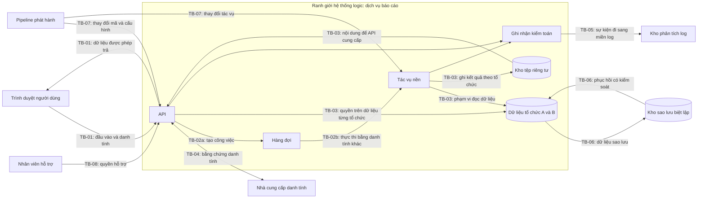

# Xác định trust boundary

## 1. Trust boundary giúp đặt yêu cầu bảo mật đúng chỗ

Một hệ thống có thể có nhiều lớp bảo vệ nhưng vẫn gặp sự cố nếu thành phần nhận dữ liệu tin vào những điều chưa được xác minh. API có thể tin mã tổ chức do trình duyệt gửi; tác vụ nền có thể tin quyền ghi trong thông điệp; công cụ hỗ trợ có thể dùng đặc quyền rộng hơn phạm vi khách hàng cần hỗ trợ.

Các tình huống này có điểm chung: dữ liệu, danh tính hoặc quyền hạn đi từ một bối cảnh sang bối cảnh khác nhưng giả định tin cậy không được xem xét lại.

**Trust boundary**, hay **ranh giới tin cậy**, là đường phân định giữa những miền có giả định tin cậy, quyền hạn hoặc cơ chế kiểm soát khác nhau. Khi một luồng đi qua ranh giới này, nhóm cần xác định bên nhận được phép tin điều gì, phải xác minh điều gì và phải làm gì nếu không xác minh được.

Xác định trust boundary tạo đầu vào trực tiếp cho mô hình đe dọa và yêu cầu bảo mật:

```text
Luồng dữ liệu, danh tính hoặc quyền hạn
                  |
                  v
Điểm thay đổi giả định tin cậy
                  |
                  v
Tình huống lạm dụng và rủi ro
                  |
                  v
Yêu cầu bảo mật và nơi thực thi
                  |
                  v
Tiêu chí chấp nhận và bằng chứng kiểm chứng
```

Sau bài học này, người học có thể nhận diện các miền tin cậy, đánh dấu điểm chuyển, ghi lại giả định và chuyển chúng thành yêu cầu về xác thực, phân quyền, dữ liệu, logging và phục hồi.

## 2. Phân biệt ranh giới tin cậy với những ranh giới khác

### 2.1. Ranh giới hệ thống và ranh giới tin cậy

**System boundary** xác định những thành phần thuộc hệ thống đang được phân tích. **Trust boundary** xác định nơi giả định tin cậy thay đổi.

Một dịch vụ xử lý báo cáo có thể bao gồm API, hàng đợi, tác vụ nền, cơ sở dữ liệu và kho tệp trong cùng một ranh giới hệ thống. Tuy nhiên:

- Trình duyệt gửi dữ liệu vào API qua một ranh giới tin cậy.
- API gửi công việc để tác vụ nền thực hiện bằng danh tính khác qua một ranh giới tin cậy.
- Một truy vấn chuyển từ ngữ cảnh tổ chức A sang tài nguyên của B chạm tới ranh giới cách ly khách hàng.
- Người vận hành khôi phục bản sao lưu vào môi trường mới đi qua ranh giới quyền vận hành và vòng đời dữ liệu.

Ranh giới tin cậy có thể nằm bên trong hệ thống hoặc trùng với giao diện bên ngoài. Vẽ đường bao hệ thống chưa đủ để tìm mọi điểm cần kiểm soát.

### 2.2. Vị trí mạng, thành phần triển khai và miền quyền

| Loại phân định | Ví dụ | Điều không thể tự suy ra |
|---|---|---|
| Mạng | Mạng công khai, mạng ứng dụng, mạng quản trị | Cùng mạng không có nghĩa mọi yêu cầu đều được phép |
| Triển khai | Tiến trình, máy ảo, cụm xử lý | Hai tiến trình tách biệt có thể dùng cùng đặc quyền quá rộng |
| Tổ chức | Nhóm sản phẩm, vận hành, nhà cung cấp | Cùng công ty không đồng nghĩa cùng quyền đọc dữ liệu |
| Danh tính | Người dùng, tài khoản dịch vụ, pipeline | Xác thực thành công chưa xác định đầy đủ quyền tài nguyên |
| Dữ liệu | Tổ chức A, tổ chức B, dữ liệu công khai, dữ liệu hạn chế | Cùng cơ sở dữ liệu không làm mất nhu cầu cách ly |
| Vòng đời | Dữ liệu đang phục vụ, bản sao lưu, môi trường phục hồi | Dữ liệu cũ vẫn có thể chứa bí mật và quyền đã hết hiệu lực |

Một thay đổi về mạng hoặc nơi triển khai là dấu hiệu cần xem xét. Việc kết luận có ranh giới tin cậy phải dựa vào sự khác biệt về chủ thể, quyền, dữ liệu và giả định kiểm soát.

### 2.3. Miền tin cậy là công cụ mô hình hóa

Một miền tin cậy nhóm những thành phần có các giả định liên quan đủ giống nhau cho mục đích phân tích. Cách nhóm phụ thuộc vào mức chi tiết.

Ở mức bối cảnh, có thể gom các dịch vụ ứng dụng vào một miền. Khi phân tích xuất báo cáo, cần tách API, bên gửi thông điệp và tác vụ có quyền đọc dữ liệu. Sơ đồ chi tiết hơn phải giải thích được vì sao từng điểm chuyển cần hoặc không cần kiểm soát bổ sung.

Không nên gắn nhãn “tin cậy” cho một miền rồi bỏ qua mọi đầu vào của nó. Thành phần trong miền vẫn có thể bị lỗi, bị cấu hình sai hoặc xử lý dữ liệu bắt nguồn từ người dùng.

## 3. Tin điều gì, trong điều kiện nào?

Độ tin cậy cần gắn với một khẳng định cụ thể. API có thể tin rằng một dịch vụ danh tính đã xác thực người dùng theo cơ chế được chấp nhận; API vẫn phải quyết định người dùng đó có được đọc báo cáo cụ thể hay không.

Có thể phân tích theo các chiều sau:

| Chiều cần xem xét | Câu hỏi tại điểm nhận |
|---|---|
| Nguồn gốc | Ai thực sự tạo dữ liệu hoặc yêu cầu này? |
| Danh tính | Bằng chứng nào xác lập chủ thể gửi hoặc chủ thể được đại diện? |
| Tính toàn vẹn | Nội dung có thể bị sửa giữa nơi tạo và nơi nhận không? |
| Quyền hạn | Chủ thể được làm hành động nào với tài nguyên nào? |
| Tổ chức sở hữu | Dữ liệu và yêu cầu thuộc khách hàng hoặc tổ chức nào? |
| Mục đích sử dụng | Bằng chứng, token hoặc tệp có dành cho thành phần nhận này không? |
| Thời gian | Quyền và dữ liệu có còn hiệu lực tại thời điểm sử dụng không? |
| Mức nhạy cảm | Bên nhận có được phép tiếp cận các trường dữ liệu này không? |
| Khả năng vận hành | Khi phụ thuộc không sẵn sàng, bên nhận xử lý thế nào? |

Ba suy luận thường gây sai lệch:

1. **“Kết nối đã mã hóa nên nội dung hợp lệ.”** Bảo vệ kênh truyền không tự chứng minh quyền nghiệp vụ hoặc tính đúng đắn của dữ liệu.
2. **“Dữ liệu lấy từ cơ sở dữ liệu nên an toàn.”** Dữ liệu có thể bắt nguồn từ đầu vào người dùng hoặc thuộc tổ chức khác.
3. **“Thông điệp do dịch vụ nội bộ gửi nên có thể làm theo mọi chỉ dẫn.”** Dịch vụ nhận vẫn cần biết nguồn được phép, phạm vi hành động và ngữ cảnh đại diện.

Một lần kiểm tra chỉ xác nhận những thuộc tính mà nó thực sự kiểm tra. Kiểm tra cấu trúc thông điệp không xác lập quyền đọc dữ liệu; xác minh danh tính không bảo đảm tệp thuộc đúng tổ chức.

## 4. Quy trình xác định trust boundary

### Bước 1: Chọn chức năng và phạm vi phân tích

Bắt đầu bằng một hành vi cụ thể như “người dùng yêu cầu tạo và tải báo cáo của tổ chức mình”. Nêu rõ những luồng liên quan: đăng nhập, tạo công việc, xử lý nền, lưu kết quả, tải tệp, ghi log và phục hồi.

Phạm vi cần bao gồm các đường có thể tác động đến tính bí mật, toàn vẹn hoặc sẵn sàng của chức năng, kể cả đường quản trị và phát hành.

### Bước 2: Liệt kê thành phần, chủ thể và quyền thực thi

Với mỗi thành phần, ghi:

- Chức năng và dữ liệu xử lý.
- Danh tính dùng để nhận yêu cầu, gọi dịch vụ hoặc truy cập kho dữ liệu.
- Chủ thể mà thành phần có thể đại diện.
- Đặc quyền thực tế và cơ chế cấp quyền.
- Người quản lý mã, cấu hình, bí mật và vận hành.

Đặc biệt chú ý thành phần có khả năng đọc dữ liệu của nhiều tổ chức, thay đổi quyền hoặc tạo bản phát hành.

### Bước 3: Vẽ luồng dữ liệu và luồng điều khiển

Luồng dữ liệu cho biết nội dung đi đâu. Luồng điều khiển cho biết ai có thể yêu cầu hoặc thay đổi hành vi.

Ví dụ, pipeline có thể không nhận dữ liệu báo cáo trong hoạt động bình thường nhưng có quyền thay mã API. Luồng đó có ảnh hưởng trực tiếp tới mức bảo vệ dữ liệu và cần được đưa vào phân tích.

Với xử lý bất đồng bộ, vẽ đầy đủ bên gửi, hàng đợi, bên nhận, kho trạng thái công việc và nơi lưu kết quả. Ghi rõ thời điểm thực hiện có thể khác thời điểm người dùng được cấp quyền.

### Bước 4: Tìm nơi giả định tin cậy thay đổi

Đặt các câu hỏi tại từng cạnh và kho dữ liệu:

- Chủ thể hoặc danh tính dịch vụ có thay đổi không?
- Quyền thực thi có lớn hơn quyền của người khởi tạo không?
- Dữ liệu có chuyển giữa các tổ chức không?
- Nơi nhận có do bên khác kiểm soát không?
- Dữ liệu có đổi từ đầu vào thành chỉ dẫn, truy vấn hoặc tên tài nguyên không?
- Quyền có thể bị thu hồi trong khoảng chờ xử lý không?
- Nội dung có được sao chép sang log, tệp, sao lưu hoặc môi trường khác không?
- Thành phần nào đang dùng một khẳng định do bên gửi tự cung cấp?

Mỗi câu trả lời chỉ ra một điểm cần đánh giá. Sau đó nhóm ghi rõ lý do xác lập ranh giới thay vì đánh dấu cơ học mọi đường kết nối.

### Bước 5: Xem xét cả hai chiều

Đầu vào qua ranh giới có thể làm giả danh tính, yêu cầu vượt quyền hoặc đưa dữ liệu sai vào hệ thống. Đầu ra qua ranh giới có thể làm lộ dữ liệu, cấp liên kết mang quyền truy cập hoặc sao chép bí mật sang kho ít được bảo vệ hơn.

Ví dụ, trình duyệt gửi mã báo cáo cần được kiểm tra quyền. Phản hồi tải báo cáo cũng cần bảo đảm đúng tổ chức, đúng nội dung và không bị lưu vào bộ nhớ đệm dùng chung ngoài chính sách.

### Bước 6: Ghi giả định, trách nhiệm và hành vi lỗi

Mỗi ranh giới cần có người chịu trách nhiệm và các khẳng định có thể xác minh.

Thay vì ghi “hàng đợi an toàn”, hãy ghi:

> Chỉ các danh tính dịch vụ được phê duyệt được gửi công việc xuất báo cáo. Nhóm vận hành quản lý quyền gửi và nhận; nhóm phát triển kiểm tra cấu trúc, tham chiếu công việc và phạm vi xử lý của thông điệp.

Tiếp theo cần mô tả khi quyền không xác định được, thông điệp không hợp lệ hoặc dịch vụ chính sách gián đoạn thì dừng, từ chối, thử lại hay chuyển xử lý thủ công.

### Bước 7: Liên kết ranh giới với mô hình đe dọa và yêu cầu

Mỗi ranh giới quan trọng cần truy được tới:

```text
Mã ranh giới
  -> giả định và tình huống lạm dụng
  -> rủi ro
  -> yêu cầu bảo mật
  -> thành phần thực thi
  -> tiêu chí chấp nhận
  -> bằng chứng và chủ sở hữu
```

Danh sách này giúp kiểm tra xem đã có nơi thực thi yêu cầu hay chỉ mới có một câu mô tả trên tài liệu.

## 5. Ví dụ: dịch vụ tạo báo cáo cho nhiều tổ chức

### 5.1. Bối cảnh và chính sách được chọn

Người dùng thuộc tổ chức A hoặc B có thể yêu cầu tạo báo cáo theo quyền của mình. API tiếp nhận công việc, tác vụ nền đọc dữ liệu và ghi tệp kết quả. Người dùng tải tệp qua API.

Trong ví dụ:

- Máy chủ xác lập danh tính và quan hệ thành viên từ nguồn được phép.
- Quyền được kiểm tra khi tiếp nhận, trước khi thực thi và trước khi công bố kết quả.
- Mỗi yêu cầu tải mới phải chịu kiểm tra quyền theo chính sách hiệu lực đã thống nhất.
- Kho tệp không cung cấp đường tải công khai.
- Các thành phần có danh tính dịch vụ riêng, với quyền được giới hạn theo nhiệm vụ.

Đây là các lựa chọn của ví dụ để phân tích ranh giới. Khi áp dụng vào sản phẩm, nhóm phải thống nhất chính sách tương ứng với nhu cầu nghiệp vụ và rủi ro thực tế.

### 5.2. Sơ đồ các điểm chuyển cần xem xét



Các nhãn TB đánh dấu những điểm có thay đổi giả định tin cậy; sơ đồ chưa mô tả mọi kết nối hoặc biện pháp kiểm soát.

TB-03 là ranh giới logic về quyền và tổ chức sở hữu dữ liệu. Nó có thể tồn tại ngay trong một cơ sở dữ liệu hoặc kho tệp, dù không có một đường chia mạng tương ứng.

Các thành phần bên trong đường bao hệ thống không được coi là có cùng quyền. TB-02a và TB-02b cần được xem xét riêng vì quyền gửi thông điệp, nhận thông điệp và thực thi công việc có thể khác nhau.

### 5.3. Sổ ranh giới minh họa

| Mã | Điểm chuyển | Giả định cần xác minh | Tình huống lạm dụng tiêu biểu |
|---|---|---|---|
| TB-01 | Trình duyệt với API | Đầu vào không tự xác lập danh tính, tổ chức hoặc quyền | Sửa mã báo cáo để đọc dữ liệu của tổ chức khác |
| TB-02a/b | API, hàng đợi và tác vụ nền | Nguồn thông điệp được phép và phạm vi công việc không bị mở rộng | Nhờ tác vụ có quyền rộng xuất dữ liệu ngoài quyền người yêu cầu |
| TB-03 | Chủ thể với tài nguyên của từng tổ chức | Mọi truy vấn và tệp gắn với ngữ cảnh quyền đúng | Kết quả của A được trả cho B qua kho tệp hoặc bộ nhớ đệm |
| TB-04 | API với hệ thống danh tính | Bằng chứng có nguồn, bên nhận và hiệu lực phù hợp | Chấp nhận bằng chứng dành cho dịch vụ khác |
| TB-05 | Ứng dụng với miền logging | Sự kiện đủ truy vết nhưng không chứa bí mật bị cấm | Token hoặc nội dung báo cáo bị sao chép vào log |
| TB-06 | Dữ liệu vận hành với sao lưu và phục hồi | Quyền, tính toàn vẹn và môi trường đích được kiểm soát | Khôi phục dữ liệu vào môi trường có quyền truy cập quá rộng |
| TB-07 | Pipeline với ứng dụng | Chỉ chủ thể được phép có thể thay mã và cấu hình | Thay đổi cấu hình để bỏ kiểm tra quyền hoặc xuất bí mật |
| TB-08 | Nhân viên hỗ trợ với chức năng quản trị | Đặc quyền có mục đích, phạm vi và dấu vết | Dùng quyền hỗ trợ để đọc tùy ý dữ liệu khách hàng |

Sổ ranh giới thực tế cần bổ sung chủ sở hữu, thành phần thực thi, yêu cầu và liên kết bằng chứng. Danh sách tình huống trên là đầu vào phân tích, chưa phải một mô hình đe dọa đầy đủ.

## 6. Phân tích sâu ranh giới xử lý bất đồng bộ

### 6.1. Phân biệt người yêu cầu với danh tính thực thi

Tác vụ nền có thể dùng tài khoản dịch vụ được phép đọc dữ liệu của nhiều tổ chức. Người dùng khởi tạo công việc chỉ được đọc một tập dữ liệu nhỏ hơn.

Nếu tác vụ làm theo toàn bộ mã tổ chức hoặc điều kiện truy vấn từ thông điệp mà không kiểm tra, người dùng có thể khiến một thành phần nhiều quyền thực hiện hành động vượt phạm vi của mình. Đây là tình huống một thành phần được trao quyền bị sử dụng để hành động sai đối tượng hoặc mục đích.

Cần giữ rõ:

- **Danh tính thực thi:** tài khoản dịch vụ dùng để kết nối và thực hiện công việc.
- **Chủ thể khởi tạo:** người hoặc hệ thống đã yêu cầu tạo báo cáo.
- **Ngữ cảnh tổ chức:** tổ chức mà công việc được phép xử lý.
- **Phạm vi hành động:** loại báo cáo, dữ liệu, bộ lọc và giới hạn được chấp thuận.
- **Thời điểm quyết định quyền:** khi tiếp nhận, thực thi, công bố và tải.

Quyền truy cập kỹ thuật của tài khoản dịch vụ không tự thay thế cho quyền nghiệp vụ của công việc.

### 6.2. Định danh công việc không tự trao quyền

Một thiết kế có thể để thông điệp mang mã công việc, còn ngữ cảnh đã được xác lập nằm trong kho trạng thái do máy chủ quản lý. Cách này giúp giảm lượng chỉ dẫn nhạy cảm trong thông điệp.

Tuy vậy, bên nhận vẫn cần:

- Xác minh nguồn gửi và quyền sử dụng kênh thông điệp.
- Kiểm tra cấu trúc, phiên bản và giới hạn dữ liệu.
- Tra cứu công việc từ nguồn có quyền truy cập phù hợp.
- Kiểm tra trạng thái, thời hạn và chính sách quyền hiện hành.
- Tránh thực hiện nhiều lần ngoài chính sách khi thông điệp được giao lại.

Mã công việc khó đoán giúp giảm khả năng dò tìm; quyết định xử lý vẫn cần kiểm tra quyền và trạng thái.

### 6.3. Quyền có thể thay đổi trong thời gian chờ

Một người có quyền lúc tạo yêu cầu có thể đã rời tổ chức trước khi tác vụ chạy. Vì vậy, đặc tả phải chọn rõ thời điểm quyền có hiệu lực.

Trong ví dụ này, tác vụ kiểm tra lại quyền trước khi đọc dữ liệu và trước khi công bố kết quả. Khi không thể xác lập quyền, kết quả không được cung cấp. Công việc có thể được thử lại theo giới hạn và trạng thái lỗi đã đặc tả.

Với yêu cầu tải mới, nhóm có thể thống nhất giới hạn độ trễ thu hồi tối đa là 60 giây. Con số này chỉ là lựa chọn minh họa; nó cần được gắn với cơ chế vô hiệu hóa hoặc làm mới quyền và cách đo cụ thể.

Việc xử lý một luồng tải đã bắt đầu cần chính sách riêng nếu nghiệp vụ yêu cầu chấm dứt giữa chừng. Một kiểm tra tại thời điểm bắt đầu tải không tự bảo đảm việc thu hồi tức thì cho mọi byte đã được gửi.

## 7. Chuyển ranh giới thành yêu cầu có thể kiểm chứng

### 7.1. Xác thực: chỉ chấp nhận bằng chứng phù hợp

**SEC-ID-01 — liên quan TB-01 và TB-04**

API phải xác minh bằng chứng danh tính theo cơ chế tích hợp đã chọn, gồm nguồn được phép, hiệu lực và bên nhận dự kiến. Dữ liệu tự khai trong yêu cầu không được dùng làm căn cứ duy nhất xác lập danh tính hoặc quyền.

**Tiêu chí chấp nhận:**

- Bằng chứng hợp lệ được xử lý theo chính sách.
- Bằng chứng sai nguồn, sai bên nhận, hết hạn hoặc không xác minh được không cho truy cập dữ liệu được bảo vệ.
- Khi cơ chế xác minh gặp lỗi, API áp dụng hành vi từ chối hoặc chờ xử lý đã đặc tả, không tự cấp quyền.

**Bằng chứng:** kết quả kiểm thử tích hợp và cấu hình xác minh tương ứng với phiên bản phát hành.

**Chủ sở hữu:** nhóm phụ trách tích hợp danh tính và API.

### 7.2. Phân quyền: gắn hành động với tổ chức và tài nguyên

**SEC-AUTHZ-01 — liên quan TB-01, TB-02 và TB-03**

API và tác vụ nền chỉ được xử lý tài nguyên khi chủ thể có quyền phù hợp trong tổ chức sở hữu. Mã tổ chức, mã báo cáo hoặc vai trò gửi từ phía người dùng phải được đối chiếu với nguồn chính sách đáng tin cậy.

Kiểm tra quyền phải bao phủ đường đọc dữ liệu, tạo công việc, công bố kết quả và tải tệp theo chính sách thời gian đã thống nhất.

**Tiêu chí chấp nhận:**

- Người dùng A không tạo được báo cáo từ dữ liệu B bằng cách sửa mã hoặc bộ lọc.
- Tác vụ không mở rộng phạm vi chỉ vì tài khoản dịch vụ có quyền đọc rộng.
- Người dùng mất quyền bị từ chối ở các mốc đã quy định.
- Bộ nhớ đệm và định danh tệp không làm lẫn kết quả giữa các tổ chức.

**Bằng chứng:** ma trận quyền trên API, tác vụ và đường tải; kiểm thử thay đổi quyền giữa các giai đoạn.

**Chủ sở hữu:** nhóm dịch vụ báo cáo, phối hợp với nhóm chính sách quyền.

### 7.3. Thông điệp: giới hạn nguồn và nội dung công việc

**SEC-MSG-01 — liên quan TB-02a và TB-02b**

Chỉ danh tính được phê duyệt được gửi hoặc nhận công việc. Bên nhận phải kiểm tra cấu trúc, giới hạn và tham chiếu công việc; thông điệp không được tự trao thêm quyền so với ngữ cảnh được máy chủ xác lập.

**Tiêu chí chấp nhận:**

- Danh tính chưa được cấp quyền không gửi hoặc nhận được công việc.
- Thông điệp sai cấu trúc, quá giới hạn hoặc tham chiếu công việc không hợp lệ không dẫn tới xuất dữ liệu.
- Thông điệp giao lại không tạo hành vi vượt chính sách xử lý lặp.
- Vai trò hoặc mã tổ chức bị sửa trong thông điệp không làm mở rộng dữ liệu được xử lý.

**Bằng chứng:** kiểm tra cấu hình quyền kênh và kiểm thử bên nhận, gồm tình huống lỗi và xử lý lặp.

**Chủ sở hữu:** nhóm tác vụ nền và nhóm vận hành kênh thông điệp.

### 7.4. Dữ liệu: kiểm soát nội dung và nơi tiếp nhận

**SEC-DATA-01 — liên quan TB-01, TB-03 và TB-05**

Tệp kết quả chỉ chứa dữ liệu thuộc phạm vi đã cho phép. Tệp được lưu với quyền truy cập phù hợp, cung cấp qua đường tải đã kiểm tra quyền và xử lý theo thời hạn lưu được phê duyệt.

Nội dung báo cáo, token và bí mật không được đưa vào log hoặc thông tin chẩn đoán ngoài danh sách dữ liệu được phép.

**Tiêu chí chấp nhận:**

- Đối chiếu tệp với tập dữ liệu và trường được phép cho tổ chức tương ứng.
- Truy cập kho tệp bằng danh tính không được cấp quyền bị từ chối.
- Yêu cầu tải trái quyền không nhận được dữ liệu tệp.
- Trường hợp thành công và lỗi không làm xuất hiện dữ liệu bị cấm trong log.
- Tệp hết hạn không còn được cung cấp theo chính sách; lỗi dọn dữ liệu có cơ chế phát hiện đã đặc tả.

**Bằng chứng:** kiểm tra nội dung tệp, cấu hình kho tệp, quyền tải, sự kiện và tác vụ hết hạn.

**Chủ sở hữu:** nhóm dịch vụ báo cáo, chủ sở hữu dữ liệu và vận hành.

### 7.5. Logging: bảo vệ cả khả năng truy vết

**SEC-LOG-01 — liên quan TB-05 và TB-08**

Các thao tác xuất, tải, từ chối truy cập và sử dụng đặc quyền hỗ trợ phải tạo sự kiện theo chính sách kiểm toán. Sự kiện xác định được thời gian, chủ thể, tổ chức, hành động, đối tượng và kết quả trong phạm vi được phép ghi.

Dữ liệu sự kiện từ nguồn không đáng tin phải được xử lý như dữ liệu, tránh làm sai cấu trúc hoặc cách hiển thị nhật ký. Quyền đọc, sửa và xóa kho kiểm toán phải được phân chia theo chính sách.

**Tiêu chí chấp nhận:**

- Có thể liên kết sự kiện từ yêu cầu API tới công việc và kết quả.
- Dữ liệu chứa ký tự xuống dòng hoặc ký tự điều khiển không giả được một sự kiện độc lập.
- Tài khoản ứng dụng không có quyền tùy ý sửa lịch sử kiểm toán nếu chính sách cấm.
- Khi kênh ghi log gián đoạn, hệ thống xử lý theo cơ chế lưu đệm, cảnh báo hoặc dừng thao tác đã thống nhất.

**Bằng chứng:** sự kiện mẫu, kiểm thử dữ liệu gây sai cấu trúc, cấu hình quyền và kiểm tra gián đoạn.

**Chủ sở hữu:** nhóm ứng dụng và nhóm phụ trách kiểm toán vận hành.

### 7.6. Phục hồi: không mang nguyên giả định của môi trường cũ

**SEC-REC-01 — liên quan TB-06**

Việc phục hồi phải được thực hiện bởi chủ thể được ủy quyền, vào môi trường có quyền truy cập phù hợp và có kiểm tra tính toàn vẹn trước khi phục vụ. Phạm vi phục hồi phải bao gồm những dữ liệu, khóa và cấu hình cần thiết.

Không được mặc nhiên coi trạng thái quyền hoặc bí mật trong bản sao lưu cũ là trạng thái hiện hành. Nhóm phải quy định cách xử lý quyền đã thu hồi, bí mật đã thay đổi và dữ liệu không còn được phép cung cấp.

**Tiêu chí chấp nhận:**

- Chủ thể không được phép không đọc hoặc khôi phục được bản sao lưu.
- Môi trường phục hồi không vô tình cung cấp dữ liệu ra ngoài phạm vi.
- Dữ liệu và phụ thuộc cần thiết được kiểm tra trước khi chuyển sang phục vụ.
- Thực hiện được bước đối chiếu hoặc áp dụng lại chính sách quyền hiện hành theo quy trình.
- Diễn tập đo được mục tiêu thời gian phục hồi và giới hạn mất dữ liệu đã thống nhất.

**Bằng chứng:** báo cáo diễn tập, kiểm tra quyền, mốc thời gian, điểm dữ liệu phục hồi và kết quả đối chiếu chính sách.

**Chủ sở hữu:** nhóm vận hành, phối hợp với chủ sở hữu dữ liệu và chính sách quyền.

## 8. Minh họa cách giữ ngữ cảnh qua các ranh giới

Mã giả dưới đây minh họa vị trí quyết định quyền trong chính sách của ví dụ. Nó không mô tả đầy đủ một triển khai thực tế.

```text
Khi API tiếp nhận yêu cầu:
    principal = xác_minh_danh_tính(request)
    tenant = xác_lập_tổ_chức_từ_quan_hệ_đáng_tin(principal, request)
    input = kiểm_tra_cấu_trúc_và_giới_hạn(request)

    scope = chính_sách.cho_phép_xuất(principal, tenant, input)
    nếu scope không được phép:
        từ_chối_và_ghi_sự_kiện()

    job = lưu_công_việc_phía_máy_chủ(
        chủ_thể = principal.id,
        tổ_chức = tenant.id,
        phạm_vi = scope,
        trạng_thái = chờ
    )
    gửi_thông_điệp_bằng_danh_tính_được_phép(job.id)

Khi tác vụ nhận thông điệp:
    xác_minh_nguồn_và_kiểm_tra_thông_điệp(message)
    job = đọc_công_việc_từ_kho_được_bảo_vệ(message.jobId)
    kiểm_tra_trạng_thái_thời_hạn_và_xử_lý_lặp(job)

    scope = kiểm_tra_lại_quyền(job.chủ_thể, job.tổ_chức, job.phạm_vi)
    nếu không xác_lập_được_quyền:
        không_công_bố_kết_quả()
        xử_lý_lỗi_theo_chính_sách()

    data = đọc_dữ_liệu_trong_phạm_vi(scope)
    file = tạo_tệp_riêng_tư(data)
    kiểm_tra_lại_quyền_trước_khi_công_bố(job)
    công_bố_tham_chiếu_kết_quả(job, file)

Khi API nhận yêu cầu tải:
    principal = xác_minh_danh_tính(request)
    result = đọc_metadata_kết_quả(request.reportId)
    kiểm_tra_quyền_tải_hiện_tại(principal, result)
    trả_nội_dung_theo_chính_sách(result)
```

Có ba điều cần giữ rõ khi chuyển thành thiết kế:

- Tham chiếu do người dùng cung cấp được dùng để tìm tài nguyên, sau đó vẫn phải kiểm tra quyền.
- Phạm vi truy vấn phải được thực thi trong quá trình đọc dữ liệu, không chỉ ghi vào metadata công việc.
- Lỗi kiểm tra quyền không được làm luồng tiếp tục công bố hoặc trả dữ liệu.

Tính nhất quán khi quyền thay đổi đồng thời cần được thiết kế theo giới hạn hiệu lực đã thỏa thuận. Một lệnh kiểm tra riêng lẻ không tự bảo đảm mọi thao tác sau đó luôn dùng trạng thái quyền mới nhất.

## 9. Kiểm chứng ranh giới bằng các tình huống có chủ đích

Kiểm thử nên xuất phát từ giả định tại điểm chuyển. Bảng dưới đây minh họa các phép kiểm chứng có mục tiêu:

| Tình huống | Ranh giới | Kết quả cần quan sát |
|---|---|---|
| Gửi bằng chứng danh tính không dành cho API | TB-04 | Không tạo ngữ cảnh được phép đọc báo cáo |
| Sửa mã tổ chức hoặc mã báo cáo trên yêu cầu | TB-01, TB-03 | Không nhận dữ liệu ngoài phạm vi quyền |
| Dùng danh tính không được cấp quyền gửi công việc | TB-02a | Kênh từ chối và không phát sinh xuất dữ liệu |
| Gửi thông điệp có dữ liệu quyền bị sửa | TB-02b | Bên nhận không coi dữ liệu đó là căn cứ tự cấp quyền |
| Thu hồi quyền khi công việc đang chờ | TB-02, TB-03 | Các mốc thực thi và công bố tuân theo chính sách đã chọn |
| Người B tải kết quả của A | TB-01, TB-03 | Không nhận tệp hoặc nội dung báo cáo của A |
| Nhập dữ liệu có xuống dòng vào trường được ghi log | TB-05 | Không tạo sự kiện kiểm toán giả qua cách ghi hoặc hiển thị |
| Gián đoạn kênh log | TB-05 | Hành vi đúng với chính sách mất kênh đã đặc tả |
| Khôi phục bản sao chứa quyền hoặc bí mật cũ | TB-06 | Thực hiện được bước kiểm tra và cập nhật trước phục vụ |
| Nhân viên hỗ trợ vượt phạm vi được phê duyệt | TB-08 | Từ chối hoặc yêu cầu quy trình cấp quyền phù hợp; có dấu vết |
| Pipeline không được phép yêu cầu phát hành | TB-07 | Không thay được mã hoặc cấu hình môi trường đích |

Cần bổ sung các trường hợp được phép để xác nhận kiểm soát không làm hỏng luồng hợp lệ.

Kiểm thử hành vi nên đi cùng kiểm tra thiết kế và cấu hình. Ví dụ, thử một yêu cầu trái quyền không chứng minh rằng mọi tài khoản đều không có quyền truy cập kho tệp. Báo cáo cần mô tả phạm vi đã kiểm tra và phần bằng chứng cấu hình tương ứng.

## 10. Giả định, chủ sở hữu và bằng chứng

Một hồ sơ ranh giới có thể dùng cấu trúc sau:

```text
Mã ranh giới:
Luồng và chiều di chuyển:
Miền nguồn và miền đích:
Chủ thể khởi tạo và danh tính thực thi:
Dữ liệu, tài nguyên và quyền đi qua:
Điều bên nhận được phép tin:
Điều phải xác minh tại điểm nhận:
Giả định và căn cứ xác nhận:
Tình huống lạm dụng và rủi ro:
Yêu cầu và thành phần thực thi:
Hành vi khi không xác minh được:
Tiêu chí chấp nhận và cách kiểm chứng:
Chủ sở hữu, bằng chứng, phiên bản và ngày xem xét:
```

Ví dụ rút gọn cho TB-02b:

| Thuộc tính | Nội dung minh họa |
|---|---|
| Nguồn và đích | Kênh công việc đến tác vụ xuất |
| Thay đổi quyền | Từ yêu cầu người dùng sang tài khoản dịch vụ có khả năng đọc dữ liệu rộng hơn |
| Điều được tin có điều kiện | Công việc tồn tại trong kho do máy chủ quản lý và được tạo theo quy trình được phép |
| Điều phải kiểm tra | Nguồn thông điệp, cấu trúc, trạng thái công việc, tổ chức và quyền hiện hành |
| Rủi ro | Tác vụ xuất dữ liệu vượt phạm vi của chủ thể khởi tạo |
| Yêu cầu | SEC-AUTHZ-01 và SEC-MSG-01 |
| Chủ sở hữu | Nhóm tác vụ nền; vận hành chịu trách nhiệm quyền kênh |
| Bằng chứng | Kiểm thử quyền, xử lý thông điệp, cấu hình danh tính và quyền truy cập |

Bằng chứng cần gắn với phiên bản mã, cấu hình và mô hình ranh giới. Một kết quả kiểm tra cũ có thể không còn phù hợp khi thay đổi danh tính dịch vụ, quyền hàng đợi hoặc chính sách thu hồi.

## 11. Duy trì ranh giới trong vòng đời phát triển

### 11.1. Khi phân tích và thiết kế

Tìm ranh giới khi lập luồng dữ liệu và mô hình đe dọa. Đặt yêu cầu trước khi quyết định kiến trúc phụ thuộc vào các giả định đó.

Nếu một thiết kế cần cho phép tác vụ sử dụng quyền rộng, cần giải thích cách giới hạn hành động theo chủ thể khởi tạo và cách kiểm chứng. Những phần chưa biết phải có người xử lý.

### 11.2. Khi triển khai và kiểm thử

Mỗi công việc liên quan ranh giới cần chỉ ra yêu cầu, nơi kiểm soát và bằng chứng. Rà soát mã và cấu hình phải kiểm tra các đường có thể bỏ qua kiểm soát, như tải tệp trực tiếp, công cụ hỗ trợ hoặc tác vụ chạy lại.

Các kết quả quét tự động có ích cho những loại lỗi chúng kiểm tra. Chúng không thay thế việc xác minh quyền theo tổ chức hoặc ngữ cảnh ủy quyền của công việc.

### 11.3. Khi phát hành và vận hành

Xác minh cấu hình thực tế của danh tính, quyền, kho tệp, logging và sao lưu. Một thiết kế đúng vẫn có thể bị vô hiệu bởi tài khoản vận hành quá nhiều quyền hoặc một đường truy cập mới.

Theo dõi sự kiện từ chối, hoạt động đặc quyền, công việc lỗi và diễn tập phục hồi. Sự cố hoặc sai lệch cấu hình cần được phản hồi vào mô hình đe dọa và yêu cầu.

### 11.4. Khi có thay đổi

Những thay đổi thường cần xem xét lại ranh giới gồm:

- Thêm đối tác, webhook hoặc nhà cung cấp danh tính.
- Chuyển tải tệp qua API sang liên kết tải trực tiếp.
- Tách tác vụ nền, thêm bộ nhớ đệm hoặc chia sẻ dữ liệu sang hệ thống phân tích.
- Gộp tài khoản dịch vụ hoặc mở rộng đặc quyền của pipeline.
- Thay đổi chính sách quyền, cách thu hồi hoặc thời hạn hiệu lực.
- Đổi nơi lưu log, sao lưu, môi trường phục hồi hoặc bên hỗ trợ.

Khi ngừng chức năng, cần xử lý các quyền, kênh thông điệp, tệp và bản sao dữ liệu còn tồn tại. Việc dừng API không tự làm biến mất những đường truy cập khác.

## 12. Những sai lệch thường gặp

| Sai lệch | Hệ quả | Cách điều chỉnh |
|---|---|---|
| Chỉ đánh dấu ranh giới Internet | Bỏ sót chuyển quyền trong nội bộ và giữa các tổ chức | Đi theo danh tính, dữ liệu và quyền thực thi |
| Đồng nhất trust boundary với firewall | Bỏ sót phân quyền tài nguyên và kiểm tra thông điệp | Nêu rõ giả định thay đổi và kiểm soát tại điểm nhận |
| Tin mọi dữ liệu sau khi đăng nhập | Người dùng hợp lệ thực hiện hành động vượt quyền | Xác thực và phân quyền theo từng ngữ cảnh |
| Tin metadata từ thông điệp nội bộ | Tác vụ làm theo tổ chức hoặc quyền bị sửa | Xác minh nguồn và đối chiếu ngữ cảnh do máy chủ quản lý |
| Bỏ qua chiều dữ liệu đi ra | Lộ báo cáo, bí mật hoặc liên kết mang quyền | Kiểm tra nội dung trả về, logging và phân phối tệp |
| Cho rằng dữ liệu lưu lâu đã trở nên đáng tin | Dữ liệu đầu vào được dùng sai như chỉ dẫn hoặc danh tính | Giữ thông tin nguồn gốc và kiểm tra theo mục đích sử dụng |
| Tin trạng thái quyền trong bản sao lưu | Khôi phục lại quyền đã bị thu hồi | Đặc tả đối chiếu chính sách trước khi phục vụ |
| Ghi ranh giới nhưng không giao chủ sở hữu | Không ai duy trì cấu hình và bằng chứng | Gắn trách nhiệm với từng điểm thực thi |
| Có kiểm tra nhưng không định nghĩa lỗi | Khi phụ thuộc lỗi, hệ thống tự mở rộng quyền | Đặc tả và kiểm thử hành vi khi không xác minh được |

## 13. Bài tập thực hành

Một dịch vụ cho phép người dùng tải tài liệu lên, đưa công việc vào hàng đợi, xử lý nội dung bằng tác vụ nền và cho nhân viên hỗ trợ xem kết quả theo yêu cầu khách hàng. Dịch vụ dùng hệ thống đăng nhập ngoài, gửi sự kiện về kho log và có môi trường phục hồi riêng.

Hãy thực hiện:

1. Vẽ luồng từ tải lên đến đọc kết quả, thêm đường hỗ trợ, logging, phát hành và phục hồi.
2. Liệt kê danh tính của từng thành phần và nơi quyền thực thi thay đổi.
3. Đánh dấu ít nhất sáu ranh giới, nêu lý do cho từng điểm.
4. Chọn một ranh giới nội bộ và mô tả một tình huống lạm dụng dù kết nối đã được mã hóa.
5. Viết yêu cầu về xác thực, phân quyền, dữ liệu, logging và phục hồi; mỗi yêu cầu có chủ sở hữu và tiêu chí chấp nhận.
6. Chọn trường hợp người dùng mất quyền khi tác vụ đang chờ; đặc tả các mốc kiểm tra và độ trễ được chấp nhận.
7. Nêu bằng chứng cần thu thập và một thay đổi khiến bằng chứng đó phải được xem xét lại.

Hồ sơ cần trả lời được: ở mỗi điểm chuyển, bên nhận đang tin khẳng định nào, dựa trên bằng chứng gì, trong phạm vi nào và sẽ xử lý thế nào khi khẳng định đó không còn đúng.
