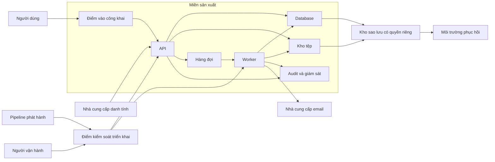

# Xác định môi trường triển khai

## Mục tiêu bài học

Cùng một ứng dụng có thể cần các yêu cầu bảo mật khác nhau khi chạy trên máy cá nhân, trong mạng doanh nghiệp, trên hạ tầng đám mây hoặc trong một nền tảng do nhà cung cấp vận hành. Nơi chạy chỉ là một phần của khác biệt. Ai được triển khai, dữ liệu nào được sử dụng, đường quản trị đi qua đâu và hệ thống phục hồi như thế nào đều ảnh hưởng đến mức bảo vệ cần thiết.

Trong chương Bối cảnh và phạm vi, xác định môi trường triển khai là bước mô tả đủ bối cảnh để trả lời: **yêu cầu bảo mật áp dụng cho hệ thống nào, trong điều kiện nào, do ai thực hiện và bằng chứng nào có thể kiểm tra?**

Sau bài học, bạn có thể:

- Phân biệt mục đích môi trường, mô hình lưu trú và hình thức vận hành.
- Lập hồ sơ môi trường bao gồm ứng dụng, hạ tầng, danh tính, dữ liệu và các đường quản trị.
- Nhận diện ranh giới tin cậy, phụ thuộc bên ngoài và trách nhiệm còn lại khi dùng dịch vụ được quản lý.
- Chuyển đặc điểm triển khai thành yêu cầu về xác thực, phân quyền, dữ liệu, logging và phục hồi.
- Gắn yêu cầu với rủi ro, quyết định kiến trúc và tiêu chí kiểm chứng trong vòng đời phát triển.

Ví dụ trong bài dùng tên và ngưỡng giả định để minh họa cách đặc tả. Các con số phải được người chịu trách nhiệm nghiệp vụ và vận hành xác nhận trước khi áp dụng thực tế.

## 1. Môi trường triển khai gồm những gì?

### 1.1. Một mô tả rộng hơn tên máy chủ

**Môi trường triển khai** là tập hợp điều kiện kỹ thuật và tổ chức nơi một phiên bản hệ thống được xây dựng cấu hình để chạy, truy cập dữ liệu và cung cấp chức năng. Trong phân tích yêu cầu bảo mật, cần xét cả thành phần chạy ứng dụng lẫn những thành phần có thể thay đổi hoặc khôi phục nó.

Một hồ sơ môi trường thường bao gồm:

| Nhóm thông tin | Nội dung cần xác định |
|---|---|
| Mục đích và phạm vi | Phát triển, kiểm thử, nghiệm thu, sản xuất, phục hồi; chức năng nào có mặt |
| Nền tảng thực thi | Máy vật lý, máy ảo, container, nền tảng ứng dụng hoặc hàm được quản lý |
| Hạ tầng và mạng | Miền quản trị hạ tầng, vùng triển khai, đường vào/ra, DNS, cổng truy cập |
| Danh tính và quyền | Người dùng, quản trị viên, pipeline, tài khoản dịch vụ, quyền khẩn cấp |
| Dữ liệu và bí mật | Loại dữ liệu, nơi lưu, bản sao, khóa, thông tin xác thực tích hợp |
| Đường thay đổi hệ thống | Nguồn mã, quy trình xây dựng, kho bản phát hành, CI/CD, sửa cấu hình trực tiếp |
| Quan sát và phục hồi | Log, audit, cảnh báo, sao lưu, môi trường phục hồi, đối soát dữ liệu |
| Phụ thuộc và trách nhiệm | Nhà cung cấp, đội vận hành, chủ dữ liệu, giới hạn kiểm soát của từng bên |

CI/CD là chuỗi tự động hóa tích hợp, kiểm tra, đóng gói và chuyển bản phát hành tới môi trường. Một pipeline có quyền triển khai có thể thay đổi mã đang xử lý dữ liệu sản xuất; vì vậy nó là một phần của bối cảnh bảo mật dù không trực tiếp phục vụ người dùng cuối.

### 1.2. Phân biệt đường phục vụ và đường quản trị

- **Đường phục vụ nghiệp vụ:** người dùng gọi API, ứng dụng đọc database, worker xử lý tác vụ, hệ thống gửi thông báo.
- **Đường quản trị:** người vận hành đổi quyền, pipeline đưa bản mới lên, công cụ thay cấu hình mạng, người được cấp quyền phục hồi dữ liệu.

Đường phục vụ có thể được bảo vệ tốt nhưng hệ thống vẫn bị tác động nếu một danh tính triển khai có quyền không giới hạn hoặc một giao diện quản trị bị công khai ngoài ý muốn. Khi lập hồ sơ, hai đường này cần được mô tả và kiểm chứng riêng.

## 2. Tách các chiều mô tả để tránh hiểu nhầm

### 2.1. Mục đích môi trường khác với nơi lưu trú

Các nhãn sau trả lời những câu hỏi khác nhau:

| Chiều mô tả | Ví dụ | Điều chưa thể suy ra chỉ từ nhãn |
|---|---|---|
| Mục đích | DEV, TEST, UAT, PROD, DR | Dữ liệu và quyền thực tế có được tách biệt hay không |
| Nơi lưu trú | Tại chỗ, đám mây, kết hợp nhiều nơi | Thành phần nào được công khai hoặc bên nào chịu trách nhiệm cấu hình |
| Hình thức thực thi | Máy ảo, container, nền tảng được quản lý | Quyền ứng dụng có bị giới hạn và bí mật có được bảo vệ hay không |
| Mô hình phục vụ | Một khách hàng riêng, nhiều tenant dùng chung | Dữ liệu có được cách ly đúng tại mọi đường truy cập hay không |
| Mô hình vận hành | Tự vận hành, nhà cung cấp vận hành, phối hợp | Ai phải phát hiện, xử lý và chứng minh việc khắc phục sự cố |

DEV là môi trường phát triển; TEST dùng để kiểm thử; UAT phục vụ người nghiệp vụ nghiệm thu; PROD cung cấp dịch vụ thực; DR phục vụ phục hồi sau sự cố. Tên gọi có thể khác giữa các tổ chức, nên hồ sơ phải định nghĩa cách dùng của dự án.

“Chạy trên cloud” không trả lời ứng dụng có tiếp xúc Internet hay không. “Dùng container” không chứng minh container không có quyền cao trên máy chủ. “Môi trường test” cũng không chứng minh dữ liệu bên trong ít nhạy cảm hơn sản xuất.

### 2.2. Một sản phẩm có thể có nhiều hồ sơ triển khai

Nếu sản phẩm hỗ trợ cả bản do nhà cung cấp vận hành và bản cài tại doanh nghiệp khách hàng, cần tách các hồ sơ khi điều kiện bảo vệ khác nhau. Ví dụ, bên quản lý khóa, cách cập nhật, đường truy cập quản trị và nơi thu thập log có thể khác hoàn toàn.

Có thể giữ một phần yêu cầu chung như kiểm tra quyền trên đối tượng, rồi bổ sung yêu cầu và bằng chứng theo từng hồ sơ. Không nên gắn nhãn “hỗ trợ mọi môi trường” nếu chưa xác định những giả định mà hệ thống phụ thuộc để giữ an toàn.

## 3. Bắt đầu bằng các câu hỏi về nghiệp vụ và vận hành

Trước khi chọn biện pháp cụ thể, cần làm rõ các nhóm câu hỏi sau.

### Người nào truy cập và qua đâu?

Xác định người dùng nội bộ, khách hàng, đối tác, người hỗ trợ và quản trị viên. Với mỗi nhóm, ghi điểm truy cập: Internet, mạng doanh nghiệp, cổng đối tác, công cụ quản trị hay API tích hợp.

Một đối tác kết nối qua mạng riêng vẫn cần danh tính và phạm vi quyền phù hợp. Vị trí mạng không thay thế việc xác minh ai đang gọi và người đó được thao tác trên dữ liệu nào.

### Môi trường xử lý dữ liệu gì?

Ghi các loại dữ liệu, mức nhạy cảm theo chính sách của tổ chức, bên quyết định cách sử dụng và nơi tạo bản sao. Xem cả log, bản dump, tệp tạm, kho kết quả xuất, sao lưu và dữ liệu đưa sang công cụ vận hành.

Nếu có giới hạn vị trí lưu hoặc xử lý, cần nêu phạm vi vị trí được chấp thuận và áp dụng cho cả bản chính, bản sao, log, sao lưu và phục hồi. Không chỉ ghi vị trí database rồi bỏ qua các bản khác. Những nghĩa vụ cụ thể phải do đầu mối có thẩm quyền xác nhận theo bối cảnh của tổ chức.

### Ai được thay đổi hệ thống?

Liệt kê danh tính có thể phát hành mã, thay cấu hình, cấp quyền, đọc bí mật hoặc khôi phục bản sao. Ghi cả công cụ tự động và quyền sửa trực tiếp trong tình huống khẩn cấp.

Quyền đọc mã nguồn không nên mặc nhiên đồng nghĩa với quyền triển khai sản xuất. Ngược lại, một pipeline không đọc dữ liệu nghiệp vụ trực tiếp vẫn có thể tác động tới dữ liệu bằng cách đưa mã mới vào hệ thống.

### Hệ thống phải chịu được những sự cố nào?

Phân biệt hỏng một tiến trình, mất một máy, mất một miền hạ tầng, mất cả vùng triển khai và tài khoản quản trị bị chiếm. Mỗi kịch bản cần tập giả định và biện pháp khác nhau.

Hai bản ứng dụng chạy ở hai máy nhưng dùng chung một database, một khóa hoặc một tài khoản quản trị vẫn có thể cùng bị ảnh hưởng bởi một sự cố chung. Số lượng bản chạy không đủ để kết luận có khả năng phục hồi độc lập.

## 4. Ví dụ: hồ sơ môi trường cho cổng tiếp nhận bảo trì

Giả sử một cổng tiếp nhận bảo trì phục vụ nhiều doanh nghiệp. Mỗi doanh nghiệp là một tenant, tức phạm vi dữ liệu và quyền riêng. Người dùng tạo yêu cầu, gửi thông tin liên hệ và tệp đính kèm; nhân viên được phân công xử lý; worker gửi email và tạo báo cáo.

Chủ dịch vụ xác nhận các mục tiêu nghiệp vụ:

1. Dữ liệu của tenant này không được tiết lộ cho tenant khác.
2. Chỉ danh tính được phê duyệt mới có thể đưa mã hoặc cấu hình vào sản xuất.
3. Môi trường ngoài sản xuất không được trở thành đường truy cập dữ liệu sản xuất.
4. Có dấu vết đủ để xác định ai thay đổi hệ thống và khi nào.
5. Dịch vụ có thể phục hồi tới mức vận hành đã thống nhất sau kịch bản sự cố được chọn.

### 4.1. Ma trận môi trường

| Môi trường | Mục đích | Dữ liệu theo chính sách ví dụ | Danh tính và đường thay đổi | Giới hạn cần giữ |
|---|---|---|---|---|
| DEV | Phát triển trên máy cá nhân hoặc tài nguyên riêng | Dữ liệu tổng hợp giả lập | Lập trình viên dùng quyền phát triển | Không có bí mật hay kết nối dữ liệu sản xuất |
| TEST | Chạy kiểm thử tự động | Bộ dữ liệu kiểm thử có thể tạo lại | Pipeline kiểm thử với quyền riêng | Không thể dùng quyền này để triển khai PROD |
| UAT | Nghiệm thu quy trình | Dữ liệu giả lập đại diện cho nghiệp vụ | Người nghiệm thu có tài khoản và vai trò riêng | Không dùng bản sao thô của dữ liệu sản xuất |
| PROD | Phục vụ giao dịch thực | Dữ liệu thật trong phạm vi được chấp thuận | Pipeline phát hành và người vận hành được cấp quyền | Thay đổi phải được kiểm soát, quan sát và truy vết |
| DR | Diễn tập hoặc phục hồi khi có sự cố | Bản phục hồi được kiểm soát như dữ liệu sản xuất | Vai trò phục hồi được cấp cho nhiệm vụ | Không mở truy cập trước khi xác minh dữ liệu, quyền và tích hợp |

Tách tên tài nguyên hoặc thêm tiền tố `prod-` không chứng minh đạt giới hạn trên. Cần xác định ranh giới tài khoản hạ tầng, danh tính, quyền, bí mật, mạng và dữ liệu thực tế. Khi dùng hạ tầng chung, nhóm phải chỉ rõ cơ chế cách ly và bằng chứng cho phần dùng chung đó.

### 4.2. Hình dạng triển khai sản xuất

Trong giả định của ví dụ:

- Cổng ứng dụng có một điểm vào công khai được phê duyệt; API nội bộ, database và đường quản trị không được mở trực tiếp ra Internet.
- API và worker chạy bằng danh tính riêng, chỉ được gọi những dịch vụ cần cho chức năng.
- Dữ liệu được lưu trong database và kho tệp; sao lưu nằm trong miền quản trị có quyền riêng với tài khoản ứng dụng.
- Nhà cung cấp danh tính và nhà cung cấp email là các phụ thuộc ngoài hệ thống.
- Pipeline lấy bản phát hành từ kho đã xác định và dùng một danh tính triển khai có phạm vi giới hạn cho PROD.
- Nhân sự vận hành đi qua cơ chế đăng nhập tập trung và cấp quyền đặc biệt có thời hạn.



Sơ đồ thể hiện các đường chính, chưa phải cấu hình chi tiết. Cần bổ sung DNS, kho bí mật, nguồn thời gian, kho bản phát hành và các đường quản trị của database, mạng, sao lưu. Mũi tên chỉ cho biết có tương tác cần phân tích, không khẳng định tương tác đó đã được cho phép đúng quyền.

## 5. Những thành phần phải có trong hồ sơ môi trường

### 5.1. Phạm vi hạ tầng và ranh giới tin cậy

Ghi miền quản trị hoặc tài khoản hạ tầng, vị trí triển khai, phần được chia sẻ và các điểm tiếp xúc bên ngoài. Với mỗi đường vào/ra quan trọng, mô tả nguồn, đích, mục đích, giao thức dự kiến và điều kiện cho phép.

Không chỉ liệt kê lưu lượng người dùng vào ứng dụng. Cần xét ứng dụng gọi dịch vụ bên ngoài, worker nhận tác vụ, người vận hành truy cập giao diện quản trị và pipeline chuyển bản phát hành. Đường ra không giới hạn có thể tạo thêm khả năng chuyển dữ liệu ra ngoài khi một thành phần bị chiếm quyền.

Nếu dùng dịch vụ hạ tầng có giao diện công khai, cần phân biệt giao diện quản lý của nhà cung cấp với điểm truy cập dữ liệu ứng dụng. Mỗi loại có chính sách danh tính, quyền và điều kiện mạng riêng; không thể kết luận bằng một câu “dịch vụ này dùng HTTPS”.

### 5.2. Danh tính người, danh tính máy và bí mật

Danh tính người gồm người dùng, nhân viên hỗ trợ và người quản trị. Danh tính máy gồm API, worker, pipeline, tác vụ sao lưu và công cụ phục hồi. Mỗi nhóm cần phạm vi quyền theo nhiệm vụ và theo môi trường.

Ghi rõ nơi phát hành thông tin xác thực, cách cấp quyền, thời hạn, cơ chế thu hồi và nơi giữ bí mật. Không dùng một tài khoản quản trị chung cho mọi tác vụ rồi dựa vào log ứng dụng để suy đoán ai đã thao tác.

Các môi trường cần có bí mật và quyền riêng theo chính sách đã chọn. Một bộ kiểm thử có thể an toàn khi dùng dữ liệu giả, nhưng sẽ tạo đường nguy hiểm nếu được cấp cùng khóa hoặc thông tin xác thực truy cập sản xuất.

### 5.3. Dữ liệu, log và các bản sao

Liệt kê nơi lưu dữ liệu chính, tệp đính kèm, cache, chỉ mục, tệp xuất, log và sao lưu. Với mỗi nơi, xác định ai được đọc/sửa/xóa, thời hạn lưu, vị trí và cách xử lý khi phục hồi.

Không chuyển dữ liệu sản xuất sang UAT chỉ bằng cách đổi tên database. Trong chính sách minh họa của bài, các môi trường ngoài sản xuất chỉ dùng dữ liệu giả lập. Nếu tổ chức muốn cho phép một tập dữ liệu đã biến đổi, cần có yêu cầu riêng về cách tạo, mức nhận diện còn lại, người phê duyệt và bằng chứng trước khi chuyển.

Log cũng có thể chứa dữ liệu nhạy cảm. Việc gửi log sang một dịch vụ quan sát bên ngoài là một luồng chia sẻ dữ liệu, cần được đánh giá về trường dữ liệu, quyền truy cập, lưu giữ và trách nhiệm xử lý sự cố.

### 5.4. Chuỗi phát hành và thay đổi cấu hình

Mô tả nguồn mã, quy trình xây dựng, người hoặc hệ thống phê duyệt, kho bản phát hành và điểm thực hiện triển khai. Một **artifact** là sản phẩm đóng gói của quá trình xây dựng, chẳng hạn tệp ứng dụng hoặc image container.

Cần nhận diện bản phát hành bằng định danh nội dung có thể kiểm tra, thay vì chỉ dựa vào một nhãn có thể bị đổi. Ví dụ, một digest băm nội dung giúp đối chiếu artifact được phê duyệt với artifact triển khai; digest riêng lẻ chưa chứng minh nguồn xây dựng đáng tin cậy. Nhóm vẫn phải xác định nguồn artifact, danh tính xây dựng và quy trình kiểm tra trước phát hành.

Thay đổi cấu hình mạng, quyền, chế độ debug hoặc mức logging có thể làm đổi trạng thái bảo mật mà không thay mã. Hồ sơ phải bao phủ cả những đường thay đổi này, kể cả đường sửa khẩn cấp.

### 5.5. Khả năng quan sát và phục hồi

Ghi sự kiện cần audit, nơi nhận cảnh báo, bên phản hồi và các phụ thuộc như đồng bộ thời gian. Muốn ghép các sự kiện giữa pipeline, hạ tầng và ứng dụng, cần có thời điểm và mã liên kết đủ dùng.

Đối với phục hồi, xác định không chỉ bản sao dữ liệu mà còn khóa, cấu hình, danh tính, cách chuyển lưu lượng và đối soát với hệ thống bên ngoài. Một bản sao lưu không đọc được vì thiếu khóa không đáp ứng mục tiêu phục hồi. Một bản phục hồi dùng quyền cũ cũng có thể làm tái xuất hiện truy cập đã bị thu hồi.

## 6. Phân định trách nhiệm khi dùng dịch vụ được quản lý

Dịch vụ được quản lý có thể giảm phần việc vận hành nhưng không làm mất các quyết định bảo mật của sản phẩm. Phân công cụ thể phụ thuộc hợp đồng, loại dịch vụ và cấu hình thực tế.

| Hạng mục | Câu hỏi phải xác nhận | Trách nhiệm thường còn lại với nhóm sản phẩm |
|---|---|---|
| Nền tảng thực thi | Ai cập nhật hệ điều hành hoặc nền tảng? Phạm vi bản vá là gì? | Cập nhật mã và phụ thuộc thuộc phạm vi mình, cấu hình thực thi, kiểm tra tương thích |
| Database được quản lý | Ai quản lý hạ tầng? Sao lưu có sẵn đến mức nào? | Quyền truy cập dữ liệu, cấu hình tiếp xúc mạng, lưu giữ, kiểm chứng phục hồi |
| Kho tệp | Cơ chế truy cập và chia sẻ nào được hỗ trợ? | Chính sách công khai, danh tính được đọc/ghi, vòng đời tệp và liên kết |
| Dịch vụ danh tính | Bằng chứng xác thực nào được cung cấp? | Kiểm tra bằng chứng, ánh xạ tài khoản, phân quyền nghiệp vụ và thu hồi truy cập |
| Công cụ log | Dữ liệu được lưu ở đâu và ai quản trị? | Chọn trường ghi, che dữ liệu cần thiết, phân quyền đọc và điều tra |
| CI/CD được cung cấp bên ngoài | Ai chạy tác vụ xây dựng, giữ thông tin xác thực và kết nối tới PROD? | Giới hạn quyền, quản lý bí mật, kiểm soát nguồn phát hành và điều kiện triển khai |

Đây là danh sách câu hỏi để xác định trách nhiệm, không phải ma trận áp dụng giống nhau cho mọi nhà cung cấp. Mỗi kiểm soát quan trọng cần có bên thực thi, bên xác nhận và nơi lấy bằng chứng. Một khoảng trống trách nhiệm phải được xử lý hoặc được người có thẩm quyền chấp nhận như rủi ro còn lại.

## 7. Từ đặc điểm môi trường tới yêu cầu bảo mật

Chuỗi chuyển đổi nên giữ được mối liên hệ:

> Điều kiện triển khai → kịch bản rủi ro → kết quả cần bảo vệ → hành vi bắt buộc → điểm thực thi → bằng chứng.

Ví dụ: “runner CI/CD nằm ngoài miền sản xuất” là điều kiện; “thông tin xác thực triển khai bị lộ từ một tác vụ không tin cậy” là kịch bản; “chỉ bản phát hành đã phê duyệt được thay đổi PROD” là mục tiêu. Yêu cầu phải chỉ ra cách giới hạn danh tính, nguồn phát hành và quyền tại điểm triển khai.

Các yêu cầu minh họa sau sử dụng chính sách của cổng bảo trì, không phải cấu hình mặc định cho mọi hệ thống.

### ENV-REQ-01 — Tách quyền và dữ liệu giữa các môi trường

Danh tính của DEV, TEST và UAT không được có quyền đọc dữ liệu, đọc bí mật hoặc thay đổi tài nguyên PROD. Các môi trường này chỉ dùng dữ liệu giả lập theo ma trận đã thống nhất. Mọi đường kết nối được cho phép phải được ghi rõ mục đích và phạm vi; không mặc nhiên dùng chung thông tin xác thực.

**Rủi ro liên quan:** một thành phần thử nghiệm bị chiếm trở thành đường vào sản xuất.

**Kiểm chứng:** dùng từng danh tính ngoài sản xuất thử đọc kho bí mật, truy cập dữ liệu và gọi thao tác triển khai PROD; tất cả thao tác trái phạm vi phải bị từ chối. Đối chiếu quyền thực tế và cấu hình kết nối với danh mục môi trường. Chỉ thấy hai database khác tên là chưa đủ.

### ENV-REQ-02 — Chỉ công khai các điểm vào được phê duyệt

Trong ví dụ, lưu lượng nghiệp vụ từ Internet chỉ được vào điểm công khai đã đăng ký qua HTTPS trên TCP 443. Database, API quản trị và điểm điều khiển triển khai không được tiếp xúc trực tiếp với Internet. Luồng nội bộ và luồng ra ngoài phải khớp danh sách nguồn, đích, danh tính và mục đích được chấp thuận.

**Rủi ro liên quan:** bề mặt truy cập ngoài ý muốn hoặc đường chuyển dữ liệu không được kiểm soát.

**Kiểm chứng:** kiểm tra cấu hình và truy cập thực tế từ bên ngoài, từ miền ứng dụng và từ miền quản trị. Xác nhận cả luồng phải được phép lẫn luồng phải bị chặn. Cổng 443 chỉ là chi tiết của chính sách ví dụ; bảo vệ vẫn cần xác thực, phân quyền và xử lý yêu cầu an toàn.

### ENV-REQ-03 — Kiểm soát quyền quản trị đặc biệt

Người thực hiện thao tác quản trị PROD phải dùng danh tính cá nhân, xác thực đa yếu tố và được cấp quyền theo nhiệm vụ. Trong ví dụ, một lần cấp quyền đặc biệt có hiệu lực tối đa **60 phút** từ thời điểm được cấp. Sau khi hết hạn, yêu cầu quản trị mới không được tiếp tục sử dụng quyền đó, kể cả phiên đăng nhập còn tồn tại.

**Rủi ro liên quan:** quyền quản trị tồn tại lâu hoặc không xác định được người thao tác.

**Kiểm chứng:** thử thao tác trước khi cấp, trong thời hạn và sau thời hạn; đối chiếu danh tính, lý do, người cấp, thời điểm và hành động với audit. Nếu có cơ chế khẩn cấp, phải đặc tả riêng người được dùng, phạm vi, thời hạn và hậu kiểm.

### ENV-REQ-04 — Giới hạn danh tính triển khai và nguồn bản phát hành

Pipeline chỉ được triển khai PROD qua danh tính và điểm kiểm soát đã đăng ký. Điểm đó phải xác minh artifact đến từ nguồn phát hành được cho phép và khớp định danh nội dung đã được phê duyệt; nếu không xác minh được thì từ chối triển khai. Quyền của tác vụ TEST không được đổi artifact hay cấu hình PROD.

**Rủi ro liên quan:** bản không được phép hoặc artifact bị thay thế đi vào sản xuất.

**Kiểm chứng:** thử artifact sai định danh, artifact từ nguồn không được phép và danh tính kiểm thử yêu cầu triển khai. Đối chiếu bản được phê duyệt, bản thực tế đang chạy và sự kiện triển khai. Với mô hình hỗ trợ quay lui, bản quay lui cũng phải đáp ứng chính sách nguồn phát hành đã định nghĩa.

### ENV-REQ-05 — Audit thay đổi và phát hiện lệch cấu hình

Hệ thống phải ghi audit cho triển khai, thay đổi quyền đặc biệt, thay đổi điểm công khai, thay đổi chính sách truy cập dữ liệu và thao tác phục hồi. Sự kiện gồm danh tính, môi trường, tài nguyên, hành động, kết quả, thời điểm và mã liên kết; không ghi giá trị bí mật hoặc token.

Nhóm phải lập danh sách cấu hình bảo mật chuẩn cần theo dõi. Trong ví dụ, thay đổi trái chuẩn đối với điểm công khai và quyền đọc kho dữ liệu phải được phát hiện và đưa tới hàng đợi vận hành trong **15 phút** từ khi thay đổi có hiệu lực. Khái niệm **lệch cấu hình** ở đây là khác biệt giữa cấu hình thực tế và bản chuẩn đã được phê duyệt.

**Rủi ro liên quan:** cấu hình bị mở rộng ngoài kiểm soát mà không được phát hiện.

**Kiểm chứng:** trong môi trường kiểm chứng đại diện, tạo thay đổi được kiểm soát và đo thời gian tới cảnh báo; kiểm tra trường audit, quyền đọc/sửa log và tình huống mất luồng quan sát. Chỉ so sánh các file cấu hình trong kho mã sẽ bỏ sót thay đổi trực tiếp trên tài nguyên đang chạy.

### ENV-REQ-06 — Phục hồi đủ quy trình, dữ liệu và quyền

Giả sử chủ dịch vụ chọn **RPO không quá 15 phút** và **RTO không quá 60 phút** cho kịch bản mất miền chạy chính, trong khi kho sao lưu, khóa và miền phục hồi vẫn sử dụng được.

- **RPO — Recovery Point Objective:** mức mất dữ liệu có thể chấp nhận biểu diễn bằng thời gian. Trong kịch bản này, điểm dữ liệu khôi phục phải nằm trong vòng 15 phút trước thời điểm sự cố đối với dữ liệu thuộc phạm vi đã thống nhất.
- **RTO — Recovery Time Objective:** thời gian mục tiêu khôi phục dịch vụ. Trong ví dụ, đo từ lúc gián đoạn tới khi người dùng có thể đăng nhập, tạo/đọc yêu cầu đúng tenant và tải tệp hợp lệ trên môi trường phục hồi, sau các bước kiểm tra bắt buộc.

Quy trình phục hồi phải đưa vào phạm vi database, tệp đính kèm, khóa cần thiết, cấu hình ứng dụng và chính sách truy cập. Trước khi mở lưu lượng, phải kiểm tra quyền, đối soát trạng thái dữ liệu và kiểm soát các tác vụ gửi ra ngoài. Trong diễn tập, phải ngăn gửi email thật hoặc tạo tác động ngoài phạm vi thử nghiệm.

**Rủi ro liên quan:** có bản sao nhưng không thể phục vụ nghiệp vụ hoặc mở lại dịch vụ với trạng thái bảo mật sai.

**Kiểm chứng:** diễn tập trong điều kiện được định nghĩa, ghi các mốc đo và chạy kiểm tra nghiệp vụ/phân quyền. Chu kỳ sao lưu 15 phút không tự chứng minh đạt RPO; việc khởi động được một máy cũng chưa chứng minh đạt RTO. Nếu cần chịu được cả việc miền sao lưu hoặc khóa bị chiếm/mất, phải bổ sung kịch bản và yêu cầu tương ứng.

## 8. Mẫu hồ sơ triển khai đủ dùng cho đặc tả

Không cần đưa mọi chi tiết hạ tầng vào một bài mô tả. Cần đủ thông tin để mỗi giả định và yêu cầu có nơi thực thi và người chịu trách nhiệm.

```text
Environment ID: ENV-PROD-01
Phiên bản hồ sơ: 1.0, trạng thái thiết kế dự kiến
Mục đích: Phục vụ cổng tiếp nhận bảo trì nhiều tenant
Chủ dịch vụ: Đầu mối vận hành cổng bảo trì
Mô hình lưu trú: Đám mây, miền quản trị sản xuất riêng
Thành phần: Điểm vào, API, worker, hàng đợi, database, kho tệp
Dữ liệu: Yêu cầu bảo trì, thông tin liên hệ, tệp đính kèm
Điểm công khai: Cổng HTTPS đã đăng ký
Đường quản trị: Danh tính cá nhân, MFA, quyền theo nhiệm vụ có thời hạn
Danh tính máy: API, worker, triển khai, sao lưu và phục hồi tách theo nhiệm vụ
Đường phát hành: Kho artifact được phép -> điểm kiểm soát -> tài nguyên PROD
Phụ thuộc ngoài: Danh tính, email, quan sát theo giao diện đã xác định
Sao lưu/DR: Miền quyền riêng; phục hồi cả dữ liệu, khóa và cấu hình
Yêu cầu liên quan: ENV-REQ-01 đến ENV-REQ-06
Giả định cần xác nhận: Miền phục hồi và khóa còn dùng được trong kịch bản DR
Chưa quyết định: Danh sách đích ra ngoài chi tiết và người xác nhận từng đích
Bằng chứng cần thu: Ma trận quyền, kiểm tra kết nối, audit, diễn tập phục hồi
Điều kiện xem xét lại: Đổi nhà cung cấp, vị trí, quyền, dữ liệu hoặc đường phát hành
```

Phân biệt **thiết kế dự kiến**, **cấu hình đã triển khai** và **kết quả đã kiểm chứng**. Một hồ sơ thiết kế nêu “database không công khai” là yêu cầu hoặc ý định; kết luận về cấu hình thực tế cần bằng chứng ở giai đoạn phù hợp.

Thông tin chưa quyết định phải có người phụ trách và thời điểm chốt. Không biến một chỗ trống trong hồ sơ thành giả định mặc định rằng hệ thống đã an toàn. Các mã môi trường và mã yêu cầu cần được giữ ổn định để hỗ trợ truy vết khi kiến trúc thay đổi.

## 9. Duy trì liên kết trong vòng đời phát triển

| Giai đoạn | Sử dụng hồ sơ môi trường như thế nào? | Bằng chứng hoặc quyết định cần giữ |
|---|---|---|
| Xác định phạm vi | Chốt loại môi trường, dữ liệu, người dùng và trách nhiệm | Ma trận môi trường, giả định và phần chưa quyết định |
| Thiết kế | Chọn điểm thực thi danh tính, quyền, mạng, log và phục hồi | Sơ đồ, quyết định kiến trúc, liên kết yêu cầu-rủi ro |
| Phát triển | Cấu hình đường triển khai và quyền theo hồ sơ | Cấu hình được quản lý, tham chiếu bản phát hành, phân công thay đổi |
| Kiểm chứng | Kiểm tra hành vi và cấu hình trên môi trường đại diện | Kết quả kiểm tra quyền, kết nối, cảnh báo và phục hồi |
| Phát hành | Xác nhận bản, cấu hình và điều kiện mở dịch vụ | Định danh artifact, kết quả kiểm tra, audit phát hành |
| Vận hành | Theo dõi thay đổi, sự cố và lệch cấu hình | Cảnh báo, xử lý sự cố, thay đổi được phê duyệt |

Môi trường đại diện cần giống ở những thuộc tính ảnh hưởng yêu cầu đang kiểm chứng. Không nhất thiết mọi tài nguyên phải có cùng quy mô, nhưng không thể dùng một bản local không có tenant, pipeline hay cổng quản trị để kết luận các yêu cầu tương ứng đã đạt ở PROD.

Khi có khác biệt giữa nơi kiểm thử và nơi triển khai, ghi rõ phần nào đã kiểm tra được, phần nào cần xác minh thêm tại đích và giới hạn của kết luận. Điều này giúp đánh giá rủi ro còn lại dựa trên bằng chứng thực tế.

Các thay đổi bắt buộc xem xét lại thường gồm: thêm điểm công khai, đổi nhà cung cấp, đưa dữ liệu thật vào môi trường khác, tăng quyền pipeline, mở thêm vùng triển khai, thay cách quản lý khóa hoặc đổi quy trình DR. Việc xem xét phải lần theo các yêu cầu bị ảnh hưởng, không chỉ sửa một ô trong sơ đồ.

## 10. Lỗi thường gặp và cách sửa

| Cách làm | Khoảng trống tạo ra | Cách cải thiện |
|---|---|---|
| Chỉ ghi “cloud” hoặc “on-premises” | Không biết ai quản lý, ai truy cập và dữ liệu đi đâu | Mô tả từng chiều: mục đích, lưu trú, thực thi, vận hành và trách nhiệm |
| Dùng tên môi trường để suy ra cách ly | Có thể vẫn dùng chung quyền và bí mật | Kiểm tra tài khoản, quyền, mạng, khóa và dữ liệu thực tế |
| Chỉ bảo vệ API phục vụ người dùng | Bỏ sót pipeline và giao diện quản trị | Mô tả cả đường phục vụ lẫn đường thay đổi hệ thống |
| Cho rằng dịch vụ được quản lý đã bảo vệ toàn bộ | Quyền và cấu hình của khách hàng có thể bị bỏ trống | Chốt trách nhiệm và bằng chứng cho từng kiểm soát |
| Dùng dữ liệu thật cho UAT vì “chỉ nội bộ” | Bản sao có thể được truy cập bởi nhóm khác và ít giám sát hơn | Xác định chính sách dữ liệu theo môi trường và kiểm soát việc chuyển bản sao |
| Chỉ kiểm tra file cấu hình trong kho mã | Thay đổi trực tiếp có thể không được phát hiện | So sánh trạng thái thực tế và theo dõi lệch cấu hình |
| Có nhiều bản chạy nên kết luận đã có DR | Các bản có thể phụ thuộc cùng dữ liệu, khóa hoặc miền quyền | Phân tích sự cố chung và diễn tập toàn bộ quy trình |
| Đổi cấu hình mà không cập nhật hồ sơ | Yêu cầu, kiến trúc và bằng chứng không còn khớp | Gắn cập nhật hồ sơ và xem xét yêu cầu vào quy trình thay đổi |

## 11. Bài tập vận dụng

Một nhóm muốn thêm một runner CI/CD do nhà cung cấp bên ngoài vận hành để xây dựng nhanh hơn. Runner cần đọc mã, tạo artifact và yêu cầu triển khai lên UAT. Nhóm đề xuất dùng luôn thông tin xác thực đang triển khai PROD để giảm cấu hình.

Hãy thực hiện:

1. Đặt runner vào hồ sơ và sơ đồ triển khai, đánh dấu đường quản trị mới.
2. Liệt kê mã nguồn, artifact, bí mật và tài nguyên mà runner có thể tác động.
3. Viết một kịch bản rủi ro khi một tác vụ xây dựng không tin cậy đọc được thông tin xác thực dùng chung.
4. Viết yêu cầu giới hạn quyền runner và điều kiện tiếp nhận artifact.
5. Nêu các kiểm tra chứng minh quyền UAT không thể triển khai, đọc bí mật hoặc truy cập dữ liệu PROD.
6. Chỉ ra ai phải xác nhận trách nhiệm lưu giữ log, bí mật và xử lý sự cố với nhà cung cấp.

**Gợi ý tự đối chiếu:** runner tạo ra một miền thực thi và danh tính mới trong chuỗi thay đổi hệ thống. Nó không cần quyền PROD chỉ vì artifact sau này có thể được phát hành lên PROD. Quyền UAT, quyền phê duyệt bản và quyền triển khai PROD cần được xác định theo nhiệm vụ. Phải kiểm chứng cả nguồn artifact, định danh nội dung và danh tính được yêu cầu triển khai, thay vì chỉ kiểm tra tác vụ xây dựng đã báo thành công.

## 12. Checklist bàn giao hồ sơ môi trường

- [ ] Mỗi môi trường có mục đích, phạm vi, người chịu trách nhiệm và mốc thiết kế rõ ràng.
- [ ] Mô hình lưu trú, hình thức thực thi và mô hình vận hành được mô tả riêng.
- [ ] Điểm công khai, đường nội bộ, đường ra ngoài và đường quản trị đã được nhận diện.
- [ ] Danh tính người, ứng dụng, pipeline, sao lưu và phục hồi có phạm vi quyền xác định.
- [ ] Chính sách dữ liệu, bí mật và khóa giữa các môi trường được nêu rõ.
- [ ] Các bản sao, log, tệp tạm và nơi phục hồi được đưa vào phạm vi.
- [ ] Chuỗi phát hành bao phủ nguồn artifact, phê duyệt, triển khai và thay cấu hình.
- [ ] Trách nhiệm của nhà cung cấp và nhóm sản phẩm không có khoảng trống không được xử lý.
- [ ] Kịch bản sự cố, mục tiêu phục hồi và giả định còn lại được thống nhất.
- [ ] Yêu cầu liên kết được tới rủi ro, điểm thực thi và bằng chứng chấp nhận.
- [ ] Những khác biệt giữa môi trường kiểm chứng và sản xuất đã được ghi nhận.
- [ ] Có người phụ trách điều chưa quyết định và điều kiện xem xét lại khi môi trường thay đổi.

Một hồ sơ triển khai đủ rõ giúp nhóm biến mục tiêu an toàn thông tin thành hành vi có thể thực hiện và kiểm chứng trong đúng bối cảnh vận hành. Giá trị của hồ sơ nằm ở việc chỉ ra quyền, dữ liệu, trách nhiệm và bằng chứng cụ thể mà từng yêu cầu bảo mật phụ thuộc vào.
