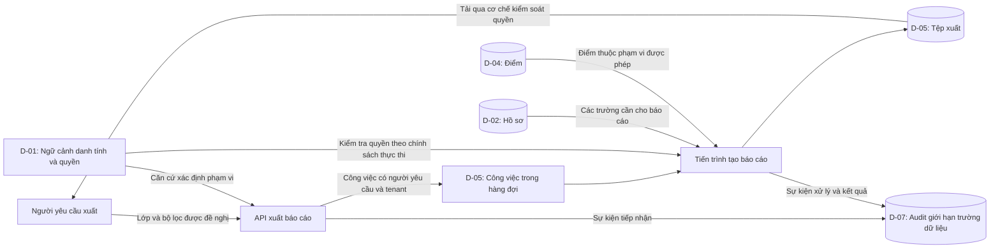

# Xác định dữ liệu xử lý

## 1. Vì sao phải xác định dữ liệu trước khi viết yêu cầu bảo mật?

Yêu cầu “bảo vệ dữ liệu người dùng” chưa cho biết dữ liệu nào đi vào hệ thống, được sử dụng vào việc gì, xuất hiện ở đâu và bên nào có thể nhận được. Nếu chỉ nhìn các bảng trong cơ sở dữ liệu, nhóm có thể bỏ sót token trong bộ nhớ, bài nộp trong kho tệp, nội dung lỗi trong log hoặc bảng điểm đã được xuất ra ngoài.

**Xác định dữ liệu xử lý** là làm rõ các nhóm dữ liệu mà hệ thống tiếp nhận, tạo ra, đọc, biến đổi, lưu, truyền, chia sẻ và loại bỏ trong một phạm vi nghiệp vụ xác định. Kết quả là một bản mô tả đủ rõ về dữ liệu và luồng xử lý để quyết định cần bảo vệ điều gì, ở đâu và bằng cách xác minh nào.

Trong thiết kế yêu cầu bảo mật, công việc này giúp trả lời:

- Hệ thống thực sự cần những dữ liệu nào để thực hiện chức năng?
- Dữ liệu do ai hoặc thành phần nào cung cấp, với mức tin cậy nào?
- Dữ liệu thuộc về đối tượng, lớp, tổ chức hay tenant nào?
- Dữ liệu có thể bị lộ, sửa sai hoặc mất ở những điểm nào?
- Có bản sao, dữ liệu phát sinh hoặc đầu ra nào chưa được tính đến không?
- Yêu cầu xác thực, phân quyền, bảo vệ dữ liệu, logging và phục hồi phải áp dụng đến đâu?

Bài này dùng một nền tảng học tập phục vụ nhiều trường làm ví dụ. Hệ thống cho phép học viên nộp bài, giảng viên nhập điểm và người có quyền xuất báo cáo lớp. Mỗi trường là một **tenant**, tức một phạm vi dữ liệu và quyền quản trị cần được phân tách theo quy tắc nghiệp vụ. Các chính sách cụ thể trong ví dụ là giả định học tập, không phải mô tả của một sản phẩm đang vận hành.

## 2. “Dữ liệu xử lý” rộng hơn “dữ liệu đã lưu”

### 2.1. Nhận diện dữ liệu qua các hành động xử lý

Một giá trị được tiếp nhận và sử dụng trong vài giây vẫn nằm trong phạm vi xử lý dù không được lưu lâu dài. Chẳng hạn, mật khẩu nhập khi đăng nhập, token gửi cùng yêu cầu và nội dung tệp được đọc để kiểm tra định dạng đều cần được xem xét.

| Hành động | Ví dụ | Câu hỏi bảo mật |
| --- | --- | --- |
| Thu nhận | Nhận thông tin hồ sơ, bài nộp hoặc dữ liệu đồng bộ | Có thực sự cần từng trường không; nguồn có thể giả mạo hay gửi nội dung bất thường không? |
| Đọc và sử dụng | Đọc điểm để hiển thị hoặc tính kết quả | Ai được đọc, trong phạm vi nào, để thực hiện mục đích gì? |
| Tạo mới | Tạo mã phiên, mã công việc xuất hoặc bản ghi audit | Dữ liệu mới có thể trao quyền truy cập hoặc tiết lộ quan hệ nào không? |
| Biến đổi và suy ra | Tính điểm trung bình, trạng thái đạt hoặc thống kê lớp | Kết quả mới có nhạy cảm không; cần bảo vệ tính chính xác thế nào? |
| Lưu và sao chép | Ghi cơ sở dữ liệu, bộ nhớ đệm, bản sao lưu | Bản sao nào tồn tại, ai có quyền đọc hoặc sửa? |
| Truyền và chia sẻ | Trả API, gửi thông báo, tạo tệp xuất | Bên nhận nào được phép nhận những trường nào? |
| Xóa hoặc làm hết khả năng sử dụng | Xóa tệp tạm, vô hiệu hóa token, dọn bản sao hết hạn | Tác động đến dữ liệu chính, bản sao và khả năng phục hồi ra sao? |

Không lưu mật khẩu dạng rõ vào cơ sở dữ liệu không có nghĩa là mật khẩu không còn cần bảo vệ. Nó vẫn có thể bị đưa vào log, thông báo lỗi hoặc dấu vết chẩn đoán nếu luồng xử lý không được kiểm soát.

### 2.2. Dữ liệu nội dung, metadata và dữ liệu dẫn xuất

**Dữ liệu nội dung** là phần người dùng hoặc nghiệp vụ trực tiếp quan tâm, như bài nộp và điểm. **Metadata — siêu dữ liệu —** mô tả nội dung hoặc sự kiện, như tên tệp, thời điểm nộp, người tạo, mã trường và địa chỉ truy cập. **Dữ liệu dẫn xuất** được tạo bằng xử lý dữ liệu khác, như xếp loại hoặc thống kê hoàn thành.

Cả ba đều có thể cần bảo vệ. Tên tệp có thể chứa tên người học; đường dẫn có thể để lộ mã lớp; thời điểm truy cập có thể mô tả hành vi sử dụng. Một thống kê tổng hợp cũng chưa chắc không tiết lộ thông tin cá nhân nếu nhóm quá nhỏ hoặc có thể kết hợp với dữ liệu khác.

Do đó, không nên gắn nhãn “chỉ là metadata” hoặc “đã tổng hợp” rồi mặc định cho phép công khai. Cần xem nội dung, khả năng liên kết và bối cảnh sử dụng thực tế.

### 2.3. Dữ liệu công khai vẫn có thuộc tính cần bảo vệ

Không phải mọi dữ liệu đều cần giữ bí mật. Mô tả khóa học được công bố công khai có thể được nhiều người đọc. Tuy nhiên, việc sửa trái phép mô tả hoặc gắn địa chỉ tải giả mạo vẫn có thể gây hại.

Ba thuộc tính cần đánh giá là:

- **Bí mật:** ai được biết dữ liệu và ở mức chi tiết nào.
- **Toàn vẹn:** ai được tạo, thay đổi hoặc xóa, theo quy tắc nào.
- **Sẵn sàng:** khi nào dữ liệu phải sử dụng được và có thể phục hồi đến mức nào.

Mức ưu tiên phải gắn với hậu quả nghiệp vụ. Không nên dùng một nhãn chung “nhạy cảm” để thay thế toàn bộ phân tích.

## 3. Chọn mức chi tiết phù hợp cho kiểm kê

### 3.1. Đi từ nhóm dữ liệu đến trường có ý nghĩa bảo mật

Có thể bắt đầu với các nhóm như hồ sơ, bài nộp, bảng điểm, phiên đăng nhập và audit. Sau đó phân rã đến những trường làm thay đổi quyền, mức tiết lộ, tính toàn vẹn hoặc cách lưu giữ.

Ví dụ, “hồ sơ học viên” có thể gồm tên hiển thị, email, mã học viên, mã trường và trạng thái tài khoản. Email có thể được dùng làm địa chỉ gửi thông báo; mã trường ảnh hưởng phạm vi dữ liệu; trạng thái tài khoản ảnh hưởng việc cho phép truy cập. Nếu gộp tất cả thành một nhãn “profile”, các nghĩa vụ này dễ bị bỏ sót.

Ngược lại, không nhất thiết tạo một dòng kiểm kê riêng cho mọi cột có cùng nguồn, mục đích, quyền truy cập và vòng đời. Mức chi tiết tốt là mức giúp viết được yêu cầu nhất quán và kiểm tra được các khác biệt có ý nghĩa.

### 3.2. Phân biệt loại dữ liệu với bản ghi thực tế

Kiểm kê thường mô tả **loại dữ liệu và quan hệ**, không cần tập hợp dữ liệu thật của người dùng vào tài liệu phân tích. Ví dụ, có thể dùng mã học viên giả và một địa chỉ thử để minh họa cấu trúc phản hồi.

```json
{
  "schoolId": "school-demo-a",
  "studentId": "student-demo-01",
  "displayName": "Hoc vien minh hoa",
  "email": "student@example.test",
  "classId": "class-demo-01",
  "score": 8.0,
  "published": false
}
```

Các giá trị trên chỉ là dữ liệu minh họa. Điểm cần phân tích là từng trường có vai trò gì: `schoolId` giới hạn tenant, `studentId` liên kết hồ sơ, `score` là kết quả học tập, còn `published` ảnh hưởng việc được công bố. Giá trị do bên gọi gửi lên không tự trở thành bằng chứng về tenant hoặc quyền của bên gọi.

### 3.3. Tên trường không quyết định cách bảo vệ

Một trường tên `id` có thể chỉ là định danh, nhưng cũng có thể cho phép tìm và liên kết các hồ sơ. Một chuỗi trong trường `url` có thể là đường dẫn công khai hoặc là đường dẫn tạm thời mà người sở hữu có thể dùng để tải dữ liệu riêng.

Cần xác định ý nghĩa và cách sử dụng thay vì chỉ tìm từ khóa như `password` hay `secret`. Dữ liệu mang khả năng truy cập, dù được đặt một tên rất thông thường, vẫn có thể phải được bảo vệ như thông tin bí mật.

## 4. Lập danh sách dữ liệu cho một luồng học tập

Xét ba chức năng: nộp bài, chấm điểm và xuất báo cáo lớp. Một bảng nhận diện ban đầu có thể như sau:

| Mã | Nhóm dữ liệu | Trường hoặc thành phần tiêu biểu | Nguồn và mục đích | Thuộc tính đáng chú ý |
| --- | --- | --- | --- | --- |
| D-01 | Ngữ cảnh danh tính và quyền | Mã chủ thể, trường, quan hệ lớp, vai trò | Nguồn danh tính được chấp nhận và dữ liệu quyền phía máy chủ; xác định ai được làm gì | Toàn vẹn quan trọng vì thay đổi sai có thể tạo quyền ngoài ý muốn. |
| D-02 | Hồ sơ liên hệ | Tên hiển thị, email, mã học viên | Người dùng hoặc tích hợp được phép; hiển thị và liên hệ | Bí mật theo phạm vi sử dụng, toàn vẹn để tránh gửi nhầm người. |
| D-03 | Bài nộp và metadata | Nội dung tệp, tên tệp, người nộp, lớp, thời điểm | Học viên nộp bài; giảng viên đọc và đánh giá | Quyền đọc, chống sửa trái phép, khả năng tiếp nhận trước hạn. |
| D-04 | Điểm và nhận xét | Giá trị điểm, nhận xét, trạng thái công bố, người sửa | Giảng viên có quyền; lưu và công bố kết quả | Bí mật trước và sau công bố theo quy tắc; toàn vẹn và truy vết sửa. |
| D-05 | Công việc và tệp xuất | Người yêu cầu, tenant, bộ lọc, trạng thái, nội dung báo cáo | Tạo từ yêu cầu xuất đã được kiểm tra | Có thể tập hợp lượng dữ liệu lớn; cần kiểm soát đọc và tải. |
| D-06 | Thông tin phiên và bí mật kỹ thuật | Token, thông tin xác thực dịch vụ, khóa liên quan | Cơ chế xác thực và cấu hình vận hành | Có thể cấp khả năng truy cập; không được tùy tiện đưa vào log hoặc tệp xuất. |
| D-07 | Audit và dữ liệu chẩn đoán | Chủ thể, hành động, đối tượng, thời điểm, kết quả | Phát sinh trong xử lý; truy vết và chẩn đoán | Toàn vẹn, quyền đọc, giới hạn dữ liệu bí mật hoặc dữ liệu học tập không cần thiết. |
| D-08 | Bản sao và dữ liệu phục hồi | Bản sao cơ sở dữ liệu, tệp, cấu hình và phụ thuộc cần thiết | Sao lưu để khôi phục | Bí mật, toàn vẹn bản sao và khả năng phục hồi sử dụng được. |

Bảng này là điểm xuất phát, chưa phải danh mục đủ cho mọi nền tảng học tập. Nếu thêm diễn đàn, thanh toán hoặc tích hợp phân tích, cần xác định dữ liệu của những chức năng đó riêng, thay vì xem như đã nằm trong nhóm hồ sơ chung.

## 5. Mô tả một mục dữ liệu đủ để ra quyết định

Danh mục dữ liệu cần nối được giá trị nghiệp vụ với nơi xử lý và trách nhiệm bảo vệ. Có thể dùng các trường sau:

| Thông tin | Câu hỏi cần trả lời |
| --- | --- |
| Mã, tên và mô tả | Dữ liệu nào, ý nghĩa từng trường quan trọng là gì? |
| Mục đích | Chức năng cần dữ liệu để làm gì; có trường nào không phục vụ mục đích đó không? |
| Nguồn và độ tin cậy | Ai cung cấp; phần nào được xác minh; phần nào vẫn do bên ngoài kiểm soát? |
| Đối tượng và phạm vi | Dữ liệu nói về ai, thuộc trường/lớp nào và liên kết với tài nguyên nào? |
| Bên chịu trách nhiệm | Ai quyết định nhu cầu nghiệp vụ và ai vận hành thành phần xử lý? |
| Hành động xử lý | Đọc, tạo, sửa, tính toán, chia sẻ, xuất hay xóa? |
| Nơi xuất hiện | API, bộ nhớ, cơ sở dữ liệu, kho tệp, chỉ mục, log, hàng đợi và bản sao nào? |
| Bên sử dụng và bên nhận | Người dùng, dịch vụ nội bộ, người vận hành hoặc nhà cung cấp nào được tiếp cận? |
| Mức bảo vệ | Tác động khi bị lộ, sửa sai hoặc mất; quyền và điều kiện áp dụng. |
| Vòng đời | Mốc tạo, cập nhật, hết giá trị sử dụng, lưu giữ, xóa và phục hồi. |
| Dữ liệu dẫn xuất | Kết quả hoặc bản sao nào được tạo từ mục dữ liệu này? |
| Giả định và điểm chưa rõ | Quyết định nào còn cần người có trách nhiệm xác nhận? |

Ví dụ với một bản báo cáo lớp:

```text
Mã: D-05
Tên: Công việc xuất và tệp bảng điểm lớp

Mục đích:
Cung cấp báo cáo cho người có quyền xuất đối với lớp được yêu cầu.

Nguồn:
Yêu cầu xuất từ người dùng; danh tính và quyền được máy chủ xác minh;
nội dung lấy từ dữ liệu điểm và hồ sơ trong phạm vi đã cho phép.

Thành phần dữ liệu:
- Mã công việc, người yêu cầu, tenant, lớp, bộ lọc.
- Thời điểm tạo, trạng thái xử lý, định danh tệp kết quả.
- Tệp chứa mã học viên, tên hiển thị và điểm theo mẫu báo cáo.

Nơi xuất hiện:
Bản ghi công việc, hàng đợi xử lý, bộ nhớ tiến trình,
kho tệp xuất và phản hồi tải về.

Bên sử dụng:
Tiến trình tạo báo cáo và người được phép tải kết quả.

Điểm bảo vệ:
Không đọc chéo tenant; không đưa email vào mẫu báo cáo nếu không cần;
không ghi nội dung tệp hoặc token tải vào log.

Dữ liệu liên quan:
D-01 để đánh giá quyền; D-02 và D-04 để tạo nội dung;
D-07 để ghi dấu vết với các trường cần thiết.

Quyết định vòng đời cần chốt:
Thời gian có thể tải, thời gian tồn tại tệp tạm,
chính sách bản sao và xử lý khi quyền bị thu hồi.
```

Việc ghi điểm chưa rõ giúp ngăn một giả định bị cài ngầm vào thiết kế. Trước khi nghiệm thu yêu cầu liên quan, các giá trị và hành vi còn mở phải được bên chịu trách nhiệm xác nhận. “Lưu đến khi không cần nữa” không đủ để lập lịch dọn dữ liệu hoặc kiểm tra kết quả.

## 6. Theo dõi luồng và nguồn gốc dữ liệu

### 6.1. Luồng dữ liệu chỉ ra nơi nghĩa vụ bảo vệ phải tiếp tục

Một tệp báo cáo không xuất hiện độc lập: nó là kết quả của việc kết hợp dữ liệu và lựa chọn phạm vi. Sơ đồ sau minh họa luồng chính:



Sơ đồ ở mức khái niệm, chưa mô tả giao thức, mọi phản hồi hoặc mọi bản sao. Nó giúp nhìn thấy ba điểm: đầu vào do người dùng đề nghị phải được kiểm tra; việc chuyển sang tiến trình nền không làm mất phạm vi quyền; nội dung báo cáo và dữ liệu audit có mục đích khác nhau nên không cần chứa cùng một tập trường.

### 6.2. Ghi nhận đầu vào, biến đổi và đầu ra

**Data lineage — nguồn gốc và đường biến đổi dữ liệu —** cho biết một kết quả đến từ nguồn nào và đã đi qua những phép xử lý nào. Không cần bắt đầu bằng một công cụ phức tạp; một bảng liên kết rõ ràng đã có ích.

| Đầu vào | Phép xử lý | Đầu ra | Nghĩa vụ phát sinh |
| --- | --- | --- | --- |
| Điểm thành phần và quy tắc tính | Tính điểm tổng kết | Điểm tổng kết, trạng thái đạt | Xác định phiên bản quy tắc và bảo vệ tính chính xác của kết quả. |
| Hồ sơ và điểm trong lớp | Chọn trường, lọc dòng, tạo tệp | Báo cáo lớp | Giữ đúng phạm vi quyền; hạn chế dữ liệu không cần cho mẫu báo cáo. |
| Yêu cầu và kết quả thao tác | Chọn thông tin truy vết | Bản ghi audit | Giữ đủ người, hành động, đối tượng, thời điểm; loại bỏ bí mật không cần thiết. |
| Dữ liệu chính và tệp liên quan | Sao chép theo cơ chế sao lưu | Bản sao phục hồi | Kiểm soát quyền với bản sao và các phụ thuộc để khôi phục. |

Nếu dữ liệu gốc bị sửa, cần làm rõ đầu ra nào phải cập nhật, đầu ra nào giữ như một bản chụp tại thời điểm tạo và cách người sử dụng nhận biết khác biệt đó. Đây vừa là vấn đề nghiệp vụ vừa là yêu cầu toàn vẹn thông tin.

### 6.3. Định dạng mới không tự làm giảm mức bảo vệ

Chuyển bảng điểm thành CSV, nén thành tệp hoặc đổi tên cột không loại bỏ nội dung nhạy cảm. Mã hóa dữ liệu bảo vệ những thuộc tính nhất định trong điều kiện quản lý khóa phù hợp, nhưng người được giải mã vẫn nhận được dữ liệu gốc.

Tương tự, thay tên học viên bằng một mã khác không tự bảo đảm dữ liệu không thể liên kết lại với người. Nếu vẫn còn bảng ánh xạ, định danh ổn định hoặc các thuộc tính đủ để suy ra danh tính, khả năng liên kết phải tiếp tục được đánh giá. Băm một định danh cũng không tự động biến toàn bộ tập dữ liệu thành dữ liệu không thể nhận diện.

Mức bảo vệ của đầu ra phải được quyết định theo nội dung và cách sử dụng của đầu ra đó. Muốn giảm mức bảo vệ sau một phép biến đổi, cần có căn cứ và cách xác minh phù hợp, thay vì chỉ dựa vào việc dữ liệu đã “được xử lý”.

## 7. Theo dõi vòng đời và các bản sao

### 7.1. Dữ liệu ở ba trạng thái xử lý

- **Trên đường truyền:** yêu cầu API, kết nối giữa dịch vụ, đồng bộ tệp và gửi dữ liệu ra ngoài.
- **Đang được sử dụng:** dữ liệu trong bộ nhớ tiến trình, bộ đệm, thao tác tính toán hoặc tạo báo cáo.
- **Được lưu trữ:** cơ sở dữ liệu, kho tệp, log, bộ nhớ đệm có lưu giữ, bản sao và chỉ mục.

Cùng một dữ liệu có thể đồng thời tồn tại ở nhiều trạng thái. Bảo vệ đường truyền không thay thế quyền đọc bản sao lưu; mã hóa kho lưu trữ không quyết định người dùng nào được tải tệp qua API.

### 7.2. Những vị trí thường bị bỏ sót

| Vị trí | Ví dụ dữ liệu xuất hiện | Điều cần làm rõ |
| --- | --- | --- |
| Bộ nhớ đệm | Kết quả truy vấn điểm hoặc hồ sơ | Khóa và phạm vi cache có phản ánh tenant, quyền và thời điểm hết hiệu lực không? |
| Hàng đợi và vùng thông điệp lỗi | Tham số công việc, đôi khi có cả nội dung đầu vào | Có cần chứa dữ liệu đầy đủ không; ai đọc được; giữ và gửi lại bao lâu? |
| Log, trace và báo cáo lỗi | Tham số, tiêu đề, nội dung phản hồi, ngữ cảnh xử lý | Trường nào được ghi; bí mật và dữ liệu học tập nào phải bị loại bỏ? |
| Tệp tạm và thư mục xử lý | Bài nộp đang kiểm tra hoặc báo cáo chưa hoàn tất | Quyền truy cập, giới hạn tồn tại và việc dọn sau lỗi hoặc hủy công việc. |
| Chỉ mục tìm kiếm | Bản sao của tên, nội dung hoặc metadata | Quyền tìm kiếm có nhất quán với quyền đọc dữ liệu gốc không? |
| Kho phân tích | Dữ liệu sự kiện, thống kê và tập dữ liệu đã biến đổi | Mục đích, mức chi tiết, bên nhận và khả năng liên kết lại. |
| Bản sao lưu và môi trường phục hồi | Dữ liệu cũ cùng cấu hình liên quan | Ai truy cập, khôi phục ở đâu và điều gì xảy ra với dữ liệu đã bị xóa hoặc thu hồi quyền? |
| Máy người nhận | Tệp tải xuống | Ranh giới trách nhiệm và quy tắc sử dụng sau khi dữ liệu rời hệ thống. |

Xóa một bản ghi chính chưa chứng minh mọi bản sao đều biến mất. Ngược lại, không phải bản sao lưu nào cũng hỗ trợ sửa từng bản ghi giống cơ sở dữ liệu đang hoạt động. Yêu cầu vòng đời cần mô tả đúng khả năng lưu trữ và quy trình, gồm giới hạn truy cập, lịch hết hạn và cách xử lý khi phục hồi.

Cũng không nên cam kết rằng hệ thống có thể thu hồi chắc chắn mọi bản tải đã được người nhận lưu trên thiết bị riêng nếu thiết kế không có khả năng đó. Hãy xác định ranh giới kiểm soát thực tế và quyết định có cho xuất dữ liệu hay không, với mức chi tiết nào.

## 8. Đánh giá mức bảo vệ và nhu cầu sử dụng

### 8.1. Tách mức nhạy cảm khỏi độ tin cậy của nguồn

Một bài nộp có thể rất cần giữ bí mật nhưng vẫn là đầu vào do học viên kiểm soát. Một kết quả xác thực có thể đến từ nguồn được chấp nhận nhưng chỉ được dùng sau các bước kiểm tra của giao thức. “Nhạy cảm” và “đáng tin” không phải cùng một trục đánh giá.

Với mỗi nhóm dữ liệu, cần đặt riêng hai câu hỏi:

1. Nếu bên không được phép biết, sửa hoặc làm mất dữ liệu, hậu quả là gì?
2. Khi sử dụng dữ liệu để đưa ra quyết định, hệ thống đã xác minh được phần nào và còn phải kiểm tra phần nào?

Ví dụ, mã trường nhận trong JSON có thể giúp người dùng chọn ngữ cảnh làm việc, nhưng không chứng minh họ có quyền trong trường đó. Quyền phải dựa trên danh tính và quan hệ được hệ thống chấp nhận, không chỉ trên một giá trị đầu vào.

### 8.2. Dùng nhãn phân loại để thống nhất hành vi

Một tổ chức có thể định nghĩa các nhãn như công khai, nội bộ, hạn chế và bí mật truy cập. Tên và số lượng mức không có một khuôn duy nhất. Điều quan trọng là mỗi nhãn phải gắn với quy tắc sử dụng cụ thể.

| Nhãn minh họa | Ví dụ trong bối cảnh học tập | Quyết định cần cụ thể hóa |
| --- | --- | --- |
| Công khai | Mô tả khóa học đã được duyệt công bố | Ai được sửa, cách duyệt thay đổi và khả năng phục hồi nội dung đúng. |
| Nội bộ theo phạm vi | Danh sách công việc vận hành không chứa nội dung học tập | Những nhóm nào được đọc; có được gửi sang công cụ bên ngoài không. |
| Hạn chế | Hồ sơ, bài nộp, điểm và báo cáo lớp | Quyền theo người, lớp, tenant; trường dữ liệu được trả; lưu giữ và chia sẻ. |
| Bí mật truy cập | Token và khóa kỹ thuật | Nơi được phép tồn tại, chủ thể được sử dụng, cách thu hồi và loại bỏ khỏi log. |

Không nên suy ra rằng mọi người trong tổ chức đều được đọc dữ liệu gắn nhãn nội bộ, hoặc mọi người có vai trò giảng viên đều được đọc dữ liệu hạn chế. Nhãn hỗ trợ chính sách; quyết định quyền vẫn cần phạm vi cụ thể.

### 8.3. Xác định dữ liệu không cần xử lý

Một câu hỏi hữu ích cho từng trường là: “Nếu bỏ trường này khỏi luồng, chức năng có còn đạt mục đích không?”.

Trong ví dụ xuất báo cáo, nếu mẫu chỉ cần mã học viên, tên và điểm thì email không cần đi vào tệp. Để gửi thông báo “báo cáo đã sẵn sàng”, nhà cung cấp gửi tin có thể chỉ cần địa chỉ nhận, mã mẫu và nội dung thông báo; không nhất thiết cần điểm hoặc toàn bộ báo cáo.

Giảm dữ liệu có thể được áp dụng ở nhiều điểm:

- Không yêu cầu người dùng cung cấp trường không cần cho chức năng.
- Không đưa toàn bộ hồ sơ vào hàng đợi nếu công việc chỉ cần định danh và phạm vi đã kiểm tra.
- Chỉ chọn các trường cần dùng khi tạo phản hồi hoặc tệp xuất.
- Chỉ ghi thông tin phục vụ truy vết và chẩn đoán, không sao chép nguyên yêu cầu vào log.
- Không tạo bản sao lâu dài chỉ vì thuận tiện trong giai đoạn phát triển.

Giảm dữ liệu không đồng nghĩa xóa hết ngữ cảnh. Công việc nền vẫn cần đủ thông tin để xác định người yêu cầu, tenant, mục đích và quyền thực thi theo chính sách. Audit vẫn cần đủ bằng chứng cho những hành động đã được xác định là cần truy vết.

## 9. Quy trình xác định dữ liệu xử lý

Có thể thực hiện theo bảy bước sau cho mỗi chức năng hoặc nhóm chức năng liên quan.

1. **Chốt phạm vi và mục đích.** Nêu hành động nghiệp vụ, thành phần nằm trong phạm vi, bên gửi và bên nhận. Tách nhu cầu thực tế khỏi dữ liệu chỉ được dự đoán là có thể hữu ích.
2. **Liệt kê đầu vào và nguồn.** Gồm nội dung yêu cầu, tệp, tiêu đề quan trọng, ngữ cảnh danh tính, dữ liệu đồng bộ và các giá trị từ cấu hình liên quan.
3. **Liệt kê dữ liệu đọc, tạo và suy ra.** Không chỉ ghi trường người dùng nhập; bổ sung trạng thái, mã công việc, kết quả tính toán, audit và thông tin xác thực phát sinh.
4. **Theo dõi các nơi xuất hiện.** Đi từ giao diện hoặc API qua xử lý, lưu trữ, cache, hàng đợi, log, đầu ra, bản sao lưu và phục hồi. Ghi rõ những nơi chưa xác nhận.
5. **Đánh giá tác động và nhu cầu tối thiểu.** Xác định hậu quả khi dữ liệu bị lộ, sửa sai hoặc mất; loại bỏ các trường và bản sao không cần cho mục đích đã chọn.
6. **Làm rõ quyền và vòng đời.** Ai được thực hiện hành động nào, trong tenant hoặc đối tượng nào; dữ liệu tồn tại đến khi nào và xử lý ra sao khi quyền hoặc nghiệp vụ thay đổi.
7. **Liên kết với rủi ro, yêu cầu và bằng chứng.** Mỗi điểm bảo vệ quan trọng cần có hành vi mong đợi, nơi thực hiện và cách xác minh.

Trong một dự án, nhóm có thể đối chiếu mô tả nghiệp vụ với hợp đồng API, biểu mẫu, mô hình lưu trữ, cấu hình ghi log và luồng tích hợp để tìm khác biệt giữa thiết kế dự định và xử lý thực tế. Người phụ trách nghiệp vụ xác nhận mục đích; phát triển làm rõ đường đi; vận hành làm rõ bản sao và phục hồi; kiểm thử xác định cách quan sát đầu ra.

Không nên xem danh mục là ảnh chụp không bao giờ đổi. Thêm một trường vào phản hồi, bật tính năng ghi trace hoặc gửi báo cáo sang nhà cung cấp mới đều có thể làm thay đổi phạm vi dữ liệu xử lý dù giao diện chính gần như không đổi.

## 10. Chuyển kết quả kiểm kê thành yêu cầu bảo mật

Có thể bắt đầu bằng mẫu:

> Trong **[luồng và điều kiện]**, hệ thống phải **[hành vi bảo vệ]** đối với **[nhóm hoặc trường dữ liệu]** tại **[điểm xử lý]**; kết quả được xác minh bằng **[bằng chứng]**.

Để thấy giá trị của kiểm kê, hãy nối từng yêu cầu với đúng dữ liệu và rủi ro:

| Dữ liệu và rủi ro | Yêu cầu minh họa | Bằng chứng xác minh |
| --- | --- | --- |
| D-01, D-04: Người gọi tự chọn tenant khác | **SR-DATA-01:** Với mỗi yêu cầu đọc hoặc sửa điểm, hệ thống phải kiểm tra quyền trên tài nguyên đích trong tenant tương ứng; nếu không có quyền thì từ chối, không trả nội dung điểm và không thay đổi điểm. | Hai tenant có dữ liệu riêng; thử thay mã tenant và mã bản ghi ở các đường đọc, sửa trong phạm vi. |
| D-02, D-04, D-05: Báo cáo chứa trường không cần thiết | **SR-EXPORT-01:** Mẫu báo cáo lớp trong ví dụ chỉ được chứa mã học viên, tên hiển thị và điểm của tập học viên được phép; không được chứa email hoặc thông tin xác thực. | Tạo dữ liệu thử có email và các giá trị nhận diện; kiểm tra cấu trúc và nội dung tệp xuất. |
| D-03: Nội dung bài nộp được sử dụng như mã | **SR-SUBMISSION-01:** Khi hiển thị tên tệp và ghi chú bài nộp, hệ thống phải xử lý chúng như dữ liệu theo chức năng hiển thị đã cho phép, không tự thực thi chúng như mã trong trình duyệt người xem. | Dùng dữ liệu thử phù hợp với ngữ cảnh hiển thị; quan sát đầu ra và hành vi trình duyệt. |
| D-06, D-07: Bí mật bị sao chép sang log | **SR-LOG-01:** Luồng đăng nhập và tạo báo cáo phải loại bỏ mật khẩu, token truy cập nguyên giá trị và đường dẫn tải mang quyền truy cập khỏi log ứng dụng trước khi gửi tới nơi lưu log. | Kiểm tra đầu ra log ở nhánh thành công, lỗi và xử lý thử lại bằng dữ liệu thử có dấu nhận diện. |
| D-05: Tệp xuất còn tải được quá thời gian cho phép | **SR-EXPIRY-01:** Theo giả định ví dụ, mọi đường tải do nền tảng cấp cho tệp báo cáo tạm phải hết hiệu lực không muộn hơn 24 giờ kể từ lúc tạo tệp thành công; hết thời gian thì không được cung cấp nội dung. | Kiểm tra trước và tại mốc hết hiệu lực trên các đường tải trong phạm vi, với cách kiểm soát thời gian phù hợp. |
| D-04, D-08: Phục hồi làm sai quan hệ dữ liệu | **SR-RESTORE-01:** Dữ liệu điểm phục hồi phải giữ đúng liên kết học viên, lớp và tenant của điểm phục hồi được chọn trước khi mở lại quyền sử dụng nghiệp vụ. | Diễn tập với dữ liệu đã biết; đối soát quan hệ và kết quả truy cập sau phục hồi. |
| D-07: Không đủ bằng chứng sửa điểm | **SR-AUDIT-01:** Mỗi lần sửa điểm thành công phải có bản ghi audit liên kết chủ thể thực hiện, tenant, đối tượng, hành động, thời điểm và kết quả, theo cơ chế bảo vệ audit đã đặc tả. | Sửa điểm qua các đường được phép rồi đối chiếu giao dịch với bản ghi audit tương ứng. |

Giới hạn 24 giờ ở đây chỉ là giả định nghiệp vụ cho ví dụ. Một hệ thống thực tế phải chọn giới hạn theo nhu cầu và rủi ro được chấp thuận. Hết hiệu lực tải cũng chưa đồng nghĩa đã xóa mọi bản sao; yêu cầu xóa tệp tạm và quản lý bản sao phải được đặc tả riêng.

Các yêu cầu trên có thể được phân rã tiếp để gắn với thành phần và tiêu chí chấp nhận cụ thể. Một kiểm thử đơn lẻ cung cấp bằng chứng trong phạm vi đã kiểm tra, không tự chứng minh toàn bộ hệ thống đã bảo vệ mọi loại dữ liệu.

Ví dụ tiêu chí chấp nhận cho tệp xuất:

```gherkin
Feature: Giới hạn dữ liệu trong báo cáo lớp

  Scenario: Xuất báo cáo theo mẫu đã được phê duyệt
    Given người yêu cầu có quyền xuất báo cáo của lớp A
    And lớp A có hồ sơ học viên gồm mã, tên, email và điểm
    When hệ thống tạo tệp báo cáo lớp A
    Then tệp chỉ chứa mã học viên, tên hiển thị và điểm theo mẫu
    And không có cột email hoặc thông tin xác thực
    And không có dữ liệu của lớp hoặc tenant ngoài phạm vi được phép
```

Mô tả này là đặc tả hành vi kiểm thử. Khi triển khai cần xác định định dạng tệp, dữ liệu thử, tập bản ghi mong đợi và cách đối chiếu, thay vì chỉ kiểm tra rằng có một tệp được tạo ra.

## 11. Các nhầm lẫn cần tránh

| Nhầm lẫn | Điều bị bỏ sót | Cách làm rõ |
| --- | --- | --- |
| “Dữ liệu xử lý là các bảng trong database.” | Tệp, bộ nhớ, hàng đợi, log, bản xuất và bên nhận ngoài hệ thống. | Đi theo hành động và vòng đời, không chỉ cấu trúc lưu trữ chính. |
| “Không lưu lâu nên không cần bảo vệ.” | Bí mật có thể lộ ngay trong đường truyền, xử lý hoặc log lỗi. | Xác định dữ liệu tại thời điểm được tiếp nhận và sử dụng. |
| “Đã lưu trong hệ thống nên có thể tin.” | Dữ liệu có thể bắt nguồn từ người dùng hoặc tích hợp không được phép quyết định quyền. | Theo dõi nguồn và điều kiện xác minh của từng trường. |
| “Đã mã hóa hoặc đổi mã nên hết nhạy cảm.” | Dữ liệu vẫn có thể giải mã, liên kết hoặc tiết lộ qua cách sử dụng. | Đánh giá nội dung đầu ra, bên nhận và khả năng liên kết thực tế. |
| “Chỉ gửi metadata ra ngoài.” | Metadata có thể chứa định danh, quan hệ hoặc khả năng tải dữ liệu. | Kiểm kê nội dung cụ thể của metadata và mục đích gửi. |
| “Xóa bản ghi chính là xong.” | Cache, chỉ mục, tệp xuất và bản sao lưu có vòng đời khác nhau. | Ghi rõ xử lý các bản sao và điều kiện phục hồi. |
| “Ghi càng nhiều log càng an toàn.” | Tạo thêm nơi chứa bí mật và dữ liệu học tập mà không chắc tăng giá trị truy vết. | Chỉ rõ sự kiện, trường dữ liệu được ghi, quyền đọc và lưu giữ. |

## 12. Kết quả đầu ra cần đạt

Một bản xác định dữ liệu xử lý có thể dùng để viết yêu cầu khi nhóm đã làm rõ:

1. Phạm vi chức năng và mục đích của từng nhóm dữ liệu.
2. Những trường có ý nghĩa về danh tính, quyền, mức tiết lộ và toàn vẹn.
3. Nguồn, dữ liệu dẫn xuất, bên sử dụng và bên nhận.
4. Các nơi dữ liệu tồn tại, gồm cả bản sao và dữ liệu vận hành.
5. Quyền, vòng đời, trách nhiệm và những quyết định còn cần xác nhận.
6. Đường liên kết từ dữ liệu và rủi ro đến yêu cầu, kiến trúc và bằng chứng kiểm chứng.

Xác định dữ liệu xử lý giúp chuyển câu “cần bảo vệ dữ liệu” thành các nghĩa vụ cụ thể: **bảo vệ trường nào, ở điểm nào, trước hành vi nào, cho chủ thể nào và đến thời điểm nào**. Khi theo dõi được dữ liệu từ nguồn tới đầu ra và bản sao, nhóm có cơ sở để đặc tả bảo mật xuyên suốt vòng đời phát triển thay vì chỉ bổ sung kiểm soát ở cơ sở dữ liệu chính.
