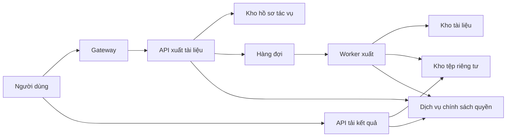

# Xác định trách nhiệm của từng component

## 1. Vì sao yêu cầu bảo mật phải được phân bổ cho component?

Một yêu cầu như “người dùng chỉ được tải dữ liệu thuộc phạm vi được cấp quyền” mô tả kết quả cần đạt của cả hệ thống. Để triển khai được, cần xác định thành phần nào xác minh danh tính, thành phần nào quyết định quyền trên dữ liệu, thành phần nào tạo tệp và thành phần nào kiểm tra trước khi cho tải.

Nếu các nhóm đều cho rằng thành phần khác đã xử lý, hệ thống có thể có nhiều cơ chế bảo mật nhưng vẫn thiếu một bước quyết định. Ví dụ, API tạo tác vụ đã kiểm tra quyền khi nhận yêu cầu, nhưng worker chạy sau đó dùng service account có quyền rộng và xuất thêm dữ liệu không thuộc yêu cầu ban đầu.

**Component**, hay **thành phần**, là đơn vị có trách nhiệm và giao diện xác định trong mô hình kiến trúc đang xét. Nó có thể là mô-đun trong một ứng dụng, dịch vụ độc lập, gateway, worker, kho dữ liệu hoặc dịch vụ bên ngoài. Phân bổ trách nhiệm bảo mật không bắt buộc phải chia hệ thống thành microservice.

**Trách nhiệm bảo mật của component** là nghĩa vụ cụ thể về quyết định, xử lý, bảo vệ hoặc cung cấp bằng chứng mà thành phần phải thực hiện trong một phạm vi đã định. Nghĩa vụ đó phải thể hiện được qua hành vi và hợp đồng giao tiếp, không chỉ qua tên thành phần.

Kết quả phân tích cần làm rõ:

- Component phải bảo vệ tài sản hoặc bất biến nào?
- Component nhận dữ liệu và căn cứ tin cậy từ đâu?
- Component tự kiểm tra điều gì và dựa vào cam kết nào của thành phần khác?
- Khi thiếu dữ liệu, quyền thay đổi hoặc phụ thuộc lỗi, component phải phản ứng ra sao?
- Ai chịu trách nhiệm triển khai, cấu hình, vận hành và kiểm chứng nghĩa vụ đó?

Một yêu cầu xuyên suốt có thể cần nhiều component phối hợp. Giao trách nhiệm cho một nơi không có nghĩa các thành phần còn lại được miễn kiểm tra những điều kiện thuộc phạm vi của chúng.

## 2. Phân biệt chức năng, trách nhiệm bảo mật và chủ sở hữu

| Khái niệm | Ví dụ trong luồng xuất tài liệu | Điều cần đặc tả |
|---|---|---|
| Chức năng | Tạo tệp xuất tài liệu. | Đầu vào, kết quả và quy tắc nghiệp vụ. |
| Trách nhiệm bảo mật | Worker chỉ xử lý tài liệu thuộc phạm vi được cho phép và không công bố tệp khi kiểm tra quyền thất bại. | Chủ thể, dữ liệu, thời điểm kiểm tra, phản ứng và bằng chứng. |
| Hợp đồng giữa component | Thông điệp tác vụ tham chiếu đến hồ sơ công việc đã được tạo bởi API tin cậy. | Nguồn phát, định danh, tính toàn vẹn, phiên bản và xử lý sai lệch. |
| Chủ sở hữu kỹ thuật | Nhóm phụ trách dịch vụ xuất tài liệu. | Ai triển khai, sửa lỗi, theo dõi và duy trì trách nhiệm của worker. |
| Người chịu trách nhiệm yêu cầu | Vai trò được dự án giao chịu trách nhiệm về yêu cầu cách ly tenant. | Ai xác nhận phạm vi và quyết định xử lý khi yêu cầu chưa được đáp ứng. |

Không nên đồng nhất component với đội phụ trách. “Nhóm nền tảng lo bảo mật” chưa cho biết gateway, dịch vụ nghiệp vụ và kho lưu trữ phải thực hiện điều gì. Tương tự, “cơ sở dữ liệu bảo vệ dữ liệu” chưa giải thích ứng dụng có thể đọc bản ghi nào hoặc dùng danh tính dịch vụ ra sao.

Độ chi tiết phải phù hợp mục đích. Ở mức bối cảnh, có thể chỉ thấy ứng dụng và nhà cung cấp định danh. Khi thiết kế luồng xuất bất đồng bộ, cần tách API nhận yêu cầu, hàng đợi, worker và đường tải để làm rõ các thời điểm kiểm tra quyền khác nhau. Không cần liệt kê mọi lớp hoặc hàm nếu việc đó không giúp phân định nghĩa vụ.

## 3. Bối cảnh xuyên suốt: xuất tài liệu trong hệ thống nhiều tenant

Giả sử một hệ thống quản lý tài liệu phục vụ nhiều tổ chức. Mỗi tổ chức là một **tenant**, có người dùng và dữ liệu riêng. Người dùng có thể xem tài liệu theo quyền được cấp; quyền xuất hàng loạt được quản lý riêng. Một yêu cầu xuất được nhận qua API, đưa vào hàng đợi, xử lý bởi worker và lưu kết quả vào kho tệp riêng tư. Người dùng tải kết quả qua một API kiểm soát truy cập.

Các tài sản cần bảo vệ gồm nội dung tài liệu, metadata, quyền người dùng, hồ sơ tác vụ, tệp xuất, danh tính dịch vụ, nhật ký kiểm toán và bản sao lưu.



Sơ đồ chỉ thể hiện các thành phần và quan hệ chính. Dịch vụ định danh, quản lý khóa, logging và phục hồi vẫn thuộc phân tích trách nhiệm dù không được vẽ đầy đủ.

Các mục tiêu đầu ra cho ví dụ là:

1. Chỉ danh tính đã được xác minh và có quyền phù hợp mới tạo được yêu cầu xuất.
2. Tác vụ không được mở rộng sang tenant hoặc tài liệu ngoài phạm vi được cho phép.
3. Tệp không được công bố cho người dùng trước khi hoàn tất các kiểm tra theo chính sách.
4. Mỗi lần tải phải đáp ứng điều kiện truy cập hiện hành đã đặc tả.
5. Có thể truy được người khởi tạo, danh tính thực thi, phạm vi dữ liệu và kết quả của tác vụ.
6. Lỗi hoặc phục hồi không tạo đường truy cập bỏ qua các điều kiện trên.

Đây là các nghĩa vụ của cả luồng. Bước tiếp theo là xác định nghĩa vụ con của từng component và các hợp đồng nối chúng lại.

## 4. Phương pháp phân bổ trách nhiệm

### Bước 1: Viết kết quả bảo vệ và bất biến

Một **bất biến** là điều kiện hệ thống phải duy trì trong phạm vi đã xác định. Ví dụ: “không đưa tài liệu của tenant B vào tệp xuất của tác vụ tenant A” hoặc “tệp chưa đủ điều kiện công bố không được tải qua giao diện người dùng”.

Bất biến giúp tránh việc bắt đầu bằng tên giải pháp như “có JWT”, “có gateway” hoặc “có mã hóa”. Các cơ chế này chỉ có ý nghĩa khi giải thích được chúng bảo vệ kết quả nào.

### Bước 2: Đi theo luồng dữ liệu và luồng điều khiển

Liệt kê các điểm nhận yêu cầu, gọi dịch vụ, đọc dữ liệu, phát thông điệp, lưu tệp, tải tệp, ghi log và phục hồi. Cần xét cả API gọi trực tiếp, thao tác quản trị, tác vụ nền và đường tích hợp.

Luồng điều khiển trả lời ai ra quyết định hoặc khởi tạo bước tiếp theo; luồng dữ liệu trả lời thông tin nào đi qua đâu. Hai luồng có thể dùng danh tính khác nhau. Worker dùng danh tính máy để đọc dữ liệu không có nghĩa người tạo tác vụ được hưởng mọi quyền của danh tính máy đó.

### Bước 3: Đánh dấu ranh giới tin cậy

Mỗi nơi dữ liệu hoặc danh tính đi qua ranh giới cần có điều kiện chấp nhận rõ ràng. Nằm cùng mạng nội bộ chưa đủ để coi mọi header, thông điệp hoặc mã tài nguyên là đáng tin.

Ví dụ, API không được tin `tenantId` trong body mà không đối chiếu với chủ thể và chính sách. Worker cũng không được coi mọi thông điệp đến từ hàng đợi là một tác vụ hợp lệ nếu producer có thể gửi sai phạm vi hoặc hồ sơ tác vụ đã bị hủy.

### Bước 4: Chọn nơi có đủ ngữ cảnh để quyết định

Xác thực danh tính có thể được thực hiện ở gateway hoặc cơ chế dùng chung. Quyền trên từng tài liệu thường cần thông tin nghiệp vụ mà gateway không nắm đủ. Thành phần sở hữu hành động và dữ liệu phải có nghĩa vụ thực thi quyết định phù hợp trước khi gây tác dụng phụ hoặc trả dữ liệu.

Nếu dùng dịch vụ chính sách tập trung, cần phân biệt:

- **Điểm quyết định chính sách:** đánh giá đầu vào và đưa ra kết quả cho phép hoặc từ chối theo chính sách.
- **Điểm thực thi chính sách:** áp dụng kết quả trước hành động được bảo vệ, với đúng chủ thể, hành động và tài nguyên.

Một kết quả cho phép chỉ có ý nghĩa trong phạm vi và thời hạn của nó. Dịch vụ chính sách không thể chịu trách nhiệm thay cho API nếu API gọi kiểm tra cho tài liệu A rồi lại trả tài liệu B.

### Bước 5: Xác định nghĩa vụ chính và phần phối hợp

Với mỗi yêu cầu, chỉ rõ component chịu trách nhiệm thực thi chính và các component cung cấp điều kiện hỗ trợ. Ví dụ, API tải kết quả chịu trách nhiệm quyết định có trả tệp cho người dùng hay không; kho tệp chịu trách nhiệm giới hạn truy cập theo danh tính dịch vụ và cấu hình riêng tư.

Đồng thời cần một vai trò hoặc nhóm chịu trách nhiệm theo dõi việc đáp ứng yêu cầu xuyên suốt. Không chia một bất biến thành nhiều mảnh rồi bỏ trống người xác nhận rằng toàn bộ luồng đáp ứng.

### Bước 6: Định nghĩa hợp đồng và chế độ lỗi

Mỗi quan hệ phối hợp phải xác định dữ liệu trao đổi, nguồn có thẩm quyền, điều kiện kiểm tra, thời gian hiệu lực, xử lý lỗi và dấu vết. “Component A gọi component B” mới chỉ mô tả kết nối, chưa mô tả trách nhiệm bảo mật.

Phải tách trường hợp chính sách xác nhận từ chối với trường hợp chưa đánh giá được vì phụ thuộc lỗi. Với hành động nhạy cảm, cả hai đều không được thực hiện khi chưa có căn cứ hợp lệ để cho phép, nhưng phản hồi, retry và cảnh báo có thể khác nhau.

### Bước 7: Gắn tiêu chí chấp nhận và bằng chứng

Mỗi nghĩa vụ cần kiểm tra được tại component và trong luồng tích hợp. Kiểm thử cục bộ có thể chứng minh một hàm đánh giá chính sách đúng; kiểm thử tích hợp mới quan sát được worker có dùng đúng kết quả và API tải có bảo vệ tệp tương ứng không.

Khi chưa xác định được nơi thực thi một nghĩa vụ, ghi rõ khoảng trống và chủ sở hữu xử lý. Không điền “tất cả component” vào bảng để thay cho một phân công còn mơ hồ.

## 5. Ma trận trách nhiệm cho các component

Bảng sau là một phương án cho hệ thống giả định, không phải kiến trúc bắt buộc cho mọi dự án.

| Component | Trách nhiệm bảo mật chính | Hợp đồng hoặc điều kiện cần từ thành phần khác |
|---|---|---|
| Nhà cung cấp định danh | Xác minh danh tính theo cơ chế đã chọn, phát bằng chứng xác thực theo cấu hình tin cậy. | Tài khoản, vòng đời danh tính, nguồn tin cậy và chính sách xác thực phải được quản lý. |
| Gateway | Kiểm tra bằng chứng xác thực hoặc nhận kết quả từ cơ chế tin cậy; chặn đường không được phép; giới hạn lưu lượng theo thiết kế. | Hợp đồng danh tính với dịch vụ nhận phải ngăn client giả mạo ngữ cảnh nội bộ. |
| API xuất tài liệu | Kiểm tra quyền tạo tác vụ, xác lập tenant và phạm vi yêu cầu, lưu hồ sơ tác vụ hợp lệ. | Chính sách quyền, dữ liệu tài liệu và danh tính đã được xác minh. |
| Dịch vụ chính sách quyền | Đánh giá nhất quán chủ thể, hành động, tài nguyên và điều kiện; cung cấp phiên bản hoặc thông tin hiệu lực khi hợp đồng cần. | Thuộc tính đầu vào có nguồn và mức độ mới phù hợp; điểm gọi thực thi đúng kết quả. |
| Kho hồ sơ tác vụ và hàng đợi | Giới hạn ai tạo/sửa hồ sơ, ai phát/nhận thông điệp; bảo vệ tính toàn vẹn và khả năng truy vết. | API cung cấp hồ sơ đúng phạm vi; worker kiểm tra trạng thái và ngữ cảnh tác vụ. |
| Worker xuất | Xác minh tác vụ, áp giới hạn tenant/tài liệu, kiểm tra quyền theo chính sách thực thi, xử lý lặp an toàn và chỉ công bố kết quả đủ điều kiện. | Hồ sơ có thẩm quyền, chính sách hiện hành, dữ liệu đầu vào và cơ chế lưu tệp an toàn. |
| Kho dữ liệu tài liệu | Chỉ nhận truy cập từ danh tính được phép; bảo vệ dữ liệu và giới hạn truy vấn theo thiết kế. | Dịch vụ gọi phải mang đúng phạm vi nghiệp vụ; quyền tài khoản máy phải được giới hạn. |
| Kho tệp xuất | Giữ tệp riêng tư, giới hạn truy cập dịch vụ, áp mã hóa, thời hạn lưu và xóa theo chính sách. | Worker gắn đúng tệp với tác vụ; API tải kiểm tra quyền người dùng trước khi trả dữ liệu. |
| API tải kết quả | Đối chiếu người tải, tenant, tác vụ, tệp và điều kiện quyền hiện hành; áp hợp đồng phản hồi. | Ánh xạ tác vụ–tệp đáng tin và trạng thái công bố hợp lệ. |
| Hệ thống logging/kiểm toán | Tiếp nhận, bảo vệ, lưu giữ và hỗ trợ truy vấn các sự kiện theo hợp đồng. | Component phát sự kiện đúng thời điểm, đủ trường và không đưa dữ liệu bị cấm vào log. |
| Quản lý khóa và bí mật | Kiểm soát cấp phát, sử dụng, thay thế và thu hồi khóa/bí mật theo chính sách. | Danh tính workload, phạm vi dữ liệu và quy trình phục hồi khóa được xác định. |
| Sao lưu và phục hồi | Tạo, bảo vệ và phục hồi dữ liệu theo mục tiêu; kiểm tra quyền và trạng thái trước khi mở lại dịch vụ. | Chủ dữ liệu xác định phạm vi, mức mất dữ liệu được chấp nhận và tiêu chí phục hồi. |

Một component có thể đảm nhiệm nhiều dòng nếu kiến trúc gộp chúng. Ngược lại, một dòng có thể được nhiều tiến trình thực hiện. Điều phải giữ là nghĩa vụ rõ ràng và hợp đồng có thể kiểm chứng, không phải số lượng ô trong sơ đồ.

## 6. Hợp đồng bảo mật giữa các component

### 6.1. Hợp đồng danh tính: biết ai đang thực hiện hành động

Dịch vụ nhận một request phải biết danh tính nào đang được dùng để quyết định quyền và căn cứ nào cho phép tin danh tính đó. Có thể xác minh trực tiếp bằng chứng xác thực hoặc nhận ngữ cảnh từ một thành phần đã được tin cậy theo thiết kế. Trong cả hai cách, cần ngăn đường mà client tự đặt header nội bộ để mạo danh.

Ví dụ, nếu chỉ gateway được phép tạo ngữ cảnh danh tính cho API, hợp đồng phải quy định cách xác thực nguồn gọi và cách loại bỏ hoặc từ chối giá trị giả mạo do bên ngoài gửi. Nếu API còn một đường truy cập khác, đường đó cũng phải có điều kiện xác thực tương đương phù hợp, không được mặc định đã đi qua gateway.

Những điều cần thống nhất gồm chủ thể, tenant đang thao tác, danh tính dịch vụ gọi, hành động ủy nhiệm nếu có, thời gian hiệu lực và cách xử lý khi các thông tin mâu thuẫn. Một mã tương quan giúp nối dấu vết nhưng không tự là bằng chứng danh tính hoặc quyền.

### 6.2. Hợp đồng quyền: đầu vào, quyết định và thực thi

Một lời gọi đánh giá quyền nên làm rõ ít nhất:

| Nội dung | Câu hỏi cần trả lời |
|---|---|
| Chủ thể | Định danh đã xác minh là ai? Đang hành động cho chính mình hay theo ủy nhiệm? |
| Hành động | Tạo tác vụ, đọc nội dung, công bố tệp hay tải tệp? |
| Tài nguyên | Tenant, tài liệu hoặc tác vụ cụ thể nào được xét? |
| Thuộc tính | Vai trò, trạng thái tài liệu, thành viên tenant và các thuộc tính khác đến từ nguồn nào? |
| Hiệu lực | Kết quả có thể dùng trong bao lâu, với phiên bản dữ liệu hoặc chính sách nào? |
| Kết quả | Cho phép, từ chối hay không đánh giá được? Có nghĩa vụ bổ sung nào phải thực hiện? |
| Điểm thực thi | Component nào phải chặn trước khi đọc, ghi hoặc trả dữ liệu? |

Một kết quả “cho phép xuất tài liệu D-1 trong tenant T-A” không được dùng cho D-2, tenant T-B hoặc hành động cấp quyền. Nếu cache quyết định, khóa cache và điều kiện hết hiệu lực phải phản ánh đầy đủ các yếu tố ảnh hưởng tới quyền, không chỉ mã người dùng.

### 6.3. Hợp đồng tác vụ: hàng đợi không tự tạo thẩm quyền

Thông điệp có thể chỉ mang tham chiếu tối thiểu:

```json
{
  "jobId": "EXP-42",
  "messageId": "MSG-91",
  "schemaVersion": 1
}
```

Worker dùng `jobId` để lấy hồ sơ tác vụ từ nguồn có thẩm quyền, kiểm tra trạng thái và các ràng buộc. Ví dụ hồ sơ đó có chủ thể khởi tạo, tenant, tập tài liệu yêu cầu, hành động, thời điểm tạo và giới hạn thực thi.

Cách thiết kế này vẫn cần bảo vệ cả thông điệp lẫn hồ sơ tác vụ. Ai được phát thông điệp, ai được sửa hồ sơ, worker kiểm tra quan hệ giữa chúng thế nào và thông điệp cũ được xử lý ra sao phải được đặc tả. Không coi `jobId` khó đoán là cơ chế phân quyền.

Không cần đưa token người dùng còn hiệu lực hoặc toàn bộ nội dung tài liệu vào hàng đợi nếu công việc chỉ cần tham chiếu. Danh tính máy của worker và quyền thực hiện thay người khởi tạo phải được quản lý riêng theo hợp đồng tác vụ.

Nếu quyền được chốt tại lúc tạo thay vì đánh giá lại khi chạy, đó là một chính sách nghiệp vụ và bảo mật cần ghi rõ phạm vi ủy nhiệm, thời hạn và hành vi khi thu hồi. Trong ví dụ của bài, chính sách được chọn là đánh giá lại điều kiện quyền khi thực thi và trước công bố theo giới hạn độ mới đã thỏa thuận.

### 6.4. Hợp đồng dữ liệu và tệp kết quả

Component phải thống nhất cách gắn tài liệu với tenant, tác vụ với người khởi tạo và tệp với tác vụ. Đường dẫn lưu tệp không nên trở thành nguồn duy nhất quyết định tenant nếu có thể bị thay thế hoặc đưa vào từ phía client.

Tệp tạm, tệp hoàn chỉnh và tệp được phép tải là các trạng thái khác nhau. Ghi xong nội dung chưa đồng nghĩa được công bố. API tải phải đối chiếu trạng thái và ánh xạ có thẩm quyền; kho tệp phải giữ các trạng thái chưa công bố ngoài đường truy cập của người dùng.

Nếu dùng liên kết mang quyền tải có thời hạn, việc người dùng giữ liên kết có thể tạo một đường truy cập khác với API kiểm tra quyền mỗi lần. Yêu cầu về hết hạn và thu hồi phải tính đến đường này. Không tuyên bố thu hồi tức thời nếu thiết kế vẫn cho phép liên kết cũ hoạt động trong một khoảng thời gian không đáp ứng yêu cầu.

## 7. Đi xuyên suốt luồng xuất để tìm trách nhiệm còn thiếu

### 7.1. Khi nhận yêu cầu

API xuất xác minh chủ thể và quyền xuất; xác lập tenant từ ngữ cảnh đã kiểm chứng; đối chiếu tập tài liệu yêu cầu với phạm vi được phép. Trong ví dụ này, chính sách là **toàn bộ hoặc không công bố**: nếu một tài liệu trong yêu cầu không hợp lệ về quyền, không được âm thầm tạo tệp đầy đủ hoặc công bố phần chứa dữ liệu trái phép.

API lưu hồ sơ tác vụ với phạm vi không thể bị client tùy ý mở rộng. Việc tạo hồ sơ và chuyển công việc cho worker cần cơ chế nhất quán: không nhận thành công rồi làm mất tác vụ, cũng không để worker xử lý một hồ sơ chưa được ghi hợp lệ. Thiết kế có thể chọn cơ chế giao dịch và chuyển tiếp bền vững phù hợp; yêu cầu cần nêu kết quả phải bảo đảm.

Nếu request được gửi lại, hợp đồng chống xử lý lặp phải xác định phạm vi khóa, thời hạn và phản ứng khi cùng khóa nhưng khác nội dung. Một lần retry không được tạo thêm tệp ngoài phạm vi hoặc làm mất liên kết kiểm toán.

### 7.2. Khi worker bắt đầu và đọc dữ liệu

Worker xác minh thông điệp, nạp hồ sơ tác vụ và kiểm tra tác vụ còn được phép chạy. Quyền của danh tính worker cho phép nó dùng hạ tầng; quyền của người khởi tạo giới hạn dữ liệu và hành động nghiệp vụ. Cả hai lớp phải thỏa mãn chính sách tương ứng.

Worker không được chuyển “xuất các tài liệu D-1 và D-2” thành “xuất toàn bộ tenant”. Các truy vấn, cache và thao tác đọc phải giữ ràng buộc tenant và phạm vi tài liệu. Nếu tài liệu đổi tenant, bị xóa hoặc quyền bị thu hồi, worker xử lý theo chính sách đã công bố.

Kiểm tra quyền và đọc dữ liệu cũng có khoảng thời gian giữa chúng. Cần xác định giới hạn độ mới, cách xử lý thay đổi đồng thời và thời điểm kiểm tra lại; không chỉ thêm một bước kiểm tra rồi giả định quyền sẽ giữ nguyên cho toàn bộ tác vụ kéo dài.

### 7.3. Trước khi công bố tệp

Worker hoặc component công bố được chỉ định phải xác nhận tác vụ hoàn thành, tệp thuộc đúng hồ sơ và các điều kiện quyền còn đáp ứng theo hợp đồng. Nếu không đủ điều kiện, tệp không được chuyển sang trạng thái người dùng tải được.

Trong chính sách toàn bộ hoặc không công bố của ví dụ, một tác vụ thất bại không để lại kết quả một phần có thể tải. Tệp tạm vẫn là dữ liệu nhạy cảm: phải riêng tư, được giới hạn quyền đọc và xóa theo thời hạn lưu đã xác định. Thất bại nghiệp vụ không tự xóa trách nhiệm bảo vệ dữ liệu đã tạo.

### 7.4. Khi tải kết quả

API tải kiểm tra chủ thể, tenant, quyền tải và điều kiện đọc tập dữ liệu được chứa trong tệp theo chính sách của sản phẩm. Việc người dùng từng được phép tạo tác vụ không tự chứng minh họ còn quyền tải sau đó.

API lấy ánh xạ tác vụ–tệp từ nguồn có thẩm quyền, không dùng đường dẫn tùy ý do người dùng gửi để đọc kho lưu trữ. Khi bị từ chối, phản hồi và log phải tuân theo chính sách không tiết lộ dữ liệu được bảo vệ.

Thu hồi quyền chỉ kiểm soát những lần truy cập còn nằm trong phạm vi kiểm soát của hệ thống. Dữ liệu đã được người dùng nhận hợp lệ từ trước không thể được thu hồi chỉ bằng cách đóng quyền API; kỳ vọng về sử dụng dữ liệu sau tải cần được xử lý bằng biện pháp thích hợp khác.

## 8. Phân công trách nhiệm khi có lỗi và thay đổi trạng thái

| Tình huống | Component có nghĩa vụ xử lý | Phản ứng cần đặc tả |
|---|---|---|
| Thiếu hoặc sai bằng chứng danh tính | Gateway và điểm tiếp nhận theo từng đường truy cập. | Không tạo ngữ cảnh người dùng hợp lệ; không chuyển tiếp như một request đã xác thực. |
| Dịch vụ chính sách không phản hồi | Component đang yêu cầu quyết định và điểm thực thi. | Không thực hiện hành động nhạy cảm nếu chưa có căn cứ cho phép; phân biệt lỗi phụ thuộc với từ chối quyền. |
| Thông điệp được gửi lại | Worker phối hợp kho hồ sơ tác vụ. | Xử lý lặp theo hợp đồng, giữ tính nhất quán và không tạo công bố ngoài ý muốn. |
| Thông điệp hoặc hồ sơ mâu thuẫn tenant | Worker và nguồn quản lý hồ sơ. | Không tiếp tục xử lý bằng cách chọn tùy ý một giá trị; ghi nhận và đưa về trạng thái lỗi an toàn. |
| Quyền bị thu hồi trong khi tác vụ chờ hoặc chạy | Dịch vụ quyền, worker, component công bố và API tải. | Áp thời hạn hiệu lực và chính sách request/tác vụ đang chạy đã xác định. |
| Lưu tệp chỉ thành công một phần | Worker, kho tệp và component quản lý trạng thái. | Không công bố trạng thái hoàn tất; bảo vệ và dọn dữ liệu tạm theo chính sách. |
| Đường chuyển log lỗi | Component phát sự kiện và nền tảng logging. | Áp cơ chế lưu bền vững/đệm, cảnh báo và hành vi giao dịch đã thỏa thuận; không âm thầm bỏ dấu vết bắt buộc. |
| Thông điệp lỗi được chuyển sang hàng đợi xử lý lỗi | Worker và nền tảng hàng đợi. | Giữ phạm vi dữ liệu tối thiểu, quyền đọc và thời hạn lưu; không để nơi xử lý lỗi thành kho chứa bí mật. |
| Khôi phục bản sao cũ | Thành phần phục hồi và các dịch vụ sở hữu trạng thái. | Kiểm tra quyền hiện hành, trạng thái công bố, tác vụ và khóa trước khi mở lại truy cập nhạy cảm. |

“Đóng an toàn” cần được định nghĩa theo hành động. Đọc dữ liệu chưa xác định được quyền thì không trả dữ liệu; tác vụ đang tạo tệp có thể dừng, giữ trạng thái chờ hoặc thất bại theo hợp đồng. Không nên dùng một khẩu hiệu chung để bỏ trống xử lý retry, dữ liệu tạm và thông báo cho người dùng.

## 9. Ví dụ yêu cầu có phân bổ và tiêu chí chấp nhận

Các ngưỡng thời gian bên dưới là giả định để minh họa, không phải chuẩn áp dụng cho mọi hệ thống.

### REQ-COMP-01 — Ngữ cảnh danh tính có nguồn tin cậy

> Mọi đường vào API xuất và API tải phải cung cấp danh tính đã được xác minh hoặc ngữ cảnh từ một nguồn được tin cậy theo thiết kế. Giá trị danh tính và tenant do client tự gửi không được mở rộng quyền. Khi không xác minh được nguồn hoặc các thông tin mâu thuẫn, không thực hiện hành động nhạy cảm.

- **Thực thi chính:** điểm tiếp nhận API và cơ chế xác thực được chỉ định cho từng đường.
- **Phối hợp:** gateway, nhà cung cấp định danh, cấu hình kết nối giữa dịch vụ.
- **Chấp nhận:** giả header nội bộ, thay tenant hoặc gọi đường truy cập thay thế không tạo được danh tính/quyền ngoài chính sách; chủ thể hợp lệ vẫn thực hiện được hành động được phép.

### REQ-COMP-02 — Giữ phạm vi quyền qua tác vụ bất đồng bộ

> API xuất phải lưu chủ thể khởi tạo, tenant và tập tài liệu yêu cầu trong hồ sơ tác vụ được bảo vệ. Worker phải đối chiếu hồ sơ, quyền thực thi của workload và quyền nghiệp vụ của người khởi tạo trước các lần đọc được bảo vệ theo hợp đồng. Component công bố phải kiểm tra lại điều kiện theo chính sách trước khi chuyển tệp sang trạng thái tải được. Tác vụ không được tự mở rộng phạm vi qua retry, thay thông điệp hoặc sửa tham chiếu.

- **Thực thi chính:** API xuất, worker và component công bố tại các bước tương ứng.
- **Phối hợp:** kho hồ sơ, hàng đợi, dịch vụ chính sách và kho dữ liệu.
- **Chấp nhận:** thay mã tác vụ, gửi lặp, đưa tài liệu sai tenant hoặc thay quyền trong lúc chờ không tạo tệp công bố vượt phạm vi. Hồ sơ, dữ liệu đọc và kết quả phải liên kết đúng.

### REQ-COMP-03 — Tải tệp và thu hồi quyền

> Chỉ API tải hoặc đường truy cập đã được đặc tả tương đương mới được trả tệp cho người dùng. Kho tệp không cho truy cập công khai. Khi thao tác thu hồi được xác nhận tại t0, mọi yêu cầu tải mới bắt đầu từ t0 + 60 giây phải bị từ chối nếu quyền cần thiết đã bị thu hồi và không có căn cứ cấp quyền độc lập khác còn hợp lệ.

- **Thực thi chính:** API tải và các điểm kiểm soát của mọi đường tải được cho phép.
- **Phối hợp:** kho tệp, dịch vụ chính sách, cache và cơ chế liên kết tải nếu có.
- **Chấp nhận:** kiểm tra cache hit/miss, đường tải trực tiếp, liên kết cũ và người khác dùng mã tác vụ. Quy tắc với lượt tải đã bắt đầu trước mốc hiệu lực phải được ghi riêng.

Giới hạn 60 giây là khoảng trễ tối đa được chấp nhận trong ví dụ. Thiết kế dùng cache, token hoặc liên kết tải phải chứng minh đáp ứng giới hạn đó; không nên gọi đây là thu hồi tức thời.

### REQ-COMP-04 — Dấu vết xuyên suốt nhưng không rò rỉ dữ liệu

> Các sự kiện tạo, chạy, công bố, tải, từ chối và hủy tác vụ phải liên kết được với chủ thể khởi tạo khi có, danh tính thực thi, tenant, mã tác vụ, hành động và kết quả. Trong điều kiện tải đã thống nhất, sự kiện phải truy xuất được tại nơi điều tra trong tối đa 60 giây tính từ thời điểm component ghi nhận sự kiện. Không ghi token, khóa bí mật hoặc nội dung tài liệu vào log này.

- **Thực thi chính:** từng component phát đúng sự kiện của mình; nền tảng logging đáp ứng tiếp nhận, bảo vệ và truy vấn theo hợp đồng.
- **Phối hợp:** cơ chế tương quan và đồng bộ thời gian phù hợp.
- **Chấp nhận:** truy được một luồng hoàn chỉnh, phân biệt người khởi tạo với workload, đo độ trễ và kiểm tra trường bị cấm. Lỗi chuyển log được thử theo chính sách lưu bền vững và cảnh báo đã định.

### REQ-COMP-05 — Phục hồi không mở lại quyền hoặc tệp ngoài chính sách

> Quy trình phục hồi phải xác định nhất quán trạng thái tác vụ, tệp kết quả, quyền hiện hành và khóa cần sử dụng trước khi mở lại chức năng xuất/tải. Không công bố tệp chỉ dựa trên bản ghi hoàn tất cũ khi ánh xạ hoặc điều kiện truy cập chưa được xác minh. Phạm vi sự cố, RTO và RPO phải được chốt riêng theo loại dữ liệu và nhu cầu nghiệp vụ.

- **Thực thi chính:** quy trình phục hồi và các dịch vụ sở hữu trạng thái cần đối chiếu.
- **Phối hợp:** kho dữ liệu, kho tệp, hệ thống quyền, quản lý khóa và vận hành.
- **Chấp nhận:** diễn tập phục hồi với trường hợp quyền đã thu hồi, tác vụ đang chạy và tệp chưa công bố; kiểm tra dữ liệu, truy cập và thời gian theo mục tiêu đã chốt.

**RTO** là mục tiêu thời gian phục hồi; **RPO** là mục tiêu về khoảng mất dữ liệu tối đa tính theo thời gian. Nếu chưa định nghĩa mốc đo và phạm vi sự cố, hai thuật ngữ này chưa đủ để nghiệm thu khả năng phục hồi.

## 10. Liên kết trách nhiệm kỹ thuật với trách nhiệm của nhóm

Sau khi phân bổ cho component, dự án cần chỉ định ai duy trì các nghĩa vụ đó. Có thể dùng bảng trách nhiệm đơn giản hoặc RACI nếu phù hợp, nhưng phải phân biệt trách nhiệm hành vi của phần mềm với trách nhiệm của con người.

| Phạm vi | Vai trò chịu trách nhiệm chính trong ví dụ | Phần phối hợp |
|---|---|---|
| Ngữ nghĩa quyền đọc/xuất và cách ly tenant | Nhóm sở hữu nghiệp vụ tài liệu. | Nhóm định danh/chính sách, kiểm thử và kiến trúc. |
| Hợp đồng API–tác vụ–worker–tệp | Nhóm sở hữu luồng xuất. | Nhóm nền tảng hàng đợi, dữ liệu và lưu trữ. |
| Cấu hình danh tính, bí mật và truy cập dịch vụ | Nhóm sở hữu nền tảng tương ứng. | Nhóm ứng dụng xác định phạm vi quyền thật sự cần. |
| Phát sự kiện và truy vết toàn luồng | Nhóm ứng dụng cho nội dung sự kiện; nhóm logging cho đường thu thập và bảo vệ. | Vai trò được giao xác nhận yêu cầu xuyên suốt có đủ bằng chứng. |
| Phục hồi và mở lại dịch vụ | Vai trò điều phối phục hồi được chỉ định. | Chủ dữ liệu, hệ thống quyền, khóa, ứng dụng và vận hành. |

Bảng phải được cụ thể hóa thành đầu mối thực tế của dự án. “Cùng chịu trách nhiệm” mà không có người xử lý khoảng trống, chấp nhận thay đổi hoặc theo dõi bằng chứng sẽ dễ dẫn đến bỏ sót.

Nếu một component do bên ngoài cung cấp, vẫn cần xác định tổ chức sử dụng phải cấu hình và kiểm tra gì. Ví dụ, kho lưu trữ có chức năng riêng tư không bảo đảm tệp luôn riêng tư nếu cấu hình triển khai cho phép công khai. Hợp đồng dịch vụ có thể là một nguồn bằng chứng, nhưng không thay thế kiểm chứng phần cấu hình và tích hợp thuộc trách nhiệm của dự án.

## 11. Kiểm chứng việc phân bổ trách nhiệm

### 11.1. Kiểm thử component và kiểm thử tích hợp bổ sung cho nhau

Kiểm thử component tập trung vào hợp đồng cục bộ: API không tin tenant tự khai, worker từ chối hồ sơ sai, kho tệp chỉ nhận danh tính được phép hoặc chính sách đánh giá đúng một tổ hợp quyền.

Kiểm thử tích hợp theo dõi bất biến xuyên suốt: người dùng hợp lệ tạo tác vụ, worker xử lý đúng phạm vi, tệp công bố đúng, quyền thay đổi và đường tải phản ứng đúng. Một tập kiểm thử cục bộ đều đạt vẫn có thể bỏ sót lỗi ánh xạ giữa hồ sơ tác vụ và tệp kết quả.

### 11.2. Kịch bản chấp nhận minh họa

```text
Cho trước:
  U thuộc tenant T-A và được xuất tài liệu D-1.
  U không có quyền đối với tài liệu D-2 thuộc tenant T-B.
  Worker dùng danh tính máy có khả năng đọc dữ liệu để làm nhiệm vụ.

Khi:
  U yêu cầu xuất D-1.
  Một thông điệp hoặc tham chiếu bị thay để đưa D-2 vào tác vụ.

Thì:
  Worker phát hiện hồ sơ/phạm vi không đáp ứng hợp đồng.
  D-2 không được đưa vào tệp công bố của tác vụ.
  Không có tệp một phần chứa dữ liệu trái phép để người dùng tải.
  Dấu vết liên kết được U, danh tính worker, tác vụ và kết quả xử lý.
```

Cần có ca thành công tương ứng để chứng minh luồng hợp lệ hoạt động. Các ca khác nên bao gồm đổi quyền khi chờ, cache quyền cũ, thông điệp lặp, gọi API không qua đường dự kiến, tệp tạm, lỗi chính sách, lỗi log và phục hồi bản sao cũ.

### 11.3. Ghi bằng chứng và giới hạn

Ma trận truy vết nên nối rủi ro, mã yêu cầu, component thực thi, chủ sở hữu và bằng chứng. Ví dụ rủi ro truy cập chéo tenant nối với REQ-COMP-02, các bước của worker và kết quả kiểm thử thao túng tác vụ.

Bằng chứng phải ghi phiên bản phần mềm, cấu hình, chính sách, dữ liệu và điều kiện lỗi được thử. “Đã gọi hàm kiểm tra quyền” hoặc “đã bật mã hóa” chưa đủ chứng minh kết quả bảo vệ. Kết quả của tập kiểm thử hữu hạn cũng không chứng minh mọi đường lạm dụng có thể có đều đã bị loại bỏ.

Khi thay đổi component hoặc giao diện, cần đánh giá lại các nghĩa vụ bị ảnh hưởng. Ví dụ thay API tải bằng liên kết có thời hạn làm thay đổi nơi thực thi quyền và khả năng thu hồi; thay worker không được làm mất liên kết người khởi tạo; tách kho dữ liệu có thể đổi ranh giới tin cậy và nguồn thuộc tính quyền.

## 12. Các lỗi phân công thường gặp

| Lỗi | Khoảng trống tạo ra | Hướng sửa |
|---|---|---|
| “Gateway đã bảo mật mọi request.” | Thiếu kiểm tra quyền trên tài nguyên và đường vào khác. | Xác định hợp đồng danh tính và điểm thực thi quyền tại hành động nghiệp vụ. |
| “Có dịch vụ chính sách nên các service không cần quan tâm quyền.” | Kết quả được đánh giá nhưng không áp đúng trước khi trả dữ liệu. | Chỉ rõ điểm quyết định, điểm thực thi và phạm vi quyết định. |
| “Worker là nội bộ nên được tin hoàn toàn.” | Quyền máy rộng lấn át giới hạn của người khởi tạo. | Kiểm tra hồ sơ, ủy nhiệm và phạm vi nghiệp vụ ở luồng bất đồng bộ. |
| “Kho tệp riêng tư là đủ.” | API hoặc liên kết tải có thể đưa tệp cho sai người. | Phân công riêng việc bảo vệ kho và cho phép tải. |
| “Logging do đội logging chịu trách nhiệm.” | Component không phát đủ sự kiện hoặc phát dữ liệu nhạy cảm. | Tách trách nhiệm tạo sự kiện với tiếp nhận, bảo vệ và truy vấn. |
| “Backup thuộc hạ tầng nên ứng dụng không cần tham gia.” | Khôi phục dữ liệu nhưng sai quyền, tác vụ hoặc trạng thái công bố. | Đặt tiêu chí phục hồi cùng chủ dữ liệu và dịch vụ sở hữu trạng thái. |
| “Tất cả component cùng chịu trách nhiệm.” | Không xác định nơi chặn, chủ sở hữu hoặc bằng chứng. | Ghi nghĩa vụ cụ thể tại từng bước và người theo dõi yêu cầu xuyên suốt. |

## 13. Bài tập áp dụng

Hệ thống bổ sung chức năng nhập tài liệu từ một đối tác. Đối tác gửi thông báo có mã lô; API tiếp nhận tạo tác vụ; worker tải tệp, kiểm tra, lưu tài liệu và cập nhật chỉ mục tìm kiếm. Có thể gửi lại cùng thông báo và có thể xảy ra lỗi giữa chừng.

Hãy thực hiện các bước sau:

1. Vẽ các component và luồng dữ liệu, đánh dấu nơi đi qua ranh giới tin cậy.
2. Xác định ai xác thực đối tác, ai quyết định tenant và ai xác minh nguồn tệp được phép tải.
3. Phân công trách nhiệm kiểm tra nội dung đầu vào, chống xử lý lặp, lưu tài liệu, công bố kết quả và cập nhật chỉ mục.
4. Viết hợp đồng cho thông báo và hồ sơ tác vụ, nêu nguồn có thẩm quyền và cách xử lý khi các thông tin mâu thuẫn.
5. Đặt yêu cầu cho quyền bị thu hồi khi tác vụ đang chờ, lỗi tải tệp, lỗi log và phục hồi sau khi đã xử lý một phần.
6. Tạo ma trận nối ít nhất ba rủi ro với yêu cầu, component thực thi, chủ sở hữu và bằng chứng kiểm chứng. Thêm một ca hợp lệ và một ca bị từ chối cho mỗi yêu cầu phù hợp.

Một kết quả đầy đủ sẽ giải thích được từng component phải tin gì, kiểm tra gì, bảo vệ gì và phản ứng thế nào khi không đáp ứng điều kiện. Chính sự rõ ràng ở các điểm nối giúp yêu cầu bảo mật trở thành trách nhiệm có thể triển khai, kiểm thử và duy trì trong vòng đời phát triển.
