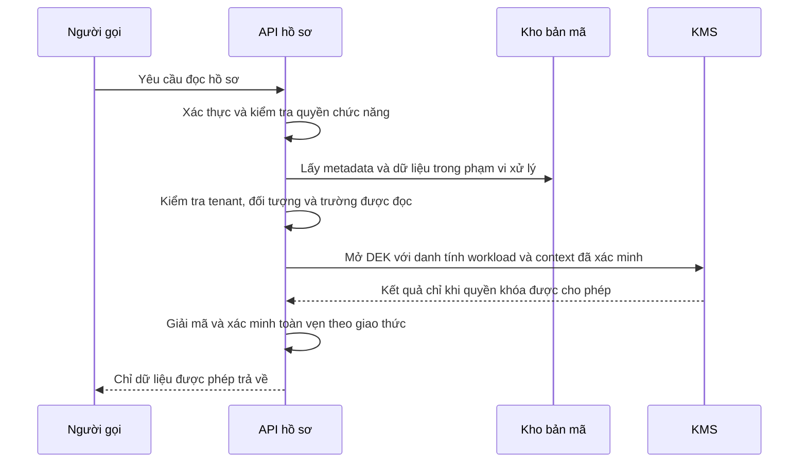

# Key access control

## 1. Ai được làm gì với khóa?

Key access control là tập quyết định và cơ chế xác định chủ thể nào được thực hiện thao tác nào với khóa mật mã, trong phạm vi và điều kiện nào. Nó bao gồm cả quyền sử dụng khóa để tạo ra kết quả mật mã và quyền quản lý những yếu tố quyết định ai sẽ được sử dụng khóa đó.

Một hệ thống có thể giữ khóa trong KMS hoặc HSM, nhưng vẫn cấp quyền giải mã cho quá nhiều workload. Khóa không bị lấy ra trực tiếp không đồng nghĩa dữ liệu không thể bị đọc: một chủ thể được phép gọi chức năng giải mã có thể dùng kết quả của chức năng đó theo quyền mà hệ thống đang cấp.

Trong thiết kế yêu cầu bảo mật, mục tiêu không chỉ là “lưu khóa an toàn”. Cần mô tả ai có quyền mã hóa, giải mã, ký, tạo data key, sửa policy, cấp quyền tiếp, thay trạng thái, xuất hoặc hủy khóa khi cơ chế hỗ trợ. Mỗi loại quyền có hậu quả và bằng chứng nghiệm thu riêng.

Sau bài này, người học có thể:

- Phân biệt quyền đọc metadata, sử dụng khóa, lấy key material và quản trị vòng đời.
- Xác định danh tính workload, phạm vi tenant và nguồn ngữ cảnh đáng tin cậy.
- Thiết kế quyền tối thiểu và tách nhiệm vụ mà không bỏ qua quyền gián tiếp.
- Phân tích tương tác giữa KMS, envelope encryption, cache và quyền đọc dữ liệu.
- Viết yêu cầu có thể kiểm chứng về cấp, sử dụng, thu hồi và audit quyền khóa.

## 2. Những quyền thường bị gộp nhầm

### 2.1. Đọc metadata không phải đọc key material

Key ID, alias, thuật toán, trạng thái và thời điểm tạo là metadata. Chúng có thể cần giới hạn truy cập theo chính sách, nhưng không giống byte bí mật của khóa.

Biết key ID không tự tạo quyền giải mã. Ngược lại, một principal có quyền sử dụng khóa không nhất thiết cần quyền liệt kê mọi khóa hoặc xem mọi cấu hình trong hệ thống.

Không dùng tính bí mật của alias như cơ chế phân quyền. Đường truy cập phải được kiểm soát dù người gọi đã biết định danh tài nguyên.

### 2.2. Sử dụng khóa không đồng nghĩa xuất khóa

Một KMS hoặc HSM có thể thực hiện thao tác bên trong ranh giới được bảo vệ mà không trả key material của khóa đó. Quyền gọi `Decrypt` hoặc `Sign` vẫn rất nhạy cảm, vì đầu ra có thể cho phép đọc dữ liệu hoặc tạo thông điệp được bên khác tin.

Nếu cơ chế có hỗ trợ xuất, nhập hoặc chuyển key material, những thao tác đó cần quyền và quy trình riêng. Không coi quyền sử dụng thông thường là lý do cho phép mọi hình thức xuất khóa.

### 2.3. Quản trị khóa không phải một quyền duy nhất

| Nhóm thao tác | Ví dụ | Rủi ro chính |
| --- | --- | --- |
| Đọc metadata | Xem trạng thái hoặc định danh | Lộ cấu trúc vận hành ngoài nhu cầu |
| Dùng mật mã | Encrypt, decrypt, sign, tạo MAC | Đọc dữ liệu hoặc tạo kết quả được tin trái nhiệm vụ |
| Sinh hoặc mở data key | Tạo DEK, mở DEK đã bọc | Có thể nhận khóa dữ liệu rõ theo giao thức |
| Quản lý policy | Sửa policy, binding hoặc điều kiện | Cấp lại quyền cho chính mình hoặc bên khác |
| Ủy quyền | Tạo grant hoặc gắn role khi được hỗ trợ | Mở đường sử dụng khóa qua principal khác |
| Quản lý vòng đời | Tạo, đổi trạng thái, rotation | Tác động tính sẵn sàng và khả năng phục hồi |
| Xuất, nhập hoặc hủy | Theo khả năng nền tảng | Mở rộng phạm vi giữ khóa hoặc mất dữ liệu không thể phục hồi |

Tên API và ranh giới quyền cụ thể phụ thuộc sản phẩm. Yêu cầu phải ánh xạ các nhóm nghiệp vụ này tới cơ chế thật của nền tảng, không suy ra mọi KMS có cùng role hoặc semantics.

### 2.4. Quyền gián tiếp cũng là quyền cần đánh giá

Một người không có `Decrypt` nhưng có thể tự gắn role có quyền giải mã vẫn có đường đạt quyền đó. Một người sửa policy hoặc triển khai mã chạy dưới danh tính có quyền khóa cũng có thể tác động tới dữ liệu theo mô hình kiểm soát đang chọn.

Vì vậy, phân tích quyền hiệu lực cần xét cả quyền trực tiếp, khả năng assume hoặc impersonate danh tính, quyền sửa cấu hình và quyền thay đổi phần mềm sử dụng khóa. Không kết luận đã tách nhiệm vụ chỉ từ hai tên role khác nhau.

## 3. Mô hình đe dọa cho một nền tảng học tập

Giả sử hồ sơ người học được ứng dụng mã hóa trước khi ghi vào kho dữ liệu. Ứng dụng sử dụng DEK để mã hóa dữ liệu và dùng một khóa quản lý trong KMS để bảo vệ DEK. Bản mã và DEK đã bọc được lưu cùng metadata cần thiết.

Các tài sản gồm dữ liệu hồ sơ, DEK, quyền sử dụng khóa KMS, policy và bằng chứng audit. Những chủ thể liên quan có thể là API đọc hồ sơ, worker nhập dữ liệu, quản trị viên khóa, quản trị viên kho dữ liệu và người vận hành sự cố.

### 3.1. Các tình huống lạm quyền

- API đọc hồ sơ có quyền dùng mọi khóa của mọi môi trường.
- Worker chỉ cần mã hóa lại có quyền mở mọi DEK lịch sử.
- Principal phát triển có thể assume role production hoặc sửa policy của khóa production.
- Request tự khai tenant rồi ứng dụng dùng giá trị đó làm ngữ cảnh giải mã mà không kiểm tra.
- Một người vừa sửa policy vừa tự cấp quyền sử dụng khóa mà không có ràng buộc quản trị tương ứng.
- Quyền đã thu hồi ở KMS nhưng ứng dụng vẫn giữ DEK rõ trong cache ngoài thời hạn thiết kế.
- Audit có thể bị người quản trị khóa vô hiệu hóa mà không có phát hiện.

### 3.2. Phải nêu rõ mô hình mã hóa dữ liệu

Trong mô hình ứng dụng tự mã hóa và kho dữ liệu chỉ giữ bản mã, tách quyền đọc kho với quyền mở DEK có thể tạo một ranh giới hữu ích.

Nếu dịch vụ lưu trữ tự giải mã hợp lệ rồi trả plaintext cho bất kỳ người có quyền đọc dữ liệu, việc người đó không có quyền gọi KMS trực tiếp chưa chứng minh họ không đọc được dữ liệu. Cần đánh giá đường nhận plaintext thật của sản phẩm.

Do đó, “quản trị viên dữ liệu không được dùng khóa” chỉ có ý nghĩa khi kiến trúc và mọi đường đọc liên quan thực sự thực thi thuộc tính mong muốn.

## 4. Xây dựng mô hình quyền theo chủ thể, thao tác và phạm vi

### 4.1. Một quyết định quyền cần đủ thành phần

```text
allow(
  verifiedPrincipal,
  keyResource,
  cryptographicOperation,
  verifiedContext,
  operationalConditions
)
```

Trong đó:

- Principal là danh tính đã được xác minh, không phải tên role do body request tự khai.
- Key resource là khóa và phạm vi phiên bản hoặc tài nguyên mà cơ chế thực sự hỗ trợ.
- Operation là thao tác cần có, không dùng quyền tổng chỉ vì thuận tiện.
- Context là tenant, mục đích hoặc thuộc tính có nguồn và ràng buộc phù hợp.
- Conditions có thể gồm môi trường, thời hạn ủy quyền hoặc nguồn gọi theo khả năng nền tảng.

Yêu cầu cần xác định cả hành vi khi thiếu hoặc không xác minh được những yếu tố đó. Thiếu thông tin không nên mặc nhiên chuyển thành cho phép.

### 4.2. Danh tính workload

Ứng dụng nên dùng danh tính workload được quản lý phù hợp với môi trường, thay vì chia sẻ credential quản trị dài hạn giữa nhiều service. Mỗi danh tính cần gắn với nhiệm vụ và vòng đời rõ.

Không dùng cùng danh tính cho pipeline triển khai, runtime đọc dữ liệu và công cụ hỗ trợ chỉ vì chúng cùng một nhóm phát triển. Chúng cần những thao tác khác nhau và có hậu quả khác nhau nếu bị chiếm quyền.

Nếu dùng credential ngắn hạn, vẫn cần kiểm soát ai được lấy hoặc gia hạn credential và ai có thể assume role. Thời hạn ngắn không sửa được một quan hệ ủy quyền quá rộng.

### 4.3. Phạm vi tài nguyên và môi trường

Quyền cần chỉ rõ khóa hoặc nhóm tài nguyên được quản lý có chủ đích. Principal của môi trường test không tự được dùng khóa production. Khóa cho chữ ký hoặc token cũng không nên vô tình nằm trong quyền giải mã hồ sơ.

Không nhận key ID hoặc ARN bất kỳ từ request rồi chuyển nguyên vào KMS như một dịch vụ mật mã chung. Ứng dụng cần ánh xạ mục đích nghiệp vụ tới tài nguyên được phép và kiểm tra đối tượng theo chính sách.

Nếu dùng alias, phải xác định ai được đổi đích của alias và cách ứng dụng nhận diện sự thay đổi. Alias dễ vận hành không tự làm mọi thay đổi đích trở nên an toàn.

### 4.4. Phạm vi tenant và mục đích

Ngữ cảnh như `tenantId`, `purpose` hoặc loại dữ liệu có thể giúp giới hạn quyền. Nguồn của chúng phải được xác minh từ danh tính, bản ghi hoặc cấu hình theo thiết kế.

Nếu mọi caller đều có thể tự khai `tenantId=tenant-17` mà không bị ràng buộc với danh tính, việc có trường tenant trong request không tạo cách ly tenant.

Khi workload phục vụ nhiều tenant, cần xác định giới hạn bảo vệ khi workload đó bị chiếm quyền. Nếu nó có quyền mở dữ liệu của mọi tenant, một trường context không tự biến nó thành danh tính chỉ có quyền trên một tenant. Có thể cần phân vùng danh tính, khóa hoặc cơ chế khác theo mô hình đe dọa.

## 5. Quyền tối thiểu và tách nhiệm vụ

### 5.1. Tách người quản lý khỏi người sử dụng

Một mô hình có thể phân biệt key manager với key user. Google Cloud KMS mô tả rõ sự tách biệt giữa quản lý vòng đời và dùng khóa để thực hiện thao tác mật mã. [Google Cloud KMS, separation of duties](https://docs.cloud.google.com/kms/docs/separation-of-duties).

Trong thiết kế của hệ thống, cần triển khai mô hình đó bằng quyền hiệu lực, quan hệ assume role, quyền thay policy và quyền đối với dữ liệu. Một role không có quyền giải mã trực tiếp nhưng có thể tự cấp lại quyền đó chưa tạo ranh giới mạnh như tên role gợi ý.

### 5.2. Ma trận nhiệm vụ minh họa

| Chủ thể | Nhiệm vụ được cấp | Không được mặc định thừa hưởng |
| --- | --- | --- |
| Runtime đọc hồ sơ | Mở DEK cho dữ liệu thuộc phạm vi đã được phép | Sửa policy, tạo grant, hủy khóa hoặc mở mọi mục đích |
| Worker ghi dữ liệu | Tạo hoặc dùng DEK để ghi theo giao thức | Mở tùy ý DEK lịch sử không liên quan |
| Quản trị vòng đời | Các thao tác quản lý đã được phân công | Đọc dữ liệu nghiệp vụ hoặc tự cấp quyền ngoài quy trình |
| Người duyệt thay đổi quyền | Đánh giá và phê duyệt phạm vi thay đổi | Tự triển khai mọi thay đổi không có kiểm soát |
| Kiểm toán viên | Xem policy và bằng chứng trong phạm vi | Dùng khóa hoặc sửa bằng chứng |
| Vai trò khẩn cấp | Quyền tạm thời cho sự cố đã xác định | Quyền thường trực và mở rộng không có thời hạn |

Đây là mô hình minh họa, không phải role có sẵn trong mọi nền tảng. Phải kiểm tra tổng các binding, policy và quyền gián tiếp để biết một principal thực sự làm được gì.

### 5.3. Quyền tạo data key có thể trả bí mật rõ

Trong AWS KMS, `GenerateDataKey` thông thường trả cả DEK rõ và bản đã được bảo vệ dưới khóa KMS. Đây không phải việc xuất key material của chính khóa KMS, nhưng vẫn đưa bí mật dữ liệu tới caller. [AWS KMS GenerateDataKey](https://docs.aws.amazon.com/kms/latest/APIReference/API_GenerateDataKey.html).

Vì vậy, worker chỉ có quyền tạo data key không có nghĩa nó chưa từng thấy plaintext key hoặc plaintext dữ liệu mà nó xử lý. Điều có thể giới hạn là khả năng mở các DEK khác hoặc dữ liệu lịch sử ngoài nhiệm vụ.

### 5.4. Quản trị policy là quyền nhạy cảm

AWS khuyến nghị cấp quyền tối thiểu và quản lý chặt quyền tạo hoặc gắn policy vì những quyền này có thể làm thay đổi tập chủ thể sử dụng khóa. [AWS KMS least-privilege permissions](https://docs.aws.amazon.com/kms/latest/developerguide/least-privilege.html).

Nếu một chủ thể có quyền tổ chức rất cao có thể thay cả danh tính, policy và phần mềm, hệ thống phải nêu họ thuộc tập được tin cậy nào và kiểm soát quản trị tương ứng. Không hứa tách nhiệm vụ tuyệt đối bằng một deny cục bộ mà chủ thể đó có thể gỡ bỏ.

## 6. Kết hợp quyền dữ liệu và quyền sử dụng khóa

### 6.1. Hai quyết định bổ sung cho nhau

Một request đọc hồ sơ cần ít nhất hai lớp quyết định trong mô hình minh họa:

1. Ứng dụng xác minh người dùng được đọc hồ sơ và các trường liên quan.
2. KMS xác minh danh tính workload được thực hiện thao tác khóa trong phạm vi được cấp.

KMS thường nhìn thấy workload và các điều kiện của lời gọi, không tự biết toàn bộ quan hệ nghiệp vụ của người dùng với từng hồ sơ. Nếu ứng dụng bỏ kiểm tra đối tượng, một role KMS hợp lệ có thể bị dùng làm công cụ giải mã ngoài quyền người dùng.

Ngược lại, quyền dữ liệu ở ứng dụng không đủ nếu workload không được cấp thao tác KMS cần thiết. Lỗi ở lớp này không phải lý do để ứng dụng tự sử dụng một khóa khác không được quản lý.

### 6.2. Luồng đọc có chủ đích



Sơ đồ mô tả trách nhiệm, không yêu cầu mọi triển khai có đúng số lời gọi. Nếu cần đọc metadata để xác định phạm vi, bước đọc đó không được làm lộ dữ liệu hoặc gây tác dụng phụ đặc quyền cho người gọi trước quyết định thích hợp.

### 6.3. Context không phải dữ liệu tự khai để xin quyền

Trong envelope encryption, metadata có thể chứa tenant, mục đích và định danh dữ liệu. Ứng dụng cần xác minh quan hệ giữa metadata, đối tượng và danh tính trước khi dùng chúng cho lời gọi mật mã.

Một request tự đổi `tenantId` không được khiến ứng dụng thử các khóa của tenant khác. Một bản mã được di chuyển sang bản ghi khác không nên được chấp nhận như đúng dữ liệu chỉ vì nó vẫn giải mã được theo một khóa dùng chung.

Nếu yêu cầu cần ràng buộc bản mã với đối tượng, phải thiết kế dữ liệu xác thực bổ sung và cách tạo ngữ cảnh theo giao thức. Context bảo vệ DEK và context của bản mã dữ liệu cần liên hệ đúng; bảo vệ một lớp không tự chứng minh lớp còn lại đã được ràng buộc.

### 6.4. Giữ điểm giải mã và đầu ra trong phạm vi quyền

Sau khi mở DEK, ứng dụng có khả năng giải mã dữ liệu tương ứng. Cần giới hạn nơi DEK rõ đi qua, tránh đưa vào log, queue hoặc API debug ngoài mục đích.

Phản hồi chỉ được tạo từ dữ liệu đã được xác minh theo cơ chế và quyền cần thiết. Không trả plaintext một phần khi kiểm tra toàn vẹn thất bại, hoặc hiển thị nội dung để chẩn đoán lỗi trước khi hoàn tất kiểm tra quyền.

## 7. Ví dụ với AWS KMS

### 7.1. Policy hiệu lực không chỉ nằm trong một tệp

AWS KMS dùng key policy và có thể kết hợp IAM policy, grants cùng các lớp liên quan. Khi cấp quyền bằng IAM theo mô hình đó, key policy phải cho phép cơ chế ủy quyền IAM tương ứng; một đoạn IAM allow không tự vượt qua mọi điều kiện khác. [AWS KMS key policies](https://docs.aws.amazon.com/kms/latest/developerguide/key-policies.html), [IAM policies với AWS KMS](https://docs.aws.amazon.com/kms/latest/developerguide/iam-policies.html).

Ví dụ dưới đây là một identity-based policy minh họa cho workload đọc hồ sơ tenant-17. Nó không phải key policy và không phải cấu hình đủ để triển khai trực tiếp vào một tài khoản bất kỳ.

```json
{
  "Version": "2012-10-17",
  "Statement": [
    {
      "Sid": "ReadLearnerProfileDataKeysForTenant17",
      "Effect": "Allow",
      "Action": "kms:Decrypt",
      "Resource": "arn:aws:kms:ap-southeast-1:111122223333:key/11111111-2222-3333-4444-555555555555",
      "Condition": {
        "StringEquals": {
          "kms:EncryptionContext:tenantId": "tenant-17",
          "kms:EncryptionContext:purpose": "learner-profile"
        }
      }
    }
  ]
}
```

ARN và các giá trị trong ví dụ chỉ dùng cho bài học. Chúng cần được thay bằng tài nguyên và ngữ nghĩa được thiết kế cho môi trường thật nếu triển khai.

### 7.2. Ví dụ giới hạn điều gì?

Statement cho phép một thao tác cụ thể trên một khóa cụ thể khi các điều kiện context tương ứng được đáp ứng. Nó không cấp trong chính statement này quyền sửa policy, tạo grant hoặc quản lý vòng đời.

Tuy nhiên, việc không xuất hiện các quyền đó ở đoạn minh họa không chứng minh principal không có chúng từ một policy khác. Phải đánh giá toàn bộ nguồn cấp quyền và đường đạt quyền gián tiếp.

Nó cũng không tự phân biệt mọi bản ghi của tenant-17. Quyền đọc một hồ sơ cụ thể vẫn nằm trong hợp đồng ứng dụng hoặc các ràng buộc chi tiết hơn được thiết kế riêng.

### 7.3. Encryption context có vai trò mật mã và điều kiện quyền

Với thao tác khóa đối xứng phù hợp, AWS KMS ràng buộc encryption context với ciphertext và yêu cầu context tương ứng khi giải mã. Context cũng có thể được dùng trong điều kiện quyền. Nó không bí mật và có thể xuất hiện trong CloudTrail, nên không đưa dữ liệu nhạy cảm vào đó. [AWS KMS encryption context](https://docs.aws.amazon.com/kms/latest/developerguide/encrypt_context.html).

Cặp `tenantId=tenant-17` trong ví dụ không phải bằng chứng caller thuộc tenant-17. Bằng chứng danh tính đến từ cơ chế xác thực và quyền được gắn cho workload. Context phải được xây dựng từ nguồn đã được xác minh theo ứng dụng.

Nếu ciphertext được tạo với context khác, đổi nhãn đầu vào để làm điều kiện policy đạt không làm nó trở thành ciphertext của context mới. Nhưng nếu ứng dụng cấp quyền đọc sai đối tượng trong cùng phạm vi context, cơ chế này cũng không tự sửa lỗi ứng dụng đó.

### 7.4. Quyền theo dịch vụ trung gian

Một số tích hợp gọi KMS thay cho ứng dụng. Khi dùng các điều kiện về dịch vụ nguồn, tài nguyên nguồn hoặc tài khoản, cần hiểu thông tin nào thực sự có mặt trong ngữ cảnh của kiểu lời gọi đó.

Không thêm một điều kiện được dùng cho lời gọi qua dịch vụ vào một client trực tiếp rồi giả định nó vẫn có cùng nghĩa. Cũng không bỏ điều kiện khi gặp lỗi mà chưa xác định đường gọi thực tế.

Các quyền tạo grant hoặc truyền quyền cho dịch vụ phải được đánh giá như đường cấp quyền tiếp, có phạm vi, điều kiện và vòng đời rõ.

## 8. Cache khóa và hiệu lực thu hồi

### 8.1. Thu hồi ở KMS không xóa DEK đã nhận

Trong envelope encryption, ứng dụng có thể đã có DEK rõ trước khi quyền KMS bị thu hồi. Nếu giữ DEK trong cache, nó có thể tiếp tục giải mã cục bộ mà không cần gọi KMS trong khoảng thời gian đó.

Vì vậy, cần phân biệt:

| Mốc kiểm soát | Điều có thể đạt | Điều không tự suy ra |
| --- | --- | --- |
| Đổi policy | Chặn lời gọi mới sau khi thay đổi có hiệu lực theo hệ thống | Xóa DEK đã nằm trong bộ nhớ ứng dụng |
| Thu hồi hoặc đổi credential | Hạn chế một đường danh tính theo cơ chế tương ứng | Thu hồi dữ liệu đã được trả cho caller |
| Làm mất hiệu lực cache | Ngăn tái sử dụng bản sao theo thiết kế cache | Xóa mọi bản sao từng bị trích xuất ngoài ranh giới |
| Ngừng workload | Chặn xử lý tiếp trong phạm vi vận hành đó | Thu hồi plaintext đã lưu ở nơi khác |

Yêu cầu không nên viết “revoke key là mọi dữ liệu lập tức không đọc được” nếu mô hình có cache hoặc bản sao rõ ngoài KMS.

### 8.2. Phạm vi của cache

Nếu cho phép cache DEK, phải xác định TTL, giới hạn sử dụng, phạm vi tenant, mục đích và cách phân biệt khóa hoặc context ảnh hưởng tới quyền. Cache key không được làm dữ liệu từ phạm vi này được dùng cho phạm vi khác.

Quyền nghiệp vụ của người gọi vẫn được kiểm tra khi dữ liệu lấy từ cache. Một cache hit không phải quyết định cho phép đọc.

Mọi chính sách tái sử dụng DEK cũng cần tuân thủ điều kiện mật mã của cơ chế mã hóa dữ liệu. Tối ưu số lời gọi KMS không được làm mất điều kiện nonce hoặc giới hạn sử dụng khóa.

### 8.3. Định nghĩa thời gian hiệu lực

Một yêu cầu có thể chọn thời gian tối đa để chặn lời gọi khóa mới và thời gian tối đa để workload không còn dùng cache đã thu hồi. Đó là các cam kết khác nhau, có thể cần cơ chế khác nhau.

Giá trị thời gian phải được lựa chọn dựa trên kiến trúc, khả năng của nền tảng và rủi ro. Không dùng thời hạn token danh tính như bằng chứng duy nhất về tốc độ thu hồi quyền khóa; policy, grant, cache, job và khả năng gia hạn danh tính đều có thể ảnh hưởng.

### 8.4. Rotation, disable, revoke và destroy

Rotation thay đổi cách cấp hoặc sử dụng key material theo cơ chế, nhưng không mặc nhiên chặn quyền đọc dữ liệu cũ. Thu hồi quyền thay đổi chủ thể được phép sử dụng. Disable làm khóa không sẵn sàng cho các thao tác theo trạng thái được nền tảng định nghĩa. Destroy tác động tới khả năng phục hồi dữ liệu.

Không dùng các từ này như đồng nghĩa. Yêu cầu cần chỉ rõ hành động nào được phép, đối tượng nào chịu ảnh hưởng, cách rollback nếu có và dữ liệu hoặc backup nào còn phụ thuộc vào khóa.

Nếu mục tiêu là xóa bằng mật mã, cần đánh giá toàn bộ bản sao key material, DEK, cache và dữ liệu rõ theo mô hình. Xóa một policy hoặc một alias không tự đạt mục tiêu đó.

## 9. Cấp quyền, quyền khẩn cấp và lỗi hệ thống

### 9.1. Vòng đời quyền

Một lượt cấp quyền nên xác định mục đích, principal, tài nguyên, thao tác, điều kiện, thời hạn nếu phù hợp và người chịu trách nhiệm. Khi workload ngừng hoặc thay nhiệm vụ, quyền cần được thu hẹp hoặc gỡ bỏ theo quy trình.

Không để tài khoản thử nghiệm, job tạm hoặc role di chuyển dữ liệu giữ quyền giải mã lâu dài sau khi công việc kết thúc.

### 9.2. Thay policy phải được xem xét như thay đổi bảo mật

Một thay đổi có thể tác động cả bí mật và tính sẵn sàng. Cần kết quả cụ thể để rà soát: chủ thể nào thêm quyền, thao tác nào mở rộng, khóa nào bị ảnh hưởng và có đường tự cấp quyền hay không.

Cơ chế kiểm soát có thể gồm phân tách người đề xuất với người thực hiện hoặc phê duyệt, phiên bản hóa, kiểm tra tự động và audit. Phải phù hợp với mức rủi ro và cấu trúc quản trị của tổ chức.

### 9.3. Break-glass có phạm vi và dấu vết

Quyền khẩn cấp cần danh tính riêng, điều kiện kích hoạt, thời hạn, phạm vi và quan sát phù hợp. Với con người, có thể cần xác thực tăng cường và kiểm tra sau sự cố theo chính sách.

Không tạo một credential có mọi quyền rồi gọi nó là break-glass chỉ vì ít khi sử dụng. Cần cơ chế gỡ quyền, đóng phiên và xử lý những thay đổi đã thực hiện trong sự cố.

### 9.4. Không fallback sang khóa không được quản lý

Khi KMS không sẵn sàng hoặc quyền bị từ chối, ứng dụng phải xử lý theo hợp đồng: trả lỗi, trì hoãn hoặc sử dụng cache chỉ trong điều kiện đã được phê duyệt.

Không dùng một khóa dự phòng hard-code, bỏ mã hóa hoặc trả plaintext cũ ngoài chính sách để giữ chức năng hoạt động. Nếu có cơ chế dự phòng, nó cũng cần cùng mô hình danh tính, quyền và vòng đời.

### 9.5. Backup và khôi phục

Phải có kế hoạch khôi phục quyền truy cập hợp lệ tới dữ liệu cần giữ, nhưng không lưu khóa rõ trong cùng backup một cách không kiểm soát. Danh tính phục hồi cần nhiệm vụ và phạm vi riêng.

Khôi phục backup không nên vô tình phục hồi lại quyền hoặc cấu hình đã bị thu hồi. Các bản sao khóa, khu vực triển khai và tài nguyên dự phòng cần được kiểm kê theo quyền thực tế, không mặc định thừa hưởng toàn bộ policy đúng từ bản chính.

## 10. Audit quyền và hoạt động sử dụng khóa

### 10.1. Theo dõi cả quản trị lẫn sử dụng

Cần quan sát những thay đổi làm mở rộng quyền và những thao tác mật mã nhạy cảm. Một log chỉ ghi vòng đời khóa nhưng không cho biết ai sử dụng, hoặc chỉ ghi decrypt nhưng bỏ thay đổi policy, sẽ thiếu phần bối cảnh quan trọng.

AWS KMS có tích hợp CloudTrail cho hoạt động quản lý và mật mã, nhưng cấu hình thu thập và các trường hợp ghi nhận phải được hiểu đúng. Không giả định mọi lỗi ở mọi ranh giới đều xuất hiện như cùng một loại sự kiện KMS. [AWS KMS và CloudTrail](https://docs.aws.amazon.com/kms/latest/developerguide/logging-using-cloudtrail.html).

Những request bị chặn tại ứng dụng hoặc một lớp khác có thể cần bằng chứng tại lớp đó. Không có log KMS không tự chứng minh không có nỗ lực truy cập.

### 10.2. Những trường hữu ích

Một schema quan sát khái niệm có thể gồm:

```text
actorId
actorType
workloadIdentity
operation
keyReference
verifiedScope hoặc nhãn phạm vi đã được phép ghi
result: ALLOWED / DENIED / ERROR
policyVersion hoặc dấu vết cấu hình tương ứng
correlationId
timestamp
changeReference, nếu là thay đổi quản trị
```

Không ghi key material, DEK rõ, credential hoặc plaintext nghiệp vụ. Context không bí mật theo giao thức cũng không có nghĩa được phép chứa email, token hay dữ liệu cá nhân ngoài chính sách.

### 10.3. Cache làm số lời gọi khác số lần đọc

Một lần mở DEK có thể phục vụ nhiều lần giải mã cục bộ nếu cache được cho phép. Audit KMS không tự phản ánh mọi lần người dùng đọc dữ liệu.

Nếu yêu cầu truy vết ở mức truy cập hồ sơ, ứng dụng cần sự kiện phù hợp cho quyền và thao tác dữ liệu. Không dùng số lời gọi decrypt làm đại diện chính xác cho số hồ sơ đã được xem nếu kiến trúc không có quan hệ đó.

### 10.4. Bảo vệ bằng chứng

Quyền sửa hoặc vô hiệu hóa việc thu thập audit phải được quản lý như một quyền nhạy cảm. Người thay policy khóa không nên có khả năng xóa dấu vết ngoài mô hình quản trị đã chấp thuận.

Cảnh báo cần bao phủ thay đổi policy, cấp grant ngoài nhu cầu, quyền không dùng lâu ngày, sử dụng từ danh tính hoặc môi trường khác và tình trạng audit không hoạt động theo phạm vi. Ngưỡng cụ thể phải dựa trên tải và rủi ro của hệ thống.

## 11. Chuyển thành yêu cầu bảo mật có thể kiểm chứng

### 11.1. Viết rõ chủ thể, thao tác và dữ liệu

Yêu cầu yếu:

> Khóa chỉ được người có quyền truy cập.

Câu này không định nghĩa “truy cập” là xem metadata, gọi giải mã hay sửa policy; cũng không nói quyền gắn với khóa nào, tenant nào và thời điểm nào.

Yêu cầu rõ hơn:

> Runtime đọc hồ sơ chỉ được mở DEK thuộc nhóm khóa và mục đích đã định nghĩa cho phạm vi được cấp. Runtime không có quyền quản trị policy, cấp quyền tiếp hoặc hủy khóa. Trước khi sử dụng DEK hoặc dữ liệu trong cache, ứng dụng phải xác minh quyền người gọi trên đối tượng và trường dữ liệu. Mọi nguồn quyền hiệu lực, kể cả quyền gián tiếp, phải được đưa vào nghiệm thu.

Để hoàn chỉnh, cần nêu danh tính thật, tập tài nguyên, điều kiện context, TTL cache và giới hạn hiệu lực thu hồi của sản phẩm.

### 11.2. Bộ yêu cầu minh họa

| Mã | Yêu cầu | Bằng chứng dự kiến |
| --- | --- | --- |
| KAC-01 | Mỗi khóa hoặc nhóm khóa có owner, mục đích, dữ liệu được bảo vệ và danh mục principal | Hồ sơ khóa và ánh xạ sử dụng |
| KAC-02 | Quyền phải giới hạn theo thao tác và tài nguyên cần thiết, không mặc định cấp toàn quyền | Ma trận thao tác và policy hiệu lực |
| KAC-03 | Danh tính runtime, quản trị, triển khai và khẩn cấp phải có phạm vi được xác định | Sơ đồ danh tính và quan hệ ủy quyền |
| KAC-04 | Tách nhiệm vụ phải xét cả sửa policy, tạo grant, assume role và sửa phần mềm có quyền | Phân tích đường đạt quyền gián tiếp |
| KAC-05 | Context dùng cho quyền hoặc mật mã phải có nguồn xác minh và ràng buộc đúng đối tượng | Ca giả mạo tenant, mục đích và metadata |
| KAC-06 | Quyền khóa không được thay phân quyền dữ liệu ở ứng dụng, kể cả cache hit | Ca có quyền KMS nhưng sai quyền đối tượng |
| KAC-07 | Không xuất key material hoặc trả DEK rõ ngoài giao thức và phạm vi được chấp thuận | Cấu hình cơ chế cùng kiểm tra đầu ra và log |
| KAC-08 | Thu hồi phải có mục tiêu thời gian cho lời gọi mới, cache và workload liên quan | Kiểm thử trước và sau mốc hiệu lực |
| KAC-09 | Thay policy và quyền khẩn cấp phải có phạm vi, vòng đời và dấu vết phù hợp | Hồ sơ thay đổi và kết quả gỡ quyền |
| KAC-10 | Lỗi KMS hoặc từ chối không được dẫn tới khóa hard-code, plaintext hay cơ chế nới quyền | Ca lỗi và nhánh fallback |
| KAC-11 | Audit phải bao phủ quản trị, sử dụng và các lớp từ chối theo yêu cầu | Bằng chứng sự kiện cùng khả năng truy vết |
| KAC-12 | Backup, replica và môi trường phục hồi phải tuân thủ quyền hiện hành theo phạm vi | Ca phục hồi và kiểm tra quyền tài nguyên dự phòng |
| KAC-13 | Quyền đối với dữ liệu cũ, rotation và hủy phải có ý nghĩa riêng rõ ràng | Kế hoạch vòng đời và phụ thuộc dữ liệu |
| KAC-14 | Quyền đọc và sửa audit hoặc context nhạy cảm phải được kiểm soát | Schema log và policy đối với bằng chứng |

Các mã là ví dụ tổ chức đặc tả, không phải mã tiêu chuẩn. Tập principal và tài nguyên phải được duy trì khi kiến trúc thay đổi, không chỉ lập một lần để hoàn tất tài liệu.

### 11.3. Truy vết từ rủi ro tới bằng chứng

```text
Tài sản: dữ liệu hồ sơ được bảo vệ bằng envelope encryption
    ↓
Mối đe dọa: workload ngoài nhiệm vụ mở DEK hoặc runtime bị dùng
để trả dữ liệu của tenant khác
    ↓
Yêu cầu: giới hạn quyền khóa + context xác minh + quyền đối tượng
    ↓
Thiết kế: danh tính theo nhiệm vụ, tài nguyên giới hạn,
kiểm tra ứng dụng trước giải mã và cache tách phạm vi
    ↓
Bằng chứng: thao tác hợp lệ thành công; sai principal, khóa,
tenant, mục đích hoặc quyền đối tượng đều không trả plaintext
```

Nếu mối đe dọa là quản trị viên tự mở rộng quyền, cần bằng chứng về đường thay policy và quản trị danh tính, không chỉ một ca decrypt bị từ chối lúc ban đầu.

## 12. Tiêu chí nghiệm thu

Phần này mô tả bằng chứng cần thu thập khi triển khai, không tuyên bố đã chạy kiểm thử đối với một hệ thống cụ thể.

### 12.1. Kiểm tra quyền hiệu lực

Cần biết danh tính thực tế của request, mọi nguồn cấp quyền liên quan, tài nguyên, trạng thái khóa và điều kiện ngữ cảnh. Một policy cục bộ không có quyền rộng chưa chứng minh principal không nhận quyền rộng từ nơi khác.

Công cụ phân tích hoặc mô phỏng policy có thể hỗ trợ rà soát. Bằng chứng runtime trong môi trường kiểm soát vẫn cần để xác nhận đường gọi, grant, workload identity và các điều kiện thực sự được dùng.

### 12.2. Ma trận trường hợp

| Trường hợp | Thiết lập | Kết quả cần chứng minh |
| --- | --- | --- |
| Principal hợp lệ | Đúng thao tác, tài nguyên và context | Thực hiện theo giao thức, chỉ trả dữ liệu được phép |
| Principal không được cấp | Cùng yêu cầu bằng danh tính khác | Không sử dụng được khóa |
| Sai môi trường | Danh tính test gọi khóa production trong môi trường thử được kiểm soát | Không vượt ranh giới môi trường |
| Sai khóa | Runtime dùng tài nguyên ngoài danh mục | Bị từ chối theo quyền hiệu lực |
| Sai thao tác | Runtime đọc yêu cầu quản lý policy hoặc tạo grant | Không có quyền ngoài nhiệm vụ |
| Sai tenant | Ngữ cảnh hoặc đối tượng thuộc tenant khác | Không mở hoặc trả dữ liệu ngoài phạm vi |
| Sai mục đích | Khóa hồ sơ được dùng cho mục đích không được cấp | Không được phép ngoài hợp đồng |
| Metadata bị thay | Di chuyển hoặc đổi nhãn bản mã, DEK, context | Không nhận sai đối tượng hoặc bỏ kiểm tra toàn vẹn |
| Có quyền khóa, sai quyền dữ liệu | Request người dùng không được đọc hồ sơ | Không trả plaintext; không bỏ kiểm tra do role KMS hợp lệ |
| Cache hit | DEK có trong cache, người gọi đã mất quyền dữ liệu | Vẫn áp dụng quyền hiện tại theo chính sách |
| Thu hồi quyền | Có credential hoặc cache còn tồn tại | Hiệu lực đúng các mốc đã được công bố |
| Quyền gián tiếp | Thử đường assume role hoặc tự cấp quyền theo phạm vi thử | Không vượt mô hình tách nhiệm vụ đã thiết kế |
| KMS không sẵn sàng | Lỗi hoặc timeout | Không fallback sang khóa không được quản lý |
| Khẩn cấp kết thúc | Quyền tạm đã hết thời hạn hoặc bị gỡ | Không còn dùng được đường khẩn cấp ngoài policy |
| Phục hồi | Dữ liệu và môi trường từ backup | Không phục hồi quyền cũ trái với chính sách hiện hành |
| Audit | Thao tác quản trị, dùng khóa và bị từ chối | Có bằng chứng tại lớp cần thiết, không lộ bí mật |

Các thao tác có thể phá hủy tài nguyên cần được kiểm chứng bằng cơ chế và môi trường thử phù hợp, không dùng khóa hoặc dữ liệu nghiệp vụ thật chỉ để chứng minh giới hạn quyền.

### 12.3. Đo hiệu lực thu hồi theo nhiều lớp

Một ca nghiệm thu thu hồi có thể gồm:

1. Xác nhận principal được phép thực hiện thao tác ban đầu.
2. Ghi nhận trạng thái cache và loại credential đang dùng.
3. Thực hiện thay đổi quyền trong môi trường thử theo quy trình.
4. Quan sát lời gọi KMS mới và kết quả tại các instance thuộc phạm vi.
5. Quan sát việc dùng cache và quyền đọc dữ liệu ứng dụng riêng.
6. Đối chiếu các mốc hiệu lực với cam kết đã chọn.

Không kết luận thu hồi hoàn tất chỉ từ một request mới bị từ chối tại một instance. Những cache hoặc danh tính khác có thể vẫn nằm trong phạm vi cần xử lý.

### 12.4. Kiểm tra không có đầu ra hoặc tác dụng phụ trái phép

Một phản hồi lỗi không đủ nếu plaintext đã được ghi vào log, đưa vào queue hoặc trả một phần trước đó. Cần quan sát các đầu ra thuộc phạm vi yêu cầu.

Với kiểm soát quản trị, cần xác nhận policy, grant hoặc trạng thái khóa không bị thay đổi trái quyền. Với sử dụng mật mã, cần xác nhận không nhận kết quả có thể dùng để đọc dữ liệu hoặc giả mạo hành động ngoài nhiệm vụ.

### 12.5. Những bằng chứng chưa đủ

- Khóa nằm trong HSM chưa chứng minh quyền decrypt hoặc sign là tối thiểu.
- Runtime không có quyền export chưa chứng minh không thể đọc dữ liệu qua API mật mã.
- Một role tên “admin” hoặc “reader” chưa mô tả quyền hiệu lực.
- Hai role khác tên chưa chứng minh hai nhiệm vụ thực sự được tách.
- Một đoạn IAM policy hẹp chưa chứng minh không có policy hoặc grant khác cấp rộng.
- Có tenant trong context chưa chứng minh tenant đã được xác minh.
- Một decrypt bị từ chối sau revoke chưa chứng minh DEK cache không còn được dùng.
- Có log KMS chưa chứng minh mọi lần truy cập plaintext đều được audit.

## 13. Vận hành và xử lý sự cố

### 13.1. Duy trì danh mục quyền

Khi thêm workload, tenant, mục đích dữ liệu hoặc khóa mới, cần cập nhật ánh xạ quyền và bằng chứng. Role tạm, job migration và tích hợp đối tác phải có điều kiện kết thúc.

Có thể rà soát quyền không dùng, tài nguyên không còn owner và điều kiện quá rộng. Việc một quyền chưa xuất hiện trong log không tự chứng minh nó có thể gỡ an toàn; cần xét luồng ít chạy như phục hồi hoặc tác vụ định kỳ.

### 13.2. Phát hiện mở rộng quyền và drift

Theo dõi thay đổi policy, grants, trust của role, alias hoặc các cấu hình ảnh hưởng tới tài nguyên thực sự được dùng. Cần quan sát tổng thể thay vì chỉ khác biệt nội dung của một policy.

Một deployment đổi workload identity có thể làm quyền hiệu lực thay đổi dù policy của khóa không đổi. Tương tự, một grant được tạo ngoài pipeline chuẩn có thể mở đường sử dụng không nằm trong hồ sơ ban đầu.

### 13.3. Ứng phó khi principal bị ảnh hưởng

Cần xác định credential và quan hệ ủy quyền của principal, khóa và dữ liệu đã được sử dụng, cache hoặc DEK còn tồn tại và hành động quản trị đã được thực hiện.

Biện pháp có thể gồm thu hồi đường danh tính, thu hẹp quyền, ngừng workload, làm mất hiệu lực cache và xử lý khóa hoặc dữ liệu theo bằng chứng. Không chỉ rotate khóa rồi mặc định mọi quyền cũ đã hết hiệu lực.

Dữ liệu đã được đọc hoặc trích xuất không thể thu hồi bằng cách thay policy. Đánh giá phạm vi sự cố phải xét những kết quả mật mã và dữ liệu rõ có thể đã rời ranh giới.

### 13.4. Khôi phục quyền hợp lệ có kiểm soát

Một lỗi policy có thể làm dịch vụ không đọc được dữ liệu cần thiết. Phục hồi phải quay lại quyền đúng với nhiệm vụ và có audit, không cấp toàn quyền cho mọi principal để giải quyết nhanh.

Kế hoạch rollback cần giữ được quyền quản trị hợp lệ theo mô hình đã thiết kế mà không tạo một credential quản trị thường trực không được kiểm soát. Cách thực hiện phụ thuộc vào nền tảng và phải được diễn tập trong phạm vi phù hợp.

## 14. Mẫu đặc tả cho runtime đọc hồ sơ

```text
ID: SEC-KEY-LEARNER-PROFILE-READER

Tài sản:
DEK và dữ liệu hồ sơ người học được bảo vệ bằng envelope encryption.

Chủ thể:
Danh tính workload đã được xác minh của runtime đọc hồ sơ trong môi trường
và phạm vi tenant đã chỉ định. Không sử dụng credential quản trị dùng chung.

Quyền được cấp:
Chỉ thao tác mở DEK cần thiết trên tài nguyên khóa được liệt kê,
với điều kiện mục đích và phạm vi theo mô hình của nền tảng.
Không cấp mặc định quyền sửa policy, tạo grant, xuất hoặc hủy khóa.

Ràng buộc ứng dụng:
Kiểm tra người gọi, tenant, đối tượng và trường được đọc trước khi trả
plaintext. Context không được lấy nguyên từ dữ liệu người gọi tự khai.
Cache hit không thay thế quyết định quyền dữ liệu.

Quyền hiệu lực:
Đánh giá mọi policy, grant, role và đường ủy quyền hoặc triển khai có thể
làm thay đổi khả năng sử dụng khóa. Tách nhiệm vụ theo quyền thực tế.

Cache và thu hồi:
Quy định TTL, phạm vi và giới hạn dùng DEK. Có mốc hiệu lực riêng cho
lời gọi khóa mới và cho khả năng dùng trạng thái đã cache theo chính sách.

Hành vi lỗi:
Không dùng khóa hard-code, không bỏ mã hóa và không trả dữ liệu rõ ngoài
quyền khi KMS, policy hoặc nguồn danh tính không đáp ứng điều kiện.

Audit:
Truy vết quản trị và sử dụng tại các lớp cần thiết, có correlation ID.
Không ghi key material, DEK, credential hoặc plaintext không cần thiết.

Bằng chứng:
Ca cho phép và từ chối theo principal, tài nguyên, thao tác, tenant,
mục đích và quyền đối tượng; quyền gián tiếp; cache; thu hồi; sự cố;
phục hồi và khả năng truy vết.

Chủ sở hữu:
Nhóm bảo mật hoặc nền tảng quản lý mô hình quyền khóa; nhóm ứng dụng
quản lý quyền dữ liệu và context; vận hành quản lý vòng đời và sự cố;
kiểm toán quản lý bằng chứng theo phạm vi độc lập đã chọn.
```

Key access control bảo vệ khả năng sử dụng mật mã, không chỉ vị trí lưu khóa. Một yêu cầu có thể kiểm chứng cần đi theo toàn bộ đường đạt quyền, từ danh tính và policy tới thao tác, context, cache và đầu ra dữ liệu, đồng thời xác định ai được thay đổi chính các ranh giới đó.
