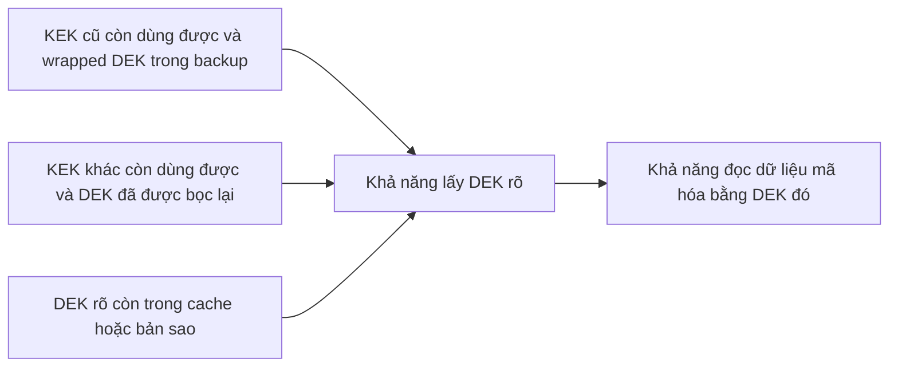

# Key destruction

## 1. Hủy khóa là kết thúc một khả năng mật mã

Key destruction là việc làm cho key material không còn sử dụng hoặc khôi phục được trong phạm vi và theo mức bảo đảm đã xác định. Nó là một bước của vòng đời khóa, có thể phục vụ việc kết thúc sử dụng, giảm rủi ro hoặc làm dữ liệu mã hóa không còn khả năng được giải mã theo mô hình đã chọn.

Một thao tác mang tên delete không tự chứng minh mục tiêu đó đã đạt. Nó có thể chỉ xóa alias, xóa một tài nguyên quản lý, đặt lịch, vô hiệu hóa quyền sử dụng hoặc xóa một bản sao trong khi bản khác còn tồn tại.

Trong thiết kế yêu cầu bảo mật, câu “xóa khóa khi không cần nữa” cần được chuyển thành nghĩa vụ cụ thể: khóa và phiên bản nào, dữ liệu nào phụ thuộc, bản sao nào còn giữ khả năng sử dụng, ai được quyết định và bằng chứng nào cho thấy quy trình đã hoàn tất.

Sau bài này, người học có thể:

- Phân biệt destruction với rotation, retirement, revoke, disable và xóa metadata.
- Xác định phạm vi key material, DEK, KEK, replica, backup và các bản sao rõ.
- Đánh giá điều kiện cần để tuyên bố cryptographic erasure trong một phạm vi dữ liệu.
- Thiết kế quy trình chuẩn bị, phê duyệt, chờ, thực hiện và xác minh.
- Viết yêu cầu bảo mật cùng tiêu chí nghiệm thu mà không nhầm lỗi truy cập với bằng chứng khóa đã bị hủy.

## 2. Các hành động có tên gần nhau nhưng ý nghĩa khác nhau

| Hành động | Mục tiêu điển hình | Điều không tự chứng minh |
| --- | --- | --- |
| Retirement | Ngừng dùng khóa cho tác vụ mới theo policy | Dữ liệu cũ đã không thể giải mã |
| Rotation | Chuyển sang material hoặc phiên bản mới theo cơ chế | Khóa cũ đã bị hủy hoặc mọi bản mã đã được di chuyển |
| Revoke quyền | Ngăn một chủ thể sử dụng khóa theo quyền hiện hành | Xóa material hoặc DEK đã cấp cho chủ thể đó |
| Disable | Chặn sử dụng theo trạng thái của nền tảng | Không thể enable hoặc phục hồi theo cơ chế |
| Schedule destruction | Đưa vào tiến trình hủy sau điều kiện hoặc thời gian chờ | Material đã bị hủy ngay lúc yêu cầu được chấp nhận |
| Destroy material | Hủy material trong ranh giới thực hiện | Mọi bản sao bên ngoài ranh giới cũng đã biến mất |
| Delete alias hoặc metadata | Gỡ định danh hoặc thông tin quản lý | Không còn đường dùng material thực tế |

Tên trạng thái và API phụ thuộc sản phẩm. Quy trình phải ánh xạ mục tiêu của tổ chức tới ý nghĩa thật của cơ chế đang dùng, thay vì suy ra từ nhãn trên giao diện.

### 2.1. Không sử dụng được không đồng nghĩa đã hủy

Một thao tác giải mã có thể thất bại vì thiếu quyền, lỗi mạng, sai context, khóa đang disable hoặc bản mã bị hỏng. Những kết quả này chưa phân biệt được khóa đã bị hủy với khóa chỉ tạm thời không truy cập được.

Bằng chứng destruction cần dựa vào trạng thái và sự kiện có thẩm quyền, quy trình của cơ chế lưu giữ material cùng phạm vi bản sao đã được đánh giá. Không chỉ ghi lại một exception rồi kết luận không thể phục hồi.

### 2.2. Không còn nhìn thấy tài nguyên không đủ

Một khóa không xuất hiện trong danh sách của một tài khoản có thể do bộ lọc, quyền hoặc ranh giới quản lý. Nếu material được nhập từ ngoài, giữ trong một hệ thống khác hoặc có replica, việc không thấy tài nguyên đó chưa nói đủ về các bản sao.

Ngược lại, một nền tảng có thể giữ metadata cho mục đích audit sau khi material đã bị hủy. Sự tồn tại của tên hoặc version không tự có nghĩa material vẫn sử dụng được.

## 3. Mục tiêu bảo mật và rủi ro

### 3.1. Vì sao cần hủy khóa?

Các mục tiêu có thể gồm kết thúc vòng đời một khóa không còn nhiệm vụ, loại bỏ khả năng sử dụng ngoài thời hạn hoặc thực hiện một thiết kế xóa bằng mật mã. Mỗi mục tiêu dẫn tới một phạm vi và bộ điều kiện khác nhau.

Khung sanitization xem việc làm cho dữ liệu mục tiêu không còn khả năng truy cập với mức nỗ lực xác định là mục tiêu cần được quản lý, không chỉ một thao tác giao diện. [NIST SP 800-88 Rev. 2, Guidelines for Media Sanitization](https://csrc.nist.gov/pubs/sp/800/88/r2/final).

Không nên dùng một chứng nhận hoặc trạng thái chung của sản phẩm để bỏ qua việc xác định dữ liệu và các bản sao trong chính kiến trúc đang triển khai.

### 3.2. Hai nhóm rủi ro đối lập

| Nếu làm thiếu | Nếu hủy nhầm hoặc quá sớm |
| --- | --- |
| Material vẫn ở backup hoặc hệ thống ngoài | Dữ liệu cần giữ không còn phục hồi được |
| Cache còn DEK rõ để tiếp tục đọc | Dịch vụ, job hoặc container không thể hoạt động |
| Một đường bọc khóa khác vẫn mở cùng DEK | Mất khả năng kiểm tra hoặc khôi phục theo nhiệm vụ |
| Imported material có thể được nạp lại | Tác động tới tenant hoặc dữ liệu không thuộc yêu cầu |
| Báo cáo hoàn tất trước khi hết thời gian chờ | Mất khóa trước khi migration thật sự đầy đủ |

Quy trình phải giảm cả hai nhóm rủi ro. Đó là lý do hủy khóa không nên chỉ dựa vào một tác vụ tự động thấy “không có request gần đây”.

### 3.3. Hủy sau khi lộ khóa không thu hồi dữ liệu đã bị đọc

Nếu một bên đã sao chép key material hoặc plaintext, hủy bản do tổ chức quản lý không làm bản của bên đó tự biến mất. Hủy khóa cũng không đảo ngược thông tin đã bị trích xuất.

Ứng phó khóa bị ảnh hưởng cần xử lý quyền, danh tính, dữ liệu mới, dữ liệu cũ và phạm vi lộ lọt theo bằng chứng. Không dùng destruction như tên khác của toàn bộ quy trình ứng phó sự cố.

## 4. Xác định đúng đối tượng cần hủy

### 4.1. Key resource, key version và material

Một tài nguyên quản lý có thể chứa nhiều version hoặc thế hệ material. Một alias có thể đổi đích. Một phiên bản có thể có nhiều bản sao theo mô hình nền tảng.

Hồ sơ destruction cần dùng định danh bất biến hoặc tham chiếu có thể xác minh chính xác, kèm môi trường, phạm vi, phiên bản và nguồn material. Không chỉ ghi một alias có thể bị thay đổi giữa lúc duyệt và lúc thực hiện.

Nếu thao tác có nghĩa hủy toàn tài nguyên và mọi thế hệ, phải kiểm tra tác động ở mức đó. Nếu chỉ hủy một version, không báo rằng mọi version của khóa đã biến mất.

### 4.2. DEK và KEK

Trong envelope encryption:

- Data Encryption Key, gọi tắt DEK, dùng để bảo vệ dữ liệu.
- Key Encryption Key, gọi tắt KEK, bảo vệ hoặc bọc DEK theo cơ chế.
- Wrapped DEK là biểu diễn DEK đã được bảo vệ, không phải plaintext DEK.

Hủy KEK có thể loại một đường mở DEK. Nhưng nếu DEK rõ còn trong cache hoặc được bọc dưới một KEK khác, đường đó vẫn cần được tính.

Hủy một bản wrapped DEK ở bản ghi hiện tại không làm bản wrapped DEK ở backup tự mất hiệu lực khi KEK vẫn dùng được. Điều này quan trọng khi mục tiêu là xóa một người dùng hoặc một tập dữ liệu nhỏ.

### 4.3. Phạm vi bản sao cần kiểm kê

| Nơi có thể còn khả năng sử dụng | Câu hỏi cần trả lời |
| --- | --- |
| KMS hoặc HSM chính | Material hay version nào thật sự bị tác động? |
| Replica, vùng dự phòng | Có material hoặc quyền sử dụng độc lập còn tồn tại không? |
| Nguồn nhập khóa | Tổ chức hoặc bên ngoài còn giữ material gốc không? |
| Backup HSM hoặc escrow | Có đường phục hồi material từ bản sao đó không? |
| Cache ứng dụng | Có DEK rõ hoặc bí mật phiên còn được dùng không? |
| Image, snapshot, dump | Trạng thái bộ nhớ hoặc tệp có chứa bản sao rõ không? |
| Bản wrapped DEK khác | Có thể mở cùng DEK bằng một khóa còn lại không? |
| Dữ liệu rõ sau giải mã | Có bản xuất, log hoặc bản sao dữ liệu ngoài phạm vi mã hóa không? |

Kiểm kê cần dựa trên cách cấp phát và sử dụng thật. Không tự kết luận mọi nơi đều có key material; cũng không bỏ qua một nơi chỉ vì bản sao đó không nằm trong bảng quản lý khóa chính.

## 5. Điều kiện để tuyên bố xóa bằng mật mã

### 5.1. Xác định dữ liệu mục tiêu trước

Cryptographic erasure sử dụng việc loại bỏ khả năng sử dụng khóa cần thiết để làm dữ liệu mã hóa không còn truy cập được theo mô hình đã định nghĩa. Nó không đồng nghĩa ghi đè mọi byte ciphertext hoặc xóa mọi metadata.

Trước khi áp dụng, cần xác định dữ liệu nào được mã hóa, cơ chế và khóa nào bảo vệ nó, các bản sao nào cùng nằm trong mục tiêu và các đường khôi phục nào vẫn tồn tại.

Nếu một phần dữ liệu đã từng được lưu rõ hoặc có bản xuất độc lập, hủy khóa của bản mã không xóa phần đó. Yêu cầu phải có phạm vi đúng thay vì tuyên bố toàn bộ dữ liệu đã biến mất.

### 5.2. Mọi đường khôi phục cần được xét



Mỗi nhánh là một đường khôi phục khái niệm, có thể gồm nhiều điều kiện thực tế. Chặn một nhánh không tự chặn hai nhánh còn lại.

Thiết kế destruction phải loại bỏ các đường còn hiệu lực trong phạm vi mục tiêu hoặc ghi rõ phần chưa đáp ứng. Không đổi nhãn thành “đã xóa bằng mật mã” khi vẫn còn một đường được quản lý có thể đọc lại dữ liệu đó.

### 5.3. Rewrap không phải re-encrypt dữ liệu

Bọc lại cùng DEK dưới KEK mới giữ nguyên khả năng dùng DEK để đọc dữ liệu. Nó có thể là bước migration hợp lệ khi vẫn cần giữ dữ liệu, nhưng không phải cách làm chính dữ liệu đó không thể đọc được.

Nếu mục tiêu là loại KEK cũ mà giữ dữ liệu, rewrap có thể phục vụ mục tiêu đó khi được thiết kế đúng. Nếu mục tiêu là xóa dữ liệu, việc tạo đường mở DEK mới lại phải được đánh giá như một đường còn tồn tại.

### 5.4. Độ hạt của khóa quyết định độ hạt hủy

Nếu một DEK hoặc KEK chung là đường duy nhất mở dữ liệu của nhiều người, hủy nó có thể ảnh hưởng toàn bộ tập đó. Không thể tuyên bố hủy riêng dữ liệu của một người bằng cách hủy khóa chung mà bỏ qua người còn lại.

Muốn hủy theo người dùng, tài liệu hoặc tenant, có thể cần phân vùng khóa và giao thức từ trước, hoặc migration dữ liệu cần giữ sang phạm vi khác. Mức phân vùng có chi phí vận hành và phải phù hợp mô hình dữ liệu.

Một thiết kế giữ global KEK và chỉ xóa wrapped DEK khỏi bản ghi hiện tại vẫn phải xử lý wrapped DEK trong backup. Xóa ở tầng ứng dụng và xóa bằng mật mã là hai cam kết khác nhau.

## 6. Hiểu đúng cơ chế của nền tảng

### 6.1. Ví dụ AWS KMS

AWS KMS phân biệt đặt lịch với việc khóa thực sự được xóa. Với cơ chế customer managed key được tài liệu mô tả, có khoảng chờ 7–30 ngày; trạng thái chờ không phải bằng chứng bước hủy cuối đã hoàn tất. Cần đối chiếu trạng thái, loại khóa và các điều kiện riêng của keystore hoặc replica. [AWS KMS, Delete an AWS KMS key](https://docs.aws.amazon.com/kms/latest/developerguide/deleting-keys.html).

Khoảng chờ của một sản phẩm không phải thời hạn chung cho mọi nền tảng. Lịch thực tế và thời điểm kết thúc cần lấy từ nguồn có thẩm quyền, có múi giờ và đơn vị thời gian rõ.

### 6.2. Ví dụ Google Cloud KMS

Cloud KMS có cơ chế đặt lịch destruction cho key version. Hủy material khác với xóa tên hoặc metadata; trạng thái còn trong thời gian chờ có thể được restore theo cơ chế, trong khi trường hợp material nhập từ ngoài cần xét khả năng re-import. [Google Cloud KMS, destroy and restore key versions](https://docs.cloud.google.com/kms/docs/destroy-restore).

Một hệ thống dùng nhiều provider cần ánh xạ riêng cho từng loại tài nguyên. Không xây một trạng thái nội bộ tên `DELETED` rồi mặc định mọi provider đã đạt cùng mức kết thúc.

### 6.3. Imported material và external keystore

Với AWS KMS, `DeleteImportedKeyMaterial` làm material nhập không còn dùng được tại đó nhưng có thể được phục hồi bằng cách nhập lại cùng material theo cơ chế. Nó khác với hủy toàn bộ tài nguyên khóa theo quy trình tương ứng. [AWS KMS DeleteImportedKeyMaterial](https://docs.aws.amazon.com/kms/latest/APIReference/API_DeleteImportedKeyMaterial.html).

Nếu material gốc vẫn do một tổ chức khác hoặc một hệ thống ngoài giữ, phạm vi destruction cần bao gồm nguồn đó khi mục tiêu yêu cầu. Không báo rằng material toàn cục đã bị hủy chỉ vì một bản trong KMS không còn sử dụng được.

Tương tự, xóa một tài nguyên KMS trỏ tới external key không tự hủy khóa bên ngoài. Phải kiểm tra ranh giới giữ material và điều kiện của đúng kiến trúc. [AWS KMS, lưu ý đối với external key store](https://docs.aws.amazon.com/kms/latest/developerguide/deleting-keys.html#deleting-keys-external-key-store).

### 6.4. Khóa bất đối xứng có người dùng ngoài KMS

Public key có thể đã được phân phối cho các bên ngoài. Nếu họ tiếp tục mã hóa bằng public key sau khi private key không còn phục vụ giải mã, có thể tạo thêm dữ liệu không thể đọc theo đường chính.

Quy trình ngừng sử dụng cần thông báo và thay đổi những consumer đó, không chỉ chờ log gọi KMS. Việc một consumer dùng public key cục bộ không nhất thiết tạo một lời gọi tới KMS để hệ thống phát hiện.

Với khóa ký, nhu cầu giữ public key và dữ liệu xác minh lịch sử có thể tiếp tục sau khi private signing key kết thúc sử dụng. Hủy private key không tự thu hồi mọi chữ ký hoặc token từng được phát hành; chính sách chấp nhận kết quả cũ cần được quản lý riêng.

## 7. Quy trình hủy có thể kiểm soát

### 7.1. Bước 1 — Lập hồ sơ chính xác

Hồ sơ cần nêu lý do, owner, dữ liệu chịu ảnh hưởng, loại khóa, định danh bất biến, phiên bản, môi trường và phương pháp dự định. Không dùng một yêu cầu chung như “xóa khóa cũ của tenant”.

Ví dụ khái niệm:

```yaml
requestId: destroy-request-example-17
scope:
  environment: training
  dataPurpose: expired-learner-export
keyTarget:
  providerResourceId: immutable-resource-example
  materialVersion: version-example-3
intent: destroy-material-in-defined-boundary
requiredEvidence:
  - dependency-review
  - approval-record
  - provider-final-state
  - copy-scope-confirmation
  - retained-data-readback
```

Đây là mẫu nội dung hồ sơ, không phải schema của một công cụ hoặc yêu cầu thực thi hủy. Hồ sơ không chứa key material, mật khẩu hoặc một bản sao khóa dùng được làm “bằng chứng”.

### 7.2. Bước 2 — Ngừng tạo phụ thuộc mới

Trước khi đánh giá không còn phụ thuộc, cần ngăn khóa tiếp tục được dùng cho dữ liệu hoặc chữ ký mới theo mục tiêu. Alias, client, job và bên nhận public key phải được xử lý theo kiến trúc.

Nếu workload còn phát hành bản mã bằng khóa cũ trong thời gian migration, kết quả rà soát có thể hết hiệu lực ngay sau khi được lập. Cần quy tắc khóa phạm vi thay đổi hoặc kiểm tra lại đủ để tránh cuộc đua đó.

Ngừng tác vụ mới không mặc nhiên chặn tác vụ đọc cũ. Quyền và trạng thái trong giai đoạn chuyển tiếp phải được đặc tả riêng.

### 7.3. Bước 3 — Xác định phụ thuộc và dữ liệu phải giữ

Cần phân loại:

- Dữ liệu thuộc mục tiêu không còn phải phục hồi theo quyết định đã có thẩm quyền.
- Dữ liệu vẫn cần sử dụng hoặc giữ khả năng phục hồi.
- Backup, snapshot hoặc bản sao chưa biết rõ quan hệ khóa.
- Bản sao material hoặc DEK rõ cần xử lý riêng.

Không xếp nhóm chưa biết thành “không còn phụ thuộc”. Nếu thiếu bằng chứng quan trọng, hồ sơ chưa sẵn sàng cho bước không thể đảo ngược.

### 7.4. Bước 4 — Migration dữ liệu cần giữ

Nếu dữ liệu phải tiếp tục đọc, cần chọn rewrap, re-encrypt hoặc một cơ chế chuyển đổi phù hợp. Hoàn tất không chỉ là job báo thành công; phải có bằng chứng đọc dữ liệu theo đường mới mà không dựa vào khả năng sẽ bị hủy.

Các backup cũ cần một quyết định rõ: được di chuyển, hết vòng đời trước khi hủy, không còn yêu cầu phục hồi, hoặc được xử lý bằng một phương án khác đã chấp thuận. Không giữ một backup buộc phải đọc bằng khóa cũ rồi vẫn báo khóa sẵn sàng hủy.

Nếu mục tiêu là xóa bằng mật mã một phần dữ liệu, migration phần cần giữ phải không tạo một đường khôi phục ngoài chủ đích cho phần cần xóa.

### 7.5. Bước 5 — Kiểm tra khả năng ngừng sử dụng

Có thể dùng giai đoạn disable hoặc hạn chế sử dụng có thể khôi phục khi nền tảng hỗ trợ và quy trình cho phép. Quan sát lỗi giúp tìm phụ thuộc còn sót.

Nhưng không có lỗi trong một khoảng ngắn chưa đủ cho công việc chạy theo tháng, quý hoặc khi phục hồi thảm họa. Cache đang nóng cũng có thể che việc ứng dụng vẫn cần khóa khi khởi động lại.

Cần chọn thời gian và các luồng kiểm tra dựa trên mô hình sử dụng, không dựa vào một số ngày quan sát áp dụng cho mọi khóa.

### 7.6. Bước 6 — Phê duyệt hành động cụ thể

Người phê duyệt cần nhìn thấy tài nguyên, version, dữ liệu giữ và xóa, phạm vi bản sao, thời điểm, điều kiện dừng và kết quả dự kiến. Phê duyệt không nên là một quyền mở cho bất kỳ khóa nào mà alias có thể trỏ tới sau đó.

Có thể tách người đề xuất, người xác minh và người thực hiện theo rủi ro. Những quyền cho phép tự thay policy, đổi đích hoặc hủy bằng một đường khác cũng phải nằm trong đánh giá quản trị.

### 7.7. Bước 7 — Đặt lịch và quản lý thời gian chờ

Nếu provider dùng khoảng chờ, trạng thái nội bộ nên thể hiện đang chờ. Cần có owner theo dõi lịch, cảnh báo phụ thuộc mới và xử lý yêu cầu hủy lịch khi còn hợp lệ.

Không đánh dấu hoàn tất destruction ngay sau một phản hồi chấp nhận schedule. Trong thời gian chờ, theo dõi cả thay đổi đích, bản sao, policy và ứng dụng có thể tạo lại phụ thuộc.

Hủy lịch hoặc thay đổi kế hoạch cần có dấu vết. Không để một thao tác quản trị khác âm thầm khôi phục material hoặc enable đường sử dụng trái quyết định hiện tại.

### 7.8. Bước 8 — Xác minh bước hủy cuối và đóng hồ sơ

Sau thời điểm dự kiến, đối chiếu trạng thái và sự kiện của nguồn có thẩm quyền, cùng các bản sao thuộc phạm vi. Nếu một phần chưa xác minh được, giữ trạng thái chờ xác minh hoặc hoàn tất một phần theo hợp đồng thay vì ghi thành công toàn bộ.

Cần xác nhận dữ liệu phải giữ vẫn đọc được theo đường mới và mục tiêu hủy đáp ứng các điều kiện đã đặt. Metadata cần cho audit phải được giữ ở nơi không phụ thuộc vào chính tài nguyên vừa bị hủy.

Đóng hồ sơ chỉ sau khi các điều kiện và bằng chứng bắt buộc đã có kết quả rõ. Không dùng việc hết deadline vận hành để suy ra thao tác không thể đảo ngược đã thành công.

## 8. Đồng thời, retry và lỗi không rõ kết quả

### 8.1. Gắn phê duyệt với đúng đích

Giữa lúc rà soát và thực hiện, alias có thể thay đổi, version mới có thể được tạo hoặc owner có thể đổi. Tác vụ cần kiểm tra lại định danh bất biến và trạng thái mong đợi trước hành động.

Nếu nền tảng hỗ trợ điều kiện hoặc phiên bản cấu hình, dùng cơ chế phù hợp để ngăn hành động dựa trên dữ liệu cũ. Nếu không có, orchestration phải có ràng buộc thay đổi và kiểm tra lại theo mức rủi ro.

Không tự tìm “khóa mới nhất có cùng tên” để thay cho đích đã được duyệt.

### 8.2. Retry không được mở rộng mục tiêu

Nếu yêu cầu hủy hoặc đặt lịch bị timeout, bước tiếp theo là đối soát trạng thái của cùng tài nguyên và thao tác theo cơ chế provider. Không chọn một target khác chỉ vì lần trước chưa có response.

Một retry có thể nhận trạng thái đã schedule, đã hủy hoặc không tìm thấy. Mỗi kết quả phải được diễn giải cùng bằng chứng, quyền của caller và trạng thái trước đó. Không coi mọi lỗi không tìm thấy là thành công.

### 8.3. Quy trình bị ngắt giữa chừng

Nếu có nhiều replica hoặc kho giữ material, một bước thành công không đảm bảo các bước khác cũng hoàn tất. Hồ sơ cần theo dõi từng đối tượng và khả năng còn lại.

Khôi phục quy trình phải tiếp tục từ bằng chứng đã xác minh, không tự lặp mọi thao tác hoặc phục hồi lại material chỉ để đưa workflow về một trạng thái dễ nhìn.

### 8.4. Không có rollback chung sau bước cuối

Trước bước không thể đảo ngược, có thể có các lựa chọn theo cơ chế như hủy lịch hoặc enable lại trong phạm vi phê duyệt. Sau khi material cần thiết thực sự không còn, không được hứa sẽ phục hồi bằng một backup chưa được đánh giá.

Nếu vẫn còn bản sao dùng được để phục hồi, điều đó có thể hữu ích cho một mục tiêu vận hành khác nhưng cũng có nghĩa tuyên bố destruction phải xét lại phạm vi. Khả năng phục hồi và cam kết hủy không thể được mô tả bằng hai giả định mâu thuẫn.

## 9. Cache, backup và dữ liệu lịch sử

### 9.1. Cache DEK có thể kéo dài khả năng đọc

Một ứng dụng có DEK rõ trong cache có thể tiếp tục giải mã dữ liệu cục bộ ngay cả khi KEK không còn dùng được tại KMS. Yêu cầu cần xác định cách ngừng workload, làm mất hiệu lực cache hoặc xử lý bộ nhớ theo khả năng nền tảng.

Không tuyên bố xóa sạch mọi bản sao chỉ từ một lệnh xóa cache nếu có dump, snapshot hoặc bản sao ngoài phạm vi đã biết. Bằng chứng phải ghi rõ ranh giới và mức bảo đảm.

### 9.2. Backup không phải ngoại lệ tự động

Nếu backup còn đường khôi phục material, nó thuộc đánh giá destruction. Nếu chỉ có ciphertext và không còn đường mở khóa đáp ứng điều kiện, cần lưu lại bằng chứng của mô hình đó thay vì coi backup luôn nguy hiểm hoặc luôn an toàn.

Một kho backup cũng có chính sách dữ liệu và vòng đời riêng. Hủy khóa không thay việc xử lý metadata hoặc dữ liệu rõ không nằm trong cơ chế mã hóa mục tiêu.

### 9.3. Dữ liệu còn nghĩa vụ giữ

Nếu tổ chức đã xác định một yêu cầu giữ hoặc bảo toàn dữ liệu, cần kiểm tra liệu hủy khóa có làm mất khả năng đáp ứng yêu cầu đó hay không. Quyết định thuộc owner và quy trình quản trị có thẩm quyền của sản phẩm.

Không tự coi “đã hết thời gian dùng khóa để mã hóa mới” là “được phép mất mọi dữ liệu cũ”. Cryptoperiod, thời hạn lưu dữ liệu và khả năng kiểm tra lịch sử có thể khác nhau.

### 9.4. Chữ ký và xác minh lịch sử

Private key không còn cần cho ký mới có thể đến giai đoạn hủy, nhưng thông tin xác minh lịch sử có thể vẫn cần giữ theo thiết kế. Public key không phải bí mật cần hủy cùng cách với private key.

Nếu mục tiêu là ngừng chấp nhận một token hoặc chữ ký đã có, cần cơ chế chấp nhận, hết hạn hoặc thu hồi riêng. Hủy private key ngăn khả năng ký tiếp trong phạm vi kiểm soát, không tự làm mọi kết quả đã phát hành mất hiệu lực.

## 10. Bằng chứng và audit

### 10.1. Tách chấp nhận yêu cầu khỏi kết quả cuối

Một hồ sơ có thể có nhiều sự kiện khác nhau:

```text
REQUESTED
DEPENDENCIES_REVIEWED
APPROVED
SCHEDULED
CANCELLED, nếu có
DESTRUCTION_EXECUTED
POSTCONDITIONS_VERIFIED
CLOSED
```

Đây là các mốc khái niệm, không phải tên trạng thái bắt buộc của provider. Mốc `SCHEDULED` không thay cho `DESTRUCTION_EXECUTED`; mốc thực hiện cũng chưa tự chứng minh mọi bản sao thuộc phạm vi đã được xử lý.

Nếu quy trình chỉ đạt một phần, hồ sơ phải thể hiện đúng phần đó. Không gộp mọi bước vào một cờ `deleted=true` làm mất khả năng phân biệt chờ, thất bại và hoàn tất.

### 10.2. Nội dung hồ sơ cần giữ

Một hồ sơ có thể gồm:

- Request ID, owner và lý do của quyết định.
- Định danh bất biến của tài nguyên, version và môi trường.
- Mục tiêu dữ liệu, phạm vi bản sao và các ngoại lệ còn lại.
- Bằng chứng phụ thuộc, migration và khả năng đọc dữ liệu cần giữ.
- Chủ thể đề xuất, duyệt, thực hiện và thay đổi kế hoạch.
- Thời điểm yêu cầu, lịch dự kiến và thời điểm xác minh thực tế.
- Sự kiện hoặc xác nhận của cơ chế giữ material.
- Kết quả hậu kiểm và điều kiện đóng hồ sơ.

Không lưu một bản khóa dùng được hoặc plaintext DEK trong hồ sơ để làm “bằng chứng đúng khóa”. Định danh và metadata phù hợp phải đủ để truy vết mà không tạo thêm đường phục hồi bí mật trái mục tiêu.

### 10.3. Hai câu hỏi cần trả lời

Câu hỏi thứ nhất: thao tác hủy đã được cơ chế có thẩm quyền thực hiện với đúng target chưa?

Câu hỏi thứ hai: sau thao tác đó, mục tiêu bảo mật trong phạm vi dữ liệu và bản sao đã xác định có đạt không?

Một API có thể trả trạng thái cuối phù hợp cho một version, trong khi mục tiêu xóa bằng mật mã vẫn chưa đạt vì còn DEK ở nơi khác. Ngược lại, mục tiêu ngừng khả năng sử dụng một tài nguyên quản lý có thể đã đạt dù metadata phục vụ audit còn tồn tại theo thiết kế.

### 10.4. Bảo vệ và giữ được bằng chứng

Bằng chứng nên nằm ngoài tài nguyên khóa bị hủy và có quyền truy cập, tính toàn vẹn cùng vòng đời phù hợp. Người có quyền hủy không nên mặc nhiên có quyền xóa dấu vết ngoài mô hình quản trị đã chấp thuận.

Với dịch vụ do bên khác vận hành, mức xác minh có thể dựa vào trạng thái, sự kiện, tài liệu cơ chế và cam kết hoặc xác nhận phù hợp. Phải nêu ranh giới tin cậy đó; client không thể tự đọc toàn bộ thiết bị của provider để chứng minh từng byte đã được xử lý.

Không hứa mức bằng chứng lớn hơn khả năng quan sát và cơ chế thực tế. Nếu còn phần không xác minh được, phải ghi rõ và xử lý theo yêu cầu thay vì che bằng một nhãn hoàn tất chung.

## 11. Chuyển thành yêu cầu bảo mật có thể kiểm chứng

### 11.1. Viết rõ hành động, target và điều kiện

Yêu cầu yếu:

> Khóa hết hạn phải bị xóa an toàn.

Câu này không cho biết hết hạn cho tác vụ nào, xóa version hay cả tài nguyên, dữ liệu nào phải giữ và có những bản sao nào còn dùng được.

Yêu cầu rõ hơn:

> Trước khi hủy material thuộc target đã xác định, hệ thống phải ngăn phát sinh phụ thuộc mới, xác minh dữ liệu cần giữ đã có đường phục hồi được chấp thuận và kiểm kê mọi bản sao material hoặc DEK thuộc phạm vi mục tiêu. Quy trình phải có phê duyệt gắn với định danh bất biến, phân biệt giai đoạn chờ với thực hiện cuối và chỉ đóng hồ sơ sau khi các hậu điều kiện cùng bằng chứng bắt buộc đã được xác minh.

Cần bổ sung profile phương pháp, các mốc thời gian, owner và phạm vi dữ liệu thật của sản phẩm.

### 11.2. Bộ yêu cầu minh họa

| Mã | Yêu cầu | Bằng chứng dự kiến |
| --- | --- | --- |
| KD-01 | Mỗi yêu cầu hủy phải xác định mục tiêu, owner, dữ liệu và target bất biến | Hồ sơ target và phạm vi được duyệt |
| KD-02 | Phân biệt version, material, tài nguyên và alias theo nền tảng | Ánh xạ hành động nội bộ với cơ chế provider |
| KD-03 | Ngăn phụ thuộc mới trước khi kết luận sẵn sàng hủy | Cấu hình ghi mới và ca cạnh tranh |
| KD-04 | Dữ liệu cần giữ phải có đường đọc hoặc phục hồi không cần khả năng sẽ bị hủy | Bằng chứng migration và readback có kiểm soát |
| KD-05 | Phạm vi phải bao gồm replica, material gốc, backup, cache và đường bọc khác có liên quan | Danh mục bản sao và đường khôi phục |
| KD-06 | Tuyên bố xóa bằng mật mã chỉ được phát hành khi các điều kiện của phạm vi mục tiêu đã đạt | Hồ sơ điều kiện và hậu kiểm |
| KD-07 | Quyền hủy, duyệt, thay policy và hủy lịch phải được quản lý theo mô hình nhiệm vụ | Policy hiệu lực và đường đạt quyền gián tiếp |
| KD-08 | Phê duyệt phải gắn với đúng target; thay alias hoặc version không được tự đổi đích thực hiện | Ca target thay đổi giữa các bước |
| KD-09 | Trạng thái chờ, thực hiện và xác minh phải riêng; schedule không phải hoàn tất | Sự kiện và chuyển trạng thái |
| KD-10 | Retry và phục hồi workflow phải đối soát cùng target, không mở rộng phạm vi | Ca timeout và quy trình bị ngắt |
| KD-11 | Bằng chứng phải tồn tại độc lập với khóa và không chứa material dùng được | Schema hồ sơ, quyền và lưu giữ |
| KD-12 | Không hủy khi còn phụ thuộc chưa rõ hoặc điều kiện giữ dữ liệu chưa được giải quyết | Ca chặn trước bước không thể đảo ngược |
| KD-13 | Cache và trạng thái bộ nhớ phải có cách xử lý theo mức bảo đảm đã chọn | Ca sử dụng DEK trước và sau mốc hiệu lực |
| KD-14 | Public key, kết quả ký và dữ liệu lịch sử phải có policy riêng sau khi private key kết thúc | Hồ sơ consumer và kiểm tra lịch sử |
| KD-15 | Destruction không được dùng thay cho đánh giá dữ liệu hoặc material đã bị sao chép trái phép | Hồ sơ sự cố và giới hạn tuyên bố |

Các mã là ví dụ tổ chức đặc tả, không phải mã tiêu chuẩn. “Mọi bản sao” phải được gắn với một ranh giới có thể kiểm kê và đánh giá; không nên dùng câu tuyệt đối nhưng không có bằng chứng thực hiện.

### 11.3. Truy vết từ rủi ro tới bằng chứng

```text
Tài sản: khả năng truy cập một tập dữ liệu mã hóa đã kết thúc vòng đời
    ↓
Mối đe dọa: chỉ xóa tài nguyên chính nhưng backup hoặc DEK cache vẫn đọc được
    ↓
Yêu cầu: kiểm kê đường khôi phục, xử lý bản sao và xác minh hậu điều kiện
    ↓
Thiết kế: target bất biến, quản lý trạng thái riêng và bằng chứng từng nơi
    ↓
Nghiệm thu: các đường thuộc phạm vi không còn phục hồi dữ liệu mục tiêu;
dữ liệu phải giữ vẫn đọc được theo đường đã phê duyệt
```

Một rủi ro khác là mất dữ liệu không thuộc yêu cầu. Rủi ro đó cần bằng chứng về độ hạt khóa, migration và target đúng, không chỉ kiểm tra rằng một lời gọi decrypt đã thất bại.

## 12. Tiêu chí nghiệm thu

Phần này mô tả bằng chứng cần thu thập khi triển khai, không tuyên bố đã thực hiện hủy hoặc kiểm thử trên một hệ thống cụ thể.

### 12.1. Dùng môi trường và dữ liệu thử phù hợp

Nghiệm thu nên có khóa và dữ liệu chuyên dụng, có thể xác định trước quan hệ giữa target, bản sao và dữ liệu. Không dùng khóa production hoặc dữ liệu cần giữ để tạo một bài thử không thể đảo ngược.

Ca kiểm tra quyền hoặc điều kiện có thể dùng các cơ chế đánh giá được nền tảng hỗ trợ; ca destruction thực cần tài nguyên thử và quy trình tương ứng. Không giả định một chế độ mô phỏng tự chứng minh toàn bộ hậu điều kiện sau hủy.

### 12.2. Ma trận trường hợp

| Trường hợp | Thiết lập | Kết quả cần chứng minh |
| --- | --- | --- |
| Target hợp lệ | Đúng tài nguyên, version và điều kiện | Chỉ tác động phạm vi đã duyệt |
| Sai principal | Danh tính không có quyền hủy | Không thay trạng thái hoặc material trái phép |
| Alias đổi đích | Thay ánh xạ sau rà soát | Không tự hủy target mới chưa được duyệt |
| Phụ thuộc còn hoạt động | Job hoặc client vẫn cần khóa | Quy trình chặn hoặc xử lý theo điều kiện trước bước cuối |
| Ghi mới trong migration | Workload cố tạo phụ thuộc mới | Không tạo bản mã mới ngoài kế hoạch chuyển tiếp |
| Dữ liệu cần giữ | Một phần đã migration | Đọc được mà không cần khả năng bị hủy |
| Shared key | Target và dữ liệu không thuộc mục tiêu dùng chung khóa | Phát hiện phạm vi ảnh hưởng và không hủy ngoài chủ đích |
| Chỉ schedule | Provider đã nhận lịch | Hồ sơ vẫn đang chờ, không báo material đã bị hủy |
| Hủy lịch hợp lệ | Trước bước cuối và đúng quyền | Có trạng thái và audit đúng; không báo hoàn tất destruction |
| Material nhập còn bản gốc | Có đường nạp lại phù hợp | Tuyên bố phạm vi phản ánh đúng khả năng phục hồi |
| Replica hoặc external store | Một nơi còn khả năng sử dụng | Không báo hủy toàn bộ chỉ từ kết quả nơi chính |
| DEK rõ trong cache | KMS không dùng được nhưng cache còn | Phát hiện khả năng đọc còn lại và xử lý theo mục tiêu |
| Timeout giữa workflow | Không biết response thao tác | Đối soát đúng target, không chọn đích khác |
| Trạng thái cuối | Có nguồn xác nhận tương ứng | Kết hợp bằng chứng thực hiện với hậu điều kiện |
| Audit | Khóa hoặc metadata chính không còn | Hồ sơ độc lập vẫn truy vết được mà không chứa bí mật |
| Restore backup | Phục hồi dữ liệu hoặc trạng thái liên quan | Không khôi phục lại đường trái với cam kết hủy |

### 12.3. Kiểm tra cơ chế lỗi đúng nguyên nhân

Sau destruction, việc mở bản mã thử phải được đánh giá trong điều kiện caller và context được xác định. Nếu thất bại chỉ vì tài khoản thử thiếu quyền, kết quả đó không phân biệt được material còn hay đã mất.

Cần phối hợp bằng chứng trạng thái có thẩm quyền với ca chức năng trong môi trường thử. Không khôi phục quyền hoặc material thật chỉ để ép một ca test qua bước cần thiết.

Một ca control với dữ liệu được giữ dưới cơ chế mới có thể giúp chứng minh hệ thống đọc vẫn hoạt động, thay vì toàn bộ ứng dụng đang lỗi mạng hoặc cấu hình.

### 12.4. Kiểm tra cache và backup theo mô hình

Với cache, xác định những điều kiện như instance đang nóng, khởi động mới, hết hạn cache hoặc snapshot phục hồi. Không chỉ thử trên một instance chưa từng nhận DEK.

Với backup, dùng bản thử có quan hệ khóa rõ để xác nhận phương án được chọn. Nếu một bản backup vẫn cần khóa cũ theo yêu cầu giữ, đó là một phụ thuộc phải giải quyết, không phải một kết quả thất bại có thể bỏ qua.

### 12.5. Những bằng chứng chưa đủ

- Không có request gần đây chưa chứng minh không còn job định kỳ hoặc nhu cầu phục hồi.
- Khóa không xuất hiện trong danh sách chưa chứng minh material đã bị hủy.
- Một lỗi AccessDenied chưa chứng minh không còn đường giải mã.
- Schedule thành công chưa chứng minh hết thời gian chờ hoặc bước cuối đã chạy.
- Hủy ở vùng chính chưa chứng minh replica và nguồn material ngoài đã được xử lý.
- Xóa một wrapped DEK chưa chứng minh backup không giữ bản khác.
- DEK đã rời cache hiện tại chưa chứng minh không có dump hoặc snapshot liên quan.
- Hủy private key ký chưa chứng minh mọi chữ ký cũ đã bị thu hồi.

Bằng chứng cần ghi rõ giới hạn. Một kết luận có phạm vi được chứng minh tốt có giá trị hơn một lời tuyên bố không còn bản sao nào nhưng không biết các bản sao từng được tạo ở đâu.

## 13. Các sai lầm thiết kế thường gặp

### 13.1. Xóa alias rồi báo hủy khóa

Alias là định vị quản lý. Material có thể vẫn có tài nguyên và đường sử dụng khác. Cần đối chiếu đối tượng thực sự bị tác động.

### 13.2. Rotate xong thì xóa ngay khóa cũ

Dữ liệu lịch sử hoặc DEK đã bọc vẫn có thể phụ thuộc khóa cũ. Rotation không chứng minh migration hay hết thời hạn giữ.

### 13.3. Hủy khóa chung để xóa một đối tượng nhỏ

Độ hạt khóa có thể lớn hơn độ hạt yêu cầu. Cần đánh giá dữ liệu ngoài mục tiêu và thiết kế lại đường bảo vệ hoặc migration trước.

### 13.4. Giữ một bản sao khóa trong hồ sơ hủy

Bản sao đó có thể phá chính mục tiêu không thể khôi phục. Bằng chứng nên dựa trên định danh, sự kiện và xác nhận thích hợp, không tạo thêm material dùng được.

### 13.5. Tin vào quan sát khi cache còn nóng

Ứng dụng không gọi KMS vì có DEK cache không chứng minh khóa không còn cần. Cần kiểm tra các vòng đời phù hợp, kể cả khởi động và phục hồi.

### 13.6. Cho automation tự mở rộng target

Tìm mọi khóa có một prefix hoặc tự chọn version mới nhất có thể vượt quá đối tượng đã được rà soát. Target và thay đổi liên quan phải được kiểm soát rõ.

### 13.7. Hủy vội khi có sự cố

Có thể cần nhanh chóng ngừng sử dụng hoặc thu hồi quyền, nhưng destruction không thay đánh giá phạm vi, dữ liệu phải giữ và bản sao đã bị lộ. Một hành động không thể đảo ngược có thể làm mất bằng chứng hoặc dữ liệu cần phục hồi nếu không có kế hoạch.

## 14. Vận hành và vòng đời hồ sơ

### 14.1. Duy trì trạng thái chưa hoàn tất một cách trung thực

Quy trình cần owner cho các yêu cầu đang chờ, thất bại hoặc không đủ bằng chứng. Deadline bị vượt phải tạo sự kiện điều phối, không tự đổi thành hoàn tất.

Các số liệu hữu ích có thể gồm yêu cầu chờ theo tuổi, phụ thuộc chưa giải quyết, lịch hủy sắp tới và hồ sơ thiếu hậu kiểm. Phạm vi và mẫu số phải rõ để không biến số lịch đã tạo thành số khóa đã được hủy.

### 14.2. Đối soát sau thay đổi kiến trúc

Thêm replica, thay KMS, bật cache DEK hoặc thay cơ chế backup làm thay đổi đường khôi phục. Kế hoạch destruction đã lập trước thay đổi cần được đánh giá lại.

Một nguồn imported material mới cũng thay đổi tập chủ thể và hệ thống cần tham gia. Không giữ nguyên kết luận “không export được” từ kiến trúc cũ khi đã có một nguồn material bên ngoài.

### 14.3. Xử lý hủy nhầm

Trước khi qua bước cuối, dùng cơ chế dừng hoặc hủy lịch theo quyền và trạng thái thực tế. Sau đó, cần đánh giá khả năng còn lại theo provider và bản sao đã biết; không hứa khả năng khôi phục chưa được chứng minh.

Sự cố phải xác định dữ liệu, dịch vụ, người dùng và nghĩa vụ vận hành bị ảnh hưởng. Bất kỳ đường phục hồi còn lại cũng cần được ghi vào đánh giá về phạm vi destruction, thay vì đồng thời khẳng định material không thể khôi phục và vẫn chắc chắn có backup để cứu.

### 14.4. Kiểm soát quyền thay đổi quy trình

Người có thể bỏ bước phê duyệt, thay target hoặc xóa hồ sơ có thể phá bảo đảm dù không trực tiếp giữ key material. Cần xem orchestration, pipeline và bằng chứng như một phần của ranh giới bảo mật.

Quyền khẩn cấp cần phạm vi, thời hạn và audit theo chính sách. Không để một cờ force biến mọi yêu cầu chưa rõ phụ thuộc thành sẵn sàng hủy.

## 15. Mẫu đặc tả ngắn

```text
ID: SEC-KEY-DESTRUCTION-RETIRED-DATASET

Mục tiêu:
Kết thúc khả năng sử dụng material thuộc target xác định và, nếu được
chọn, đáp ứng mục tiêu xóa bằng mật mã cho tập dữ liệu đã được phê duyệt.

Target:
Định danh bất biến, version/material generation, môi trường, loại khóa,
nguồn material và ranh giới giữ bản sao. Không chỉ dùng alias.

Điều kiện trước:
Ngừng phụ thuộc mới; dữ liệu cần giữ có đường phục hồi phù hợp;
phụ thuộc, replica, backup, imported source, DEK cache và đường bọc khác
đã được đánh giá. Phần chưa rõ không được coi là không còn cần.

Quyền và phê duyệt:
Quyết định gắn với target, thời điểm và kết quả cụ thể; quyền đề xuất,
duyệt, thực hiện và hủy lịch được quản lý theo rủi ro.

Thực hiện:
Ánh xạ đúng cơ chế provider. Trạng thái schedule và chờ khác trạng thái
hủy cuối. Retry đối soát cùng đối tượng, không tự retarget.

Hậu điều kiện:
Có bằng chứng cơ chế đã hoàn tất trong phạm vi; các đường khôi phục
thuộc mục tiêu được xử lý; dữ liệu phải giữ vẫn đọc được theo thiết kế.
Chỉ tuyên bố xóa bằng mật mã khi các điều kiện của mục tiêu đó đã đạt.

Bằng chứng:
Giữ request, approval, target, dependency review, sự kiện cuối và kết quả
hậu kiểm ở nơi độc lập. Không lưu key material hoặc DEK rõ trong hồ sơ.

Hành vi chưa đạt:
Giữ trạng thái chờ, thất bại hoặc hoàn tất một phần theo hợp đồng.
Không coi lỗi quyền, không tìm thấy hoặc hết deadline là thành công tự động.

Chủ sở hữu:
Owner dữ liệu xác định nhu cầu giữ; owner khóa quản lý target và phương
pháp; vận hành thực hiện vòng đời; nhóm kiểm tra xác minh bằng chứng theo
mức độc lập đã được chọn.
```

Key destruction cần được thiết kế theo khả năng khôi phục dữ liệu và phạm vi material thực tế, không chỉ theo tên lệnh xóa. Một quy trình có giá trị khi nó chứng minh đúng target đã được xử lý, các phụ thuộc đã được giải quyết và tuyên bố hoàn tất không vượt quá bằng chứng mà hệ thống có.
