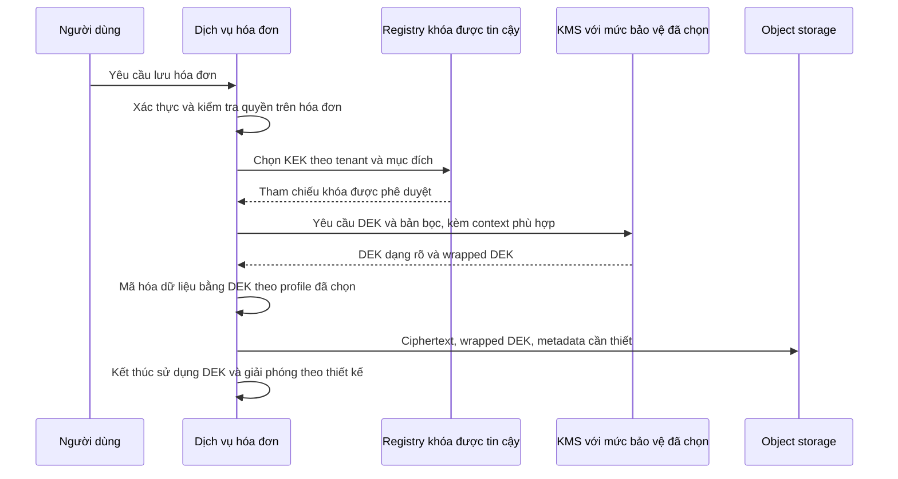

# KMS và HSM

## 1. Từ yêu cầu bảo vệ khóa đến ranh giới tin cậy

“Dữ liệu phải được mã hóa” chưa trả lời được ai có thể giải mã, khóa tồn tại ở đâu và hệ thống tiếp tục hoạt động thế nào khi mất quyền truy cập khóa. Nếu ứng dụng đọc khóa từ cùng database với ciphertext, kẻ chiếm được database có thể lấy cả hai. Nếu chuyển khóa vào một dịch vụ chuyên dụng nhưng cấp quyền giải mã cho mọi tài khoản vận hành, rủi ro truy cập trái phép vẫn còn.

Trong thiết kế yêu cầu bảo mật, **Key Management Service/System — KMS** và **Hardware Security Module — HSM** giúp thiết lập các ranh giới khác nhau cho việc quản lý và sử dụng khóa. Đích đến của thiết kế là những phát biểu kiểm chứng được: loại khóa nào được bảo vệ, thao tác nào được cho phép, chủ thể nào được sử dụng và bằng chứng nào chứng minh yêu cầu đã được thực hiện.

Xét dịch vụ lưu hóa đơn có thông tin khách hàng. Kẻ tấn công có thể lấy bản sao database và object storage, chiếm một workload identity hoặc lợi dụng quyền quản trị. Ba tình huống này đòi hỏi biện pháp khác nhau. Đặt khóa trong HSM có thể giảm khả năng lấy vật liệu khóa trực tiếp, nhưng ứng dụng đã bị chiếm quyền vẫn có thể yêu cầu giải mã nếu quyền gọi dịch vụ quá rộng.

Sau bài này, người học cần có khả năng:

- Phân biệt chức năng quản lý khóa của KMS với ranh giới thực thi mật mã của HSM.
- Vẽ được đường đi của KEK, DEK và dữ liệu rõ trong một thiết kế cụ thể.
- Đặc tả yêu cầu về quyền sử dụng, mức bảo vệ khóa, vòng đời, khả dụng và bằng chứng vận hành.
- Nhận diện giới hạn của các tuyên bố như “khóa không rời HSM” hoặc “hệ thống đã dùng KMS”.

## 2. KMS và HSM đảm nhận những phần việc nào?

### 2.1. KMS: quản lý tài nguyên khóa và quyền thực hiện thao tác

Một KMS thường cung cấp giao diện tạo hoặc nhập khóa, định danh tài nguyên khóa, quản lý trạng thái và phiên bản, đặt chính sách sử dụng, thực hiện một số thao tác mật mã và ghi nhận hoạt động. Phạm vi cụ thể phụ thuộc sản phẩm và cấu hình. Không nên giả định mọi KMS đều có cùng cơ chế phân quyền, cùng kiểu xoay khóa hoặc cùng khả năng khôi phục.

KMS có thể là dịch vụ được quản lý bởi nhà cung cấp, hoặc là hệ thống do tổ chức vận hành. Ứng dụng thường dùng API để gửi yêu cầu kèm danh tính và nhận kết quả. Với một số loại khóa, ứng dụng yêu cầu thao tác bằng tham chiếu khóa thay vì tải vật liệu khóa về máy.

Tên “KMS” không xác định nơi mọi phép toán được thực hiện. Ví dụ, Google Cloud KMS phân biệt mức bảo vệ bằng phần mềm, HSM và HSM đơn thuê. Thiết kế phải chỉ rõ mức bảo vệ được yêu cầu cho từng tài nguyên, thay vì chỉ ghi tên dịch vụ. [Tài liệu Google Cloud về protection levels](https://docs.cloud.google.com/kms/docs/protection-levels).

### 2.2. HSM: ranh giới bảo vệ vật liệu khóa và thực thi mật mã

HSM là một mô-đun phần cứng được thiết kế để bảo vệ khóa và thực hiện các thao tác mật mã trong ranh giới của mô-đun. Ứng dụng có thể kết nối với thiết bị tại chỗ, thiết bị qua mạng hoặc dịch vụ HSM được quản lý. Cơ chế chống can thiệp, phân vùng, xác thực và dự phòng phụ thuộc loại mô-đun cùng cách triển khai.

Một khóa có thể được tạo trong HSM và được cấu hình để ứng dụng chỉ sử dụng qua thao tác cho phép. Tuy nhiên, sở hữu thiết bị HSM chưa tự tạo ra một hệ thống quản lý khóa hoàn chỉnh. Tổ chức vẫn phải thiết kế chính sách cấp quyền, cấp phát khóa, sao lưu, phục hồi, giám sát, quản lý danh tính và xử lý sự cố.

KMS có thể sử dụng HSM làm nơi bảo vệ khóa. Vì vậy, câu hỏi kiến trúc hữu ích là: **KMS quản lý những gì, HSM bảo vệ những khóa nào và ứng dụng nhận được những dạng dữ liệu nào?**

| Khía cạnh | KMS | HSM |
|---|---|---|
| Trọng tâm | Quản lý tài nguyên khóa, chính sách, vòng đời và giao diện sử dụng | Bảo vệ vật liệu khóa và thực thi mật mã trong mô-đun |
| Giao diện thường gặp | API dịch vụ, SDK, giao diện quản trị | PKCS#11, giao diện nhà cung cấp hoặc giao diện dịch vụ |
| Danh tính và quyền | Tích hợp với hệ thống danh tính/chính sách của dịch vụ | Cơ chế đăng nhập, vai trò và chính sách của mô-đun hoặc lớp quản lý |
| Công việc tổ chức còn phải làm | Phân loại dữ liệu, cấp quyền ứng dụng, chọn phạm vi khóa, vận hành | Các việc bên trái, cộng phần quản lý khóa/dịch vụ chưa được sản phẩm cung cấp |
| Bằng chứng cần có | Cấu hình tài nguyên, chính sách, audit, trạng thái và đường gọi | Đúng mô-đun, cấu hình, thuộc tính khóa và đường thực thi thực tế |

### 2.3. Những khái niệm dễ bị đánh đồng

**Secret manager** lưu và phân phối bí mật như mật khẩu hoặc API token. Nếu ứng dụng lấy bí mật dạng rõ về để dùng, ranh giới khác với một dịch vụ chỉ cho phép thao tác bằng khóa không xuất được. Hai loại dịch vụ có thể phối hợp trong cùng thiết kế, nhưng không nên coi chúng có tính chất bảo vệ giống nhau.

**Java KeyStore** là một API trừu tượng để truy cập các mục khóa và chứng thư. Một KeyStore có thể dựa trên file hoặc token. Khai báo một đối tượng `KeyStore` trong Java không chứng minh khóa nằm trong phần cứng; cần biết loại kho, provider, nguồn khóa và cấu hình triển khai.

**Chứng nhận mô-đun** cũng có phạm vi cụ thể. FIPS 140-3 quy định yêu cầu đối với mô-đun mật mã; chương trình CMVP gắn việc xác nhận với phiên bản mô-đun và môi trường được kiểm tra. Một hệ thống có sử dụng sản phẩm mang nhãn FIPS chưa đủ để kết luận toàn bộ ứng dụng đáp ứng một yêu cầu tuân thủ. [NIST FIPS 140-3](https://csrc.nist.gov/pubs/fips/140-3/final), [quy trình CMVP](https://csrc.nist.gov/projects/cryptographic-module-validation-program/cmvp-flow).

## 3. Viết rõ khóa nào được bảo vệ trước mối đe dọa nào

### 3.1. Phân biệt KEK, DEK và khóa ký

Trong mô hình envelope encryption:

- **DEK — Data Encryption Key** mã hóa dữ liệu nghiệp vụ.
- **KEK — Key Encryption Key**, còn có thể được gọi theo thuật ngữ riêng của dịch vụ, bảo vệ DEK.
- **Wrapped DEK** là DEK đã được mã hóa hoặc bọc theo cơ chế được chọn. Có thể lưu nó cùng ciphertext nếu giao thức và phân quyền được thiết kế đúng.

Khóa ký là một trường hợp khác. Ứng dụng có thể gửi dữ liệu hoặc digest phù hợp giao thức tới dịch vụ ký và nhận chữ ký. Phải đặc tả loại khóa, cơ chế ký, định dạng thông điệp và quyền ký; không suy từ luồng bảo vệ DEK sang luồng ký.

AWS mô tả data key được tạo tại HSM và có thể được trả cho chủ thể được cấp quyền dưới cả dạng rõ lẫn dạng đã mã hóa. Đây là ví dụ cho thấy “dùng KMS có HSM” vẫn có thể đi cùng việc ứng dụng nhận DEK dạng rõ. [AWS KMS cryptographic details: basic concepts](https://docs.aws.amazon.com/kms/latest/cryptographic-details/basic-concepts.html).

### 3.2. “Không rời HSM” phải gắn với một vật liệu khóa cụ thể

Hai yêu cầu sau có ý nghĩa rất khác nhau:

> KEK của hồ sơ hóa đơn không được xuất dưới dạng rõ qua giao diện ứng dụng; quyền dùng KEK chỉ được cấp cho các workload đã xác định.

> Không có bất kỳ khóa mã hóa dữ liệu nào xuất hiện dạng rõ ngoài mô-đun mật mã được phê duyệt.

Yêu cầu đầu có thể phù hợp với envelope encryption khi DEK được dùng trong bộ nhớ ứng dụng. Yêu cầu thứ hai không phù hợp với chính luồng đó; kiến trúc phải thay đổi đường mã hóa/giải mã để thỏa ranh giới đã đặt ra.

Không nên thay một yêu cầu mạnh bằng một cụm từ mơ hồ để hợp thức hóa thiết kế sẵn có. Cần xác định loại dữ liệu, lý do cần ranh giới, vị trí xử lý plaintext và mức rủi ro được chấp nhận trước khi chọn cơ chế.

Tài liệu AWS phân biệt rõ vật liệu của KMS key với data key và mô tả ranh giới HSM đối với vật liệu KMS key. Phát biểu cho một loại khóa trong một dịch vụ không phải là bảo đảm cho mọi khóa, mọi API hoặc mọi hệ thống dùng tên “KMS”. [AWS KMS: data protection](https://docs.aws.amazon.com/kms/latest/developerguide/data-protection.html).

### 3.3. Liệt kê khả năng và giới hạn bảo vệ

| Tình huống đe dọa | Cơ chế có ích | Giới hạn phải ghi trong thiết kế |
|---|---|---|
| Bị lấy bản sao object storage | Ciphertext và DEK được bọc bằng KEK có quyền truy cập riêng | Kẻ tấn công có thêm danh tính giải mã hợp lệ vẫn có thể đọc dữ liệu |
| Bị lấy bản sao database | Phân tách dữ liệu lưu trữ khỏi quyền sử dụng KEK | Metadata và các trường không mã hóa vẫn có thể lộ |
| Bị chiếm tiến trình xử lý plaintext | Giới hạn quyền, phạm vi dữ liệu và thời gian tồn tại DEK | HSM không ngăn tiến trình đọc plaintext mà tiến trình vốn được phép xử lý |
| Người vận hành có quyền đổi policy | Tách nhiệm vụ, phê duyệt và audit thay đổi quyền | Chỉ đặt khóa trong phần cứng không ngăn cấp quyền sai |
| Mất một nút hoặc vùng triển khai | Dự phòng, thiết kế phụ thuộc và phương án phục hồi | Backup ciphertext không thay thế backup/khả năng truy cập khóa cần thiết |
| Dịch vụ ký bị lạm dụng | Giới hạn danh tính, mục đích, loại thông điệp và tốc độ ký | Khóa không xuất được vẫn có thể bị dùng để ký thông điệp trái phép |

Một threat model tốt giúp tránh tuyên bố quá mức: HSM làm giảm một số cách lấy khóa, nhưng việc sử dụng khóa trái mục đích còn phụ thuộc quyền và kiểm tra ở ứng dụng.

## 4. Envelope encryption: đường đi của khóa và dữ liệu

Giả sử một hóa đơn đã được xác định thuộc tenant A. Dịch vụ cần lưu tài liệu có kích thước lớn, trong khi KEK phải được quản lý tập trung. Một thiết kế có thể tạo DEK cho tài liệu, dùng DEK mã hóa cục bộ, rồi lưu DEK đã bọc cùng ciphertext.



Sơ đồ thể hiện một biến thể envelope encryption; tên API và cách tạo/bọc DEK phụ thuộc dịch vụ. Không mặc định mọi KMS đều có API trả đồng thời hai dạng DEK. Một biến thể khác tạo DEK bằng nguồn ngẫu nhiên phù hợp rồi yêu cầu dịch vụ bọc khóa đó.

Khi đọc tài liệu, trình tự bảo mật phải bao gồm cả nghiệp vụ:

1. Xác thực người yêu cầu và kiểm tra quyền đọc đúng tài liệu.
2. Lấy tenant, mục đích và profile từ nguồn đã xác thực; kiểm tra metadata của đối tượng lưu trữ.
3. Chọn hoặc xác minh tham chiếu KEK bằng registry được tin cậy.
4. Yêu cầu mở wrapped DEK với context và quyền phù hợp.
5. Giải mã bằng profile đã định, xác minh tính toàn vẹn trước khi cung cấp dữ liệu theo giao thức.
6. Hạn chế thời gian tồn tại của DEK, plaintext và các bản sao trung gian.

Ứng dụng không được coi bước 4 thành kiểm tra quyền đọc tài liệu. KMS có thể chỉ nhận biết một service account được cấp quyền với KEK; nó không tự biết người dùng cuối có quyền đọc hóa đơn cụ thể hay không.

### Metadata cần đủ để đọc lại và đủ chặt để chống tráo đổi

Một bản ghi envelope có thể bao gồm:

```text
formatVersion       = 1
cryptoProfile       = invoice-aead-v1
keyReference        = tham chiếu KEK được hệ thống phê duyệt
wrappedDataKey      = bytes theo định dạng của dịch vụ
nonceOrHeader       = dữ liệu công khai theo profile
ciphertextAndTag    = bytes theo định dạng đã quy định
contextSchema       = invoice-context-v1
```

Đây là mô hình dữ liệu minh họa, không phải định dạng liên vận chuẩn. Profile phải quy định thuật toán, cách xử lý nonce, tag, giới hạn kích thước và cách xác thực metadata. Nếu dùng mã hóa theo khối/chunk, còn phải quy định chỉ số, thứ tự và cách ngăn thiếu hoặc tráo chunk. Một lần gọi KMS không tự giải quyết những yêu cầu này.

Các trường nhận từ storage đều là đầu vào cần kiểm tra. Không cho `keyReference` trong bản ghi tùy ý chuyển ứng dụng sang khóa ngoài phạm vi tenant, môi trường hoặc mục đích. Tham chiếu có thể hỗ trợ định tuyến, nhưng quyết định tin cậy phải dựa trên policy và registry do hệ thống kiểm soát.

## 5. Gắn quyền sử dụng khóa với danh tính và mục đích

### 5.1. Cấp quyền cho workload cụ thể

Nên diễn đạt quyền theo tổ hợp **chủ thể — thao tác — tài nguyên — điều kiện**, chẳng hạn:

```text
Chủ thể: workload xử lý hóa đơn ở production
Thao tác: tạo/bọc DEK và mở DEK cho mục đích lưu hóa đơn
Tài nguyên: tập KEK của production đã đăng ký
Điều kiện: đúng tenant, đúng purpose và đúng đường gọi được cho phép
Không bao gồm: sửa policy, xuất khóa, xóa khóa hoặc dùng khóa ký
```

Đây là một yêu cầu thiết kế, không phải cú pháp IAM dùng chung. Cần ánh xạ từng phần sang khả năng thật của nền tảng: policy của key, identity policy, grant, quyền token hoặc lớp kiểm soát khác. Điều kiện nào KMS không biểu diễn được phải được thực thi ở thành phần thích hợp và ghi rõ giới hạn tin cậy.

Ưu tiên cơ chế danh tính workload và credential có thời hạn phù hợp. Nếu quyền gọi KMS được bảo vệ bằng một secret dài hạn đặt cạnh ứng dụng, bí mật đó trở thành điểm đầu vào cần bảo vệ. Việc chuyển KEK ra khỏi file cấu hình không làm biến mất vấn đề bootstrap danh tính.

### 5.2. Tách người quản lý khóa khỏi người sử dụng dữ liệu

Một mô hình phân vai có thể gồm:

| Vai trò | Nhu cầu hợp lệ | Quyền không nên được gộp mặc định |
|---|---|---|
| Quản trị tài nguyên khóa | Tạo tài nguyên và cấu hình vòng đời theo quy trình | Giải mã dữ liệu nghiệp vụ |
| Workload xử lý dữ liệu | Thực hiện thao tác mật mã trong phạm vi được giao | Sửa policy hoặc xóa khóa |
| Người phê duyệt thay đổi nhạy cảm | Xem xét cấp quyền, vô hiệu hóa và xóa | Tự thực hiện rồi tự phê duyệt cùng thay đổi |
| Người kiểm toán | Đọc bằng chứng và đối chiếu thay đổi | Truy xuất plaintext hoặc dùng khóa |
| Nhóm ứng cứu | Quyền khẩn cấp có thời hạn, có ghi nhận và rà soát | Duy trì quyền đặc biệt thường trực không có phạm vi |

Sự phân tách phải được kiểm tra qua quyền thực tế. Một người không có `Decrypt` nhưng có thể tự sửa policy để thêm `Decrypt` vẫn có một đường dẫn tới dữ liệu. Threat model phải xét cả quyền trực tiếp và quyền có thể tạo ra quyền mới.

### 5.3. Context/AAD hỗ trợ ràng buộc, nhưng cần nguồn tin cậy

Với một cơ chế hỗ trợ authenticated encryption, có thể ràng buộc các định danh như tenant, đối tượng và mục đích vào dữ liệu được bảo vệ. Ví dụ:

```text
tenant-id     = định danh tenant từ ngữ cảnh xác thực
object-id     = định danh tài liệu đã kiểm tra quyền
purpose       = invoice-storage
schema        = invoice-context-v1
```

Giá trị cần được dựng theo quy tắc chuẩn hóa cố định. Không lấy toàn bộ context do client gửi rồi mặc nhiên coi đó là kết quả xác thực. Một tenant ID tự khai không chứng minh người gọi thuộc tenant đó.

Trong AWS KMS, encryption context của các thao tác phù hợp với khóa đối xứng được ràng buộc với ciphertext, không phải bí mật và có thể xuất hiện trong CloudTrail. Vì vậy, chỉ đưa định danh không nhạy cảm theo chính sách vào context; không đưa mật khẩu, token, số giấy tờ hoặc nội dung hóa đơn. Không áp dụng mặc định khả năng này cho mọi loại khóa. [AWS KMS: encryption context](https://docs.aws.amazon.com/kms/latest/developerguide/encrypt_context.html).

Context của lần bọc DEK và AAD của lần mã hóa dữ liệu cục bộ là hai điểm ràng buộc khác nhau. Profile phải xác định dữ liệu nào được đưa vào từng bước và cách đối chiếu khi đọc lại. Bọc DEK có context không tự xác thực mọi metadata mà ứng dụng đặt cạnh ciphertext.

## 6. Tích hợp Java: dùng tham chiếu khóa qua PKCS#11

Một hướng tích hợp HSM trong Java là dùng provider PKCS#11 phù hợp với mô-đun. Oracle mô tả cách truy cập token qua `KeyStore` loại `PKCS11` và truyền PIN qua tham số mật khẩu của `load`. Đây là mô hình tích hợp token, còn một KMS qua mạng thường có SDK hoặc API riêng. [Oracle Java 21: PKCS#11 Reference Guide](https://docs.oracle.com/en/java/javase/21/security/pkcs11-reference-guide1.html).

Ví dụ dưới đây chỉ minh họa ranh giới: chọn provider được phê duyệt, mở kho token và lấy đối tượng khóa theo alias đã cấu hình. Ví dụ không khởi tạo khóa mới hoặc thiết lập chính sách xuất khóa.

```java
import java.io.IOException;
import java.security.GeneralSecurityException;
import java.security.Key;
import java.security.KeyStore;
import java.security.KeyStoreException;
import java.security.Provider;
import java.util.Objects;
import javax.crypto.SecretKey;

public final class TokenKeyAccess {
    private TokenKeyAccess() {
    }

    public static SecretKey loadConfiguredKey(
            Provider approvedProvider,
            String configuredAlias,
            char[] loginPin)
            throws GeneralSecurityException, IOException {

        Objects.requireNonNull(approvedProvider, "approvedProvider");
        Objects.requireNonNull(configuredAlias, "configuredAlias");
        Objects.requireNonNull(loginPin, "loginPin");

        KeyStore tokenStore = KeyStore.getInstance(
                "PKCS11", approvedProvider);
        tokenStore.load(null, loginPin);

        Key key = tokenStore.getKey(configuredAlias, null);
        if (!(key instanceof SecretKey secretKey)) {
            throw new KeyStoreException(
                    "Configured secret key is unavailable");
        }
        return secretKey;
    }
}
```

`approvedProvider` và `configuredAlias` phải đến từ cấu hình được kiểm soát, không từ tham số tùy ý của request. Thành phần gọi chịu trách nhiệm lấy PIN từ cơ chế bootstrap phù hợp, tránh log và xóa mảng ký tự khi hết nhu cầu. Cần thiết kế riêng vòng đời đăng nhập, phiên, kết nối và xử lý đồng thời theo tài liệu của provider; không mặc định tải lại token cho từng request.

Đối tượng `SecretKey` có thể đại diện cho khóa trên token. Mã nghiệp vụ có thể dùng đối tượng đó với thao tác/provider tương thích mà không cần gọi `getEncoded()` để chuyển khóa thành `byte[]`. Tuy nhiên, kiểu Java và giá trị `getEncoded() == null` không đủ chứng minh toàn bộ hệ thống không có đường xuất khóa. Thuộc tính khóa, quyền token, cách tạo/nhập và các giao diện khác đều cần được kiểm soát.

Nếu provider không sẵn sàng, không tự chọn một khóa file hoặc provider phần mềm để tiếp tục khi yêu cầu đòi khóa ở HSM. Cơ chế xử lý lỗi phải bảo toàn yêu cầu bảo vệ đã đặt ra. Trường hợp cho phép một đường dự phòng khác phải được đặc tả trước cùng mức bảo vệ và bằng chứng đáp ứng.

Với managed KMS, không ép mô hình mọi khóa đều phải là `SecretKey` cục bộ. Có thể lưu một tham chiếu tài nguyên đã phê duyệt và gọi API tương ứng. Quan trọng là hợp đồng bảo mật của đường gọi và dạng kết quả nhận được, không phải tên lớp Java được sử dụng.

## 7. Vòng đời khóa: tạo, nhập, thay đổi và kết thúc sử dụng

### 7.1. Tạo và nhập khóa là hai đường đi có lịch sử khác nhau

Nếu yêu cầu là “vật liệu khóa chưa từng tồn tại dạng rõ ngoài HSM”, phải xem xét nguồn tạo khóa và toàn bộ đường xử lý từ ban đầu. Nhập khóa từ một file vào HSM rồi đánh dấu không cho xuất không xóa được lịch sử những bản sao đã có trên máy tạo khóa, công cụ chuyển đổi hoặc hệ thống backup.

Với khóa nhập, đặc tả cần trả lời: ai tạo khóa, nguồn ngẫu nhiên nào được dùng, khóa được bảo vệ thế nào khi chuyển, ai giữ bản gốc, bản gốc có thời hạn lưu nào và mất bản gốc có ảnh hưởng đến phục hồi hay không. Không gộp “tổ chức sở hữu khóa” với “khóa không tồn tại ở bất kỳ nơi nào khác”.

Ví dụ, AWS yêu cầu người dùng quản lý bản sao ngoài AWS đối với vật liệu khóa nhập để có thể nhập lại khi cần. Điều này cho thấy chính sách nguồn gốc và backup là một phần của ranh giới bảo vệ, kể cả khi dịch vụ không cung cấp API xuất vật liệu đã nhập. [AWS KMS: lưu ý với imported key material](https://docs.aws.amazon.com/kms/latest/developerguide/importing-keys-considerations.html).

### 7.2. Phiên bản, alias và rotation cần được đặc tả riêng

Thiết kế phải phân biệt ít nhất bốn hành động:

- Tạo vật liệu khóa hoặc tài nguyên khóa mới.
- Chuyển đường ghi mới sang khóa/phiên bản mới.
- Bọc lại DEK bằng KEK khác, nếu cơ chế cho phép.
- Giải mã và mã hóa lại dữ liệu bằng DEK mới.

Các hành động này không tương đương. Đổi alias có thể chỉ thay đích cho lần ghi sau; dữ liệu cũ vẫn có quan hệ với khóa cũ. Bọc lại DEK không thay DEK đã dùng để mã hóa dữ liệu. Nếu DEK bị lộ, chỉ thay KEK không loại bỏ khả năng kẻ tấn công dùng DEK đã có để đọc bản ciphertext tương ứng.

AWS nêu rõ rotation vật liệu KMS key không tự xoay data key hoặc mã hóa lại dữ liệu đã được bảo vệ. Khi viết yêu cầu cho nền tảng khác, cũng cần kiểm tra đúng ý nghĩa của thao tác rotation trên nền tảng đó. [AWS KMS: rotate keys](https://docs.aws.amazon.com/kms/latest/developerguide/rotate-keys.html).

Định dạng lưu trữ phải cho phép tìm đúng khóa khi đọc lại. Một số dịch vụ quản lý phiên bản nội bộ trong ciphertext, còn dịch vụ khác bộc lộ phiên bản qua giao diện tài nguyên. Yêu cầu nên mô tả kết quả cần đạt: dữ liệu cũ giải mã được bằng đường đọc được phê duyệt, metadata không thể chuyển việc giải mã sang khóa ngoài phạm vi và không phụ thuộc mù quáng vào alias hiện tại.

### 7.3. Disable, thu hồi quyền và delete không có cùng tác động

Thu hồi quyền ngăn một chủ thể tiếp tục thực hiện thao tác được kiểm soát sau thời gian hiệu lực của cơ chế. Vô hiệu hóa khóa có thể ngăn các thao tác mới dùng khóa đó. Xóa vật liệu khóa có thể làm dữ liệu không thể phục hồi. Cần xem chính xác trạng thái, thời gian lan truyền và khả năng hoàn tác của nền tảng.

Những hành động này không tự xóa DEK đang nằm trong bộ nhớ của một tiến trình hoặc plaintext đã được đọc trước đó. Chúng cũng không thu hồi được bản sao khóa đã bị lấy ra trái phép. Với ứng dụng hợp lệ, có thể yêu cầu dừng sử dụng cache và hoàn tất xử lý trong một thời hạn; với tiến trình đã bị kiểm soát, cần có biện pháp cô lập, chấm dứt danh tính và ứng cứu rộng hơn.

Trước khi xóa khóa, cần kiểm kê dữ liệu sống, bản sao, backup, dữ liệu lưu giữ theo nghĩa vụ và hệ thống phụ thuộc. “Đã đổi khóa cho ghi mới” không chứng minh mọi backup cũ không còn cần khóa cũ. Chính sách crypto-erasure phải xác định cả phạm vi các bản sao khóa và điều kiện thực sự làm dữ liệu không thể phục hồi.

## 8. Khả dụng, hiệu năng và cache không được phá vỡ yêu cầu bảo vệ

### 8.1. Chọn đường gọi theo loại thao tác

Gọi từ xa cho mỗi khối dữ liệu có thể làm tăng độ trễ và số request. Envelope encryption tách việc bảo vệ DEK khỏi việc xử lý dữ liệu khối lượng lớn. Đổi lại, DEK và plaintext xuất hiện tại thành phần mã hóa/giải mã cục bộ. Đây là đánh đổi về ranh giới tin cậy cần được ghi trong thiết kế.

Với mỗi đường gọi, cần xác định giới hạn kích thước, thuật toán được hỗ trợ, quota, độ trễ mục tiêu, thời gian chờ, cơ chế retry và xử lý kết quả không chắc chắn. Không sao chép một con số giới hạn từ KMS này sang KMS khác. Tài liệu vận hành phải gắn với dịch vụ, vùng, cấu hình và phiên bản SDK đang dùng.

Retry cần có giới hạn, backoff và cách xử lý thao tác đã thành công nhưng client chưa nhận kết quả. Ví dụ, tạo DEK mới rồi mất kết nối không cho phép ứng dụng ghi một ciphertext thiếu wrapped DEK tương ứng. Luồng lưu trữ phải tránh trạng thái “đã báo thành công nhưng không thể giải mã dữ liệu”.

### 8.2. Cache DEK là một quyết định bảo mật

Cache có thể giảm số lần gọi dịch vụ, nhưng kéo dài thời gian vật liệu khóa tồn tại trong ứng dụng. Một cache hợp lệ cần có phạm vi rõ ràng và không được trả khóa theo một alias ngắn bỏ qua tenant hoặc mục đích.

| Thuộc tính cần quy định | Lý do |
|---|---|
| Tenant, mục đích và profile | Ngăn dùng nhầm vật liệu khóa giữa các miền dữ liệu |
| Danh tính/quan hệ khóa tương ứng | Không tái sử dụng mục cache cho tham chiếu không liên quan |
| Thời hạn tối đa | Giới hạn cửa sổ sử dụng vật liệu đã lấy về |
| Giới hạn số lần và lượng dữ liệu khi tái sử dụng để mã hóa | Tôn trọng giới hạn của cơ chế mật mã đã chọn |
| Cơ chế loại bỏ khi thay đổi quyền hoặc ứng cứu | Hỗ trợ thời hạn ngừng sử dụng đã cam kết |
| Vị trí lưu và khả năng tạo bản sao | Tránh biến cache bộ nhớ thành kho khóa trên đĩa ngoài thiết kế |

AWS Encryption SDK minh họa việc quản lý cache bằng các ngưỡng tuổi, số thông điệp và lượng dữ liệu. Đây là ví dụ về kiểm soát cần có; không phải hướng dẫn tự xây cache hay tái sử dụng DEK với mọi thuật toán. Phải chọn cơ chế cache được thư viện hỗ trợ và tương thích profile. [AWS Encryption SDK: cache security thresholds](https://docs.aws.amazon.com/encryption-sdk/latest/developer-guide/thresholds.html).

Giả sử yêu cầu nghiệp vụ đặt thời hạn **120 giây** để các workload hợp lệ dừng giải mã sau lệnh thu hồi. Con số này chỉ là ví dụ của bài. Thiết kế phải tính cả thời gian lan truyền policy, cache trên mọi instance và thao tác đang chạy. Nếu cache có tuổi tối đa 10 phút mà không có đường vô hiệu hóa đáp ứng thời hạn, thiết kế chưa thỏa yêu cầu 120 giây.

Thời hạn này không phải bảo đảm lấy lại plaintext đã giao cho người dùng hoặc vô hiệu hóa một DEK đã bị đánh cắp. Cần diễn đạt chính xác phạm vi: ngăn hệ thống hợp lệ tiếp tục thực hiện thao tác sau mốc đã định.

### 8.3. Thiết kế trạng thái lỗi và phục hồi

Khi KMS/HSM không sẵn sàng, ứng dụng không được lưu plaintext, dùng khóa ghi cứng hoặc đổi sang mức bảo vệ yếu hơn để báo thành công. Có thể trả lỗi tạm thời hoặc chờ xử lý theo thiết kế; nếu có hàng đợi, dữ liệu trong hàng đợi cũng phải được bảo vệ theo yêu cầu.

Cần tách các tình huống: mất kết nối, bị từ chối quyền, khóa không còn hoạt động, vượt quota, lỗi mô-đun và ciphertext không hợp lệ. Cách phản hồi bên ngoài tránh lộ chi tiết nhạy cảm, còn quan sát nội bộ phải đủ để phân biệt nguyên nhân và chọn hành động phù hợp.

Một kế hoạch khả dụng cần bao gồm cả danh tính, DNS/mạng, credential, policy, phiên HSM và hệ thống audit liên quan. Có hai thiết bị không đủ chứng minh phục hồi nếu cả hai phụ thuộc một tài khoản đã hết hạn hoặc backup chỉ giải mã được bằng khóa đã mất.

Đối với sao lưu và phục hồi, cần xác định:

1. Vật liệu hoặc tài nguyên nào được sao lưu, theo cơ chế nào và dưới sự kiểm soát của ai.
2. Những tài nguyên, quyền và trạng thái nào cần được tái lập để đọc ciphertext cũ.
3. Cách duy trì giới hạn xuất khóa trong quá trình sao lưu, nhân bản và phục hồi.
4. Mục tiêu thời gian khôi phục và mức mất dữ liệu được chấp nhận cho đúng luồng nghiệp vụ.
5. Bằng chứng khôi phục trên môi trường đại diện, bao gồm dữ liệu dùng khóa cũ.

Không mặc định backup HSM của một nhà cung cấp có thể nhập vào HSM khác, hoặc giữ bản sao khóa là có thể tự giải mã mọi định dạng ciphertext của dịch vụ. Tính tương thích phải được kiểm tra ở cấp giao thức và sản phẩm đã chọn.

## 9. Chuyển kiến trúc thành yêu cầu bảo mật có thể kiểm chứng

Một yêu cầu hữu ích cần có tài sản, phạm vi, hành vi bắt buộc và bằng chứng. Các mã dưới đây là ví dụ cho dịch vụ hóa đơn, không phải bộ quy định áp dụng nguyên trạng cho mọi hệ thống.

| Mã | Yêu cầu minh họa | Bằng chứng/tiêu chí chấp nhận |
|---|---|---|
| KM-HSM-01 | KEK production dùng mức bảo vệ HSM đã được phê duyệt; ứng dụng không được xuất KEK dạng rõ | Cấu hình tài nguyên, thuộc tính khóa và kết quả từ chối đường xuất không được phép |
| KM-HSM-02 | Danh tính xử lý hóa đơn chỉ được dùng tập khóa và thao tác phục vụ hóa đơn production | Policy thực tế và tình huống từ chối với khóa, thao tác, môi trường ngoài phạm vi |
| KM-HSM-03 | Quyền đọc hóa đơn được kiểm tra trước khi gọi mở DEK hoặc sử dụng DEK cache | Luồng xử lý và bằng chứng người dùng không có quyền không nhận plaintext |
| KM-HSM-04 | Tenant, đối tượng và mục đích được ràng buộc theo context/profile đã định | Đổi tenant, object hoặc purpose làm thao tác bị từ chối hoặc xác minh thất bại |
| KM-HSM-05 | Tham chiếu khóa từ ciphertext không được lựa chọn tài nguyên ngoài registry được tin cậy | Metadata giả không tạo được đường gọi tới khóa tùy ý |
| KM-HSM-06 | Các workload hợp lệ dừng thao tác thuộc phạm vi thu hồi trong 120 giây theo giả định của hệ thống ví dụ | Quan sát nhiều instance, policy propagation, cache và tác vụ đang chạy |
| KM-HSM-07 | Sự cố KMS/HSM không làm dữ liệu được lưu dạng rõ hoặc dùng khóa dự phòng ngoài policy | Bằng chứng trạng thái lưu trữ và phản hồi ở các nhánh lỗi đại diện |
| KM-HSM-08 | Quản trị khóa không mặc nhiên có quyền đọc dữ liệu; thay đổi quyền nhạy cảm có phê duyệt theo quy trình | Ma trận quyền, đường cấp quyền gián tiếp, audit và bản ghi phê duyệt |
| KM-HSM-09 | Rotation không làm mất khả năng đọc dữ liệu còn trong thời hạn lưu giữ | Đọc dữ liệu trước/sau thay đổi và dữ liệu phục hồi từ backup đại diện |
| KM-HSM-10 | Khóa, DEK, PIN và plaintext không xuất hiện trong log ứng dụng, trace hoặc bản ghi lỗi | Quan sát log/trace ở luồng thành công, từ chối và timeout |
| KM-HSM-11 | Các thao tác quản trị và sử dụng khóa cần thiết có audit gắn được với workload và request | Sự kiện có chủ thể, tài nguyên, thao tác, kết quả, thời gian và correlation phù hợp |
| KM-HSM-12 | Nếu có yêu cầu xác nhận mô-đun, triển khai phải khớp đúng chứng chỉ và điều kiện áp dụng | Chứng chỉ, security policy, phiên bản và cấu hình môi trường được đối chiếu |

Không chọn mã yêu cầu theo tên sản phẩm rồi xem đó là hoàn thành. Ví dụ, KM-HSM-01 có thể chỉ bảo vệ KEK, trong khi yêu cầu khác vẫn cần xử lý việc DEK nằm trong heap Java. Hai phạm vi phải xuất hiện rõ trong hồ sơ thiết kế.

Đối với yêu cầu định lượng, cần quy định cách đo. “KMS có độ trễ thấp” không cho biết ngưỡng, tải hoặc percentile. “Phục hồi nhanh” không cho biết tính từ lúc nào và cần phục hồi thao tác nào. Ngưỡng được chọn phải dựa trên nhu cầu của luồng nghiệp vụ và được xác minh bằng môi trường đại diện.

## 10. Các tình huống chấp nhận cần mô tả trong thiết kế

Các tình huống sau là đề xuất cho bước kiểm chứng của dự án. Chúng giúp làm rõ yêu cầu; việc viết danh sách không đồng nghĩa hệ thống đã được kiểm thử hoặc đã đạt yêu cầu.

| Tình huống | Kết quả mong đợi |
|---|---|
| Workload hợp lệ, đúng hóa đơn và đúng khóa | Lưu/đọc thành công theo profile, có audit cần thiết |
| Người dùng không có quyền trên hóa đơn, workload vẫn có quyền KMS | Bị chặn tại kiểm tra nghiệp vụ; không nhận plaintext |
| Credential của workload khác được dùng để gọi trực tiếp | KMS hoặc lớp kiểm soát tương ứng từ chối theo policy |
| Wrapped DEK của tenant A được chuyển sang hồ sơ tenant B | Bị từ chối do kiểm tra phạm vi hoặc xác minh context/profile |
| Metadata chứa khóa khác, alias môi trường thử nghiệm hoặc URI tùy ý | Không điều hướng ra ngoài tập tài nguyên được phê duyệt |
| Ciphertext, tag hoặc metadata đã ràng buộc bị sửa | Không trả dữ liệu được xem là hợp lệ; không lộ chi tiết nhạy cảm |
| Khóa hoặc provider có mức bảo vệ thấp hơn yêu cầu | Phát hiện và từ chối dùng đường không đáp ứng policy |
| HSM mất kết nối hoặc KMS timeout | Xử lý lỗi theo thiết kế, không có plaintext lưu thay thế hoặc khóa ghi cứng |
| Dịch vụ trả lỗi quyền, quota hoặc khóa không hoạt động | Không retry vô hạn; có tín hiệu vận hành đúng loại |
| Thu hồi quyền khi nhiều instance đang giữ DEK cache | Các instance hợp lệ dừng trong cửa sổ đã đặc tả |
| Chuyển khóa ghi mới rồi đọc dữ liệu cũ | Vẫn tìm đúng đường đọc cho dữ liệu còn cần giữ |
| Phục hồi backup trong bối cảnh mất nút hoặc mất cấu hình | Đạt mục tiêu phục hồi và giữ được mức bảo vệ đã yêu cầu |
| Quản trị viên không có quyền dữ liệu thử tự thêm quyền | Hành vi bị ngăn hoặc được đưa qua kiểm soát thay đổi đã quy định |
| Gặp lỗi khi đăng nhập token hoặc khởi tạo SDK | Không log PIN, credential hoặc vật liệu khóa |

Với yêu cầu “không xuất KEK”, cần chỉ rõ giao diện nào phải bị từ chối và cơ chế backup/replication được phép ra sao. Một thử nghiệm gọi một API xuất không thành công không chứng minh không còn đường nào khác; hồ sơ bằng chứng còn cần thuộc tính khóa, quyền quản trị, nguồn gốc và ranh giới sản phẩm.

Nếu khóa đã được nhập, tình huống kiểm chứng phải bao gồm lịch sử bản sao ngoài mô-đun. Nếu dùng HSM qua PKCS#11, cần xác nhận đường triển khai thật dùng provider và token đã chọn. Nếu dùng KMS có nhiều mức bảo vệ, cần kiểm tra đúng tài nguyên đang phục vụ request production.

## 11. Audit: quan sát việc dùng khóa và việc truy cập dữ liệu

Audit quản trị cần cho biết ai tạo, nhập, thay policy, chuyển trạng thái hoặc yêu cầu xóa khóa. Audit sử dụng cần giúp truy vết danh tính workload, thao tác, tham chiếu khóa, kết quả và thời điểm. Những bản ghi này cần quyền truy cập và cơ chế chống sửa phù hợp với threat model.

Tuy nhiên, không thể suy toàn bộ số lần đọc dữ liệu chỉ từ số lần gọi KMS. Nếu một lần mở DEK được phục vụ tiếp qua cache, nhiều lần giải mã cục bộ có thể không tạo thêm lời gọi tới KMS. Đây là hệ quả của thiết kế cache: cần kết hợp audit của ứng dụng với audit khóa để thấy cả hành vi nghiệp vụ và thao tác mật mã.

Với dịch vụ hóa đơn, có thể liên kết:

```text
Request nghiệp vụ
  -> danh tính người dùng và quyết định quyền trên hóa đơn
  -> danh tính workload và tham chiếu khóa được chọn
  -> thao tác mở DEK hoặc quyết định dùng cache
  -> kết quả cung cấp dữ liệu
```

Correlation ID không thay thế xác thực; nó giúp nối các bằng chứng. Cần kiểm soát độ dài, định dạng và nguồn giá trị để tránh log injection hoặc trường dữ liệu tùy ý. Không đưa plaintext, DEK, PIN hoặc toàn bộ thông điệp nhạy cảm vào sự kiện để thuận tiện điều tra.

Tín hiệu cảnh báo có thể gồm thay đổi policy bất thường, tăng đột biến từ chối quyền, thao tác giải mã ngoài mẫu hoạt động dự kiến, provider/token không sẵn sàng và yêu cầu vô hiệu hóa/xóa ngoài quy trình. Ngưỡng phải dựa trên đặc tính hệ thống, tránh xem mọi tăng tải hợp lệ là sự cố bảo mật.

## 12. Áp dụng vào dịch vụ hóa đơn nhiều tenant

Giả sử nhóm ban đầu đề xuất: “Mỗi hóa đơn lưu ciphertext và wrapped DEK; KEK nằm trong KMS có HSM; backend có quyền giải mã toàn bộ.” Thiết kế này có thể chống việc chỉ lấy bản sao storage, nhưng phạm vi thiệt hại khi backend bị chiếm còn lớn.

Một cách làm rõ yêu cầu là xác định ba ranh giới:

**Ranh giới người dùng với dữ liệu.** Mọi yêu cầu đọc hóa đơn cần qua kiểm tra quyền trên đối tượng. Quyền của backend tại KMS không thay kiểm tra này. Tenant được lấy từ ngữ cảnh xác thực và quan hệ sở hữu đã kiểm tra, không từ một header tự khai.

**Ranh giới workload với tài nguyên khóa.** Registry ánh xạ tenant/mục đích/môi trường sang tập khóa hợp lệ. Workload không được mở DEK cho mục đích ngoài phạm vi được cấp. Với hệ thống có mức cô lập cao hơn, có thể chia workload và quyền theo miền dữ liệu; lựa chọn này cần cân nhắc quy mô, vận hành và mô hình đe dọa.

**Ranh giới mô-đun mật mã với ứng dụng.** KEK được giữ theo mức bảo vệ đã quy định. DEK dạng rõ được phép tồn tại trong thành phần xử lý hóa đơn theo envelope profile, với giới hạn thời gian và kiểm soát bộ nhớ/log. Nếu phân loại dữ liệu không cho phép điều đó, phải chọn một đường xử lý khác trước khi triển khai.

Sau đó nhóm bổ sung yêu cầu vận hành: dữ liệu cũ còn đọc được sau rotation, lỗi KMS không dẫn đến lưu plaintext, thu hồi quyền đáp ứng cửa sổ đã định và phục hồi bao gồm cả khả năng truy cập khóa. Các yêu cầu này nối threat model với kiến trúc và tiêu chí chấp nhận cụ thể.

Trong tình huống workload bị chiếm, biện pháp ứng cứu có thể gồm cô lập tiến trình, thu hồi danh tính, kiểm tra cache và phạm vi dữ liệu đã bị truy cập, rồi chọn thay khóa hoặc mã hóa lại theo vật liệu có nguy cơ lộ. Không kết luận chỉ cần xoay KEK là đã xử lý xong mọi ảnh hưởng.

## 13. Những kết luận cần giữ chính xác

- **Dùng KMS** cần đi kèm mô tả mức bảo vệ, quyền và đường sử dụng của từng loại khóa.
- **Dùng HSM** cần đi kèm mô tả nguồn gốc khóa, thuộc tính, giao diện, vận hành và phạm vi mô-đun.
- **Khóa không xuất được** giảm một cách lấy vật liệu khóa; quyền gọi giải mã hoặc ký vẫn phải được giới hạn.
- **KEK không rời mô-đun dạng rõ** không có nghĩa DEK hoặc plaintext không xuất hiện tại ứng dụng.
- **Rotation, thu hồi quyền và xóa khóa** là các hành động khác nhau, với tác động khác nhau lên ciphertext, cache và khả năng phục hồi.
- **Bằng chứng bảo mật** phải bao gồm cấu hình và hành vi triển khai thực tế, cùng giới hạn của những điều đã xác minh.

Một thiết kế KMS/HSM đủ rõ cho người triển khai và người kiểm chứng phải trả lời được: khóa nào, ở đâu, ai được dùng, dùng vào việc gì, khi nào quyền chấm dứt và làm sao phục hồi mà vẫn giữ được ranh giới bảo vệ đã cam kết.
