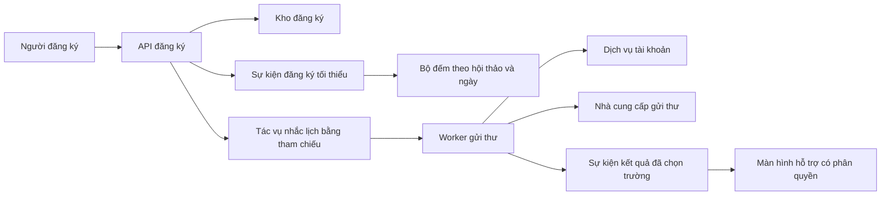

# Data minimization

## 1. Tối thiểu hóa dữ liệu phải trở thành quyết định thiết kế

**Data minimization**, hay tối thiểu hóa dữ liệu, là lựa chọn và giới hạn dữ liệu cần xử lý để hoàn thành một mục đích đã xác định. Quyết định này liên quan đến trường dữ liệu, độ chi tiết, số đối tượng, tần suất thu thập, thời gian tồn tại và nơi nhận dữ liệu. Trong thiết kế yêu cầu bảo mật, phát biểu “chỉ thu thập dữ liệu cần thiết” phải được chuyển thành hợp đồng mà người triển khai và người nghiệm thu có thể hiểu giống nhau.

W3C đặt nguyên tắc giới hạn dữ liệu trao đổi theo nhu cầu của người dùng và khuyến khích thiết kế API để giảm dữ liệu phải yêu cầu. Phạm vi của nguyên tắc này bao gồm cả dữ liệu chưa được coi là định danh hoặc nhạy cảm. [W3C Privacy Principles — Data Minimization](https://www.w3.org/TR/privacy-principles/#data-minimization)

Một yêu cầu còn mơ hồ:

> Dịch vụ đăng ký hội thảo phải bảo vệ thông tin cá nhân và chỉ lưu thông tin cần thiết.

Một yêu cầu có thể triển khai:

> Với mục đích đếm số đăng ký theo hội thảo và ngày, sự kiện chuyển sang hệ thống thống kê chỉ được chứa `eventId`, `workshopId`, `registrationDay` và loại thay đổi bộ đếm. Sự kiện không được chứa email, tên hiển thị, mã tài khoản hoặc toàn bộ hồ sơ đăng ký. Cơ chế chống đếm trùng phải có phạm vi và thời hạn riêng, không được tự bổ sung định danh người dùng vào kho thống kê.

Yêu cầu thứ hai chỉ ra mục đích, biên hệ thống, tập dữ liệu và một tình huống dễ làm mở rộng dữ liệu ngoài dự kiến. Nhờ đó có thể nối rủi ro với thiết kế, hợp đồng sự kiện và tiêu chí kiểm thử.

Sau bài này, người học cần có khả năng:

- Giải thích vì sao từng trường dữ liệu cần tồn tại cho từng mục đích.
- Chọn cách giảm dữ liệu từ lúc thu thập đến khi tạo bản sao và kết thúc thời hạn lưu.
- Viết yêu cầu đo được cho API, sự kiện, log, công cụ hỗ trợ và khôi phục dữ liệu.
- Xác định bằng chứng cần thu để nghiệm thu, cùng giới hạn của bằng chứng đó.

## 2. “Tối thiểu” luôn đi cùng “đủ cho mục đích”

Tập dữ liệu nhỏ nhất về số cột chưa chắc là tập dữ liệu phù hợp. Một hệ thống bỏ thời điểm xảy ra sự kiện và kết quả xác thực khỏi nhật ký có thể mất khả năng điều tra chiếm tài khoản. Một hệ thống giữ toàn bộ nội dung yêu cầu trong nhiều năm để “phục vụ điều tra” lại có thể tạo một kho dữ liệu thừa lớn hơn cơ sở dữ liệu nghiệp vụ.

Hướng dẫn của ICO về data minimisation nhấn mạnh ba yếu tố: dữ liệu phải đủ để thực hiện mục đích, có liên quan đến mục đích và được giới hạn ở mức cần thiết. Đây là một cách đặt câu hỏi hữu ích khi đặc tả kỹ thuật; việc xác định nghĩa vụ pháp lý cụ thể cần căn cứ bối cảnh áp dụng. [ICO — Principle (c): Data minimisation](https://ico.org.uk/for-organisations/uk-gdpr-guidance-and-resources/data-protection-principles/a-guide-to-the-data-protection-principles/data-minimisation/)

Với mỗi đề xuất thu thập dữ liệu, cần trả lời:

1. Quyết định hoặc chức năng nào thực sự cần dữ liệu này?
2. Nếu bỏ trường đó, chức năng thất bại theo cách nào?
3. Có thể dùng một kết quả suy ra, độ chi tiết thấp hơn hoặc một truy vấn tại thời điểm cần dùng hay không?
4. Dữ liệu phải xuất hiện ở những thành phần nào và tồn tại đến sự kiện nào?
5. Bằng chứng nào cho thấy cách giảm dữ liệu vẫn đáp ứng chức năng và kiểm soát rủi ro?

Ví dụ, nếu tính năng chỉ cần chọn ngôn ngữ giao diện, một mã ngôn ngữ do người dùng chọn thường phù hợp hơn việc thu địa chỉ nhà và suy ra ngôn ngữ từ địa chỉ. Nếu tính năng cần gửi hàng đến một địa điểm, mã ngôn ngữ lại không thể thay thế địa chỉ giao nhận. Cùng một trường có thể hợp lý trong luồng này và dư thừa trong luồng khác.

“Có thể hữu ích sau này”, “đã có sẵn trong entity” và “nhà cung cấp cho phép gửi thêm” không phải là đặc tả mục đích. Một nhu cầu dự phòng có cơ sở, chẳng hạn điều tra hành vi lạm dụng cụ thể, vẫn phải nêu dữ liệu, phạm vi, thời hạn và người chịu trách nhiệm.

## 3. Các chiều cần giới hạn

Đếm số trường chỉ là một góc nhìn. Một hệ thống còn có thể thu quá thường xuyên, giữ quá lâu hoặc chia sẻ một bản ghi nhỏ cho quá nhiều nơi.

| Chiều cần xem xét | Câu hỏi thiết kế | Ví dụ quyết định |
|---|---|---|
| Phạm vi trường | Chức năng cần thuộc tính nào? | Trang hỗ trợ gửi thư cần trạng thái gửi, không cần ngày sinh |
| Độ chi tiết | Cần giá trị chính xác đến đâu? | Báo cáo theo ngày không mặc định cần thời điểm từng lượt nhấp |
| Phạm vi đối tượng | Cần dữ liệu của ai? | Quy trình cấp chứng nhận chỉ hỏi tên in chứng nhận của người yêu cầu |
| Tần suất | Cần quan sát bao nhiêu lần? | Chỉ ghi thay đổi trạng thái thay vì chụp toàn bộ hồ sơ mỗi phút |
| Thời gian | Sau sự kiện nào dữ liệu hết cần thiết? | Bản xuất tạm có hạn sử dụng tính từ lúc tạo |
| Bản sao | Dữ liệu được nhân sang đâu? | Sự kiện chỉ chứa mã tham chiếu cần thiết, không sao chép hồ sơ |
| Người nhận | Ai cần trường nào cho mục đích nào? | Đơn vị thống kê nhận số đếm, đơn vị gửi thư nhận địa chỉ nhận thư |
| Khả năng liên kết | Có thể ghép thông tin giữa các ngữ cảnh không? | Tránh dùng một định danh theo dõi chung cho mọi bên nhận |

Giảm độ chi tiết không bảo đảm loại bỏ mọi rủi ro. Một vùng địa lý rộng đi cùng lịch sử thời gian dày đặc và những dữ liệu khác vẫn có thể làm lộ hành vi. W3C lưu ý rằng tính nhạy cảm phụ thuộc ngữ cảnh và việc truy vấn lặp lại có thể làm mất tác dụng của việc giảm độ chính xác vị trí. [W3C Privacy Principles — Sensitive Information](https://www.w3.org/TR/privacy-principles/#sensitive-information)

Khi đánh giá một phương án, hãy xem cả dữ liệu quan sát trực tiếp lẫn thông tin có thể suy ra. Nhãn “thường xuyên tham gia lớp phục hồi chức năng”, dù được tạo từ mã sự kiện, có thể nhạy cảm hơn nhiều trường đầu vào riêng lẻ.

## 4. Tình huống xuyên suốt: đăng ký hội thảo trực tuyến

Giả sử một nền tảng cho phép người đã đăng nhập đăng ký hội thảo. Người đăng ký có thể xem thông tin tham gia trong tài khoản; họ có thể chọn nhận thêm email nhắc lịch. Ban tổ chức cần số lượng đăng ký theo ngày. Nhóm hỗ trợ cần biết vì sao một lần gửi nhắc lịch thất bại. Việc cấp chứng nhận tham gia là một tính năng tùy chọn, có luồng riêng.

Các giả định thiết kế trong ví dụ:

- Dịch vụ tài khoản đã quản lý thông tin đăng nhập và địa chỉ email đã xác minh theo chính sách riêng.
- Dịch vụ đăng ký dùng mã tham chiếu tài khoản để xác định người đăng ký; mã này vẫn được quản lý như dữ liệu có khả năng liên kết với cá nhân.
- Email nhắc lịch là lựa chọn riêng; đăng ký hội thảo không đòi hỏi bật lựa chọn này.
- Không có nhu cầu nghiệp vụ đã được phê duyệt cho ngày sinh, số giấy tờ tùy thân, địa chỉ nhà hoặc vị trí GPS.
- Mọi con số về thời hạn trong ví dụ bên dưới là giả định để minh họa đặc tả, không phải thời hạn chuẩn cho các hệ thống khác.

### 4.1. Tách mục đích trước khi chọn trường

| Mã mục đích | Kết quả cần đạt | Dữ liệu có thể cần | Dữ liệu không được đưa vào chỉ vì tiện |
|---|---|---|---|
| P-REG | Quản lý đăng ký và quyền tham gia hội thảo | Mã đăng ký, hội thảo, tham chiếu tài khoản, trạng thái, mốc thời gian cần thiết | Hồ sơ đầy đủ của tài khoản |
| P-REMIND | Gửi email nhắc lịch khi người dùng đã chọn | Tham chiếu đăng ký, lựa chọn nhận thư, mẫu thư; địa chỉ được giải quyết lúc gửi | Ngày sinh, địa chỉ nhà, toàn bộ lịch sử học |
| P-COUNT | Đếm đăng ký theo hội thảo và ngày | Hội thảo, ngày, thay đổi bộ đếm; thông tin chống trùng có giới hạn nếu cần | Email, tên, tham chiếu tài khoản |
| P-SUPPORT | Xử lý sự cố gửi nhắc lịch | Mã đăng ký hoặc tác vụ, mã lỗi phân loại, thời điểm và trạng thái gửi | Toàn bộ thư, token truy cập, bản sao hồ sơ |
| P-CERT | Tạo chứng nhận khi có yêu cầu | Tên in trên chứng nhận và dữ liệu xác nhận tham gia được đặc tả riêng | Tự thu tên pháp lý của mọi người ngay khi đăng ký |

Một dữ liệu có thể phục vụ nhiều mục đích, nhưng mỗi mục đích phải được giải thích riêng. Sự tồn tại của email trong dịch vụ tài khoản không có nghĩa mọi dịch vụ được phép đọc hoặc sao chép email đó.

### 4.2. Lập bản ghi quyết định cho từng trường

Một bản ghi quyết định tối thiểu cần có:

```yaml
field: accountRef
purpose: P-REG
reason: Xác định đăng ký thuộc tài khoản nào để thực thi quyền tham gia
source: Danh tính đã được máy chủ xác thực
precision: Mã tham chiếu nội bộ trong phạm vi nền tảng
collection_event: Tạo đăng ký
storage: registration_store
recipients:
  - registration_service
retention_rule: Theo thời hạn hồ sơ đăng ký đã được phê duyệt
excluded_destinations:
  - workshop_count_warehouse
  - generic_application_log
owner: registration_service_owner
evidence: Hợp đồng lưu trữ, hợp đồng sự kiện và kết quả kiểm chứng luồng
```

Đây là cấu trúc minh họa cho tài liệu thiết kế. Trong một đặc tả đã chốt, `retention_rule` phải trỏ tới quy tắc cụ thể có mốc bắt đầu, hạn hoàn tất và phạm vi bản sao; không được để một câu chung chung thay cho chính sách chưa quyết định.

Nếu không tìm được mục đích cho một trường, lựa chọn mặc định là chưa thêm trường vào hợp đồng thu thập. Người đề xuất cần làm rõ nhu cầu trước khi tạo thêm nơi chứa dữ liệu.

## 5. Vẽ luồng dữ liệu đến hết các nơi nhận

Một trường đã biến mất khỏi màn hình vẫn có thể nằm trong gateway log, hàng đợi, trace, kho tìm kiếm hoặc bản xuất hỗ trợ. Vì vậy cần mô tả luồng dữ liệu theo từng biên, bao gồm cả đường lỗi.



Sơ đồ chỉ thể hiện luồng chính. Bản thiết kế thực tế còn phải ghi nhận cache, retry, hàng đợi lỗi, lịch sao lưu và bản sao ở nhà cung cấp. Dịch vụ tài khoản chỉ trả dữ liệu liên hệ cho worker khi có yêu cầu gửi hợp lệ, đúng đối tượng và đúng mục đích.

Với mỗi mũi tên, cần nêu:

- Tập trường được phép chuyển và ngữ nghĩa của chúng.
- Bên tạo, bên nhận và điều kiện cho phép chuyển.
- Dữ liệu nào được lưu tại bên nhận, dữ liệu nào chỉ tồn tại trong xử lý tạm.
- Chính sách retry, thời hạn tác vụ và thời hạn bản sao lỗi.
- Điểm quan sát để chứng minh hợp đồng được thực thi.

Ví dụ, hàng đợi nhắc lịch có thể chỉ cần `taskId`, `registrationId`, `templateId`, `scheduledAt` và `expiresAt`. Worker tra địa chỉ nhận tại thời điểm gửi. Cách này giảm số bản sao email và tránh gửi đến địa chỉ cũ đã được thay đổi, nhưng phải xử lý cả trường hợp tài khoản không còn hợp lệ, người dùng đã bỏ lựa chọn nhận thư hoặc hội thảo đã kết thúc.

Giới hạn dữ liệu trong hàng đợi không tự loại bỏ dữ liệu khỏi nhà cung cấp email. Nhà cung cấp vẫn cần địa chỉ và nội dung thư để thực hiện tác vụ. Hợp đồng tích hợp phải nêu dữ liệu được gửi, chế độ lưu thư, dữ liệu callback, người được xem và thời hạn lưu ở phía đó. Không chèn thông tin riêng tư không cần thiết vào tiêu đề thư, metadata hoặc nhãn chiến dịch.

## 6. Thực thi tại đầu vào và đầu ra API

### 6.1. Chặn thu thập thừa từ hợp đồng đầu vào

Đầu vào đăng ký không cần nhận lại toàn bộ hồ sơ tài khoản. Một hợp đồng minh họa có thể là:

```json
{
  "workshopId": "wk_82",
  "emailReminder": false
}
```

Máy chủ lấy danh tính từ ngữ cảnh xác thực đã kiểm chứng. Không tin `accountRef` do client tự thêm. Các thuộc tính như email, tên đầy đủ, ngày sinh hoặc `isOrganizer` không thuộc hợp đồng này.

Một chính sách phù hợp cho ví dụ là từ chối thuộc tính ngoài hợp đồng với lỗi có mã cố định; không đưa tên trường tùy ý hoặc giá trị gốc vào thông báo được log. Với API cần tương thích mở rộng, có thể chọn bỏ qua thuộc tính chưa biết, nhưng phải ghi rõ cách bảo đảm chúng không được bind vào entity, lưu trữ hoặc ghi log. Việc chọn chính sách phải nhất quán với hợp đồng phiên bản API.

Kiểm tra schema sau khi nhận body chỉ ngăn dữ liệu đi sâu hơn; hệ thống vẫn đã tiếp nhận các byte đó. Bởi vậy còn cần giới hạn kích thước request, cấu hình gateway và tắt thu toàn bộ body ở các lớp quan sát. Một annotation validation trên DTO không kiểm soát được log của reverse proxy hay agent theo dõi đã chạy trước đó.

Ô nhập tự do và file đính kèm cũng là kênh thu thập dữ liệu. Dòng nhắc “không nhập thông tin nhạy cảm” có ích nhưng không đủ để bảo đảm người dùng làm đúng. Thiết kế nên thay ô mô tả bằng danh mục lỗi khi đáp ứng được nhu cầu, giới hạn độ dài và tệp, hạn chế quyền đọc, đồng thời có quy trình xử lý nội dung ngoài dự kiến. Không dùng regex như bằng chứng rằng mọi dữ liệu nhạy cảm đã bị loại bỏ.

### 6.2. Chọn trường đầu ra ở máy chủ

Màn hình hỗ trợ gửi thư trong ví dụ chỉ cần trạng thái và mốc xử lý. Nó không cần email đầy đủ hoặc tên của người đăng ký. Không serialize toàn bộ entity rồi để giao diện ẩn các trường không dùng.

OWASP khuyến nghị chọn rõ thuộc tính được trả về, kiểm tra quyền ở mức thuộc tính và giữ cấu trúc phản hồi theo nhu cầu nghiệp vụ của endpoint. [OWASP API3:2023 — Broken Object Property Level Authorization](https://api-security.owasp.org/editions/2023/en/0xa3-broken-object-property-level-authorization/)

Ví dụ kiểu dữ liệu Java cho một phép chiếu đầu ra:

```java
import java.time.Instant;
import java.util.UUID;

final class SupportProjectionExample {
    enum DeliveryStatus {
        NOT_REQUESTED, PENDING, SENT, FAILED
    }

    record SupportRow(
            UUID registrationId,
            DeliveryStatus deliveryStatus,
            Instant lastAttemptAt) {
    }

    record SupportView(
            UUID registrationId,
            DeliveryStatus deliveryStatus,
            Instant lastAttemptAt) {
    }

    static SupportView toView(SupportRow row) {
        return new SupportView(
                row.registrationId(),
                row.deliveryStatus(),
                row.lastAttemptAt());
    }
}
```

Ví dụ chỉ minh họa tập trường; nó chưa thực thi xác thực, phân quyền hoặc truy vấn dữ liệu. Lớp dịch vụ phải kiểm tra quyền truy cập đăng ký, phạm vi tổ chức và mục đích hỗ trợ trước khi cung cấp `SupportRow`. Truy vấn nên lấy đúng các cột cần dùng thay vì tải cả hồ sơ chứa email vào bộ nhớ chỉ để bỏ đi khi trả response.

UUID vẫn có thể liên kết với người đăng ký và không phải bằng chứng được phép truy cập. Tối thiểu hóa phản hồi và phân quyền truy cập đối tượng phải cùng tồn tại.

Các đường xuất dữ liệu khác cũng cần hợp đồng tương đương: GraphQL chỉ cho chọn các trường được phép, CSV hỗ trợ có tập cột riêng, webhook theo mục đích của bên nhận và trang quản trị có phép chiếu theo tác vụ. Không coi endpoint nội bộ là nơi mặc định được trả mọi trường.

## 7. Log và telemetry phải có tập trường riêng

Log thường biến một dữ liệu được bảo vệ chặt trong nghiệp vụ thành dữ liệu tìm kiếm được bởi nhiều nhóm. Các câu lệnh ghi toàn bộ request, response, entity, exception context hoặc callback của nhà cung cấp có thể tạo bản sao thừa mà thiết kế ban đầu không tính đến.

OWASP liệt kê access token, mật khẩu, khóa mã hóa và nhiều dữ liệu cá nhân nhạy cảm trong nhóm thông tin không nên được ghi trực tiếp vào log. Đồng thời, log cần đủ sự kiện và ngữ cảnh để thực hiện mục đích giám sát. [OWASP Logging Cheat Sheet — Data to exclude](https://cheatsheetseries.owasp.org/cheatsheets/Logging_Cheat_Sheet.html#data-to-exclude)

Với một lần gửi nhắc lịch thất bại, có thể thiết kế sự kiện riêng:

```json
{
  "eventType": "REMINDER_DELIVERY_FAILED",
  "taskId": "task_f20",
  "occurredAt": "2026-11-20T09:15:00Z",
  "providerCode": "RECIPIENT_TEMPORARILY_UNAVAILABLE",
  "attempt": 2
}
```

Các giá trị trên là dữ liệu minh họa. `providerCode` được ánh xạ về danh mục của hệ thống; không sao chép thông báo lỗi tự do có thể kèm địa chỉ nhận thư. `taskId` là tham chiếu được quản lý, có thời hạn và quyền truy cập; không mặc định coi nó là dữ liệu vô danh.

Yêu cầu cho luồng này cần bao gồm cả các lớp bên ngoài ứng dụng:

- Gateway và HTTP client không ghi body hay header chứa thông tin xác thực của luồng gửi thư.
- Trace dùng tên operation ổn định, tránh đưa email hoặc token vào span name, baggage và attribute tùy ý.
- Metric dùng nhãn có tập giá trị giới hạn như nhóm kết quả; không dùng email hoặc mã từng người làm nhãn.
- Retry và hàng đợi lỗi không đính kèm bản chụp entity để giúp debug.
- Chế độ chẩn đoán tăng cường có phạm vi, thời hạn, người phê duyệt và cấu hình trường riêng.

Không thay yêu cầu này bằng “mask dữ liệu khi hiển thị log”. Nếu bản gốc đã được gửi và lưu ở nền tảng log, việc che trên giao diện chỉ giới hạn một đường xem. Quyết định giảm trường nên được thực thi trước lần chuyển đến nơi nhận không cần dữ liệu đó.

Đối với sự kiện an ninh, cần giữ tập thông tin tối thiểu nhưng đủ cho mô hình đe dọa đã xác định: loại hành động, thời điểm, kết quả, phạm vi tài nguyên và tham chiếu cần thiết để điều tra. Quyết định giữ địa chỉ IP, định danh tác nhân hoặc dữ liệu tương quan phải có mục đích và thời hạn cụ thể; không xóa toàn bộ bằng chứng bảo mật chỉ để làm nhỏ log.

## 8. Giới hạn thời gian trên toàn bộ vòng đời

### 8.1. Đặc tả thời hạn bằng mốc và hạn hoàn tất

“Lưu trong 30 ngày” chưa đủ rõ nếu không biết 30 ngày được tính từ lúc tạo, lúc kết thúc hội thảo hay lần sửa cuối. Cần phân biệt:

- **Mốc phát sinh thời hạn:** sự kiện nghiệp vụ bắt đầu tính thời gian.
- **Thời điểm hết nhu cầu:** sau thời điểm này dữ liệu không còn phục vụ mục đích được ghi nhận.
- **Hạn thực thi:** khoảng trễ tối đa để các hệ thống xử lý việc xóa hoặc biến đổi.
- **Phạm vi hoàn tất:** kho chính, cache, chỉ mục, bản xuất, hàng đợi và bên nhận nào đã được xử lý.
- **Ngoại lệ:** dữ liệu nào bị giữ lại, theo quyết định nào, đến khi nào và ai có quyền truy cập.

Bảng dưới là chính sách giả định của ví dụ, cần được chủ sở hữu nghiệp vụ và dữ liệu quyết định trước khi áp dụng:

| Nhóm dữ liệu | Mốc kết thúc nhu cầu trong ví dụ | Hạn thực thi minh họa | Phạm vi và lưu ý |
|---|---|---|---|
| Tác vụ nhắc lịch chưa chạy | Thời điểm bắt đầu hội thảo | Ngừng thực thi ngay khi quá hạn; dọn bản ghi tác vụ trong 24 giờ | Worker kiểm tra hạn cả khi retry và replay |
| Kết quả gửi phục vụ hỗ trợ | 14 ngày sau khi kết thúc hội thảo | Xóa khỏi kho kết quả và chỉ mục trong 24 giờ tiếp theo | Sự kiện an ninh riêng áp dụng chính sách riêng |
| Bản xuất hỗ trợ tạm | 24 giờ sau khi tạo | Chặn tải khi hết hạn; xóa object trong 24 giờ tiếp theo | Bao gồm phiên bản object và bản sao do hệ thống tạo |
| Hồ sơ đăng ký phục vụ quản lý và điều chỉnh sau sự kiện | 30 ngày sau khi kết thúc hội thảo | Xử lý kho trực tuyến và cache trong 24 giờ tiếp theo | Nhu cầu xử lý điều chỉnh phải được ghi rõ trong P-REG |
| Kho chống xử lý trùng sự kiện đếm | Kết thúc cửa sổ replay được hỗ trợ | Theo hạn dọn đã phê duyệt cho cửa sổ đó | Chỉ chứa định danh sự kiện cần thiết, không hồ sơ người dùng |

Tại thời điểm đặc tả sản phẩm, cửa sổ replay và hạn dọn phải có giá trị cụ thể. Không thể coi dòng “theo cửa sổ được hỗ trợ” là tiêu chí nghiệm thu cuối cùng nếu vận hành chưa có cửa sổ đó.

Thời hạn xóa vật lý và thời hạn ngừng cho người dùng tải là hai điều kiện khác nhau. Một URL đã hết hạn không chứng minh object đã bị xóa. Ngược lại, tác vụ xóa chạy theo lô không cho phép endpoint tiếp tục cung cấp dữ liệu đã hết thời hạn truy cập.

### 8.2. Tính cả đường lỗi và bản sao phục hồi

Một quyết định xóa cần xử lý các trường hợp sau:

1. Kho chính đã xóa nhưng cache hoặc chỉ mục vẫn trả bản cũ.
2. Hàng đợi lỗi còn payload chứa dữ liệu đã hết nhu cầu.
3. Consumer tạm ngừng rồi khởi động lại, ghi dữ liệu cũ trở lại.
4. Bản xuất đã được tạo nhưng chưa tải, hoặc đã được chia sẻ sang nơi khác.
5. Bản sao lưu còn bản ghi cũ và có thể được phục hồi sau này.

Với backup bất biến, thiết kế phải nêu thời hạn hết hạn của backup, quyền tiếp cận trong thời gian còn lưu và cách xử lý khi phục hồi. Có thể cần giữ một tập dấu xóa tối thiểu để áp dụng lại trước khi mở hệ thống cho sử dụng. Tập dấu xóa đó cũng có mục đích, trường dữ liệu, quyền truy cập và thời hạn riêng; không được âm thầm trở thành lịch sử người dùng vĩnh viễn.

Không báo “đã xóa mọi bản sao ngay lập tức” nếu kiến trúc thực tế chỉ mới xóa kho trực tuyến và chờ backup hết hạn. Trạng thái xử lý nên phân biệt rõ những phạm vi đã hoàn tất, còn chờ và được giữ theo ngoại lệ. `deleted = true` trong bảng nghiệp vụ chỉ là một dấu trạng thái nếu dữ liệu gốc vẫn còn đọc được.

Một ngoại lệ giữ dữ liệu để điều tra hoặc đáp ứng nghĩa vụ áp dụng phải xác định đúng bản ghi và trường cần giữ. Nó không tự mở rộng thành quyền giữ toàn bộ kho hoặc tiếp tục dùng dữ liệu cho thống kê sản phẩm. Cần có chủ sở hữu, căn cứ quyết định, hạn xem xét và hạn chế truy cập riêng.

## 9. Phân biệt với các biện pháp liên quan

| Biện pháp | Điều nó thực hiện | Điều cần kiểm tra thêm cho tối thiểu hóa |
|---|---|---|
| Mã hóa | Hạn chế việc đọc dữ liệu khi thiếu khóa phù hợp | Trường đó có cần tồn tại, được giải mã ở đâu và lưu bao lâu? |
| Che trên giao diện | Giảm thông tin hiển thị trong một màn hình | API, bộ nhớ trình duyệt và kho phía sau có còn bản đầy đủ? |
| Pseudonymization | Thay định danh bằng một giá trị khác | Ai liên kết lại được, có dùng chung định danh giữa các mục đích không? |
| Tổng hợp | Chuyển bản ghi chi tiết thành kết quả nhóm | Nhóm có quá nhỏ hoặc có thể suy ngược qua truy vấn lặp không? |
| Phân quyền | Giới hạn chủ thể được truy cập dữ liệu | Người được cấp quyền có nhận nhiều trường hơn tác vụ cần không? |
| Giới hạn thời gian lưu | Giới hạn khoảng tồn tại dữ liệu | Dữ liệu thừa có cần được thu thập ngay từ đầu không? |

### 9.1. Băm email không tự làm dữ liệu trở thành vô danh

Một giá trị băm xác định của email vẫn có thể dùng để nối các sự kiện của cùng người. Người có tập địa chỉ ứng viên còn có thể tính băm để so sánh. Việc bỏ cột tên khỏi một bảng do đó không đủ để chứng minh không còn khả năng nhận diện.

Nếu cần một định danh thay thế để tương quan trong phạm vi cụ thể, có thể thiết kế mã ngẫu nhiên có bảng ánh xạ được bảo vệ hoặc một phép biến đổi có khóa theo chính sách mật mã. Cách chọn phụ thuộc mục đích và mô hình đe dọa. Cả hai vẫn cần kiểm soát khả năng liên kết, người được truy cập, cách quản lý ánh xạ hoặc khóa và thời hạn sử dụng. Không gắn nhãn “anonymous” chỉ vì dữ liệu không hiển thị email.

W3C mô tả dữ liệu de-identified với mức tin cậy cao rằng không thể nhận diện người trực tiếp hoặc gián tiếp, kể cả khi kết hợp với thông tin sẵn có khác. Yêu cầu này vượt xa việc thay một cột định danh. [W3C Privacy Principles — De-identified Data](https://www.w3.org/TR/privacy-principles/#de-identified-data)

### 9.2. Tổng hợp cần xét cả khả năng truy vấn

Kho đếm theo hội thảo và ngày có thể không cần tham chiếu tài khoản. Tuy vậy, một báo cáo về hội thảo rất ít người, kết hợp danh sách tham dự công khai, vẫn có thể lộ thông tin. Người nhận báo cáo có thể so sánh hai bộ lọc gần nhau để suy ra đóng góp của một người.

Tùy rủi ro, hợp đồng báo cáo có thể yêu cầu giảm chiều lọc, tăng độ rộng thời gian, giới hạn truy vấn hoặc chỉ công bố nhóm đủ lớn. Ngưỡng số người đơn lẻ không phải bảo đảm vô danh cho mọi tập dữ liệu. Mọi tuyên bố về mức bảo vệ phải phù hợp với nguồn dữ liệu phụ và quyền truy vấn thực tế.

Với P-COUNT, còn phải giữ đúng nghĩa nghiệp vụ của số đếm. Đặc tả cần quyết định đếm lượt tạo đăng ký hay số đăng ký còn hiệu lực, và việc hủy đăng ký tác động ngày nào. Cơ chế chống trùng có thể dùng `eventId` trong kho riêng có thời hạn theo cửa sổ replay; không cần thêm email để chống trùng. Nếu giữ khả năng replay vô hạn thì không được tự giả định một cache chống trùng ngắn hạn vẫn bảo đảm số đếm đúng.

## 10. Chuyển rủi ro thành bộ yêu cầu có thể truy vết

Một mẫu yêu cầu hữu ích có các thành phần:

```text
ID và mục đích
Rủi ro cần giảm
Phạm vi dữ liệu và thành phần
Hành vi bắt buộc hoặc bị cấm
Thời điểm/điều kiện áp dụng
Tiêu chí nghiệm thu
Bằng chứng cần thu
Chủ sở hữu và quy tắc ngoại lệ
```

Các yêu cầu dưới đây là đề xuất cho tình huống hội thảo. Chúng minh họa cách đặc tả, không phải kết quả kiểm thử đã chạy.

### DM-01 — Giới hạn đầu vào đăng ký

**Mục đích:** P-REG và lựa chọn P-REMIND. **Rủi ro:** thu thêm hồ sơ hoặc cho client chỉ định chủ sở hữu đăng ký.

API tạo đăng ký chỉ chấp nhận `workshopId` và `emailReminder` trong body; danh tính lấy từ ngữ cảnh xác thực. Thuộc tính ngoài hợp đồng bị từ chối bằng lỗi đã định nghĩa. Luồng xử lý lỗi không phản chiếu giá trị ngoài hợp đồng vào response hoặc log. Danh sách trường của API phải được thực thi tại runtime, không chỉ ghi trong tài liệu.

**Nghiệm thu:** request hợp lệ tạo đăng ký cho đúng người đã xác thực. Request bổ sung email, ngày sinh, `accountRef` hoặc thuộc tính quản trị không tạo bản ghi và không làm thay đổi tài khoản khác. Các tầng gateway, ứng dụng và quan sát không lưu body bị từ chối. Hạn kích thước request được kiểm chứng riêng để bao phủ giai đoạn trước validation.

**Bằng chứng:** hợp đồng API, chính sách parser/binding, quan sát các đường thành công và bị từ chối với dữ liệu tổng hợp. **Chủ sở hữu:** nhóm dịch vụ đăng ký.

### DM-02 — Giải quyết địa chỉ nhận theo tác vụ gửi hợp lệ

**Mục đích:** P-REMIND. **Rủi ro:** sao chép email vào nhiều kho hoặc gửi thư sau khi lựa chọn đã thay đổi.

Hàng đợi chỉ lưu các trường tác vụ đã phê duyệt, không chứa email hay nội dung hồ sơ. Trước mỗi lần gửi, worker xác minh tác vụ chưa hết hạn, đăng ký còn hiệu lực và người dùng vẫn chọn nhận nhắc lịch; sau đó yêu cầu dịch vụ tài khoản giải quyết địa chỉ nhận trong phạm vi tác vụ được phép. Worker không được truy vấn tùy ý địa chỉ của tài khoản khác.

**Nghiệm thu:** hủy lựa chọn trước khi worker xử lý ngăn một lần gửi mới. Retry sau thời điểm bắt đầu hội thảo không gửi thư. Payload hàng đợi thường và hàng đợi lỗi không chứa email. Nếu nhà cung cấp đã nhận tác vụ trước lúc người dùng thay đổi lựa chọn, trạng thái phải phản ánh giới hạn hủy thực tế và xử lý theo hợp đồng tích hợp; không hứa thu hồi được thư đã gửi.

**Bằng chứng:** hợp đồng message, quyền gọi dịch vụ tài khoản, dấu vết xử lý tác vụ và payload tích hợp. **Chủ sở hữu:** nhóm thông báo phối hợp nhóm tài khoản.

### DM-03 — Giới hạn dữ liệu cho thống kê

**Mục đích:** P-COUNT. **Rủi ro:** tạo kho lịch sử hành vi có thể liên kết người dùng cho một nhu cầu chỉ cần số đếm.

Sự kiện thống kê chỉ chứa `eventId`, `workshopId`, `registrationDay` và loại thay đổi bộ đếm. `eventId` phục vụ chống trùng trong cửa sổ replay đã đặc tả. Kho tổng hợp không giữ hồ sơ người đăng ký; kho chống trùng tách riêng quyền truy cập và thời hạn. Schema sự kiện không cho phép trường tùy ý.

**Nghiệm thu:** thêm trường email hoặc tham chiếu tài khoản bị chặn trước khi phát sự kiện vào luồng thống kê. Sự kiện phát lại trong cửa sổ hỗ trợ không làm sai kết quả. Kiểm chứng cả các tình huống retry, hủy đăng ký và thứ tự sự kiện theo ngữ nghĩa bộ đếm đã chốt. Người đọc báo cáo không được truy cập kho chống trùng hoặc nguồn hồ sơ chỉ vì có quyền xem số đếm.

**Bằng chứng:** hợp đồng sự kiện, cấu hình quyền của consumer, mẫu dữ liệu tổng hợp và tình huống phát lại. **Chủ sở hữu:** nhóm thống kê cùng nhóm phát sự kiện.

### DM-04 — Giới hạn phản hồi hỗ trợ

**Mục đích:** P-SUPPORT. **Rủi ro:** hỗ trợ viên xem dữ liệu không cần cho việc xử lý gửi thư.

Endpoint kiểm tra trạng thái gửi trả `registrationId`, `deliveryStatus` và `lastAttemptAt` cho một đăng ký mà người gọi được phép hỗ trợ. Truy vấn chọn các cột tương ứng; không serialize entity đầy đủ. Mọi nhu cầu cần thêm trường phải được xét theo tác vụ cụ thể.

**Nghiệm thu:** response không có email, tên đầy đủ, token hoặc dữ liệu hồ sơ ngoài hợp đồng, kể cả khi entity nguồn có thêm trường mới. Yêu cầu với đăng ký ngoài phạm vi được phân quyền không trả dữ liệu. Luồng xuất hỗ trợ tuân theo tập trường riêng đã phê duyệt.

**Bằng chứng:** hợp đồng response, phép chiếu truy vấn, kiểm chứng quyền đối tượng và quan sát bản xuất. **Chủ sở hữu:** nhóm công cụ hỗ trợ.

### DM-05 — Giới hạn telemetry mà vẫn đủ bằng chứng

**Mục đích:** P-SUPPORT và mục đích giám sát an ninh được đặc tả riêng. **Rủi ro:** dữ liệu riêng tư và bí mật lan sang nền tảng quan sát.

Luồng đăng ký và gửi nhắc lịch không ghi request/response body, địa chỉ email hoặc thông tin xác thực vào telemetry thông thường. Mã lỗi nhà cung cấp phải được ánh xạ sang tập giá trị được phép trước khi ghi. Sự kiện an ninh cần thiết được ghi với schema riêng, quyền truy cập và thời hạn riêng.

**Nghiệm thu:** dữ liệu tổng hợp đánh dấu email và token không xuất hiện trong gateway log, application log, trace, crash report hoặc hàng đợi lỗi thuộc phạm vi kiểm chứng. Các lỗi timeout, validation, callback không hợp lệ và provider error vẫn tạo được sự kiện phân loại cần thiết mà không mang giá trị gốc ngoài hợp đồng.

**Bằng chứng:** cấu hình thu thập, schema sự kiện và kết quả quan sát các đích đã liệt kê. **Chủ sở hữu:** nhóm dịch vụ cùng nhóm nền tảng quan sát.

### DM-06 — Thực thi thời hạn và ngăn dữ liệu quay trở lại

**Mục đích:** giới hạn thời gian tồn tại theo từng nhóm dữ liệu. **Rủi ro:** còn bản sao quá hạn hoặc replay/restore tái tạo dữ liệu đã xóa.

Các nhóm dữ liệu áp dụng mốc và hạn hoàn tất đã phê duyệt. Tác vụ dọn dẹp phải có khả năng chạy lại an toàn, ghi kết quả tối thiểu, báo lỗi và tiếp tục xử lý phần chưa hoàn tất. Dữ liệu đã hết thời hạn truy cập không được phục vụ chỉ vì tác vụ dọn vật lý chưa hoàn thành. Khôi phục backup và replay phải áp dụng quyết định xóa hoặc thời hạn trước khi mở lại dữ liệu.

**Nghiệm thu:** bản ghi sát hai phía mốc thời gian có hành vi đúng; lỗi dọn cache không được báo hoàn tất toàn bộ; retry không tái tạo dữ liệu quá hạn. Kịch bản phục hồi có bằng chứng áp dụng lại quyết định xóa. Backup chưa hết hạn phải được ghi nhận theo chính sách và hạn chế truy cập, không được báo là đã xóa vật lý.

**Bằng chứng:** cấu hình thời hạn, báo cáo công việc dọn dẹp theo phạm vi, kịch bản replay và phục hồi. **Chủ sở hữu:** nhóm dịch vụ phối hợp nhóm lưu trữ và vận hành.

## 11. Thiết kế bằng chứng nghiệm thu

Một hợp đồng trường dữ liệu có thể đúng trên tài liệu nhưng sai khi chạy. Mặt khác, một lần tìm kiếm không thấy email trong log cũng không đủ chứng minh mọi đường xử lý đều an toàn. Cần kết hợp nhiều loại bằng chứng.

| Loại bằng chứng | Nó giúp trả lời gì? | Giới hạn cần ghi nhận |
|---|---|---|
| Hợp đồng đầu vào/đầu ra/sự kiện | Tập trường nào đã được thống nhất? | Không tự chứng minh thực thi tại runtime |
| Truy vấn và cấu hình binding | Thành phần có chọn đúng trường không? | Có thể bỏ sót middleware và đường lỗi |
| Quan sát với dữ liệu tổng hợp | Dữ liệu thực sự tới những đích nào trong kịch bản? | Phụ thuộc kịch bản, sampling và thời gian thu |
| Kiểm tra dữ liệu lưu và bản xuất | Kho nào còn giữ giá trị ngoài hợp đồng? | Bộ quét không nhận diện được mọi dạng dữ liệu |
| Thử thời hạn, replay và restore | Quy tắc vòng đời có được thực thi không? | Không bao phủ đích hoặc backup chưa đưa vào phạm vi |
| Đối chiếu cấu hình triển khai | Môi trường đang chạy có theo thiết kế không? | Cấu hình có thể thay đổi sau thời điểm chụp |

### 11.1. Dùng dữ liệu tổng hợp có dấu hiệu nhận biết

Có thể dùng địa chỉ minh họa như `min-check-482@example.invalid`, một chuỗi đánh dấu trong trường bị cấm và token giả không có quyền truy cập. Mục đích là tìm xem những giá trị đó có lan sang nơi không được phép hay không, không phải đưa dữ liệu cá nhân thật vào một hệ thống kiểm thử.

Các đích quan sát cần được liệt kê trước: kho đăng ký, kho thống kê, cache, hàng đợi thường, hàng đợi lỗi, gateway log, trace, báo cáo lỗi và bản xuất. Với tích hợp ngoài, dùng môi trường hoặc phương thức mô phỏng phù hợp; không gửi dữ liệu kiểm thử ngoài quy trình được phép.

Nếu trace bị sampling hoặc log chưa đến đủ, kết luận phải ghi rõ giới hạn. “Không thấy trong các bản ghi đã thu” khác với bằng chứng rằng đường xử lý đó không bao giờ ghi dữ liệu. Schema nghiêm ngặt và kiểm soát ngay tại nơi phát giúp bổ sung cho quan sát.

### 11.2. Tập tình huống cần có trong kế hoạch

- Luồng đăng ký thành công có và không có lựa chọn nhắc lịch.
- Client gửi thêm trường hoặc cố gán chủ sở hữu đăng ký khác.
- Provider trả lỗi có chứa địa chỉ nhận trong thông báo tự do.
- Worker lỗi rồi retry; tác vụ chuyển sang hàng đợi lỗi.
- Người dùng thay đổi lựa chọn hoặc địa chỉ trước lần gửi tiếp theo.
- Đăng ký hoặc tác vụ hết hạn đúng lúc consumer xử lý.
- Kho chính xóa thành công nhưng một đích phụ tạm ngừng.
- Phục hồi từ backup có dữ liệu trước thời điểm quyết định xóa.
- Entity được bổ sung một trường nhạy cảm trong khi API hỗ trợ giữ hợp đồng cũ.

Mỗi tình huống phải có cả bằng chứng giảm dữ liệu lẫn bằng chứng chức năng vẫn đúng. Chẳng hạn, không gửi email khi người dùng chưa chọn là hành vi đúng; không gửi được mọi email do thiếu dữ liệu cần thiết là lỗi chức năng.

## 12. Theo dõi bằng chỉ số có mẫu số rõ ràng

Không nên dùng duy nhất chỉ số “số cột đã xóa”. Một nhóm có thể xóa cột khỏi cơ sở dữ liệu nhưng để dữ liệu ở log; nhóm khác có thể giảm độ chi tiết và số nơi nhận mà không thay số cột.

Các chỉ số có ích gồm:

| Chỉ số | Cách hiểu |
|---|---|
| Tỷ lệ trường có quyết định mục đích | Số trường có đủ mục đích, chủ sở hữu và quy tắc vòng đời / số trường trong phạm vi kiểm kê |
| Tỷ lệ đích nhận có hợp đồng trường | Số đích có schema và chính sách lưu / tổng số đích đã nhận diện |
| Bản ghi trực tuyến quá hạn | Số bản ghi chưa có ngoại lệ hợp lệ nhưng còn tồn tại sau hạn hoàn tất |
| Độ trễ thực thi xóa theo đích | Khoảng thời gian từ mốc yêu cầu đến hoàn tất tại từng đích |
| Ngoại lệ chưa được xem xét đúng hạn | Số ngoại lệ còn hiệu lực kỹ thuật nhưng đã quá ngày rà soát |
| Phát hiện dữ liệu ngoài hợp đồng | Số lần phát hiện, đích bị ảnh hưởng và thời gian xử lý |

Mẫu số phải có phiên bản và thời điểm xác lập. “100% đích có chính sách” chỉ có ý nghĩa với tập đích đã biết; nó không chứng minh đã khám phá toàn bộ hệ thống. Bản thân chỉ số cũng không nên chứa định danh người dùng làm nhãn. Khi cần điều tra một bản ghi, dùng kênh truy vấn có phân quyền thay vì biến kho metric thành kho hồ sơ mới.

## 13. Quản lý thay đổi và dữ liệu đã tồn tại

Tối thiểu hóa phải bao phủ cả schema tương lai và dữ liệu đã có. Một thay đổi thiết kế thường cần đi theo trình tự:

1. Chốt mục đích và tập trường mới, xác định mọi producer, consumer và bản sao bị ảnh hưởng.
2. Cập nhật bên nhận để dùng được hợp đồng tối thiểu, kiểm tra đường lỗi và chức năng bắt buộc.
3. Ngừng phát hoặc ngừng thu trường thừa tại nguồn; ngăn phiên bản cũ tiếp tục bổ sung dữ liệu đó.
4. Xử lý dữ liệu lịch sử theo phạm vi, thời hạn và ngoại lệ đã phê duyệt.
5. Theo dõi các đích còn chờ, các bản sao phục hồi và khả năng rollback làm thu thập trở lại.

Không coi triển khai DTO mới là đã xử lý xong dữ liệu cũ. Cũng không xóa tùy tiện dữ liệu đang cần cho chức năng hoặc nghĩa vụ đã xác định. Quyết định phải ghi rõ tập bản ghi, trường, thời điểm, tác động và bằng chứng hoàn tất.

Khi một tính năng mới cần thêm dữ liệu, bản thay đổi yêu cầu cần giải thích vì sao phương án ít dữ liệu hơn không đủ. Ví dụ, tính năng chứng nhận có thể bổ sung tên in trên chứng nhận ở bước người dùng yêu cầu cấp. Điều đó không tự cho phép mở trường tên pháp lý bắt buộc cho mọi đăng ký từ trước.

Một ngoại lệ kỹ thuật, chẳng hạn cần tạm tăng thông tin chẩn đoán để xử lý sự cố, phải có tối thiểu:

- Sự cố và câu hỏi cần trả lời.
- Trường bổ sung, nguồn và đích nhận chính xác.
- Phạm vi đối tượng, thời gian bắt đầu và thời điểm tự kết thúc.
- Quyền truy cập, trách nhiệm dọn bản sao và bằng chứng hoàn tất.
- Người quyết định theo thẩm quyền của tổ chức.

Hết ngoại lệ phải đóng được kênh thu thập, không chỉ đóng ticket. Nếu dữ liệu bổ sung vẫn nằm trong cấu hình debug, snapshot hoặc kho hỗ trợ thì nghĩa vụ xử lý dữ liệu chưa kết thúc.

## 14. Những cách làm dễ tạo cảm giác hoàn tất sai

| Cách làm | Vì sao chưa đạt yêu cầu | Hướng điều chỉnh |
|---|---|---|
| Gửi cả entity rồi ẩn cột trên giao diện | Client đã nhận dữ liệu ngoài nhu cầu | Chiếu trường và thực thi quyền tại máy chủ |
| Chỉ mã hóa mọi trường | Vẫn thu và giữ dữ liệu thừa | Quyết định sự cần thiết trước, rồi bảo vệ dữ liệu cần giữ |
| Đổi email thành băm và gọi là vô danh | Có thể liên kết hoặc đối chiếu với tập ứng viên | Mô hình hóa khả năng nhận diện và giới hạn tương quan |
| Xóa kho chính nhưng giữ DLQ vô hạn | Bản sao chứa dữ liệu cũ vẫn tồn tại | Đặc tả vòng đời cả retry, DLQ và replay |
| Bật ghi body khi cần debug | Mở thêm luồng thu thập ngoài hợp đồng | Chọn trường chẩn đoán, giới hạn phạm vi và thời gian |
| Thu thêm vì trường là tùy chọn | Tùy chọn không giải thích mục đích | Chỉ đưa vào biểu mẫu khi có nhu cầu rõ ràng |
| Dùng “không tìm thấy PII” làm bằng chứng duy nhất | Bộ quét có thể bỏ sót dữ liệu dẫn xuất hoặc mã hóa | Kết hợp hợp đồng, luồng dữ liệu và quan sát thực thi |
| Xóa mọi định danh khỏi log an ninh | Có thể mất ngữ cảnh điều tra cần thiết | Đặc tả tập bằng chứng đủ dùng với quyền và thời hạn |

## 15. Bài tập áp dụng

Một nhóm muốn cải thiện P-SUPPORT bằng cách thêm email, tên đầy đủ, địa chỉ IP, nội dung request và toàn bộ callback của nhà cung cấp vào mỗi tác vụ nhắc lịch. Lý do được đưa ra là hỗ trợ viên sẽ có đủ thông tin trong một màn hình.

Hãy lập một đề xuất thay thế gồm các phần sau:

1. Câu hỏi hỗ trợ cần trả lời, chẳng hạn thư chưa được lên lịch, tác vụ hết hạn hay nhà cung cấp tạm từ chối.
2. Tập trường tối thiểu trả lời được từng câu hỏi và nơi phải tra cứu khi thực sự cần thêm dữ liệu.
3. Hợp đồng riêng cho tác vụ gửi, sự kiện kết quả, response hỗ trợ và nhật ký an ninh.
4. Mốc hết nhu cầu, hạn thực thi và phạm vi bản sao cho từng nhóm.
5. Hai tình huống lỗi có thể làm dữ liệu lan ra ngoài hợp đồng và bằng chứng để phát hiện.

Một phương án có cơ sở có thể dùng mã tác vụ, trạng thái, thời điểm và mã lỗi đã phân loại cho màn hình thường dùng; quyền truy vấn dữ liệu liên hệ bổ sung chỉ xuất hiện ở tác vụ có nhu cầu được xác định. Phương án phải chứng minh hỗ trợ viên vẫn giải quyết được sự cố, thay vì chỉ chứng minh đã bớt trường.

Tiêu chuẩn của một yêu cầu tối thiểu hóa tốt là giải thích được **dữ liệu nào, cho mục đích nào, ở đâu, đến khi nào, ai chịu trách nhiệm và chứng minh bằng cách nào**. Những câu trả lời đó cần theo được dữ liệu qua cả luồng thành công, đường lỗi, bản sao và phục hồi.
