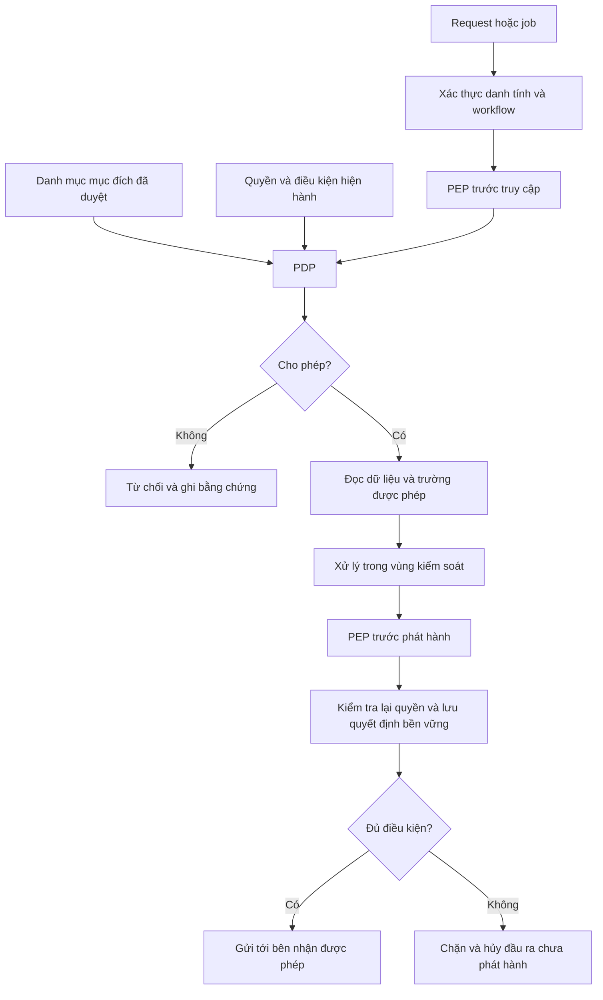

# Purpose limitation — Giới hạn mục đích sử dụng dữ liệu

## 1. Mục tiêu học tập và phạm vi

Trong chương **Data protection**, purpose limitation trả lời câu hỏi: **dữ liệu được xử lý để đạt kết quả gì, và hệ thống ngăn việc sử dụng ngoài mục đích đó như thế nào?** Một tổ chức có thể bảo vệ cơ sở dữ liệu bằng mã hóa, xác thực mạnh và phân quyền theo vai trò nhưng vẫn sử dụng dữ liệu sai mục đích. Ví dụ, dịch vụ được quyền đọc email để gửi cảnh báo bảo mật lại chuyển danh sách đó sang hệ thống quảng cáo.

Trong phạm vi module `SECURITY_SECURITY_DESIGN_SECURITY_REQUIREMENTS`, bài học tập trung chuyển mục tiêu bảo vệ dữ liệu và mô hình đe dọa thành yêu cầu bảo mật cụ thể, đo được, có thể kiểm chứng. Sau bài học, người học có thể:

- Đặc tả mục đích xử lý đủ rõ để xác định dữ liệu, thao tác, chủ thể và bên nhận được phép.
- Phân biệt quyền truy cập kỹ thuật với quyền sử dụng dữ liệu cho một mục đích cụ thể.
- Liên kết kịch bản lạm dụng với yêu cầu, vị trí thực thi trong kiến trúc và bằng chứng kiểm thử.
- Bao phủ API, tác vụ nền, bản xuất, dữ liệu dẫn xuất, logging và phục hồi.
- Xác định cách thu hồi quyền xử lý, kiểm soát thay đổi mục đích và đo độ bao phủ của kiểm soát.

Các mã yêu cầu, cấu hình và ngưỡng thời gian trong bài là **thiết kế minh họa cho một hệ thống giả định**, không phải thời hạn hay cấu hình bắt buộc cho mọi tổ chức.

## 2. Hiểu đúng purpose limitation

### 2.1. Mục đích phải nói được kết quả cần đạt

Mục đích là lý do nghiệp vụ của việc xử lý dữ liệu. Các mô tả như “sử dụng dữ liệu”, “phân tích” hoặc “cải thiện hệ thống” thường quá rộng để kỹ sư xác định thao tác nào cần bị chặn.

| Mô tả chưa đủ rõ | Mô tả có thể chuyển thành yêu cầu | Ranh giới cần thể hiện |
| --- | --- | --- |
| Gửi email | Gửi thông báo về lần đăng nhập đáng ngờ cho chính chủ tài khoản | Người nhận là chủ tài khoản; nội dung là sự kiện bảo mật |
| Hỗ trợ người dùng | Xử lý phiếu hỗ trợ đang mở của người học trong tenant được giao | Phải có mã phiếu và quan hệ phụ trách hợp lệ |
| Phân tích học tập | Tính tỷ lệ hoàn thành theo khóa học và tuần cho báo cáo nội bộ | Không cần email hay nội dung trao đổi riêng tư |
| Huấn luyện AI | Huấn luyện mô hình phân loại chủ đề bằng tập câu hỏi được phê duyệt riêng | Không mặc định sử dụng toàn bộ phiếu hỗ trợ |

W3C Privacy Principles nêu nguyên tắc xác định mục đích khi truy cập dữ liệu cá nhân hoặc xin quyền, đồng thời giới hạn việc sử dụng theo mục đích đã nêu. Bài học chuyển nguyên tắc này thành các ràng buộc kỹ thuật của ví dụ. [W3C Privacy Principles, mục 2.10](https://www.w3.org/TR/2025/STMT-privacy-principles-20250515/#purpose-limitation).

Một mục đích rõ vẫn cần chủ sở hữu, phê duyệt và điều kiện sử dụng phù hợp với bối cảnh. Đặt tên `SECURITY` không tự làm mọi thao tác trở nên cần thiết hoặc được phép.

### 2.2. Các khái niệm liên quan nhưng không thay thế nhau

| Khái niệm | Câu hỏi chính | Ví dụ |
| --- | --- | --- |
| Purpose limitation | Dùng dữ liệu để làm gì? | Email phục vụ cảnh báo bảo mật không tự động được dùng cho quảng cáo |
| Data minimization | Cần dữ liệu nào, với độ chi tiết nào? | Báo cáo hoàn thành khóa học không cần địa chỉ email |
| Storage limitation | Giữ dữ liệu trong bao lâu, theo điều kiện nào? | File tạm của báo cáo bị xóa theo lịch đã phê duyệt |
| Access control | Ai được thực hiện thao tác nào trên tài nguyên nào? | Chỉ worker cảnh báo được gọi giao diện gửi thông báo bảo mật |
| Căn cứ cho phép xử lý | Vì sao hoạt động xử lý được cho phép trong bối cảnh áp dụng? | Hồ sơ phê duyệt ghi nhận căn cứ và điều kiện tương ứng |
| Consent khi áp dụng | Lựa chọn nào của người dùng cho phép hoạt động nào? | Người học đăng ký nhận bản tin tùy chọn |

Không phải mọi mục đích đều dùng consent làm điều kiện. Hệ thống phải biểu diễn điều kiện phù hợp cho từng hoạt động; không được coi một lựa chọn nhận bản tin là quyền sử dụng mọi dữ liệu tài khoản.

Cách tách “vì sao xử lý”, “dữ liệu gì”, “thao tác nào” và “căn cứ nào” cũng được thể hiện trong mô hình khái niệm của DPV. DPV Primer là báo cáo của Community Group, không phải W3C Standard; bài học tham khảo cách phân tách khái niệm, không yêu cầu triển khai DPV. [DPV Primer, mục 3.1](https://www.w3.org/community/reports/dpvcg/CG-FINAL-primer-20240801/#structure-of-dpv).

### 2.3. Có quyền đọc vẫn có thể dùng sai mục đích

Tài khoản hỗ trợ có thể đọc email và thông tin khóa học để trả lời phiếu đang được giao. Dùng quyền đó để xuất danh sách người học cho chiến dịch bán hàng là hoạt động khác.

RBAC có thể xác nhận người dùng thuộc vai trò `SUPPORT_AGENT`, nhưng chưa chứng minh có phiếu liên quan, dữ liệu được lấy là cần thiết hay bên nhận được phép. Quyết định truy cập cần thêm điều kiện nghiệp vụ.

Một policy engine cũng không thể tự hiểu ý định trong đầu con người. Nó kiểm tra tín hiệu đáng tin cậy và ràng buộc hành vi quan sát được: workflow, mã công việc, tập trường, người nhận và đầu ra. Thiết kế cần kết hợp giao diện chuyên biệt, quyền hạn hẹp và giám sát.

## 3. Tình huống xuyên suốt: nền tảng học tập

Một nền tảng học tập phục vụ nhiều tổ chức; mỗi tổ chức là một `tenant`.

| Nhóm dữ liệu | Nội dung điển hình | Mục đích ban đầu trong ví dụ |
| --- | --- | --- |
| Hồ sơ tài khoản | `user_id`, `tenant_id`, email liên hệ | Quản lý tài khoản và thông báo liên quan |
| Sự kiện bảo mật | Thời điểm đăng nhập, loại sự kiện, tín hiệu thiết bị | Phát hiện và thông báo sự kiện đáng ngờ |
| Tiến độ học tập | Khóa học, bài học, trạng thái hoàn thành | Hiển thị tiến độ và báo cáo đã phê duyệt |
| Phiếu hỗ trợ | Mã phiếu, nội dung yêu cầu, người phụ trách | Giải quyết yêu cầu hỗ trợ cụ thể |

Sản phẩm muốn bổ sung bản tin giới thiệu khóa học và huấn luyện mô hình từ phiếu hỗ trợ. Hai đề xuất này cần được đánh giá như hoạt động xử lý riêng. Dữ liệu đã nằm trong hệ thống không có nghĩa mọi mục đích mới đều được phép.

Ví dụ sử dụng ba mục đích đã phê duyệt:

| Mã mục đích | Kết quả nghiệp vụ | Phạm vi được phép | Ngoài phạm vi |
| --- | --- | --- | --- |
| `ACCOUNT_SECURITY_ALERT` | Cảnh báo chủ tài khoản về đăng nhập đáng ngờ | Gửi mẫu cảnh báo được duyệt cho tài khoản có sự kiện hợp lệ | Chèn quảng cáo, xuất danh sách email, gửi cho tenant khác |
| `SUPPORT_CASE_RESOLUTION` | Giải quyết phiếu hỗ trợ đang mở | Người phụ trách đọc phần dữ liệu cần cho phiếu được giao | Tra cứu hàng loạt, đọc tài khoản không liên quan, dùng để huấn luyện |
| `COURSE_COMPLETION_REPORT` | Báo cáo tỷ lệ hoàn thành theo khóa học và tuần | Xử lý tiến độ trong tenant để tạo đầu ra tổng hợp đã duyệt | Xuất email, nối dữ liệu quảng cáo, phát hành chi tiết chưa được duyệt |

`NEWSLETTER_DELIVERY` là mục đích được đề xuất nhưng chưa kích hoạt. Dữ liệu không đủ điều kiện sử dụng chỉ vì quản trị viên thêm chuỗi đó vào request.

## 4. Từ mô hình đe dọa tới yêu cầu

### 4.1. Tài sản và ranh giới tin cậy

Tài sản gồm dữ liệu gốc, dữ liệu dẫn xuất, quyền sử dụng, hồ sơ phê duyệt và bằng chứng quyết định. File CSV, thông điệp trong hàng đợi và log cũng có thể chứa dữ liệu hoặc tạo đường đi vòng.

Các ranh giới cần xem xét:

- Từ trình duyệt hoặc ứng dụng khách vào API.
- Từ API vào dịch vụ xử lý và kho dữ liệu.
- Từ bên phát thông điệp qua hàng đợi tới worker.
- Từ nghiệp vụ sang kho báo cáo, nền tảng hỗ trợ hoặc nhà cung cấp email.
- Từ bản sao lưu vào hệ thống được khôi phục.

Không coi đường truyền đáng tin chỉ vì nó nằm trong mạng nội bộ.

### 4.2. Kịch bản lạm dụng

| Rủi ro | Kịch bản | Hậu quả | Hướng đặt yêu cầu |
| --- | --- | --- | --- |
| R-01 | Client tự khai báo mục đích bảo mật để gọi API xuất email | Rò rỉ và tái sử dụng ngoài phạm vi | Ràng buộc mục đích với danh tính, workflow và thao tác |
| R-02 | Job đã xếp hàng vẫn chạy sau khi quyền xử lý bị thu hồi | Tiếp tục dùng dữ liệu dù không còn điều kiện | Kiểm tra trạng thái hiện hành khi thực thi |
| R-03 | ETL sao chép dữ liệu nhưng làm mất hạn chế sử dụng | Kho phân tích mở quyền cho mục đích mới | Bảo toàn lineage và áp dụng policy ở bên nhận |
| R-04 | Người hỗ trợ dùng quyền hợp lệ để xuất dữ liệu hàng loạt | Lạm dụng đặc quyền nội bộ | Quyền theo phiếu, giới hạn trường và thao tác |
| R-05 | Log chứa nội dung phiếu rồi được dùng huấn luyện mô hình | Hình thành kho dữ liệu ngoài kiểm soát | Giới hạn nội dung và quản lý mục đích của log |
| R-06 | Backup cũ làm sống lại quyền đã thu hồi | Mất hiệu lực thay đổi sau thời điểm backup | Đối soát trạng thái hiện hành trước khi mở xử lý |
| R-07 | Nhà cung cấp gửi email dùng lại dữ liệu cho sản phẩm riêng | Mất kiểm soát sau chia sẻ | Giới hạn bên nhận, cấu hình, payload và bằng chứng |

Mô hình đe dọa bao gồm cả cố ý và sai sót: dùng chung tài khoản dịch vụ, cấu hình nhầm bucket, tự thêm nguồn vào pipeline hoặc dùng mẫu cảnh báo có quảng cáo.

## 5. Danh mục mục đích và hợp đồng sử dụng dữ liệu

### 5.1. Hồ sơ của một mục đích

Danh mục mục đích là nguồn định nghĩa có phiên bản. Mỗi hồ sơ cần mô tả:

| Thành phần | Nội dung cần đặc tả |
| --- | --- |
| Định danh, phiên bản | Mã ổn định; phiên bản thay đổi khi phạm vi hay điều kiện thay đổi |
| Kết quả nghiệp vụ | Vì sao cần xử lý, ai hưởng lợi, kết quả mong muốn |
| Chủ sở hữu, phê duyệt | Ai chịu trách nhiệm; hồ sơ nào cho phép kích hoạt |
| Dữ liệu, nguồn | Dataset, trường được phép, nguồn gốc và mức chi tiết |
| Chủ thể, ngữ cảnh | Dịch vụ, vai trò, tenant, workflow, phiếu hoặc sự kiện liên quan |
| Thao tác | Thu thập, đọc, biến đổi, gửi, xuất, xóa trong phạm vi cụ thể |
| Bên nhận, đầu ra | Đích gửi, dạng kết quả, bên xử lý tiếp, điều kiện tái chia sẻ |
| Điều kiện hiện hành | Hiệu lực, tình trạng phê duyệt, lựa chọn người dùng khi áp dụng |
| Vòng đời | Thời gian sử dụng, lưu giữ, xử lý khi mục đích kết thúc |
| Bằng chứng | Quyết định cấp quyền, lineage, phiên bản policy, kiểm thử |

Danh mục chưa thay thế trạng thái động như việc một phiếu vừa đóng hay tài khoản vừa rút lựa chọn. Các trạng thái đó cần được kiểm tra riêng từ nguồn có thẩm quyền.

### 5.2. Cấu hình minh họa

YAML sau diễn đạt thiết kế trong bài, không phải định dạng chuẩn hay cấu hình chạy được của dự án:

```yaml
purpose_id: ACCOUNT_SECURITY_ALERT
version: 3
state: ACTIVE
owner: identity-security-team
approval_ref: APR-SEC-042
outcome: Thông báo sự kiện đăng nhập đáng ngờ cho chủ tài khoản
trusted_workflow: suspicious-login-alert
allowed_principals:
  - security-alert-worker
allowed_sources:
  - account-contact
  - verified-security-event
allowed_fields:
  - user_id
  - tenant_id
  - contact_email
  - security_event_type
  - event_occurred_at
allowed_operations:
  - send_approved_security_notice
recipient_rule: affected_account_owner
output_template: security-alert-v2
export_contact_list: false
marketing_content: false
preconditions:
  - authenticated_workload_identity
  - matching_tenant
  - verified_event_belongs_to_account
  - processing_authority_is_current
  - purpose_and_resource_grants_are_current
```

Mỗi điều kiện phải có logic xác minh cụ thể. Ví dụ, `matching_tenant` cần đối chiếu danh tính đã xác thực với tài nguyên, không chỉ so sánh hai giá trị do client gửi. Một dòng cấu hình không chứng minh cơ chế thực thi đã tồn tại.

Một tài nguyên có thể phục vụ nhiều mục đích hợp lệ. Cần biểu diễn từng quan hệ và điều kiện riêng; một cờ `can_process = true` không đủ phân biệt các hoạt động.

## 6. Viết yêu cầu cụ thể, đo được và kiểm chứng được

### 6.1. Cấu trúc yêu cầu

Có thể dùng mẫu:

> Với **chủ thể và ngữ cảnh**, khi **kích hoạt thao tác**, hệ thống **phải cho phép hoặc từ chối hành vi xác định**, trong **phạm vi dữ liệu và đầu ra**, dựa trên **điều kiện đáng tin cậy**, với **ngưỡng và bằng chứng kiểm chứng**.

Đặc tả cần nói rõ điểm thực thi, hành vi khi thiếu thông tin quyết định và cách thu hồi. Câu “hệ thống phải tuân thủ purpose limitation” chưa đủ để lập trình hoặc nghiệm thu.

| Câu mơ hồ | Cách viết rõ hơn |
| --- | --- |
| Chỉ dùng email đúng mục đích | Worker cảnh báo chỉ được yêu cầu gửi mẫu được duyệt tới chủ tài khoản của sự kiện đã xác minh; không có API xuất danh sách email cho worker |
| Thu hồi nhanh quyền sử dụng | Sau khi thu hồi được commit, quyết định cấp quyền mới phải dựa trên trạng thái hiện hành; không dùng quyết định cũ để phát hành đầu ra mới |
| Ghi log đầy đủ | Quyết định ở cổng phát hành có chủ thể, mục đích, phiên bản, kết quả và lý do; không ghi email hay nội dung phiếu |

### 6.2. Bộ yêu cầu minh họa

Từ **phải** diễn đạt hành vi bắt buộc của hệ thống giả định. Các ngưỡng 5 phút, 15 phút và 24 giờ dưới đây là giả định để nghiệm thu ví dụ.

| Mã | Yêu cầu | Tiêu chí nghiệm thu chính |
| --- | --- | --- |
| PL-01 | Mọi workflow đọc, xuất hoặc truyền dữ liệu trong phạm vi phải tham chiếu mục đích và phiên bản đang hoạt động trong danh mục đã phê duyệt | Không workflow đã đăng ký nào được triển khai chỉ với mục đích tự do hoặc hồ sơ chưa kích hoạt |
| PL-02 | Điểm thực thi phải ràng buộc mục đích với danh tính đã xác thực, workflow máy chủ và thao tác được phép; tham số client không được mở rộng quyền | Đổi header, body hay metadata sang mục đích khác không biến request bị cấm thành được phép |
| PL-03 | Trước truy cập và phát hành, phải kiểm tra tenant, phạm vi tài nguyên, tập trường, điều kiện workflow và bên nhận | Chéo tenant, thừa trường, đổi người nhận hoặc dùng phiếu đã đóng đều bị chặn |
| PL-04 | Khi không xác minh được trạng thái quyền hiện hành, phiên bản policy hoặc nguồn ngữ cảnh, thao tác có bảo vệ phải bị chặn trước truy cập hoặc phát hành tương ứng | Gián đoạn dịch vụ quyết định không tạo đường cho phép mặc định; có mã lỗi phù hợp |
| PL-05 | Job phải kiểm tra quyền hiện hành trước từng lô đọc và từng lần phát hành; mất quyền thì dừng, hủy đầu ra chưa phát hành và không retry bằng quyền cũ | Job chờ, nhiều lô và retry sau thu hồi không tiếp tục phát hành bằng trạng thái cũ |
| PL-06 | Dữ liệu dẫn xuất, sự kiện và bản xuất phải có lineage tới nguồn, mục đích, phiên bản policy và ràng buộc tương ứng | Thiếu lineage hoặc chưa được phê duyệt cho mục đích đầu ra làm cổng phát hành từ chối |
| PL-07 | Quyết định cho phép và từ chối tại cổng phát hành phải truy vết được; đầu ra chỉ phát hành sau khi quyết định được lưu bền vững | Không có đầu ra phát hành thiếu `decision_id`; lỗi lưu audit chặn phát hành; log không có dữ liệu nghiệp vụ thô |
| PL-08 | Thêm mục đích, trường, bên nhận hoặc mở rộng đầu ra phải được đánh giá tác động, phê duyệt, phiên bản hóa và kiểm thử trước kích hoạt | Thay đổi chưa đủ hồ sơ hoặc chưa qua cổng triển khai không được runtime sử dụng |
| PL-09 | Tích hợp gửi email chỉ chuyển dữ liệu tối thiểu cho từng lần gửi; không được bật tái sử dụng dữ liệu cho mục đích riêng ngoài phạm vi phê duyệt | Có kiểm thử payload, kiểm tra cấu hình và hồ sơ xử lý; không đủ điều kiện thì không kích hoạt |
| PL-10 | Sau phục hồi, scheduler và cổng phát hành phải khóa cho đến khi đối soát mục đích, thu hồi và lựa chọn hiện hành với nguồn có thẩm quyền | Khôi phục backup cũ không chạy lại job của mục đích bị thu hồi sau thời điểm backup |
| PL-11 | Khi mục đích kết thúc, quyền thực thi phải bị vô hiệu hóa; xóa hoặc giữ từng bản dữ liệu theo lịch và ngoại lệ được phê duyệt riêng | Dữ liệu còn giữ cho mục đích khác không truy cập được qua mục đích đã kết thúc; bản tạm được xử lý đúng lịch |
| PL-12 | Sự kiện từ chối vì sai mục đích hoặc đích nhận ngoài danh sách phải tạo cảnh báo trong 5 phút, được giao người xử lý trong 15 phút; các luồng đăng ký được đối soát cấu hình mỗi 24 giờ | Sự kiện thử tạo đúng cảnh báo và giao việc; cấu hình lệch được ghi nhận trong lần đối soát theo lịch |

PL-07 ưu tiên tính truy vết và có đánh đổi với khả dụng. Nếu chọn bộ đệm audit bền vững cục bộ, phải quy định dung lượng, quyền truy cập, chuyển tiếp và hành vi khi đầy. Ghi vào bộ nhớ chưa phải lưu bền vững. Khi không thể ghi bản từ chối vào kho audit, hệ thống vẫn phải chặn và báo sự cố qua telemetry độc lập.

PL-11 tách thu hồi quyền sử dụng khỏi xóa vật lý. Dữ liệu có thể còn phục vụ mục đích khác hoặc có yêu cầu lưu giữ riêng. Các bản giữ lại phải có lý do và ranh giới truy cập tương ứng.

## 7. Đặt điểm thực thi vào kiến trúc

### 7.1. Quyết định và thực thi

Có thể chia thành hai trách nhiệm:

- **Policy Decision Point, PDP:** đánh giá ngữ cảnh đáng tin và trả quyết định kèm phạm vi, phiên bản, điều kiện và hạn hiệu lực.
- **Policy Enforcement Point, PEP:** chặn hoặc cho phép ở nơi dữ liệu được truy cập hay rời một ranh giới kiểm soát.

Đây là cách tổ chức minh họa, không bắt buộc phải mua policy engine riêng. Các yêu cầu đòi hỏi mọi đường xử lý trong phạm vi có kiểm soát tương ứng.



PEP chỉ ở API Gateway chưa đủ khi ETL đọc database trực tiếp hoặc worker tự gửi ra ngoài. Quyền database, danh tính dịch vụ, cấu hình mạng và cổng phát hành phải ngăn đường đi vòng.

### 7.2. Ngữ cảnh phải có nguồn đáng tin

```text
principal_id       <- cơ chế xác thực người dùng hoặc workload
workflow_id        <- định tuyến và cấu hình máy chủ đã duyệt
purpose_id/version <- liên kết workflow với danh mục
resource_tenant    <- tài nguyên đã được định danh
case_or_event_ref  <- quan hệ đã xác minh với tài khoản và workflow
requested_fields   <- đối chiếu danh sách trường cho phép
recipient          <- quan hệ nghiệp vụ đã xác minh
current_conditions <- nguồn quyền và lựa chọn có thẩm quyền
```

Request có thể đề xuất mục đích nhưng máy chủ phải xác minh sự phù hợp với danh tính và workflow. Chữ ký thông điệp chứng minh nguồn phát, chưa chứng minh nguồn đó có quyền sử dụng mục đích hoặc tự tạo mọi ngữ cảnh.

### 7.3. Mã giả quyết định truy cập

Đoạn sau diễn đạt thứ tự kiểm tra, không phải mã hoàn chỉnh hoặc thư viện của dự án:

```text
authorize(identity, server_workflow, resource, action, fields, recipient):
    require identity is authenticated

    binding = approved_workflow_binding(identity, server_workflow)
    deny if binding is missing

    purpose = load_current_approved_purpose(binding.purpose_id)
    deny if purpose is missing or not ACTIVE
    deny if binding.version is not accepted by current policy

    state = load_authoritative_current_conditions(resource, purpose)
    deny if state cannot be verified

    require identity is permitted by purpose
    require identity.tenant is permitted for resource.tenant
    require action is allowed for this workflow and purpose
    require fields are a subset of approved_fields(resource, purpose)
    require recipient satisfies the approved recipient rule
    require verified case or event belongs to resource, when required
    require resource grants allow this purpose and action
    require all purpose-specific conditions are satisfied
    require current user choice is satisfied, if required by this purpose

    return scoped_decision(
        identity, resource_scope, action, fields, recipient,
        purpose_id, policy_version, condition_revision,
        decision_id, expires_at
    )
```

Quyết định phải gắn với tài nguyên, tenant, thao tác, trường và người nhận cụ thể. Không tái sử dụng cho phạm vi khác. Cache phải xét đủ các chiều này và có cơ chế vô hiệu hóa; khóa chỉ gồm `role + purpose` không đáp ứng PL-03.

Chỉ có `expires_at` chưa đáp ứng thu hồi. Trước thao tác bảo vệ, bên thực thi phải kiểm tra quyết định còn dựa trên revision hiện hành hay không. Nếu kiến trúc chấp nhận độ trễ đồng bộ, phải ghi độ trễ và hệ quả thành yêu cầu riêng, không hứa hiệu lực tức thời.

## 8. Job nền, thu hồi và cạnh tranh thời điểm

### 8.1. Kiểm tra tại thời điểm chạy

Thông điệp hàng đợi nên mang mã tham chiếu tài nguyên, tenant, workflow, mục đích, phiên bản và mã công việc. Không cần sao chép email thô hay nội dung phiếu nếu worker có thể đọc qua cổng kiểm soát khi chạy.

Các mốc cần kiểm tra:

1. Khi tạo job: xác minh bên yêu cầu có quyền khởi tạo workflow.
2. Khi worker bắt đầu: xác minh nguồn phát và quyền hiện hành.
3. Trước mỗi lô đọc: kiểm tra quyền và phạm vi dữ liệu.
4. Trước mỗi lần phát hành: kiểm tra lại điều kiện đầu ra và bên nhận.
5. Khi retry hoặc chạy lại từ dead-letter queue: áp dụng trạng thái hiện hành như lần chạy mới.

Quyền hợp lệ lúc tạo job không bảo đảm hợp lệ sau nhiều giờ.

### 8.2. Thu hồi giữa lúc xử lý

Job báo cáo đã đọc hai lô nhưng bị thu hồi quyền trước phát hành phải dừng và hủy đầu ra tạm theo cơ chế đã định. Hoàn tất tính toán không phải điều kiện cho phép gửi file.

Thiết kế phải định nghĩa **điểm quyết định có hiệu lực**. Với cổng phát hành do hệ thống kiểm soát, việc kiểm tra revision và chấp nhận lệnh cần được phối hợp với thu hồi để có thứ tự xác định. Kiểm thử phải xen kẽ hai hoạt động này.

Nếu thu hồi đã commit trước điểm chấp nhận lệnh, lệnh phải bị từ chối. Nếu cổng chấp nhận hợp lệ trước thu hồi, đó là lệnh đã bắt đầu thực hiện theo thiết kế; phải theo dõi riêng trạng thái gửi, hủy và hoàn tất.

Lệnh đã được nhà cung cấp bên ngoài chấp nhận có thể không thu hồi được. Yêu cầu cần nêu rõ ranh giới đó, cách hủy nếu có, xử lý thông điệp chờ và bằng chứng về thời điểm chuyển giao. Không cam kết thu hồi mọi bản đã gửi nếu kiến trúc không làm được.

### 8.3. Không đồng nhất các điều kiện xử lý

Nếu bản tin dựa trên lựa chọn tùy chọn, việc rút lựa chọn phải tác động tới danh sách chờ, cache, job và retry. Với cảnh báo bảo mật có hồ sơ cho phép độc lập, rút lựa chọn nhận bản tin không tự tắt cảnh báo bảo mật.

Thay đổi phải cập nhật đúng quan hệ giữa chủ thể dữ liệu, mục đích, phạm vi và điều kiện. Một cờ toàn cục `consent = false` có thể làm tắt nhầm chức năng hoặc không đủ chi tiết để chặn đúng hoạt động.

## 9. Dữ liệu dẫn xuất và mục đích mới

### 9.1. Sao chép không xóa hạn chế sử dụng

Các hạn chế cần được xem xét khi dữ liệu đi qua CDC, ETL, kho báo cáo, cache, file xuất, embedding hoặc tập huấn luyện. Đổi định dạng hay tên cột không tạo quyền sử dụng mới.

Lineage nên ghi nguồn, phiên bản dataset, phép biến đổi, mục đích đầu ra, điều kiện và chủ sở hữu. Không xác định được nguồn hoặc điều kiện thì chặn sử dụng đầu ra cho đến khi đánh giá xong.

Với phép nối nhiều nguồn, không lấy **hợp các mục đích** rồi coi mọi mục đích đều hợp lệ cho kết quả. Mục đích đầu ra chỉ là ứng viên khi tất cả nguồn liên quan cho phép thao tác cần thiết và các ràng buộc kết hợp tương thích. Workflow và đầu ra vẫn phải được phê duyệt riêng theo PL-08.

### 9.2. Biến đổi không tự tạo quyền tái sử dụng

Thay email bằng hash hoặc mã người dùng có thể vẫn cho phép nối bản ghi, theo dõi hoặc liên kết lại. Không coi đây là bằng chứng dữ liệu đã vô danh.

Tổng hợp có thể giảm chi tiết nhưng vẫn cần xét nhóm nhỏ, truy vấn lặp, phép trừ giữa báo cáo và nguồn liên kết bên ngoài. Không mở SQL tùy ý chỉ vì kết quả có hàm `COUNT`. Quy tắc phát hành đầu ra cần được duyệt.

Nếu cho phép đầu ra đã giảm khả năng nhận diện phục vụ mục đích mới, hồ sơ cần ghi phương pháp, giả định, đánh giá rủi ro và phạm vi được phép. Nhãn “anonymous” không phải đường bỏ qua kiểm soát.

### 9.3. Quy trình thay đổi mục đích

Khi muốn dùng phiếu hỗ trợ để huấn luyện mô hình, chủ sở hữu cần:

1. Nêu kết quả mô hình, dữ liệu cần dùng và vì sao phương án ít dữ liệu hơn chưa đáp ứng.
2. Xác định nguồn, điều kiện đang áp dụng và phạm vi được phép của từng nguồn.
3. Đánh giá rủi ro mới: nội dung nhạy cảm, ghi nhớ dữ liệu, bên nhận và cách cung cấp mô hình.
4. Xác định căn cứ, lựa chọn người dùng và biện pháp cần thiết theo bối cảnh; không mặc định dữ liệu cũ đủ điều kiện.
5. Phê duyệt mục đích, workflow, đầu ra, thời gian lưu giữ và tiêu chí kiểm thử.
6. Chỉ chọn dữ liệu đủ điều kiện; kiểm soát tập huấn luyện, checkpoint, mô hình và các bản sao liên quan.

Đó là thay đổi yêu cầu bảo vệ dữ liệu trong vòng đời phát triển, không chỉ là thay đổi truy vấn ETL.

## 10. Logging, bên nhận và phục hồi

### 10.1. Logging phục vụ kiểm chứng

Ví dụ một sự kiện audit:

```json
{
  "decision_id": "dec-example-018",
  "request_id": "req-example-032",
  "principal_id": "security-alert-worker",
  "tenant_ref": "tenant-example",
  "resource_ref": "account-ref-example",
  "purpose_id": "ACCOUNT_SECURITY_ALERT",
  "policy_version": 3,
  "condition_revision": 28,
  "operation": "send_approved_security_notice",
  "recipient_type": "affected_account_owner",
  "decision": "DENY",
  "reason_code": "RESOURCE_PURPOSE_GRANT_REVOKED",
  "occurred_at": "2026-01-01T00:00:00Z"
}
```

Không ghi access token, email, nội dung phiếu hoặc toàn bộ payload chỉ để chứng minh quyết định. Mã tham chiếu và metadata audit vẫn có thể liên quan cá nhân; cần phân quyền, mục đích và thời gian lưu giữ riêng.

Phân biệt quyết định với kết quả thực thi. `ALLOW` không chứng minh email đã gửi thành công. Sự kiện gửi phải tham chiếu `decision_id`, có trạng thái và đối soát được với cổng phát hành hoặc nhà cung cấp. Giới hạn người được sửa, xóa và cơ chế phát hiện sửa đổi tăng độ tin cậy của bằng chứng.

Khi kho audit lỗi, cần telemetry vận hành độc lập để phát hiện sự cố và luồng bị chặn. Không thể chỉ dựa vào bản ghi trong chính kho đang hỏng.

### 10.2. Giới hạn chia sẻ cho bên nhận

Nhà cung cấp email chỉ nên nhận địa chỉ cần gửi, dữ liệu tối thiểu cho mẫu và mã đối soát. Không gửi toàn bộ hồ sơ học tập cho một cảnh báo.

Cần xác định bên nhận, cấu hình, phạm vi lưu giữ, quyền tái sử dụng, nhà xử lý tiếp và cách kết thúc dịch vụ. Thỏa thuận xử lý cùng kiểm tra cấu hình là một phần bằng chứng; chúng không thay thế kiểm soát payload.

Sau chia sẻ, khả năng quan sát có giới hạn. Hồ sơ rủi ro phải ghi phần còn phụ thuộc nhà cung cấp. HTTP thành công không chứng minh bên nhận đã sử dụng đúng mục đích.

### 10.3. Phục hồi không phục hồi nhầm quyền cũ

Backup có thể chứa danh mục và quyền tại thời điểm cũ. Trước khi mở job và tích hợp:

- Giữ scheduler và cổng phát hành ở trạng thái khóa.
- Lấy trạng thái thu hồi, mục đích và lựa chọn hiện hành từ nguồn có thẩm quyền được bảo vệ ngoài phạm vi khôi phục cũ, hoặc tái dựng từ lịch sử đáng tin cậy.
- Đối soát policy, quyền, job chờ, cache và bản dữ liệu không còn đủ điều kiện.
- Chạy kiểm tra chặn mục đích đã kết thúc hoặc bị thu hồi.
- Chỉ mở sau khi có bằng chứng đối soát thành công.

Nếu nguồn hiện hành cũng mất hoặc không xác minh được, PL-04 và PL-10 yêu cầu tiếp tục khóa thao tác tương ứng. Khôi phục file dữ liệu chưa đủ để khôi phục quyền xử lý.

## 11. Truy vết từ rủi ro tới kiểm thử

### 11.1. Ma trận truy vết

| Yêu cầu | Rủi ro | Điểm thực thi hoặc cơ chế | Bằng chứng nghiệm thu |
| --- | --- | --- | --- |
| PL-01 | R-01, R-03 | Danh mục, cổng triển khai workflow | Danh sách workflow, phê duyệt, kết quả kiểm tra tham chiếu |
| PL-02 | R-01, R-04 | API, xác thực workload, ánh xạ workflow | Kiểm thử giả mạo mục đích và sai danh tính |
| PL-03 | R-01, R-04 | Dịch vụ nghiệp vụ, quyền dữ liệu | Kiểm thử chéo tenant, sai phiếu, thừa trường, đổi bên nhận |
| PL-04 | R-01, R-02 | PEP trước đọc và phát hành | Thử lỗi PDP, mất trạng thái hiện hành, policy không hợp lệ |
| PL-05 | R-02 | Worker, cổng phát hành, quản lý retry | Thu hồi ở các thời điểm và chạy lại job |
| PL-06 | R-03 | Pipeline, catalog, cổng xuất | Lineage; kiểm thử mất nhãn và nguồn không tương thích |
| PL-07 | R-04, R-05 | Audit bền vững, đối soát cổng phát hành | Liên kết đầu ra với quyết định; thử lỗi audit, kiểm tra nội dung log |
| PL-08 | R-01, R-03, R-07 | Quy trình thay đổi, kiểm soát kích hoạt | Hồ sơ đánh giá, phê duyệt và kiểm thử trước triển khai |
| PL-09 | R-07 | Adapter và quản lý nhà cung cấp | Kiểm tra payload, cấu hình và hồ sơ xử lý |
| PL-10 | R-06 | Runbook, khóa scheduler và cổng xuất | Diễn tập backup cũ với quyền thay đổi sau backup |
| PL-11 | R-02, R-03, R-06 | Vô hiệu hóa mục đích, lịch lưu giữ | Kiểm thử mục đích kết thúc, bản tạm và bản giữ lại hợp lệ |
| PL-12 | R-01 đến R-07 | Cảnh báo, giao việc, đối soát luồng | Dấu thời gian cảnh báo, giao xử lý và kết quả đối soát |

Ma trận giúp phát hiện rủi ro chưa có yêu cầu, yêu cầu chưa có điểm thực thi hoặc tiêu chí chưa tạo được bằng chứng. Ghi “có ABAC” trong kiến trúc chưa chứng minh mọi luồng đã được bảo vệ.

### 11.2. Ca nghiệm thu quan trọng

| Mã ca | Điều kiện và hành động | Kết quả mong đợi |
| --- | --- | --- |
| AT-01 | Worker hợp lệ, sự kiện đúng tài khoản, quyền hiện hành | Chỉ gửi mẫu cảnh báo cho chủ tài khoản; liên kết được quyết định và kết quả |
| AT-02 | Client gắn mục đích bảo mật lên API xuất liên hệ | Bị từ chối; không có danh sách hoặc lệnh gửi ngoài workflow |
| AT-03 | Người hỗ trợ cùng tenant nhưng không phụ trách phiếu | Không đọc được dữ liệu phiếu; có lý do từ chối |
| AT-04 | Vai trò đúng nhưng tài nguyên thuộc tenant khác | Bị chặn trước khi dữ liệu được đọc hoặc trả ra |
| AT-05 | Job tạo trước thu hồi, chạy hoặc retry sau thu hồi | Không thực thi bằng bản chụp quyền lúc tạo job |
| AT-06 | Thu hồi sau một lô đọc, trước khi cổng chấp nhận đầu ra | Chặn lô tiếp theo; hủy đầu ra chưa phát hành |
| AT-07 | Thu hồi và chấp nhận lệnh chạy đồng thời | Kết quả theo điểm quyết định; không nhận lệnh mới bằng revision đã thu hồi |
| AT-08 | Không truy cập được PDP hoặc nguồn điều kiện hiện hành | Chặn thao tác; không cho phép mặc định hoặc dùng cache không còn xác minh được |
| AT-09 | ETL mất lineage hoặc nối nguồn không cho phép mục đích đầu ra | Chặn phát hành; không mở rộng quyền bằng hợp các nhãn |
| AT-10 | Đổi mẫu cảnh báo sang mẫu có quảng cáo | Cấu hình hoặc lần gửi bị từ chối |
| AT-11 | Không lưu bền vững được quyết định phát hành | Chặn đầu ra; telemetry độc lập phản ánh sự cố |
| AT-12 | Khôi phục backup cũ sau khi mục đích đã bị vô hiệu hóa | Scheduler khóa đến khi đối soát; job cũ không được phát hành |
| AT-13 | Mục đích báo cáo kết thúc nhưng dữ liệu còn phục vụ mục đích hợp lệ khác | Khóa đường báo cáo; chỉ hoạt động còn đủ điều kiện tiếp tục |
| AT-14 | Rút lựa chọn bản tin, tài khoản vẫn có điều kiện cảnh báo riêng | Chặn bản tin; cảnh báo chỉ tiếp tục khi đủ các điều kiện riêng |
| AT-15 | Nhà cung cấp bật tái sử dụng ngoài phạm vi | Không kích hoạt tích hợp đến khi điều kiện được đáp ứng |

Ca từ chối phải chứng minh **không có dữ liệu hoặc tác dụng phụ thoát ra**, không chỉ kiểm tra mã lỗi API. Dùng dữ liệu giả và bên nhận kiểm thử để đối soát kho đầu ra, hàng đợi, adapter, log và lệnh gửi.

## 12. Đo mức đáp ứng

| Chỉ số | Cách đo | Cách diễn giải |
| --- | --- | --- |
| Độ bao phủ mục đích | Workflow có mục đích, chủ sở hữu, phê duyệt hợp lệ / tổng workflow trong danh sách luồng | Mục tiêu ví dụ là 100%; vẫn cần phát hiện luồng chưa đăng ký |
| Độ bao phủ thực thi | Đường đọc hoặc xuất đã xác minh PEP / tổng đường tương ứng đã nhận diện | Một đường database trực tiếp bị sót có thể làm kết luận sai |
| Độ bao phủ truy vết | Đầu ra đối soát được quyết định bền vững / tổng đầu ra quan sát độc lập ở cổng | Không chỉ đếm log `ALLOW` |
| Hiệu lực thu hồi | Số lệnh mới được chấp nhận bằng trạng thái đã thu hồi, xét theo điểm quyết định | Phải bằng 0 sau điểm thu hồi đã đặc tả |
| Thời gian cảnh báo | Thời điểm cảnh báo trừ thời điểm sự kiện thuộc PL-12 | So với 5 phút; dùng chuẩn thời gian và đồng hồ đồng bộ |
| Độ trễ giao xử lý | Thời điểm giao người xử lý trừ thời điểm sự kiện | So với 15 phút; giao việc không đồng nghĩa xử lý xong |
| Độ mới đối soát | Khoảng cách giữa hai lần đối soát thành công | Không vượt 24 giờ theo PL-12; lỗi đối soát được theo dõi |

Số lần từ chối bằng 0 có thể do hệ thống bình thường, thiếu PEP hoặc mất telemetry. Cần đối chiếu kiểm thử chủ động và nguồn quan sát độc lập.

## 13. Lỗi thiết kế thường gặp

| Lỗi | Vì sao thất bại | Cách sửa yêu cầu |
| --- | --- | --- |
| Chỉ ghi mục đích trong chính sách văn bản | Không ràng buộc API, job, bản xuất | Chỉ định điểm thực thi, điều kiện và kiểm thử từng luồng |
| Tin `X-Purpose` do client gửi | Bên gọi tự chọn lý do có quyền rộng hơn | Ràng buộc với danh tính và workflow máy chủ |
| Dùng mục đích `BUSINESS` cho mọi hoạt động | Không phân biệt được sử dụng hợp lệ và tùy tiện | Tách kết quả nghiệp vụ, nêu ngoài phạm vi |
| Cấp quyền cả bảng rồi lọc giao diện | Export, job và đường trực tiếp vẫn đọc được | Hạn chế trường, bản ghi và quyền phía dịch vụ hoặc dữ liệu |
| Chỉ kiểm tra khi tạo job | Quyền thay đổi trước khi chạy hoặc gửi | Kiểm tra hiện hành ở từng điểm đã đặc tả |
| Dùng TTL thay quy tắc thu hồi | Trạng thái cũ còn cho phép trong TTL | Đặc tả revision, vô hiệu hóa, điểm quyết định |
| Gắn nhãn nhưng không kiểm soát đường ra | Nhãn không ngăn copy file hoặc truyền tiếp | Có PEP và quyền kỹ thuật tại điểm đọc, phát hành |
| Coi hash hoặc embedding là tự do sử dụng | Đầu ra có thể còn quan hệ hoặc thông tin nhạy cảm | Đánh giá đầu ra, lineage, phạm vi phê duyệt |
| Kết thúc mục đích thì xóa mọi dữ liệu | Có thể xóa dữ liệu còn cần cho hoạt động hợp lệ | Tách thu hồi theo mục đích khỏi lịch lưu giữ từng bản |
| Khôi phục trạng thái cũ rồi mở scheduler | Quyền và job cũ hoạt động lại | Khóa xử lý, đối soát trước khi mở |

## 14. Bài tập vận dụng

Nền tảng muốn gợi ý khóa học dựa trên tiến độ và nội dung phiếu hỗ trợ. Bộ phận sản phẩm cho rằng chỉ cần dùng tài khoản `analytics-reader` vì tài khoản này đã đọc được cả hai nguồn.

Hãy xây dựng:

1. Mô tả mục đích có kết quả nghiệp vụ, chủ sở hữu, nguồn, thao tác, bên nhận và phần ngoài phạm vi.
2. Ba kịch bản lạm dụng với tài sản, chủ thể, ranh giới tin cậy và hậu quả.
3. Năm yêu cầu có mã, bao phủ truy cập, ngữ cảnh đáng tin, job nền, logging và thay đổi mục đích.
4. Sơ đồ luồng có điểm chặn trước truy cập nguồn và trước phát hành gợi ý.
5. Ca nghiệm thu cho luồng hợp lệ, giả mạo, thu hồi giữa chừng, thiếu lineage và phục hồi cũ.

Gợi ý tự kiểm tra: quyền của `analytics-reader` chỉ chứng minh khả năng truy cập hiện có. Đề xuất phải giải thích vì sao từng nguồn được phép phục vụ gợi ý, dữ liệu nào cần thiết và điều kiện nào cần đáp ứng trước kích hoạt. Chưa xác định được điều kiện dùng phiếu hỗ trợ thì không mặc định đưa nguồn này vào pipeline.

Bộ yêu cầu đạt mục tiêu bài học phải cho người triển khai biết chặn ở đâu, người kiểm thử biết quan sát điều gì, và người vận hành biết xử lý thế nào khi quyền thay đổi hoặc hệ thống được phục hồi.
