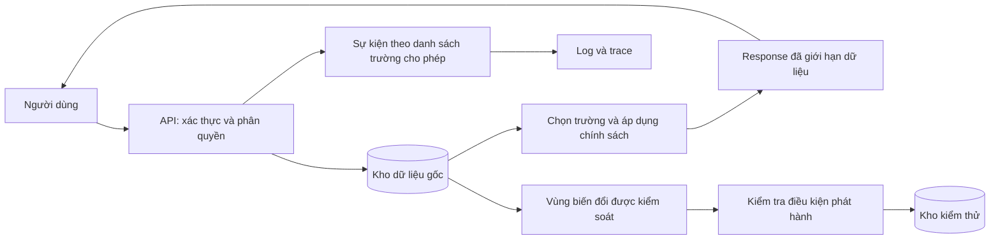

# Data masking

## 1. Từ mục tiêu bảo mật đến yêu cầu cụ thể

Data masking là việc che hoặc thay thế dữ liệu nhạy cảm để một người, hệ thống hoặc môi trường chỉ nhận được mức thông tin cần thiết cho công việc. Giá trị được hiển thị có thể bị che một phần, thay bằng dữ liệu khác hoặc bị loại khỏi kết quả, tùy mục đích sử dụng.

Ví dụ, nhân viên hỗ trợ cần bốn số cuối của số điện thoại để đối chiếu hồ sơ, nhưng không nhất thiết cần toàn bộ số. Nhóm phát triển cần dữ liệu có quan hệ hợp lệ để kiểm thử đơn hàng, nhưng thường không cần tên, email và địa chỉ thật của khách hàng.

Trong chương **Data protection**, yêu cầu “phải che dữ liệu nhạy cảm” mới là một ý định. Thiết kế yêu cầu bảo mật phải làm rõ:

- Dữ liệu nào cần che, ở những nơi nào và trước ranh giới tiết lộ nào?
- Ai được xem bản gốc, ai chỉ được xem bản đã che?
- Được giữ lại bao nhiêu thông tin và vì nhu cầu nghiệp vụ gì?
- Khi chính sách thiếu hoặc thành phần xử lý lỗi, hệ thống phải làm gì?
- Kiểm thử và bằng chứng nào cho phép kết luận yêu cầu đã được thực hiện?

Sau bài học, người học cần lập được danh mục trường cần masking, lựa chọn cách xử lý cho từng luồng dữ liệu, viết yêu cầu đo được và liên kết chúng với rủi ro, kiến trúc, kiểm thử và vận hành.

Các vai trò, mã yêu cầu, thời hạn và ngưỡng trong bài là ví dụ cho một hệ thống quản lý khách hàng nhiều tenant. Chúng không phải mức bắt buộc áp dụng cho mọi tổ chức.

## 2. Khả năng và giới hạn của masking

### 2.1. Masking không tự tạo ra quyền truy cập

Giả sử nhân viên A không được truy cập hồ sơ khách hàng B. Trả về hồ sơ B với số điện thoại đã che vẫn có thể làm lộ việc khách hàng đó tồn tại, mã đơn hàng, trạng thái giao dịch hoặc thông tin khác.

Thứ tự quyết định cần rõ ràng:

1. Xác thực chủ thể và xác lập tenant từ ngữ cảnh đáng tin cậy.
2. Kiểm tra quyền đối với bản ghi và thao tác được yêu cầu.
3. Chọn tập trường chủ thể được phép nhận.
4. Với những trường được nhận, áp dụng chế độ bản gốc hoặc masking theo chính sách.

Masking giảm lượng thông tin được tiết lộ trong phạm vi quyền đã xác định. Nó không thay thế kiểm soát truy cập theo đối tượng, tenant hoặc mục đích sử dụng.

### 2.2. Phân biệt các biện pháp liên quan

| Biện pháp | Mục đích chính | Điều cần lưu ý |
|---|---|---|
| Masking | Che hoặc thay giá trị theo ngữ cảnh sử dụng | Có dấu sao không chứng minh toàn bộ bản ghi an toàn |
| Mã hóa | Bảo vệ tính bí mật bằng thuật toán và khóa; bên có quyền giải mã có thể lấy lại dữ liệu | Mã hóa ổ đĩa không tự hạn chế người đọc dữ liệu qua ứng dụng |
| Tokenization | Thay dữ liệu bằng token; khả năng truy ngược phụ thuộc thiết kế kho ánh xạ hoặc cơ chế sinh token | Token không mặc nhiên là dữ liệu công khai |
| Pseudonymization, dùng định danh thay thế | Giảm việc gắn trực tiếp dữ liệu với một người; thông tin bổ sung có thể cho phép liên kết lại | Thay tên bằng mã không tự loại bỏ khả năng nhận diện |
| Ẩn danh hóa | Nhằm làm việc nhận diện lại không còn khả thi trong bối cảnh và mô hình đối thủ được đánh giá | Không thể kết luận đạt chỉ từ việc che tên và email |
| Dữ liệu tổng hợp | Tạo dữ liệu phục vụ một mục đích như kiểm thử | Dữ liệu sinh từ nguồn thật vẫn cần đánh giá khả năng tiết lộ dữ liệu nguồn |

Một giải pháp có thể kết hợp nhiều biện pháp. Yêu cầu nên nêu thuộc tính bảo vệ cần đạt, thay vì chỉ yêu cầu “dùng công cụ masking”.

### 2.3. Dữ liệu sau masking vẫn có thể nhạy cảm

Bốn số cuối của số điện thoại, ngày giao dịch, địa bàn nhỏ và một đơn hàng hiếm có thể đủ để liên kết hồ sơ với thông tin bên ngoài. Một token ổn định còn cho phép nối hoạt động của cùng người qua nhiều tập dữ liệu.

Vì vậy, nhãn “đã masking” chưa trả lời được dữ liệu có thể chia sẻ với ai. Cần xét cả thuộc tính được giữ lại, khả năng kết hợp, quy mô tập dữ liệu, quyền truy vấn và thông tin đối thủ có thể biết.

## 3. Xuất phát từ mô hình đe dọa và dòng dữ liệu

### 3.1. Tình huống xuyên suốt

Hệ thống quản lý khách hàng có các luồng sau:

- Nhân viên hỗ trợ mở hồ sơ trong tenant được phân công.
- Người xử lý một tác vụ đặc biệt cần xem đầy đủ một trường liên hệ trong thời gian ngắn.
- Backend dùng thông tin liên hệ để gửi thông báo nghiệp vụ.
- Nhóm phát triển nhận dữ liệu kiểm thử ngoài production.
- Log, trace, báo lỗi và audit đi tới hệ thống quan sát riêng.
- Tác vụ xuất báo cáo tạo tệp tải xuống hoặc chuyển dữ liệu sang kho phân tích.

Mỗi luồng có nhu cầu tiếp cận dữ liệu khác nhau. Một hàm che số điện thoại trên giao diện không bao phủ toàn bộ các luồng này.

| Mã rủi ro | Kịch bản đe dọa | Yêu cầu cần phát sinh |
|---|---|---|
| R-DP-01 | Tài khoản hỗ trợ bị chiếm dụng rồi thu thập hàng loạt thông tin liên hệ | Phân quyền hồ sơ, masking phía server, giới hạn xuất và phát hiện truy cập bất thường |
| R-DP-02 | Bản sao production được đưa vào môi trường kiểm thử có quyền rộng | Dùng dữ liệu tổng hợp hoặc bản sao đã biến đổi và kiểm chứng trước khi phát hành |
| R-DP-03 | Response đã che nhưng request, exception hoặc trace còn dữ liệu gốc | Kiểm soát dữ liệu trước khi ghi vào hệ thống quan sát |
| R-DP-04 | Người có quyền truy vấn tùy ý suy ra giá trị từ điều kiện lọc hoặc kết quả đếm | Hạn chế khả năng truy vấn và đánh giá suy luận ngoài việc che cột |
| R-DP-05 | Cache hoặc tệp xuất tạo bằng quyền cao được dùng lại cho quyền thấp | Phân tách kết quả theo quyền; kiểm tra quyền khi tạo và khi nhận |
| R-DP-06 | Khôi phục hoặc rollback làm mất chính sách masking | Khôi phục chính sách, kiểm tra quyền trước khi mở lại luồng nhạy cảm |

### 3.2. Xác định ranh giới thực thi



Sơ đồ phân biệt việc giới hạn dữ liệu khi trả kết quả và việc tạo bản dữ liệu kiểm thử được phép phát hành. Vùng biến đổi còn tiếp xúc với dữ liệu gốc nên phải được bảo vệ theo mức của nguồn, kể cả tệp tạm và log tác vụ.

Nếu masking nằm ở ứng dụng thì bản gốc vẫn có thể hiện diện trong bộ nhớ backend. Thiết kế đó không tự bảo vệ trước một backend đã bị kiểm soát hoàn toàn. Cần ghi nhận giới hạn và chọn biện pháp bổ sung phù hợp với mô hình đe dọa.

## 4. Chọn dạng masking phù hợp

### 4.1. Masking tĩnh cho bản dữ liệu dẫn xuất

Masking tĩnh biến đổi một bản sao trước khi cung cấp cho môi trường hoặc người nhận khác. Sau khi phát hành, việc thu hồi quyền tại nguồn không tự thu hồi mọi bản đã tải xuống.

Đặc tả cần bao phủ nguồn dữ liệu, nơi chạy biến đổi, cách thay thế, kiểm tra đầu ra, người nhận, thời hạn tồn tại và xử lý bản sao cũ. Nếu có bảng ánh xạ về bản gốc, phải bảo vệ bảng đó như dữ liệu nhạy cảm và không giao kèm cho bên chỉ được dùng bản đã xử lý.

Ví dụ: thay tên và thông tin liên hệ trong bản sao kiểm thử, đồng thời đổi định danh liên kết giữa bảng khách hàng và đơn hàng nhất quán trong cùng lần phát hành.

### 4.2. Masking động khi truy cập

Masking động lựa chọn dữ liệu hiển thị theo chủ thể và ngữ cảnh tại thời điểm đọc. Bản gốc vẫn được lưu tại nguồn. Điểm thực thi có thể ở cơ sở dữ liệu, lớp dịch vụ hoặc thành phần truy cập dữ liệu được kiểm soát.

Không nên coi masking động là rào cản đầy đủ trước người được truy vấn tùy ý. Với SQL Server, Microsoft nêu rõ giới hạn suy luận qua truy vấn và khuyến nghị kết hợp quản lý quyền, kiểm toán cùng các biện pháp bảo vệ khác. Cần xét giới hạn này khi chọn kiến trúc, thay vì giả định mọi truy vấn đều an toàn sau khi gắn mask. [Microsoft Learn: Dynamic Data Masking](https://learn.microsoft.com/en-us/sql/relational-databases/security/dynamic-data-masking)

Ví dụ yêu cầu kiến trúc: vai trò hỗ trợ chỉ truy cập API nghiệp vụ đã giới hạn thao tác; không được chạy SQL tùy ý trên cột nhạy cảm chỉ vì cột có cấu hình masking.

### 4.3. Redaction tại điểm phát sinh đầu ra

Redaction là loại bỏ hoặc che phần nhạy cảm trước khi dữ liệu được ghi hoặc gửi tới một đích. Cách này hữu ích với log, lỗi, sự kiện, tài liệu và tệp xuất.

Với log có cấu trúc, ưu tiên chọn rõ trường được phép ghi. Ghi toàn bộ object rồi dùng biểu thức chính quy để tìm dữ liệu nhạy cảm khó bao phủ trường mới, cấu trúc lồng nhau, kiểu mã hóa và văn bản tự do.

### 4.4. Các phép biến đổi thường gặp

| Phép biến đổi | Khi có thể phù hợp | Rủi ro hoặc điều phải quy định |
|---|---|---|
| Che toàn bộ bằng giá trị cố định | Không cần phân biệt giá trị gốc | Mất khả năng đối chiếu; cần thống nhất cách biểu diễn |
| Giữ một phần | Nghiệp vụ cần xác nhận một phần nhỏ của dữ liệu | Phần còn lại vẫn có thể định danh hoặc hỗ trợ dò tìm |
| Thay bằng dữ liệu giả đúng định dạng | Kiểm thử giao diện, định dạng | Phải ngăn gửi email, SMS hoặc giao dịch thật từ môi trường thử nghiệm |
| Thay định danh nhất quán | Kiểm thử quan hệ giữa nhiều bảng | Tạo khả năng liên kết; cần giới hạn miền nhất quán |
| Tổng quát hóa | Chỉ cần nhóm tuổi, vùng thay cho ngày sinh, địa chỉ đầy đủ | Nhóm hiếm vẫn có thể nhận diện người |
| Xóa trường hoặc bỏ bản ghi | Dữ liệu không cần cho mục đích đã duyệt | Cần xét tác động tới nghiệp vụ và độ đại diện của tập dữ liệu |

Không dùng hash không khóa như một bảo đảm chung cho việc giấu số điện thoại hoặc định danh dễ đoán. Đối thủ có thể thử các giá trị ứng viên rồi đối chiếu. Cơ chế có khóa có thể giảm một số rủi ro dò ngoại tuyến khi khóa được giữ kín, nhưng vẫn cần xét lộ khóa, quyền sử dụng dịch vụ biến đổi và khả năng liên kết. Không tự thiết kế thuật toán mật mã cho bài toán này.

## 5. Lập danh mục trường và ma trận tiết lộ

### 5.1. Một dòng chính sách cần nhiều hơn tên cột

Với mỗi trường hoặc nhóm trường, nên ghi:

- Chủ sở hữu, mức nhạy cảm và mục đích sử dụng được cho phép.
- Định dạng, nguồn, trường suy ra và các bản sao đã biết.
- Vai trò, phạm vi đối tượng, tenant và điều kiện xem bản gốc.
- Cách biểu diễn khi đã che, thiếu giá trị hoặc không xử lý được.
- Kênh áp dụng: API, trang hiển thị, export, sự kiện, log, cache, bản sao kiểm thử.
- Chủ sở hữu yêu cầu, tiêu chí kiểm thử và bằng chứng cần giữ lại.

Tên trường không đủ để phát hiện dữ liệu nhạy cảm. Thông tin liên hệ có thể nằm trong ghi chú, metadata, tệp đính kèm hoặc chuỗi JSON lưu trong cột văn bản.

### 5.2. Ma trận ví dụ cho hồ sơ khách hàng

Các giá trị dưới đây là fixture tổng hợp; `0000001234` chỉ là chuỗi minh họa, không dùng để liên hệ. Chính sách hiển thị là lựa chọn của ví dụ.

| Trường | Bản gốc minh họa | Hỗ trợ thông thường | Khi có quyền nghiệp vụ phù hợp | Dữ liệu kiểm thử |
|---|---|---|---|---|
| Họ tên | Nguyễn Lan Mẫu | `[NAME_MASKED]` | Chỉ đọc khi nhiệm vụ và chính sách cho phép | Tên giả được sinh |
| Số điện thoại | `0000001234` | `******1234` | Quyền riêng để xem đủ trường này | Chuỗi kiểm thử được kiểm soát; không liên hệ bên ngoài |
| Email | `lan.mau@example.invalid` | `[EMAIL_MASKED]` | Đọc theo quyền và mục đích đã duyệt | Địa chỉ thử nghiệm không dùng để gửi thật |
| Ngày sinh | `1994-06-15` | Không trả trường | Chỉ cấp cho nghiệp vụ có căn cứ | Nhóm tuổi hoặc giá trị thay thế theo mục tiêu kiểm thử |
| Ghi chú tự do | Có thể chứa dữ liệu nhạy cảm | Không trả trường | Quyền riêng; không kế thừa từ quyền đọc thông tin liên hệ | Loại bỏ hoặc thay bằng văn bản giả |
| Access token | Không đưa giá trị mẫu vào hồ sơ | Không trả và không log | Không cung cấp qua chức năng hỗ trợ | Không sao chép bí mật production |

Quyền xem một trường không kéo theo quyền xem mọi trường. Quyền đọc trong phiên tương tác cũng không tự cấp quyền xuất hàng loạt, chuyển dữ liệu sang hệ thống khác hoặc ghi vào log.

### 5.3. Đặc tả các trường hợp biên

Với số điện thoại trong ví dụ, chính sách có thể quy định:

- Giá trị hợp lệ sau chuẩn hóa: tiền tố cố định `******` và đúng bốn chữ số cuối.
- Giá trị thiếu: trả `null` nếu việc tiết lộ sự hiện diện của trường được chấp nhận tại kênh đó.
- Giá trị sai định dạng, quá ngắn hoặc không chuẩn hóa được: trả `[MASKED]`; không trả lại đầu vào.
- Không giữ độ dài bản gốc trong chuỗi che nếu nghiệp vụ không cần biết độ dài.
- Trường nhạy cảm mới chưa có chính sách: không trả ở kênh quyền thấp và báo lỗi cấu hình cho nhóm phụ trách.

Giữ bốn chữ số cuối là quyết định nghiệp vụ của ví dụ. Với vai trò hoặc rủi ro khác, có thể cần che toàn bộ.

## 6. Viết yêu cầu có thể đo và kiểm chứng

### 6.1. Mẫu phát biểu yêu cầu

> Trong **[ngữ cảnh]**, khi **[chủ thể thực hiện thao tác]** trên **[phạm vi dữ liệu]**, hệ thống phải **[hành vi cụ thể]** tại **[ranh giới thực thi]**. Khi **[lỗi hoặc thiếu điều kiện]**, hệ thống phải **[hành vi an toàn]**. Việc đáp ứng được chứng minh bằng **[kiểm thử và bằng chứng]**.

Yêu cầu yếu: “Thông tin cá nhân phải được che phù hợp”. Câu này chưa xác định được trường, người, kênh hay điều kiện để kết luận đạt.

Yêu cầu cụ thể hơn: “API hồ sơ phải trả số điện thoại dưới dạng `******` và bốn chữ số cuối cho vai trò hỗ trợ thông thường đã được phép truy cập hồ sơ; body phản hồi không được chứa giá trị đầy đủ hoặc trường thay thế cho phép lấy lại giá trị đó”.

### 6.2. Bộ yêu cầu minh họa

| ID | Phát biểu yêu cầu | Tiêu chí chấp nhận và bằng chứng |
|---|---|---|
| REQ-MSK-01 | Mọi API hồ sơ cho hỗ trợ thông thường phải thực hiện ma trận tiết lộ phía server sau khi kiểm tra quyền bản ghi và tenant. | Kiểm thử từng endpoint theo vai trò, tenant; kiểm tra body mạng thực tế, kể cả trường lồng và lỗi. |
| REQ-MSK-02 | Quyền xem số điện thoại đầy đủ phải cấp riêng, ràng buộc người dùng, hồ sơ và tác vụ; hiệu lực tối đa 10 phút trong ví dụ này. | Kiểm tra trước, trong, sau hạn; đổi hồ sơ, tenant hoặc tác vụ không dùng lại được phê duyệt. |
| REQ-MSK-03 | Response, cache và tệp xuất cho quyền thấp không được dùng lại bản chứa dữ liệu gốc đã tạo cho quyền cao. | Đọc bằng quyền cao rồi quyền thấp; kết quả quyền thấp vẫn tuân chính sách. |
| REQ-MSK-04 | Log, trace và báo lỗi của luồng hồ sơ chỉ chứa tập trường đã duyệt; không ghi liên hệ gốc hay bí mật xác thực. | Dùng fixture nhận biết ở nhánh thành công và lỗi; kiểm tra đầu ra quan sát trong phạm vi ca thử. |
| REQ-MSK-05 | Bản sao kiểm thử chỉ được phát hành sau biến đổi, kiểm tra phạm vi trường và ràng buộc dữ liệu. | Lưu phiên bản chính sách, báo cáo kiểm tra, quyết định phát hành; mọi kiểm tra bắt buộc phải đạt. |
| REQ-MSK-06 | Khi chính sách không hợp lệ hoặc biến đổi lỗi, hệ thống không được trả dữ liệu gốc để thay thế. | Tiêm lỗi; nhận phản hồi từ chối hoặc đã loại trường, cùng sự kiện vận hành không chứa bản gốc. |
| REQ-MSK-07 | Trường nhạy cảm hoặc kênh đầu ra mới phải có chính sách và kiểm thử trước khi mở cho quyền thấp. | Thay đổi schema hay hợp đồng API thiếu phân loại phải làm bước kiểm tra bắt buộc thất bại. |
| REQ-MSK-08 | Sau khôi phục hoặc rollback, chỉ mở lại luồng nhạy cảm khi xác minh được chính sách, quyền và hành vi masking. | Diễn tập có ca đọc theo vai trò; kiểm tra không đạt phải chặn mở luồng tương ứng. |

Không dùng kết quả “không phát hiện dữ liệu gốc trong một lần quét” làm bằng chứng duy nhất cho bảo đảm toàn hệ thống. Báo cáo kiểm thử phải chỉ rõ tập dữ liệu, kênh, phiên bản và vị trí đã quan sát.

### 6.3. Đo hiệu năng có ngữ cảnh

Có thể bổ sung: trên bộ tải tham chiếu 200 yêu cầu mỗi giây, tối đa 50 hồ sơ mỗi phản hồi và cấu hình môi trường đã ghi nhận, phần đánh giá chính sách cùng masking có p95 không quá 20 ms trong bài đo 15 phút sau làm nóng.

Đây là ví dụ về ngưỡng đo được. Tổ chức phải chọn tải và ngân sách phù hợp thực tế. Nếu không đạt, cần tối ưu hoặc giới hạn chức năng; không bỏ masking để trả dữ liệu nhanh hơn.

## 7. Liên kết yêu cầu với kiến trúc thực thi

### 7.1. Bảo vệ trước ranh giới tiết lộ

Masking chỉ trong trình duyệt không bảo vệ dữ liệu đã gửi tới trình duyệt. Người dùng có thể xem response, trạng thái ứng dụng hoặc dữ liệu lưu cục bộ.

Với API, một thiết kế thường dùng là tạo DTO đầu ra từ danh sách trường được phép. Tránh serialize trực tiếp entity chứa bản gốc rồi hy vọng từng controller sẽ nhớ xóa đủ trường.

Có DTO chưa đủ: cần bao phủ endpoint cũ, chức năng xuất, liên kết tải tệp, subscription, message và nhánh lỗi. Điểm thực thi tập trung giúp giảm bỏ sót, nhưng cần chứng minh các đường ra đi qua đó hoặc có kiểm soát tương đương.

### 7.2. Pseudocode minh họa

Đoạn dưới mô tả thứ tự quyết định, không phải thư viện phân quyền hoặc thuật toán chuẩn hóa số điện thoại hoàn chỉnh.

```text
function readCustomerForSupport(request):
    context = trustedAuthenticatedContext(request)
    requirePermission(context, "customer.support.read")

    customer = repository.findWithinTenant(context.tenantId, request.customerId)
    requireAuthorizedObject(context, customer)

    decision = policy.evaluate(
        subject = context.subject,
        tenant = context.tenantId,
        customerId = customer.id,
        action = "read_support_profile",
        trustedTask = context.authorizedTask
    )

    if decision.missingOrInvalid:
        return denyWithoutSensitivePayload()

    output = newAllowedSupportDto()
    output.customerId = customer.id
    output.phonePreview = safePhonePreview(customer.phone)
    output.emailPreview = "[EMAIL_MASKED]"

    if decision.allowFullPhone:
        requireActiveApprovalFor(context, customer.id, "phone")
        requireSuccessfulAuditAppend(
            actor = context.subject,
            objectReference = customer.id,
            field = "phone",
            task = context.authorizedTask,
            policyVersion = decision.policyVersion
        )
        output.fullPhone = customer.phone

    return output

function safePhonePreview(value):
    if value is absent:
        return null

    normalized = normalizeUsingApprovedPhoneRules(value)
    if normalized is invalid or digitCount(normalized) <= 4:
        return "[MASKED]"

    return "******" + lastFourDigits(normalized)
```

Tenant, quyền và phê duyệt phải được kiểm chứng phía server; không tin tham số như `unmask=true` hoặc vai trò do client tự khai. Request có thể tham chiếu một tác vụ nghiệp vụ, nhưng server phải kiểm tra chủ thể thật sự được thực hiện tác vụ đó.

Trong ví dụ, nếu không ghi được audit thì thao tác xem bản gốc bị từ chối. Đây là lựa chọn cho thao tác nâng quyền trong hệ thống mẫu và cần được ghi thành yêu cầu. Audit ghi tham chiếu, quyết định và phiên bản chính sách; không ghi số điện thoại được xem.

### 7.3. Cache và tác vụ bất đồng bộ

Cache có thể làm sai một quyết định masking đúng ở thời điểm tạo dữ liệu. Có thể không cache phản hồi chứa bản gốc, chỉ cache nguồn trong vùng kiểm soát rồi áp dụng chính sách khi đọc, hoặc phân tách cache theo đầy đủ thuộc tính ảnh hưởng tới quyền.

Thêm vai trò vào cache key chưa chắc đủ. Quyền còn có thể phụ thuộc người dùng, tenant, hồ sơ, tác vụ, hạn phê duyệt và phiên bản chính sách. Phải có hành vi khi các thuộc tính đó thay đổi.

Với export nền, kiểm tra quyền lúc yêu cầu, lúc xử lý nếu tác vụ chờ lâu và trước khi cấp quyền tải. URL khó đoán không tự thay thế quyền truy cập; tệp chứa bản gốc cần phạm vi và thời hạn tải phù hợp.

## 8. Masking cho môi trường không phải production

### 8.1. Xác định mục tiêu trước khi sao chép

Kiểm thử phân trang, hợp đồng API, định dạng hoặc nhiều lỗi nghiệp vụ có thể dùng fixture tổng hợp. Chỉ dùng dữ liệu dẫn xuất từ nguồn thật khi có nhu cầu xác định và điều kiện bảo vệ phù hợp.

Đặc tả pipeline biến đổi cần nêu:

1. **Đầu vào:** nguồn được phép dùng, phạm vi trường, tập bản ghi và thời điểm chụp.
2. **Vùng xử lý:** danh tính chạy tác vụ, quyền tối thiểu, lưu tạm, đường truyền và người được truy cập.
3. **Biến đổi:** quy tắc từng trường, quan hệ cần giữ, bí mật phải loại và dữ liệu tự do cần xử lý.
4. **Kiểm chứng:** kiểm tra schema, dữ liệu còn sót, quan hệ khóa và ràng buộc nghiệp vụ.
5. **Phát hành:** chỉ cung cấp cho người nhận và môi trường đã duyệt sau khi kiểm tra bắt buộc đạt.
6. **Vòng đời:** thời hạn giữ dữ liệu, tệp tạm, báo cáo, bản sao lưu và cơ chế loại bỏ hoặc hết hạn.

### 8.2. Giữ tính hữu dụng trong phạm vi cần thiết

Thay `customer_id` ở bảng khách hàng mà không thay tương ứng ở bảng đơn hàng có thể làm hệ thống thử nghiệm không chạy được. Ngược lại, dùng một định danh thay thế ổn định trên mọi môi trường trong nhiều năm làm tăng khả năng liên kết dữ liệu.

Yêu cầu nên giới hạn miền nhất quán: cùng khách hàng có cùng định danh thay thế trong các bảng thuộc một lần phát hành; các lần phát hành độc lập không tự giữ liên kết nếu nghiệp vụ không cần.

Cần kiểm tra thêm tính duy nhất, khóa ngoại, thứ tự thời gian, khoảng giá trị và độ dài. Thay ngày sinh hoặc thời điểm giao dịch không được âm thầm làm sai nghiệp vụ rồi khiến kiểm thử đưa kết luận sai.

Định danh tổng hợp dùng trong trường duy nhất phải có cách xử lý va chạm. Băm rồi cắt ngắn không tự bảo đảm không trùng.

### 8.3. Ngăn tác động tới hệ thống thật

Dữ liệu giả vẫn có thể kích hoạt gửi thông báo hoặc tích hợp thanh toán. Yêu cầu cho môi trường thử nghiệm phải kết hợp chặn đường gửi ra ngoài, dùng đích kiểm thử và tách thông tin xác thực tích hợp.

Không sao chép access token, mật khẩu, khóa API hoặc cookie production để “giữ dữ liệu giống thật”. Đây là bí mật hoạt động, không phải dữ liệu cần giữ cho sự tương đồng của bộ kiểm thử.

### 8.4. Không phát hành đầu ra dở dang

Pipeline lỗi giữa chừng có thể để lại đầu ra gồm cả bản gốc lẫn bản đã che. Trạng thái `PARTIAL` chưa đủ điều kiện sử dụng. Người nhận chỉ truy cập vùng phát hành sau khi kiểm chứng đạt, không truy cập trực tiếp thư mục làm việc của tác vụ.

Tệp tạm và snapshot nguồn vẫn giữ mức bảo vệ của dữ liệu gốc trong vòng đời đã định. Xóa một tệp làm việc không chứng minh mọi bản sao trong snapshot hay backup đã biến mất.

## 9. Bao phủ log, lỗi và các đường ra ít thấy

### 9.1. Log an toàn vẫn phải hữu ích

Log cần cho biết ai thực hiện thao tác gì, trên phạm vi nào, lúc nào và kết quả ra sao. Thường có thể đạt mục tiêu bằng mã sự kiện, tham chiếu nội bộ, phiên bản chính sách và mã tương quan, thay vì sao chép payload.

OWASP khuyến nghị xem xét loại bỏ, che hoặc xử lý phù hợp mật khẩu, access token, định danh phiên, dữ liệu cá nhân nhạy cảm và khóa bí mật trước khi ghi log. Đây là cơ sở để xây dựng danh sách trường được phép ghi cho từng loại sự kiện. [OWASP Logging Cheat Sheet: Data to exclude](https://cheatsheetseries.owasp.org/cheatsheets/Logging_Cheat_Sheet.html#data-to-exclude)

Ví dụ sự kiện cho thao tác xem bản gốc:

```json
{
  "event": "sensitive_field_reveal",
  "actorRef": "staff-test-17",
  "tenantRef": "tenant-test-a",
  "objectRef": "customer-test-42",
  "field": "phone",
  "taskRef": "case-test-09",
  "decision": "allowed",
  "policyVersion": "mask-policy-v3",
  "correlationId": "trace-test-08"
}
```

Các tham chiếu vẫn có thể cho phép liên kết hoạt động và cần được giới hạn truy cập, thời hạn giữ. Không gọi chúng là dữ liệu vô danh chỉ vì không có tên khách hàng.

### 9.2. Những kênh cần đưa vào phạm vi yêu cầu

| Kênh | Lỗ hổng dễ bỏ sót | Điểm cần kiểm chứng |
|---|---|---|
| Request, response | Middleware lưu toàn bộ body trước masking | Cấu hình thu thập và dữ liệu thực tế ở hệ thống đích |
| Exception | Thông báo ghép đầu vào, SQL parameter hoặc object | Lỗi trả client và nội dung tới hệ thống báo lỗi |
| Trace, APM | Agent tự thu query parameter, body hoặc thuộc tính span | Danh sách thuộc tính được phép và cấu hình agent |
| Message, dead-letter queue | Payload lỗi được giữ nguyên ở nơi có quyền rộng hơn | Quyền đọc, thời hạn giữ và nội dung bản sao lỗi |
| Export, báo cáo | Tác vụ nền dùng danh tính đọc được bản gốc | Chính sách theo người nhận và quyền tải tệp |
| Tài liệu, ảnh | Thông tin trong nội dung tự do hoặc tệp đính kèm | Quy trình riêng; không suy từ mask của cột |
| Debug, công cụ quản trị | Đường quản trị bỏ qua DTO an toàn | Phân quyền, điểm thực thi và nhật ký thao tác |
| Backup, khôi phục | Bản nguồn hoặc cấu hình cũ xuất hiện lại | Bảo vệ backup và kiểm tra sau khôi phục |

Che dữ liệu sau khi đã gửi tới dịch vụ bên ngoài không thu hồi được lần tiết lộ trước đó. Điểm xử lý phải nằm trước ranh giới mà đích nhận không được phép tiếp cận bản gốc.

## 10. Thiết kế kiểm thử theo mối đe dọa

### 10.1. Kiểm tra điều phải có và điều bị cấm

Chỉ xác nhận có `******1234` là chưa đủ. Cần kiểm tra response không đồng thời chứa `phoneRaw`, object lồng chứa số gốc, header debug hoặc liên kết lấy dữ liệu đầy đủ ngoài quyền.

Nên kiểm tra hợp đồng trường được phép, kết hợp fixture có dấu hiệu nhận biết để phát hiện rò rỉ ở các kênh đã xác định. Tìm chuỗi không bao phủ mọi dạng biến đổi hoặc suy luận, nên chỉ là một phần bằng chứng.

| Ca thử | Thiết lập hoặc hành động | Kết quả mong đợi |
|---|---|---|
| TC-MSK-01 | Hỗ trợ thường đọc hồ sơ được phép | Chỉ nhận trường được duyệt và dạng che đã quy định |
| TC-MSK-02 | Cùng người dùng đọc hồ sơ tenant khác | Bị từ chối hoặc không thấy hồ sơ theo hợp đồng API; không nhận cả bản đã che |
| TC-MSK-03 | Phê duyệt còn hiệu lực cho đúng hồ sơ, đúng trường | Chỉ trường được duyệt hiện bản gốc; audit không chứa giá trị gốc |
| TC-MSK-04 | Phê duyệt hết hạn, bị thu hồi hoặc dùng với hồ sơ khác | Không lộ bản gốc; không phục hồi quyết định cũ từ cache |
| TC-MSK-05 | Fixture thiếu, quá ngắn, sai định dạng hoặc có ký tự đặc biệt | Đúng quy tắc biên; không có nhánh trả nguyên đầu vào |
| TC-MSK-06 | Đọc quyền cao rồi quyền thấp trên cùng đối tượng | Cache không làm lộ bản gốc cho quyền thấp |
| TC-MSK-07 | Thành phần chính sách hoặc biến đổi lỗi | Không fallback sang bản gốc; lỗi và log vẫn an toàn |
| TC-MSK-08 | Gây lỗi nghiệp vụ và lưu trữ với fixture nhạy cảm | Client, log, trace và báo lỗi không nhận trường bị cấm |
| TC-MSK-09 | Xuất CSV hoặc chạy tác vụ nền sau khi thu hồi quyền | Không nhận tệp bản gốc ngoài quyền tại thời điểm tương ứng |
| TC-MSK-10 | Thêm trường nhạy cảm hoặc endpoint mới | Không tự phát hành trường ra quyền thấp khi thiếu chính sách |
| TC-MSK-11 | Pipeline kiểm thử lỗi giữa quá trình | Không phát hành dữ liệu chưa hoàn tất biến đổi và kiểm chứng |
| TC-MSK-12 | Khôi phục snapshot và cấu hình cũ | Luồng nhạy cảm chỉ mở sau khi kiểm tra quyền và masking đạt |

### 10.2. Tiêu chí Given–When–Then

```gherkin
Scenario: Cache không làm lộ số điện thoại sau khi hết quyền xem bản gốc
  Given hồ sơ customer-test-42 thuộc tenant-test-a
    And nhân viên có phê duyệt xem số điện thoại tới thời điểm T
    And nhân viên đã đọc bản gốc trước thời điểm T
  When nhân viên đọc lại sau thời điểm T
  Then phản hồi chỉ chứa phonePreview theo chính sách hỗ trợ thường
    And phản hồi không chứa fullPhone hoặc trường tương đương
    And không có bản gốc trong header hoặc đường dẫn tải dữ liệu
```

Để ca thử ổn định, dùng đồng hồ kiểm soát được trong môi trường thử nghiệm. Định nghĩa chính xác ranh giới hết hạn, chẳng hạn phê duyệt không còn hiệu lực khi thời điểm hiện tại lớn hơn hoặc bằng T.

### 10.3. Thuộc tính của phép biến đổi

Có thể xác định các thuộc tính thay vì chỉ vài giá trị ví dụ:

- Đầu vào hợp lệ cho đầu ra đúng mẫu được duyệt.
- Đầu vào không hợp lệ không được phản hồi nguyên dạng như một cách xử lý lỗi.
- Chỉ phần được phép giữ lại mới xuất hiện trong kết quả.
- Hàm hiển thị không sửa giá trị trong kho nguồn.
- Tính nhất quán chỉ được bảo đảm trong miền đã định, như cùng lần phát hành.
- Giá trị thiếu không bị biến thành chuỗi dễ bị hiểu là dữ liệu thật.

Thuộc tính phải phù hợp chính sách. “Đầu ra luôn khác đầu vào” không đủ chứng minh an toàn, và có thể không phù hợp nếu đầu vào vốn là giá trị biểu diễn đã che.

## 11. Những bẫy thiết kế thường gặp

### 11.1. Giao diện đã che nhưng API trả bản gốc

Ô hiển thị có dấu sao nhưng body mạng chứa số đầy đủ. Cần xác định ranh giới server và hợp đồng response; kiểm thử dữ liệu truyền thực tế.

### 11.2. Quyền đọc tự động trở thành quyền bỏ che

Vai trò hỗ trợ được dùng cho cả truy cập hồ sơ và đọc liên hệ đầy đủ. Cần tách quyền theo trường, thao tác và mục đích; kiểm tra riêng quyền xuất hàng loạt.

### 11.3. Bỏ qua dữ liệu suy ra

Email đã che nhưng tên tệp chứa email, hoặc số điện thoại còn trong nội dung thông báo. Yêu cầu cần bao phủ các biểu diễn và kênh dẫn xuất, không chỉ cột nguồn.

### 11.4. Giữ nhiều thuộc tính cho phép liên kết lại

Tên đã thay nhưng ngày sinh, địa bàn nhỏ, nghề hiếm và lịch sử giao dịch giữ nguyên. Cần đánh giá sự kết hợp thuộc tính và giảm chi tiết theo mục đích; không tự gắn nhãn “ẩn danh”.

### 11.5. Áp dụng cùng quy tắc cho mọi kênh

Nhân viên có thể cần bốn số cuối trên màn hình hỗ trợ, nhưng log không cần phần đó. Mỗi đích nhận phải có mục đích và mức tiết lộ riêng.

### 11.6. Đầu vào lỗi làm lộ bản gốc

Hàm masking trả nguyên giá trị nếu không nhận diện định dạng. Quy tắc an toàn là loại bỏ, che toàn bộ hoặc từ chối theo hợp đồng; ghi lỗi mà không ghép dữ liệu nhạy cảm vào thông báo.

### 11.7. Bỏ qua đường ghi dữ liệu

Masking thường điều khiển biểu diễn khi đọc. Nó không tự cấm sửa cột, ngăn gán giá trị qua endpoint khác hoặc kiểm tra tính hợp lệ. Quyền cập nhật và kiểm tra đầu vào cần yêu cầu riêng.

## 12. Truy vết xuyên vòng đời phát triển

Một yêu cầu có giá trị khi đi được từ rủi ro tới hành vi thực tế và bằng chứng. Có thể duy trì ma trận sau trong hồ sơ thiết kế:

| Rủi ro | Yêu cầu | Quyết định kiến trúc | Kiểm thử hoặc bằng chứng | Chủ sở hữu ví dụ |
|---|---|---|---|---|
| R-DP-01 | REQ-MSK-01, REQ-MSK-02 | DTO theo quyền; quyền xem trường riêng; phê duyệt có hạn | TC-MSK-01 đến TC-MSK-04 | Nhóm ứng dụng, chủ sở hữu dữ liệu |
| R-DP-02 | REQ-MSK-05 | Vùng biến đổi riêng; phát hành sau kiểm chứng | Báo cáo pipeline, TC-MSK-11 | Nhóm dữ liệu |
| R-DP-03 | REQ-MSK-04 | Sự kiện theo danh sách trường cho phép; lọc tại nguồn | TC-MSK-08, đầu ra hệ thống quan sát | Nhóm ứng dụng, vận hành |
| R-DP-05 | REQ-MSK-03 | Kiểm soát cache và tệp xuất theo quyền | TC-MSK-06, TC-MSK-09 | Nhóm nền tảng |
| R-DP-06 | REQ-MSK-08 | Quản lý phiên bản chính sách; kiểm tra trước mở dịch vụ | TC-MSK-12, biên bản diễn tập | Nhóm vận hành |

Khi thay schema, thêm kênh xuất, đổi nhà cung cấp APM, sửa vai trò hoặc cơ chế cache, cần đánh giá lại yêu cầu liên quan. Kiểm thử đạt ở phiên bản trước không chứng minh phiên bản mới vẫn đúng.

Trong vận hành, có thể theo dõi số lần từ chối do thiếu chính sách, lỗi biến đổi, yêu cầu xem bản gốc, lần thu hồi quyền không có hiệu lực và pipeline chưa đạt kiểm chứng. Các chỉ số giúp phát hiện vấn đề; bản thân chúng không được thu thập thêm payload nhạy cảm.

## 13. Bài tập áp dụng

Một hệ thống hỗ trợ đang trả cùng object chứa tên, email, số điện thoại, ngày sinh và ghi chú cho giao diện, CSV và log debug. Nhóm phát triển nhận bản sao production mỗi tuần. Nhân viên hỗ trợ chỉ được làm việc trong một tenant và thỉnh thoảng cần xem đầy đủ số điện thoại cho một tác vụ đã xác nhận.

Hãy lập đặc tả gồm:

1. Dòng dữ liệu và ít nhất ba ranh giới có thể tiết lộ dữ liệu ngoài mục đích.
2. Phân loại trường; thông tin tối thiểu cho màn hình, CSV, log và môi trường kiểm thử.
3. Ít nhất năm yêu cầu có mã, phạm vi, hành vi khi lỗi và tiêu chí chấp nhận.
4. Điều kiện xem bản gốc, thời hạn, phạm vi hồ sơ và cách thu hồi.
5. Ca thử vượt tenant, hết phê duyệt, cache, export và lỗi pipeline.
6. Rủi ro còn lại, nhất là liên kết hồ sơ và việc backend vẫn tiếp xúc bản gốc.

Một phương án thuyết phục phải cho biết ai nhận dữ liệu nào, qua đâu, dưới điều kiện nào và bằng chứng gì cho thấy giới hạn được giữ. Khi đó, data masking trở thành tập yêu cầu bảo mật có thể triển khai, kiểm thử và duy trì cùng vòng đời hệ thống.
