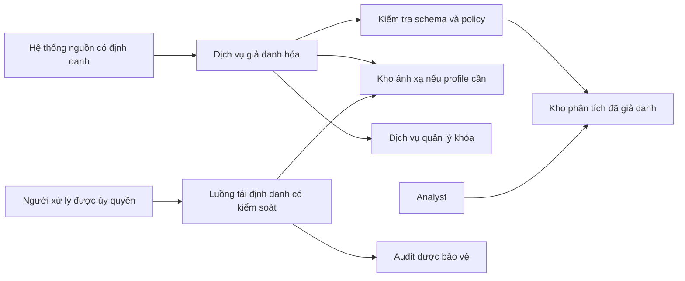

# Data pseudonymization

## 1. Giả danh hóa dữ liệu giải quyết vấn đề gì?

**Giả danh hóa dữ liệu — data pseudonymization** — thay một hoặc nhiều định danh bằng giá trị thay thế, gọi là pseudonym, để giảm khả năng gắn dữ liệu đang xử lý với danh tính gốc. Chẳng hạn, kho phân tích lưu `learner_pseudo` thay vì email hoặc mã tài khoản vận hành. Cách hiểu này phù hợp với [định nghĩa pseudonymization của NIST](https://csrc.nist.gov/glossary/term/pseudonymization).

Giả danh hóa hữu ích khi cần phân tích nhiều sự kiện của cùng một chủ thể nhưng phần lớn bên xử lý không cần biết người đó là ai. Tuy nhiên, việc bỏ tên và email không tự làm dữ liệu trở thành vô danh. Bảng ánh xạ, khóa bí mật, quyền gọi dịch vụ biến đổi hoặc dữ liệu phụ trợ vẫn có thể giúp nhận ra chủ thể.

Trong chương Data protection của module yêu cầu bảo mật, câu hỏi chính là: **ai được phép liên kết dữ liệu nào, trong phạm vi nào, bằng cơ chế nào và phải chứng minh điều đó ra sao?** Chọn một hàm biến đổi chỉ là một phần của câu trả lời.

Sau bài học, người học có thể:

- Phân biệt giả danh hóa với che hiển thị, mã hóa và ẩn danh hóa.
- Chọn phạm vi ổn định của pseudonym theo mục đích xử lý và mô hình đe dọa.
- Đặc tả bảo vệ khóa, bảng ánh xạ và quyền tái định danh.
- Viết yêu cầu có thể kiểm thử cho pipeline dữ liệu, vòng đời và ứng phó sự cố.

Mọi tên, định danh, thời hạn và ngưỡng trong ví dụ dưới đây thuộc một hệ thống giả định; chúng không phải ngưỡng áp dụng chung.

## 2. Phân biệt các khái niệm dễ nhầm

| Khái niệm | Mục tiêu minh họa | Điều cần kiểm chứng |
|---|---|---|
| Giả danh hóa | Phân tích theo chủ thể mà không cung cấp định danh gốc cho analyst | Phạm vi liên kết, thông tin bổ sung và quyền truy cập có bị giới hạn thực tế không? |
| Che hiển thị — masking | Giao diện chỉ hiện một phần địa chỉ hoặc số điện thoại | API, export, DOM và log có còn lộ giá trị đầy đủ không? |
| Mã hóa | Bảo vệ nội dung bằng khóa | Ai có thể giải mã và dữ liệu có bị giải mã tại nơi không cần thiết không? |
| Ẩn danh hóa — anonymization | Giảm khả năng nhận diện theo mô hình rủi ro của việc sử dụng hoặc công bố dữ liệu | Có đánh giá khả năng nhận diện và liên kết bằng dữ liệu khác không? |
| Phân quyền | Quyết định chủ thể nào được đọc hoặc thực hiện hành động | Quyền có được kiểm tra trên từng tài nguyên và tenant không? |

Các biện pháp có thể phối hợp. Ví dụ, bảng ánh xạ được mã hóa; analyst chỉ được đọc tập dữ liệu đã giả danh; giao diện vận hành còn che bớt pseudonym khi không cần xem đầy đủ.

Pseudonym không phải access token. Biết `learner_pseudo` không được mặc nhiên cho phép xem hồ sơ học viên. Một API nhận pseudonym vẫn phải xác thực, phân quyền và kiểm tra tenant như các API khác.

Cũng không nên coi mọi mã nội bộ là pseudonym có mức bảo vệ phù hợp. Mã tài khoản dùng chung giữa CRM, URL công khai, log và kho phân tích có thể trở thành cầu nối danh tính rất thuận tiện.

## 3. Tình huống: phân tích tiến độ học tập

Một nền tảng học tập muốn đo tỷ lệ hoàn thành khóa học theo tuần. Nhóm phân tích cần nối sự kiện của cùng học viên trong một tenant, nhưng không cần email, tên thật hoặc mã tài khoản của hệ thống vận hành.

Sự kiện đầu vào minh họa:

```json
{
  "tenantId": "tenant-demo-a",
  "accountId": "account-demo-17",
  "email": "learner17@example.invalid",
  "courseId": "course-java-demo",
  "occurredAt": "2026-01-12T09:42:13Z",
  "eventType": "LESSON_COMPLETED"
}
```

Dữ liệu đích minh họa:

```json
{
  "tenantId": "tenant-demo-a",
  "learnerPseudo": "ps_v3_example_only",
  "courseId": "course-java-demo",
  "eventWeek": "2026-W03",
  "eventType": "LESSON_COMPLETED"
}
```

`ps_v3_example_only` chỉ minh họa định dạng, không phải đầu ra mật mã hợp lệ. Việc chuyển thời điểm sang tuần là một bước giảm độ chi tiết riêng, không phải tác dụng tự động của pseudonymization.

Các quyết định cần chốt trước khi triển khai:

1. Pseudonym có ổn định trong toàn bộ báo cáo theo dõi tiến độ hay chỉ trong một đợt phân tích?
2. Cùng tài khoản ở hai tenant có được liên kết không?
3. Có được nối dữ liệu học tập với chiến dịch marketing không?
4. Ai được phép tìm tài khoản gốc khi cần hỗ trợ hoặc điều tra?
5. Bản export, bản sao lưu và môi trường kiểm thử được xử lý ra sao?

Nếu yêu cầu nghiệp vụ chỉ cần số đếm theo nhóm, nên xem xét xuất dữ liệu tổng hợp thay vì tạo một tập dữ liệu cấp cá nhân có pseudonym ổn định. Không tạo khả năng liên kết dài hạn chỉ vì kỹ thuật đó thuận tiện.

## 4. Mô hình đe dọa và thông tin bổ sung

Giả danh hóa phải gắn với một đối thủ và một ranh giới bảo vệ cụ thể. Không có một bảo đảm duy nhất bao phủ mọi khả năng xâm phạm.

| Mã rủi ro | Tình huống | Hệ quả cần hạn chế |
|---|---|---|
| R1 | Người nhận lấy được bản export đã giả danh | Nhận diện bằng định danh còn sót hoặc dữ liệu phụ trợ |
| R2 | Người xử lý biết danh sách email hoặc số điện thoại có khả năng xuất hiện | Đoán đầu vào và đối chiếu pseudonym |
| R3 | Hai bên cùng nhận pseudonym ổn định toàn hệ thống | Nối hai tập dữ liệu ngoài mục đích đã duyệt |
| R4 | Tài khoản analyst gọi được dịch vụ ánh xạ hoặc đọc khóa | Tái định danh hàng loạt |
| R5 | Pipeline lỗi và tự chuyển sang xuất dữ liệu gốc | Lộ định danh tại kho hoặc vùng trung gian |
| R6 | Khôi phục backup hoặc chạy lại dữ liệu cũ | Làm sống lại mapping đã xóa hoặc liên kết đã bị hạn chế |
| R7 | Cạnh tranh, va chạm hoặc chuẩn hóa sai | Gộp nhầm dữ liệu của hai chủ thể hoặc tách một chủ thể thành nhiều hồ sơ |

Tài sản cần bảo vệ gồm định danh gốc, bảng ánh xạ, khóa, quyền gọi biến đổi, quyền tái định danh, chính tập dữ liệu đã giả danh và metadata giúp nối các tập dữ liệu.

**Quasi-identifier** là thuộc tính có thể hỗ trợ nhận diện khi kết hợp với thuộc tính khác; xem [định nghĩa của NIST](https://csrc.nist.gov/glossary/term/quasi_identifier). Trong ví dụ này, thời điểm học quá chi tiết, khóa học ít người tham gia hoặc mô tả tự do có thể làm một bản ghi dễ được đối chiếu với thông tin bên ngoài.

Do đó, yêu cầu không dừng ở việc đổi `accountId`. Cần đánh giá toàn bộ tập trường, khả năng nối dữ liệu và điều kiện truy cập. Nếu đối thủ chiếm cả kho phân tích lẫn kho ánh xạ, giả danh hóa bằng mapping không còn cung cấp ranh giới đã kỳ vọng giữa hai kho.

## 5. Phạm vi pseudonym là một quyết định kiến trúc

### 5.1. Tính ổn định và khả năng liên kết

Pseudonym ổn định giúp nối sự kiện theo thời gian, đồng thời cũng cho phép người nhận theo dõi cùng một chủ thể lâu hơn. Hai mục tiêu này phải được đánh đổi rõ ràng.

Một profile có thể quy định:

```text
scope = tenant + mục đích đã duyệt + thế hệ dữ liệu
```

Ví dụ, `learning-progress` và `marketing-analysis` là hai mục đích riêng. Nếu không có quyền nối hai mục đích, hệ thống phải dùng namespace, khóa hoặc mapping tách biệt phù hợp, đồng thời kiểm soát các đường nối khác.

Đổi pseudonym giữa hai tập dữ liệu chỉ loại bỏ một cầu nối trực tiếp. Các thuộc tính còn lại vẫn có thể cho phép liên kết; không tuyên bố rằng pseudonym khác nhau đồng nghĩa với hoàn toàn không thể nối dữ liệu.

### 5.2. Ai quyết định scope?

Dịch vụ tin cậy phải xác định tenant và purpose từ danh tính workload cùng policy. Không nhận nguyên giá trị `purpose` do người gọi tùy ý gửi rồi cấp pseudonym cho bất kỳ miền nào.

Nếu analyst có thể gọi profile của một phòng ban khác với mọi định danh họ đoán được, việc tách profile gần như mất ý nghĩa.

Cần đặc tả cả môi trường. Không dùng khóa, mapping hoặc pseudonym ổn định của production để tạo dữ liệu thử nghiệm nếu mục tiêu là cô lập môi trường phát triển khỏi danh tính thật.

### 5.3. Thay đổi định danh gốc

Email có thể thay đổi hoặc được cấp lại. Nếu mục tiêu là theo dõi cùng một tài khoản qua thời gian, đầu vào thường nên là định danh tài khoản ổn định trong hệ thống nguồn có thẩm quyền, thay vì email.

Phải xác định cách xử lý merge, split, xóa rồi tạo lại tài khoản và chuyển tenant. Không gộp hai chủ thể chỉ vì cùng chuỗi email xuất hiện ở các thời điểm khác nhau.

## 6. Chọn cơ chế theo nhu cầu, không chỉ theo tên thuật toán

ENISA phân tích nhiều kỹ thuật và chính sách giả danh hóa, cùng các tấn công như dò từ điển và vét cạn; xem [Pseudonymisation techniques and best practices](https://www.enisa.europa.eu/publications/pseudonymisation-techniques-and-best-practices). Những lựa chọn dưới đây là thiết kế minh họa cho tình huống học tập, cần được cụ thể hóa theo mô hình rủi ro của từng hệ thống.

| Cơ chế | Phù hợp khi | Điều phải đặc tả thêm |
|---|---|---|
| Token ngẫu nhiên và kho ánh xạ | Cần định danh thay thế ổn định và tra ngược có kiểm soát | Sinh ngẫu nhiên an toàn, duy nhất, tính nhất quán, quyền truy cập mapping |
| HMAC trên định danh có ngữ cảnh | Cần tái tạo pseudonym ổn định mà không duy trì mapping cho việc biến đổi | Khóa bí mật, domain separation, chuẩn hóa đầu vào, giới hạn dịch vụ biến đổi |
| Biến đổi bằng mã hóa có quản lý khóa | Có nhu cầu khôi phục đầu vào bằng quyền giải mã | Profile mã hóa, quản lý khóa, xác thực ngữ cảnh và kiểm soát giải mã |
| Hash trực tiếp định danh dễ đoán | Không đủ để đáp ứng mục tiêu chống đoán trong ví dụ này | Phải thay đổi thiết kế thay vì chỉ kéo dài chuỗi hash |

### 6.1. Vì sao `SHA-256(email)` không đủ?

Một bên biết các email có thể thử hash từng email rồi đối chiếu. Họ không cần đảo ngược thuật toán hash để tìm ra một giá trị có khả năng khớp.

Thêm một salt công khai không ngăn bên có salt thử lại từng ứng viên. Salt có thể phục vụ mục tiêu riêng trong một thiết kế, nhưng không được mô tả như một khóa bí mật mà người nhận không có.

Không tự xây dựng công thức `hash(secret + identifier)` rồi coi tương đương một cấu trúc keyed hash chuẩn. Nếu chọn HMAC, dùng thư viện mật mã và profile đã duyệt; [RFC 2104](https://www.rfc-editor.org/rfc/rfc2104.html#section-2) mô tả cấu trúc HMAC dựa trên hàm hash và khóa bí mật.

### 6.2. HMAC cũng cần ranh giới sử dụng

HMAC không có thao tác giải mã để trả lại đầu vào. Tuy nhiên, bên có khóa có thể tính pseudonym cho các ứng viên rồi đối chiếu. Bên không có khóa nhưng được gọi dịch vụ biến đổi tùy ý cũng có thể khai thác dịch vụ như một oracle để thử các định danh.

Vì vậy, bảo vệ khóa mà để API biến đổi mở rộng cho analyst vẫn không đạt mục tiêu R2 và R4. Rate limit hỗ trợ hạn chế lạm dụng; quyền gọi và phạm vi dữ liệu nguồn mới là các điều kiện thiết yếu của contract.

## 7. Ví dụ profile HMAC có phạm vi

Profile minh họa chọn HMAC-SHA-256 với khóa bí mật 256 bit được sinh bởi cơ chế mật mã, dùng toàn bộ đầu ra 256 bit và mã hóa thành base64url. Đây là một lựa chọn cho ví dụ, không phải tuyên bố mọi bài toán đều cần cùng tham số.

```text
createPseudonym(workloadIdentity, sourceRecord):
    policy = authorizeProfile(workloadIdentity, sourceRecord.tenant)
    require sourceRecord belongs to the authorized source

    subject = canonicalInternalAccountId(sourceRecord.accountId)
    message = lengthPrefixedUtf8Encode(
        "learning-pseudonym",
        policy.profileVersion,
        policy.tenant,
        policy.purpose,
        policy.dataGeneration,
        subject
    )

    keyHandle = approvedKeyHandle(policy.keyVersion)
    tag = HMAC_SHA256(keyHandle, message)
    return policy.publicVersionPrefix + base64url(tag)
```

Mã giả thể hiện contract, không phải triển khai thư viện. `lengthPrefixedUtf8Encode` biểu diễn từng trường có độ dài rõ ràng, tránh nhập nhằng như ghép `ab` với `c` và ghép `a` với `bc`. Chuẩn hóa, encoding và phiên bản phải được thống nhất giữa các producer.

Những yêu cầu cần đi cùng profile:

- Không ghi khóa vào source code, cấu hình công khai, tập dữ liệu đích hoặc log.
- Không xuất raw key cho consumer; quyền sử dụng khóa được giới hạn theo workload và profile.
- Tenant, purpose và phiên bản được xác định theo policy tin cậy.
- Không tự cắt ngắn đầu ra để phù hợp cột dữ liệu khi chưa đánh giá va chạm.
- Không biến pseudonym thành bằng chứng xác thực hoặc quyền truy cập.
- Có test vector cho encoding và tính ổn định của cùng profile.

Kiểm tra “hai đầu vào khác nhau cho hai đầu ra khác nhau” trên một tập mẫu không chứng minh hoàn toàn không có va chạm. Độ dài đầu ra, quy mô dữ liệu dự kiến và hậu quả va chạm phải nằm trong thiết kế.

Nếu vẫn cần tìm lại danh tính từ pseudonym, phải chỉ ra nguồn tra cứu có thẩm quyền hoặc một mapping được quản lý. Không thêm một endpoint “giải mã HMAC”, vì HMAC không cung cấp chức năng đó.

## 8. Ví dụ kho ánh xạ cho token ngẫu nhiên

Một phương án khác cấp token ngẫu nhiên trong mỗi scope và lưu quan hệ với chủ thể gốc. Contract của ví dụ yêu cầu cùng chủ thể trong cùng scope nhận một token ổn định, còn scope khác có mapping riêng.

```text
(scope, internalSubject) -> randomPseudonym
(scope, randomPseudonym) -> protectedSourceReference
```

Token có thể được sinh từ 128 bit ngẫu nhiên bằng CSPRNG trong profile minh họa. Kích thước này không thay thế kiểm tra duy nhất ở kho ánh xạ. Hai request cạnh tranh không được tạo hai mapping đang hoạt động cho cùng chủ thể nếu contract yêu cầu ổn định.

Luồng cấp phát cần bảo đảm:

1. Xác thực workload và xác định scope được phép.
2. Tìm mapping hiện hành trong kho được bảo vệ.
3. Nếu chưa có, sinh ứng viên bằng CSPRNG và tạo mapping nguyên tử.
4. Áp dụng ràng buộc duy nhất cho cả chủ thể trong scope và token trong scope theo thiết kế lưu trữ.
5. Nếu xung đột do request khác đã tạo mapping, trả mapping đã được xác lập; nếu token va chạm với chủ thể khác, sinh lại theo giới hạn đã định.
6. Nếu không hoàn tất được, dừng xử lý hoặc cách ly bản ghi; không trả định danh gốc làm giá trị thay thế.

Cột tra cứu và chỉ mục trong vault cũng là dữ liệu nhạy cảm. Mã hóa một cột nhưng để một bản sao định danh gốc trong index, cache hoặc log vẫn làm lộ đường liên kết.

Cần quyết định cách backup, khôi phục, sao chép và truy cập khẩn cấp cho cả vault. Chỉ chuyển mapping sang một database khác nhưng dùng cùng tài khoản có toàn quyền với kho phân tích chưa tạo được sự tách biệt như yêu cầu.

## 9. Kiến trúc tách dữ liệu và quyền tái định danh



Sơ đồ không ngụ ý mọi profile đều cần vault. Với HMAC, dịch vụ vẫn phụ thuộc nguồn định danh và quyền dùng khóa; với token ngẫu nhiên, vault là thành phần trọng yếu của việc duy trì liên kết.

Một ma trận quyền minh họa:

| Vai trò/workload | Đọc tập phân tích | Gửi dữ liệu nguồn để biến đổi | Tra ngược danh tính | Quản lý khóa |
|---|---|---|---|---|
| Analyst | Theo dataset được cấp | Không | Không | Không |
| Pipeline đã được cấp profile | Không mặc định có quyền tùy ý | Chỉ nguồn và scope đã cấp | Không | Chỉ thao tác mật mã cần thiết |
| Nhân sự xử lý vụ việc | Theo nhu cầu vụ việc | Không mặc định | Theo case, mục đích và thời hạn | Không |
| Quản trị khóa | Không mặc định | Không mặc định | Không mặc định | Theo nhiệm vụ quản trị |

Tách nhiệm vụ phải được thực thi bằng IAM, tài khoản dịch vụ, policy khóa và quyền mạng hoặc dữ liệu phù hợp. Đặt tên vai trò khác nhau không đủ nếu một tài khoản có thể tự cấp tất cả các quyền đó.

Luồng tái định danh cần ràng buộc vào case ID, mục đích, tenant, số lượng bản ghi và người yêu cầu. Hoạt động có rủi ro cao có thể yêu cầu xác thực tăng cường hoặc phê duyệt độc lập theo policy. Phản hồi chỉ trả thông tin cần cho vụ việc, không mặc nhiên xuất cả mapping.

## 10. Pipeline, logging và hành vi khi lỗi

### 10.1. Schema đích phải là allowlist

Không sao chép mọi trường từ đầu vào rồi chỉ xóa `email`. Một trường mới như `supportComment`, `profileUrl` hoặc `deviceDescription` có thể đưa định danh vào kho mà code biến đổi không biết.

Yêu cầu nên quy định schema đầu ra theo allowlist, quản lý thay đổi schema và đánh giá lại trường tự do. Lọc tên cột chỉ là một kiểm tra; định danh có thể nằm trong nội dung một trường được phép.

Trong ví dụ, trường `email`, `accountId` và địa chỉ IP đầy đủ không có trong schema phân tích tiến độ đã duyệt. Nếu một mục đích khác thật sự cần các trường này, phải đi qua quyết định riêng và có kiểm soát tương ứng.

### 10.2. Không fallback sang dữ liệu gốc

Khi dịch vụ khóa, vault hoặc policy không sẵn sàng, pipeline phải dừng hoặc đưa bản ghi vào vùng cách ly có bảo vệ. Không xuất `accountId` vào `learnerPseudo`, không dùng một khóa mặc định và không hash tạm bằng công thức khác mà consumer không biết.

Vùng cách ly, dead-letter queue, payload retry và file tạm có thể chứa dữ liệu gốc. Chúng cần quyền truy cập, mã hóa, thời hạn lưu và quy trình xóa phù hợp với dữ liệu nguồn.

### 10.3. Log không trở thành kho ánh xạ thứ hai

Tránh log đồng thời định danh gốc và pseudonym. Không ghi raw payload, key material hoặc response tái định danh vào trace thông thường.

Audit có thể ghi sự kiện, workload hoặc người thao tác, profile, phiên bản policy, case ID, kết quả và mã lý do. Pseudonym trong audit cũng có thể hỗ trợ liên kết nên vẫn cần giới hạn truy cập và retention.

Ví dụ sự kiện không chứa danh tính gốc:

```yaml
eventType: REIDENTIFICATION_REQUEST_EVALUATED
caseId: case-demo-82
tenantId: tenant-demo-a
profileId: learning-progress-v3
requesterAuditId: operator-demo-4
requestedRecordCount: 1
decision: DENY
reasonCode: PURPOSE_NOT_AUTHORIZED
correlationId: trace-demo-913
```

Nếu audit bắt buộc không ghi được, hành vi của thao tác tái định danh phải được định nghĩa trước. Không để một yêu cầu “mọi lần tra ngược đều có audit” bị bỏ qua chỉ vì hệ thống log lỗi.

## 11. Vòng đời: rotation, xóa và phục hồi

### 11.1. Phân biệt các loại thay khóa

Thay khóa bọc hoặc khóa mã hóa bảo vệ vault có thể giữ nguyên pseudonym nếu dữ liệu ánh xạ không đổi. Đổi khóa HMAC dùng tạo pseudonym thường làm đổi đầu ra cho cùng đầu vào.

Vì vậy, một yêu cầu “rotate key mỗi chu kỳ” phải nói rõ loại khóa, ảnh hưởng tới dữ liệu lịch sử và cách chuyển phiên bản. Không gộp mọi thao tác thay khóa vào một hành vi chung.

Nếu consumer cần nối dữ liệu cũ và mới, cơ chế chuyển đổi chính là một cầu nối nhạy cảm. Cần giới hạn người dùng, phạm vi và thời hạn của cầu nối; không xuất đồng thời hai thế hệ pseudonym cho mọi bên chỉ để thuận tiện migration.

### 11.2. Retention và xóa

Phải có chính sách riêng cho dữ liệu nguồn, dataset đã giả danh, mapping, khóa, audit, file trung gian và backup. Giữ mapping lâu hơn dataset có thể không cần thiết; xóa mapping sớm hơn nhu cầu hợp lệ có thể làm mất khả năng hỗ trợ hoặc sửa dữ liệu.

Xóa một mapping không tự chứng minh dataset đã trở thành vô danh. Các bản sao mapping, nguồn khác, thuộc tính gián tiếp hoặc pseudonym được dùng chung vẫn có thể cho phép liên kết.

Hủy một khóa HMAC dùng chung để xử lý yêu cầu của một chủ thể có thể ảnh hưởng toàn bộ scope, và cũng không xóa những đầu ra đã phát hành. Cần thiết kế quy trình tìm, xóa hoặc hạn chế bản ghi theo yêu cầu cụ thể thay vì coi hủy khóa là thao tác xóa theo từng người.

### 11.3. Khôi phục và xử lý sự cố

Phục hồi backup phải tái áp dụng các quyết định xóa, thu hồi quyền và phiên bản policy liên quan trước khi đưa dữ liệu trở lại phục vụ. Một bản backup còn mapping không được vô tình mở lại luồng tra ngược đã bị loại bỏ.

Khi nghi lộ khóa hoặc vault, quy trình cần xác định scope bị ảnh hưởng, chặn quyền lạm dụng, bảo toàn bằng chứng, đánh giá dữ liệu đã xuất và quyết định tạo thế hệ pseudonym mới. Tạo thế hệ mới không thu hồi được bản export cũ đã ra khỏi quyền kiểm soát.

Phải thử khôi phục trong môi trường được cô lập. Không dùng thao tác restore như một đường đưa mapping production vào tài khoản phát triển có quyền rộng hơn.

## 12. Chuyển rủi ro thành yêu cầu có thể nghiệm thu

Một yêu cầu đầy đủ nên nêu: đối tượng dữ liệu, mục đích, chủ thể được phép, ranh giới thực thi, hành vi khi lỗi, thước đo và bằng chứng. Không chỉ ghi “dữ liệu phải được pseudonymize”.

Bộ yêu cầu dưới đây thuộc tình huống phân tích tiến độ học tập:

| ID | Yêu cầu | Rủi ro và bằng chứng nghiệm thu |
|---|---|---|
| PSEUDO-01 | Dataset tiến độ chỉ chứa các trường trong schema đã duyệt; không chứa định danh trực tiếp đã bị loại khỏi mục đích | R1, R5; kiểm schema và dữ liệu canary ở đầu ra cùng các nhánh lỗi |
| PSEUDO-02 | Pseudonym ổn định trong cùng tenant, purpose và thế hệ; không dùng chung namespace giữa các scope cần tách | R3; test vector theo scope và rà soát các đường nối khác |
| PSEUDO-03 | Profile tạo pseudonym và nguồn đầu vào được cấp theo workload; analyst không có quyền biến đổi tùy ý | R2, R4; kiểm policy thực tế và thử gọi với workload không được cấp |
| PSEUDO-04 | Khóa và vault không nằm trong quyền đọc của consumer dataset; chỉ workload được cấp mới dùng thao tác cần thiết | R4; đối chiếu IAM, policy khóa, quyền database và thử truy cập bị từ chối |
| PSEUDO-05 | Cấp token ngẫu nhiên bảo đảm mapping ổn định và duy nhất theo contract dù có request cạnh tranh | R7; kiểm trạng thái commit qua nhiều worker và thử xung đột |
| PSEUDO-06 | Lỗi khóa, vault hoặc policy phải dừng xuất dữ liệu hoặc cách ly; không thay bằng định danh gốc | R5; fault injection trên từng phụ thuộc và kiểm kho đích, log, queue |
| PSEUDO-07 | Tái định danh chỉ được thực hiện theo tenant, case và purpose hợp lệ, có audit theo policy | R4; ca được phép, bị từ chối, quyền hết hạn và audit không khả dụng |
| PSEUDO-08 | Mỗi dataset có profile và phiên bản biến đổi xác định; migration không phát tán cầu nối ngoài người được cấp | R3, R6; kiểm manifest, consumer và dữ liệu hai thế hệ |
| PSEUDO-09 | Chính sách retention, xóa và restore bao phủ cả mapping, dữ liệu trung gian và backup | R1, R6; diễn tập xóa và khôi phục theo phạm vi đã công bố |
| PSEUDO-10 | Trước khi mở dataset cho bên nhận mới hoặc thêm thuộc tính có khả năng nhận diện, phải đánh giá lại rủi ro liên kết | R1, R3; hồ sơ thay đổi schema và đánh giá dữ liệu phụ trợ theo mô hình bên nhận |

Ví dụ đặc tả chi tiết hơn cho một yêu cầu:

```yaml
id: PSEUDO-06
asset: learning-progress-export
threats:
  - R5
precondition: Input batch contains direct identifiers
requiredBehavior:
  - Stop publication when the approved transform is unavailable
  - Retain retry data only in the protected quarantine
  - Never substitute source account IDs for pseudonyms
measurement:
  consumerObjectsPublishedForFailedBatch: 0
  directIdentifierCanaryMatchesInConsumerOutputs: 0
evidence:
  - Dependency failure test report
  - Destination and temporary-storage inspection
owner: data-platform
```

Một canary không xuất hiện chỉ chứng minh ca thử đó không làm lộ giá trị đã cài, chưa chứng minh mọi kiểu định danh đều bị loại. Cần phối hợp kiểm tra schema, quyền, đường dữ liệu và các ca đại diện theo rủi ro.

Các mục tiêu thời gian phải được gắn với kiến trúc. Chẳng hạn, nếu yêu cầu quyền tái định danh hết hiệu lực trên mọi instance trong tối đa 5 phút sau thu hồi, phải tính đến cache quyền, phiên đang hoạt động và credential của workload; không chỉ cập nhật một dòng policy ở nguồn.

## 13. Ma trận kiểm thử và bằng chứng

Đây là các tiêu chí thiết kế kiểm thử, chưa phải kết quả QA của một triển khai cụ thể.

| Tình huống | Kết quả mong đợi |
|---|---|
| Cùng chủ thể, cùng profile hợp lệ, xử lý ở hai worker | Cùng pseudonym theo contract ổn định |
| Cùng chủ thể nhưng tenant hoặc purpose khác cần cô lập | Không tái sử dụng cùng mapping/profile dùng chung; vector kiểm thử cho đầu ra theo scope |
| Người gọi sửa tenant hoặc purpose trong payload | Không vượt qua scope được cấp bởi policy |
| Analyst đọc vault, dùng khóa hoặc gọi API biến đổi | Bị từ chối ở điểm thực thi tương ứng |
| Analyst dùng pseudonym làm ID trên API hồ sơ | Không nhận dữ liệu nếu không có quyền trên tài nguyên |
| Hai yêu cầu tạo mapping cho cùng chủ thể chạy đồng thời | Chỉ một mapping hiệu lực theo contract |
| Cơ chế sinh token trả ứng viên va chạm trong test | Không gán chung token cho hai chủ thể; retry có giới hạn hoặc lỗi an toàn |
| Email thay đổi nhưng định danh tài khoản có thẩm quyền không đổi | Hành vi liên kết đúng profile đã công bố |
| Xuất hiện trường mới hoặc PII trong trường tự do | Bị chặn, loại bỏ hoặc xử lý theo policy đã đặc tả trước khi xuất |
| Vault, dịch vụ khóa hoặc policy lỗi | Không có đầu ra sử dụng định danh gốc để thay thế |
| Luồng retry, dead-letter, crash và debug | Không phát tán dữ liệu gốc ngoài vùng được phép |
| Tái định danh có case hợp lệ hoặc sai tenant | Chỉ trường hợp đủ điều kiện được trả thông tin tối thiểu |
| Quyền tra ngược hết hạn hoặc bị thu hồi | Bị từ chối trong ngân sách thời gian đã đặc tả |
| Rotation và migration giữa hai thế hệ | Consumer đúng phiên bản; cầu nối chỉ hiện diện trong phạm vi được cấp |
| Restore backup sau khi có quyết định xóa/hạn chế | Quyết định được tái áp dụng trước khi phục vụ dữ liệu |
| Kết hợp thuộc tính còn lại với dữ liệu phụ trợ trong đánh giá được phép | Rủi ro còn lại được ghi nhận và xử lý theo tiêu chí chia sẻ |

Bằng chứng phải lấy ở đúng ranh giới. Một API trả `403` không chứng minh analyst không có đường đọc vault qua database, snapshot hoặc tài khoản vận hành khác. Một file đầu ra sạch cũng không chứng minh log và vùng trung gian sạch.

Đối với dữ liệu dùng cho công bố hoặc chia sẻ rộng, cần đánh giá rủi ro theo mô hình chia sẻ và khả năng tái nhận diện thay vì dựa vào tên gọi “đã giả danh”. [NIST SP 800-188](https://csrc.nist.gov/pubs/sp/800/188/final) trình bày cách tiếp cận quản trị và đánh giá cho de-identification, trong đó có lựa chọn mô hình chia sẻ và thước đo rủi ro.

## 14. Những lỗi đặc tả thường gặp

- **“Băm mọi email là xong.”** Thiếu mô hình đoán đầu vào, quyền gọi biến đổi và kiểm soát các trường khác.
- **“Một pseudonym chung tiện cho mọi phòng ban.”** Tạo khả năng nối mục đích ngoài nhu cầu đã duyệt.
- **“Vault ở server khác nên đã tách quyền.”** Chưa kiểm tài khoản chung, backup, IAM và quyền quản trị khóa.
- **“HMAC không đảo ngược nên không thể nhận diện.”** Bỏ qua dò ứng viên qua khóa hoặc oracle và dữ liệu phụ trợ.
- **“Rotate khóa không ảnh hưởng báo cáo.”** Chưa phân biệt khóa bảo vệ vault với khóa sinh pseudonym.
- **“Không có tên nên đưa production vào môi trường test được.”** Chưa đánh giá mapping, khóa, hành vi và khả năng nối với production.
- **“Xóa mapping là dữ liệu tự trở thành vô danh.”** Bỏ qua bản sao, dữ liệu gián tiếp và những đường nối khác.
- **“Pseudonym khó đoán nên API không cần kiểm quyền.”** Nhầm định danh với credential và phân quyền.

Một đặc tả tốt giữ được đúng khả năng liên kết cần cho nghiệp vụ, đồng thời chỉ rõ ai bị ngăn nhận diện, thông tin nào phải được giữ riêng và bảo đảm nào vẫn phải tồn tại khi lỗi, migration hoặc restore. Khi các điều kiện đó được liên kết với rủi ro và bằng chứng nghiệm thu, giả danh hóa trở thành một yêu cầu bảo vệ dữ liệu có thể triển khai và kiểm chứng.
