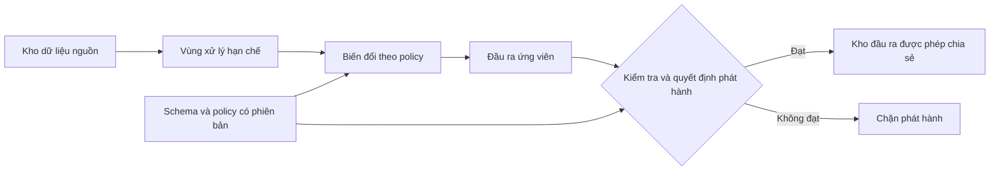

# Data anonymization

## 1. Mục tiêu của ẩn danh dữ liệu trong yêu cầu bảo mật

Data anonymization, hay ẩn danh dữ liệu, hướng đến việc cung cấp dữ liệu hữu ích cho một mục đích đã định trong khi giảm khả năng nhận diện cá nhân đến mức được chấp nhận trong bối cảnh sử dụng. Kết luận về khả năng nhận diện phải xét dữ liệu được cung cấp, thông tin bổ trợ, người có thể tiếp cận và cách dữ liệu được sử dụng.

Ví dụ, nhóm sản phẩm muốn biết phân bố độ tuổi của khách hàng theo vùng. Yêu cầu nghiệp vụ có thể được đáp ứng bằng thống kê tổng hợp; nhóm này không nhất thiết cần bản ghi giao dịch, ngày sinh chính xác và lịch sử vị trí của từng người.

Trong module yêu cầu bảo mật, đầu ra cần là một đặc tả trả lời được:

- Dữ liệu phục vụ mục đích nào, cho người nhận nào và qua hình thức truy cập nào?
- Những thuộc tính hoặc tổ hợp thuộc tính nào có thể làm lộ cá nhân?
- Bên tấn công có thể biết thêm điều gì và gây ra tác động nào?
- Phép biến đổi, giới hạn truy cập và kiểm soát phát hành xử lý rủi ro đó ra sao?
- Bằng chứng nào đủ để chấp nhận một phiên bản dữ liệu và điều gì buộc phải đánh giá lại?

NIST SP 800-188 đặt việc khử nhận dạng trong mối liên hệ với mục đích sử dụng, mô hình chia sẻ và đánh giá rủi ro tiết lộ. Đây là điểm tham khảo cho việc xây dựng yêu cầu, không phải chứng nhận tự động cho một tập dữ liệu. Xem [NIST SP 800-188 — De-Identifying Government Datasets](https://csrc.nist.gov/pubs/sp/800/188/final).

Một mục tiêu như “xóa hết thông tin cá nhân” thường chưa đủ để triển khai. Cần biết tên, địa chỉ, khóa liên kết, nội dung tự do, metadata và tổ hợp thuộc tính được xử lý theo quy tắc nào; đồng thời xác định phép kiểm tra trên đúng dữ liệu sẽ được phát hành.

## 2. Các khái niệm phải phân biệt

| Khái niệm | Ý nghĩa trong thiết kế | Giới hạn cần ghi vào yêu cầu |
|---|---|---|
| De-identification | Nhóm quá trình loại bỏ hoặc giảm liên kết giữa dữ liệu và chủ thể | Cần nói rõ mức bảo vệ và bối cảnh; nhãn này chưa chứng minh dữ liệu đã đạt mục tiêu ẩn danh |
| Anonymization | Hướng đến đầu ra không còn khả năng nhận diện được chấp nhận trong bối cảnh đánh giá | Phải xét nguồn bổ trợ, các bản phát hành khác và khả năng thay đổi theo thời gian |
| Pseudonymization | Thay định danh bằng bí danh hoặc mã, thường còn khả năng liên kết thông qua thông tin bổ sung | Mã ổn định, bảng ánh xạ, khóa hoặc thuộc tính còn lại có thể hỗ trợ nhận diện |
| Masking | Che hoặc thay đổi cách biểu diễn một phần dữ liệu | Cần phân biệt che trên giao diện với biến đổi dữ liệu xuất ra |
| Encryption | Bảo vệ nội dung bằng khóa, cho phép khôi phục khi có quyền | Bên có khả năng giải mã vẫn tiếp cận được dữ liệu gốc; phải quản lý khóa và quyền |
| Aggregation | Chuyển bản ghi chi tiết thành thống kê nhóm | Nhóm nhỏ, tổng phụ và nhiều truy vấn kết hợp có thể làm lộ thông tin |

Một màn hình hiển thị `ng***@example.test` có thể vẫn trả đầy đủ email trong response API. Kiểm tra ảnh chụp màn hình không chứng minh bản xuất dữ liệu đã được biến đổi.

Tương tự, việc thay `customerId` bằng một UUID ổn định có thể đáp ứng nhu cầu giả danh và liên kết bản ghi. Nó không xử lý các dấu vết còn lại như lịch sử giao dịch hiếm hoặc tổ hợp thời gian, địa điểm và nghề nghiệp.

Bài này dùng các khái niệm trên để đặc tả kiểm soát kỹ thuật. Việc xác định nghĩa vụ pháp lý cần theo phạm vi áp dụng của dự án; không suy ra kết luận pháp lý chỉ từ tên thuật toán hoặc tên cột.

## 3. Khảo sát dữ liệu trước khi chọn kỹ thuật

### 3.1. Nhận diện các vai trò của thuộc tính

| Vai trò | Ví dụ | Câu hỏi cần đặt ra |
|---|---|---|
| Định danh trực tiếp | Họ tên, email cá nhân, số điện thoại, số định danh | Có cần giữ không, có xuất hiện ở trường lồng nhau hoặc nội dung tự do không? |
| Quasi-identifier, định danh gián tiếp | Tuổi, khu vực cư trú, chức danh, thời điểm sự kiện | Khi kết hợp với nhau hoặc nguồn ngoài, chúng có phân biệt được một người không? |
| Thuộc tính cần bảo vệ | Thu nhập, phản hồi nhân sự, thông tin sức khỏe, hành vi mua hàng | Người nhận có thể suy ra điều gì về một cá nhân hoặc một nhóm? |
| Khóa liên kết | ID tài khoản, ID thiết bị, bí danh ổn định | Có nối được nhiều tập dữ liệu hoặc nhiều kỳ báo cáo không? |
| Nội dung và metadata khác | Ghi chú, tên tệp, tọa độ ảnh, đường dẫn, sheet ẩn | Có chứa thông tin nhận diện nằm ngoài schema chính không? |

Các vai trò không loại trừ nhau. Một thuộc tính nhạy cảm cũng có thể là quasi-identifier khi giá trị đó hiếm và được biết từ nguồn khác. Việc phân loại phải theo ngữ cảnh, không chỉ theo kiểu dữ liệu.

### 3.2. Bao phủ dữ liệu thực sự rời khỏi ranh giới

Ví dụ một gói dữ liệu gồm CSV, tệp mô tả và báo cáo lỗi. CSV đã bỏ tên người dùng nhưng báo cáo lỗi vẫn chứa nguyên bản ghi đầu vào. Kênh lỗi đã làm hỏng mục tiêu bảo vệ của cả gói.

Bản khảo sát cần ghi nhận:

- Bảng, JSON lồng nhau, khóa ngoại, chuỗi thời gian và số bản ghi trên mỗi cá nhân.
- Trường tự do, tài liệu đính kèm, ảnh, âm thanh hoặc dữ liệu vị trí nếu có.
- Header, tên tệp, sheet phụ, comment, thuộc tính tài liệu và dữ liệu phụ trợ.
- Tệp tạm, staging, cache, log, trace, backup và vùng lưu của bên nhận.
- Các tập đã phát hành trước đó có thể liên kết với đầu ra mới.

Schema thay đổi phải là một sự kiện có ảnh hưởng đến yêu cầu bảo mật. Một cột mới như `freeTextReason` không được tự động đi qua pipeline chỉ vì các cột cũ đã từng được chấp nhận.

## 4. Mô hình đe dọa: bên nhận có thể học được điều gì?

Ba câu hỏi hữu ích là có thể tách riêng một người, liên kết nhiều thông tin về cùng người đó, hoặc suy ra thuộc tính cần bảo vệ hay không. ICO nhấn mạnh vai trò của singling out và linkability trong đánh giá khả năng nhận diện theo bối cảnh. Xem [ICO — How do we ensure anonymisation is effective?](https://ico.org.uk/for-organisations/uk-gdpr-guidance-and-resources/data-sharing/anonymisation/how-do-we-ensure-anonymisation-is-effective/).

| Tình huống đe dọa | Thông tin bên tấn công có thể có | Kết quả cần ngăn hoặc hạn chế |
|---|---|---|
| Ghép dữ liệu theo thuộc tính | Danh bạ công khai, nghề nghiệp và tuổi gần đúng | Gắn một dòng dữ liệu với một người cụ thể |
| Nhận diện mẫu hiếm | Một lịch sử di chuyển hoặc giao dịch đã biết | Tìm ra cá nhân dù không còn tên |
| Suy ra thuộc tính trong nhóm | Biết người đó thuộc một nhóm nhỏ | Học được thu nhập hoặc phản hồi mà không cần xác định đúng dòng |
| So sánh nhiều lần xuất | Hai báo cáo có tập người gần giống nhau | Tính ra giá trị của người vừa được thêm hoặc loại bỏ |
| Lạm dụng thông tin bổ sung | Bảng ánh xạ, khóa hoặc quyền truy cập dữ liệu gốc | Liên kết bí danh với chủ thể ban đầu |
| Suy ra việc tham gia | Biết danh tính mục tiêu và có đầu ra phân tích hoặc mô hình | Xác định người đó có nằm trong tập nhạy cảm hay không |

Đặc tả cần giới hạn giả định: dữ liệu được công bố công khai hay chỉ cho một đối tác, người nhận có những nguồn bổ trợ nào, có được tải toàn bộ dữ liệu không, và có thể kết hợp bao nhiêu lần phát hành.

Giả định “người nhận chỉ có đúng tệp này” phải có cơ sở. Chẳng hạn, bộ phận nhân sự thường đã biết tuổi, bộ phận làm việc và chức danh của nhân viên. Một phép đánh giá bỏ qua kiến thức đó có thể đánh giá thấp rủi ro.

Hạn chế truy cập, hợp đồng và giám sát là các lớp bảo vệ của mô hình chia sẻ có kiểm soát. Chúng không chứng minh cùng dữ liệu đó phù hợp để công bố công khai.

## 5. Chọn phép biến đổi theo mục đích và rủi ro

### 5.1. Các kỹ thuật thường gặp

| Kỹ thuật | Ví dụ tự xây dựng | Đánh đổi cần kiểm tra |
|---|---|---|
| Loại bỏ thuộc tính | Không đưa email vào đầu ra | Các cột còn lại vẫn có thể nhận diện khi kết hợp |
| Generalization, khái quát hóa | Tuổi 34 thành nhóm 30–39; địa chỉ thành vùng lớn | Giảm độ chi tiết; cần kiểm tra tổ hợp thuộc tính sau biến đổi |
| Suppression, loại bỏ giá trị hoặc bản ghi | Không xuất một nhóm quá nhỏ | Có thể làm lệch kết quả; tỷ lệ và đặc điểm phần bị loại cần được đo |
| Top/bottom coding | Gom các giá trị thu nhập rất cao vào một khoảng mở | Giảm dấu vết ngoại lệ nhưng mất thông tin phần đuôi phân bố |
| Aggregation | Chỉ xuất số lượng và tỷ lệ theo nhóm | Cần xét nhóm nhỏ, tổng phụ và khả năng tính chênh lệch |
| Perturbation, thêm nhiễu có thiết kế | Công bố thống kê qua cơ chế riêng tư đã đặc tả | Cần xác định bảo đảm, giới hạn đóng góp và sai số chấp nhận |
| Synthetic data, dữ liệu tổng hợp | Tạo bộ dữ liệu phục vụ kiểm thử theo quy tắc | Cần đánh giá sao chép bản ghi và thông tin bị học từ nguồn nếu dùng mô hình huấn luyện |

Phép biến đổi phải đáp ứng nhu cầu cụ thể. Nếu chỉ cần phân bố theo tháng, việc giữ timestamp đến mili giây tạo thêm chi tiết mà mục đích phân tích không sử dụng.

### 5.2. Hash và bí danh cần một quyết định riêng

Hash email hoặc số điện thoại không tự loại bỏ khả năng liên kết. Bên có danh sách ứng viên có thể tính hash tương ứng rồi đối chiếu, trong khi một giá trị hash ổn định vẫn hỗ trợ nối các bản ghi. Salt công khai không biến miền đầu vào nhỏ thành một bí mật khó dò.

HMAC với khóa được bảo vệ có thể phù hợp cho một số thiết kế giả danh có kiểm soát. Yêu cầu khi đó phải nêu ai được sử dụng khóa, phạm vi bí danh, việc liên kết giữa các hệ thống và cách xử lý khi khóa bị lộ. Các thuộc tính khác trong bản ghi vẫn cần được đánh giá.

Nếu mục đích là nghiên cứu theo dõi cùng cá nhân qua thời gian, bí danh ổn định có thể cần thiết. Hãy ghi nhận đây là nhu cầu liên kết và kiểm soát nó theo mô hình rủi ro, thay vì đặt nhãn “đã ẩn danh” chỉ vì không còn tên.

## 6. Ví dụ về k-anonymity và giới hạn của một chỉ số

### 6.1. Dữ liệu giả lập

Giả sử một khảo sát nội bộ có sáu người, mỗi người đúng một bản ghi. Tất cả dữ liệu dưới đây được tạo để minh họa.

| Mã trong dữ liệu nguồn | Tuổi | Khu vực | Mức thu nhập |
|---|---:|---|---|
| NV-01 | 34 | A1 | Thấp |
| NV-02 | 36 | A2 | Thấp |
| NV-03 | 38 | A3 | Thấp |
| NV-04 | 44 | B1 | Trung bình |
| NV-05 | 46 | B2 | Cao |
| NV-06 | 48 | B3 | Trung bình |

Trong ví dụ, tập quasi-identifier được chọn là tuổi và khu vực. Nhóm phát hành bỏ mã nguồn, gom tuổi thành khoảng mười năm và gom A1–A3 vào vùng A, B1–B3 vào vùng B:

| Nhóm tuổi | Vùng | Mức thu nhập |
|---|---|---|
| 30–39 | A | Thấp |
| 30–39 | A | Thấp |
| 30–39 | A | Thấp |
| 40–49 | B | Trung bình |
| 40–49 | B | Cao |
| 40–49 | B | Trung bình |

Với tập quasi-identifier đã nêu, mỗi tổ hợp xuất hiện ba lần. Vì vậy bảng đạt k = 3 theo phép kiểm tra này. Thứ tự dòng trong bảng chỉ dùng để trình bày; hệ thống thực tế còn phải xét việc thứ tự hoặc metadata có tiết lộ liên kết với nguồn hay không.

k-anonymity yêu cầu mỗi nhóm bản ghi có cùng giá trị trên các quasi-identifier được chọn chứa ít nhất k bản ghi. Nếu bỏ sót một quasi-identifier, kết quả tính có thể không phản ánh rủi ro thực tế.

### 6.2. Đạt k vẫn có thể làm lộ thuộc tính

Một người biết đồng nghiệp 35 tuổi sống ở vùng A và tham gia khảo sát có thể suy ra mức thu nhập “Thấp”, vì toàn bộ nhóm tương ứng có cùng giá trị đó. Người này không cần biết đồng nghiệp nằm ở dòng nào.

l-diversity bổ sung yêu cầu về sự đa dạng của thuộc tính nhạy cảm trong từng nhóm; cần ghi rõ biến thể và cách tính. Với cách đếm giá trị phân biệt đơn giản, nhóm A chỉ có một giá trị thu nhập.

t-closeness xét khoảng cách giữa phân bố thuộc tính nhạy cảm trong nhóm và phân bố tham chiếu của toàn tập theo một thước đo đã chọn. Nó hướng đến một vấn đề khác với việc chỉ đếm số giá trị.

Các mô hình này có giới hạn trước kiến thức bổ trợ và kết hợp nhiều lần phát hành. Phần giải thích và tài liệu tham khảo về k-anonymity, l-diversity và t-closeness có trong [NIST SP 800-188, mục 2.2](https://nvlpubs.nist.gov/nistpubs/SpecialPublications/NIST.SP.800-188.pdf).

Không chuyển “nhóm có 3 bản ghi” thành khẳng định “xác suất tái nhận dạng tối đa là 1/3” khi chưa nêu mô hình tấn công và giả định. Nếu dữ liệu có nhiều sự kiện của một người, ba dòng cũng chưa chắc tương ứng với ba cá nhân.

### 6.3. Mã giả cho một kiểm tra có phạm vi rõ

```text
Input:
    candidateRelease
    approvedQuasiIdentifiers
    approvedMinimumK

groups = groupBy(candidateRelease, approvedQuasiIdentifiers)

for each group:
    if group.rowCount < approvedMinimumK:
        rejectRelease("GROUP_TOO_SMALL")

continueWithOtherPrivacyAndUtilityChecks()
```

Mã giả chỉ kiểm tra kích thước nhóm theo danh sách được cung cấp. Nó không tự tìm mọi quasi-identifier, không kiểm tra suy luận thuộc tính và không chứng minh dữ liệu đã ẩn danh.

## 7. Thống kê tổng hợp, nhiều lần phát hành và differential privacy

### 7.1. Một ô nhỏ có thể bị suy ra qua tổng

Xét một báo cáo giả lập: tổng thu nhập nhóm là 100 đơn vị, còn tổng của cùng nhóm sau khi loại một người là 70. Nếu biết người bị loại, bên nhận có thể tính ra 30 đơn vị thuộc về người đó.

Chỉ ẩn một ô thống kê có số người nhỏ chưa đủ nếu các tổng và nhóm còn lại cho phép tính lại ô đó. Thiết kế phải xét tổng hàng, tổng cột, nhóm giao nhau và báo cáo các kỳ.

Với dịch vụ truy vấn, yêu cầu cần nêu bộ lọc nào được phép, lịch sử đầu ra được quản lý ra sao và cách xử lý truy vấn chồng lấn. Rate limit hạn chế lưu lượng nhưng không cung cấp một bảo đảm riêng tư cho phép tính.

### 7.2. Khi dùng differential privacy

Differential privacy cung cấp một bảo đảm toán học cho cơ chế phát hành đầu ra, thông qua giới hạn tác động của thay đổi dữ liệu thuộc đơn vị được bảo vệ. Cần đặc tả ít nhất:

- Đơn vị riêng tư: cá nhân, sự kiện hay một đơn vị khác; định nghĩa dữ liệu lân cận.
- Giới hạn đóng góp của đơn vị đó và cơ chế được sử dụng.
- Tham số epsilon, delta nếu áp dụng, cùng tổng ngân sách và cách kế toán qua nhiều đầu ra.
- Toàn bộ đường phát hành phải đi qua cơ chế; hành vi khi ngân sách không đủ.

Cùng epsilon nhưng khác đơn vị riêng tư hoặc delta không tạo ra hai bảo đảm có thể so sánh trực tiếp. Nguồn tham khảo là [NIST SP 800-226 — Guidelines for Evaluating Differential Privacy Guarantees](https://csrc.nist.gov/pubs/sp/800/226/final).

Thêm nhiễu tùy ý vào CSV không đủ để tuyên bố differential privacy. Đồng thời, kiểm thử thực nghiệm một vài lần không chứng minh được bảo đảm toán học; cần cơ sở của cơ chế và kiểm tra việc tích hợp đúng các giả định.

## 8. Kiến trúc pipeline và ranh giới quyền

Một kiến trúc minh họa cho bản xuất định kỳ:



Vùng xử lý vẫn chứa dữ liệu gốc hoặc dữ liệu trung gian có thể nhận diện. Vì vậy, cần yêu cầu xác thực workload, phân quyền đọc/ghi, bảo vệ dữ liệu lưu trữ, logging và dọn dữ liệu cho chính pipeline này.

Một số quyết định kiến trúc cần được đưa vào đặc tả:

- Job biến đổi đọc đúng nguồn cần thiết; người nhận đầu ra không được kế thừa quyền đọc nguồn.
- Kho đầu ra chỉ nhận artifact đã qua bước quyết định; tệp đang ghi hoặc thất bại không tự xuất hiện cho người nhận.
- Mỗi artifact gắn với snapshot nguồn, schema, policy và kết quả kiểm tra xác định.
- Tệp phát hành phải chính là tệp đã được kiểm tra; có thể dùng digest và cơ chế bất biến phù hợp để ràng buộc hai bước.
- Khóa hoặc bảng ánh xạ phục vụ giả danh có quyền riêng và không nằm trong gói chia sẻ.
- Log ghi mã job, phiên bản và kết quả, tránh ghi toàn bộ dòng bị từ chối.
- Khi policy, schema hoặc kiểm tra không hợp lệ, pipeline chặn phát hành và ghi sự kiện có thể điều tra.

Nếu cần duy trì khả năng liên kết lại dữ liệu với cá nhân, phải ghi rõ thành phần nào giữ thông tin bổ sung và quyền nào cho phép thao tác đó. Không coi việc chuyển bảng ánh xạ sang một thư mục khác là đã tách ranh giới quyền.

## 9. Đặc tả yêu cầu có thể đo và kiểm chứng

### 9.1. Bối cảnh và các ngưỡng minh họa

Giả sử một doanh nghiệp muốn cung cấp dữ liệu khảo sát nhân sự cho nhóm phân tích nội bộ theo từng quý. Mỗi người có một bản ghi trong bản xuất. Dữ liệu nguồn gồm mã nhân viên, email, tuổi, bộ phận, vùng và nhóm thu nhập.

Dự án giả lập chọn:

- Chỉ giữ các cột nằm trong schema đầu ra được phê duyệt; loại email, mã nhân viên và trường ghi chú.
- Gom tuổi thành khoảng mười năm; bộ phận hiếm phải được gom hoặc loại theo policy.
- Mỗi nhóm trên tập quasi-identifier đã duyệt có ít nhất 10 cá nhân.
- Tỷ lệ bản ghi bị suppression không vượt 5%.
- Sai lệch tuyệt đối của các tỷ lệ phân tích đã liệt kê không vượt 2 điểm phần trăm trên bộ đánh giá đã thống nhất.
- Dữ liệu trung gian được dọn trong 24 giờ sau khi job kết thúc, với phạm vi bản sao và cơ chế kiểm tra được mô tả trong thiết kế vận hành.

**Đây là các lựa chọn minh họa, không phải ngưỡng bảo đảm ẩn danh do tiêu chuẩn bắt buộc.** Đạt k = 10 hoặc các giới hạn về độ hữu ích chưa đủ để kết luận phát hành an toàn. Mỗi lần phát hành còn cần đánh giá rủi ro suy luận và kết hợp với dữ liệu khác.

Nếu yêu cầu riêng tư và độ hữu ích không cùng đạt, kết quả là chặn bản xuất để điều chỉnh thiết kế hoặc nhu cầu sử dụng. Không tự giảm ngưỡng bảo vệ để job hoàn thành.

### 9.2. Ma trận truy vết

Các mã rủi ro dưới đây chỉ áp dụng cho ví dụ khảo sát:

| Mã yêu cầu | Rủi ro | Hành vi bắt buộc | Tiêu chí nghiệm thu |
|---|---|---|---|
| AN-01 | R1: định danh trực tiếp lọt vào bản xuất | Chỉ xuất các cột trong allowlist; chặn schema nguồn thay đổi chưa được xử lý | Thêm cột email lồng trong dữ liệu thử làm job bị chặn; đầu ra không chứa cột ngoài schema |
| AN-02 | R2: tổ hợp thuộc tính tạo nhóm nhỏ | Áp dụng quy tắc tuổi, vùng và bộ phận theo policy; kiểm tra tối thiểu 10 cá nhân mỗi nhóm | Báo cáo kích thước nhóm trên artifact cuối; nhóm 9 người khiến bản xuất bị từ chối |
| AN-03 | R3: nhóm đồng nhất tiết lộ thu nhập | Kiểm tra phân bố thuộc tính nhạy cảm và đánh giá kịch bản suy luận trước phát hành | Tập thử có một nhóm cùng mức thu nhập bị gắn cờ và chặn cho đến khi xử lý hoặc có quyết định rủi ro hợp lệ |
| AN-04 | R4: nội dung tự do hoặc metadata mang định danh | Không xuất ghi chú và dữ liệu phụ ngoài cấu trúc đã duyệt | Dữ liệu thử chứa định danh trong ghi chú, tên tệp và gói lỗi không được truyền sang kho chia sẻ |
| AN-05 | R5: người nhận truy cập nguồn | Tách quyền nguồn, staging và kho đầu ra; xác thực người dùng và workload | Danh tính chỉ có quyền phân tích bị từ chối khi đọc nguồn, staging hoặc bảng ánh xạ |
| AN-06 | R6: kết hợp nhiều kỳ làm tăng khả năng nhận diện | Ghi lịch sử artifact đã chia sẻ và đánh giá chồng lấn trước bản xuất mới | Kịch bản nhóm chỉ thêm một người phải được phát hiện; không phát hành nếu chưa có xử lý đạt policy |
| AN-07 | R7: biến đổi làm sai kết luận phân tích | Đo suppression tối đa 5% và sai lệch tỷ lệ tối đa 2 điểm phần trăm theo bộ chỉ tiêu đã duyệt | Báo cáo từng chỉ tiêu; vượt một giới hạn thì job không được tự công bố kết quả |
| AN-08 | R8: tệp được chia sẻ khác tệp đã kiểm tra | Ràng buộc artifact phát hành với phiên bản và digest đã được quyết định | Thay nội dung sau kiểm tra khiến thao tác phát hành bị từ chối |
| AN-09 | R9: log và dữ liệu trung gian giữ bản gốc | Log không chứa dòng nguồn; dọn dữ liệu trung gian trong 24 giờ theo phạm vi đã định | Đường lỗi không ghi email thử; quan sát vòng đời tệp tạm và đối chiếu cấu hình các bản sao |
| AN-10 | R10: phát hiện rủi ro mới nhưng tiếp tục chia sẻ | Cho phép dừng phân phối, xác định các artifact bị ảnh hưởng và khởi động đánh giá lại | Diễn tập phát hiện nguồn bổ trợ mới; phiên bản liên quan bị chặn phân phối và có hồ sơ xử lý |

Mỗi yêu cầu còn cần chủ sở hữu, nơi thực hiện trong kiến trúc, người quyết định ngoại lệ và bằng chứng được lưu. Những yếu tố này giúp kiểm soát thay đổi trong vòng đời phát triển.

### 9.3. Tiêu chí chấp nhận minh họa

```gherkin
Given schema va policy cua ban xuat da duoc phe duyet
And du lieu thu co mot nhom quasi-identifier gom 9 ca nhan
When pipeline tao artifact ung vien
Then ket qua kiem tra AN-02 la FAIL
And artifact khong xuat hien trong kho duoc chia se
And log chi ghi ma job, ma quy tac va thong tin doi soat duoc phep
```

Một kiểm tra khác cần bao phủ thay đổi sau khi chấp nhận:

```gherkin
Given artifact A da duoc kiem tra va gan digest H
When noi dung artifact bi thay doi truoc buoc phat hanh
Then buoc phat hanh tu choi vi digest khong khop
And nguoi nhan khong duoc truy cap ban da thay doi
```

Đây là tiêu chí để dự án xây dựng kiểm thử, không phải thông báo rằng một hệ thống thực tế đã vượt qua các kiểm tra đó.

## 10. Xác minh hiệu quả và độ hữu ích

Một kế hoạch xác minh cần kết hợp nhiều loại bằng chứng:

1. **Kiểm tra cấu trúc:** allowlist, kiểu dữ liệu, trường lồng nhau, nội dung tự do và metadata.
2. **Kiểm tra phép biến đổi:** ranh giới tuổi, giá trị thiếu, giá trị hiếm, ngoại lệ và bản ghi trùng.
3. **Kiểm tra theo mô hình đã chọn:** nhóm quasi-identifier, phân bố thuộc tính nhạy cảm hoặc cấu hình cơ chế riêng tư.
4. **Thử nghiệm liên kết được cho phép:** dùng dữ liệu bổ trợ trong phạm vi đánh giá để kiểm tra các kịch bản tấn công đã nêu.
5. **Đánh giá độ hữu ích:** đo các thống kê phục vụ nghiệp vụ và xem tác động riêng trên các nhóm nhỏ.
6. **Kiểm tra ranh giới hệ thống:** quyền nguồn, tệp tạm, đường lỗi, bước phát hành và hành vi khi job thất bại.
7. **Kiểm tra kết hợp:** xét artifact mới cùng các phiên bản mà cùng người nhận đã có.

Không tìm ra cá nhân trong một bài thử chỉ chứng minh kết quả của bài thử đó. Cần ghi rõ nguồn bổ trợ, nguồn lực, chiến lược, độ bao phủ và giới hạn của phép đánh giá. Một con số “0% tái nhận dạng” thiếu những thông tin này có thể gây hiểu nhầm.

Tương tự, quét không thấy email không chứng minh mọi dữ liệu đều an toàn. Một lịch sử hoạt động đặc trưng có thể không chứa bất kỳ chuỗi nào giống định danh trực tiếp.

Độ hữu ích cần được đánh giá theo mục đích. Nếu suppression loại phần lớn nhân viên của bộ phận nhỏ, sai số toàn công ty thấp vẫn có thể che khuất sai lệch quan trọng. Cần công bố các giới hạn phân tích cho người dùng dữ liệu bằng cách không làm lộ thêm nhóm nhỏ.

## 11. Vòng đời, sự cố và dữ liệu tổng hợp phục vụ kiểm thử

### 11.1. Theo dõi từng lần phát hành

Hồ sơ cho một artifact nên có định danh phiên bản, snapshot nguồn, mục đích, người nhận, schema, policy, tham số, kết quả kiểm tra, quyết định phát hành và các giới hạn sử dụng. Chỉ lưu metadata cần thiết; hồ sơ kiểm tra cũng có thể chứa thông tin cần bảo vệ.

Phải đánh giá lại khi thêm cột, tăng độ chi tiết, thêm người nhận, đổi mục đích, phát hành thêm kỳ hoặc xuất hiện nguồn bổ trợ có ảnh hưởng đến mô hình đe dọa.

Việc phục hồi từ backup không được tự đưa một artifact đã bị dừng chia sẻ trở lại kho phân phối. Trạng thái quyết định phát hành và các hạn chế hiện hành phải được đối soát trước khi mở truy cập.

### 11.2. Khi phát hiện khả năng tái nhận dạng

Quy trình cần xác định ai tiếp nhận báo cáo, ai dừng phân phối và ai đánh giá tác động. Trước hết phải khoanh vùng artifact, người nhận và nguồn bổ trợ liên quan; sau đó quyết định biến đổi lại, đổi mô hình chia sẻ hoặc dừng sử dụng theo trách nhiệm của dự án.

Thu hồi quyền tải về có tác dụng đối với các lượt truy cập tiếp theo. Nó không bảo đảm xóa bản sao đã được người khác nhận, nhất là dữ liệu đã công bố công khai. Do đó, lựa chọn mô hình phát hành phải được cân nhắc trước khi chia sẻ.

### 11.3. Synthetic data cho môi trường phát triển

Nếu kiểm thử chỉ cần dữ liệu hợp lệ về schema và quan hệ nghiệp vụ, có thể tạo dữ liệu giả lập từ quy tắc mà không sao chép cá nhân thật. Yêu cầu nên nêu các ràng buộc cần giữ như khóa ngoại, khoảng ngày và trường hợp biên.

Nếu mô hình sinh dữ liệu được huấn luyện trên nguồn cá nhân, cần đánh giá nguy cơ ghi nhớ, tái tạo hoặc tiết lộ thông tin về tập huấn luyện. Nhãn “synthetic” chưa đủ để bỏ các kiểm tra bảo vệ dữ liệu.

Bộ dữ liệu kiểm thử cũng cần tránh email, số điện thoại hoặc địa chỉ có thể vô tình trùng với người thật khi các giá trị đó có khả năng kích hoạt email, SMS hoặc tích hợp bên ngoài. Dự án phải dùng định danh thử và cấu hình luồng tích hợp phù hợp.

## 12. Các lỗi đặc tả thường gặp

| Câu còn thiếu thông tin | Cần viết thêm |
|---|---|
| “Xóa tên để ẩn danh” | Danh sách định danh, quasi-identifier, nội dung phụ và nguồn bổ trợ |
| “Hash tất cả ID” | Mục đích liên kết, rủi ro dò và nối dữ liệu, cách quản lý thông tin bổ sung |
| “Đạt k = 10 là an toàn” | Tập quasi-identifier, đơn vị bản ghi, rủi ro suy luận và các bản phát hành khác |
| “Chỉ xuất báo cáo tổng hợp” | Nhóm nhỏ, tổng phụ, bộ lọc và khả năng tính chênh lệch |
| “Thêm nhiễu bảo vệ riêng tư” | Cơ chế, đơn vị riêng tư, tham số, ngân sách, đường phát hành và độ hữu ích |
| “Được phê duyệt một lần” | Phiên bản cụ thể, mục đích, người nhận và điều kiện đánh giá lại |
| “Xóa dữ liệu nguồn là đủ” | Vòng đời staging, log, backup, artifact đầu ra và bản sao bên nhận |
| “Không tái nhận dạng được” | Phương pháp đánh giá, phạm vi giả định, bằng chứng và giới hạn kết luận |

Đặc tả data anonymization cần liên kết được **mục đích sử dụng → mô hình đe dọa → phép biến đổi và kiểm soát truy cập → tiêu chí riêng tư và độ hữu ích → quyết định phát hành → đánh giá lại**. Chuỗi này giúp nhóm phát triển tạo ra dữ liệu đáp ứng nhu cầu phân tích trong phạm vi rủi ro đã xác định và có thể kiểm chứng.
