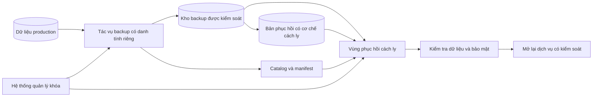

# Backup protection

## 1. Bản sao lưu cũng là một tài sản cần bảo vệ

Backup protection là tập yêu cầu bảo vệ bản sao lưu, hệ thống tạo và quản lý bản sao, khóa mã hóa, danh mục phục hồi và quy trình khôi phục. Mục tiêu là giữ được dữ liệu có thể sử dụng khi cần, đồng thời ngăn bản sao trở thành đường làm lộ hoặc phá hủy thông tin.

Một bản sao lưu thường chứa dữ liệu của nhiều người dùng, nhiều tenant hoặc nhiều giai đoạn hoạt động. Người đọc được nó có thể vượt qua cơ chế phân quyền đang áp dụng trên ứng dụng. Vì vậy, backup phải có mức bảo vệ phù hợp với dữ liệu nguồn và phạm vi tập hợp của bản sao.

Trong chương **Data protection**, câu “hệ thống phải có backup” chưa đủ để thiết kế hoặc kiểm thử. Cần chuyển mục tiêu bảo mật thành các yêu cầu cụ thể:

- Ai được tạo, đọc, phục hồi, thay chính sách và xóa bản sao?
- Khi production hoặc tài khoản quản trị bị chiếm dụng, còn bản sao nào nằm ngoài phạm vi phá hủy đó?
- Khóa, danh mục bản sao và các phụ thuộc phục hồi có còn sử dụng được khi hệ thống chính ngừng hoạt động?
- Có thể phục hồi tới thời điểm nào, trong bao lâu và với độ tin cậy nào?
- Bằng chứng nào cho thấy dữ liệu phục hồi đúng, đủ và an toàn để phục vụ lại?

Bài học sử dụng một dịch vụ quản lý đơn hàng nhiều tenant làm ví dụ. Các thời hạn, ngưỡng và lịch kiểm tra dưới đây là quyết định minh họa, cần được điều chỉnh theo tác động nghiệp vụ và mô hình đe dọa thực tế.

## 2. Xác định đúng phạm vi và các khái niệm

### 2.1. Backup không chỉ là một tệp dữ liệu

Phạm vi cần đưa vào đặc tả gồm cả dữ liệu và thành phần giúp sử dụng được dữ liệu đó:

| Thành phần | Nếu thiếu hoặc bị xâm phạm |
|---|---|
| Cơ sở dữ liệu, transaction log, tệp và object nghiệp vụ | Mất bản ghi, mất quan hệ hoặc không đạt điểm phục hồi cần thiết |
| Catalog, manifest, chỉ mục và thông tin phiên bản | Không tìm được bản phù hợp hoặc không dựng được chuỗi phục hồi |
| Khóa và thông tin cần giải mã | Có tệp nhưng không đọc được dữ liệu, hoặc người không có quyền vẫn giải mã được |
| Chính sách backup, quyền, lịch và cấu hình retention | Tác vụ không chạy, dữ liệu bị giữ sai hạn hoặc bản sao bị xóa sớm |
| Cấu hình, schema, bản phát hành và tài liệu phục hồi | Dữ liệu không tương thích ứng dụng hoặc không dựng lại được dịch vụ |
| Hạ tầng danh tính, DNS, mạng và công cụ phục hồi | Không đăng nhập hoặc không tiếp cận được kho backup khi có sự cố |
| Tệp tạm, bản phục hồi thử và báo cáo | Tạo thêm các bản sao nhạy cảm ngoài phạm vi kiểm soát |

Không mặc định sao chép mọi bí mật vào một kho chung. Với từng loại bí mật, phải xác định cách bảo quản, cấp lại hoặc thay mới khi phục hồi. Có những khóa cũ cần để giải mã bản sao, trong khi thông tin xác thực truy cập bị lộ cần được thay trước khi mở dịch vụ.

### 2.2. Phân biệt backup với các cơ chế dễ nhầm

| Cơ chế | Công dụng | Vì sao chưa đủ làm bảo vệ backup |
|---|---|---|
| Replication | Duy trì bản sao gần thời gian thực để tăng khả dụng | Có thể truyền cả thao tác xóa, dữ liệu hỏng hoặc mã hóa độc hại |
| Snapshot | Ghi nhận trạng thái tại một thời điểm | Nếu nằm cùng miền quản trị hoặc bị xóa cùng nguồn thì chưa có tính độc lập cần thiết |
| Đồng bộ thư mục | Giữ nội dung giữa các nơi tương đồng | Xóa hoặc sửa sai có thể lan sang nơi nhận |
| Archive | Giữ dữ liệu dài hạn cho một mục đích đã xác định | Thời gian lấy lại và độ đầy đủ chưa chắc đáp ứng phục hồi dịch vụ |
| Backup | Giữ các điểm dữ liệu để phục hồi theo chính sách | Chỉ có giá trị khi bản sao, phụ thuộc và quy trình phục hồi được kiểm chứng |

Snapshot hoặc replication có thể là thành phần của giải pháp backup. Điều quyết định là thuộc tính được chứng minh: điểm phục hồi, lịch sử phiên bản, cách ly, retention, quyền quản lý và khả năng sử dụng sau sự cố.

### 2.3. Bốn thuộc tính cần đặc tả

- **Bí mật:** người không có quyền không đọc được dữ liệu, kể cả khi lấy được phương tiện hoặc object backup.
- **Toàn vẹn và nguồn gốc:** phát hiện được thay đổi, mất thành phần hoặc bản sao không đúng nguồn đã chấp nhận.
- **Khả dụng để phục hồi:** lấy được dữ liệu, khóa, công cụ và năng lực xử lý trong thời gian cần thiết.
- **Trách nhiệm giải trình:** truy vết được hành động và thay đổi quan trọng mà không ghi thêm dữ liệu nhạy cảm không cần thiết.

Mã hóa không ngăn người có quyền xóa bản sao. Immutability không ngăn người có quyền đọc lấy dữ liệu. Tác vụ báo thành công không chứng minh ứng dụng sẽ chạy đúng sau restore. Mỗi thuộc tính cần yêu cầu và bằng chứng riêng.

## 3. Bắt đầu từ rủi ro và miền ảnh hưởng

### 3.1. Mô hình đe dọa cho dịch vụ đơn hàng

| Mã rủi ro | Kịch bản | Hậu quả | Hướng yêu cầu |
|---|---|---|---|
| R-BKP-01 | Tài khoản ứng dụng bị chiếm dụng rồi tìm cách xóa backup | Mất cả nguồn và đường phục hồi | Danh tính backup riêng; ứng dụng không có quyền quản trị kho |
| R-BKP-02 | Tài khoản quản trị production bị chiếm dụng | Snapshot và bản sao cùng quyền quản trị bị phá hủy | Bản phục hồi thuộc miền quản trị độc lập hoặc ở trạng thái offline phù hợp |
| R-BKP-03 | Kho backup hoặc tệp tải xuống bị đọc trái phép | Lộ dữ liệu tập trung của nhiều tenant | Mã hóa, quản lý khóa và giới hạn đọc, tải, phục hồi |
| R-BKP-04 | Backup thiếu, hỏng hoặc chuỗi log bị đứt | Không phục hồi được tới điểm yêu cầu | Kiểm tra chuỗi, manifest, tính nhất quán và diễn tập restore |
| R-BKP-05 | Khóa hoặc dịch vụ danh tính mất cùng hệ thống chính | Có bản sao nhưng không sử dụng được | Phương án phục hồi phụ thuộc và quyền khẩn cấp đã thử nghiệm |
| R-BKP-06 | Kẻ tấn công đã tồn tại lâu trước khi tạo backup | Phục hồi cả trạng thái bị xâm phạm | Giữ nhiều thế hệ; lựa chọn điểm phục hồi và kiểm tra trước mở dịch vụ |
| R-BKP-07 | Restore đưa quyền cũ, bí mật cũ hoặc dữ liệu đã loại bỏ trở lại | Tái tạo lỗ hổng hoặc tiết lộ dữ liệu | Áp dụng lại trạng thái bảo mật và đối soát sau phục hồi |
| R-BKP-08 | Tệp restore thử bị bỏ trong môi trường quyền rộng | Phát sinh kho dữ liệu nhạy cảm ngoài dự kiến | Cách ly môi trường thử, hạn dùng và kiểm tra dọn dữ liệu |

“Miền ảnh hưởng” là tập tài sản có thể cùng bị tác động bởi một sự cố hoặc một quyền bị chiếm dụng. Hai bucket khác tên nhưng cùng tài khoản có quyền xóa toàn bộ chưa tạo ra mức độc lập trước chính tài khoản đó.

### 3.2. Nhìn toàn bộ đường phục hồi



Sơ đồ không khẳng định mọi bản sao phải dùng cùng công nghệ. Với từng mũi tên, cần xác định danh tính, quyền, giao thức bảo vệ, lỗi có thể xảy ra và bằng chứng vận hành.

Nếu kho backup độc lập nhưng khóa chỉ tồn tại trong một hệ thống production không thể truy cập sau thảm họa, đường phục hồi vẫn bị đứt. Phải đánh giá độc lập cả dữ liệu, quyền điều khiển và các phụ thuộc giải mã.

## 4. Đặc tả mục tiêu phục hồi có thể đo

### 4.1. RPO, RTO và retention trả lời ba câu hỏi khác nhau

**Recovery Point Objective — RPO** là mục tiêu về mức mất dữ liệu chấp nhận được, biểu diễn bằng thời gian. Khi đo, phải xác định điểm dữ liệu thực sự có thể khôi phục nhất quán, không chỉ thời điểm tác vụ backup gần nhất được khởi chạy.

**Recovery Time Objective — RTO** là mục tiêu về thời gian đưa năng lực dịch vụ đã xác định trở lại sau gián đoạn. Cần ghi rõ mốc bắt đầu, mốc kết thúc và chức năng nào phải hoạt động để được coi là phục hồi.

**Retention** là thời gian hoặc điều kiện giữ bản sao. Giữ backup 30 ngày không có nghĩa chỉ mất tối đa 30 phút dữ liệu hoặc có thể phục hồi trong 30 phút.

NIST SP 800-34 cung cấp khung lập kế hoạch dự phòng, gắn phân tích tác động với chiến lược, kiểm thử và duy trì khả năng phục hồi. Có thể dùng khung này để tổ chức việc chuyển nhu cầu nghiệp vụ thành mục tiêu và kế hoạch cụ thể. [NIST SP 800-34 Rev. 1](https://csrc.nist.gov/pubs/sp/800/34/r1/upd1/final)

### 4.2. Ví dụ định nghĩa phép đo

Với sự cố mất hạ tầng lúc 10:00, giả sử điểm dữ liệu mới nhất đã phục hồi nhất quán là 09:50 và dịch vụ đạt điều kiện hoạt động lúc 13:10:

```text
Mốc gián đoạn t0                 = 10:00
Điểm dữ liệu phục hồi được tr    = 09:50
Thời điểm dịch vụ đạt tiêu chí t1 = 13:10

Độ mất dữ liệu theo thời gian = t0 - tr = 10 phút
Thời gian phục hồi thực tế    = t1 - t0 = 3 giờ 10 phút
```

Nếu mục tiêu của kịch bản là RPO không quá 15 phút và RTO không quá 4 giờ thì lần diễn tập này đạt hai mục tiêu thời gian, với điều kiện kiểm tra dữ liệu và bảo mật cũng đạt.

Trong ví dụ, RTO được tính từ thời điểm gián đoạn dịch vụ, nên thời gian phát hiện và huy động xử lý nằm trong phép đo. Không được lùi mốc bắt đầu tới lúc bấm nút restore để làm kết quả trông tốt hơn.

Một điểm 09:50 chỉ có giá trị nếu đủ thành phần, giải mã được và khôi phục được. Nếu chỉ có bản nhất quán lúc 09:35 thì độ mất dữ liệu là 25 phút, dù giao diện backup vẫn báo nhiều tác vụ gần đó thành công.

### 4.3. Tách mục tiêu theo kịch bản và loại dữ liệu

| Phạm vi ví dụ | RPO minh họa | RTO minh họa | Điều phải kiểm chứng |
|---|---|---|---|
| Đơn hàng khi mất một vùng hạ tầng | Không quá 15 phút | Không quá 4 giờ | Dữ liệu và log cần thiết còn truy cập được ngoài vùng lỗi |
| Tài liệu đính kèm của đơn hàng | Không quá 1 giờ | Không quá 8 giờ | Không tạo trạng thái đơn hàng tham chiếu tệp không thể lấy lại mà không phát hiện |
| Mất một bảng do thao tác sai | Theo điểm khôi phục được duyệt | Theo phạm vi phục hồi đã định | Không ghi đè giao dịch mới hợp lệ ngoài phạm vi |
| Sự cố xâm nhập kéo dài | Xác định theo điểm đủ tin cậy và tác động nghiệp vụ | Xác định theo kế hoạch ứng phó | Đánh giá thời gian đối thủ tồn tại và các thế hệ backup còn giữ |

Không mặc định mục tiêu 15 phút của sự cố hạ tầng cũng đạt được khi phải quay về một điểm an toàn cũ hơn do xâm nhập. Nếu không có điểm đủ tin cậy trong cửa sổ yêu cầu, phải báo không đạt và xử lý rủi ro với chủ sở hữu nghiệp vụ.

Định nghĩa “dịch vụ đã phục hồi” nên bao gồm các luồng thiết yếu như đọc đơn, tạo đơn mới, kiểm tra quyền theo tenant, truy cập tệp cần thiết và ghi audit. Cơ sở dữ liệu khởi động được mới là một bước trung gian.

## 5. Bảo vệ tính bí mật và quyền truy cập

### 5.1. Mã hóa cả khi truyền và khi lưu

Yêu cầu phải bao phủ đường truyền tới kho, bản nằm trong kho, bản xuất ra phương tiện khác và dữ liệu tạm trong quá trình xử lý. Không chỉ ghi “backup encrypted” mà bỏ qua đường tải về hoặc thư mục restore.

Với từng lớp mã hóa, cần xác định thuật toán và cấu hình được tổ chức chấp nhận, nơi giữ khóa, danh tính được giải mã và cách chứng minh cấu hình đang hiệu lực. Không thiết kế thuật toán riêng cho định dạng backup.

Mã hóa tại kho có thể vẫn cho phép mọi danh tính có quyền đọc hợp lệ nhận dữ liệu đã giải mã. Vì vậy, phải kiểm tra quyền đọc thực tế bằng danh tính không được phép, không chỉ nhìn trạng thái mã hóa trong giao diện quản trị.

### 5.2. Quản lý khóa theo vòng đời bản sao

- Tách quyền quản trị kho với quyền quản lý hoặc sử dụng khóa theo rủi ro đã đánh giá.
- Gắn bản sao với mã tham chiếu và phiên bản khóa cần thiết để giải mã, không ghi khóa vào manifest hay log.
- Giữ được khả năng dùng các phiên bản khóa cũ khi backup phụ thuộc vào chúng còn phải phục hồi.
- Có quy trình cấp lại quyền hoặc phục hồi khóa phù hợp khi vùng, tài khoản hoặc hệ thống chính không khả dụng.
- Kiểm tra tác động trước khi vô hiệu hóa hoặc hủy khóa; mất khóa có thể làm mất vĩnh viễn khả năng phục hồi.
- Thử đường phục hồi trong điều kiện phụ thuộc chính bị mất, thay vì chỉ kiểm tra giải mã trong ngày vận hành bình thường.

Rotation tạo khóa mới không tự chứng minh backup cũ đã được chuyển sang khóa mới. Cần biết công cụ mã hóa lại dữ liệu, bọc lại khóa dữ liệu hay tiếp tục phụ thuộc khóa cũ và lưu bằng chứng tương ứng.

### 5.3. Phân quyền theo thao tác

| Vai trò ví dụ | Quyền được cấp | Giới hạn cần ghi rõ |
|---|---|---|
| Tác vụ tạo backup | Đọc phạm vi nguồn cần thiết, tạo bản sao và ghi trạng thái | Không xóa bản đang được bảo vệ; không sửa retention hoặc cấp quyền cho mình |
| Người theo dõi vận hành | Xem tình trạng, dung lượng, độ trễ và lỗi đã lọc | Không tự tải dữ liệu hoặc giải mã backup |
| Người phục hồi | Phục hồi phạm vi đã duyệt vào đích được kiểm soát | Không phục hồi dữ liệu thật vào môi trường tùy chọn |
| Người quản lý chính sách | Thay lịch và chính sách qua quy trình kiểm soát | Thay đổi rút ngắn bảo vệ cần mức phê duyệt riêng |
| Người quản lý khóa | Quản lý khóa theo trách nhiệm được giao | Không mặc nhiên đọc hoặc xuất dữ liệu backup |
| Người kiểm toán | Đọc bằng chứng và sự kiện cần thiết | Không cần nhận payload nghiệp vụ |

Tài khoản ứng dụng production không được quản trị kho backup. Với thao tác đặc quyền, có thể yêu cầu xác thực mạnh, cấp quyền có thời hạn và phê duyệt tách biệt theo mức rủi ro. Đường truy cập khẩn cấp cũng phải có phạm vi, audit và diễn tập; không được trở thành một mật khẩu dùng chung không kiểm soát.

## 6. Chống xóa, mã hóa độc hại và mất đồng thời

### 6.1. Tách các thuộc tính bảo vệ

- **Offline:** bản sao không có đường truy cập trực tuyến trong trạng thái được định nghĩa. Khi kết nối để ghi hoặc phục hồi, cần kiểm soát cửa sổ tiếp xúc.
- **Cách ly quản trị:** quyền bị chiếm dụng trong production không tự điều khiển được bản sao độc lập.
- **Immutability hoặc WORM:** ngăn thay đổi hoặc xóa trong thời gian bảo vệ, với ngữ nghĩa cụ thể của cơ chế được chọn.
- **Phân tách vị trí:** giảm rủi ro cùng mất vì sự cố địa điểm hoặc vùng hạ tầng, nhưng không tự tạo ra cách ly quyền.

CISA khuyến nghị giữ backup offline, được mã hóa và thường xuyên kiểm tra tính khả dụng, toàn vẹn trong kịch bản phục hồi. Đây là cơ sở để đặt yêu cầu về bản sao độc lập và restore thử, thay vì chỉ kiểm tra lịch chạy. [CISA: #StopRansomware Guide](https://www.cisa.gov/sites/default/files/2025-03/StopRansomware-Guide%20508.pdf)

Một bản online có immutability không tự đồng nghĩa với offline. Bản ở vùng khác nhưng cùng một quyền xóa toàn cục cũng không đáp ứng mục tiêu chống chiếm quyền đó.

### 6.2. Viết yêu cầu bất biến theo năng lực thực tế

Ví dụ: “Trong thời hạn bảo vệ 30 ngày của lớp bản sao chống phá hủy, danh tính ứng dụng, quản trị production và tác vụ backup không được sửa, xóa hoặc rút ngắn thời hạn của các bản đã ghi”.

Để kiểm chứng câu này cần xác định:

1. Các danh tính và quyền nào thuộc phạm vi thử nghiệm?
2. Chế độ khóa có cho phép một quyền đặc biệt vượt qua không?
3. Việc tắt lịch backup, ngừng replication, đổi lifecycle hoặc xóa tài khoản có tác động gì?
4. Catalog, transaction log, phiên bản object và khóa cần thiết có được bảo vệ tương ứng không?
5. Khi đầy dung lượng hoặc hết ngân sách, cơ chế có âm thầm xóa bản đang được bảo vệ không?

Không suy diễn rằng mọi sản phẩm có nhãn “immutable” đều chống được cùng một nhóm quyền. Phải ghi lại giới hạn, kiểm tra đúng chế độ cấu hình và xử lý phần rủi ro còn lại.

### 6.3. Có bản cũ không bảo đảm có bản sạch

Nếu dữ liệu đã hỏng hoặc hệ thống đã bị xâm nhập trước lúc backup, bản sao có thể giữ nguyên vấn đề. Cần nhiều điểm phục hồi, lịch sử phù hợp thời gian có thể phát hiện sự cố và quy trình chọn điểm đủ tin cậy.

Một kết quả quét không phát hiện mã độc không chứng minh tuyệt đối bản sao sạch. Quyết định mở lại dịch vụ cần kết hợp điều tra, nguồn gốc bản sao, kiểm tra dữ liệu, dựng môi trường đáng tin cậy và đánh giá rủi ro còn lại.

## 7. Bảo đảm toàn vẹn và tính nhất quán

### 7.1. Kiểm tra nhiều lớp

| Lớp kiểm tra | Câu hỏi cần trả lời |
|---|---|
| Truyền và lưu trữ | Có thiếu phần, hỏng khối hoặc không đọc được object không? |
| Manifest và chuỗi phục hồi | Đủ full backup, incremental và log theo thứ tự cần thiết chưa? |
| Nguồn gốc | Bản sao có đúng nguồn, thời điểm và phiên bản đã chấp nhận không? |
| Nhất quán ứng dụng | Cơ sở dữ liệu, tệp và sự kiện có tạo thành trạng thái nghiệp vụ hợp lệ không? |
| Bảo mật sau restore | Quyền, tenant, bí mật, bản vá và cấu hình an toàn đã đúng chưa? |

Checksum giúp phát hiện thay đổi so với giá trị tham chiếu. Nếu đối thủ sửa được cả backup và checksum nằm cạnh nó thì đối chiếu đó không đủ chứng minh nguồn gốc. Với mô hình đe dọa tương ứng, cần thông tin xác thực toàn vẹn hoặc manifest có chữ ký, cùng điểm tin cậy được quản lý độc lập và kiểm tra được.

Mã hóa có xác thực, chữ ký hoặc cơ chế toàn vẹn của công cụ chỉ có ý nghĩa khi xác minh thật sự được thực hiện và lỗi xác minh chặn việc sử dụng dữ liệu. Không bỏ qua cảnh báo toàn vẹn để tiếp tục phục hồi tự động.

### 7.2. Trạng thái nhất quán của dịch vụ

Snapshot có thể ghi trạng thái ở mức lưu trữ mà chưa bảo đảm mọi giao dịch đang dở hoặc mọi phụ thuộc liên dịch vụ đã nhất quán. Phải xác định cơ chế được hỗ trợ: phối hợp với ứng dụng, ghi log giao dịch, replay hoặc quy trình đối soát phù hợp.

Ví dụ, đơn hàng đã ghi thành công nhưng tệp hợp đồng chưa có trong bản sao object storage. Cơ sở dữ liệu phục hồi thành công vẫn chưa đủ. Tiêu chí cần phát hiện tham chiếu thiếu và xác định cách khôi phục hoặc xử lý nghiệp vụ.

Với chuỗi incremental, mất một thành phần có thể làm một số điểm phía sau không sử dụng được. Chính sách giữ bản và kiểm tra dọn dữ liệu phải xét cả chuỗi, thay vì chỉ xóa từng tệp theo tuổi.

## 8. Bộ yêu cầu bảo mật có thể nghiệm thu

### 8.1. Cấu trúc một yêu cầu

Một yêu cầu tốt xác định được chủ thể, phạm vi dữ liệu, hành vi bắt buộc, điều kiện lỗi và cách chứng minh:

> Khi **[chủ thể hoặc tác vụ]** thực hiện **[thao tác]** trên **[lớp bản sao]**, hệ thống phải **[hành vi quan sát được]**. Nếu **[thiếu điều kiện hoặc có lỗi]**, hệ thống phải **[hành vi an toàn]**. Kiểm chứng bằng **[ca thử hoặc bằng chứng]**.

Yêu cầu yếu: “Backup phải an toàn và phục hồi nhanh”.

Yêu cầu cụ thể hơn: “Danh tính ứng dụng production không được đọc, xóa, sửa quyền hoặc thay retention của kho backup; các thao tác thử bằng danh tính này phải bị từ chối và tạo sự kiện kiểm toán phù hợp”.

### 8.2. Yêu cầu minh họa cho dịch vụ đơn hàng

| ID | Phát biểu yêu cầu | Tiêu chí chấp nhận và bằng chứng |
|---|---|---|
| REQ-BKP-01 | Danh mục phạm vi backup phải bao phủ dữ liệu đơn hàng, log cần cho phục hồi, tệp tham chiếu, catalog và các phụ thuộc đã xác định. | Đối chiếu với danh mục tài sản và phục hồi một luồng nghiệp vụ có đủ dữ liệu, tệp và cấu hình. |
| REQ-BKP-02 | Backup và dữ liệu tạm phải được bảo vệ khi truyền và lưu bằng cơ chế được chấp nhận; người ngoài phạm vi không được giải mã. | Bằng chứng cấu hình, thử truy cập âm tính và kiểm tra nơi tạo bản tạm, tải xuống, restore. |
| REQ-BKP-03 | Ứng dụng và quản trị production không được quản trị lớp bản sao phục hồi độc lập; tác vụ tạo backup không được tự xóa bản đang được bảo vệ. | Thử thao tác đọc, xóa, đổi quyền, rút retention bằng từng danh tính đã liệt kê. |
| REQ-BKP-04 | Lớp bản sao chống phá hủy phải duy trì thời hạn bảo vệ 30 ngày trong ví dụ, với tập quyền không được vượt khóa đã định. | Kiểm tra bằng bản sao thử: sửa, xóa, đổi lifecycle và rút thời hạn đều có kết quả đúng chính sách. |
| REQ-BKP-05 | Kịch bản mất vùng hạ tầng cho dữ liệu đơn hàng phải đạt RPO không quá 15 phút và RTO không quá 4 giờ theo mốc đo đã định. | Biên bản diễn tập ghi mốc gián đoạn, điểm dữ liệu thực tế, thời điểm đạt luồng nghiệp vụ và điều kiện môi trường. |
| REQ-BKP-06 | Bản sao chỉ đủ điều kiện sử dụng khi có đủ thành phần, xác minh toàn vẹn đạt và cơ chế khôi phục nhất quán khả dụng. | Mô phỏng thiếu log hoặc sửa một thành phần; hệ thống phát hiện và không báo điểm đó là phục hồi được. |
| REQ-BKP-07 | Khi vùng production không truy cập được, người phục hồi được ủy quyền phải lấy được bản sao, catalog và khả năng giải mã theo đường phục hồi đã duyệt. | Diễn tập chặn đường tới vùng chính; không dùng tài khoản, khóa hoặc tài liệu chỉ có ở vùng đó. |
| REQ-BKP-08 | Thay đổi quyền, lịch, retention, trạng thái khóa và kết quả restore phải có audit; sự kiện rủi ro cao phải được phát hiện và chuyển tới người trực. | Thử một thay đổi chính sách và một thao tác bị từ chối; xác minh nội dung, thời điểm và người nhận cảnh báo. |
| REQ-BKP-09 | Restore thử chứa dữ liệu thật chỉ chạy trong vùng có mức bảo vệ đã duyệt, không gửi email, SMS hoặc giao dịch tới đích thật. | Kiểm tra quyền vào vùng, đường mạng ra ngoài, cấu hình tích hợp và dọn dữ liệu sau diễn tập. |
| REQ-BKP-10 | Trước khi mở dịch vụ sau restore, phải áp dụng quyền hiện hành, xử lý thông tin xác thực có nguy cơ lộ và kiểm tra cách ly tenant. | Kiểm thử quyền bị thu hồi, phiên cũ, tài khoản bị khóa, thao tác vượt tenant và audit sau khôi phục. |
| REQ-BKP-11 | Việc loại bỏ backup phải tuân chính sách giữ bản và phụ thuộc phục hồi; không xóa bản đang khóa hoặc khóa giải mã còn cần dùng. | Bằng chứng tính hạn, quan hệ chuỗi và kiểm tra trước xóa; thử tại các mốc biên. |
| REQ-BKP-12 | Khi backup lỗi hoặc độ mới của điểm phục hồi vượt ngưỡng, hệ thống phải cảnh báo và không hiển thị trạng thái đạt mục tiêu. | Tiêm lỗi, ngừng log shipping hoặc làm đầy vùng thử; dashboard và cảnh báo phản ánh đúng mất khả năng đáp ứng. |

Một số yêu cầu chứa nhiều kiểm tra vì chúng mô tả một thuộc tính chung. Khi triển khai thành backlog, có thể tách nhỏ nhưng phải giữ liên kết với mục tiêu và không bỏ mất trường hợp lỗi.

### 8.3. Quy định ngưỡng vận hành riêng với mục tiêu phục hồi

Ví dụ, để hướng tới RPO 15 phút, đội vận hành đặt cảnh báo khi tuổi của điểm dữ liệu đủ điều kiện phục hồi vượt 10 phút và nâng mức sự cố khi vượt 15 phút. Cần nêu rõ:

- “Tuổi” được tính từ điểm dữ liệu, không phải thời gian file backup vừa được tải lên.
- Nguồn thời gian và xử lý sai lệch đồng hồ phải đủ tin cậy cho phép đo.
- Thời gian phát hiện và chuyển cảnh báo được đo; ví dụ chuyển tới người trực trong 5 phút từ khi điều kiện được bộ giám sát ghi nhận.
- Cảnh báo sớm không bảo đảm tuyệt đối sẽ không vi phạm RPO; nó tạo cơ hội xử lý trước khi vượt mục tiêu.

Nếu không đủ thông tin để xác định điểm phục hồi, trạng thái phải là chưa xác minh hoặc không đạt điều kiện, thay vì mặc định xanh.

## 9. Thiết kế quy trình phục hồi an toàn

### 9.1. Các giai đoạn cần có điều kiện chuyển tiếp

```text
Chọn kịch bản và phạm vi
        -> Xác định điểm phục hồi đủ tin cậy
        -> Chuẩn bị vùng phục hồi cách ly
        -> Lấy bản sao, khóa và thành phần phụ thuộc
        -> Xác minh toàn vẹn, phiên bản và khả năng sử dụng
        -> Restore và đối soát tính nhất quán
        -> Áp dụng trạng thái bảo mật hiện hành
        -> Kiểm thử nghiệp vụ và quyền
        -> Phê duyệt mở dịch vụ, theo dõi sau phục hồi
```

Đây là trình tự định hướng, cần điều chỉnh theo công nghệ và kịch bản. Ví dụ, phản ứng với ransomware còn cần phối hợp điều tra, cô lập hệ thống bị tác động và giữ bằng chứng phù hợp trước khi tái kết nối.

### 9.2. Đích restore là một ranh giới bảo mật

Quyền phục hồi dữ liệu phải gắn với đích đã duyệt. Nếu người dùng được phép lấy backup production rồi restore vào máy cá nhân thì cơ chế phân quyền nguồn không còn bảo vệ được dữ liệu đó.

Đích restore cần giới hạn người truy cập, mã hóa lưu trữ, kiểm soát mạng và cấu hình quan sát phù hợp. Không cho môi trường thử tự gửi thông báo hoặc chạy tích hợp thật chỉ vì bản sao có sẵn hàng đợi và cấu hình cũ.

Với backup chứa nhiều tenant, yêu cầu phục hồi riêng một tenant phải xác định cách tránh làm lộ tenant khác. Công cụ có thể cần khôi phục toàn bộ vào vùng đặc quyền rồi trích xuất có kiểm soát; không được giao cả bản sao cho người chỉ có quyền ở một tenant.

### 9.3. Khôi phục dữ liệu không đồng nghĩa khôi phục quyền cũ

Một snapshot từ tuần trước có thể chứa tài khoản đã bị khóa hôm nay, quyền đã thu hồi, mật khẩu hoặc token đã thay và cấu hình bảo mật đã vá.

Trước mở dịch vụ cần xác định nguồn trạng thái hiện hành và quy trình đối soát:

- Áp dụng lại tài khoản bị khóa và quyền đã thu hồi.
- Thay hoặc vô hiệu hóa thông tin xác thực có nguy cơ bị lộ; không tự làm sống lại phiên cũ.
- Đưa cấu hình và bản vá cần thiết về trạng thái được chấp nhận.
- Kiểm tra cách ly tenant, masking và audit trên luồng đã phục hồi.
- Xử lý các thay đổi dữ liệu đã có hiệu lực sau điểm backup theo quy trình được duyệt.

Không áp dụng việc vô hiệu hóa khóa một cách máy móc: khóa cần giải mã bản sao cũ phải được giữ hoặc chuyển đổi theo kế hoạch, trong khi thông tin xác thực cấp quyền truy cập có thể cần thay ngay. Hai vòng đời này cần được phân biệt.

### 9.4. Điều kiện mở lại dịch vụ

Trong hệ thống mẫu, chỉ mở lại khi kiểm tra toàn vẹn và đối soát bắt buộc đạt, luồng nghiệp vụ thiết yếu hoạt động, quyền hiện hành được áp dụng và người chịu trách nhiệm chấp nhận kết quả.

Nếu có ngoại lệ, phải ghi phạm vi chức năng được mở, dữ liệu chưa phục hồi, tác động, biện pháp tạm thời và người chấp nhận rủi ro. Không đổi nhãn một lần restore thiếu dữ liệu thành “thành công đầy đủ”.

## 10. Kiểm thử backup bằng restore và thử điều kiện lỗi

### 10.1. Ba mức kiểm chứng bổ sung cho nhau

1. **Theo dõi tác vụ:** phát hiện lịch không chạy, lỗi truyền, thiếu dung lượng hoặc log bị chậm.
2. **Xác minh bản sao:** kiểm tra thành phần, toàn vẹn, phiên bản và các phụ thuộc của điểm phục hồi.
3. **Diễn tập khôi phục dịch vụ:** đưa dữ liệu vào môi trường kiểm soát, chạy kiểm tra nghiệp vụ, quyền và đo thời gian thực tế.

Mức trước hỗ trợ mức sau nhưng không thay thế được nó. Một file đọc được không chứng minh dữ liệu nhất quán; một cơ sở dữ liệu chạy được không chứng minh dịch vụ đã sẵn sàng.

### 10.2. Ma trận ca thử

| Ca thử | Hành động | Kết quả mong đợi |
|---|---|---|
| TC-BKP-01 | Dùng danh tính ứng dụng thử đọc, xóa hoặc đổi retention | Bị từ chối theo ma trận quyền; có audit phù hợp |
| TC-BKP-02 | Dùng quản trị production tác động lớp bản sao độc lập | Không phá hủy được bản thuộc phạm vi bảo vệ đã định |
| TC-BKP-03 | Thử sửa, xóa hoặc rút thời hạn của bản sao thử đang khóa | Đúng ngữ nghĩa khóa; ngoại lệ quyền đặc biệt được nhận diện và xử lý |
| TC-BKP-04 | Ngắt đường tới vùng production rồi thực hiện phục hồi | Dùng được đường truy cập, catalog và khóa thay thế đã duyệt |
| TC-BKP-05 | Làm thiếu một thành phần chuỗi hoặc thay đổi byte trong bản sao thử | Xác minh phát hiện lỗi; không dùng điểm lỗi như điểm hợp lệ |
| TC-BKP-06 | Khôi phục bản sao dùng phiên bản khóa cũ sau rotation | Giải mã theo quyền và quy trình, hoặc phát hiện rõ thiếu phụ thuộc |
| TC-BKP-07 | Gây trễ transaction log trong môi trường thử | Điểm phục hồi bị đánh giá già hơn, cảnh báo đúng ngưỡng |
| TC-BKP-08 | Restore đơn hàng và tệp tại một điểm được chọn | Không bỏ qua tham chiếu thiếu; đối soát dữ liệu và nghiệp vụ đạt |
| TC-BKP-09 | Phục hồi dữ liệu có tài khoản hoặc quyền đã bị thu hồi | Quyền hiện hành được áp dụng trước mở dịch vụ |
| TC-BKP-10 | Phục hồi riêng một tenant từ backup nhiều tenant | Không cung cấp dữ liệu tenant khác cho bên nhận |
| TC-BKP-11 | Chạy tác vụ có email, hàng đợi và tích hợp trong vùng restore | Không gây tác động tới người dùng hoặc đích thật |
| TC-BKP-12 | Cho đầy dung lượng hoặc làm tác vụ lỗi | Không âm thầm xóa bản được bảo vệ; có cảnh báo và trạng thái đúng |
| TC-BKP-13 | Tính hết hạn ở mốc biên và trên chuỗi incremental | Không xóa thành phần còn cần hoặc bản đang được giữ theo ngoại lệ |
| TC-BKP-14 | Kết thúc diễn tập | Dữ liệu tạm được xử lý theo hạn; bằng chứng không chứa payload không cần thiết |

Các thử nghiệm thay đổi hoặc làm hỏng dữ liệu phải dùng bản sao thử và môi trường được phép. Không làm hỏng bản phục hồi cuối cùng đang bảo vệ hệ thống thật để kiểm tra một yêu cầu.

### 10.3. Tiêu chí chấp nhận theo Given–When–Then

```gherkin
Scenario: Mất production nhưng vẫn phục hồi được đơn hàng
  Given production không thể truy cập từ thời điểm t0
    And có điểm backup và chuỗi log đủ điều kiện phục hồi
    And thông tin truy cập khẩn cấp được quản lý ngoài vùng bị mất
  When đội phục hồi thực hiện quy trình đã duyệt trong vùng cách ly
  Then dữ liệu đơn hàng được phục hồi tới điểm tr đã xác minh
    And t0 trừ tr không vượt RPO của kịch bản
    And dịch vụ đạt tiêu chí nghiệp vụ và bảo mật trước thời hạn RTO
    And không cần dùng phụ thuộc chỉ còn tồn tại ở vùng production đã mất
    And không tạo giao dịch hoặc thông báo thật trong giai đoạn thử
```

Kịch bản này kiểm tra mất hạ tầng theo giả định đã nêu. Nó không chứng minh rằng điểm tr đủ tin cậy trong một sự cố xâm nhập kéo dài; trường hợp đó cần tiêu chí lựa chọn điểm phục hồi riêng.

### 10.4. Lịch và bằng chứng diễn tập

Một lịch minh họa có thể gồm kiểm tra tự động sau tác vụ, restore đại diện hằng tháng và diễn tập mất vùng hằng quý. Phải điều chỉnh theo mức quan trọng, tốc độ thay đổi và thời gian thực hiện, không lấy tần suất minh họa làm chuẩn chung.

Thay công nghệ lưu trữ, định dạng backup, phiên bản cơ sở dữ liệu, mô hình khóa, hệ thống danh tính hoặc quyền quản trị là các tác nhân cần xem xét chạy lại kiểm chứng liên quan trước khi phụ thuộc vào thiết kế mới.

Biên bản nên ghi kịch bản, giả định, phiên bản hệ thống, định danh bản sao, điểm dữ liệu, thời gian từng giai đoạn, kết quả đối soát, kiểm tra quyền và hạn chế. Khôi phục một tập nhỏ không đủ để suy ra thời gian của toàn bộ dữ liệu; cần ghi rõ quy mô và điều kiện bài đo.

## 11. Retention, loại bỏ và dữ liệu được khôi phục trở lại

### 11.1. Chọn thời hạn theo mục đích

Retention cần cân bằng nhu cầu phục hồi, khả năng phát hiện sự cố muộn, yêu cầu lưu giữ đã xác định, chi phí và rủi ro giữ dữ liệu lâu. Bản sao cũ hơn mở rộng cửa sổ phục hồi nhưng cũng kéo dài thời gian cần bảo vệ dữ liệu và khóa.

Với từng lớp bản sao, ghi rõ lịch tạo, thời hạn giữ, thời hạn khóa, điều kiện chuyển lớp và ngoại lệ lưu giữ. Không để một lifecycle mặc định xóa mất chuỗi còn cần, cũng không giữ vô hạn chỉ vì chưa xác định người chịu trách nhiệm.

Yêu cầu về vị trí lưu hoặc lưu giữ theo pháp luật, hợp đồng phải được xác định từ bối cảnh cụ thể của tổ chức. Không gán một thời hạn phổ quát cho mọi hệ thống từ ví dụ trong bài.

### 11.2. Xử lý yêu cầu xóa khi có bản sao bất biến

Nếu dữ liệu đã xóa ở nguồn còn tồn tại trong backup không cho sửa, chính sách phải giải thích rõ bản sao nào còn giữ, ai được tiếp cận, khi nào hết hạn và phải làm gì nếu phục hồi từ bản đó.

Một cách thiết kế là duy trì sổ thay đổi hoặc thông tin đối soát được bảo vệ để áp dụng lại các thao tác xóa, vô hiệu hóa hoặc giới hạn sử dụng sau restore. Bản thân sổ này có thể chứa định danh nhạy cảm và cần quyền, retention và đường phục hồi riêng.

Không khẳng định xóa một bản ghi trong hệ thống đang chạy đã loại bỏ ngay mọi bản sao. Đồng thời, không bỏ qua yêu cầu xử lý dữ liệu chỉ vì đã bật immutability. Cần làm rõ chính sách và nghĩa vụ áp dụng trước khi chọn thời hạn khóa.

### 11.3. Hủy khóa không phải thao tác dọn dẹp thông thường

Hủy khóa có thể làm một tập bản sao không còn giải mã được. Trước khi dùng cách này để loại bỏ dữ liệu, phải biết khóa được dùng chung cho những bản nào, có bản sao hoặc khóa bọc khác không và cơ chế có thực sự làm dữ liệu không còn truy cập được theo mục tiêu đã đặt hay không.

Không gọi việc xóa một tham chiếu khóa là bằng chứng hoàn tất loại bỏ mọi dữ liệu. Cần chứng minh phạm vi, phụ thuộc và kết quả theo cơ chế đang sử dụng.

## 12. Logging, giám sát và ứng phó

Sự kiện quan trọng gồm thay đổi lịch, quyền, retention, trạng thái khóa, tạo và xóa bản sao, lỗi xác minh, bắt đầu và kết thúc restore, dùng quyền khẩn cấp và truy cập tải dữ liệu.

Ví dụ audit thiết kế cho thao tác phục hồi:

```json
{
  "event": "backup_restore_requested",
  "actorRef": "recovery-operator-test-03",
  "backupRef": "backup-test-2026-11-27-a",
  "scopeRef": "orders-test",
  "targetRef": "isolated-recovery-test",
  "approvalRef": "approval-test-21",
  "policyVersion": "backup-policy-v4",
  "decision": "allowed",
  "correlationId": "recovery-test-18"
}
```

Không ghi mật khẩu, khóa giải mã, URL có thông tin xác thực hoặc bản ghi nghiệp vụ vào audit. Các tham chiếu vẫn có thể nhạy cảm nên phải giới hạn truy cập và thời hạn giữ.

Cần cảnh báo khi tác vụ bị vô hiệu hóa, độ mới điểm phục hồi vượt ngưỡng, thời hạn bảo vệ giảm, khóa bị lên lịch hủy, có truy cập tải bất thường hoặc xác minh liên tục lỗi. Kênh giám sát và tài liệu ứng phó cần khả dụng khi production mất, nếu không nhóm vận hành có thể vừa mất dữ liệu vừa mất khả năng nhận biết.

Khi phát hiện dấu hiệu xâm phạm, phải đánh giá cả việc dữ liệu đã bị lấy ra. Khôi phục được hệ thống không tự xử lý hậu quả mất tính bí mật của bản sao đã bị đọc trái phép.

## 13. Truy vết từ rủi ro tới bằng chứng

| Rủi ro | Yêu cầu liên quan | Quyết định kiến trúc | Bằng chứng chính | Chủ sở hữu ví dụ |
|---|---|---|---|---|
| R-BKP-01, R-BKP-02 | REQ-BKP-03, REQ-BKP-04 | Danh tính tách biệt, lớp bản sao độc lập và bảo vệ thời hạn | TC-BKP-01 đến TC-BKP-03 | Nhóm nền tảng, an toàn thông tin |
| R-BKP-03 | REQ-BKP-02, REQ-BKP-09 | Mã hóa, quản lý khóa, giới hạn tải và đích restore | Ma trận quyền, kiểm tra âm tính, TC-BKP-11 | Chủ sở hữu dữ liệu, nhóm nền tảng |
| R-BKP-04 | REQ-BKP-01, REQ-BKP-05, REQ-BKP-06 | Catalog, chuỗi phục hồi và đối soát ứng dụng | TC-BKP-05, TC-BKP-08, bài đo RPO/RTO | Nhóm dữ liệu, nhóm ứng dụng |
| R-BKP-05 | REQ-BKP-07 | Đường phục hồi phụ thuộc ngoài vùng lỗi | TC-BKP-04, TC-BKP-06 | Nhóm nền tảng, quản lý khóa |
| R-BKP-07 | REQ-BKP-10 | Kiểm tra trạng thái bảo mật trước mở dịch vụ | TC-BKP-09, TC-BKP-10 | Nhóm danh tính, nhóm ứng dụng |
| R-BKP-08 | REQ-BKP-09, REQ-BKP-11 | Vùng thử được kiểm soát, hạn dùng và dọn dữ liệu | TC-BKP-14, báo cáo vòng đời | Nhóm vận hành |

Mỗi yêu cầu cần một bên chịu trách nhiệm và trạng thái kiểm chứng. Khi bằng chứng thất bại hoặc giả định thay đổi, cập nhật đánh giá rủi ro và kế hoạch khắc phục; không chỉ sửa dashboard về màu xanh.

## 14. Bài tập áp dụng

Một dịch vụ đơn hàng có cơ sở dữ liệu, object storage và tác vụ chạy mỗi đêm. Snapshot nằm cùng tài khoản với production. Khóa giải mã chỉ truy cập được qua hệ thống danh tính ở vùng chính. Dashboard báo thành công nhưng sáu tháng chưa restore thử. Nhân viên phát triển có thể tải bản sao về để điều tra lỗi.

Hãy lập đặc tả bảo vệ backup cho hệ thống này:

1. Xác định ít nhất năm rủi ro và chỉ ra các phụ thuộc có thể mất đồng thời.
2. Phân loại dữ liệu, xác định phạm vi bản sao và người được thực hiện từng thao tác.
3. Đề xuất RPO, RTO và retention riêng theo kịch bản, giải thích tác động nghiệp vụ.
4. Viết ít nhất sáu yêu cầu có mã, điều kiện lỗi và tiêu chí chấp nhận.
5. Thiết kế diễn tập mất production, thiếu khóa, hỏng chuỗi log và restore quyền đã thu hồi.
6. Nêu cách bảo vệ vùng restore, kiểm soát dữ liệu tạm và xử lý dữ liệu đã xóa khi phục hồi.
7. Chỉ ra giới hạn còn lại, đặc biệt khả năng bản sao đã chứa dữ liệu hỏng hoặc trạng thái bị xâm nhập.

Một thiết kế đầy đủ phải chứng minh được cả việc bảo vệ bản sao và khả năng dùng bản sao để đưa dịch vụ về trạng thái được chấp nhận. Đó là cơ sở để biến mục tiêu phục hồi thành yêu cầu bảo mật có thể triển khai, đo lường và duy trì trong vòng đời phát triển.
