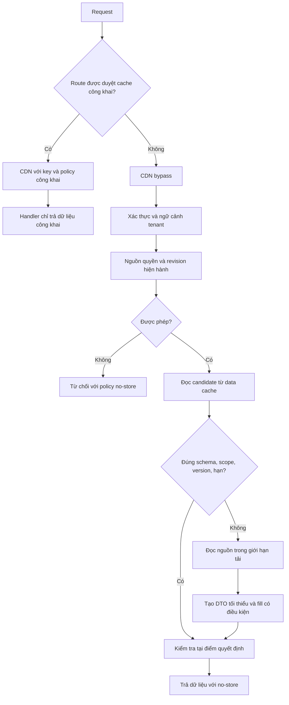

# Cache protection — Yêu cầu bảo vệ dữ liệu trong cache

## 1. Mục tiêu và phạm vi bài học

Cache lưu kết quả có thể tái sử dụng để giảm độ trễ và tải lên nguồn dữ liệu. Việc tái sử dụng đó tạo một câu hỏi bảo mật: **bản dữ liệu được tạo cho ngữ cảnh nào, và có được phép trả lại trong ngữ cảnh hiện tại hay không?**

Một bản ghi được bảo vệ tốt trong database vẫn có thể bị lộ khi bản sao của nó nằm trong CDN, cache của ứng dụng, trình duyệt hoặc file snapshot. Cache cũng có thể giữ nội dung sai, trạng thái quyền đã hết hiệu lực hoặc dữ liệu khôi phục từ thời điểm cũ.

Trong chương **Data protection** của module `SECURITY_SECURITY_DESIGN_SECURITY_REQUIREMENTS`, bài học chuyển các rủi ro đó thành yêu cầu cụ thể, đo được và có thể kiểm chứng. Sau bài học, người học có thể:

- Nhận diện các lớp cache và dữ liệu được phép đặt ở từng lớp.
- Đặc tả cache key, cô lập tenant, kiểm tra quyền trên cache hit và thời hạn dữ liệu.
- Phân biệt vô hiệu hóa cache, hết TTL và thu hồi quyền truy cập.
- Đặt yêu cầu chống cache poisoning, cache deception và lạm dụng tài nguyên.
- Liên kết yêu cầu với kiến trúc, logging, phục hồi và tiêu chí kiểm thử.

Các endpoint, mã yêu cầu, kích thước và ngưỡng thời gian dưới đây thuộc **một thiết kế giả định phục vụ học tập**. Chúng phải được lựa chọn lại theo phân loại dữ liệu, mô hình đe dọa và mục tiêu vận hành của hệ thống thực tế.

## 2. Nhìn cache như một kho dữ liệu có vòng đời

### 2.1. Các lớp cần đưa vào phạm vi

| Lớp | Ví dụ | Ai có thể dùng chung? | Rủi ro cần đặc tả |
| --- | --- | --- | --- |
| HTTP cache của trình duyệt | Response HTML, JSON, ảnh | Các lần sử dụng cùng hồ sơ trình duyệt | Dữ liệu còn hiển thị khi đổi tài khoản hoặc đăng xuất |
| Trạng thái ứng dụng phía khách | Bộ nhớ JavaScript, state store, dữ liệu offline | Các màn hình hoặc phiên sử dụng của ứng dụng | Bỏ sót dữ liệu khi chuyển người dùng hoặc tenant |
| Service worker và kho lưu phía khách | Cache Storage, IndexedDB | Theo origin và thiết kế ứng dụng | Dữ liệu vẫn phục vụ offline dù HTTP policy đã đổi |
| CDN, reverse proxy, gateway | Cache response ở edge | Nhiều người dùng, nhiều tenant | Response của A bị trả cho B |
| Cache cục bộ của backend | Map trong process, thư viện cache | Các request qua cùng instance | Key thiếu phạm vi; khó purge mọi instance |
| Cache phân tán | Redis hoặc dịch vụ tương đương | Nhiều service, instance | Đọc/ghi trái phép, dữ liệu cũ, sai cấu hình |
| Bản sao vận hành | Replica, snapshot, dump, backup | Nhân sự và hệ thống vận hành | Giữ dữ liệu lâu hơn chính sách hoặc phục hồi bản cũ |

Cache HTTP, trạng thái trong JavaScript và kho dữ liệu do service worker quản lý không phải một cơ chế duy nhất. Yêu cầu phải nêu từng lớp và bằng chứng kiểm tra tương ứng.

Nếu cùng một sản phẩm lưu session, số lần thử đăng nhập hoặc khóa idempotency, những dữ liệu đó có thể là **trạng thái nghiệp vụ hoặc trạng thái an toàn thông tin có thẩm quyền**, không phải bản sao tùy ý bỏ đi. Cần phân loại riêng trước khi quyết định xóa, khởi tạo lại hoặc cho phép mất dữ liệu.

### 2.2. Bốn thuộc tính cần bảo vệ

- **Bí mật:** chỉ trả dữ liệu cho chủ thể và mục đích được phép.
- **Toàn vẹn:** dữ liệu, nguồn tạo, schema và ngữ cảnh cache phải đúng.
- **Tính hiện hành:** không dùng bản cũ khi thay đổi quyền hoặc nội dung khiến nó không còn hợp lệ.
- **Khả dụng có kiểm soát:** cache hỏng không làm tê liệt nguồn dữ liệu hoặc mở đường bỏ qua xác thực.

Cache hit chỉ có nghĩa là tìm thấy một entry. Nó không chứng minh entry được tạo đúng, người gọi hiện tại có quyền hoặc dữ liệu còn đủ mới.

## 3. Tình huống xuyên suốt và phân loại dữ liệu

Nền tảng học tập phục vụ nhiều tổ chức, mỗi tổ chức là một `tenant`. Hệ thống cung cấp danh mục khóa học công khai, tiến độ cá nhân và hồ sơ hỗ trợ.

| Dữ liệu hoặc route | Chính sách HTTP của ví dụ | Cache phía backend | Điều kiện chính |
| --- | --- | --- | --- |
| `GET /public/courses?lang=vi` | Được dùng shared cache theo danh sách cho phép | Được phép | Chỉ có dữ liệu công khai, không cá nhân hóa hoặc kèm cookie phiên |
| `GET /api/me/progress` | `Cache-Control: no-store`; CDN bypass | DTO tối thiểu, TTL tối đa 60 giây | Key theo tenant và chủ thể; kiểm tra quyền hiện hành mỗi lần |
| `GET /api/support/cases/{id}` | `no-store`; CDN bypass | Không lưu nội dung phiếu trong cache của ví dụ | Quyền theo phiếu đang được giao |
| Response cấp lại bí mật khôi phục | `no-store`; CDN bypass | Không lưu trong data cache | Không đưa bí mật vào key, log hoặc telemetry |
| Danh sách quyền quyết định truy cập | Không công bố qua route công khai | Không dùng cache quyết định cho phép trong ví dụ | Dùng nguồn trạng thái có thẩm quyền |
| File tĩnh có phiên bản nội dung | Được cache công khai | Không cần data cache nghiệp vụ | Không chứa dữ liệu người dùng hoặc secret |

Việc cho backend cache DTO tiến độ không mâu thuẫn với việc cấm HTTP cache lưu response. Đó là hai lớp có phạm vi, chủ thể truy cập và cơ chế bảo vệ khác nhau.

Đối với route công khai trong ví dụ, backend chỉ tạo một biểu diễn công khai đã xác định. Nếu request mang thông tin phiên hoặc tham số chưa được phân loại, hệ thống bypass cache hoặc từ chối theo hợp đồng route; không lặng lẽ thêm dữ liệu cá nhân vào biểu diễn công khai.

## 4. Mô hình đe dọa cho cache

| Rủi ro | Kịch bản | Hậu quả | Hướng yêu cầu |
| --- | --- | --- | --- |
| R-01 | Cache key chỉ có `user_id`, bỏ tenant hoặc phạm vi view | Dữ liệu A được trả cho B | Key có ngữ cảnh đáng tin và đối chiếu envelope |
| R-02 | Đã thu hồi quyền nhưng cache hit trả ngay, không authorize | Người mất quyền vẫn đọc được dữ liệu | Kiểm tra quyền hiện hành trên cả hit và miss |
| R-03 | CDN lưu response cá nhân do rule “cache mọi GET” | Rò rỉ qua shared cache | Policy theo route, cấm override trên route nhạy cảm |
| R-04 | Input không có trong key làm thay đổi response được cache | Nội dung độc hại hoặc sai được phát cho người khác | Giới hạn input và đồng nhất cách tạo key |
| R-05 | URL cá nhân gắn đuôi tĩnh được CDN xem là tài nguyên công khai | Dữ liệu riêng bị cache dưới URL dễ chia sẻ | Tách route động/tĩnh, từ chối đường dẫn ngoài hợp đồng |
| R-06 | Service khác ghi vào namespace của tiến độ học tập | Cache bị đầu độc, sửa tenant hoặc field | Giới hạn writer, kiểm tra schema và ngữ cảnh |
| R-07 | Truy cập trực tiếp được cache server, dump hoặc công cụ quản trị | Lộ cả tập dữ liệu hoặc xóa hàng loạt | Mạng, danh tính, quyền tối thiểu, bảo vệ bản sao |
| R-08 | Nhiều key độc nhất hoặc cùng hết hạn khiến database quá tải | Giảm khả dụng, bỏ qua kiểm soát khi xử lý sự cố | Quota, giới hạn fill và hành vi suy giảm rõ ràng |
| R-09 | Purge một node nhưng L1, replica hoặc edge khác còn bản cũ | Hành vi không nhất quán, phục vụ dữ liệu hết hiệu lực | Phạm vi invalidation và bằng chứng ở từng lớp |
| R-10 | Khôi phục snapshot cũ làm sống lại dữ liệu đã xóa hoặc quyền cũ | Tiếp tục phục vụ dữ liệu không còn hợp lệ | Cách ly, đối soát, đổi generation hoặc tái tạo cache |
| R-11 | Đăng xuất rồi Back, đổi tài khoản hoặc chạy offline vẫn thấy dữ liệu cũ | Rò rỉ trên thiết bị dùng chung | Quản lý state phía khách và kiểm thử vòng đời |
| R-12 | Key, log hoặc tín hiệu hit/miss làm lộ tài nguyên nhạy cảm | Lộ token, định danh hoặc sự tồn tại của đối tượng | Giảm dữ liệu metadata, authorize và hạn chế quan sát |

Cache poisoning là việc làm cache giữ response sai để phục vụ người khác; cache deception là việc khiến nội dung riêng được coi là nội dung cache được, thường qua sự không thống nhất về đường dẫn. OWASP có mô tả hai nhóm rủi ro này; các yêu cầu và tình huống trong bài là thiết kế riêng cho nền tảng giả định. [OWASP Web Cache Security](https://cheatsheetseries.owasp.org/cheatsheets/Web_Cache_Security_Cheat_Sheet.html).

## 5. Chính sách HTTP: cấm lưu và cho phép tái sử dụng là hai việc khác nhau

### 5.1. Các directive dễ nhầm

Bảng sau dùng dạng response directive không có danh sách field:

| Directive | Ý nghĩa cần nhớ |
| --- | --- |
| `no-store` | Cache HTTP tuân thủ không lưu response để tái sử dụng |
| `private` | Không cho shared cache lưu; private cache vẫn có thể lưu |
| `no-cache` | Có thể lưu, nhưng phải xác thực lại trước tái sử dụng |
| `max-age=N` | Xác định thời gian fresh; không phải giới hạn quyền truy cập |
| `s-maxage=N` | Điều khiển freshness ở shared cache |
| `must-revalidate` | Khi stale, phải xác thực lại trước tái sử dụng |

`max-age=0` không đồng nghĩa cấm lưu. Chọn directive theo yêu cầu dữ liệu, không theo cảm giác từ tên gọi. [MDN Cache-Control](https://developer.mozilla.org/en-US/docs/Web/HTTP/Reference/Headers/Cache-Control).

Ví dụ response tiến độ cá nhân của thiết kế:

```http
HTTP/1.1 200 OK
Content-Type: application/json
Cache-Control: no-store

{"completedLessons": 12, "totalLessons": 20}
```

Ví dụ danh mục công khai đã được duyệt:

```http
HTTP/1.1 200 OK
Content-Type: application/json
Cache-Control: public, max-age=30, s-maxage=120
Vary: Accept-Encoding

{"courses": [{"slug": "java-basics", "title": "Java cơ bản"}]}
```

Trong ví dụ, ngôn ngữ nằm ở query `lang` và phải thuộc key. `Vary: Accept-Encoding` mô tả thêm biến thể nén. Nếu biểu diễn phụ thuộc header khác thì thiết kế cũng phải xử lý chiều đó.

### 5.2. Không suy quyền riêng tư từ cookie hoặc Authorization

`Set-Cookie` tự nó không cấm lưu cache. Với request có `Authorization`, RFC 9111 đặt điều kiện cho shared cache; một số response directive có thể cho phép chia sẻ. Vì vậy không dựa riêng vào việc có token để kết luận dữ liệu không bị cache.

`Vary` phân biệt các biến thể theo header, không thay thế kiểm tra quyền. Trong ví dụ, route cá nhân không được chuyển sang shared cache chỉ bằng cách thêm `Vary: Cookie`. Khi xử lý conditional request, origin vẫn phải kiểm tra quyền trước khi quyết định trả `304`.

Các nguyên tắc HTTP trên được quy định trong [RFC 9111: lưu response, Authorization và Vary](https://www.rfc-editor.org/rfc/rfc9111.html#section-3).

### 5.3. Policy phải có hiệu lực trên đường truyền thực tế

Cần kiểm soát cả framework, proxy, CDN và worker ở edge. Header đúng tại origin chưa đủ nếu rule CDN ghi đè nó.

Hợp đồng route nhạy cảm trong ví dụ yêu cầu:

- Response thành công, lỗi, redirect và nhánh xác thực đều có policy rõ ràng.
- CDN không áp dụng rule cache công khai cho route này.
- Request với hậu tố tĩnh lạ không bị ánh xạ sang handler cá nhân rồi đưa vào shared cache.
- Khi policy thiếu hoặc mâu thuẫn, route không được phép lưu ở shared cache.
- Nếu từng cấu hình sai, phải chặn phục vụ và xử lý entry cũ; sửa header chỉ điều khiển response về sau, không chứng minh bản đã lưu được loại bỏ.

Không dùng sự vắng mặt của `Age` hoặc một header báo `MISS` duy nhất để chứng minh không lưu. Phải kết hợp cấu hình, chuỗi request lặp lại và quan sát lưu trữ ở các lớp có thể kiểm soát.

## 6. Cache key và cô lập ngữ cảnh

### 6.1. Key phải đại diện đúng dữ liệu được tái sử dụng

Nếu hai request có thể nhận nội dung khác nhau, việc dùng chung key phải được giải thích và kiểm chứng. Với cache dữ liệu cá nhân của ví dụ, key được xây từ cấu trúc:

```text
environment
application
key_schema_version
tenant_ref_from_authenticated_context
subject_ref_for_personal_view
resource_type
resource_ref
representation_version
field_set_id
resource_version
cache_generation
```

Ví dụ dạng dễ đọc, chỉ dùng định danh giả:

```text
prod:learning:k4:tenant-t7:subject-u18:progress:course-c9:view-v2:fields-basic:r31:g8
```

Trong triển khai, cần encoding có cấu trúc để tránh nhập nhằng khi định danh chứa dấu phân cách. Tenant phải được suy ra từ ngữ cảnh xác thực và đối chiếu với tài nguyên, không lấy trực tiếp từ header do client tự khai.

Không đặt bearer token, mật khẩu, email hay bí mật khôi phục vào key. Key thường đi vào log, metric, dashboard và lệnh purge. Nếu dùng mã hóa định danh hoặc HMAC để giảm lộ metadata, vẫn phải quản lý khóa và quyền truy cập; biến đổi định danh không biến nó thành dữ liệu công khai.

Đưa tenant vào key cũng không tạo cách ly vật lý. Một tài khoản cache có quyền đọc mọi key vẫn có thể đọc dữ liệu nhiều tenant. Yêu cầu phải phân biệt cách ly do ứng dụng kiểm soát với cách ly bằng quyền của hạ tầng hoặc cụm riêng.

### 6.2. Key HTTP và key ứng dụng không nhất thiết giống nhau

Ở cache HTTP công khai của ví dụ, hợp đồng key xét method, origin đã được xác minh, đường dẫn và query đã chuẩn hóa, cùng các chiều biểu diễn liên quan.

Không được bỏ query khỏi key nếu origin vẫn dùng query đó để đổi nội dung. Ví dụ, bỏ `lang` nhưng vẫn để origin trả ngôn ngữ theo `lang` sẽ làm trộn biểu diễn. Tham số không biết phải bị từ chối hoặc làm bypass; chỉ loại bỏ sau khi chứng minh nó không ảnh hưởng route, nội dung và quyết định an toàn.

CDN và origin cần thống nhất với request có tham số trùng, encoding lạ, dấu gạch chéo hoặc thông tin host mâu thuẫn. Không để một lớp chuẩn hóa thành tài nguyên công khai còn lớp khác định tuyến sang tài nguyên riêng.

### 6.3. Hit không thay thế authorization

Đường sai:

```text
if cache contains key_from_request:
    return cached_value
authenticate_and_authorize()
```

Đường yêu cầu của ví dụ:

```text
authenticate current request
resolve tenant and resource using trusted server context
authorize current subject for current resource, action and field set
build scoped cache key
read candidate entry
validate envelope, schema, version and allowed fields
return only after current authorization remains valid at decision boundary
```

Trạng thái dùng để quyết định quyền không được tin chỉ vì nó nằm trong cùng entry. Trong ví dụ, nguồn quyền có thẩm quyền được kiểm tra riêng; cache dữ liệu không phải nguồn cấp quyền.

Nếu cache quyền ở thiết kế khác, phải đặc tả đầy đủ subject, object, action, điều kiện, phiên bản policy, độ trễ thu hồi và hành vi khi nguồn quyền lỗi. TTL ngắn chỉ giới hạn thời gian tồn tại entry, không tự đáp ứng yêu cầu thu hồi.

## 7. Bộ yêu cầu bảo vệ cache có thể nghiệm thu

Mỗi yêu cầu cần nêu dữ liệu, lớp cache, điểm thực thi, hành vi lỗi và bằng chứng. Các ngưỡng dưới đây là giả định của ví dụ: TTL tiến độ tối đa 60 giây, payload tối đa 256 KiB, xóa entry bị ảnh hưởng trong 30 giây ở hệ thống do tổ chức kiểm soát, cảnh báo trong 5 phút.

| Mã | Yêu cầu | Tiêu chí nghiệm thu chính |
| --- | --- | --- |
| CP-01 | Mỗi route và dataset phải có hồ sơ cacheability ghi lớp được phép, dữ liệu, chủ sở hữu, TTL, phạm vi người dùng, invalidation và phục hồi | Không có route nhạy cảm trong danh sách triển khai thiếu policy; route chưa phân loại không được shared cache |
| CP-02 | Key của cache tiến độ phải ràng buộc môi trường, ứng dụng, schema, tenant, chủ thể và các chiều biểu diễn, phiên bản, generation liên quan | Hai người dùng hoặc tenant khác nhau không nhận dữ liệu của nhau khi cache đã được làm nóng |
| CP-03 | Mọi lần trả dữ liệu cá nhân, kể cả hit, phải qua kiểm tra quyền hiện hành; không lấy entry làm bằng chứng quyền | Thu hồi trước điểm quyết định làm request tiếp theo bị chặn dù entry còn TTL; khi không xác minh được quyền thì không trả dữ liệu |
| CP-04 | Route nhạy cảm phải phát `no-store` và bypass shared cache trên mọi nhánh response thuộc hợp đồng; cấu hình edge không được ghi đè thành public | Kiểm thử toàn đường qua CDN không tạo entry dùng lại cho người khác; cấu hình sai bị chặn trước triển khai |
| CP-05 | Route công khai chỉ cache khi các input ảnh hưởng biểu diễn đã được phân loại và nằm trong key, hoặc request bị từ chối/bypass | Thay từng query, header hoặc đường dẫn không làm request khác nhận biểu diễn bị trộn hoặc nội dung do input không kiểm soát tạo ra |
| CP-06 | TTL tiến độ không vượt 60 giây; mọi entry phải có hạn và không được gia hạn vô hạn bằng thao tác đọc | Sau hạn không phục vụ entry đó; metadata hết hạn được đối chiếu độc lập với TTL của engine |
| CP-07 | Sự kiện xóa, đổi phân loại hoặc thay đổi biểu diễn phải ngăn phục vụ bản cũ tại cổng trả dữ liệu ngay theo revision/generation hiện hành, và xóa entry bị ảnh hưởng trong 30 giây ở mọi lớp do tổ chức kiểm soát | Thử event trễ, mất event, cache L1 và fill chạy đồng thời không làm bản cũ được phục vụ; quá hạn xóa gây cảnh báo |
| CP-08 | Chỉ workload được chỉ định được kết nối và đọc/ghi namespace tương ứng; ứng dụng thường không có quyền cấu hình hay xóa toàn bộ kho | Kết nối không xác thực, sai service, đọc/ghi namespace khác và thao tác quản trị ngoài quyền đều bị từ chối |
| CP-09 | Dữ liệu nhạy cảm phải được bảo vệ trên đường truyền tới cache và replica; bản lưu bền vững, dump và backup phải theo phân loại, quyền và lịch lưu giữ | Kiểm tra cấu hình, chứng thư, kết nối không mã hóa và quyền đọc snapshot; không coi TLS là bảo vệ dữ liệu trên đĩa |
| CP-10 | Entry chỉ chứa DTO được duyệt, không có bí mật bị cấm; trước sử dụng phải kiểm tra nguồn ghi được phép, schema, ngữ cảnh và kích thước tối đa 256 KiB | Entry sai tenant, thừa field, schema lạ, payload quá lớn hoặc dữ liệu hỏng bị bỏ và không trả ra |
| CP-11 | Cache lỗi hoặc quá tải không được bỏ kiểm tra quyền; fallback đọc nguồn phải được giới hạn và giữ nguyên phân quyền | Thử timeout, mất cache, nhiều miss đồng thời không cho phép mặc định hoặc gây luồng fallback không kiểm soát |
| CP-12 | Logout hoặc chuyển tài khoản phải xóa state cá nhân do ứng dụng quản lý; route nhạy cảm không được lưu vào kho offline của ví dụ | Thử Back/Forward, nhiều tab, tài khoản B và offline không hiển thị lại dữ liệu A theo ma trận trình duyệt được hỗ trợ |
| CP-13 | Log và metric phải ghi đủ route, lớp, hit/miss, phiên bản, invalidation và lỗi bằng metadata tối thiểu; không ghi token, raw key nhạy cảm hoặc response body | Kiểm tra sự kiện mẫu không có secret; sự cố cách ly, purge quá hạn hoặc writer trái phép tạo cảnh báo trong 5 phút |
| CP-14 | Cache dữ liệu tái tạo được phải được cách ly khi phục hồi và chỉ mở sau đối soát quyền, generation, dữ liệu đã xóa và policy hiện hành | Snapshot cũ không làm sống lại entry hết hiệu lực; cache trống được làm nóng với giới hạn tải đã phê duyệt |

CP-07 tách **ngăn phục vụ bản cũ** khỏi **xóa byte khỏi nơi lưu**. Không được dùng ngưỡng xóa 30 giây làm khoảng thời gian được phép trả dữ liệu sau thu hồi. Với bản sao lưu có lịch lưu giữ riêng, phải ghi phạm vi và quy trình xử lý riêng, không tuyên bố purge online đã xóa backup.

Nếu mục tiêu phục hồi hoặc khả dụng không đáp ứng được yêu cầu trên, nhóm cần điều chỉnh thiết kế hoặc làm rõ yêu cầu trước triển khai. Không âm thầm biến điều kiện an toàn thành tùy chọn khi cache gặp lỗi.

## 8. Kiến trúc thực thi và mã giả

### 8.1. Phân biệt đường công khai và đường cá nhân



CDN bypass là yêu cầu cho route cá nhân của thiết kế này. Không áp dụng kết luận đó cho mọi kiến trúc edge; nếu xử lý dữ liệu riêng ở edge thì phải có mô hình danh tính, quyền và cách ly tương ứng được đặc tả riêng.

### 8.2. Envelope của entry

```json
{
  "schema": "progress-dto-v2",
  "tenantRef": "tenant-t7",
  "subjectRef": "subject-u18",
  "resourceRef": "course-c9",
  "fieldSet": "basic-progress",
  "resourceVersion": 31,
  "generation": 8,
  "createdAt": "2026-01-01T00:00:00Z",
  "expiresAt": "2026-01-01T00:01:00Z",
  "data": {
    "completedLessons": 12,
    "totalLessons": 20
  }
}
```

Đây là cấu trúc minh họa. Các định danh giả không đại diện tài khoản thực. Metadata phải được kiểm tra với ngữ cảnh đã xác minh trước khi dùng `data`.

Đối chiếu metadata phát hiện nhiều lỗi trộn key nhưng không chứng minh tính toàn vẹn trước writer đã bị chiếm quyền. Nếu mô hình đe dọa có writer không tin cậy, cần tách quyền ghi hoặc cơ chế xác thực nội dung với khóa nằm ngoài quyền của writer đó. Một checksum do kẻ sửa dữ liệu tự tính lại không đủ.

### 8.3. Mã giả cho cache dữ liệu cá nhân

```text
getProgress(request):
    identity = authenticate(request)
    scope = resolveTrustedTenantSubjectAndResource(identity, request)

    current = readAuthoritativeMetadataAndPolicy(scope)
    decision = authorize(identity, scope, "read-progress", current)
    deny if decision is not allowed

    key = buildStructuredKey(
        environment, application, keySchema,
        scope.tenant, scope.subject, scope.resource,
        approvedView, approvedFieldSet,
        current.resourceVersion, current.cacheGeneration
    )

    entry = cache.getWithTimeout(key)

    if entry exists and validEnvelope(entry, scope, current):
        dto = validateAndSelectApprovedFields(entry)
    else:
        dto, actualVersion = readApprovedDtoFromSource(scope)
        if actualVersion differs from current.resourceVersion:
            retry boundedly with fresh metadata and authorization
        cache.putOnlyIfVersionAndGenerationStillCurrent(
            key, validatedEnvelope(dto), ttlAtMost60Seconds
        )

    confirmDecisionStillUsableAtReleaseBoundary(decision, current)
    return dto with response header "Cache-Control: no-store"
```

Các hàm là hợp đồng cần triển khai, không phải API có sẵn. Đọc metadata từ nguồn hiện hành có chi phí, nhưng có thể rẻ hơn việc tái tính toàn bộ DTO. Không được xóa bước đó chỉ để tăng hit ratio khi nó đang bảo đảm thu hồi hoặc ngăn bản đã xóa xuất hiện lại.

Cơ chế xác nhận cuối cần có ranh giới quyết định rõ với cập nhật quyền. Nó không đồng nghĩa giữ khóa toàn hệ thống suốt thời gian truyền response. Yêu cầu phải xác định request nào được coi đã được chấp nhận trước thay đổi và request nào phải thấy trạng thái mới.

## 9. TTL, invalidation và các tình huống cạnh tranh

### 9.1. TTL là giới hạn freshness, không phải quyền

TTL 60 giây có thể phù hợp với tiến độ ít nhạy cảm với độ trễ. Nó không cho phép tiếp tục trả dữ liệu trong 60 giây sau khi người dùng bị thu hồi quyền.

Tách ba trường hợp:

| Thay đổi | Cơ chế cần xem xét |
| --- | --- |
| Tiến độ cập nhật nhưng quyền không đổi | Freshness, resource version và invalidation |
| Người dùng mất quyền xem | Quyết định quyền hiện hành trên cả cache hit |
| Dữ liệu bị xóa hoặc đổi phân loại | Chặn bản cũ bằng revision/generation, purge và kiểm soát bản sao |

Không làm sliding TTL vô hạn cho entry nhạy cảm. Nếu được làm mới, phải xác minh lại từ nguồn, tạo thời điểm hết hạn và version mới theo policy.

### 9.2. Invalidation phải chịu được mất thông điệp

Một chuỗi thiết kế có thể gồm:

1. Commit cập nhật dữ liệu hoặc quyền và ghi nhận version/revision trong nguồn có thẩm quyền.
2. Đảm bảo sự kiện invalidation được phát bằng cơ chế có thể đối soát, chẳng hạn outbox trong cùng giao dịch với thay đổi liên quan.
3. Các cache nhận sự kiện theo cách lặp lại an toàn; không giả định chỉ phát đúng một lần.
4. Khi đọc, đối chiếu version/generation hiện hành để không phụ thuộc duy nhất vào tốc độ purge.
5. Theo dõi xác nhận và đối soát các lớp chưa xử lý hoặc không thể liên lạc.

Outbox làm giảm khoảng trống giữa commit và phát event nhưng không thay thế logic ở phía đọc. Một consumer mất kết nối vẫn có thể chậm purge.

### 9.3. Chặn fill cũ sau purge

Tình huống quan trọng:

```text
T1: Request A đọc dữ liệu phiên bản 31 để tính DTO.
T2: Quản trị viên xóa hoặc đổi dữ liệu; nguồn chuyển sang phiên bản 32.
T3: Invalidation xóa entry của phiên bản 31.
T4: Request A hoàn tất và ghi DTO cũ vào cache.
```

Nếu cache chỉ dùng key theo resource, bước T4 có thể hồi sinh bản cũ. Cần ghi kèm version, kiểm tra generation hoặc dùng cơ chế ghi có điều kiện. Bên đọc chỉ dùng version hiện hành, nên một entry cũ còn tồn tại cũng không được phục vụ.

Cần xét cả L1 trong process, cache phân tán và node khởi động lại. Flush cache phân tán không tự xóa map trong mọi instance.

### 9.4. Không hứa thu hồi dữ liệu đã tới người dùng

Hệ thống có thể dừng request mới, ngăn tái sử dụng và xóa bản do mình kiểm soát. Nó không thể bảo đảm xóa ảnh chụp màn hình, file đã tải hoặc dữ liệu đã bị bên nhận sao chép.

Yêu cầu phải nêu phạm vi “không phục vụ lại sau điểm quyết định” và “xóa bản lưu do tổ chức kiểm soát”. Hai cam kết này kiểm chứng được và khác với việc thu hồi mọi byte đã từng gửi.

## 10. Cache poisoning, cache deception và toàn vẹn dữ liệu

### 10.1. Không để input ngoài key điều khiển response cache được

Ví dụ, route danh mục dùng host từ một header chưa tin cậy để tạo URL trong JSON. Nếu header đó không nằm trong key, một request có thể tạo entry dùng lại cho request khác.

Thiết kế ví dụ yêu cầu:

- Origin công khai chỉ chấp nhận host thuộc cấu hình đã phê duyệt.
- Proxy biên thay thế hoặc loại bỏ forwarded header từ bên ngoài theo hợp đồng.
- Handler không phản chiếu metadata chưa xác minh vào link, redirect hoặc header của response cache được.
- Những input làm thay đổi biểu diễn phải nằm trong key hoặc không được chấp nhận cho route đó.
- Response lỗi hoặc redirect không được tự lưu chung chỉ vì status có thể cache.

Với phép thử bảo mật, dùng marker vô hại trên môi trường được phép và xác minh marker không lan sang request độc lập. Không cần nội dung gây hại để kiểm chứng tính đúng của key.

### 10.2. Không phân loại theo đuôi file đơn thuần

`/api/me/progress/avatar.css` không được trả JSON tiến độ rồi bị CDN coi là CSS công khai. Route động phải từ chối phần đường dẫn không thuộc hợp đồng; rule tài nguyên tĩnh chỉ áp dụng namespace tĩnh đã xác định.

Đối chiếu đuôi file với Content-Type có thể là một tín hiệu bổ sung. Nó không thay thế kiểm tra route và phân loại dữ liệu. Một response gắn Content-Type sai vẫn có thể chứa dữ liệu riêng.

### 10.3. Hạn chế writer và dữ liệu được parse

Cache không nên trở thành kênh trao đổi object tùy ý giữa mọi service. Hợp đồng cần chỉ định writer, reader, schema và namespace.

Trong ví dụ, chỉ parse DTO có schema được duyệt, giới hạn kích thước, độ sâu và trường. Không dùng native object deserialization của Java cho entry không tin cậy. Dữ liệu lỗi bị bỏ, có telemetry tối thiểu và chỉ fallback qua luồng đã được phân quyền.

## 11. Bảo vệ cache server, bản lưu và khả dụng

### 11.1. Mạng, danh tính và quyền

Với cache phân tán, đặc tả cần tách quyền ứng dụng thường khỏi quyền vận hành. Service đọc tiến độ không cần quyền thay cấu hình, đọc mọi namespace hoặc xóa toàn bộ kho.

Redis hỗ trợ ACL và TLS cho các kênh liên quan; tài liệu cũng khuyến nghị giới hạn truy cập từ môi trường đáng tin. Những khả năng này phải được cấu hình và kiểm chứng, không tự có chỉ vì chọn Redis. [Redis security](https://redis.io/docs/latest/operate/oss_and_stack/management/security/).

Trong thiết kế ví dụ:

- Chỉ workload nằm trong danh sách cho phép được kết nối qua đường mạng đã kiểm soát.
- Mỗi nhóm dịch vụ có danh tính và quyền lệnh/key cần thiết, không dùng chung tài khoản quản trị.
- Kết nối client và replica phải xác thực đầu bên kia theo kiến trúc; không bỏ kiểm tra chứng thư khi có lỗi.
- Quyền cấu hình, dump và purge được tách, lưu bằng chứng và giới hạn phạm vi.
- Credential được cấp từ hệ thống quản lý bí mật, có quy trình đổi và thu hồi.

Cần kiểm tra khả năng thực tế của sản phẩm và phiên bản triển khai, đặc biệt nếu đòi hỏi cách ly tenant mạnh. Prefix key chỉ do ứng dụng tuân thủ không phải rào cản với tài khoản có toàn quyền đọc.

### 11.2. RAM không đồng nghĩa không có bản lưu

Cache có thể tạo snapshot, log ghi bền vững, core dump, swap hoặc backup. Hồ sơ dữ liệu phải xác định những nơi nào thực sự tồn tại và ai đọc được.

Nếu dữ liệu chỉ cần bản sao tái tạo, có thể thiết kế không tạo persistence cho namespace hoặc cụm tương ứng. Nếu cần persistence, phải bảo vệ bản lưu, khóa mã hóa, quyền đọc và thời gian giữ. TLS chỉ bảo vệ đường truyền, không mã hóa snapshot trên đĩa.

Xóa entry online không chứng minh dữ liệu đã biến mất khỏi dump và backup. Cần lịch lưu giữ và quy trình phục hồi để bản cũ không quay lại phục vụ.

### 11.3. Chống cạn tài nguyên và cache stampede

Cache miss hàng loạt có thể dồn tải vào database. Thêm chiều ngẫu nhiên do người gọi kiểm soát vào key cũng có thể làm số entry tăng không giới hạn.

Yêu cầu vận hành của ví dụ gồm giới hạn số key hoặc dung lượng theo tenant, kích thước entry, thời gian chờ, số fill đồng thời và số lần retry. Với cùng key đã được phân vùng đúng, có thể hợp nhất request fill; không gộp nhiều người dùng vào cùng kết quả cá nhân.

Jitter TTL chỉ được phép trong khoảng không vượt trần dữ liệu. Không kéo dài TTL nhạy cảm để giữ hit ratio. Khi cache lỗi, fallback vẫn kiểm tra quyền và phải có cơ chế hạn chế tải; nếu nguồn không đáp ứng, trả lỗi kiểm soát được.

Không dùng stale-if-error cho dữ liệu cá nhân trong ví dụ. Một thiết kế muốn dùng stale cho dữ liệu công khai cần nêu rõ lớp dữ liệu, giới hạn tuổi và điều kiện; không tự lan quy tắc đó sang trạng thái quyền.

## 12. Trình duyệt, logout và phục hồi

### 12.1. Logout phải xét trạng thái ứng dụng

Đăng xuất cần vô hiệu hóa session theo cơ chế xác thực, đồng thời xóa state cá nhân do ứng dụng quản lý. Chuyển tài khoản hoặc tenant phải làm rỗng các truy vấn, view model và kho offline liên quan trước khi hiển thị ngữ cảnh mới.

HTTP cache và back/forward cache không đồng nhất. Chrome có tài liệu về việc cho phép một số trang dùng `no-store` vào bfcache trong điều kiện nhất định; không thể coi riêng header này là bảo đảm trang không được khôi phục. [Chrome: bfcache và no-store](https://developer.chrome.com/docs/web-platform/bfcache-ccns).

Hợp đồng frontend cần xác định xử lý khi trang được khôi phục, tab quay lại hoạt động hoặc session đổi ở tab khác. Với màn hình nhạy cảm của ví dụ, trạng thái phải được che hoặc loại bỏ trước khi tái hiển thị, rồi xác minh ngữ cảnh hiện hành; khi offline hoặc không xác minh được thì không hiển thị dữ liệu cá nhân cũ.

Việc chỉ revalidate sau khi đã vẽ nội dung có thể còn một khoảng lộ dữ liệu. Kiểm thử phải quan sát cả lúc chuyển trang, không chỉ trạng thái cuối cùng. Phạm vi cam kết là các trình duyệt, phiên bản và luồng sử dụng đã được chỉ định trong ma trận hỗ trợ.

### 12.2. Phục hồi data cache

Với cache tiến độ có thể tái tạo, phương án đơn giản là giữ cache phục hồi cách ly, khởi tạo generation mới và làm nóng từ nguồn đã đối soát. Không cần phục hồi bản dữ liệu cũ chỉ để tăng hit ratio.

Quy trình cần:

1. Khóa đường đọc từ cache phục hồi và đường fill chưa được duyệt.
2. Xác minh nguồn quyền, dữ liệu và bản ghi xóa hiện hành.
3. Bảo đảm generation mới không bị lùi cùng snapshot cũ.
4. Bỏ hoặc đối soát entry cũ; không dùng cache làm nguồn sự thật.
5. Mở dần với giới hạn warm-up và quan sát tải nguồn.
6. Kiểm tra dữ liệu đã xóa, tenant bị khóa và quyền đã thu hồi không xuất hiện lại.

Không áp dụng thao tác “xóa hết rồi dựng lại” một cách máy móc cho session, rate-limit counter, idempotency hoặc trạng thái chống phát lại. Mất các trạng thái đó có thể mở lại hành vi đã bị chặn. Chúng cần yêu cầu phục hồi riêng trước khi thao tác.

## 13. Truy vết và tiêu chí kiểm thử

### 13.1. Ma trận yêu cầu — rủi ro — điểm thực thi

| Yêu cầu | Rủi ro chính | Điểm thực thi | Bằng chứng |
| --- | --- | --- | --- |
| CP-01 | R-03, R-07, R-10 | Danh mục dữ liệu, cổng triển khai | Policy theo route/dataset và phê duyệt |
| CP-02 | R-01, R-12 | Hàm tạo key, context resolver | Kiểm thử nhiều chủ thể, tenant và biểu diễn |
| CP-03 | R-02, R-09 | Authorization và cổng trả dữ liệu | Cache đã nóng vẫn chặn sau thu hồi |
| CP-04 | R-03, R-05 | Origin, proxy, CDN | Response, cấu hình và quan sát entry qua toàn đường |
| CP-05 | R-04, R-05 | Chuẩn hóa request, route, key edge | Thử thay đổi từng input và path không hợp lệ |
| CP-06 | R-02, R-09 | Thư viện cache và metadata entry | TTL, tuổi entry và kiểm thử qua mốc hết hạn |
| CP-07 | R-02, R-09, R-10 | Version/generation, invalidation | Event trễ, mất event, fill cũ, xác nhận nhiều lớp |
| CP-08 | R-06, R-07 | Danh tính workload, mạng, quyền lệnh/key | Từ chối kết nối và thao tác ngoài phạm vi |
| CP-09 | R-07, R-10 | Đường truyền, kho snapshot, quản lý khóa | Kiểm tra kết nối, cấu hình mã hóa, quyền và lịch giữ |
| CP-10 | R-01, R-06, R-08 | Writer, parser và validator | Entry hỏng, sai tenant, thừa field, quá kích thước |
| CP-11 | R-08 | Timeout, quota, giới hạn fill và fallback | Thử lỗi và tải; kiểm tra quyền vẫn thực thi |
| CP-12 | R-11 | State frontend, session, kho offline | Back/Forward, đổi tài khoản, nhiều tab, offline |
| CP-13 | R-07, R-09, R-12 | Log, metric, cảnh báo | Không có secret; sự kiện thử tạo cảnh báo đúng hạn |
| CP-14 | R-10 | Runbook phục hồi và warm-up | Diễn tập snapshot cũ và nguồn đã thay đổi |

### 13.2. Các ca nghiệm thu cần có cache đã được làm nóng

Chỉ chạy với cache rỗng sẽ bỏ sót nhiều lỗi quan trọng.

| Ca | Thao tác | Kết quả mong đợi |
| --- | --- | --- |
| AT-01 | A đọc tiến độ để làm nóng cache, sau đó B đọc cùng URL | B chỉ nhận dữ liệu B hoặc bị từ chối; không có field của A |
| AT-02 | Dùng định danh resource giống nhau ở hai tenant | Key và envelope không trộn dữ liệu |
| AT-03 | Làm nóng entry rồi thu hồi quyền trước request tiếp theo | Request bị chặn dù entry còn TTL |
| AT-04 | Gửi conditional request sau khi mất quyền | Không dùng `304` để tiếp tục cho phép dữ liệu trái quyền |
| AT-05 | Chạy qua CDN thật của môi trường kiểm thử với hai phiên độc lập | Route cá nhân không có bản dùng chung; route công khai đúng policy |
| AT-06 | Thay `lang`, tham số trùng, header forwarded và host ngoài hợp đồng | Không đầu độc hoặc trộn biểu diễn; request bị từ chối/bypass theo policy |
| AT-07 | Thêm đuôi `.css` hoặc segment lạ vào route cá nhân | Không trả dữ liệu riêng qua đường được cache công khai |
| AT-08 | Chèn entry có tenant sai, schema lạ hoặc field bí mật | Entry không được trả; fallback vẫn kiểm tra quyền |
| AT-09 | Tạo payload tại và vượt ngưỡng 256 KiB | Tại ngưỡng được xử lý theo hợp đồng; vượt ngưỡng bị chặn khỏi cache |
| AT-10 | Cho entry tiến độ đi qua mốc 60 giây | Entry hết hạn không được phục vụ hoặc gia hạn chỉ nhờ đọc |
| AT-11 | Giữ một request fill cũ, commit cập nhật, purge rồi cho fill hoàn tất | Bản cũ không được dùng theo version/generation hiện hành |
| AT-12 | Làm mất sự kiện invalidation hoặc cô lập một node L1 | Không phục vụ dữ liệu bị cấm; đối soát và cảnh báo phát hiện sai lệch |
| AT-13 | Đăng xuất, Back/Forward, đổi sang B, mở tab cũ và offline | Không hiển thị lại dữ liệu A trong các luồng hỗ trợ |
| AT-14 | Cache timeout, hết bộ nhớ hoặc đồng loạt miss | Không bypass quyền; fallback và tải nguồn được giới hạn |
| AT-15 | Kết nối sai danh tính hoặc thử đọc namespace khác | Bị từ chối; có telemetry không chứa secret |
| AT-16 | Phục hồi snapshot trước thời điểm xóa dữ liệu và thu hồi quyền | Cache cách ly; dữ liệu/quyền cũ không sống lại khi mở phục vụ |
| AT-17 | Tạo purge quá hạn hoặc writer trái phép bằng sự kiện thử | Cảnh báo đến trong 5 phút; có bằng chứng xử lý |

Đối với xóa trong 30 giây, cần quan sát từng lớp có trách nhiệm lưu, không chỉ việc API purge trả thành công. Một cache replica không liên lạc được phải được loại khỏi phục vụ hoặc được cổng đọc bảo vệ; không ghi nhận đã xóa khi chưa có bằng chứng.

## 14. Logging, chỉ số và phản ứng sự cố

### 14.1. Logging tối thiểu

Một sự kiện có thể ghi `request_id`, route mẫu, lớp cache, hit/miss/bypass, mã tham chiếu đã giảm định danh, schema, generation, version, kết quả authorization và mã lỗi. Sự kiện invalidation cần thêm phạm vi, thời điểm commit, thời điểm từng lớp xác nhận và trạng thái đối soát.

Không log response body, cookie, token hoặc raw key có thông tin nhạy cảm. Không dùng nguyên giá trị key làm nhãn metric vì vừa lộ dữ liệu vừa tạo cardinality lớn.

### 14.2. Chỉ số giúp kiểm chứng yêu cầu

| Chỉ số | Cách dùng |
| --- | --- |
| Tỷ lệ route đã có cache policy | Mẫu số lấy từ danh sách route/dataset triển khai, không chỉ từ cache đang có entry |
| Shared-cache hit trên route nhạy cảm | Mục tiêu của ví dụ là 0; cần nguồn quan sát tại edge |
| Độ trễ invalidation từng lớp | So với ngưỡng 30 giây; có cả trường hợp mất xác nhận |
| Tuổi entry được phục vụ | Đối chiếu thời hạn dữ liệu, version và không chỉ TTL còn lại |
| Số lỗi scope/schema/generation | Phát hiện key sai, writer sai hoặc dữ liệu cũ |
| Độ trễ fallback, fill đồng thời, tải nguồn | Kiểm tra suy giảm có kiểm soát khi cache gặp sự cố |
| Độ bao phủ ca nhiều danh tính | Chứng minh đã thử cache nóng, thay quyền và đổi tenant |

Hit ratio cao không chứng minh an toàn. Tăng hit bằng cách bỏ tenant, bỏ authorization hoặc cho phép stale có thể làm hiệu năng đẹp hơn trong khi vi phạm yêu cầu.

### 14.3. Khi nghi rò rỉ hoặc đầu độc cache

Trước hết chặn route hoặc generation bị ảnh hưởng khỏi đường phục vụ, rồi sửa nguyên nhân về key, route, quyền hoặc policy. Lưu metadata điều tra cần thiết trong phạm vi được phép; không sao chép hàng loạt payload nhạy cảm vào log sự cố.

Purge các lớp bị ảnh hưởng và xác minh bằng request độc lập. Đổi credential nếu đường ghi hoặc quyền quản trị đã bị xâm phạm. Chỉ mở lại sau khi kiểm thử cho thấy không còn đường tái tạo entry sai.

Purge đơn lẻ chưa giải quyết được lỗi: nếu handler và key vẫn sai, request tiếp theo có thể tạo lại cùng vấn đề.

## 15. Bài tập vận dụng

Một nhóm muốn tăng tốc dashboard bằng cách dùng key `dashboard:{userId}`, TTL 10 phút và rule CDN “cache mọi URL kết thúc bằng .json”. Dashboard phụ thuộc tenant, vai trò, ngôn ngữ và tập trường được cấp quyền. Khi đăng xuất, frontend chỉ xóa access token.

Hãy tạo:

1. Hồ sơ cacheability cho dashboard, phân biệt HTTP cache, state phía khách và cache backend.
2. Ít nhất bốn rủi ro gắn với dữ liệu, chủ thể và ranh giới tin cậy.
3. Một key có cấu trúc và giải thích nguồn đáng tin của từng chiều.
4. Năm yêu cầu có mã, bao phủ cách ly, kiểm tra quyền trên hit, HTTP policy, invalidation và logout.
5. Ca nghiệm thu có cache nóng, đổi tenant, thu hồi quyền, fill đồng thời với purge và Back/Forward.
6. Phương án phục hồi cache trống mà không làm quá tải nguồn hoặc làm sống lại trạng thái bị thu hồi.

Gợi ý tự kiểm tra: chỉ thêm tenant vào key chưa giải quyết quyết định quyền hiện hành; chỉ giảm TTL chưa giải quyết thu hồi; chỉ thêm `no-store` chưa quản lý state frontend và cache backend. Bộ yêu cầu phải chỉ ra nơi thực thi, ranh giới thời điểm và bằng chứng cho từng cam kết.
