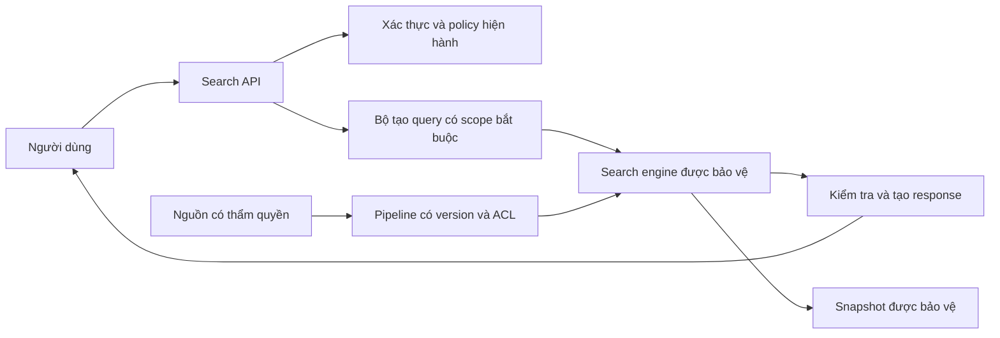

# Search index protection

## 1. Vì sao chỉ mục tìm kiếm cần được bảo vệ như một kho dữ liệu?

**Search index protection** là tập yêu cầu bảo vệ dữ liệu, quyền truy cập và tính đúng đắn trong toàn bộ vòng đời của chỉ mục tìm kiếm: lấy dữ liệu nguồn, biến đổi, lập chỉ mục, truy vấn, lưu bản sao, cập nhật, xóa và phục hồi.

Một ứng dụng có thể bảo vệ database tốt nhưng vẫn làm lộ dữ liệu qua search. Ví dụ, hồ sơ hỗ trợ chỉ cho phép nhân viên được phân công đọc, trong khi API tìm kiếm dùng một tài khoản có quyền đọc toàn bộ chỉ mục. Nếu không áp đúng phạm vi quyền, tiêu đề, đoạn trích hoặc số lượng kết quả có thể tiết lộ nội dung mà API hồ sơ không cho đọc.

Chỉ mục không đơn thuần là cấu trúc tăng tốc có thể bỏ qua trong mô hình dữ liệu. Nó có thể giữ nội dung, bản nguồn, token từ văn bản, giá trị phục vụ sắp xếp, metadata quyền và các dạng dữ liệu dẫn xuất. Dữ liệu cũng có thể xuất hiện trong replica, chỉ mục cũ, snapshot, cache, log truy vấn và hàng đợi lập chỉ mục.

Bài học thuộc chương Data protection, tập trung chuyển các nguy cơ đó thành yêu cầu bảo mật cụ thể, đo được và có thể nghiệm thu. Các thời hạn, tên chỉ mục và tài nguyên trong bài là ví dụ của một hệ thống giả định, không phải giá trị mặc định hay ngưỡng áp dụng chung.

Sau bài học, người học có thể đặc tả:

- Dữ liệu nào được phép đi vào chỉ mục và hình thức lưu giữ tương ứng.
- Cách áp quyền theo tenant, tài liệu và trường trên mọi đường đọc.
- Cách kiểm soát độ trễ khi thu hồi quyền, xóa dữ liệu hoặc thay đổi mức nhạy cảm.
- Yêu cầu đối với pipeline, cache, snapshot, reindex và bằng chứng kiểm thử.

## 2. Dữ liệu có thể lộ ở những bề mặt nào?

Giả sử một hệ thống tìm kiếm phiếu hỗ trợ có các trường:

```json
{
  "documentId": "ticket-demo-42",
  "tenantId": "tenant-demo-a",
  "title": "Yêu cầu điều chỉnh hồ sơ học tập",
  "searchText": "Nội dung đã được chọn cho mục đích tìm kiếm",
  "readPrincipalIds": ["group:support-demo-a"],
  "sourceRevision": 108,
  "classification": "INTERNAL",
  "updatedAt": "2026-01-12T09:00:00Z"
}
```

Đây là mô hình minh họa, không phải schema đủ cho mọi hệ thống. `tenantId`, danh sách quyền và phiên bản phải được suy ra từ nguồn có thẩm quyền; không được tin nguyên các giá trị do người dùng cuối tự khai.

| Bề mặt | Ví dụ dữ liệu có thể bị tiết lộ |
|---|---|
| Kết quả tài liệu | ID, tiêu đề, nội dung, trường metadata |
| Highlight hoặc snippet | Đoạn văn nhạy cảm dù phần kết quả chính đã bỏ trường đó |
| Autocomplete, suggestion, sửa chính tả | Tên hoặc cụm từ chỉ xuất hiện trong tài liệu bị hạn chế |
| Facet, aggregation và total count | Sự tồn tại và số lượng hồ sơ thuộc một nhóm nhạy cảm |
| Sắp xếp, scoring và thống kê thuật ngữ | Tín hiệu về dữ liệu ngoài phạm vi mà người gọi được đọc |
| API đọc khác | Get theo ID, đọc hàng loạt, export, truy vấn nhiều chỉ mục |
| API quản trị hoặc chẩn đoán | Mapping, term vector, explain, profile hoặc thông tin cấu trúc |
| Pipeline và vận hành | Payload lỗi, slow log, trace, snapshot và bản reindex |

Một yêu cầu “không trả tài liệu trái quyền” chưa bao phủ hết bảng này. Cần xác định rõ cả dữ liệu hiển thị lẫn tín hiệu tồn tại mà policy muốn bảo vệ.

Nếu chỉ mục chứa vector hoặc nhiều chunk cho một tài liệu, quyền và vòng đời phải bao phủ từng chunk, metadata, trích dẫn và đường truy xuất nội dung. Không coi vector là dữ liệu vô hại chỉ vì không hiển thị dưới dạng câu văn.

## 3. Mô hình đe dọa và bất biến bảo mật

### 3.1. Các rủi ro cần truy vết

| Mã | Tình huống | Hệ quả |
|---|---|---|
| R1 | Người dùng tenant A truy vấn được dữ liệu tenant B | Rò rỉ giữa khách hàng hoặc tổ chức |
| R2 | Một trường nhạy cảm được ẩn ở giao diện nhưng còn trong index hoặc API khác | Đọc hoặc suy luận nội dung ngoài nhu cầu |
| R3 | Quyền ở nguồn đã bị thu hồi nhưng chỉ mục, cache hoặc phiên tìm kiếm còn dùng trạng thái cũ | Tiếp tục tiết lộ sau mốc phải ngừng |
| R4 | Sự kiện cũ hoặc dữ liệu giả ghi đè tenant, ACL hay trạng thái xóa | Mở rộng quyền hoặc làm sống lại dữ liệu |
| R5 | Tài khoản tìm kiếm có quyền ghi, quản trị hoặc tạo snapshot quá rộng | Sửa kết quả, phá dữ liệu hoặc xuất cả kho |
| R6 | Reindex, restore hoặc chỉ mục cũ không có policy hiện tại | Tạo đường đọc vòng qua kiểm soát đang áp dụng |
| R7 | Query tốn tài nguyên hoặc export hàng loạt | Gián đoạn dịch vụ hoặc tăng quy mô lấy dữ liệu |
| R8 | Query, kết quả và credential bị ghi trong telemetry | Tạo thêm kho dữ liệu nhạy cảm ngoài dự kiến |

### 3.2. Bất biến phải công bố

Với hệ thống giả định, có thể đặt các bất biến:

1. Mọi dữ liệu hoặc tín hiệu được phép trả phải nằm trong phạm vi tenant và policy của người gọi tại thời điểm áp dụng contract.
2. Người dùng không thể mở rộng phạm vi đó bằng cách sửa query, chọn chỉ mục, chọn field hoặc đổi endpoint.
3. Dữ liệu không được tìm kiếm khi thiếu metadata bảo mật bắt buộc hoặc khi không chứng minh được metadata còn đủ mới theo yêu cầu.
4. Tài khoản đọc không được dùng quyền ghi, alias, snapshot hoặc reindex để tạo một bản sao dễ truy cập hơn.
5. Việc xóa hay thu hồi không được bị đảo ngược bởi replay sự kiện, rollback hoặc restore.

Không mô tả bất biến tuyệt đối nếu kiến trúc còn chấp nhận một cửa sổ cũ. Phải nói rõ mốc bắt đầu, ngân sách thời gian và hành vi khi không giữ được ngân sách đó.

## 4. Giảm dữ liệu ngay trước khi lập chỉ mục

### 4.1. Lập danh mục trường theo mục đích

Từng trường cần có quyết định riêng về khả năng tìm kiếm, lưu giữ, trả về, tổng hợp và retention. Không sao chép toàn bộ row hoặc JSON nguồn chỉ vì thuận tiện.

| Trường minh họa | Quyết định của profile tìm phiếu hỗ trợ |
|---|---|
| `documentId` | Giữ định danh tham chiếu, vẫn kiểm quyền khi mở hồ sơ |
| `tenantId`, metadata quyền | Bắt buộc, lấy từ nguồn tin cậy, chỉ dùng theo policy |
| `title`, `searchText` | Chỉ nhận nội dung đã được duyệt cho tìm kiếm |
| Email, số điện thoại | Chỉ đưa vào nếu có nhu cầu rõ ràng và profile truy vấn phù hợp |
| Mật khẩu, mã khôi phục, access token, private key | Không đưa vào chỉ mục nghiệp vụ này |
| Nội dung ghi chú riêng | Không gộp vào trường tìm kiếm chung cho mọi nhân viên |
| Payload debug hoặc bản request gốc | Không lưu kèm tài liệu tìm kiếm |

Profile phải bao phủ cả nội dung trong file đính kèm và các trường tự do. Chỉ cấm một tên field không ngăn người dùng dán credential vào một trường văn bản được phép.

### 4.2. Không searchable không có nghĩa là không lưu

Trong Elasticsearch, `_source` chứa nội dung JSON được gửi khi lập chỉ mục và có thể được trả qua thao tác đọc; xem [tài liệu về `_source`](https://www.elastic.co/docs/reference/elasticsearch/mapping-reference/mapping-source-field). Vì vậy, tắt khả năng lập chỉ mục của một field không phải bằng chứng rằng giá trị đã bị loại khỏi dữ liệu lưu hoặc mọi đường đọc.

Tương tự, một lựa chọn chỉ trả vài field trong response không tự tạo ranh giới quyền. [Tài liệu retrieve selected fields](https://www.elastic.co/docs/reference/elasticsearch/rest-apis/retrieve-selected-fields) mô tả những cách lấy field khác nhau; đặc tả bảo mật phải đánh giá toàn bộ cách đọc được cấp cho tài khoản.

Cách giảm phơi lộ trực tiếp là không gửi dữ liệu không cần thiết vào search ngay từ đầu. Sau đó mới bổ sung các kiểm soát theo tài liệu, field và endpoint phù hợp.

### 4.3. Schema phải được quản lý

Dùng allowlist cho tài liệu đầu ra của indexer và đánh giá thay đổi mapping. Một field mới hoặc một multi-field có thể mở thêm khả năng truy vấn, trả giá trị hay tổng hợp.

Không yêu cầu “dùng strict mapping là đủ”. Cần đặc tả cả việc biến đổi payload, nội dung trường tự do, lỗi schema và nơi giữ bản ghi bị cách ly.

## 5. Tách tenant, quyền tài liệu và quyền trường

### 5.1. Tách index hay dùng index chung?

| Phương án | Lợi ích có thể đạt | Điều vẫn phải kiểm soát |
|---|---|---|
| Chỉ mục riêng theo tenant hoặc miền nhạy cảm | Giảm mức dùng chung dữ liệu và đơn giản hóa một số quyền | Wildcard, tài khoản đa tenant, snapshot, routing và endpoint quản trị |
| Chỉ mục chung có metadata quyền | Thuận tiện cho vận hành nhiều tập dữ liệu | Predicate bắt buộc, DLS/FLS phù hợp, giới hạn suy luận và mọi API đọc |
| Cluster hoặc deployment riêng | Tạo ranh giới hạ tầng mạnh hơn cho miền cần cô lập | IAM, quyền quản trị, repository và kết nối giữa các hệ thống |

Tên index, alias hoặc routing không tự chứng minh cách ly. Phải chứng minh người gọi không thể chọn một tên khác, truy cập chỉ mục gốc hoặc đi qua một thao tác không áp bộ lọc tương ứng.

### 5.2. DLS và FLS là các cơ chế có phạm vi cụ thể

**Document-level security — DLS** giới hạn tài liệu được đọc; **field-level security — FLS** giới hạn trường được đọc. Cần xác nhận hành vi của sản phẩm, phiên bản và cấu hình đang dùng, kể cả cách kết hợp nhiều role.

Ví dụ, [tài liệu DLS của OpenSearch](https://docs.opensearch.org/latest/security/access-control/document-level-security/) phân biệt kiểm soát đọc với quyền ghi và lưu ý kiểu dữ liệu của thuộc tính dùng cho điều kiện quyền. Trường chứa ID tenant hoặc principal cần so khớp chính xác theo contract; không dùng phân tích toàn văn khiến hai ID khác nhau trở thành các token dễ khớp nhầm.

[FLS của OpenSearch](https://docs.opensearch.org/latest/security/access-control/field-level-security/) cũng yêu cầu xem xét subfield và tương tác với DLS. Một đặc tả chỉ nhắc tên field cha có thể bỏ sót đường truy cập qua biến thể của nó.

Quyền thực tế phải được kiểm tra sau khi hợp nhất mọi role, nhóm, API key và quyền kế thừa. Không nghiệm thu từng role riêng lẻ rồi suy rằng tổ hợp role vẫn giữ cùng mức hạn chế.

### 5.3. Không suy rộng cơ chế sang mọi loại rò rỉ

Elastic ghi nhận các giới hạn của DLS, bao gồm ảnh hưởng của thống kê toàn index tới scoring và một số khả năng suy ra thông tin tổng hợp; xem [giới hạn document/field security](https://www.elastic.co/docs/deploy-manage/users-roles/cluster-or-deployment-auth/controlling-access-at-document-field-level).

Nếu yêu cầu là tenant A không được suy ra sự tồn tại dữ liệu tenant B, phải đánh giá mức cô lập và các API được mở tương ứng. Không thay yêu cầu này bằng câu “đã bật DLS”. Có thể phải tách miền dữ liệu hoặc đóng tính năng không đáp ứng bảo đảm.

## 6. Cổng tìm kiếm phải tạo phạm vi từ ngữ cảnh tin cậy

Một kiến trúc có cổng tìm kiếm trung gian có thể giúp kiểm soát contract công khai. Tuy nhiên, cổng chỉ hữu ích khi client không có đường gọi trực tiếp search engine bằng tài khoản quyền rộng.



Mã giả:

```text
search(identity, userInput):
    context = authenticateAndResolveTenant(identity)
    authorization = resolveCurrentSearchAuthorization(context)
    require authorization is valid and fresh enough

    request = validatePublicSearchContract(userInput)
    require request uses only approved fields and features

    predicate = AND(
        tenantEquals(context.tenant),
        readableBy(authorization.principalSet),
        allowedClassification(authorization),
        activeAndEligibleForSearch()
    )

    query = buildQueryFromApprovedTemplate(request, predicate)
    result = searchEngine.execute(query, restrictedServiceIdentity)
    return buildAuthorizedResponse(result, context, authorization)
```

Ở đây, `principalSet` do hệ thống quyền xác định; không lấy từ tham số người dùng tự gửi. `AND` là sự kết hợp bắt buộc, không phải một nhánh tùy chọn mà query toàn văn có thể làm vô hiệu.

API công khai có thể chỉ cho nhập từ khóa, bộ lọc nghiệp vụ đã duyệt và lựa chọn sắp xếp trong allowlist. Nếu cho gửi DSL đầy đủ, cần phân tích tác động của từng khả năng; không mặc định DSL là đầu vào vô hại vì nó không phải SQL.

Trong ví dụ, client không tự chọn index, field tùy ý, script, truy vấn liên cluster hoặc chức năng quản trị. Các nhu cầu đó, nếu có, dùng contract và quyền riêng.

## 7. Lọc trước khi tính kết quả, không chỉ sau khi lấy hits

### 7.1. Vì sao post-filter ở ứng dụng chưa đủ?

Một cách làm yếu là tìm trên toàn bộ dữ liệu, nhận 100 hits rồi xóa tài liệu trái quyền trước khi trả response. Cách này có thể vẫn để lộ:

- Tổng số kết quả hoặc các bucket thống kê tính trên tập rộng hơn.
- Gợi ý hoặc highlight được tạo từ tài liệu không được phép.
- Dấu vết qua phân trang, sắp xếp và sự hiện diện của dữ liệu ngoài phạm vi.
- Payload nhạy cảm đi vào bộ nhớ, trace hoặc log của ứng dụng trung gian.

Yêu cầu đúng phải đặt phạm vi quyền vào nơi các kết quả hoặc tín hiệu được tính, và kiểm chứng từng tính năng. Kiểm lại quyền cho từng hit có thể là lớp bổ sung, nhưng không sửa được một aggregation đã tính từ dữ liệu trái quyền.

### 7.2. Mỗi tính năng có contract riêng

| Tính năng | Yêu cầu cần có |
|---|---|
| Hits và get theo ID | Chỉ trả tài liệu trong tenant và quyền hiện hành |
| Snippet, highlight | Chỉ tạo từ field và phiên bản nội dung được phép |
| Facet, count, aggregation | Chỉ dùng tập dữ liệu được phép hoặc bị tắt nếu không đáp ứng bảo đảm |
| Autocomplete, suggestion | Có phạm vi quyền phù hợp; không dùng từ điển toàn hệ thống nếu gây lộ |
| Export và truy vấn nhiều tài liệu | Giữ quyền theo từng đối tượng và giới hạn quy mô |
| Cuộn trang hoặc phiên tìm kiếm dài | Xử lý thay đổi quyền và thời hạn context theo policy |
| Truy vấn vector hoặc chunk | Áp đúng quyền ở khâu truy xuất và dữ liệu trả về |

Không tự giả định mọi tính năng hỗ trợ cùng kiểu lọc hoặc DLS. Nếu tính năng không hỗ trợ kiểm soát cần thiết, đặc tả phải chọn giải pháp khác hoặc loại nó khỏi profile được phép.

### 7.3. Không tái sử dụng snippet cũ sau khi policy đổi

Một tài liệu vẫn có thể được đọc nhưng một đoạn nội dung đã bị xóa hoặc chuyển sang mức nhạy cảm cao hơn. Chỉ kiểm tra “người dùng còn quyền đọc tài liệu” không đủ để cho phép trả snippet cũ.

Cần gắn output với phiên bản nội dung và policy thích hợp, hoặc lấy đoạn hiển thị từ nguồn đã được làm sạch hiện hành. Quy tắc đồng bộ phải bao phủ thay đổi field, không chỉ thay đổi ACL của cả tài liệu.

## 8. Độ mới của ACL là một yêu cầu bảo mật

### 8.1. Phân biệt ghi nhận thay đổi với ngừng tiết lộ

Chuỗi cập nhật có thể đi qua nhiều mốc:

```text
T0: nguồn commit thu hồi quyền hoặc thay đổi dữ liệu
T1: sự kiện xuất hiện trong queue
T2: indexer xử lý phiên bản mới
T3: thay đổi có hiệu lực trên đường search thực tế
T4: cache, context cũ và đường đọc khác không còn trả dữ liệu bị cấm
```

HTTP thành công từ một thao tác ghi index không tự chứng minh mọi đường tìm kiếm đã thấy trạng thái mới. Elasticsearch có cơ chế near-real-time search và refresh; xem [tài liệu near-real-time search](https://www.elastic.co/docs/manage-data/data-store/near-real-time-search). Không dùng một refresh interval mặc định như bằng chứng về thời hạn thu hồi quyền toàn hệ thống.

### 8.2. Ví dụ ngân sách thu hồi

> Sau khi nguồn có thẩm quyền commit quyết định thu hồi tại T0, mọi response tìm kiếm được phát hành từ T0 + 60 giây trở đi phải không còn tiết lộ hits, snippet hoặc thống kê thuộc phạm vi quyền đã bị thu hồi.

Đây là mục tiêu của hệ thống giả định. Muốn cam kết phải chỉ ra cơ chế: quyền hiện hành tại query gateway, metadata cập nhật có bảo đảm, overlay thu hồi hoặc phương án tương đương. Cơ chế phải bao phủ toàn bộ output được cho phép.

Nếu độ cũ vượt ngân sách hoặc không xác minh được trạng thái, hệ thống phải ngừng phục vụ phạm vi bị ảnh hưởng hay từ chối tính năng liên quan. Không tiếp tục trả kết quả cũ vô hạn vì queue đang lag.

Đặc tả cũng cần nêu hành vi của request đang chạy và dữ liệu đã được giao trước mốc. Không thể thu hồi tri thức mà người nhận đã đọc; yêu cầu ở đây kiểm soát việc tiếp tục phát hành dữ liệu từ hệ thống.

### 8.3. Đo ở phía consumer

Đo từ quyết định ở nguồn tới response cuối cùng mà các node, replica, cache hoặc context có thể trả. Theo dõi queue lag là một chỉ báo, không thay thế phép đo kết quả.

Nếu chỉ có số liệu p99, cần nói rõ cách xử lý các trường hợp vượt ngưỡng. Một yêu cầu không chấp nhận tiết lộ quá hạn phải có chặn phục vụ khi quá hạn, không chỉ đặt cảnh báo.

## 9. Pipeline phải bảo vệ tenant, ACL và tính toàn vẹn

### 9.1. Dữ liệu và metadata phải đi cùng nhau

Indexer cần có danh tính workload riêng, chỉ nhận nguồn và phạm vi được cấp. Tenant, ACL, classification và trạng thái hiệu lực phải đến từ nguồn đáng tin cậy hoặc được xác minh trước khi ghi.

Thiếu ACL không được hiểu thành public. Sự kiện không hợp lệ cần bị từ chối hoặc cách ly trong vùng có bảo vệ, không đưa vào index bằng một quyền mặc định rộng hơn.

Nếu một tài liệu sinh nhiều chunk, mọi chunk phải kế thừa đúng metadata và source revision. Cập nhật ACL hoặc xóa phải bao phủ toàn bộ tập chunk, kể cả bản được tạo bởi pipeline cũ.

### 9.2. Sự kiện cũ không được làm sống lại dữ liệu

Yêu cầu cần xử lý trùng lặp, đảo thứ tự và retry. Một bản cập nhật cũ không được ghi đè ACL mới; một sự kiện tạo cũ không được tái tạo tài liệu sau khi đã xóa.

Một cách đặc tả là dùng revision có thứ tự từ nguồn có thẩm quyền, bao phủ trạng thái dữ liệu và quyền liên quan. Nếu nội dung và ACL có luồng version riêng, phải có quy tắc kết hợp rõ ràng; không tùy ý chọn timestamp lớn hơn rồi coi trạng thái đã nhất quán.

Trạng thái xóa hoặc tombstone cần được giữ đủ cho cửa sổ replay mà hệ thống cho phép, hoặc có cơ chế đối chiếu nguồn tương đương. Xóa tombstone quá sớm có thể mở đường cho dữ liệu cũ quay lại.

### 9.3. Phân biệt chấp nhận ghi với hoàn tất bảo vệ

Một bulk request có thể có lỗi ở từng phần tử. Pipeline phải kiểm kết quả của từng thao tác, retry có kiểm soát và theo dõi độ hội tụ của cả nội dung lẫn ACL. Không đánh dấu batch hoàn tất chỉ vì lớp HTTP đã trả thành công.

Job đối soát cần phát hiện tài liệu thiếu, thừa, sai tenant, sai revision hoặc khác policy. Việc đối soát không được tự nới quyền để làm số lượng bản ghi khớp nhau.

## 10. Cache, phân trang và đường truy cập trực tiếp

Cache response của ứng dụng phải phân biệt những ngữ cảnh có quyền khác nhau. Key cache có thể cần tenant, phạm vi quyền, phiên bản policy, query chuẩn hóa, field và lựa chọn phân trang theo thiết kế. Cache chỉ theo chuỗi từ khóa dễ trả kết quả của người trước cho người sau.

Không mặc định “cùng role” nghĩa là cùng quyền: hai người có cùng tên role vẫn có thể khác tenant, nhóm, quyền trên tài liệu hoặc thời hạn được cấp.

Khi quyền thay đổi, cần invalidation hoặc cơ chế version/TTL cùng kiểm tra hiện hành đáp ứng ngân sách. TTL riêng lẻ không bảo đảm thu hồi nhanh hơn chính TTL và các độ trễ khác.

Context phân trang, cursor hoặc point-in-time phải được ràng buộc với người gọi và scope. Nếu context giữ trạng thái cũ, cần hủy, làm mới hoặc áp policy hiện hành trước khi tiếp tục trả dữ liệu theo contract. Không cho một cursor trở thành credential chuyển giao tùy ý.

Những đường vòng phải nằm trong kiểm thử:

- Endpoint đọc theo ID hoặc đọc hàng loạt không đi qua UI search.
- Tên chỉ mục cũ, alias khác, wildcard và chỉ mục sau rollover.
- Dashboard, API console, export và credential dùng cho chẩn đoán.
- Truy cập trực tiếp từ mạng nội bộ hoặc workload khác.
- Truy vấn nhiều chỉ mục hay liên cluster nếu được triển khai.

## 11. Quyền vận hành, mã hóa và giới hạn tài nguyên

### 11.1. Tách danh tính theo nhiệm vụ

| Danh tính | Quyền minh họa |
|---|---|
| Search API | Đọc những index và chức năng phục vụ đã duyệt; không ghi hoặc quản trị |
| Indexer | Ghi cập nhật trong phạm vi nguồn và index được cấp; không quản lý role hoặc repository |
| Job xóa/đối soát | Các thao tác cần thiết theo nhiệm vụ, có audit và giới hạn phạm vi |
| Job snapshot/restore | Quyền backup/restore riêng, không dùng làm credential phục vụ người dùng |
| Quản trị khẩn cấp | Quyền có thời hạn, xác thực phù hợp và truy vết theo quy trình |

Quyền đọc tài liệu không được kéo theo quyền snapshot, clone, reindex hoặc đổi alias để mở một bản sao. Phải kiểm tra các thao tác thực tế của engine, không chỉ tên vai trò do nhóm phát triển đặt.

### 11.2. Mã hóa bảo vệ lớp nào?

Dùng kênh mã hóa và xác minh danh tính đầu cuối theo thiết kế cho kết nối client, gateway, node, pipeline và repository. Bảo vệ dữ liệu lưu trên volume, snapshot và bản sao tương ứng; quản lý khóa tách khỏi dữ liệu theo mô hình vận hành.

Mã hóa ổ đĩa không ngăn một tài khoản được cấp search đọc dữ liệu qua engine đang chạy. Mã hóa trường trước khi lập chỉ mục cũng có thể thay đổi khả năng tìm kiếm; không tuyên bố mã hóa thông thường giữ nguyên mọi chức năng full-text.

Nếu dùng biến đổi để tìm kiếm định danh nhạy cảm, phải đánh giá riêng khả năng dò đầu vào, rò rỉ quan hệ bằng nhau và quyền sử dụng khóa. Đây không phải lý do để tự xây một cơ chế mã hóa tìm kiếm rồi bỏ qua đánh giá mật mã.

### 11.3. Tài nguyên và quy mô truy xuất

Contract nên giới hạn page size, kích thước query, thời gian xử lý, số bucket, truy vấn tốn tài nguyên và export. Áp quota phù hợp theo tenant hoặc workload để một khách hàng không làm cạn tài nguyên dùng chung.

Rate limit không thay thế phân quyền. Một kết quả trái quyền vẫn là lỗi dù chỉ được đọc một lần. Khi quá tải hoặc timeout, không được bỏ bộ lọc bảo mật để tìm kiếm nhanh hơn.

## 12. Xóa dữ liệu, reindex và snapshot

### 12.1. Tách các mục tiêu xóa

Cần phân biệt:

1. **Ngừng phục vụ dữ liệu** qua mọi đường đọc trong ngân sách bảo mật.
2. **Loại khỏi các cấu trúc online** gồm index, chunk, cache và bản cũ theo kế hoạch.
3. **Hết hạn bản sao lịch sử** theo retention của snapshot, queue và backup.
4. **Loại bỏ dữ liệu trên phương tiện lưu trữ** theo cơ chế và phạm vi có thể chứng minh.

Một thao tác delete thành công không tự chứng minh bốn mục tiêu đều hoàn tất. Việc biến mất khỏi kết quả không đồng nghĩa mọi bản sao vật lý và snapshot đã biến mất.

Ví dụ hệ thống giả định có ngân sách ngừng tiết lộ 60 giây và mục tiêu làm sạch index online 15 phút. Hai mục tiêu này cần bằng chứng riêng; thời hạn backup cũng phải được công bố riêng, không suy ra từ hai con số trên.

### 12.2. Reindex phải áp policy hiện tại

Chỉ mục mới không được mở cho consumer trước khi có mapping, quyền, schema tối thiểu và bộ kiểm tra bảo mật phù hợp. Khi chuyển alias hoặc route, cần xác nhận dữ liệu mới nhất, ACL, tombstone và giới hạn truy cập.

Rollback cũng là một quyết định bảo mật. Không quay lại index cũ chứa quyền hoặc nội dung đã bị thu hồi chỉ vì nó từng hoạt động tốt.

Sau cutover, chỉ mục cũ cần được đóng quyền phục vụ và xử lý theo retention. Việc bỏ alias không đủ nếu tài khoản vẫn được đọc index bằng tên gốc.

### 12.3. Snapshot có thể giữ nhiều hơn dữ liệu tìm kiếm

Snapshot có thể chứa dữ liệu và trạng thái cấu hình của hệ thống; xem [tài liệu snapshot and restore của Elastic](https://www.elastic.co/docs/deploy-manage/tools/snapshot-and-restore). Repository phải có kiểm soát đọc, ghi, mã hóa và retention riêng.

Tài liệu về [tạo và bảo vệ snapshot](https://www.elastic.co/docs/deploy-manage/tools/snapshot-and-restore/create-snapshots) cũng lưu ý dữ liệu nhạy cảm trong một số feature state. Quyền đọc repository không được coi là ít nhạy cảm hơn quyền đọc index chỉ vì nội dung ở dạng backup.

Restore phải vào môi trường cô lập, áp lại policy hiện tại và các quyết định xóa/thu hồi liên quan trước khi phục vụ. Kiểm tra cả credential, role, alias và cấu hình được khôi phục; không để trạng thái bảo mật cũ thay thế trạng thái đã được sửa.

Xử lý retention bằng cơ chế snapshot/repository được hỗ trợ; không tự xóa tùy tiện file thành phần của một repository đang dùng. Đặc tả phải ghi rõ điều gì được xóa, khi nào và bằng chứng nào xác nhận phạm vi đó.

## 13. Logging và phản ứng khi phát hiện rò rỉ

Chuỗi tìm kiếm có thể chứa email, số điện thoại, tên người hoặc một đoạn bí mật mà người dùng dán vào. Không coi query là metadata vô hại để ghi đầy đủ ở mọi lớp proxy, analytics và slow log.

Audit nên giữ thông tin đủ điều tra như danh tính kiểm toán, tenant, route, phiên bản policy, quyết định, phạm vi thao tác và correlation ID. Việc giữ query hoặc kết quả chi tiết, nếu thật sự cần, phải có mục đích, giới hạn truy cập, thời hạn và xử lý nhạy cảm riêng.

Sự kiện minh họa:

```yaml
eventType: SEARCH_SCOPE_ENFORCEMENT
requesterAuditId: user-demo-8
tenantId: tenant-demo-a
policyVersion: search-policy-12
indexGeneration: tickets-v7
decision: DENY
reasonCode: AUTHORIZATION_STATE_TOO_OLD
correlationId: trace-demo-573
```

Khi phát hiện dữ liệu bị lập chỉ mục quá mức hoặc trả sai scope, quy trình cần:

- Chặn đường phục vụ bị ảnh hưởng và thu hồi credential liên quan khi cần.
- Xác định index, generation, snapshot, cache và các luồng export đã chịu tác động.
- Bảo toàn bằng chứng được kiểm soát trước khi thực hiện thao tác làm mất dấu vết.
- Sửa nguồn lỗi, làm sạch hoặc tái tạo chỉ mục, rồi kiểm chứng các bất biến trước khi mở lại.
- Đánh giá những response đã được giao; việc sửa index hiện tại không thu hồi được dữ liệu đã rời hệ thống.

## 14. Bộ yêu cầu bảo mật mẫu có thể nghiệm thu

| ID | Yêu cầu | Rủi ro và bằng chứng |
|---|---|---|
| SEARCH-01 | Mỗi profile tìm kiếm có allowlist dữ liệu lưu, tìm, trả và tổng hợp; schema mới phải được đánh giá | R2, R8; mapping, payload đầu ra indexer và dữ liệu canary |
| SEARCH-02 | Mọi đường đọc áp tenant và policy từ danh tính tin cậy; client không tự chọn scope rộng hơn | R1; kiểm quyền hiệu lực và ca sửa query/tenant/index |
| SEARCH-03 | Hits, snippet, suggestion, count và aggregation đáp ứng cùng policy về dữ liệu được tiết lộ; chức năng không đáp ứng bị đóng | R1, R2; kiểm từng feature và API được cấp |
| SEARCH-04 | Metadata quyền phải có nguồn gốc và revision xác định; thiếu hoặc không hợp lệ dẫn đến cách ly/từ chối | R4; test payload thiếu, giả mạo và sai kiểu dữ liệu |
| SEARCH-05 | Thu hồi quyền hoặc xóa ở nguồn ngăn phát hành dữ liệu bị cấm sau ngân sách đã công bố, kể cả cache và context cũ | R3; đo end-to-end với nhiều node và phụ thuộc lỗi |
| SEARCH-06 | Event trùng, đảo thứ tự và replay không khôi phục quyền hay dữ liệu đã bị loại | R3, R4; kiểm trạng thái sau retry, replay và restart |
| SEARCH-07 | Danh tính phục vụ tìm kiếm không có quyền ghi, quản lý bảo mật, snapshot hoặc thao tác tạo bản sao ngoài nhiệm vụ | R5; rà quyền hợp nhất và thử thao tác bị cấm |
| SEARCH-08 | Cache và cursor được ràng buộc với ngữ cảnh quyền; không chia sẻ kết quả giữa các scope khác nhau | R1, R3; cùng query qua hai user/tenant và sau thu hồi |
| SEARCH-09 | Reindex, cutover và rollback chỉ dùng generation đáp ứng policy hiện tại | R6; kiểm quyền trước chuyển, sau chuyển và khi rollback |
| SEARCH-10 | Xóa, retention và restore bao phủ index, chunk, bản cũ, vùng trung gian và snapshot theo phạm vi công bố | R3, R6; diễn tập xóa/restore và hồ sơ retention |
| SEARCH-11 | Query và output nhạy cảm không bị ghi ngoài vùng telemetry đã cấp; audit bảo vệ được quyết định truy cập | R8; kiểm proxy, engine, app, queue lỗi và cấu hình log |
| SEARCH-12 | Có quota và giới hạn query/export; quá tải không làm bỏ qua policy bảo mật | R7; thử tải và lỗi với dữ liệu kiểm thử phân quyền |

Một đặc tả chi tiết cho ngân sách thu hồi có thể là:

```yaml
id: SEARCH-05
asset: support-ticket-search
trigger: Authoritative source commits access revocation
startTimestamp: sourceCommitTime
maximumDisclosureDelaySeconds: 60
coverage:
  - Search hits and snippets
  - Counts and approved aggregations
  - Application cache and existing pagination contexts
  - Every online serving generation
failureBehavior: Deny affected scope if freshness cannot be proven
evidence:
  - End-to-end revocation test
  - Cache and pagination revocation test
  - Delayed-event and dependency-failure test
owner: search-platform
```

Yêu cầu này chỉ khả thi khi kiến trúc có cơ chế giữ ngân sách và chặn phục vụ khi cần. Việc thêm field `sourceRevision` vào index nhưng không kiểm nó ở đâu không tạo ra bảo đảm về độ mới.

## 15. Ma trận kiểm thử đúng ranh giới

Đây là tiêu chí thiết kế kiểm thử, chưa phải kết quả QA của một triển khai cụ thể. Dùng dữ liệu tổng hợp và tài khoản có thẩm quyền trong môi trường kiểm thử.

| Tình huống | Kết quả mong đợi |
|---|---|
| Cùng từ khóa có tài liệu ở tenant A và B, người gọi chỉ thuộc A | Chỉ có dữ liệu và tín hiệu được phép cho A theo contract |
| Client sửa tenant, tên index, wildcard hoặc field | Không mở rộng scope; yêu cầu không hợp lệ bị từ chối |
| Người gọi có nhiều role chồng lấn | Quyền hợp nhất vẫn đáp ứng profile đã duyệt |
| Field nhạy cảm không hiện ở UI nhưng được yêu cầu qua API khác | Không đọc hoặc truy vấn trái contract được |
| Từ khóa canary chỉ có trong tài liệu bị hạn chế | Không xuất hiện qua snippet, suggestion hoặc thống kê bị cấm |
| Gọi get, multi-get, multi-search, export hoặc route được bật khác | Có cùng bảo đảm quyền ở điểm thực thi tương ứng |
| Thu hồi quyền trong khi có request và cursor đang hoạt động | Không phát hành dữ liệu bị cấm sau mốc đã đặc tả |
| Thay nội dung nhạy cảm nhưng giữ nguyên quyền đọc tài liệu | Không trả snippet cũ ngoài contract phiên bản |
| Queue chậm, policy lỗi hoặc thiếu metadata ACL | Không fallback sang kết quả không lọc hoặc quyền public |
| Event cập nhật cũ đến sau xóa hoặc thu hồi | Không làm sống lại tài liệu hay ACL cũ |
| Hai user có cùng từ khóa nhưng quyền tài liệu khác nhau | Không nhận cache response của nhau |
| Cutover và rollback qua index cũ | Không phục vụ generation vi phạm policy hiện tại |
| Restore snapshot trước khi có quyết định xóa | Áp lại quyết định trước khi mở phục vụ |
| Query tốn tài nguyên hoặc export vượt hạn mức | Bị giới hạn theo contract, không bỏ điều kiện bảo mật |
| Rà telemetry trên cả ca thành công và lỗi | Không có credential hoặc nội dung ngoài chính sách log |

Không chỉ đếm HTTP status. Cần kiểm response body, highlight, count, bucket, cache, context, tài liệu thực tế trong index và hành vi của API trực tiếp được cấp. Một response rỗng ở UI không chứng minh search engine không có đường đọc vòng.

Đối với yêu cầu chống suy luận giữa tenant, ca thử phải phù hợp với tín hiệu đang muốn che giấu. Kiểm một canary qua một query chỉ là một phần bằng chứng; không chứng minh không có mọi kênh suy luận có thể xảy ra.

## 16. Những lỗi đặc tả thường gặp

- **Chỉ bảo vệ database nguồn.** Bỏ qua bản sao tìm kiếm và vòng đời riêng của nó.
- **Ẩn field ở giao diện là đủ.** Chưa kiểm source, API khác, highlight, subfield và aggregation.
- **Thêm tenant filter do client gửi.** Chưa có ranh giới tin cậy ngăn sửa scope.
- **Lọc hits sau khi tìm kiếm toàn bộ.** Để metadata và tín hiệu đã được tính trên dữ liệu trái quyền.
- **Thu hồi quyền đồng nghĩa queue sẽ cập nhật sau.** Không có ngân sách hoặc chặn phục vụ khi độ trễ quá lớn.
- **Tài khoản search dùng chung tài khoản quản trị.** Làm tăng phạm vi đọc, sửa và xuất dữ liệu khi bị lạm dụng.
- **Reindex và restore là việc thuần vận hành.** Bỏ qua khả năng quay lại policy và dữ liệu cũ.
- **Delete thành công là dữ liệu biến mất ở mọi nơi.** Không tách ngừng phục vụ, làm sạch online và retention bản sao.

Bảo vệ chỉ mục tìm kiếm đòi hỏi coi mọi kết quả và tín hiệu của search là một lần công bố dữ liệu. Yêu cầu tốt xác định dữ liệu được phép lập chỉ mục, phạm vi quyền tại thời điểm công bố, giới hạn độ cũ và hành vi khi không chứng minh được các điều kiện đó. Từ các bất biến này mới chọn cơ chế kiến trúc và bằng chứng nghiệm thu phù hợp.
