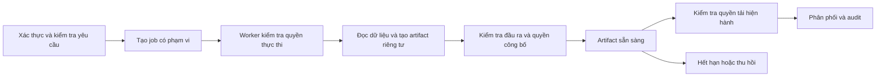

# Copy và export control

## 1. Mục tiêu: kiểm soát dữ liệu đi qua ranh giới nào

Copy và export control là các yêu cầu điều khiển việc sao chép, tạo bản xuất, tải xuống và chuyển giao dữ liệu từ hệ thống sang một vị trí hoặc một chủ thể khác.

Một tài khoản có thể được phép xem từng hồ sơ để xử lý công việc nhưng không được phép tải toàn bộ danh sách khách hàng. Một người được phép xuất báo cáo tổng hợp cũng chưa chắc được phép xuất số điện thoại, ghi chú nội bộ hoặc dữ liệu thuộc tenant khác.

Vì vậy, đặc tả cần tách các hành động:

- Xem dữ liệu trong ứng dụng.
- Sao chép một giá trị hoặc một tập giá trị qua chức năng do ứng dụng cung cấp.
- Tạo bản xuất theo bộ lọc, trường dữ liệu và định dạng đã định.
- Xem trạng thái, hủy job và lấy artifact của một bản xuất.
- Chia sẻ, in hoặc chuyển dữ liệu sang hệ thống bên ngoài nếu các luồng này thuộc phạm vi.

Mục tiêu kiểm soát gồm phòng ngừa truy cập ngoài quyền, giảm khả năng lấy dữ liệu hàng loạt, giới hạn bản sao phát sinh và cung cấp bằng chứng điều tra. Yêu cầu phải nói rõ dữ liệu nào được phép rời hệ thống, ai thực hiện, qua kênh nào, trong thời gian nào và với giới hạn nào.

Ví dụ yêu cầu còn mơ hồ:

> Chặn copy và chỉ cho người có quyền export.

Một cách viết có thể kiểm chứng hơn:

> API tạo export chỉ chấp nhận người dùng có quyền xuất tập dữ liệu tương ứng trong tenant hiện tại. Bản xuất chỉ gồm các dòng và cột được policy cho phép. API tải xuống phải kiểm tra quyền hiện hành với chính artifact đó trước khi trả nội dung.

Bài học tập trung vào chuyển các mục tiêu này thành yêu cầu bảo mật, quyết định kiến trúc và tiêu chí nghiệm thu.

## 2. Bản đồ luồng dữ liệu và ma trận hành động

### 2.1. Những đường có thể tạo bản sao

Một tính năng export có thể đi qua nhiều thành phần:

```text
Người dùng
    → giao diện / API tạo yêu cầu
    → hàng đợi
    → worker đọc dữ liệu nguồn
    → tệp tạm hoặc vùng staging
    → kho artifact
    → API tải xuống / liên kết chia sẻ
    → thiết bị hoặc hệ thống của người nhận

Các đường khác cần kiểm kê:
    copy từ bảng dữ liệu, API phân trang, báo cáo định kỳ,
    in và PDF, email đính kèm, công cụ hỗ trợ,
    log, trace, backup, tích hợp và tác vụ quản trị.
```

Nếu hệ thống chặn nút “Export” nhưng API danh sách vẫn trả mọi trường với giới hạn phân trang tùy ý, dữ liệu vẫn có đường đi ra ngoài. Kiểm kê phải theo khả năng truy cập thực tế, không chỉ theo tên tính năng trên giao diện.

### 2.2. Ma trận quyền minh họa

Giả sử một ứng dụng quản lý khách hàng nhiều tenant:

| Chủ thể | Xem hồ sơ | Copy qua chức năng ứng dụng | Tạo export | Tải artifact |
|---|---|---|---|---|
| Nhân viên hỗ trợ | Hồ sơ được phân công; điện thoại đã che | Chỉ giá trị đã che | Không được phép | Không được phép |
| Chuyên viên phân tích | Báo cáo theo phạm vi được giao | Số liệu được phép hiển thị | Chỉ schema báo cáo đã duyệt | Artifact thuộc phạm vi và người nhận được phép |
| Quản lý nghiệp vụ | Hồ sơ thuộc phạm vi quản lý | Theo quyền từng trường | Bản xuất nghiệp vụ theo policy | Cần kiểm tra quyền hiện hành |
| Worker export | Dữ liệu cần cho job hợp lệ | Không áp dụng | Thực thi job được giao | Không tự có quyền phân phối mọi artifact |
| Quản trị hạ tầng | Theo trách nhiệm vận hành | Theo policy riêng | Không mặc nhiên có quyền nghiệp vụ | Quyền đọc kho lưu phải được kiểm soát riêng |

Bảng này là ví dụ thiết kế. Dự án phải xác định quyền theo dữ liệu, tenant, quan hệ nghiệp vụ, mục đích và điều kiện môi trường cần thiết.

Quyền xem là một đầu vào của quyết định export. Dự án có thể yêu cầu quyền export riêng, xác thực bổ sung hoặc phê duyệt cho một loại dữ liệu có tác động lớn. Những điều kiện đó phải gắn với rủi ro và có tiêu chí rõ ràng, không chỉ thêm một hộp thoại xác nhận chung.

## 3. Mô hình đe dọa cho copy và export

| Rủi ro | Tình huống cụ thể | Kiểm soát cần đặc tả |
|---|---|---|
| R1: vượt quyền chức năng | Người chỉ được xem gọi thẳng API tạo export | Kiểm tra quyền export phía máy chủ |
| R2: vượt phạm vi dữ liệu | Đổi tenant, bộ lọc, mã đối tượng hoặc danh sách cột | Phạm vi dòng và trường được xác định từ ngữ cảnh đáng tin |
| R3: truy cập artifact của người khác | Đổi job ID hoặc artifact ID | Kiểm tra quyền trên từng đối tượng và mọi endpoint liên quan |
| R4: quyền thay đổi trong lúc chạy | Người dùng bị thu hồi quyền khi job còn trong hàng đợi | Chính sách kiểm tra lại ở các mốc thực thi và phân phối |
| R5: phát tán liên kết tải | Link xuất hiện trong log, chat hoặc lịch sử trình duyệt | Cơ chế phân phối phù hợp, thời hạn và bảo vệ bí mật truy cập |
| R6: rút dữ liệu hàng loạt | Chia thành nhiều job, nhiều trang hoặc request đồng thời | Hạn mức tích lũy và phát hiện hành vi trên các kênh liên quan |
| R7: bản sao trung gian bị lộ | Tệp lỗi, object chưa hoàn tất hoặc backup bị đọc | Quyền kho, bảo vệ lưu trữ và vòng đời bản sao |
| R8: nội dung export gây tác động khi mở | Chuỗi do người dùng nhập được diễn giải thành công thức bảng tính | Quy tắc tạo định dạng và kiểm thử trên phần mềm đích |
| R9: thiếu dấu vết hoặc log chứa dữ liệu | Không biết ai tải tệp; log giữ nguyên nội dung export | Audit theo sự kiện, tối thiểu hóa dữ liệu và bảo vệ quyền đọc |
| R10: phục hồi làm mở lại dữ liệu cũ | Restore khôi phục artifact đã hết hạn hoặc bị thu hồi | Đối soát trạng thái phân phối trước khi phục vụ |

Mô hình cần xét cả người ngoài dùng tài khoản bị chiếm và người nội bộ có một phần quyền hợp lệ. Với chủ thể đã có khả năng đọc nội dung, kiểm soát xuất hàng loạt có thể hạn chế quy mô và tăng khả năng phát hiện; nó không tự loại bỏ mọi cách ghi lại nội dung đã được nhìn thấy.

## 4. Kiểm soát tại ranh giới máy chủ

### 4.1. Kiểm tra hành động, dòng và trường

Một quyết định cho phép export cần kết hợp ít nhất:

```text
identity
    + tenant và quan hệ với dữ liệu
    + quyền thực hiện hành động export
    + phạm vi dòng dữ liệu
    + allowlist các trường đầu ra
    + mục đích và điều kiện bổ sung nếu có
    + hạn mức và trạng thái hệ thống
```

Không lấy tenant hoặc vai trò từ request body rồi coi đó là căn cứ cấp quyền. Máy chủ phải đối chiếu ngữ cảnh xác thực, quan hệ được quản lý và policy hiện hành.

Danh sách cột từ client phải được kiểm tra. Nếu người dùng yêu cầu cột ngoài quyền, contract cần nêu rõ từ chối toàn yêu cầu hay tạo schema đã giới hạn và thông báo tương ứng. Một lựa chọn dễ kiểm tra là từ chối yêu cầu không hợp lệ trước khi tạo job.

Với dữ liệu lớn, phạm vi quyền nên được đưa vào truy vấn hoặc lớp đọc dữ liệu được kiểm soát. Không lấy toàn bộ dữ liệu rộng hơn quyền rồi dựa vào mã giao diện để lọc.

OWASP khuyến nghị kiểm tra quyền trên mỗi request và đặt quyết định cấp quyền ở phía được tin cậy. Xem [OWASP Authorization Cheat Sheet](https://cheatsheetseries.owasp.org/cheatsheets/Authorization_Cheat_Sheet.html#validate-the-permissions-on-every-request).

### 4.2. Bao phủ mọi endpoint của vòng đời

Quyền cần được kiểm tra cho tạo job, xem trạng thái, hủy, liệt kê bản xuất, lấy metadata, tải tệp và tạo hoặc sử dụng liên kết chia sẻ. Metadata cũng có thể tiết lộ tên khách hàng, loại báo cáo hoặc số lượng bản ghi.

Job ID khó đoán giúp giảm khả năng dò nhưng không thay thế authorization. Cần thử trường hợp một người đã biết ID hợp lệ của người khác.

Nếu chức năng dùng cookie phiên, các request thay đổi trạng thái như tạo hoặc chia sẻ export cần biện pháp chống CSRF theo kiến trúc. Xác thực bằng cookie không tự chứng minh request thể hiện ý định hợp lệ của người dùng.

### 4.3. Schema đầu ra cần độc lập với cấu trúc lưu trữ

Dùng một schema export rõ ràng giúp tránh việc cột nội bộ mới tự đi vào tệp khi bảng nguồn thay đổi. Mỗi cột cần có tên, kiểu, quy tắc chuyển đổi và điều kiện được phép xuất.

Nếu giao diện chỉ cho xem số điện thoại đã che, API phục vụ giao diện phải trả dạng được phép. Giữ số thật trong JSON rồi che bằng CSS làm lộ dữ liệu ngay tại ranh giới client.

Dự án có thể cho phép một vai trò xuất giá trị đầy đủ theo quyền riêng. Quyết định này phải được mô tả rõ trong policy và audit; không suy ra từ việc người đó có quyền xem hồ sơ.

## 5. Clipboard, giao diện và thiết bị người dùng

### 5.1. Chức năng copy do ứng dụng cung cấp

Một nút “Copy” có thể áp dụng định dạng và chọn đúng giá trị được phép sao chép. Yêu cầu cần xác định giá trị sao chép là giá trị hiển thị, giá trị đã che hay một biểu diễn được phê duyệt khác.

Ví dụ, khi người dùng chỉ được xem `09******12`, chức năng copy không được lấy số điện thoại đầy đủ từ một thuộc tính ẩn. Kiểm thử phải đọc payload và kết quả clipboard, thay vì chỉ nhìn giao diện.

Các sự kiện “nhấn nút Copy” chỉ ghi nhận hành động thông qua chức năng của ứng dụng. Chúng không chứng minh mọi lần sao chép dữ liệu đều đã được quan sát.

### 5.2. Giới hạn của kiểm soát trên web

Chặn menu chuột phải, phím tắt hoặc chọn văn bản có thể thay đổi thao tác thông thường nhưng không tạo ranh giới bảo vệ cho dữ liệu đã được gửi đến client. Nội dung có thể được lấy từ response, công cụ phát triển, ảnh chụp hoặc bằng cách ghi lại.

Vì vậy, yêu cầu phải giới hạn lời hứa của sản phẩm. Có thể kiểm chứng rằng ứng dụng không cung cấp nút copy hoặc không gửi trường ngoài quyền; không nên cam kết rằng một trình duyệt không được quản lý sẽ tuyệt đối không tạo được bản sao.

Một watermark chứa mã tài liệu hoặc mã người nhận có thể hỗ trợ truy vết và nhắc trách nhiệm sử dụng. Nó không ngăn mọi lần sao chép và không được tự tạo thêm thông tin cá nhân không cần thiết.

### 5.3. Khi có môi trường thiết bị được quản lý

Nếu dự án dùng DLP, trình duyệt được quản lý hoặc ứng dụng native có policy thiết bị, đặc tả cần nêu:

- Thiết bị, ứng dụng nguồn, ứng dụng đích và kênh nào thuộc phạm vi.
- Thao tác nào bị chặn, cảnh báo hoặc chỉ ghi audit.
- Cách xác minh trạng thái quản lý và đồng bộ policy.
- Hành vi khi thiết bị offline, agent lỗi hoặc không xác nhận được trạng thái.
- Ngoại lệ có phạm vi, thời hạn và chủ thể chịu trách nhiệm nào.

Một kiểm soát trên thiết bị công ty không tự bao phủ thiết bị cá nhân. Những giới hạn triển khai này phải xuất hiện trong yêu cầu và kế hoạch nghiệm thu.

## 6. Export nền: ủy quyền và trạng thái phải đi cùng job

### 6.1. Luồng xử lý minh họa



Một job cần gắn với người yêu cầu, tenant, phạm vi dữ liệu, schema, định dạng, policy, thời điểm và điều kiện phê duyệt nếu áp dụng. Worker nhận job qua kênh đã xác thực và không dùng dữ liệu do client tự khai để nâng quyền.

Policy version giúp giải thích quyết định đã thực hiện. Việc lưu phiên bản cũ không mặc nhiên cho phép bỏ qua một lệnh thu hồi quyền hiện hành.

### 6.2. Xác định thời điểm kiểm tra lại

Tình huống giả lập:

```text
10:00  người dùng U tạo yêu cầu export
10:02  U bị thu hồi quyền export
10:05  worker bắt đầu job
10:10  artifact được tạo
10:15  U yêu cầu tải xuống
```

Dự án phải chọn chính sách cho trường hợp này. Với dữ liệu nhạy cảm, một lựa chọn là kiểm tra quyền hiện hành trước khi worker đọc nguồn, trước khi chuyển artifact sang trạng thái sẵn sàng và trước mỗi lần bắt đầu tải.

Cần xác định quyền với snapshot dữ liệu: bản xuất dùng phạm vi tại lúc yêu cầu hay phạm vi hiện hành khi thực thi. Nếu phạm vi bị thu hẹp, hệ thống có thể hủy job hoặc tạo lại theo quyền mới. Không được âm thầm giữ phạm vi cũ khi contract yêu cầu thu hồi có hiệu lực.

Đối với job hoặc stream đã chạy, yêu cầu phải nói rõ có kiểm tra giữa các chặng hay không, thời hạn áp dụng thay đổi quyền và cách xử lý phần dữ liệu đã truyền. Kiểm tra tại lúc bắt đầu không tự tạo khả năng thu hồi các byte đã đến người nhận.

### 6.3. Retry và tệp chưa hoàn tất

Job chạy lại có thể tạo nhiều object, tính hạn mức nhiều lần hoặc công bố tệp thiếu. Thiết kế cần có ID lần chạy, thao tác chuyển trạng thái phù hợp và quy tắc idempotency.

Artifact đang ghi phải nằm ở vùng không được phân phối. Chỉ khi hoàn tất kiểm tra schema, số dòng, kích thước và ràng buộc policy thì mới được chuyển sang trạng thái cho phép tải.

Nếu hủy job hoặc worker lỗi, tệp chưa hoàn tất phải được xử lý theo chính sách dọn dữ liệu. Một object tồn tại trong kho không đồng nghĩa với việc người dùng được phép tải nó.

## 7. Phân phối artifact và vòng đời liên kết tải

### 7.1. Chọn mô hình phù hợp với yêu cầu thu hồi

Có hai mô hình phổ biến cần đánh giá riêng:

| Mô hình | Điểm kiểm soát chính | Điều phải kiểm chứng |
|---|---|---|
| Tải qua dịch vụ có xác thực | Dịch vụ kiểm tra người gọi, tenant, artifact và quyền hiện hành | Mọi đường lấy nội dung, kể cả tải tiếp hoặc range request nếu hỗ trợ, đều tuân thủ policy |
| Liên kết ký gửi thẳng tới kho object | Kho kiểm tra chữ ký, quyền được ủy nhiệm và thời hạn của liên kết | Người giữ link có thể dùng trong phạm vi được cấp; thay đổi quyền trong ứng dụng có thể không được kho biết |

Ví dụ cụ thể, tài liệu Amazon S3 mô tả presigned URL là bearer token và cho biết một URL có thể dùng nhiều lần trước khi hết hạn. Thời hạn được kiểm tra khi request bắt đầu; một lượt tải đã bắt đầu có thể tiếp tục sau thời điểm hết hạn. Xem [Amazon S3 — Download and upload objects with presigned URLs](https://docs.aws.amazon.com/AmazonS3/latest/userguide/using-presigned-url.html).

Các thuộc tính của nhà cung cấp là đầu vào thiết kế, không phải mặc định chung cho mọi nền tảng. Nếu yêu cầu đòi chặn mọi lượt tải mới ngay sau khi thu hồi quyền trong ứng dụng, cần một đường phân phối thực sự kiểm tra trạng thái đó hoặc cơ chế tương đương có thể chứng minh.

### 7.2. “Một lần tải” cần định nghĩa cụ thể

Một URL có chữ ký không tự là link dùng một lần. Nếu nghiệp vụ cần một lần sử dụng, cần định nghĩa đối tượng bị tiêu thụ là ticket, phiên tải hay toàn artifact, cùng thao tác tiêu thụ nguyên tử.

Cần trả lời thêm:

- Hai request đồng thời với cùng ticket có được cùng thành công không?
- Mất kết nối có cho phép tải lại không, và tải lại cần xác thực thế nào?
- Range request hoặc tải tiếp có nằm trong cùng phiên tải không?
- Ticket bị tiêu thụ khi bắt đầu trả dữ liệu hay khi hoàn tất?
- Quyền hiện hành còn được kiểm tra ở những mốc nào?

Máy chủ có thể ghi nhận số byte đã gửi và trạng thái kết nối. Thông tin này không chứng minh người dùng đã lưu tệp thành công hoặc mở được nội dung.

### 7.3. Hạn chế bản sao và rò rỉ qua đường phân phối

Kho artifact cần private mặc định, chỉ cho workload được phép ghi hoặc phục vụ dữ liệu. Người dùng không được đọc trực tiếp bằng đường dẫn object nếu kiến trúc yêu cầu đi qua kiểm tra quyền của ứng dụng.

Không đặt dữ liệu nhạy cảm trong tên tệp, object key hoặc URL khi không cần thiết. Không ghi đầy đủ URL mang bí mật truy cập vào log, thông báo lỗi hoặc hệ thống phân tích.

Ví dụ header cho bản tải CSV có tên do máy chủ kiểm soát:

```http
Content-Type: text/csv; charset=utf-8
Content-Disposition: attachment; filename="customer-report.csv"
Cache-Control: no-store
X-Content-Type-Options: nosniff
```

Các header này hỗ trợ xử lý response và cache. Chúng không cấp quyền và không xóa bản sao mà người nhận đã tải. RFC 9111 cũng nêu rằng `no-store` không phải cơ chế đủ để bảo đảm riêng tư. Xem [RFC 9111, mục 5.2.2.5](https://www.rfc-editor.org/rfc/rfc9111.html#section-5.2.2.5).

Thời hạn cho phép tải, thời điểm xóa object và retention của backup là ba yêu cầu khác nhau. Kiểm tra hết hạn phải nằm ở đường phân phối; không chờ job dọn object mới từ chối tải.

## 8. An toàn nội dung và định dạng đầu ra

### 8.1. Xuất đúng schema và đúng dữ liệu được phép

Một artifact có thể bỏ tên khách hàng nhưng vẫn mang email trong sheet ẩn hoặc ghi chú trong thuộc tính tài liệu. Đặc tả cần bao phủ toàn bộ gói xuất: dữ liệu chính, sheet phụ, tên tệp, metadata và phần đính kèm.

Nếu policy yêu cầu che dữ liệu, việc biến đổi phải diễn ra trước khi ghi artifact. Che trên trang xem trước không làm thay đổi nội dung tệp đã được tạo.

Với PDF hoặc ảnh, cần phân biệt che bằng một lớp hình vẽ với loại bỏ nội dung nguồn. Việc nghiệm thu phải xét khả năng chọn, trích xuất hoặc đọc nội dung còn nằm trong artifact theo công cụ và định dạng dự án sử dụng.

### 8.2. CSV và formula injection

Khi dữ liệu không đáng tin được xuất ra CSV, phần mềm bảng tính có thể diễn giải một số chuỗi thành công thức. Ví dụ thử nghiệm vô hại là `=3*7`. Dấu phân cách, dấu nháy và ký tự điều khiển cũng có thể làm thay đổi ranh giới ô.

Yêu cầu phải phân biệt cột số đã được xác thực với cột văn bản không đáng tin. Với văn bản, cần chính sách biểu diễn phù hợp phần mềm đích, kiểm tra ký tự mở đầu có thể kích hoạt công thức và xử lý đúng cú pháp CSV.

Chỉ bọc dấu nháy không đủ cho mọi trường hợp; cách xử lý còn phụ thuộc ứng dụng và luồng lưu, mở lại. OWASP nêu không có một chiến lược CSV sanitization dùng an toàn cho mọi phần mềm và mọi bên tiêu thụ. Xem [OWASP — CSV Injection](https://community.owasp.org/attacks/CSV_Injection).

Một lựa chọn khác là định dạng có kiểu ô rõ ràng, ghi nội dung không đáng tin dưới dạng chuỗi và không tự tạo formula hoặc liên kết ngoài. Vẫn phải kiểm thử artifact cuối trên các phần mềm được hỗ trợ.

### 8.3. Biến đổi phải giữ ý nghĩa nghiệp vụ

Các biện pháp an toàn định dạng có thể thay đổi giá trị mà hệ thống khác nhận được. Do đó, đặc tả cần nêu đầu ra phục vụ người mở bảng tính hay tích hợp máy với máy, cùng quy tắc mã hóa và nhập lại.

Không tự biến đổi một số âm hợp lệ thành chuỗi sai ý nghĩa chỉ vì ký tự đầu là dấu trừ. Thay vào đó, xác định kiểu cột, miền giá trị và cách tạo đầu ra theo schema.

## 9. Hạn mức, phát hiện và hành vi khi lỗi

### 9.1. Hạn mức cần bao phủ tích lũy

Hạn chế 5.000 dòng mỗi tệp không ngăn một người tạo 100 tệp nhỏ. Cần xác định các chiều hạn mức như người dùng, tenant, lớp dữ liệu, cửa sổ thời gian, số job đồng thời và lượng dữ liệu thực tế.

Ví dụ có thể tính theo số lượt bản ghi được xuất. Khi đó, cùng một bản ghi xuất hai lần được tính hai lượt. Nếu dự án muốn tính theo số cá nhân duy nhất, phải có cách nhận diện và kế toán khác được đặc tả rõ.

Request đồng thời cần chia sẻ một cơ chế giữ chỗ hoặc cập nhật hạn mức nhất quán. Quy tắc phải bao phủ retry, job hủy, kết quả rỗng và lỗi sau khi đã tạo một phần dữ liệu.

Nếu số dòng chỉ biết khi chạy, thiết kế cần giới hạn trong lúc tạo artifact. Không cho phép tệp vượt quota được tải chỉ vì ước lượng ban đầu thấp hơn thực tế.

### 9.2. Kênh xem cũng có thể trở thành kênh lấy hàng loạt

API phân trang, tìm kiếm, báo cáo và export có thể cung cấp các phần của cùng dữ liệu. Yêu cầu phải xem khả năng kết hợp các kênh đó, đặc biệt khi một người lặp bộ lọc hoặc tự động duyệt mọi trang.

Rate limit cho lưu lượng và quota cho lượng dữ liệu là hai công cụ có phạm vi khác nhau. Một người truy cập chậm vẫn có thể lấy nhiều dữ liệu trong thời gian dài.

Phát hiện bất thường cần có tín hiệu và phản ứng cụ thể: tăng đột biến khối lượng, nhiều yêu cầu bị từ chối, chia nhỏ bộ lọc hoặc truy cập ngoài khung hoạt động đã định. Cần đặt quy tắc theo nghiệp vụ để tránh chặn tác vụ hợp lệ một cách tùy tiện.

### 9.3. Lỗi dịch vụ phụ trợ cần có chính sách

Nếu không xác định được quyền, export không được chuyển sang nhánh cho phép mặc định. Với quota, audit và dịch vụ phê duyệt, dự án cũng cần quyết định hành vi khi timeout hoặc dữ liệu không đủ mới.

Một thiết kế có thể giữ job ở trạng thái chờ và không phân phối artifact khi chưa ghi được sự kiện phát hành vào nơi lưu bền theo contract. Nếu dùng buffer hoặc outbox, phải đặc tả dung lượng, độ bền, xử lý đầy và thời hạn đẩy tiếp.

Không ghi dữ liệu thô vào thông báo lỗi để giúp debug. Correlation ID và mã lỗi có thể hỗ trợ điều tra mà không tạo thêm một bản sao của tệp xuất.

## 10. Ví dụ yêu cầu đo được và truy vết rủi ro

### 10.1. Giả định của ứng dụng minh họa

Ứng dụng quản lý khách hàng trong bài chọn các giới hạn sau:

- Mỗi export CSV tối đa 5.000 dòng dữ liệu, không tính dòng tiêu đề.
- Mỗi người dùng tối đa 20.000 lượt bản ghi được tạo thành artifact thành công trong ngày UTC, tính trên tất cả tenant mà người đó có quyền.
- Mỗi người dùng có tối đa một job ở trạng thái queued hoặc running; mỗi tenant tối đa ba job như vậy.
- Artifact sẵn sàng được phép bắt đầu tải trong 10 phút; sau đó từ chối request tải mới.
- Thu hồi quyền được áp dụng cho request tải mới trong tối đa 30 giây từ khi giao dịch thu hồi commit.
- Artifact và tệp trung gian trong kho vận hành phải được dọn trong 24 giờ sau khi hết hạn, bị hủy hoặc thất bại; backup được quản lý theo retention riêng.
- Sự kiện audit được giữ 90 ngày và có quyền truy cập riêng.

**Các con số là giả định phục vụ bài học, không phải giá trị bắt buộc từ OWASP, HTTP hoặc nhà cung cấp.** Dự án thật cần chọn ngưỡng theo rủi ro, nhu cầu nghiệp vụ và năng lực kiến trúc.

Để đáp ứng yêu cầu thu hồi 30 giây cho lượt tải mới, ví dụ sử dụng dịch vụ tải có xác thực và kiểm tra quyền hiện hành. Nó không dựa vào một link truy cập trực tiếp còn hiệu lực 10 phút.

Quota ngày cần giữ chỗ cho các job đang xử lý rồi đối soát khi hoàn tất. Trong ví dụ này, job thất bại trước khi tạo artifact được giải phóng phần giữ chỗ; chi phí và số lần thử vẫn có giới hạn riêng để tránh lạm dụng tài nguyên. Job thành công bị hủy hoặc hết hạn sau đó không được hoàn lại quota đã tiêu thụ.

### 10.2. Ma trận yêu cầu và bằng chứng

| Mã | Rủi ro | Yêu cầu cụ thể | Bằng chứng nghiệm thu |
|---|---|---|---|
| CE-01 | R1 | API tạo job từ chối người không có quyền export tương ứng | Gọi API trực tiếp bằng tài khoản chỉ có quyền xem bị từ chối; không có job hoặc artifact được tạo |
| CE-02 | R2 | Phạm vi dòng và trường phải nằm trong quyền của người yêu cầu và policy export | Đổi tenant, bộ lọc và cột nhạy cảm không mở rộng đầu ra; artifact được đối chiếu với tập dữ liệu thử có nhãn quyền |
| CE-03 | R3 | Mọi endpoint job và artifact đều kiểm tra quyền trên đối tượng | Người biết ID của người khác không đọc được status nhạy cảm, metadata hoặc nội dung; không hủy được job ngoài quyền |
| CE-04 | R4 | Kiểm tra quyền trước khi đọc nguồn, công bố artifact và bắt đầu tải | Thu hồi quyền khi job chờ hoặc chạy khiến job bị hủy hoặc artifact không được phân phối theo contract |
| CE-05 | R4 | Request tải mới bắt đầu từ 30 giây sau commit thu hồi phải bị từ chối | Phát lại request qua từng node, kể cả node mất cập nhật; quá giới hạn mà chưa xác nhận được quyền mới thì từ chối |
| CE-06 | R5 | Artifact chỉ tải qua đường có xác thực; hết hạn sau 10 phút từ lúc chuyển ready | Đọc object trực tiếp thất bại; request tải mới tại hoặc sau expiresAt bị từ chối dù object chưa được xóa |
| CE-07 | R6 | Mỗi tệp tối đa 5.000 dòng; quota ngày 20.000 lượt; giới hạn job được áp dụng nhất quán | Thử 5.001 dòng, nhiều job đồng thời, đổi tenant, retry và ranh giới ngày UTC; không vượt giới hạn đã định |
| CE-08 | R7 | Bảo vệ staging và kho artifact; tệp chưa hoàn tất không được phân phối; dọn trong 24 giờ | Mô phỏng worker crash và hủy job; xác minh quyền đọc và tác vụ dọn, gồm các lần chạy còn sót |
| CE-09 | R8 | Trường văn bản không đáng tin tuân thủ chính sách chống công thức trên phần mềm được hỗ trợ | Mở tệp chứa chuỗi thử, dấu phân cách và ký tự điều khiển; kiểm tra kiểu ô và luồng lưu, mở lại thuộc phạm vi |
| CE-10 | R9 | Ghi audit tạo, từ chối, bắt đầu chạy, hoàn tất, phát hành, bắt đầu tải, hủy và hết hạn | Đối soát sự kiện bằng job ID, artifact ID và attempt ID; không có dữ liệu dòng nguồn hoặc link mang bí mật truy cập |
| CE-11 | R10 | Restore phải giữ hiệu lực của thu hồi và hết hạn trước khi mở phân phối | Khôi phục snapshot có artifact từng hợp lệ; request mới vẫn bị từ chối nếu trạng thái hiện hành không cho phép |
| CE-12 | R2, R9 | Chức năng copy chỉ trả biểu diễn được phép của từng trường | Tài khoản chỉ được xem số đã che không lấy được giá trị gốc qua nút copy, response API hoặc dữ liệu ẩn của trang |

Mỗi yêu cầu cần có chủ sở hữu, thành phần thực thi và bằng chứng được lưu. Bảng trên mô tả điều cần kiểm chứng; nó không khẳng định một ứng dụng thực tế đã vượt qua các kiểm tra.

### 10.3. Tiêu chí chấp nhận cho thay đổi quyền

```gherkin
Given artifact A thuoc tenant T va con trong thoi han tai
And nguoi dung U da tung co quyen tai A
When giao dich thu hoi quyen cua U commit tai t0
Then moi request tai moi bat dau tu t0 + 30 giay cua U bi tu choi
And truy cap truc tiep object khong bo qua duoc kiem tra
And su kien tu choi khong chua noi dung artifact hoac bi mat truy cap
```

Tiêu chí này áp dụng cho lượt tải mới. Nếu nghiệp vụ cần dừng stream đang truyền, phải có yêu cầu riêng về thời hạn kiểm tra lại, cách đóng stream và giới hạn đối với dữ liệu đã gửi.

### 10.4. Tiêu chí chấp nhận cho quota đồng thời

```gherkin
Given U da tieu thu 17000 luot ban ghi trong ngay UTC hien tai
When hai request dong thoi moi request yeu cau export 3000 dong
Then co nhieu nhat mot job duoc giu cho quota va chap nhan
And tong quota da tieu thu va dang giu cho khong vuot 20000
And retry cung yeu cau khong tao them artifact ngoai contract idempotency
```

Ngày được tính khi chấp nhận job trong ví dụ này; phần giữ chỗ và đối soát của job gắn với cùng bucket ngày đó dù job hoàn tất sau nửa đêm. Dự án có thể chọn cách khác nhưng phải mô tả và kiểm thử rõ.

## 11. Logging, vận hành và phục hồi

### 11.1. Audit phải giải thích được chuỗi quyết định

Một sự kiện minh họa, không chứa dữ liệu khách hàng:

```json
{
  "eventType": "EXPORT_DOWNLOAD_STARTED",
  "jobId": "job-example-17",
  "artifactId": "artifact-example-17",
  "attemptId": "attempt-example-2",
  "actorId": "user-example-9",
  "tenantId": "tenant-example-a",
  "policyVersion": "export-policy-example-4",
  "rowCount": 2400,
  "result": "ALLOWED",
  "correlationId": "request-example-83"
}
```

Các ID và số lượng vẫn là metadata có thể cần bảo vệ. Chỉ người có trách nhiệm vận hành, điều tra hoặc kiểm toán phù hợp mới được truy cập theo policy.

Phân biệt sự kiện yêu cầu tải, bắt đầu truyền, truyền hoàn tất ở phía máy chủ và người dùng đã nhận được tệp. Không ghi một yêu cầu được chấp nhận thành “người dùng đã đọc dữ liệu”.

Yêu cầu logging cần nêu vị trí lưu, quyền ghi/đọc, tính toàn vẹn, thời gian giữ và cách đối soát khi worker hoặc mạng lỗi. Không ghi raw query chứa dữ liệu nhạy cảm, toàn bộ request body hoặc URL có token chỉ để tiện debug.

### 11.2. Phục hồi không được mở lại artifact không còn được phép

Giả sử snapshot lúc 09:00 chứa artifact đang ready, còn lúc 09:10 artifact bị thu hồi do sai phạm vi dữ liệu. Restore snapshot cũ có thể khôi phục object và trạng thái cũ.

Trước khi mở phân phối, hệ thống phải đối soát lệnh thu hồi, thời hạn, quyền hiện hành và những artifact bị ảnh hưởng. Nếu không đủ dữ liệu để xác định khả năng phân phối, đường tải cần giữ trạng thái không phục vụ cho đến khi xử lý theo quy trình.

Dọn object trong kho chính cũng không chứng minh mọi phiên bản, replica hoặc backup đã mất dữ liệu. Phạm vi và thời hạn xóa phải được định nghĩa cho từng loại bản sao.

### 11.3. Khi phát hiện bản xuất ngoài quyền

Quy trình cần cho phép dừng phân phối tiếp, khoanh vùng artifact, xác định người đã được cấp hoặc đã bắt đầu tải và kiểm tra nguyên nhân.

Nếu rò rỉ do link, phải xử lý khả năng truy cập còn hiệu lực của link theo cơ chế thực tế. Nếu do quyền, cần sửa quyết định cấp quyền và đánh giá các job đã được tạo cùng điều kiện.

Xóa artifact hoặc thu hồi quyền không bảo đảm lấy lại bản sao đã gửi ra thiết bị người nhận. Phạm vi ứng phó và thông tin báo cáo phải phản ánh giới hạn đó.

## 12. Những điểm cần làm rõ trước nghiệm thu

| Câu đặc tả còn mơ hồ | Điều cần bổ sung |
|---|---|
| “Không cho copy dữ liệu” | Kênh, loại thiết bị, dữ liệu được gửi đến client và khả năng kiểm soát thực tế |
| “Có quyền xem thì export được” | Quyền hành động, schema, phạm vi dòng, khối lượng và mục đích được phép |
| “Link an toàn trong 10 phút” | Ai giữ link có thể dùng, số lần sử dụng, điểm kiểm tra hết hạn và khả năng thu hồi |
| “Job đã kiểm tra quyền” | Kiểm tra khi tạo, chạy, công bố, tải và khi quyền thay đổi |
| “Giới hạn 5.000 dòng” | Mỗi tệp hay tích lũy, danh tính tính quota, retry, đồng thời và các kênh tương đương |
| “Xóa export sau một ngày” | Ngừng cho tải lúc nào, dọn object lúc nào và retention của các bản sao |
| “Ghi log đầy đủ” | Sự kiện, ý nghĩa kết quả, dữ liệu bị cấm ghi, quyền đọc và xử lý khi audit lỗi |
| “CSV đã escape” | Kiểu cột, phần mềm đích, chuỗi thử và hành vi khi lưu, mở lại |

Một đặc tả copy và export control cần nối được **dữ liệu → hành động → chủ thể → phạm vi quyền → đường phân phối → vòng đời bản sao → bằng chứng kiểm thử**. Với chuỗi này, nhóm phát triển có thể đánh giá một thay đổi giao diện, API, worker hoặc kho lưu có làm mở thêm đường lấy dữ liệu ngoài yêu cầu hay không.
