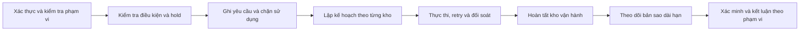

# Secure deletion

## 1. Xóa an toàn là một yêu cầu về dữ liệu và khả năng phục hồi

Secure deletion, hay xóa an toàn, hướng đến việc chấm dứt khả năng tiếp cận hoặc phục hồi dữ liệu mục tiêu theo phạm vi và mức bảo đảm đã xác định. Khi đặc tả, cần nêu rõ ai có thể thử lấy lại dữ liệu, họ có quyền hoặc phương tiện nào và bản sao nào thuộc trách nhiệm của hệ thống.

Một tài khoản biến mất khỏi màn hình chưa chứng minh hồ sơ của tài khoản đó đã bị loại khỏi database, search index, object storage, log và backup. Ngược lại, một quy trình hủy toàn bộ thiết bị lưu trữ không phải cơ chế phù hợp để xóa riêng một khách hàng trong hệ thống nhiều tenant đang hoạt động.

Trong module yêu cầu bảo mật, bài toán cần được chuyển thành các câu hỏi có thể kiểm chứng:

- Dữ liệu nào đủ điều kiện xóa và ai có quyền yêu cầu?
- Khi nào phải ngừng cho phép sử dụng dữ liệu?
- Bản sao nào được xóa trực tiếp, bản sao nào chờ hết retention hoặc cần xử lý bằng khóa?
- Cơ chế nào ngăn dữ liệu xuất hiện lại do retry, replay, đồng bộ hoặc phục hồi?
- Bằng chứng nào đủ để kết luận hoàn tất ở từng mức?

NIST mô tả media sanitization theo khả năng làm cho việc truy cập dữ liệu mục tiêu trở nên không khả thi với một mức nỗ lực đã cho. Có thể tham khảo [NIST SP 800-88 Rev. 2 — Guidelines for Media Sanitization](https://csrc.nist.gov/pubs/sp/800/88/r2/final) khi xây dựng yêu cầu ở tầng phương tiện lưu trữ.

Đặc tả cần liên kết việc xóa ở tầng ứng dụng với vòng đời lưu trữ. Một câu như “xóa vĩnh viễn sau 24 giờ” phải chỉ ra bắt đầu tính từ đâu, xóa ở những nơi nào và “vĩnh viễn” được chứng minh bằng cách nào.

## 2. Phân biệt các trạng thái và mức bảo đảm

| Khái niệm | Ý nghĩa | Điều chưa được chứng minh chỉ bằng thao tác đó |
|---|---|---|
| Chặn truy cập | Dừng cho người dùng hoặc workload sử dụng dữ liệu | Các byte hoặc bản sao có thể vẫn tồn tại |
| Soft delete | Đánh dấu trạng thái đã xóa, thường còn cơ chế khôi phục | Dữ liệu nguồn có thể còn đầy đủ |
| Xóa logic khỏi kho | Loại bản ghi hoặc liên kết qua API của hệ thống lưu trữ | Dữ liệu có thể còn ở phiên bản cũ, vùng trống hoặc backup |
| Media sanitization | Xử lý dữ liệu trên phương tiện lưu trữ theo mức bảo đảm đã chọn | Phải xác định phạm vi phương tiện và kỹ thuật phù hợp |
| Cryptographic erase | Xử lý các khóa liên quan để việc phục hồi plaintext không còn khả thi trong mô hình đã định | Cần chứng minh điều kiện mã hóa, phạm vi khóa và các bản sao khóa |
| Anonymization | Biến đổi dữ liệu nhằm đạt mục tiêu không còn nhận diện trong bối cảnh đánh giá | Kết quả cần được đánh giá riêng; thay tên hoặc ID chưa đủ |

Ở tầng phương tiện lưu trữ, NIST phân biệt **clear**, **purge** và **destroy**: lần lượt hướng đến chống phục hồi đơn giản qua giao diện thông thường; chống phục hồi ở mức kỹ thuật phòng thí nghiệm hiện đại; và làm phương tiện không còn sử dụng được đồng thời bảo vệ dữ liệu mục tiêu. Xem [NIST SP 800-88 Rev. 2, mục 3.1](https://nvlpubs.nist.gov/nistpubs/SpecialPublications/NIST.SP.800-88r2.pdf).

Đây là các mức cần chọn theo loại phương tiện và rủi ro. Không ánh xạ trực tiếp một lệnh SQL hoặc một nút “Delete” sang mức purge hay destroy.

Một API có thể trả “yêu cầu xóa đã được tiếp nhận” ngay khi tạo workflow. Thông điệp đó cần tách với “đã xóa khỏi hệ thống vận hành” và “đã xử lý hết các bản sao trong phạm vi”.

## 3. Lập bản đồ dữ liệu và bản sao

### 3.1. Phạm vi không dừng ở bản ghi chính

Giả sử dịch vụ lưu hồ sơ người dùng và tài liệu đính kèm. Một yêu cầu xóa có thể tác động tới:

| Nơi lưu | Dữ liệu có thể tồn tại | Câu hỏi cần đặc tả |
|---|---|---|
| Database chính | Hồ sơ, quan hệ, bảng phụ | Điều kiện xóa, khóa ngoại và dữ liệu cần giữ riêng là gì? |
| Read replica | Bản sao dữ liệu nguồn | Khi nào thay đổi xóa được áp dụng, xử lý replica bị chậm thế nào? |
| Cache | Giá trị, kết quả truy vấn | Có thể trả dữ liệu cũ hoặc nạp lại từ nguồn cũ không? |
| Search index | Nội dung và đoạn trích | Xóa tài liệu, refresh và rebuild có tuân theo trạng thái xóa không? |
| Object storage | Tệp, thumbnail, preview | Có version, bản sao vùng khác hoặc upload chưa hoàn tất không? |
| Hàng đợi và dead-letter queue | Payload sự kiện, tác vụ thất bại | Replay có tái tạo dữ liệu hoặc giữ payload gốc quá lâu không? |
| Kho phân tích | Bản ETL, materialized view | Có định danh hoặc dấu vết liên kết nào cần xử lý? |
| Export và staging | CSV, PDF, tệp tạm | Ai đang giữ artifact, thời hạn phân phối và dọn tệp là gì? |
| Log và trace | Nội dung request hoặc lỗi | Có chứa dữ liệu cần xóa; retention và quyền truy cập ra sao? |
| Snapshot, backup, archive | Ảnh dữ liệu ở thời điểm trước | Bao lâu bản sao cuối cùng mất hiệu lực giữ; restore xử lý ra sao? |
| Thiết bị hoặc bên nhận | Bản tải xuống, tích hợp đối tác | Hệ thống có quyền và cơ chế xử lý gì, giới hạn trách nhiệm ở đâu? |
| Hệ thống khóa | Khóa trực tiếp, khóa bọc, bản sao khóa | Có đường nào còn cho phép giải mã dữ liệu mục tiêu? |

Danh mục phải gắn với chủ sở hữu và cơ chế xác nhận kết quả. Nếu một hệ thống hạ nguồn chưa được kiểm kê, coordinator không thể kết luận đã xử lý mọi nơi bằng cách chỉ đếm các nơi nó biết.

### 3.2. Định danh phạm vi xóa phải chính xác

Yêu cầu cần phân biệt xóa tài khoản, hồ sơ nghiệp vụ, tài liệu, tenant hoặc một khoảng dữ liệu hết retention. Cùng một người có thể liên quan tới nhiều tenant, còn một bản ghi có thể chứa thông tin của nhiều người.

Không dùng email hiện tại như khóa xóa duy nhất nếu email có thể đổi hoặc được cấp lại. Cần ID và ngữ cảnh đủ ổn định để nhận diện đúng dữ liệu, gồm tenant và phiên bản hoặc thế hệ đối tượng khi cần.

Với dữ liệu tổng hợp hoặc mô hình được xây dựng từ nguồn, dự án cần xác định quan hệ với chủ thể và yêu cầu áp dụng. Không tự hứa rằng xóa một dòng nguồn đã làm mất mọi ảnh hưởng của dòng đó trên mọi dữ liệu dẫn xuất.

## 4. Rủi ro, retention và điều kiện được phép xóa

### 4.1. Mô hình đe dọa

| Rủi ro | Tình huống | Mục tiêu yêu cầu |
|---|---|---|
| R1: vẫn sử dụng được dữ liệu | API, cache hoặc tìm kiếm trả nội dung sau mốc xóa | Ngừng phục vụ theo thời hạn đã định |
| R2: khôi phục từ bản sao | Backup hoặc phiên bản object còn dữ liệu | Xử lý vòng đời bản sao và chặn phục hồi trái trạng thái |
| R3: tái tạo qua sự kiện | Consumer xử lý lại sự kiện tạo hồ sơ cũ | Áp dụng trạng thái xóa và quy tắc thứ tự |
| R4: mất dữ liệu ngoài phạm vi | Job xóa sai tenant hoặc dùng khóa dùng chung | Kiểm tra quyền và cô lập phạm vi tác động |
| R5: mất dấu một phần thất bại | Một hệ thống hạ nguồn timeout nhưng job báo xong | Trạng thái theo từng đích và retry có kiểm soát |
| R6: lấy lại từ phương tiện | Người có thiết bị hoặc quyền lưu trữ phục hồi dữ liệu dư | Phương pháp sanitization phù hợp mô hình |
| R7: còn đường giải mã | Khóa ở cache, backup hoặc dạng bọc khác vẫn còn dùng được | Bao phủ mọi đường khôi phục khóa trong phạm vi |
| R8: bằng chứng tự tạo bản sao | Log xóa ghi nguyên dữ liệu bị xóa | Tối thiểu hóa dữ liệu audit và quản lý retention |

### 4.2. Retention và ngoại lệ phải được giải quyết trước

Dự án có thể có quy tắc giữ dữ liệu theo nghiệp vụ, hợp đồng hoặc nghĩa vụ áp dụng. Nếu một phần dữ liệu đang có hold được quản lý, workflow cần xác định ai quyết định, phần nào bị giữ, đến khi nào và hạn chế sử dụng trong thời gian đó.

Một hold không được tự động giữ tất cả dữ liệu không liên quan. Ngược lại, worker xóa không được tự bỏ hold để đạt chỉ tiêu thời gian. Trạng thái phải phản ánh phần bị trì hoãn cùng lý do và thời hạn đánh giá lại.

Cần phân biệt:

- Thời gian chờ người dùng đổi ý nếu sản phẩm có hỗ trợ.
- Thời điểm yêu cầu đủ điều kiện thực thi.
- Mốc ngừng truy cập.
- Mốc xử lý kho vận hành.
- Mốc xử lý hết bản sao dài hạn trong phạm vi.

Nếu sản phẩm cho phép khôi phục trong bảy ngày, giai đoạn đó cần được gọi đúng là chờ hoặc soft delete. Không mô tả dữ liệu đã bị xóa không thể phục hồi ngay từ lúc bắt đầu chờ.

## 5. Workflow xóa trong hệ thống phân tán

### 5.1. Từ yêu cầu đến kế hoạch thực thi

Một luồng minh họa:



Cần lưu đủ trạng thái để tiếp tục sau khi coordinator hoặc worker bị dừng. Một thiết kế có thể dùng outbox để gắn việc ghi yêu cầu với sự kiện cần phát, kết hợp các tác vụ có khả năng chạy lại an toàn. Lựa chọn cụ thể phải phù hợp bảo đảm giao dịch của hệ thống.

Worker phải xác thực tác vụ, kiểm tra tenant và mục tiêu từ nguồn đáng tin. Việc một message có trường `approved: true` không tự chứng minh người gửi có quyền yêu cầu xóa.

### 5.2. Idempotency và kết quả không xác định

Một lần gọi xóa có thể thành công ở phía lưu trữ nhưng timeout trước khi worker nhận phản hồi. Gọi lại phải không mở rộng phạm vi hoặc làm mất dữ liệu mới xuất hiện hợp lệ sau đó.

Mã giả mô tả yêu cầu, không phải chương trình vận hành:

```text
handleDeletionTask(task):
    authenticateTaskSource(task)
    verifyTenantAndTargetGeneration(task)
    verifyCurrentDeletionEligibility(task)

    if taskResultAlreadyVerified(task.id):
        return recordedResult

    applyApprovedDeletionAction(task.target)
    verifyResultForThisStore(task.target)
    recordResultWithoutRawPayload(task.id)
```

Trạng thái “không tìm thấy” có thể là kết quả hợp lệ của một tác vụ chạy lại. Tuy nhiên, nó cũng có thể do sai ID, sai vùng hoặc thiếu quyền liệt kê. Điều kiện xác nhận thành công phải xét contract của API và phạm vi đích.

Nếu một đích thất bại, coordinator cần giữ trạng thái chưa hoàn tất, lịch retry và cảnh báo theo thời hạn. Không đổi toàn yêu cầu thành hoàn tất chỉ vì message đã được đưa vào hàng đợi.

### 5.3. Ngăn tái tạo bởi luồng ghi hoặc replay

Sau khi xóa nguồn, một consumer có thể xử lý message cũ và ghi lại hồ sơ. Vì vậy, workflow cần một cơ chế chặn ghi lại hoặc nhận biết yêu cầu xóa đối với đúng thế hệ dữ liệu.

Có thể dùng deletion ledger, tombstone, phiên bản đối tượng hoặc watermark theo thiết kế. Dữ liệu này phải tồn tại đủ lâu để bao phủ các nguồn phục hồi và replay còn khả dụng, đồng thời có policy riêng để tránh giữ định danh không cần thiết vô thời hạn.

Tombstone chỉ giúp giữ trạng thái và thứ tự. Nó không tự xóa payload trong queue, backup hoặc kho lưu khác.

Nếu người dùng được tạo tài khoản mới sau khi tài khoản cũ đã bị xóa, thế hệ đối tượng cần được phân biệt. Một tác vụ xóa cũ không được vô tình xóa dữ liệu hợp lệ của tài khoản mới dùng lại cùng địa chỉ email.

## 6. Xóa tại database, object storage và các bản dẫn xuất

### 6.1. Database: kết quả truy vấn khác với dữ liệu còn trên lưu trữ

Một lệnh `DELETE` thành công có thể chứng minh các dòng mục tiêu đã được xử lý theo giao dịch. Nó không tự chứng minh mọi phiên bản cũ, log phục hồi hoặc snapshot đã mất dữ liệu.

Ví dụ, PostgreSQL mô tả `UPDATE` và `DELETE` không lập tức loại bỏ phiên bản cũ của dòng do MVCC; `VACUUM` phục vụ thu hồi không gian cho tái sử dụng. Xem [PostgreSQL — Routine Vacuuming, Recovering Disk Space](https://www.postgresql.org/docs/current/routine-vacuuming.html#VACUUM-FOR-SPACE-RECOVERY).

Không dùng kết quả dọn không gian làm chứng nhận xóa an toàn toàn bộ dữ liệu. Yêu cầu cần xét cả replica, transaction log, snapshot và phương tiện bên dưới theo trách nhiệm của dự án.

### 6.2. Object storage: phiên bản là một phần của phạm vi

Một API trả không tìm thấy object hiện tại vẫn có thể còn phiên bản cũ. Với Amazon S3 có versioning, lệnh xóa đơn giản tạo delete marker; phiên bản trước còn tồn tại và cần được xử lý theo cơ chế xóa phiên bản. Xem [Amazon S3 — Deleting object versions](https://docs.aws.amazon.com/AmazonS3/latest/userguide/DeletingObjectVersions.html).

Đặc tả cho object storage cần bao phủ version, replica, thumbnail, preview, artifact xuất ra và dữ liệu upload chưa hoàn tất nếu có. Các đặc điểm của S3 là ví dụ; hệ thống thực tế phải đối chiếu contract của dịch vụ được sử dụng.

Nếu retention lock hoặc hold ngăn xóa phiên bản, workflow phải ghi nhận trạng thái chờ phù hợp. Không biến một phản hồi từ chối xóa thành thành công.

### 6.3. Cache, tìm kiếm và kho phân tích

Xóa cache cần ngăn việc nạp lại từ replica hoặc kết quả truy vấn cũ. Search index cần xử lý tài liệu, đoạn trích và luồng rebuild. Kho phân tích cần có khóa liên kết hoặc quy tắc khác đủ để xác định đúng dữ liệu thuộc phạm vi.

Cần chọn bằng chứng cho từng đích: dữ liệu thử không còn được đọc qua các đường đã định, kết quả đối soát đúng phạm vi và trạng thái xử lý của kho. Việc chỉ kiểm tra API chính bỏ qua các đường truy cập khác mà dự án vẫn chịu trách nhiệm.

## 7. Phương tiện lưu trữ và mức bảo đảm phù hợp

### 7.1. Kỹ thuật phải phù hợp loại phương tiện

Yêu cầu sanitization phải xét loại thiết bị, cách dữ liệu được ghi, khả năng của công cụ và mức rủi ro khi phương tiện được tái sử dụng hoặc chuyển giao.

Ghi đè một tệp qua filesystem không nhất thiết ghi lên mọi vị trí từng chứa dữ liệu. Cơ chế copy-on-write, snapshot hoặc quản lý khối bên dưới có thể giữ bản cũ. Với flash và SSD, các vùng dự phòng và wear leveling làm cho việc ghi thông thường không bao phủ được mọi vị trí lịch sử.

Do đó, không đặt một số lượt ghi đè chung cho mọi thiết bị như bằng chứng đủ của secure deletion. Cần kỹ thuật được chấp nhận cho loại phương tiện và điều kiện sử dụng cụ thể; đối chiếu tài liệu kỹ thuật của thiết bị và chính sách tổ chức.

### 7.2. Cloud và dịch vụ được quản lý

Trong dịch vụ cloud, bên thuê thường không trực tiếp điều khiển từng thiết bị vật lý. Yêu cầu cần phân chia trách nhiệm:

- Ứng dụng xác định và xử lý dữ liệu logic, bản sao, quyền truy cập và vòng đời khóa mà mình quản lý.
- Dịch vụ lưu trữ cung cấp cơ chế xóa, retention, phiên bản và bảo đảm theo contract.
- Đơn vị quản lý phương tiện chịu trách nhiệm sanitization hoặc tiêu hủy vật lý trong phạm vi được giao.

Bằng chứng ở tầng ứng dụng có thể là kết quả API và đối soát inventory. Bằng chứng ở tầng phương tiện có thể là hồ sơ sanitization của đơn vị chịu trách nhiệm. Hai loại bằng chứng cần được liên kết với phạm vi cam kết, không thay thế nhau bằng một thông báo “delete succeeded”.

### 7.3. Tái sử dụng hoặc loại bỏ thiết bị

Một quy trình cần nhận diện đúng tài sản, chủ thể đang giữ, kỹ thuật được áp dụng, kết quả và điểm chuyển giao. Thiết bị lỗi không thực hiện được kỹ thuật đã chọn cần được xử lý theo nhánh khác phù hợp rủi ro.

Không bàn giao thiết bị ra khỏi ranh giới kiểm soát chỉ vì job xóa đã được lên lịch. Điều kiện chuyển giao phải dựa trên kết quả đã được xác minh và quyết định chấp nhận phù hợp.

## 8. Cryptographic erase: phạm vi khóa quyết định phạm vi xóa

### 8.1. Điều kiện cần được đặc tả

Ý tưởng của cryptographic erase là làm mất khả năng giải mã dữ liệu mục tiêu thông qua xử lý khóa. Để sử dụng làm cơ sở kết luận, dự án cần xác định:

- Dữ liệu mục tiêu đã được mã hóa trước khi ghi vào những nơi nào.
- Có bản plaintext, bản xuất, tệp tạm hoặc khóa nằm ngoài phạm vi xử lý không.
- Khóa nào trực tiếp mã hóa dữ liệu, khóa nào bọc hoặc cho phép khôi phục khóa đó.
- Các bản sao, phiên bản, bản cache và bản backup khóa được xử lý ra sao.
- Bằng chứng nào cho thấy không còn đường khôi phục khóa trong mô hình đã định.

Không thể dùng việc xóa khóa để xử lý một bản plaintext từng được gửi ra ngoài phạm vi kiểm soát. Tương tự, đổi khóa hiện hành chưa chứng minh dữ liệu cũ không còn giải mã được nếu phiên bản khóa cũ vẫn được giữ để đọc backup.

### 8.2. Envelope encryption và khóa dùng chung

Mô hình minh họa:

```text
Khóa bọc K
    ├── bản DEK-A đã được bọc → dữ liệu A
    └── bản DEK-B đã được bọc → dữ liệu B

DEK: khóa mã hóa dữ liệu
K: khóa dùng để bọc các DEK trong ví dụ
```

Nếu chỉ xóa bản DEK-A trong database hiện tại nhưng backup vẫn có bản DEK-A được bọc dưới K, việc giữ K có thể cho phép khôi phục khả năng giải mã dữ liệu A.

Nếu phá hủy K dùng chung, dữ liệu B có thể mất khả năng giải mã ngoài phạm vi yêu cầu. Vì vậy, mức phân chia khóa phải phù hợp đơn vị cần xóa và các yêu cầu phục hồi còn lại.

Một thiết kế có thể dùng ranh giới khóa riêng cho đối tượng hoặc nhóm dữ liệu cần xóa. Tuy nhiên, dự án vẫn phải kiểm tra mọi đường khôi phục, phạm vi ảnh hưởng và chi phí vận hành. Chỉ thêm một khóa vào sơ đồ không tự đáp ứng điều kiện cryptographic erase.

### 8.3. Vô hiệu hóa, lên lịch xóa và hủy khóa là các trạng thái khác nhau

Một khóa bị vô hiệu hóa có thể được bật lại theo quyền quản trị. Một khóa được lên lịch xóa có thể còn trong giai đoạn chờ hoặc có khả năng hủy lịch theo dịch vụ. Workflow phải phản ánh trạng thái thực tế.

Ví dụ, AWS KMS phân biệt việc disable, schedule deletion và khóa thực sự bị xóa; schedule deletion có thời gian chờ bắt buộc. Dịch vụ cũng lưu ý tác động đến data key đã được lấy ra có thể khác với trạng thái khóa trong KMS. Xem [AWS KMS — Delete an AWS KMS key](https://docs.aws.amazon.com/kms/latest/developerguide/deleting-keys.html).

Điều này có nghĩa yêu cầu “không giải mã được qua API KMS hiện tại” cần tách với “không thể khôi phục khóa”. Nếu tiến trình còn giữ plaintext DEK trong bộ nhớ hoặc một thành phần có bản sao khác, việc đổi trạng thái KMS chưa xử lý hết đường giải mã.

Dự án không nên tuyên bố cryptographic erase hoàn tất chỉ vì một lời gọi API đã được chấp nhận. Cần trạng thái cuối, kiểm tra phạm vi khóa và bằng chứng cho các điều kiện đã chọn.

## 9. Backup, retention và ngăn dữ liệu xuất hiện trở lại

### 9.1. Bản sao bất biến cần một chính sách có thể thực hiện

Một backup có thể không hỗ trợ xóa riêng một hồ sơ hoặc đang có cơ chế bất biến. Khi đó, yêu cầu cần nêu rõ thời hạn giữ, giới hạn truy cập, trường hợp được phục hồi và cách áp dụng yêu cầu xóa sau phục hồi.

Không hứa xóa ngay từng bản ghi khỏi mọi backup nếu kiến trúc không làm được. Có thể chọn vòng đời hết hạn có kiểm soát hoặc một thiết kế mã hóa phù hợp, nhưng phải ghi rõ mức bảo đảm và thời điểm đạt được.

Cần kiểm kê backup đầy đủ, incremental, archive log, snapshot, bản sao vùng khác và các bản sao phục vụ kiểm thử phục hồi. Một bản sao mới của backup cũ không được âm thầm làm kéo dài thời hạn tồn tại ngoài contract.

### 9.2. Phục hồi trong vùng cách ly rồi đối soát

Tình huống giả lập:

```text
09:00  backup có hồ sơ P
09:15  yêu cầu xóa P đủ điều kiện và được tiếp nhận
10:00  P được xử lý ở kho vận hành
11:00  hệ thống cần phục hồi backup lúc 09:00
```

Quy trình cần giữ môi trường phục hồi chưa mở phục vụ người dùng. Trước khi cho đọc, phải áp dụng các yêu cầu xóa phát sinh sau snapshot và kiểm tra các bản dẫn xuất sẽ được dựng lại.

Deletion ledger hoặc nguồn quyết định tương đương cần được bảo vệ, có khả năng phục hồi đủ mới và đủ phạm vi. Nếu chính ledger bị restore về trước yêu cầu xóa, hệ thống có thể mất thông tin để đối soát.

Một nguyên tắc cho luồng minh họa là:

```text
restore snapshot trong vùng cách ly
    → xác minh nguồn quyết định xóa
    → áp dụng các yêu cầu còn hiệu lực đến watermark đã chọn
    → xử lý replay và các chỉ mục được tái tạo
    → xác minh kết quả
    → cho phép phục vụ
```

Nếu không chứng minh nguồn quyết định đủ mới, phải giữ trạng thái chưa phục vụ theo policy. Không mở truy cập trước rồi hẹn một job dọn dữ liệu sau.

### 9.3. Retention phải tính từ vòng đời bản sao cuối

Giả sử xóa kho vận hành mất tối đa một ngày. Trong thời gian đó có thể còn snapshot mới chứa dữ liệu. Nếu snapshot tồn tại tối đa 30 ngày và việc xử lý hết hạn mất thêm tối đa một ngày, giới hạn tổng tính từ lúc yêu cầu đủ điều kiện có thể lên đến:

```text
1 ngày xử lý kho vận hành
+ 30 ngày tồn tại tối đa của snapshot cuối còn chứa dữ liệu
+ 1 ngày xử lý hết hạn
= 32 ngày
```

Đây là phép tính của ví dụ. Nó chỉ đúng khi không có bản sao, archive, bản phục hồi hoặc quá trình sao chép nào kéo dài chuỗi lưu giữ hơn các giả định.

Đặc tả phải làm rõ mốc tính. “Backup giữ 30 ngày” không tự đồng nghĩa dữ liệu bị yêu cầu xóa sẽ biến mất trong 30 ngày kể từ lúc tiếp nhận yêu cầu.

## 10. Ví dụ yêu cầu đo được và liên kết với rủi ro

### 10.1. Bối cảnh và giả định

Giả sử dịch vụ quản lý tài liệu nhiều tenant có database, cache, search index, object storage có version và backup. Log ứng dụng không được chứa payload tài liệu. Một tập dữ liệu không có hold được áp dụng quy trình xóa minh họa sau:

- t0 là thời điểm yêu cầu đã được xác thực, đủ điều kiện và ghi bền vững.
- Request đọc mới qua các kênh phục vụ do hệ thống kiểm soát bị từ chối từ t0 + 60 giây.
- Database, cache, search index và các phiên bản object thuộc phạm vi được xử lý trong tối đa 24 giờ từ t0.
- Chuỗi backup có thời hạn như phép tính mục 9.3; xử lý các bản sao còn chứa dữ liệu trong tối đa 32 ngày từ t0.
- Tác vụ lỗi hoặc quá hạn phải có cảnh báo trong tối đa 15 phút kể từ khi được phát hiện hoặc vượt hạn.
- Audit yêu cầu xóa giữ 90 ngày; chỉ giữ metadata được phê duyệt, không giữ nội dung đã xóa.
- Ledger phục vụ chống tái tạo được giữ đủ để bao phủ mọi nguồn restore và replay còn hợp lệ, theo thời hạn đã được thiết kế riêng.

**Các thời hạn này là giả định của bài, không phải yêu cầu mặc định từ NIST hay quy định pháp lý chung.** Trước khi cam kết, dự án phải xác nhận khả năng của hệ thống lưu trữ, dịch vụ bên ngoài và chính sách retention thực tế.

Yêu cầu 60 giây áp dụng cho request mới. Nếu cần dừng stream đang truyền hoặc tác vụ đã đọc dữ liệu, phải bổ sung yêu cầu riêng về điểm kiểm tra lại và giới hạn đối với phần dữ liệu đã được gửi.

### 10.2. Ma trận yêu cầu và bằng chứng nghiệm thu

| Mã | Rủi ro | Yêu cầu cụ thể | Bằng chứng nghiệm thu |
|---|---|---|---|
| SD-01 | R4 | Xác thực người yêu cầu và quyền xóa trên đúng tenant, đối tượng, thế hệ dữ liệu | Đổi tenant hoặc ID sang đối tượng ngoài quyền bị từ chối; không phát sinh tác vụ xóa cho đối tượng đó |
| SD-02 | R4 | Kiểm tra retention và hold; phần chưa đủ điều kiện có trạng thái và lý do riêng | Tập thử có hold chỉ trì hoãn đúng phạm vi; worker không tự bỏ hold hoặc báo hoàn tất toàn bộ |
| SD-03 | R1 | Chặn request đọc mới từ t0 + 60 giây trên mọi đường phục vụ thuộc contract | Kiểm tra API, tìm kiếm, cache và đường tải; node chưa xác minh trạng thái đủ mới không được trả dữ liệu cũ quá hạn |
| SD-04 | R1, R5 | Xử lý kho vận hành trong 24 giờ và lưu kết quả từng đích | Đối soát các bản ghi, chỉ mục, cache và object đã biết; đích timeout làm yêu cầu còn chưa hoàn tất |
| SD-05 | R2 | Xử lý các version, bản dẫn xuất và replica object thuộc phạm vi | Dữ liệu thử có nhiều version và preview không đọc lại được qua các đường đã định; chỉ có delete marker chưa được tính đủ |
| SD-06 | R3 | Retry hoặc replay cũ không tái tạo dữ liệu đã xóa hoặc xóa nhầm thế hệ mới | Thử duplicate message, message trễ và tài khoản mới dùng lại email; trạng thái từng thế hệ được giữ đúng |
| SD-07 | R2 | Bao phủ backup trong 32 ngày theo giả định; còn bản sao chờ thì chưa kết luận hoàn tất toàn phạm vi | Inventory và lịch hết hạn khớp; bản sao phục hồi phục vụ kiểm thử cũng được theo dõi, không tự gia hạn dữ liệu |
| SD-08 | R2, R3 | Restore phải đối soát nguồn quyết định xóa trước khi cho phục vụ | Phục hồi snapshot trước t0 trong môi trường thử; dữ liệu mục tiêu không xuất hiện lại sau bước mở phục vụ |
| SD-09 | R4, R7 | Khi chọn cryptographic erase, xác minh phạm vi khóa và mọi đường khôi phục liên quan | Không giải mã được theo các đường trong thiết kế; bản sao khóa, dạng bọc và cache được đối soát; dữ liệu ngoài phạm vi vẫn dùng được |
| SD-10 | R5 | Có retry, trạng thái lỗi và cảnh báo trong giới hạn 15 phút đã định | Mô phỏng đích bị lỗi và tác vụ quá hạn; có cảnh báo, không có kết luận hoàn tất sai |
| SD-11 | R8 | Audit không chứa nội dung nguồn; retention và quyền đọc riêng | Kiểm tra đường thành công và lỗi với dữ liệu thử; chỉ metadata được phê duyệt được giữ trong thời hạn quy định |
| SD-12 | R6 | Trước chuyển giao phương tiện, có kết quả sanitization và quyết định chấp nhận phù hợp | Hồ sơ liên kết đúng tài sản, kỹ thuật, kết quả, người chịu trách nhiệm và trạng thái bàn giao |

Các yêu cầu liên quan cryptographic erase hoặc phương tiện chỉ áp dụng khi chúng nằm trong thiết kế và trách nhiệm dự án. Không coi việc áp dụng một phương pháp là lý do bỏ qua các bản sao không được phương pháp đó bảo vệ.

### 10.3. Tiêu chí chấp nhận cho phục hồi

```gherkin
Given snapshot B duoc tao truoc yeu cau xoa D
And D da duoc ghi ben vung tai t0 va con hieu luc
When B duoc phuc hoi trong vung cach ly
Then du lieu thuoc D duoc xu ly truoc khi mo phuc vu
And chi muc duoc dung lai khong lam xuat hien du lieu thuoc D
And neu khong xac minh duoc ledger du moi thi chua cho phuc vu
```

### 10.4. Tiêu chí chấp nhận cho thất bại một phần

```gherkin
Given yeu cau D gom database, search va object storage
When database va search xac minh da xu ly
And object storage tra loi loi tam thoi
Then D chua co trang thai hoan tat toan pham vi
And tac vu object storage duoc thu lai theo policy
And D van bi chan su dung du lieu theo moc thoi gian da dinh
And retry khong lam thay doi du lieu cua tenant khac
```

Đây là tiêu chí để xây dựng kiểm thử dự án. Chúng không phải thông báo rằng một hệ thống thực tế đã vượt qua các kiểm tra.

## 11. Xác minh, bằng chứng và trạng thái hoàn tất

### 11.1. Chọn bằng chứng theo mức cam kết

Kiểm tra không tìm thấy hồ sơ qua API là bằng chứng cho đường truy cập được kiểm tra. Nó chưa chứng minh dữ liệu không còn trên phương tiện hoặc trong một backup chưa được xem xét.

Một kế hoạch có thể gồm:

- Dữ liệu thử nhận biết được trong từng đích thuộc inventory.
- Kiểm tra quyền xóa và phạm vi dữ liệu trước thực thi.
- Đối soát số mục tiêu và kết quả từng bước.
- Quan sát retry, replica chậm, đích offline và replay.
- Diễn tập restore từ snapshot trước yêu cầu xóa.
- Đánh giá điều kiện khóa nếu dùng cryptographic erase.
- Hồ sơ phương tiện nếu có sanitization hoặc chuyển giao thiết bị.

Đối với phương tiện, cần kiểm tra kết quả công cụ và xem xét kỹ thuật có phù hợp dữ liệu, thiết bị và mức bảo đảm hay không. Một công cụ báo thành công chưa đủ nếu chọn sai phạm vi. Tham khảo cách phân biệt verification và validation trong [NIST SP 800-88 Rev. 2, mục 4.5](https://nvlpubs.nist.gov/nistpubs/SpecialPublications/NIST.SP.800-88r2.pdf).

### 11.2. Hồ sơ kết quả không tạo thêm dữ liệu cần xóa

Một báo cáo trạng thái minh họa:

```json
{
  "requestId": "deletion-example-17",
  "scopeRef": "scope-example-a",
  "policyVersion": "deletion-policy-example-3",
  "accessSuppressed": true,
  "operationalStores": "VERIFIED",
  "backupScope": "PENDING_EXPIRY",
  "overallStatus": "PENDING",
  "evidenceRef": "evidence-example-83"
}
```

Các giá trị là dữ liệu giả lập. Trong hệ thống thật, reference và metadata cũng cần phân loại, giới hạn quyền và retention.

Không ghi toàn bộ hồ sơ trước khi xóa vào audit để chứng minh job đã chạy. Hash email cũng không tự trở thành dữ liệu không thể liên kết; chỉ giữ định danh đối soát thực sự cần cho mục đích đã duyệt.

### 11.3. Hoàn tất phải đúng với phạm vi đã cam kết

Có thể cần những trạng thái riêng như đã chặn truy cập, đã xử lý kho vận hành, đang chờ backup hết hạn, bị giữ lại theo policy, đang lỗi hoặc đã xác minh toàn phạm vi.

Nếu còn bản sao được giữ hợp lệ theo ngoại lệ, báo cáo phải nêu giới hạn và chủ thể chịu trách nhiệm. Không gộp “đã gửi yêu cầu cho đối tác” thành “đối tác đã xác minh xóa” khi chưa có bằng chứng theo contract.

## 12. Những câu đặc tả cần viết rõ hơn

| Câu còn mơ hồ | Điều cần bổ sung |
|---|---|
| “Xóa vĩnh viễn” | Dữ liệu, bản sao, chủ thể có thể phục hồi, mức bảo đảm và bằng chứng |
| “Chạy DELETE là xong” | Phiên bản cũ, log phục hồi, replica, cache, chỉ mục và backup |
| “Ghi đè nhiều lần” | Loại phương tiện, lớp trừu tượng lưu trữ và kỹ thuật phù hợp |
| “Xóa object” | Phiên bản, bản dẫn xuất, replication, hold và upload chưa hoàn tất |
| “Hủy khóa để xóa” | Khóa nào, phạm vi ảnh hưởng, bản sao khóa, đường giải mã và trạng thái cuối |
| “Backup giữ 30 ngày” | Mốc tính, snapshot cuối có dữ liệu, bản sao phụ, thời gian hết hạn và kiểm soát restore |
| “Job đã thành công” | Thành công từng đích, đích còn chờ, bằng chứng xác minh và điều kiện kết luận toàn phạm vi |
| “Lưu audit đầy đủ” | Metadata cần giữ, dữ liệu bị cấm ghi, quyền truy cập và retention riêng |

Yêu cầu secure deletion cần nối được **điều kiện xóa → phạm vi dữ liệu và bản sao → phương pháp → thời hạn → ngăn tái tạo → bằng chứng → trạng thái hoàn tất**. Khi chuỗi này rõ ràng, nhóm phát triển mới có thể kiểm chứng điều hệ thống thực sự đã xóa và phần trách nhiệm còn phải theo dõi.
