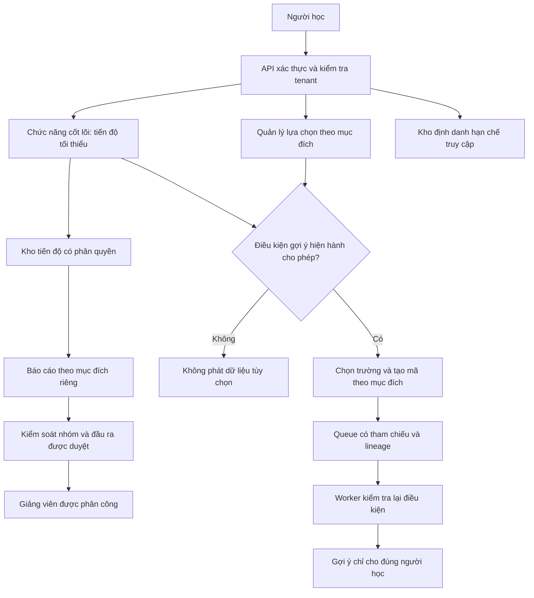

# Privacy by design — Thiết kế quyền riêng tư ngay từ đầu

## 1. Mục tiêu và phạm vi

Privacy by design là cách đưa mục tiêu riêng tư vào quyết định sản phẩm, quy trình nghiệp vụ, kiến trúc và vận hành từ lúc hình thành ý tưởng. Một hệ thống đáp ứng cách tiếp cận này phải có khả năng giải thích vì sao xử lý dữ liệu, giới hạn việc xử lý theo thiết kế và tạo được bằng chứng rằng các giới hạn đang có hiệu lực.

Trong chương **Privacy requirement** của module `SECURITY_SECURITY_DESIGN_SECURITY_REQUIREMENTS`, bài học tập trung chuyển mục tiêu an toàn thông tin và mô hình đe dọa thành yêu cầu bảo mật, riêng tư cụ thể, đo được và có thể kiểm chứng. Người học sẽ thực hành:

- Phân biệt mục tiêu riêng tư, kiểm soát bảo mật và mặc định bảo vệ dữ liệu.
- Xác định rủi ro đối với con người từ cả việc lạm dụng và hoạt động xử lý đúng chức năng.
- Đặc tả dữ liệu, mục đích, quyền, lựa chọn, logging, lưu giữ và phục hồi.
- Đặt điểm thực thi vào luồng dữ liệu thay vì chỉ mô tả ý định trong tài liệu.
- Truy vết từ rủi ro tới yêu cầu, kiến trúc, tiêu chí kiểm thử và bằng chứng vận hành.

Các mã yêu cầu, thời hạn và ngưỡng trong bài thuộc **một thiết kế giả định phục vụ học tập**. Căn cứ cho phép xử lý, nghĩa vụ theo bối cảnh và yêu cầu lưu giữ phải được xác định trong hồ sơ áp dụng của tổ chức; bài không mặc định mọi hoạt động đều dựa trên consent.

## 2. Hiểu đúng đối tượng cần thiết kế

### 2.1. Riêng tư bao gồm cách hệ thống sử dụng dữ liệu

Bảo mật hỗ trợ bảo vệ dữ liệu trước truy cập, thay đổi hoặc gián đoạn trái phép. Câu hỏi riêng tư còn bao gồm: có cần thu thập dữ liệu đó không, việc sử dụng có phù hợp với bối cảnh không, người bị tác động hiểu và thực hiện được lựa chọn nào?

Ví dụ, một báo cáo gửi đúng cho quản lý đã được xác thực vẫn có thể gây hại nếu nó suy đoán sức khỏe hoặc năng lực nhân viên từ chủ đề khóa học mà họ xem. Không cần có tài khoản bị chiếm hay dữ liệu bị đánh cắp để xuất hiện rủi ro riêng tư.

NIST mô tả rủi ro riêng tư có thể phát sinh từ hoạt động xử lý bình thường, kể cả khi không xảy ra sự cố an ninh mạng. [NIST SP 1800-29B, mục 3.4](https://www.nccoe.nist.gov/publication/1800-29/VolB/index.html#privacy-considerations).

Vì vậy, mô hình đe dọa cần xét cả người tấn công, nhân viên lạm quyền, cấu hình sai và tính năng được thiết kế quá rộng.

### 2.2. Privacy by design và privacy by default

| Khía cạnh | Câu hỏi cần trả lời | Ví dụ trong thiết kế |
| --- | --- | --- |
| Privacy by design | Toàn bộ sản phẩm và vòng đời dữ liệu bảo vệ riêng tư thế nào? | Tách kho định danh, giới hạn dữ liệu phân tích, thiết kế xóa và kiểm chứng phục hồi |
| Privacy by default | Nếu người dùng không làm gì, dữ liệu được xử lý và chia sẻ ở mức nào? | Hồ sơ không công khai; gợi ý tùy chọn chưa bật; thiếu trạng thái lựa chọn thì không kích hoạt |
| Security by design | Hệ thống bảo vệ tính bí mật, toàn vẹn và khả dụng thế nào? | Phân quyền đối tượng, xác thực workload, mã hóa và kiểm soát đặc quyền |
| Hồ sơ tuân thủ áp dụng | Tổ chức phải đáp ứng điều kiện và nghĩa vụ nào trong bối cảnh cụ thể? | Xác định mục đích, căn cứ, trách nhiệm, thời hạn và bằng chứng tương ứng |

Mặc định là một phần của thiết kế tổng thể. Một nút tắt trên giao diện chưa đủ nếu backend mặc định vẫn phát sự kiện sang pipeline hoặc SDK đã gửi dữ liệu trước khi người dùng chọn.

Một hồ sơ pháp lý cũng chưa chứng minh runtime đang thực hiện đúng. Yêu cầu cần nối được lời cam kết với hành vi quan sát được và người chịu trách nhiệm.

## 3. Bảy nguyên tắc nền tảng và cách sử dụng

Khung Privacy by Design được trình bày với bảy nguyên tắc nền tảng. Bảng dưới diễn giải ngắn gọn theo hướng thiết kế, không phải danh sách chứng nhận. [Information and Privacy Commissioner of Ontario: Privacy by Design](https://www.ipc.on.ca/sites/default/files/legacy/2018/01/pbd.pdf).

| Nguyên tắc | Ý nghĩa |
| --- | --- |
| Chủ động phòng ngừa | Nhận diện rủi ro trước khi xảy ra thiệt hại |
| Riêng tư ở trạng thái mặc định | Người dùng không phải tự sửa mặc định bất lợi |
| Tích hợp vào thiết kế | Đưa bảo vệ dữ liệu vào cấu trúc sản phẩm |
| Cùng đạt mục tiêu chính đáng | Tìm phương án đáp ứng chức năng và riêng tư |
| Bảo vệ suốt vòng đời | Bao phủ thu thập, sử dụng, lưu giữ và kết thúc |
| Minh bạch và kiểm chứng | Có thể đối chiếu thực tế với cam kết |
| Tôn trọng người dùng | Thông tin rõ, lựa chọn dễ hiểu và thực hiện được |

Để áp dụng, nhóm cần chuyển mỗi nguyên tắc thành một câu hỏi có đầu ra cụ thể. Ví dụ, với sản phẩm học tập trong bài:

- Trước khi thêm sự kiện, ai xác nhận rằng không thể đạt mục tiêu bằng dữ liệu ít chi tiết hơn?
- Tài khoản được tạo qua giao diện, API, nhập hàng loạt và migration có cùng mặc định không?
- Nếu bỏ email khỏi kho phân tích, báo cáo hoàn thành khóa học còn đáp ứng mục tiêu không?
- Có thể phát hiện một SDK mới bắt đầu gửi dữ liệu ngoài danh sách không?
- Khi khôi phục backup, hệ thống lấy trạng thái lựa chọn hiện hành từ đâu?

Tìm phương án cùng đạt mục tiêu không có nghĩa mọi đánh đổi tự biến mất. Nếu phương án còn rủi ro, phải ghi rõ lợi ích, tác động, biện pháp, người quyết định và điều kiện xem xét lại.

## 4. Chuyển nguyên tắc thành mục tiêu kỹ thuật

Có thể dùng ba mục tiêu kỹ thuật để kiểm tra độ cụ thể của thiết kế:

| Mục tiêu | Câu hỏi thiết kế |
| --- | --- |
| Predictability — khả năng dự đoán | Người dùng và người vận hành có hiểu đáng tin cậy hệ thống sẽ làm gì với dữ liệu không? |
| Manageability — khả năng quản lý | Có thể quản lý chi tiết việc thu thập, sửa, xóa và tiết lộ dữ liệu không? |
| Disassociability — giảm liên kết định danh | Có thể xử lý mà không gắn với cá nhân hoặc thiết bị vượt nhu cầu vận hành không? |

Các mục tiêu này được giới thiệu trong privacy engineering của NIST. [NIST SP 1800-29B: privacy engineering objectives](https://www.nccoe.nist.gov/publication/1800-29/VolB/index.html#privacy-considerations).

Áp dụng vào ví dụ:

| Mục tiêu | Quyết định minh họa | Bằng chứng cần có |
| --- | --- | --- |
| Dự đoán | Thông báo rằng gợi ý tùy chọn dùng trạng thái hoàn thành, không dùng nội dung phiếu hỗ trợ | Nội dung thông báo khớp schema và payload thực tế |
| Quản lý | Có trạng thái lựa chọn theo mục đích và phiên bản; tác vụ nền kiểm tra lại trước xử lý | Test rút lựa chọn với job đã xếp hàng |
| Giảm liên kết | Pipeline gợi ý dùng mã riêng theo mục đích, không có quyền đọc bảng email | Kiểm thử quyền service và trường dữ liệu |

Giảm liên kết không đồng nghĩa vô danh hoàn toàn. Cần xem xét dữ liệu còn lại, khả năng nối nguồn, người có khóa ánh xạ và đầu ra suy luận.

## 5. Tình huống xuyên suốt: nền tảng học tập nhiều tenant

Nền tảng có tài khoản người học, tiến độ khóa học và báo cáo cho giảng viên được phân công. Nhóm sản phẩm muốn bổ sung:

1. Gợi ý khóa học dựa trên tiến độ.
2. Chia sẻ thành tích cho bạn học.
3. Báo cáo xu hướng hoàn thành theo lớp.

Mỗi tổ chức sử dụng là một `tenant`. Trong thiết kế giả định:

- Chức năng cốt lõi lưu tiến độ cần thiết để người học tiếp tục khóa học.
- Giảng viên chỉ xem phạm vi lớp và tập trường đã được phê duyệt cho vai trò của mình.
- Gợi ý cá nhân và chia sẻ thành tích là chức năng tùy chọn, ban đầu tắt.
- Báo cáo vận hành có hồ sơ mục đích riêng; không mặc định dùng cùng lựa chọn với gợi ý.
- Không sử dụng nội dung phiếu hỗ trợ cho gợi ý hoặc huấn luyện mô hình.
- Không tạo bảng xếp hạng công khai hoặc hồ sơ người học công khai trong phiên bản này.

Việc một tổ chức quản lý tài khoản không tự cho mọi quản trị viên quyền xem toàn bộ lịch sử học tập. Ngược lại, việc người học tắt gợi ý không tự làm mất khả năng lưu tiến độ cốt lõi. Phải đặc tả riêng từng mục đích và quyền.

### 5.1. Dữ liệu tối thiểu theo chức năng

| Chức năng | Dữ liệu cần trong ví dụ | Dữ liệu không đưa vào luồng này |
| --- | --- | --- |
| Xác định tài khoản | Mã tài khoản trong tenant; thuộc tính liên hệ cần thiết theo phương án đăng nhập | Toàn bộ claim hoặc profile của nhà cung cấp danh tính |
| Lưu tiến độ | Mã người học, khóa học, bài học, trạng thái hoàn thành, mốc thời gian đủ dùng | Vị trí chính xác, danh bạ thiết bị, lịch sử duyệt web |
| Gợi ý tùy chọn | Mã theo mục đích, khóa học và trạng thái hoàn thành trong phạm vi được phép | Email, tên thật, nội dung hỗ trợ, token đăng nhập |
| Báo cáo xu hướng | Khóa học, khoảng thời gian, số lượng tổng hợp theo nhóm được duyệt | Danh sách định danh cá nhân trong đầu ra tổng hợp |
| Hỗ trợ | Mã phiếu, nội dung người dùng gửi và dữ liệu cần để giải quyết phiếu | Bản sao tự động của mọi hoạt động trên thiết bị |
| Audit | Chủ thể tham chiếu, thao tác, quyết định, mục đích, phiên bản, thời điểm | Mật khẩu, token, nội dung phiếu, toàn bộ response body |

“Cần thiết” phải có lý do nghiệp vụ, không được suy từ việc trường đó dễ thu thập. Nếu một tính năng có thể đạt mục tiêu bằng trạng thái hoàn thành theo tuần, cần giải thích trước khi chọn chuỗi sự kiện chi tiết tới từng thao tác.

### 5.2. Mặc định phải nhất quán ở mọi đường tạo tài khoản

| Đường tạo hoặc thay đổi | Mặc định của thiết kế |
| --- | --- |
| Đăng ký thông thường | Gợi ý và chia sẻ tùy chọn tắt |
| Tạo qua API | Backend áp dụng cùng mặc định, không phụ thuộc UI |
| Nhập tài khoản hàng loạt | Không coi ô trống là đã đồng ý |
| Migration từ bản cũ | Trạng thái chưa xác định không được chuyển thành bật |
| Đồng bộ từ hệ thống danh tính | Không nhận lựa chọn tùy chọn từ claim không có thẩm quyền |
| Thêm mục đích mới | Chưa kích hoạt cho tới khi có hồ sơ và điều kiện tương ứng |

Không dùng một cờ `privacy_enabled` để điều khiển tất cả. Một trạng thái chung khó thể hiện mục đích nào được phép, điều kiện nào đã thay đổi và tác vụ nào phải dừng.

## 6. Lập bản đồ dữ liệu và mô hình rủi ro

### 6.1. Hồ sơ tối thiểu cho mỗi hoạt động xử lý

Mỗi luồng cần có chủ sở hữu, mục đích, nguồn, trường, đối tượng bị tác động, người được truy cập, bên nhận, thời hạn sử dụng, lịch xóa, bản sao và điều kiện thay đổi.

| Thành phần hồ sơ | Ví dụ với gợi ý cá nhân |
| --- | --- |
| Kết quả mong muốn | Đề xuất khóa học liên quan tới tiến độ của chính người học |
| Tập dữ liệu | Mã theo mục đích, khóa học, trạng thái hoàn thành |
| Điều kiện | Mục đích được phê duyệt; lựa chọn hiện hành cho phép |
| Bên xử lý | Dịch vụ gợi ý nội bộ với danh tính riêng |
| Đầu ra | Danh sách gợi ý chỉ trả cho người học tương ứng |
| Ngoài phạm vi | Đánh giá nhân sự, quảng cáo, chia sẻ cho giảng viên, huấn luyện nhà cung cấp |
| Vòng đời | Có mốc ngừng sử dụng, xóa active store và lịch backup riêng |
| Bằng chứng | Schema, quyền service, quyết định, lineage và test lựa chọn |

Cần bao gồm cache, queue, log, kho phân tích, bản xuất và nhà cung cấp. Chỉ ghi database chính sẽ bỏ sót nhiều bản sao.

### 6.2. Xác định thiệt hại với con người

Rủi ro cần ghi cả tác động cá nhân, không chỉ tổn thất của tổ chức.

| Rủi ro | Tình huống | Tác động có thể xảy ra |
| --- | --- | --- |
| R-01 | Thu thập sự kiện quá chi tiết dù chỉ cần trạng thái hoàn thành | Theo dõi không cần thiết, mất tự chủ |
| R-02 | Gợi ý hoặc chia sẻ tùy chọn tự bật khi tạo tài khoản | Xử lý ngoài lựa chọn và kỳ vọng |
| R-03 | Giảng viên hoặc quản trị viên xem ngoài lớp được giao | Lộ lịch sử học tập, gây bất lợi trong đánh giá |
| R-04 | Nối dữ liệu tiến độ với email và phiếu hỗ trợ | Suy luận ngoài mục đích, tăng khả năng nhận diện |
| R-05 | Người học rút lựa chọn nhưng job chờ vẫn xử lý | Lựa chọn không có hiệu lực thực tế |
| R-06 | Báo cáo nhóm nhỏ hoặc truy vấn lặp làm lộ cá nhân | Suy ra người chưa hoàn thành hoặc chủ đề nhạy cảm |
| R-07 | SDK, log hoặc pipeline gửi thêm dữ liệu | Tạo kho theo dõi ngoài hồ sơ được công bố |
| R-08 | Xóa ở database nhưng cache, export và backup còn phục vụ bản cũ | Dữ liệu tiếp tục được sử dụng sau mốc kết thúc |
| R-09 | Nhà cung cấp dùng dữ liệu để huấn luyện sản phẩm riêng | Mở rộng mục đích và mất kiểm soát |
| R-10 | Backup cũ khôi phục trạng thái “đã bật” | Vô hiệu hóa lựa chọn mới và làm sống lại dữ liệu |
| R-11 | Xuất dữ liệu hoặc yêu cầu xóa không xác minh đúng chủ thể | Rò rỉ hoặc tác động nhầm người |
| R-12 | Thông báo quá chung, tùy chọn khó tìm hoặc ép bật để học | Người dùng không hiểu hoặc không thực hiện được lựa chọn |

Đánh giá khả năng và mức tác động theo tiêu chí của tổ chức. Các nhóm ít khả năng thương lượng, thiết bị dùng chung hoặc lớp rất nhỏ có thể cần biện pháp khác. Không coi một mức điểm số là bằng chứng rủi ro đã được giải quyết.

## 7. Chọn kiến trúc giảm dữ liệu và giảm liên kết

### 7.1. Tách các đường xử lý theo mục đích



Sơ đồ diễn đạt điểm kiểm soát, không yêu cầu mỗi hộp là một microservice. Điều quan trọng là quyền, dữ liệu và trách nhiệm giữa các đường xử lý có thể phân biệt, kiểm tra và thu hồi được.

Một cổng chỉ đặt sau queue là quá muộn nếu ngay việc đưa dữ liệu tùy chọn vào queue đã không được phép. Cần chặn trước phát dữ liệu, rồi kiểm tra lại khi tiêu thụ vì trạng thái có thể thay đổi.

### 7.2. Tách định danh theo mục đích

Dịch vụ gợi ý không cần bảng email. Có thể dùng mã ngẫu nhiên được quản lý qua kho ánh xạ riêng hoặc cơ chế mã theo mục đích đã được đánh giá. Quyền truy cập ánh xạ phải tách khỏi quyền phân tích.

Không dùng cùng một mã toàn cục ở mọi hệ thống nếu điều đó tạo khả năng nối dữ liệu ngoài nhu cầu. Hash email không tự bảo đảm giảm liên kết: miền giá trị email có thể đoán được, và cùng hash vẫn có thể nối nhiều tập dữ liệu.

Mã thay thế vẫn có thể liên quan tới cá nhân. Phải bảo vệ dữ liệu, khóa ánh xạ, đầu ra và quyền sử dụng tương ứng. Pseudonymization không tự biến dữ liệu thành anonymous.

### 7.3. Đánh giá công nghệ theo rủi ro cụ thể

Mã hóa giảm khả năng đọc trái phép nhưng không ngăn một dịch vụ có khóa dùng dữ liệu sai mục đích. Tổng hợp giảm chi tiết nhưng không bảo đảm an toàn nếu nhóm quá nhỏ hoặc có thể truy vấn chênh lệch.

Differential privacy, xử lý tại thiết bị, secure aggregation hoặc tính toán bảo vệ dữ liệu có thể phù hợp với một số bài toán. Chọn công nghệ phải kèm mô hình đe dọa, tham số, giới hạn và cách đánh giá; chỉ ghi tên công nghệ vào kiến trúc chưa tạo ra yêu cầu có thể nghiệm thu.

## 8. Đặc tả yêu cầu privacy by design

### 8.1. Mẫu yêu cầu

Một yêu cầu tốt nêu đủ:

> Với **chủ thể và mục đích**, khi **kích hoạt hoạt động**, hệ thống **phải cho phép hoặc ngăn hành vi xác định**, trong **phạm vi trường, tài nguyên và bên nhận**, dựa trên **điều kiện có thẩm quyền**, tại **điểm thực thi cụ thể**, có **mốc thời gian và bằng chứng kiểm chứng**.

Ví dụ:

| Mô tả mơ hồ | Mô tả kiểm chứng được |
| --- | --- |
| Thu thập ít dữ liệu | Luồng gợi ý chỉ nhận các field trong schema đã duyệt; email, tên thật và nội dung hỗ trợ không được ghi vào queue hoặc kho gợi ý |
| Tôn trọng lựa chọn | Thiếu hoặc không xác minh được trạng thái cho phép thì không phát dữ liệu tùy chọn; worker kiểm tra trạng thái hiện hành trước xử lý |
| Có thể xóa | Mỗi yêu cầu xóa đủ điều kiện có danh sách kho cần xử lý, trạng thái từng kho, lỗi và bằng chứng; không kết luận hoàn tất từ một lệnh DELETE |
| Mặc định riêng tư | Mọi đường tạo tài khoản đều khởi tạo chức năng tùy chọn ở trạng thái tắt, kể cả migration và import |

### 8.2. Bộ yêu cầu minh họa

Các mốc của ví dụ: dữ liệu gợi ý được sử dụng tối đa 7 ngày từ khi tạo; active store được xóa trong 24 giờ sau mốc kết thúc áp dụng; mỗi snapshot backup giữ tối đa 35 ngày từ lúc tạo; log quyết định giữ 30 ngày; cảnh báo sai lệch trong 5 phút.

Đây là giả định kỹ thuật để xây dựng tiêu chí, không phải thời hạn pháp lý.

| Mã | Yêu cầu | Tiêu chí nghiệm thu chính |
| --- | --- | --- |
| PBD-01 | Mọi hoạt động xử lý phải có hồ sơ mục đích, field, nguồn, bên nhận, chủ sở hữu và vòng đời được phê duyệt trước kích hoạt | Không route, event hoặc tích hợp trong danh sách triển khai được phát dữ liệu khi thiếu hồ sơ |
| PBD-02 | Gợi ý và chia sẻ tùy chọn phải tắt mặc định ở UI và backend; trạng thái thiếu, cũ chưa chuyển đổi hoặc không xác minh được không được hiểu là bật | Đăng ký, API, import, migration và đồng bộ danh tính đều giữ trạng thái tắt khi chưa đủ điều kiện |
| PBD-03 | Luồng gợi ý chỉ phát schema tối thiểu đã duyệt; field ngoài phạm vi phải bị loại hoặc từ chối trước persistence và forwarding tương ứng | Dữ liệu thử có email, token, nội dung hỗ trợ không xuất hiện trong queue, kho gợi ý, log hoặc payload bên nhận |
| PBD-04 | Mỗi truy cập và phát hành phải kiểm tra danh tính, tenant, đối tượng, hành động, mục đích và tập trường được phép | Người học khác, tenant khác và giảng viên không phụ trách không đọc được dữ liệu, kể cả qua cache hoặc export |
| PBD-05 | Luồng tùy chọn phải dùng lựa chọn hiện hành từ nguồn có thẩm quyền trước phát dữ liệu và trước xử lý; thu hồi không được bị bỏ qua bởi queue, cache hay retry | Sau điểm quyết định thu hồi đã đặc tả, không chấp nhận hoạt động mới bằng revision cũ |
| PBD-06 | Trước khi bật chức năng tùy chọn, người dùng phải thấy mục đích, dữ liệu, bên nhận và cách tắt bằng nội dung dễ hiểu; từ chối không chặn chức năng cốt lõi của ví dụ | UI không chọn sẵn, không ép bật; network không khởi tạo SDK hay gửi dữ liệu tùy chọn trước điều kiện cho phép |
| PBD-07 | Kho gợi ý không chứa định danh trực tiếp; service gợi ý không có quyền đọc kho ánh xạ và dữ liệu hỗ trợ | Kiểm tra field và quyền service xác nhận không thể nối tới email qua quyền hiện có |
| PBD-08 | Dữ liệu gợi ý phải ngừng sử dụng tại mốc 7 ngày hoặc mốc kết thúc sớm hơn; bản active đủ điều kiện phải xóa trong 24 giờ sau mốc đó; backup tuân theo lịch riêng | Kiểm tra tuổi, điều kiện sử dụng, danh sách kho và bằng chứng xóa; lỗi từng kho không bị che bằng trạng thái hoàn tất chung |
| PBD-09 | Yêu cầu xem, sửa, xuất hoặc xóa phải xác minh chủ thể và phạm vi tương ứng, có mã công việc và đối soát các kho liên quan | Không xử lý tài khoản khác; file xuất chỉ tải qua quyền hiện hành, thời hạn 15 phút và không có dữ liệu của người khác ngoài phạm vi được phép |
| PBD-10 | Audit phải ghi quyết định, mục đích, revision, chủ thể tham chiếu, hành động và kết quả với dữ liệu tối thiểu; không ghi secret hoặc nội dung nghiệp vụ thô; log quyết định có hạn 30 ngày | Sự kiện mẫu đủ truy vết nhưng không có email, token, nội dung hỗ trợ; lịch xóa và quyền đọc log được kiểm chứng |
| PBD-11 | Bên nhận và nhà cung cấp chỉ nhận payload, mục đích và cấu hình đã duyệt; không được bật tái sử dụng để huấn luyện riêng ngoài phạm vi cho phép | Có kiểm thử payload, kiểm tra cấu hình và hồ sơ xử lý; không đủ điều kiện thì tích hợp không được kích hoạt |
| PBD-12 | Dữ liệu phải được bảo vệ theo phân loại trên đường truyền, nơi lưu và công cụ vận hành; đặc quyền được tách, kiểm soát và truy vết | Kiểm thử danh tính sai, quyền service vượt mức, kết nối không hợp lệ và truy cập dump không được phép |
| PBD-13 | Phục hồi phải khóa các luồng liên quan đến khi đối soát trạng thái lựa chọn, quyền, dữ liệu đã xóa và policy hiện hành từ nguồn có thẩm quyền | Backup trước thời điểm thu hồi không làm bật lại gợi ý hoặc phục vụ dữ liệu đã bị chặn |
| PBD-14 | Thêm field, SDK, mục đích, bên nhận, phép nối hoặc mô hình phải kích hoạt đánh giá thay đổi và cập nhật yêu cầu, sơ đồ, thông báo, kiểm thử trước triển khai | Thay đổi thiếu hồ sơ không được qua cổng triển khai; cấu hình lệch được phát hiện và cảnh báo trong 5 phút theo cơ chế đã định |
| PBD-15 | Báo cáo nhóm chỉ phát hành theo tập truy vấn được duyệt; nhóm dưới 10 người bị ẩn và phải có kiểm soát truy vấn chênh lệch | Không có đầu ra nhóm nhỏ hoặc đường truy vấn tùy ý cho phép suy ra cá nhân; không tuyên bố ngưỡng 10 tự tạo vô danh |

PBD-03 cần được triển khai cả ở giao diện thu thập lẫn các cổng dữ liệu. Một request độc hại có thể tự mang field ngoài hợp đồng; yêu cầu là không persist hoặc chuyển tiếp chúng qua raw body log trước khi validator xử lý.

PBD-09 liệt kê năng lực xử lý yêu cầu của hệ thống giả định. Việc một yêu cầu cụ thể được chấp nhận, giới hạn hay giữ lại vì điều kiện khác phải dựa trên hồ sơ áp dụng, có người quyết định và lý do truy vết được.

## 9. Thực thi mặc định và lựa chọn ở runtime

### 9.1. Mô hình trạng thái theo mục đích

```yaml
subject_ref: learner-example
tenant_ref: tenant-example
purpose_id: OPTIONAL_COURSE_RECOMMENDATION
choice:
  state: DISABLED
  revision: 12
  recorded_at: "2026-01-01T00:00:00Z"
  notice_version: recommendation-notice-v2
policy:
  purpose_version: 3
  allowed_fields:
    - purpose_subject_ref
    - course_ref
    - completion_state
    - completion_week
  forbidden_sources:
    - support_case_content
    - identity_contact_directory
```

Đây là schema minh họa, không phải cấu hình chạy được của dự án. `notice_version` cho biết nội dung đã gắn với lần lựa chọn; tự nó không chứng minh lựa chọn hợp lệ hoặc thay thế căn cứ xử lý.

Nếu trạng thái lựa chọn không truy cập được, luồng gợi ý tùy chọn dừng. Chức năng cốt lõi có thể tiếp tục khi vẫn đủ các điều kiện riêng của nó. Không vì dịch vụ lựa chọn lỗi mà cho phép mọi xử lý, cũng không mặc định tắt mọi chức năng không liên quan.

### 9.2. Mã giả cho cổng phát dữ liệu tùy chọn

```text
publishRecommendationInput(request, progressEvent):
    identity = authenticate(request)
    scope = resolveVerifiedTenantAndSubject(identity, progressEvent)

    require authorize(identity, scope, "use-progress-for-recommendation")

    purpose = loadCurrentApprovedPurpose("OPTIONAL_COURSE_RECOMMENDATION")
    deny optional processing if purpose is missing or inactive

    choice = loadAuthoritativeCurrentChoice(scope.subject, purpose)
    deny optional processing if choice is unavailable
    deny optional processing if choice.state is not ENABLED

    payload = selectApprovedFields(progressEvent, purpose)
    payload.subject = resolvePurposeScopedReference(scope.subject, purpose)

    require payload matches approved schema
    require payload contains no forbidden field

    commitOptionalWorkAtDefinedDecisionBoundary(
        scope, purpose.version, choice.revision, payload
    )
```

Worker phải kiểm tra lại điều kiện trước khi đọc hoặc xử lý dữ liệu tùy chọn và trước phát hành đầu ra khi cần. Thông điệp đã ký chỉ chứng minh nguồn phát; nó không bảo đảm lựa chọn vẫn cho phép ở thời điểm chạy.

### 9.3. Đặc tả cạnh tranh giữa thu hồi và công việc đang chạy

Cần định nghĩa điểm hệ thống chấp nhận hoạt động, rồi phối hợp điểm đó với cập nhật lựa chọn. Nếu thu hồi đã commit trước điểm chấp nhận, không được dùng revision cũ để nhận công việc mới.

Một công việc đã được chấp nhận hợp lệ trước đó cần được theo dõi riêng: có thể hủy chưa, dữ liệu đã chuyển tới đâu, đầu ra còn bị giữ ở cổng phát hành không? Yêu cầu cần nêu điều kiện dừng, xóa dữ liệu trung gian và kiểm tra trước các bước tiếp theo.

Không cam kết lấy lại mọi byte đã gửi tới bên ngoài. Thiết kế phải có cơ chế dừng tương lai và xử lý bản sao nằm trong phạm vi kiểm soát, cùng giới hạn đã được ghi rõ cho bên nhận.

## 10. Vòng đời: lưu giữ, xóa và phục hồi

### 10.1. Phân biệt ngừng sử dụng và xóa vật lý

Trong ví dụ:

```text
use_until  = thời điểm sớm hơn giữa created_at + 7 ngày
             và mốc kết thúc đủ điều kiện áp dụng
delete_by  = use_until + 24 giờ đối với active store
```

Khoảng 24 giờ dành cho xóa active store không cho phép tiếp tục dùng dữ liệu gợi ý. Các bản còn chờ xóa phải bị chặn khỏi xử lý thông thường.

Nếu dữ liệu được giữ cho một mục đích còn hiệu lực hoặc ngoại lệ lưu giữ đã được phê duyệt, cần tách quyền, lý do, thời hạn và người phụ trách. Không dùng một ngoại lệ không giới hạn để giữ mọi bản sao.

### 10.2. Xóa là workflow nhiều kho

Workflow cần nhận diện database, event store, queue, cache, chỉ mục tìm kiếm, kho phân tích, file xuất, bảng ánh xạ và các bên nhận có liên quan.

Mỗi bước có trạng thái, retry an toàn và bằng chứng. Không báo xóa hoàn tất khi chỉ database chính trả thành công. Nếu một kho tạm thời không xóa được, phải chặn sử dụng theo phạm vi yêu cầu và báo đúng trạng thái còn tồn tại.

Bản ghi phục vụ theo dõi xóa cũng cần tối thiểu dữ liệu và lịch giữ. Không lưu lại toàn bộ hồ sơ trong “log đã xóa”.

### 10.3. Backup có lịch riêng và không được làm sống lại dữ liệu

Thiết kế giả định giữ mỗi snapshot tối đa 35 ngày từ lúc tạo. Điều đó không đồng nghĩa mọi bản liên quan đã xóa trong 35 ngày từ lúc người dùng gửi yêu cầu; cần tính theo các bản thực sự tồn tại và lịch tạo backup.

Backup hết hạn phải được xử lý theo quy trình. Bản còn trong thời gian giữ không được đưa trở lại luồng phục vụ mà bỏ qua trạng thái xóa và lựa chọn mới.

Nguồn thu hồi, policy và dấu mốc xóa hiện hành phải được bảo vệ khỏi việc lùi cùng bản khôi phục, hoặc tái dựng được từ lịch sử đáng tin cậy. Nếu không xác minh được trạng thái hiện hành, các luồng tương ứng tiếp tục bị khóa.

## 11. Báo cáo nhóm, bên nhận và quyền người dùng

### 11.1. Không dùng ngưỡng nhóm như chứng minh vô danh

PBD-15 dùng ngưỡng 10 làm một biện pháp của ví dụ. Còn phải xét các nhóm chồng nhau, truy vấn lặp, suy luận bằng phép trừ, nguồn bên ngoài và số liệu bổ sung làm lộ nhóm đã ẩn.

Ví dụ, nếu báo cáo cho cả lớp và cùng báo cáo loại trừ một người đều được phát hành, chênh lệch có thể tiết lộ người đó. Vì vậy phải kiểm soát tập truy vấn, bộ lọc và mức chi tiết, không chỉ đếm từng ô đầu ra.

Các nhóm nhỏ có thể chỉ nhận thông báo chưa đủ điều kiện báo cáo. Không thay số lượng thật bằng một giá trị ngẫu nhiên tùy tiện rồi gọi đó là bảo vệ riêng tư.

### 11.2. Bên nhận phải nằm trong thiết kế

Với tích hợp nhà cung cấp, phải xác định payload, mục đích, nơi xử lý theo hồ sơ áp dụng, việc lưu giữ, bên xử lý tiếp, cấu hình dùng dữ liệu cho huấn luyện và cách chấm dứt dịch vụ.

Không chỉ kiểm tra hợp đồng. Cần quan sát payload, quyền API, cấu hình thực tế và quy trình xóa hoặc đối soát. Một response HTTP thành công chưa chứng minh bên nhận đã xử lý đúng mục đích.

### 11.3. Thiết kế lựa chọn để người dùng thực hiện được

Nội dung thông báo nên giải thích kết quả thực tế: dữ liệu nào giúp tạo gợi ý, ai thấy đầu ra, tắt ở đâu và điều gì xảy ra với công việc đang chờ.

Trong ví dụ, từ chối gợi ý không cản trở học khóa học. UI không dùng lựa chọn chọn sẵn, diễn đạt gây hiểu nhầm hoặc giấu nút từ chối. Cài đặt cần hoạt động với bàn phím và công nghệ hỗ trợ theo yêu cầu tiếp cận của sản phẩm.

Yêu cầu xem hoặc xuất dữ liệu phải kiểm tra đúng chủ thể, chống truy cập chéo tenant và giới hạn thời gian tải. Khi kết quả chứa thông tin về người khác, phải có bước xác định phạm vi được phép thay vì xuất nguyên bản mọi dữ liệu liên quan.

## 12. Truy vết từ rủi ro tới kiểm thử

### 12.1. Ma trận yêu cầu và điểm thực thi

| Yêu cầu | Rủi ro chính | Điểm thực thi | Bằng chứng |
| --- | --- | --- | --- |
| PBD-01 | R-01, R-07, R-09 | Danh mục dữ liệu và cổng triển khai | Hồ sơ theo route, event, tích hợp và chủ sở hữu |
| PBD-02 | R-02 | UI, API, import, migration | Cùng bộ ca mặc định cho mọi đường tạo |
| PBD-03 | R-01, R-04, R-07 | Schema, cổng phát và tiếp nhận dữ liệu | Field thực tế trong queue, log, kho và payload |
| PBD-04 | R-03, R-11 | Authorization và cổng xuất | Test đối tượng, tenant, vai trò, cache hit, export |
| PBD-05 | R-05, R-10 | Nguồn lựa chọn, cổng phát, worker | Thu hồi trước/sau điểm chấp nhận, retry, cache cũ |
| PBD-06 | R-02, R-12 | UI và khởi tạo SDK | Quan sát thao tác, khả năng từ chối và lưu lượng mạng |
| PBD-07 | R-04 | Kho ánh xạ, quyền service | Schema, kiểm thử quyền nối định danh |
| PBD-08 | R-08 | Scheduler, kiểm tra hạn và workflow xóa | Mốc ngừng dùng, trạng thái từng kho, quá hạn |
| PBD-09 | R-11 | Xác minh yêu cầu và cổng tải export | Kiểm thử chủ thể sai, dữ liệu lẫn, hết hạn và thu hồi |
| PBD-10 | R-07 | Audit, logging, quyền vận hành | Nội dung log, lịch xóa và truy cập đặc quyền |
| PBD-11 | R-09 | Adapter và quản lý bên nhận | Payload, cấu hình và hồ sơ xử lý |
| PBD-12 | R-03, R-07, R-09 | Mạng, lưu trữ, danh tính, quản trị | Test kết nối và quyền trái phép |
| PBD-13 | R-10 | Runbook và khóa luồng phục hồi | Diễn tập snapshot cũ sau thay đổi quyền/lựa chọn |
| PBD-14 | R-01, R-04, R-07, R-09 | Quy trình thay đổi và giám sát lệch | Phiên bản hồ sơ, cổng chặn, cảnh báo |
| PBD-15 | R-06 | Bộ truy vấn và cổng phát báo cáo | Test nhóm nhỏ, truy vấn chồng và phép trừ |

### 12.2. Các ca nghiệm thu quan trọng

| Ca | Điều kiện và thao tác | Kết quả mong đợi |
| --- | --- | --- |
| AT-01 | Tạo tài khoản rồi không thay đổi cài đặt | Gợi ý và chia sẻ tắt; không có dữ liệu tùy chọn được phát |
| AT-02 | Tạo qua API/import; thiếu field lựa chọn | Backend giữ mặc định tắt |
| AT-03 | Migration dữ liệu không rõ trạng thái | Không tự chuyển thành cho phép |
| AT-04 | Chỉ từ chối gợi ý rồi học tiếp khóa học | Tiến độ cốt lõi hoạt động theo điều kiện riêng; luồng gợi ý không chạy |
| AT-05 | Thêm email, token hoặc nội dung hỗ trợ vào input thử | Không có các field này trong queue, kho gợi ý, log hoặc bên nhận |
| AT-06 | Người học hoặc giảng viên truy cập tài nguyên ngoài phạm vi | Bị chặn trên API, cache hit và export |
| AT-07 | Có lựa chọn cho phép, sau đó rút trước khi job được chấp nhận | Không chấp nhận job mới bằng revision cũ |
| AT-08 | Rút lựa chọn khi có queue và retry đang chờ | Worker kiểm tra hiện hành, dừng xử lý chưa được phép và xử lý dữ liệu trung gian theo policy |
| AT-09 | Dịch vụ lựa chọn không liên lạc được | Luồng tùy chọn dừng; không suy “không biết” thành cho phép |
| AT-10 | Service gợi ý thử đọc bảng email hoặc ánh xạ | Bị từ chối theo quyền kỹ thuật |
| AT-11 | Qua mốc 7 ngày nhưng job xóa chưa chạy | Dữ liệu không còn được dùng; xóa active store đúng hạn 24 giờ |
| AT-12 | Một kho xóa lỗi hoặc còn file export | Workflow báo đúng phần chưa xong, không kết luận hoàn tất chung |
| AT-13 | Đổi chủ thể khi tải export hoặc dùng link quá 15 phút | Không tải được; không có dữ liệu của người khác ngoài phạm vi |
| AT-14 | Báo cáo 9 người và hai truy vấn có thể lấy hiệu | Nhóm nhỏ bị ẩn; không phát cặp truy vấn gây suy luận ngoài phạm vi |
| AT-15 | Mở trang khi chưa cho phép; giám sát mạng và kho phía khách | Không tải SDK hoặc gửi dữ liệu tùy chọn trước điều kiện cho phép |
| AT-16 | Nhà cung cấp bật dùng dữ liệu huấn luyện riêng ngoài phạm vi | Tích hợp không được kích hoạt |
| AT-17 | Backup trước thu hồi được khôi phục | Luồng khóa đến khi đối soát; không bật lại gợi ý hoặc dữ liệu đã bị chặn |
| AT-18 | Thêm event field hoặc SDK chưa có đánh giá | Cổng triển khai chặn; drift thử tạo cảnh báo đúng mốc |
| AT-19 | Kiểm tra audit khi có cho phép, từ chối và lỗi | Truy vết được quyết định, không có secret hoặc nội dung nghiệp vụ thô |

Ca “không thu thập hoặc không phát” phải quan sát vị trí dữ liệu có thể xuất hiện. UI hiện tắt chưa đủ; cần kiểm tra request, SDK, queue, log và kho nhận bằng dữ liệu thử, không dùng dữ liệu thật để chứng minh khả năng rò rỉ.

Không thấy dữ liệu trong một công cụ quan sát cũng chưa chứng minh toàn luồng không xử lý. Cần đối chiếu với sơ đồ, cấu hình và danh sách điểm xuất dữ liệu.

## 13. Đưa yêu cầu vào vòng đời phát triển

| Giai đoạn | Công việc | Đầu ra kiểm chứng |
| --- | --- | --- |
| Hình thành ý tưởng | Nêu lợi ích, chủ thể bị tác động, dữ liệu ít hơn và rủi ro | Mục tiêu xử lý, phương án và người chịu trách nhiệm |
| Đặc tả | Lập hồ sơ mục đích, field, mặc định, quyền, vòng đời | Yêu cầu có mã và tiêu chí nghiệm thu |
| Thiết kế | Vẽ luồng, đặt điểm chặn, tách quyền và định danh | Sơ đồ, hợp đồng schema, quyết định kiến trúc |
| Triển khai | Xây cổng kiểm soát và workflow người dùng | Mã, cấu hình, migration với mặc định đúng |
| Kiểm thử | Thử cả luồng cho phép, từ chối, cạnh tranh, lỗi và phục hồi | Bằng chứng liên kết mã yêu cầu |
| Phát hành | Đối chiếu thay đổi với hồ sơ và thông báo | Phiên bản được duyệt, điều kiện mở tính năng |
| Vận hành | Đo sai lệch, quá hạn xóa, quyền và bên nhận | Cảnh báo, đối soát, xử lý sự cố |
| Kết thúc | Ngừng xử lý, thu hồi quyền, xử lý dữ liệu và tích hợp | Bằng chứng đóng luồng và bản còn lưu hợp lệ |

Đánh giá tác động riêng tư là hoạt động hữu ích để hệ thống hóa mục đích, luồng, tác động và biện pháp. Khi bối cảnh áp dụng yêu cầu một hình thức đánh giá cụ thể, phải theo quy trình đó; không tự tuyên bố mọi tính năng đều có cùng nghĩa vụ.

Người phụ trách sản phẩm chịu trách nhiệm mục đích và lợi ích. Kỹ sư chịu trách nhiệm thực thi và giới hạn kỹ thuật. Người phụ trách dữ liệu, riêng tư và bảo mật phối hợp đánh giá điều kiện, rủi ro và bằng chứng. Quyền quyết định chấp nhận rủi ro phải được tổ chức chỉ định, không mặc định thuộc người viết mã.

## 14. Đo lường và các lỗi thường gặp

### 14.1. Chỉ số có ý nghĩa

| Chỉ số | Cách đo và giới hạn |
| --- | --- |
| Độ bao phủ hồ sơ xử lý | Luồng có hồ sơ hợp lệ / tổng luồng đã nhận diện; phải bổ sung phát hiện luồng chưa đăng ký |
| Độ bao phủ mặc định | Đường tạo tài khoản đã chứng minh mặc định đúng / tổng đường hỗ trợ |
| Field ngoài danh sách tại cổng nhận | Số field và nguồn bị từ chối; không log lại nguyên payload để đếm |
| Hoạt động mới sau thu hồi bằng revision cũ | Theo điểm quyết định đã định nghĩa; mục tiêu ví dụ là 0 |
| Quá hạn ngừng dùng hoặc xóa active store | Tách hai mốc; theo từng kho và ngoại lệ hợp lệ |
| Độ bao phủ truy vết | Quyết định/đầu ra đối soát được với mục đích và phiên bản / tổng đầu ra quan sát độc lập |
| Độ trễ phát hiện drift | Từ thay đổi thử được quan sát đến cảnh báo; so với mốc 5 phút |

Số nút privacy, tỷ lệ người dùng bật tùy chọn hoặc số tài liệu đã ký không chứng minh dữ liệu đang được xử lý đúng. Chỉ số phải gắn với hành vi và phạm vi quan sát.

### 14.2. Lỗi thiết kế và cách sửa

| Lỗi | Hệ quả | Cách sửa trong đặc tả |
| --- | --- | --- |
| Chỉ bổ sung privacy policy cuối dự án | Cam kết không khớp luồng đã triển khai | Đặt yêu cầu dữ liệu từ giai đoạn ý tưởng và thiết kế |
| Dùng consent chung cho mọi chức năng | Không phân biệt mục đích hoặc điều kiện | Mô hình riêng từng hoạt động và trạng thái phù hợp |
| Chỉ tắt giao diện | Backend, SDK hoặc queue vẫn chạy | Cổng chặn trước phát dữ liệu và kiểm tra lại ở worker |
| Mặc định khác nhau giữa UI và import | Tài khoản nhập bị bật ngoài ý muốn | Bộ kiểm thử mặc định chung cho mọi đường tạo |
| Mã hóa rồi cho rằng đủ riêng tư | Dịch vụ có quyền vẫn dùng dữ liệu quá rộng | Giới hạn mục đích, trường, người nhận và thời gian |
| Hash email rồi gọi là anonymous | Vẫn đoán hoặc nối được cá nhân | Đánh giá liên kết, quyền ánh xạ và đầu ra |
| Dùng ngưỡng nhóm cố định làm bảo đảm tuyệt đối | Truy vấn chênh lệch vẫn tiết lộ | Kiểm soát truy vấn và đánh giá rủi ro suy luận |
| Xóa database chính rồi đóng yêu cầu | Bản sao và export còn phục vụ | Workflow có lineage, trạng thái và đối soát từng kho |
| Khôi phục backup rồi mở luồng ngay | Lựa chọn và dữ liệu cũ quay lại | Khóa, đối soát trạng thái hiện hành trước phục vụ |
| Lấy dữ liệu thật đưa vào log để QA | Tạo thêm nơi lưu dữ liệu nhạy cảm | Dùng dữ liệu thử và metadata tối thiểu |

## 15. Bài tập vận dụng

Nhóm muốn bổ sung bảng xếp hạng tiến độ cho doanh nghiệp. Đề xuất hiện tại dùng tên thật, thời gian học theo phút, trạng thái từng bài và nội dung câu hỏi hỗ trợ. Tính năng bật mặc định cho mọi tenant; quản trị viên có thể tải CSV toàn bộ người học.

Hãy xây dựng một phương án có thể đưa ra xem xét gồm:

1. Mục đích, lợi ích cụ thể và những tác động có thể xảy ra với người học.
2. Hai phương án ít dữ liệu hơn, giải thích chức năng nào vẫn được đáp ứng.
3. Bản đồ dữ liệu có kho định danh, tiến độ, báo cáo, cache, export và bên nhận.
4. Ít nhất sáu yêu cầu có mã, bao phủ mặc định, tối thiểu hóa, phân quyền, lựa chọn, vòng đời và logging.
5. Ca nghiệm thu với tài khoản mới, import, giảng viên ngoài lớp, nhóm nhỏ, thu hồi giữa chừng và phục hồi backup.
6. Rủi ro còn lại, người có thẩm quyền quyết định và điều kiện cần đánh giá lại.

Gợi ý tự kiểm tra: trước khi chọn công nghệ, hãy hỏi có cần bảng xếp hạng cá nhân hay một báo cáo tổng hợp đủ đáp ứng mục tiêu. Bộ yêu cầu đạt mục tiêu bài học phải nối được lợi ích nghiệp vụ với dữ liệu tối thiểu, điểm thực thi, lựa chọn thực hiện được và bằng chứng kiểm chứng suốt vòng đời.
