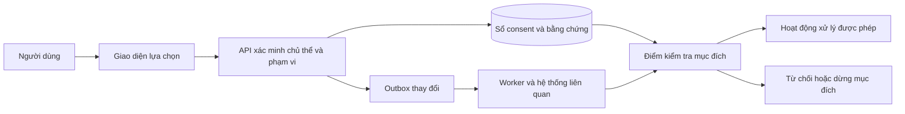
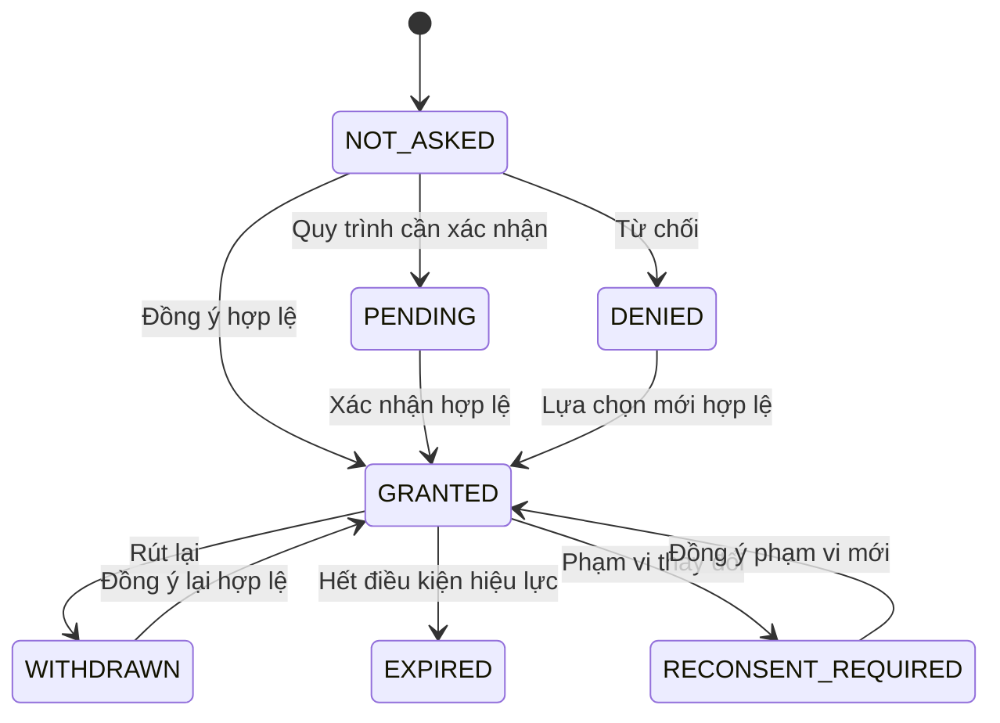

# Consent requirement

## 1. Biến lựa chọn của người dùng thành ràng buộc xử lý dữ liệu

Consent requirement là yêu cầu về cách hệ thống xin, ghi nhận, chứng minh, thực thi và cập nhật sự đồng ý đối với những hoạt động xử lý dữ liệu được xác định là dựa trên sự đồng ý. Một checkbox trên giao diện chỉ là một điểm thu nhận; yêu cầu phải đi theo dữ liệu tới backend, hàng đợi, công cụ phân tích và bên nhận liên quan.

Trong chương **Privacy requirement**, mục tiêu không dừng ở câu “người dùng đã chấp nhận”. Thiết kế yêu cầu bảo mật và quyền riêng tư phải trả lời:

- Đồng ý cho ai xử lý dữ liệu gì, với mục đích nào, trong phạm vi nào?
- Người dùng đã được cung cấp thông tin gì và đã thực hiện hành động gì?
- Hệ thống nào quyết định có được xử lý, tại thời điểm nào?
- Khi người dùng từ chối hoặc rút lại, công việc đang chờ và bản sao trạng thái phải thay đổi ra sao?
- Bằng chứng nào cho thấy dữ liệu không bị dùng ngoài phạm vi đã được cho phép?

Bài học dùng một nền tảng học trực tuyến làm ví dụ. Hệ thống có tài khoản, email tiếp thị tùy chọn và phân tích hành vi tùy chọn. Trong thiết kế mẫu, hai hoạt động tùy chọn này được tổ chức xác định là dựa trên consent. Các ngưỡng thời gian và quy tắc giao diện dưới đây là tiêu chí kỹ thuật minh họa, không phải thời hạn pháp luật áp dụng cho mọi dịch vụ.

Sau bài học, người học cần viết được yêu cầu từ rủi ro, mô hình hóa trạng thái consent, thiết kế bằng chứng tối thiểu và liên kết lựa chọn của người dùng với hành vi xử lý dữ liệu có thể kiểm thử.

## 2. Xác định đúng vai trò và phạm vi của consent

### 2.1. Không dùng consent như một nhãn chung cho mọi thao tác

Một tổ chức cần xác định căn cứ và điều kiện cho từng hoạt động xử lý trong bối cảnh áp dụng. Không mặc định mọi hoạt động đều phải xin consent, cũng không dùng một lần đồng ý để hợp thức hóa mọi xử lý trong tương lai.

| Khái niệm | Câu hỏi được giải quyết | Không được suy ra |
|---|---|---|
| Consent cho xử lý dữ liệu | Cá nhân đã đồng ý cho mục đích và phạm vi cụ thể nào? | Không tự cấp quyền kỹ thuật truy cập mọi tài nguyên |
| Chấp nhận điều khoản dịch vụ | Hai bên chấp nhận những điều khoản sử dụng nào? | Không tự chứng minh đã đồng ý với các mục đích dữ liệu tùy chọn |
| Thông báo quyền riêng tư | Tổ chức cung cấp thông tin gì về xử lý dữ liệu? | Đã hiển thị thông báo không đồng nghĩa đã có lựa chọn đồng ý |
| Phân quyền ứng dụng | Chủ thể được làm thao tác nào trên đối tượng nào? | Có quyền đọc không tự cho phép dùng dữ liệu cho tiếp thị |
| Quyền của hệ điều hành hoặc trình duyệt | Ứng dụng được truy cập một tài nguyên thiết bị nào? | Cho phép camera không tự cấp consent cho mọi cách dùng ảnh |
| Sở thích nhận thông báo | Người dùng muốn nhận loại thông báo qua kênh nào? | Cần xác định khi nào đây là lựa chọn nghiệp vụ, khi nào thuộc quy trình consent |

Ví dụ, email khôi phục tài khoản và email quảng bá khóa học phải có mã mục đích, luồng xử lý và căn cứ đã xác định riêng. Không đổi tên email quảng cáo thành “thông báo hệ thống” để vượt qua lựa chọn từ chối.

### 2.2. Nêu rõ bối cảnh pháp lý khi sử dụng ví dụ

Nếu một hoạt động thuộc phạm vi GDPR và dựa trên consent, những thuộc tính như tự nguyện, cụ thể, có thông tin và thể hiện ý chí rõ ràng có ý nghĩa pháp lý. Ủy ban châu Âu giải thích các thuộc tính này cùng việc trình bày yêu cầu bằng ngôn ngữ dễ hiểu. Đây là một nguồn tham khảo cho thiết kế, không phải lý do để suy ra mọi hệ thống tiếng Việt đều thuộc GDPR. [European Commission: Information for individuals](https://commission.europa.eu/law/law-topic/data-protection/information-individuals_en)

Với dự án thực tế, phạm vi pháp lý, loại dữ liệu, nhóm tuổi, chủ thể xử lý và điều kiện đồng ý cần được người có trách nhiệm xác định. Đội kỹ thuật chuyển những quyết định đó thành chính sách và kiểm thử; không tự chọn một mốc tuổi hay một thời hạn chung từ tên ngôn ngữ giao diện.

### 2.3. Consent không xóa bỏ các giới hạn khác

Dù đã có consent, hệ thống vẫn phải tuân thủ các yêu cầu áp dụng về giới hạn mục đích, tối thiểu dữ liệu, bảo mật và vòng đời dữ liệu. Người dùng đồng ý nhận bản tin không đồng nghĩa tổ chức được thu thập toàn bộ lịch sử duyệt web hoặc chia sẻ hồ sơ với mọi đối tác.

Một consent hợp lệ cũng không phải giấy phép vượt tenant hoặc bỏ qua quyền quản trị. Quyết định xử lý phải đồng thời thỏa điều kiện truy cập, chính sách mục đích và các điều kiện liên quan.

## 3. Bắt đầu từ danh mục mục đích và mô hình đe dọa

### 3.1. Xây danh mục mục đích đủ cụ thể

| Mã mục đích ví dụ | Hoạt động | Dữ liệu tối thiểu dự kiến | Kênh hoặc bên nhận | Quyết định trong thiết kế mẫu |
|---|---|---|---|---|
| `account_recovery` | Hỗ trợ lấy lại tài khoản | Địa chỉ liên hệ và thông tin xác minh cần thiết | Hệ thống tài khoản, nhà cung cấp gửi thư đã duyệt | Đánh giá riêng; không kế thừa từ consent tiếp thị |
| `marketing_email` | Gửi nội dung quảng bá khóa học | Địa chỉ email, ngôn ngữ và lựa chọn liên quan | Dịch vụ tiếp thị, nhà cung cấp gửi thư đã duyệt | Chỉ xử lý khi consent trong phạm vi còn hiệu lực |
| `optional_usage_analytics` | Phân tích cách sử dụng để cải tiến sản phẩm | Tập sự kiện và thuộc tính được công bố | Hệ thống phân tích đã duyệt | Chỉ thu nhận khi consent trong phạm vi còn hiệu lực |
| `partner_marketing` | Chia sẻ dữ liệu cho mục đích quảng bá của đối tác | Chưa phê duyệt | Chưa phê duyệt | Không được suy ra từ hai consent phía trên |

Các mã phải ánh xạ tới hoạt động thực tế. Một mã như `improve_experience` quá rộng có thể che giấu nhiều hành vi khác nhau, khiến người dùng khó lựa chọn và đội kiểm thử không biết cần quan sát gì.

Mỗi mục đích nên có chủ sở hữu, nhóm dữ liệu, hệ thống tham gia, bên nhận, điều kiện áp dụng, phiên bản phạm vi, vòng đời và điểm thực thi. Thay đổi đối tác hoặc dùng dữ liệu để huấn luyện mô hình cần đánh giá lại mục đích; không tự coi đó là phần mở rộng miễn kiểm tra.

### 3.2. Rủi ro cần chuyển thành yêu cầu

| Mã rủi ro | Kịch bản | Hướng yêu cầu |
|---|---|---|
| R-CNS-01 | Ô chọn được bật sẵn hoặc đóng hộp thoại bị coi là đồng ý | Trạng thái ban đầu không cho phép mục đích tùy chọn; chỉ ghi grant từ hành động xác định |
| R-CNS-02 | Một lựa chọn gộp nhiều mục đích độc lập | Tách lựa chọn theo mục đích và phạm vi cần thiết |
| R-CNS-03 | Consent được ghi nhận nhưng SDK đã gửi dữ liệu trước đó | Chặn khởi tạo hoặc thu nhận ở điểm trước lần tiết lộ đầu tiên |
| R-CNS-04 | Rút lại trên giao diện nhưng worker dùng danh sách cũ | Kiểm tra lại ở điểm xử lý, truyền thay đổi và đo độ trễ |
| R-CNS-05 | Không chứng minh được nội dung người dùng đã thấy | Gắn bằng chứng với phiên bản thông báo và hành động |
| R-CNS-06 | Người khác hoặc request giả mạo đổi consent | Kiểm tra quyền chủ thể, chống giả mạo, giới hạn token và audit |
| R-CNS-07 | Consent cũ tự mở rộng khi thêm mục đích hoặc bên nhận | Quản lý phiên bản phạm vi và đánh giá nhu cầu xin lại |
| R-CNS-08 | Khôi phục backup hoặc sự kiện đến trễ làm sống lại grant | Thứ tự cập nhật đáng tin cậy và đối soát trước mở xử lý |
| R-CNS-09 | Kho bằng chứng thu thập quá nhiều IP, thiết bị và payload | Mô hình bằng chứng tối thiểu, quyền đọc và retention riêng |

### 3.3. Theo dõi đường dữ liệu, không chỉ biểu mẫu



Một thay đổi đã ghi trong sổ trung tâm chưa chứng minh mọi consumer đã áp dụng. Ngược lại, chỉ lưu lựa chọn trong trình duyệt không đủ để quyết định cho worker tiếp thị chạy trên server.

## 4. Đặc tả trải nghiệm xin và quản lý consent

### 4.1. Thông tin cần cho một lựa chọn có ý nghĩa

Màn hình xin consent cần làm người dùng hiểu rõ bên xử lý, mục đích, nhóm dữ liệu, phạm vi bên nhận liên quan, khả năng rút lại và tác động của lựa chọn. Thông tin nên đủ gần với điểm lựa chọn, có liên kết tới chi tiết cần thiết và phù hợp khả năng tiếp cận.

Với `marketing_email`, một mô tả có thể là: “Tôi đồng ý nhận email giới thiệu khóa học từ nền tảng qua địa chỉ email của tài khoản. Tôi có thể tắt lựa chọn này trong phần quyền riêng tư hoặc qua liên kết quản lý nhận thư”. Đây chỉ là nội dung minh họa, cần rà soát với hoạt động và phạm vi thực tế trước khi dùng.

Không dùng câu mơ hồ như “Tôi đồng ý cải thiện trải nghiệm cùng các bên liên quan” nếu nó thực chất bao gồm chia sẻ dữ liệu hoặc nhiều mục đích khác biệt.

### 4.2. Yêu cầu giao diện có thể kiểm thử

Trong hệ thống mẫu:

- Hai mục đích tùy chọn có hai lựa chọn độc lập, ban đầu không bật.
- Từ chối mục đích tiếp thị không chặn chức năng học cốt lõi của ví dụ.
- Bấm đóng, bỏ qua hoặc tiếp tục học không được tạo sự kiện grant.
- Lựa chọn từ chối có đường truy cập rõ ràng, sử dụng được bằng bàn phím và công nghệ hỗ trợ.
- Nút lưu phải cho biết thay đổi đã được ghi nhận hay chưa; lỗi lưu không được hiển thị như thành công.
- Màn hình quản lý thể hiện trạng thái theo từng mục đích, thời điểm cập nhật và cách thay đổi.
- Không liên tục hỏi lại một mục đích đã từ chối nếu chưa có chính sách hỏi lại được duyệt.

Các tiêu chí này phải được kiểm tra trên từng luồng web, ứng dụng di động và biến thể giao diện có thể thay đổi ý nghĩa lựa chọn. Cùng một API đúng không bù được màn hình dẫn người dùng tới lựa chọn không rõ ràng.

### 4.3. Xin consent và xác minh địa chỉ là hai việc liên quan nhưng khác nhau

Xác minh người dùng kiểm soát địa chỉ email giúp giảm việc đăng ký hộ người khác. Nó không tự chứng minh họ đã nhận đủ thông tin và đồng ý cho một mục đích cụ thể.

Có thể dùng double opt-in trong thiết kế phù hợp: lưu lựa chọn chờ xác nhận rồi chỉ kích hoạt sau khi người dùng thực hiện bước xác nhận hợp lệ. Đây là một lựa chọn kiểm soát rủi ro của dự án, không được trình bày như yêu cầu chung bắt buộc cho mọi loại consent.

Token xác nhận cần gắn đúng mục đích, địa chỉ hoặc chủ thể, thời hạn và phiên bản phạm vi; không dùng một token cũ để bật mục đích mới.

## 5. Mô hình trạng thái, phạm vi và phiên bản

### 5.1. Tránh một biến `consent = true` cho toàn tài khoản

Một quyết định phải gắn với một phạm vi đủ rõ. Trong ví dụ, khóa logic có thể gồm:

```text
subjectRef + serviceScope + purposeId + channel + scopeVersion
```

`serviceScope` xác định phạm vi dịch vụ hoặc tổ chức có trách nhiệm trong thiết kế, không được nhầm với một tenant bất kỳ do client gửi. Nếu hoạt động yêu cầu tách theo bên nhận hoặc nhóm dữ liệu, phạm vi phải biểu diễn thêm những chiều đó.

Không mặc định đồng ý ở một dịch vụ có hiệu lực cho mọi sản phẩm. Khi liên kết hoặc gộp tài khoản, không lấy phép hợp tất cả grant như một cách tự động mở rộng consent.

### 5.2. Các trạng thái nghiệp vụ

| Trạng thái | Ý nghĩa | Có cho phép hoạt động dựa trên consent không? |
|---|---|---|
| `NOT_ASKED` | Chưa có lựa chọn được ghi nhận | Không |
| `PENDING` | Chờ bước xác nhận theo quy trình được chọn | Không |
| `GRANTED` | Có grant còn phù hợp phạm vi và điều kiện | Có, nếu các kiểm tra khác cùng đạt |
| `DENIED` | Người dùng đã từ chối | Không |
| `WITHDRAWN` | Grant đã được rút lại | Không |
| `EXPIRED` | Hết hiệu lực theo chính sách áp dụng đã xác định | Không |
| `RECONSENT_REQUIRED` | Phạm vi mới chưa được grant cũ bao phủ | Không cho phạm vi mới |

Không cần mọi dự án đều có tất cả trạng thái. Điều cần giữ là không đánh đồng “không có bằng chứng”, “đã từ chối” và “đang đồng ý”. Mặc định cho hoạt động tùy chọn dựa trên consent phải là không xử lý khi chưa xác định được trạng thái cho phép.



Sơ đồ là ví dụ trạng thái cho một phạm vi. Việc từ chối phạm vi mới không nhất thiết hủy mọi mục đích cũ độc lập; chính sách phải xác định rõ phần nào còn được phép.

### 5.3. Phân biệt phiên bản thông báo, phạm vi và thứ tự sự kiện

- **Phiên bản thông báo:** nội dung và ngôn ngữ đã trình bày cho người dùng.
- **Phiên bản phạm vi:** mục đích, dữ liệu, bên nhận và điều kiện mà grant bao phủ.
- **Phiên bản cập nhật:** thứ tự thay đổi trạng thái của cùng khóa logic, dùng để chống ghi đè hoặc xử lý sự kiện cũ.

Sửa lỗi chính tả không tự đồng nghĩa phải xin lại mọi consent. Thêm mục đích, mở rộng nhóm dữ liệu hoặc thay đổi bên nhận cần đánh giá ảnh hưởng và có thể phải xin lại trước khi xử lý trong phạm vi mới.

Không coi mọi lần cập nhật chính sách là tự động gia hạn. Cũng không đặt một thời hạn hết hiệu lực phổ quát nếu dự án chưa có căn cứ và chính sách xác định.

## 6. Thiết kế bằng chứng consent tối thiểu và đáng tin cậy

### 6.1. Cần chứng minh điều gì?

Bằng chứng cần cho phép trả lời: chủ thể nào, người thao tác nào, mục đích và phạm vi nào, đã thấy nội dung nào, thực hiện lựa chọn gì và hệ thống ghi nhận lúc nào.

Trong bối cảnh GDPR, Điều 7 yêu cầu khả năng chứng minh consent khi xử lý dựa trên căn cứ này. Đội kỹ thuật cần chuyển nghĩa vụ đó thành dữ liệu và quy trình kiểm chứng cụ thể, thay vì chỉ lưu một boolean. [GDPR, Điều 7 trên EUR-Lex](https://eur-lex.europa.eu/eli/reg/2016/679/)

Một bản ghi minh họa:

```json
{
  "receiptId": "consent-test-042",
  "subjectRef": "learner-test-17",
  "actorRef": "learner-test-17",
  "serviceScope": "learning-test",
  "purposeId": "marketing_email",
  "channel": "email",
  "scopeVersion": "marketing-scope-v2",
  "noticeVersion": "notice-vi-v3",
  "action": "GRANT",
  "statusAfter": "GRANTED",
  "recordedAt": "2026-11-27T03:00:00Z",
  "aggregateVersion": 12,
  "captureFlow": "privacy-settings-v2",
  "requestRef": "request-test-09"
}
```

Đây là dữ liệu tổng hợp, không phải hồ sơ người thật. `aggregateVersion` là thứ tự cập nhật trong một phạm vi, không phải thời hạn consent.

### 6.2. Liên kết bằng chứng với nội dung đã hiển thị

Phải giữ được phiên bản thông báo và quy tắc lựa chọn tương ứng. Nếu mọi bằng chứng đều trỏ tới URL có nội dung thay đổi liên tục thì khó xác định người dùng đã thấy gì ở thời điểm đồng ý.

Có thể lưu nội dung đã duyệt theo phiên bản, bản địa hóa và mã kiểm tra toàn vẹn. Hash giúp đối chiếu nội dung tham chiếu nhưng không tự chứng minh người dùng đã đọc, hiểu hoặc đồng ý hợp lệ. Bằng chứng vẫn cần hành động, luồng thu nhận và bối cảnh phù hợp.

Không tin các trường `subjectRef`, `recordedAt` hoặc `noticeVersion` do client gửi mà không kiểm tra. Server xác lập chủ thể từ ngữ cảnh đã xác minh, ghi thời gian đáng tin cậy và chỉ chấp nhận phiên bản được phép trong luồng đó.

### 6.3. Không biến bằng chứng thành kho theo dõi quá mức

Không mặc định lưu toàn bộ IP, fingerprint thiết bị, body request và bản sao giấy tờ chỉ để “chứng minh tốt hơn”. Với từng dữ liệu bổ sung, cần mục đích, mức cần thiết, quyền truy cập và retention rõ ràng.

Kho bằng chứng cần chống sửa trái phép, phân quyền đọc, audit thao tác và cơ chế sửa sai có truy vết. Có thể giữ lịch sử thay đổi và trạng thái hiện tại riêng, nhưng lịch sử không có nghĩa phải giữ vô hạn.

Người vận hành không được bật consent thay người dùng qua một màn hình quản trị thông thường. Nếu có quy trình nhập bằng chứng ngoại tuyến hoặc sửa lỗi, phải xác định quyền, nguồn chứng cứ và hành vi; không làm giả hành động như thể chính người dùng đã bấm đồng ý.

## 7. Rút lại consent phải thay đổi hành vi xử lý

### 7.1. Phân biệt rút lại, xóa dữ liệu và ngừng một mục đích

Rút lại consent là thay đổi điều kiện cho hoạt động dựa trên consent trong phạm vi tương ứng. Nó không đồng nghĩa nút “xóa toàn bộ tài khoản”, và cũng không tự động xóa được mọi email đã gửi hoặc bản dữ liệu đã chuyển ra ngoài.

Trong phạm vi GDPR, Điều 7 nêu việc rút lại không làm thay đổi tính hợp pháp của xử lý dựa trên consent trước đó và việc rút lại phải dễ như khi đồng ý. Cần biến nguyên tắc này thành đường thao tác thực tế và trạng thái backend có hiệu lực. [GDPR, Điều 7 trên EUR-Lex](https://eur-lex.europa.eu/eli/reg/2016/679/)

Sau khi rút lại, dự án cần xác định riêng dữ liệu nào dừng sử dụng cho mục đích đó, dữ liệu nào cần xóa hoặc hạn chế và bằng chứng nào còn được giữ theo mục đích, căn cứ cùng retention đã được xác định. Không tự đổi căn cứ xử lý ở hậu trường chỉ để tiếp tục chính hoạt động mà người dùng vừa rút consent.

### 7.2. Định nghĩa các mốc thời gian

Trong thiết kế mẫu:

```text
t0 = lúc sổ consent xác nhận commit sự kiện WITHDRAW

t1 = lúc các consumer bắt buộc xác nhận đã áp dụng phiên bản mới

t2 = lúc hoàn tất các tác vụ hậu xử lý được yêu cầu riêng
```

API chỉ báo đã ghi nhận rút lại sau khi thay đổi được lưu bền vững. Từ t0, các quyết định cấp phép mới đọc nguồn trạng thái nhất quán phải từ chối mục đích đã rút. Không lấy thời gian trên thiết bị người dùng làm thứ tự có thẩm quyền.

Ví dụ đặt mục tiêu truyền trạng thái tới các consumer nội bộ trong tối đa 60 giây và cảnh báo khi vượt. Con số này là giới hạn kỹ thuật phải được đánh giá cho bối cảnh áp dụng, không phải thời gian gia hạn consent. Nếu rủi ro không cho phép trạng thái cho phép bị cũ, điểm quyết định phải đọc nguồn nhất quán hoặc dùng cơ chế chặn tương đương trước hoạt động.

`t2` có thể khác `t1`: cập nhật quyền xử lý, hủy tác vụ, yêu cầu bên nhận dừng sử dụng và xóa dữ liệu là những việc khác nhau. Giao diện và báo cáo cần phản ánh đúng, không gom tất cả thành “đã xóa ngay”.

### 7.3. Xử lý công việc đã xếp hàng và đang thực hiện

Một danh sách tiếp thị tạo từ hôm qua không phải bằng chứng consent còn hiệu lực hôm nay. Worker phải kiểm tra lại mục đích, phạm vi và phiên bản trạng thái khi chuẩn bị thực hiện, không chỉ lúc tạo campaign.

Phải xác định ranh giới khó đảo ngược, chẳng hạn khi hệ thống gửi thư đã tiếp nhận yêu cầu. Yêu cầu cho từng nhóm công việc có thể là:

| Nhóm công việc | Hành vi khi rút lại |
|---|---|
| Chưa được cấp phép thực hiện | Từ chối cấp phép mới cho mục đích đã rút |
| Đang chờ nội bộ | Hủy hoặc đánh dấu bị chặn; kiểm tra lại khi lấy khỏi hàng đợi |
| Đang gọi dịch vụ bên ngoài | Ghi nhận là tác vụ đang thực hiện, cố gắng hủy nếu hỗ trợ; không tuyên bố thu hồi được mọi tác động |
| Đã được nhà cung cấp tiếp nhận | Áp dụng cơ chế hủy hoặc suppression nếu có; ghi nhận giới hạn không thể thu hồi |
| Retry hoặc phát lại | Đánh giá consent hiện hành, không dùng quyết định cho phép cũ để chạy lại |

Kiểm tra ngay trước gửi vẫn có thể gặp cạnh tranh giữa thời điểm kiểm tra và thời điểm chuyển dữ liệu. Nếu cần bảo đảm thứ tự chặt, phải thiết kế điểm điều phối chung và định nghĩa chính xác khi nào một thao tác được xem là đã bắt đầu. Không tuyên bố không còn email nào tới sau t0 chỉ vì worker có một câu lệnh kiểm tra.

### 7.4. Rút lại một phần và đồng ý lại

Người dùng có thể rút `marketing_email` nhưng giữ `optional_usage_analytics`. Không được tắt hoặc bật tất cả chỉ vì một trường `globalConsent` thay đổi.

Khi người dùng đồng ý lại, cần bằng chứng và phạm vi hiện hành. Request grant cũ được retry không được trở thành hành động đồng ý mới sau withdrawal. Một hành động mới hợp lệ phải phân biệt được với phát lại một request cũ.

## 8. Kiến trúc ghi nhận và thực thi consent

### 8.1. Ghi trạng thái và sự kiện thay đổi một cách nhất quán

Một thiết kế có thể dùng giao dịch để cùng ghi trạng thái, bằng chứng và outbox. Nếu chỉ cập nhật trạng thái rồi gửi message riêng, lỗi giữa hai thao tác có thể làm consumer không bao giờ biết có withdrawal.

```text
function changeConsent(request, trustedContext):
    subject = resolveAuthorizedSubject(trustedContext)
    scope = policy.resolveAllowedScope(request.purposeId, request.channel)
    requireValidAction(request.action)
    if request.action == "GRANT":
        requireAcceptedNoticeVersion(scope, request.noticeVersion)
    requireValidCaptureFlow(request, trustedContext)

    begin transaction
        if request.idempotencyKey already exists:
            requireSameRequestMeaning(request)
            return storedResultWithoutNewTransition()

        current = lockConsentAggregate(subject, scope)
        requireExpectedVersion(current, request.expectedVersion)
        next = transition(current, request.action, serverTime())
        evidence = buildMinimalEvidence(subject, scope, request, next)

        saveState(next)
        saveEvidence(evidence)
        saveOutboxEvent(next.aggregateVersion, next.status)
        saveIdempotentResult(request.idempotencyKey, next)
    commit transaction

    return committedReceipt(next)
```

Pseudocode thể hiện các thuộc tính cần có, không phải API hoàn chỉnh. Kiểm tra phiên bản thông báo trong nhánh GRANT không được trở thành điều kiện chặn từ chối hoặc rút lại. Với withdrawal, hệ thống xác định đúng phạm vi và thẩm quyền cần thiết, không đặt thêm bước đồng ý thông báo mới làm điều kiện rút lại.

Kiểm tra phiên bản giúp phát hiện thao tác từ màn hình cũ. Khi xung đột, không âm thầm dùng grant cũ ghi đè withdrawal mới. Có thể yêu cầu tải lại trạng thái cho hành động bật mới; việc xử lý rút lại cần ưu tiên tránh giữ grant trái lựa chọn hiện tại.

### 8.2. Quy tắc cho consumer và cache

Consumer nên xử lý sự kiện theo thứ tự phiên bản của cùng phạm vi, nhận biết message trùng và không cho sự kiện cũ làm lùi trạng thái. Không chỉ sắp xếp theo timestamp client hoặc thứ tự nhận qua mạng.

Nếu nhận withdrawal phiên bản 13 rồi grant phiên bản 12, consumer phải giữ trạng thái phiên bản 13. Nếu nhận grant phiên bản 14 từ hành động mới hợp lệ thì phải phân biệt được đó là thay đổi mới, không phải cấm đồng ý lại vĩnh viễn.

Cache phải có tuổi và cơ chế vô hiệu hóa phù hợp. Không cho phép vô thời hạn dựa trên một giá trị `true` đã lưu. Khi không chứng minh được trạng thái cho phép, hoạt động tùy chọn dựa trên consent phải dừng; có thể tiếp tục các chức năng khác nếu chúng có điều kiện xử lý độc lập đã được xác định.

Hàng đợi lỗi, retry, job chạy theo lịch và công cụ xuất dữ liệu đều thuộc phạm vi. Một ngoại lệ “chỉ chạy lại dữ liệu cũ” vẫn có thể tạo lần xử lý hoặc lần tiết lộ mới ngoài consent hiện hành.

### 8.3. SDK và trình duyệt phải chặn trước khi tiết lộ

Với phân tích tùy chọn trong ví dụ, cần quyết định SDK có thể được tải, khởi tạo và gửi loại dữ liệu nào ở từng trạng thái. Chỉ tắt một lời gọi `track()` không đủ nếu SDK tự gửi định danh hoặc sự kiện khi khởi động.

Kiểm thử cần quan sát mạng, cookie, bộ nhớ cục bộ và hành vi của tag manager trước lựa chọn, sau từ chối, sau grant và sau withdrawal. Không thu dữ liệu trước rồi hứa xóa sau như một cách đáp ứng yêu cầu chỉ thu sau consent.

Lựa chọn trên một thiết bị hoặc một trình duyệt không tự ánh xạ sang toàn bộ tài khoản. Nếu hệ thống hỗ trợ đồng bộ, phải giải thích phạm vi và có quy tắc nhận diện an toàn; nếu không, không được hứa “đã tắt ở mọi nơi”.

### 8.4. Bên nhận dữ liệu là một phần của yêu cầu

Đối với dịch vụ bên ngoài, cần biết dữ liệu được chuyển, mục đích, phiên bản consent liên quan, cách nhận thay đổi và cách kiểm chứng kết quả. Một sự kiện `withdrawn` phát thành công trong hệ thống nội bộ không chứng minh bên nhận đã dừng hoạt động.

Cần xử lý lỗi truyền, retry có kiểm soát, xác nhận áp dụng và trường hợp không thể xác nhận. Nếu chưa có cơ chế thực thi phù hợp cho một bên nhận, không nên mở hoạt động chia sẻ dựa trên giả định rằng checkbox nội bộ đã đủ.

## 9. Bảo vệ API và xử lý nhận diện chủ thể

Consent là một trạng thái có giá trị bảo mật và cần chống thay đổi trái phép:

- API dùng chủ thể từ phiên hoặc cơ chế xác minh đã duyệt; không tin `userId` tùy ý trong body.
- Khi dùng cookie phiên, có biện pháp chống request giả mạo phù hợp với luồng; kiểm tra nguồn và quyền theo thiết kế.
- Token xác nhận hoặc rút nhận thư phải khó đoán, giới hạn phạm vi, hạn dùng và không cấp quyền truy cập hồ sơ khác.
- Idempotency và kiểm tra phiên bản ngăn retry tạo bằng chứng lặp hoặc ghi đè trạng thái mới.
- Audit được phép ghi sự kiện thay đổi nhưng không ghi token, cookie hoặc toàn bộ payload nhạy cảm.
- Lỗi không để lộ một địa chỉ hoặc tài khoản có tồn tại khi người gọi chưa có quyền biết.

Đường rút nhận thư có thể không yêu cầu đăng nhập nếu dùng bằng chứng kiểm soát kênh phù hợp. Không áp thêm nhiều bước xác minh hơn mức cần thiết khiến thao tác rút lại trở nên khó dùng, nhưng cũng không cho token đó quyền đọc tài khoản hoặc bật một mục đích khác.

Với người chưa đăng nhập, lựa chọn ở trình duyệt cần mã tham chiếu và phạm vi được định nghĩa. Không thu thêm định danh mạnh chỉ để liên kết mọi hành vi consent nếu mục đích không cần. Đăng nhập sau đó phải có quy tắc xử lý xung đột, không mặc định biến một grant trên thiết bị dùng chung thành grant toàn tài khoản.

Nếu có người đại diện hoặc người giám hộ, mô hình phải tách `actorRef` với `subjectRef`, xác định thẩm quyền, phạm vi và điều kiện hiệu lực. Không đặt một mốc tuổi cố định hoặc kết luận người dùng đủ điều kiện chỉ từ năm sinh tự khai khi chính sách yêu cầu xác minh khác.

## 10. Bộ yêu cầu có tiêu chí chấp nhận

| ID | Phát biểu yêu cầu mẫu | Tiêu chí chấp nhận và bằng chứng |
|---|---|---|
| REQ-CNS-01 | Các mục đích tùy chọn trong ví dụ phải có lựa chọn độc lập, ban đầu không bật; đóng hoặc bỏ qua không tạo grant. | Kiểm thử giao diện và kiểm tra sổ trạng thái trên từng luồng thu nhận. |
| REQ-CNS-02 | Chỉ ghi grant khi xác minh đúng chủ thể, hành động, mục đích, phạm vi và phiên bản thông báo được phép. | Thử giả chủ thể, sửa mục đích, phiên bản cũ, request thiếu và token hết hạn; không sinh grant sai. |
| REQ-CNS-03 | Hoạt động dựa trên consent chỉ được cho phép khi trạng thái cùng phạm vi là GRANTED và các điều kiện khác đạt. | Kiểm thử mọi trạng thái, sai kênh, sai dịch vụ, sai mục đích và sai phạm vi; mặc định từ chối. |
| REQ-CNS-04 | Mỗi thay đổi thành công phải gắn với bằng chứng tối thiểu và nội dung thông báo có thể truy xuất theo phiên bản. | Từ receipt tái dựng được chủ thể, hành động, phạm vi và nội dung tham chiếu; không dựa vào URL nội dung đã bị thay. |
| REQ-CNS-05 | API chỉ báo rút lại đã ghi nhận sau commit; các quyết định mới tại nguồn nhất quán phải từ chối phạm vi đã rút. | Tiêm lỗi ghi và đọc, kiểm tra mốc t0, trạng thái phản hồi và quyết định xử lý sau commit. |
| REQ-CNS-06 | Consumer nội bộ phải áp dụng withdrawal theo phiên bản; mục tiêu truyền thay đổi của ví dụ là tối đa 60 giây. | Đo từ commit tới xác nhận từng consumer; quá hạn phải cảnh báo, không được báo đã áp dụng toàn bộ. |
| REQ-CNS-07 | Worker phải đánh giá lại consent tại điểm thực thi đã định; retry không được dùng grant cũ để vượt withdrawal. | Tạo job trước, rút lại rồi chạy; thử message trùng, đảo thứ tự và retry. |
| REQ-CNS-08 | Thu nhận và gửi dữ liệu phân tích tùy chọn phải bị chặn trước khi có consent trong phạm vi. | Quan sát mạng và lưu trữ trình duyệt trước lựa chọn và sau từ chối, không chỉ kiểm tra nhãn giao diện. |
| REQ-CNS-09 | Phạm vi mới không được tự kế thừa grant nếu chưa có đánh giá và quyết định tương thích được duyệt. | Thêm mục đích hoặc bên nhận; luồng mới bị chặn khi thiếu điều kiện áp dụng. |
| REQ-CNS-10 | Consent phải có quyền đọc, sửa, vòng đời bằng chứng và audit riêng; quản trị thường không được grant thay người dùng. | Kiểm tra âm tính bằng các vai trò và kiểm tra xử lý dữ liệu hết hạn theo chính sách. |
| REQ-CNS-11 | Restore, import hoặc gộp tài khoản không được tự làm sống lại grant đã rút hoặc mở rộng phạm vi. | Restore bản cũ rồi đối soát, nhập dữ liệu trùng và thử xung đột nhận diện trước khi mở xử lý. |
| REQ-CNS-12 | Bên nhận thuộc phạm vi phải có cơ chế truyền và xác nhận thay đổi; lỗi chưa xử lý phải được nhìn thấy. | Giả lập bên nhận lỗi, hết hạn chờ và retry; có trạng thái áp dụng rõ cùng cảnh báo phù hợp. |

Các ngưỡng là ví dụ cho thiết kế kỹ thuật. Nếu không đáp ứng điều kiện pháp lý hoặc rủi ro của dự án, phải chọn kiến trúc chặt hơn, không dùng một SLA nội bộ làm lý do tiếp tục xử lý khi đã mất điều kiện cho phép.

## 11. Thiết kế kiểm thử theo rủi ro

### 11.1. Kiểm tra cả trạng thái và tác động thực tế

Một kiểm thử chỉ xác nhận `status = WITHDRAWN` chưa chứng minh người dùng ngừng nhận hoạt động tiếp thị. Phải quan sát cả job, quyết định cấp phép, đường mạng và trạng thái bên nhận trong phạm vi đã xác định.

| Ca thử | Thiết lập hoặc thao tác | Kết quả mong đợi |
|---|---|---|
| TC-CNS-01 | Tài khoản mới mở hoặc đóng màn hình lựa chọn | Không có grant; không thu nhận cho mục đích tùy chọn |
| TC-CNS-02 | Chỉ đồng ý marketing_email | Analytics vẫn bị chặn; không suy ra consent cho đối tác |
| TC-CNS-03 | Sửa subjectRef, purposeId hoặc phạm vi trong request | Không cập nhật trái thẩm quyền; không sinh bằng chứng sai |
| TC-CNS-04 | Grant từ màn hình có phạm vi thông báo đã lỗi thời | Không âm thầm mở phạm vi mới; yêu cầu lựa chọn phù hợp |
| TC-CNS-05 | Rút lại khi thông báo vừa đổi phiên bản | Không bắt người dùng đồng ý thông báo mới để được rút lại |
| TC-CNS-06 | Cơ sở dữ liệu lỗi trước commit | Không báo đã lưu; không tiếp tục dựa trên grant chưa ghi nhận |
| TC-CNS-07 | Message withdrawal gửi chậm hoặc consumer ngừng chạy | Có retry và quan sát độ trễ; không báo hoàn tất áp dụng ở consumer đó |
| TC-CNS-08 | Nhận WITHDRAW phiên bản 13 rồi GRANT phiên bản 12 | Giữ phiên bản 13; không bật lại |
| TC-CNS-09 | Đồng ý lại bằng hành động mới tạo phiên bản 14 | Chấp nhận nếu đủ điều kiện; phân biệt với request phát lại |
| TC-CNS-10 | Tạo campaign, rút lại rồi mới cho worker chạy | Job chưa thực hiện bị chặn tại điểm quyết định đã định |
| TC-CNS-11 | Withdrawal cạnh tranh với thao tác gửi đang thực hiện | Kết quả phù hợp ranh giới đã công bố; có bằng chứng để phân loại in-flight |
| TC-CNS-12 | Chặn nguồn trạng thái hoặc làm grant cache quá cũ | Hoạt động tùy chọn không mặc định cho phép |
| TC-CNS-13 | Mở trang trước consent, từ chối rồi tải lại | SDK không gửi dữ liệu tùy chọn ở các trạng thái bị chặn |
| TC-CNS-14 | Restore bản có grant trước một withdrawal | Áp dụng lại withdrawal trước khi mở xử lý |
| TC-CNS-15 | Gộp tài khoản hoặc đăng nhập từ thiết bị dùng chung | Không tự mở rộng consent; thực hiện quy tắc xung đột đã duyệt |
| TC-CNS-16 | Bên nhận không xác nhận áp dụng withdrawal | Hiển thị đúng trạng thái chưa xác nhận, cảnh báo và xử lý theo quy trình |

Dùng fixture tổng hợp và đích gửi thử để tránh kiểm thử tự tạo lần xử lý dữ liệu thật ngoài phạm vi. Báo cáo cần nêu hệ thống, luồng, phiên bản và điểm quan sát; không suy ra mọi bên nhận đều đúng từ một consumer thử nghiệm.

### 11.2. Tiêu chí Given–When–Then

```gherkin
Scenario: Sự kiện cũ không làm sống lại consent đã rút
  Given marketing_email đang GRANTED ở phiên bản 12
    And người dùng rút lại, tạo phiên bản 13 đã commit
    And consumer đã áp dụng phiên bản 13
  When consumer nhận lại sự kiện GRANT của phiên bản 12
  Then trạng thái marketing_email vẫn là WITHDRAWN ở phiên bản 13
    And job tiếp thị chưa thực hiện không được cấp phép mới
    And sự kiện cũ không tạo ra một bằng chứng đồng ý mới
```

Có thể bổ sung ca song song trên cùng phạm vi để kiểm tra kiểm soát phiên bản, idempotency và phản hồi xung đột. Không chỉ dùng timestamp khác nhau trong một kiểm thử tuần tự rồi kết luận đã xử lý đúng mọi cạnh tranh.

### 11.3. Một số bất biến cần duy trì

- Không có trạng thái cho phép thì không xử lý hoạt động đã xác định là phụ thuộc consent.
- Grant của mục đích A không cấp quyền cho mục đích B.
- Sự kiện phiên bản nhỏ hơn không làm lùi trạng thái cùng phạm vi.
- Retry cùng request không tạo hành động mới sau withdrawal.
- Một receipt chỉ có ý nghĩa khi liên kết được với phạm vi và nội dung đã xác định.
- Không báo withdrawal đã áp dụng toàn bộ nếu còn consumer bắt buộc chưa xác nhận.
- Không đưa grant cũ trở lại chỉ vì import hoặc restore thành công về mặt dữ liệu.

Đây là các thuộc tính kỹ thuật cần cụ thể hóa theo mô hình hệ thống. Chúng bổ sung cho đánh giá nội dung thông báo và luồng lựa chọn; kiểm thử tự động không tự chứng minh mọi điều kiện về tính tự nguyện hay khả năng hiểu đã đạt.

## 12. Vòng đời bằng chứng, dữ liệu và phục hồi

### 12.1. Tách trạng thái hiện hành với lịch sử

Trạng thái hiện hành phục vụ quyết định nhanh; lịch sử giúp giải thích việc thay đổi. Hai lớp có thể có vòng đời và quyền khác nhau, nhưng phải truy vết được với nhau và không để lịch sử tự ghi đè quyết định hiện tại.

Sau withdrawal, có thể cần giữ bằng chứng giới hạn để giải thích trạng thái hoặc thực hiện nghĩa vụ đã xác định. Việc giữ này cần mục đích, điều kiện, retention và quyền riêng; không có nghĩa tiếp tục dùng dữ liệu để tiếp thị.

Nếu giữ suppression record để tránh gửi lại, cần xác định định danh tối thiểu, cách bảo vệ và thời hạn. Danh sách từ chối vẫn có thể tiết lộ thông tin cá nhân; không coi nó là dữ liệu công khai.

### 12.2. Restore không được làm mất lựa chọn mới hơn

Backup tại thời điểm T có thể chứa grant, trong khi withdrawal xảy ra sau T. Restore phải có đường khôi phục hoặc đối soát các thay đổi cần thiết trước khi mở hoạt động phụ thuộc consent.

Nguồn đối soát cũng cần được bảo vệ, có thứ tự thay đổi và khả năng sử dụng khi hệ thống chính lỗi. Nếu không xác định được trạng thái hiện hành, giữ chặn hoạt động tùy chọn thay vì mặc định dùng grant trong backup.

Cần diễn tập tình huống này trên dữ liệu và luồng thật của hệ thống thử nghiệm. Chỉ bảo quản lịch sử ở một nơi mất cùng backup không đáp ứng mục tiêu không làm sống lại grant.

### 12.3. Export, xóa tài khoản và gộp nhận diện

Export cho người dùng phải chỉ cung cấp thông tin họ có quyền nhận, tránh lộ dữ liệu của chủ thể khác hoặc chi tiết nội bộ không cần thiết. Xóa tài khoản phải đánh giá riêng trạng thái consent, bằng chứng còn được giữ và dữ liệu ở các bên nhận theo chính sách áp dụng.

Khi gộp nhận diện, phải xác minh các tài khoản thuộc cùng chủ thể, so sánh phạm vi và xử lý xung đột. Không dùng việc tài khoản A từng đồng ý làm lý do bỏ qua withdrawal hợp lệ ở tài khoản B nếu chính sách nhận diện xác định chúng thuộc cùng phạm vi.

Không có một phép gộp boolean phù hợp cho mọi bối cảnh. Quy tắc cần được viết trước, có thể giải thích và kiểm thử; trường hợp chưa xác định được phải không tự mở rộng quyền xử lý.

## 13. Truy vết yêu cầu và giám sát vận hành

| Rủi ro | Yêu cầu | Quyết định kiến trúc | Bằng chứng chính | Chủ sở hữu ví dụ |
|---|---|---|---|---|
| R-CNS-01, R-CNS-02 | REQ-CNS-01 | Lựa chọn riêng, trạng thái ban đầu không grant | TC-CNS-01, TC-CNS-02; đánh giá nội dung và khả năng tiếp cận | Nhóm sản phẩm, chủ sở hữu quyền riêng tư |
| R-CNS-03 | REQ-CNS-03, REQ-CNS-08 | Chặn SDK và xử lý theo mục đích | TC-CNS-12, TC-CNS-13; quan sát mạng | Nhóm ứng dụng |
| R-CNS-04 | REQ-CNS-05 đến REQ-CNS-07 | Sổ có thẩm quyền, outbox, kiểm tra tại điểm xử lý | TC-CNS-06 đến TC-CNS-11 | Nhóm nền tảng, nhóm nghiệp vụ |
| R-CNS-05, R-CNS-09 | REQ-CNS-04, REQ-CNS-10 | Bằng chứng tối thiểu và nội dung theo phiên bản | Tái dựng receipt, kiểm tra quyền và retention | Chủ sở hữu dữ liệu, an toàn thông tin |
| R-CNS-06 | REQ-CNS-02 | Xác minh chủ thể, chống giả mạo và phát lại | TC-CNS-03, TC-CNS-09 | Nhóm danh tính |
| R-CNS-07 | REQ-CNS-09 | Danh mục mục đích và đánh giá thay đổi phạm vi | TC-CNS-04, TC-CNS-05 | Chủ sở hữu quyền riêng tư, nhóm sản phẩm |
| R-CNS-08 | REQ-CNS-11 | Thứ tự phiên bản và đối soát sau restore | TC-CNS-08, TC-CNS-14, TC-CNS-15 | Nhóm dữ liệu, vận hành |

Có thể giám sát số thay đổi lỗi, độ trễ withdrawal theo consumer, quyết định bị chặn do thiếu trạng thái, job bị hủy và bên nhận chưa xác nhận. Số lượng grant không nên là chỉ số duy nhất vì có thể khuyến khích giao diện gây áp lực lựa chọn.

Log vận hành cần mã sự kiện, tham chiếu đã bảo vệ, kết quả, phiên bản và thời điểm. Không ghi token, email đầy đủ hoặc payload hành vi chỉ để debug việc kiểm tra consent. Dashboard và quyền đọc bằng chứng cũng thuộc phạm vi bảo vệ dữ liệu.

Thay SDK, tag manager, nhà cung cấp gửi thư, mục đích, ngôn ngữ thông báo, mô hình nhận diện hoặc cơ chế queue là các tác nhân cần đánh giá lại yêu cầu và kiểm thử liên quan trong vòng đời phát triển.

## 14. Bài tập áp dụng

Một nền tảng học có checkbox “Tôi đồng ý mọi điều khoản và quảng cáo” được chọn sẵn. Analytics khởi tạo ngay khi tải trang. Nhóm tiếp thị xuất danh sách email mỗi tuần và worker không kiểm tra lại. Trang rút nhận thư chỉ đổi một cờ trong trình duyệt; backend vẫn lưu `consent = true`. Khi restore backup, mọi grant cũ được nhập lại.

Hãy lập đặc tả cải tiến:

1. Xác định các mục đích và căn cứ cần được đánh giá riêng; tách điều khoản sử dụng với consent tùy chọn.
2. Vẽ dòng dữ liệu từ giao diện tới SDK, worker và bên nhận; xác định nơi phải chặn trước tiết lộ.
3. Thiết kế phạm vi, trạng thái, ba loại phiên bản và bằng chứng tối thiểu.
4. Viết ít nhất sáu yêu cầu có mã, điều kiện lỗi, tiêu chí chấp nhận và chủ sở hữu.
5. Định nghĩa mốc withdrawal, ranh giới tác vụ đang thực hiện và cách đo truyền trạng thái.
6. Thiết kế ca thử request giả mạo, message đảo thứ tự, campaign cũ, restore và gộp tài khoản.
7. Nêu các giới hạn còn lại, nhất là tác động đã được bên ngoài tiếp nhận và việc chưa xác định được trạng thái mới nhất.

Một đặc tả hoàn chỉnh phải nối được lựa chọn của cá nhân với điều kiện xử lý dữ liệu trong toàn bộ hệ thống. Khi phạm vi, bằng chứng, thời điểm và điểm thực thi đều rõ, consent mới trở thành yêu cầu quyền riêng tư có thể triển khai, kiểm chứng và duy trì.
