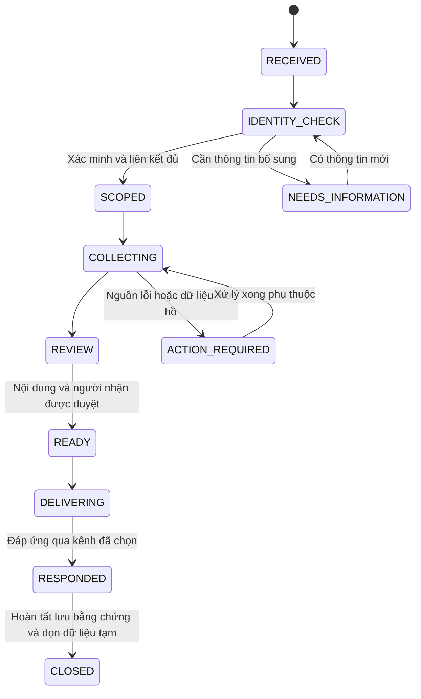
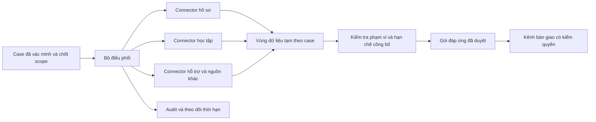

# Data subject access

## 1. Truy cập dữ liệu của chủ thể là một quy trình bảo vệ quyền riêng tư

**Data subject access** là việc chủ thể dữ liệu yêu cầu biết tổ chức có xử lý dữ liệu cá nhân về mình hay không, truy cập dữ liệu thuộc phạm vi được đáp ứng và nhận thông tin liên quan đến hoạt động xử lý. Một yêu cầu như vậy thường được gọi là subject access request hoặc data subject access request, viết tắt SAR/DSAR.

Trong phạm vi GDPR, Ủy ban châu Âu mô tả ba thành phần: xác nhận việc xử lý, cung cấp bản sao dữ liệu cá nhân và thông tin về việc xử lý. Xem [hướng dẫn tiếp nhận yêu cầu của cá nhân](https://commission.europa.eu/law/law-topic/data-protection/information-business-and-organisations/dealing-requests-individuals_en). Bài học dùng GDPR làm ví dụ có nguồn; phạm vi quyền, thời hạn và ngoại lệ của hệ thống thực tế phải được xác định theo quy định áp dụng.

Từ góc nhìn yêu cầu bảo mật, mục tiêu là:

> Cung cấp đúng dữ liệu, đủ phạm vi đã xác định, cho đúng người hoặc người đại diện hợp lệ, trong thời hạn áp dụng, đồng thời bảo vệ dữ liệu và quyền lợi của các bên khác.

Đây là một luồng có khả năng tập hợp nhiều dữ liệu nhạy cảm vào một nơi. Một nút “Tải dữ liệu của tôi” có thể làm tăng thiệt hại khi tài khoản bị chiếm, file xuất bị gửi nhầm hoặc worker thu thập dữ liệu bằng điều kiện sai.

Bài học thuộc chương Privacy requirement của module yêu cầu bảo mật. Trọng tâm là biến quyền truy cập thành contract, ranh giới kiến trúc, bất biến và bằng chứng nghiệm thu. Các mã yêu cầu, ngưỡng và thời hạn kỹ thuật trong ví dụ là lựa chọn của hệ thống giả định.

## 2. Phân biệt với quyền truy cập ứng dụng và các quyền khác

| Khái niệm | Câu hỏi chính | Khác biệt cần giữ trong đặc tả |
|---|---|---|
| Phân quyền ứng dụng | Ai được đọc hoặc sửa tài nguyên để thực hiện nghiệp vụ? | Một nhân viên có thể được đọc hồ sơ khách hàng nhưng không được yêu cầu bản sao với tư cách chính khách hàng đó |
| Data subject access | Tổ chức xử lý dữ liệu gì về chủ thể và cung cấp quyền truy cập ra sao? | Có thể bao gồm dữ liệu nằm ngoài màn hình hồ sơ thông thường |
| Data portability | Dữ liệu nào có thể được nhận hoặc chuyển theo điều kiện của quyền chuyển dữ liệu? | Không đồng nhất điều kiện và phạm vi với quyền truy cập |
| Rectification hoặc erasure | Dữ liệu nào cần sửa hoặc xóa theo yêu cầu được chấp nhận? | Không tự động thực hiện sửa/xóa chỉ vì đang xử lý yêu cầu truy cập |
| Export phục vụ quản trị | Nhân viên xuất dữ liệu để vận hành hoặc báo cáo | Cần quyền và mục đích riêng; không thay thế quy trình DSAR |

Ví dụ, một người vẫn có thể yêu cầu truy cập dữ liệu liên quan sau khi đóng tài khoản nếu tổ chức còn xử lý dữ liệu và yêu cầu thuộc phạm vi áp dụng. Vì vậy, đăng nhập tài khoản đang hoạt động không thể là đường duy nhất mà kiến trúc hỗ trợ.

Cũng không nên coi việc tải bảng `users` là hoàn tất. Dữ liệu liên quan có thể ở lịch sử giao dịch, tương tác hỗ trợ, hồ sơ học tập, log hoạt động hoặc hệ thống do nhà cung cấp xử lý theo phạm vi đã xác định.

Trong thiết kế phải phân biệt hai việc:

- **Xác thực người yêu cầu:** người đang giao tiếp có đúng là người họ tuyên bố hay không?
- **Xác định dữ liệu liên quan:** những tài khoản, định danh và bản ghi nào thật sự thuộc phạm vi của chủ thể đó?

Vượt qua bước thứ nhất không tự chứng minh kết quả bước thứ hai là đúng.

## 3. Tình huống minh họa và phạm vi trách nhiệm

Một nền tảng học tập nhận yêu cầu: “Tôi muốn xem dữ liệu cá nhân mà đơn vị đang lưu và xử lý về tôi”. Dữ liệu có thể phân tán như sau:

| Nguồn | Dữ liệu cần đánh giá trong phạm vi yêu cầu | Khó khăn thiết kế |
|---|---|---|
| Hệ thống tài khoản | Hồ sơ, lịch sử thay đổi thông tin, trạng thái tài khoản | Email cũ, tài khoản đã đóng, nhiều account |
| Hệ thống học tập | Đăng ký khóa học, kết quả, hoạt động học | Mã học viên khác với mã đăng nhập |
| Thanh toán | Giao dịch và thông tin liên quan đến người yêu cầu | Giao dịch có thể có người trả tiền khác |
| Hỗ trợ | Phiếu, hội thoại, file đính kèm có dữ liệu liên quan | Một tài liệu chứa dữ liệu của nhiều người |
| Phân tích | Sự kiện hoặc hồ sơ suy luận còn liên kết được với chủ thể | Pseudonym và pipeline chuyển đổi định danh |
| Nhà cung cấp | Dữ liệu thuộc dịch vụ đã được đưa vào phạm vi xử lý | Giao thức phối hợp, thời gian phản hồi, bằng chứng |

Trước khi đặt yêu cầu kỹ thuật, cần xác định tổ chức đang có trách nhiệm gì với từng nguồn. Trong dịch vụ cho doanh nghiệp, nền tảng có thể xử lý một số dữ liệu theo chỉ dẫn của khách hàng tổ chức, đồng thời tự quyết định việc xử lý một số dữ liệu khác. Không mặc định mọi yêu cầu đều do cùng một đơn vị trả lời trực tiếp cho chủ thể.

Một profile của quy trình có thể ghi:

```yaml
profileId: access-request-demo-v2
responsibleOrganization: learning-service-demo
privacyPolicyVersion: privacy-profile-demo-7
requestType: SUBJECT_ACCESS
identityResolutionPolicy: subject-resolution-demo-3
requiredSources:
  - identity
  - learning
  - support
  - billing
  - analytics
```

Đây là cấu hình minh họa, không phải một danh mục đầy đủ về nghĩa vụ pháp lý. `requiredSources` phải được lập từ bản đồ dữ liệu và hoạt động xử lý thực tế, không chọn theo những connector đã có sẵn cho tiện.

Phạm vi chủ thể cũng không đồng nhất với tenant hiện đang đăng nhập. Nếu một người có dữ liệu trong nhiều miền thuộc trách nhiệm của tổ chức, cần quy trình xác minh liên kết từng miền phù hợp. Ngược lại, không mở toàn bộ dữ liệu của tenant chỉ vì người yêu cầu là quản trị viên của tenant đó.

## 4. Mô hình đe dọa và bất biến cần giữ

| Mã rủi ro | Tình huống | Hậu quả |
|---|---|---|
| R1 | Kẻ giả mạo dùng email, giấy tờ hoặc phiên bị chiếm để yêu cầu xuất | Nhận tập dữ liệu cá nhân đầy đủ của nạn nhân |
| R2 | Ghép dữ liệu bằng email tái sử dụng, tên giống nhau hoặc ID sai tenant | Gửi dữ liệu của người khác |
| R3 | Connector bỏ sót nguồn hoặc coi timeout là không có dữ liệu | Trả lời thiếu nhưng tuyên bố đầy đủ |
| R4 | Bản sao chứa thông tin bên thứ ba, bí mật hoặc dữ liệu ngoài phạm vi | Vi phạm ranh giới công bố dữ liệu |
| R5 | Link tải, file tạm hoặc quyền object storage bị lộ | Một bên không được phép lấy được gói dữ liệu |
| R6 | Nhân sự hoặc worker có quyền thu thập/xem mọi case | Lạm dụng đặc quyền và xuất hàng loạt |
| R7 | Hàng đợi lỗi, mất case hoặc tính deadline sai | Bỏ sót hoặc chậm phản hồi |
| R8 | Log, bằng chứng xác minh hoặc bản nháp bị giữ quá mức | Hình thành kho dữ liệu nhạy cảm thứ hai |

Các bất biến của quy trình minh họa:

1. Mỗi case có chủ thể mục tiêu, căn cứ liên kết danh tính, phạm vi và người nhận được xác định.
2. Mọi bản ghi trong gói đáp ứng có nguồn gốc và lý do thuộc phạm vi; bản ghi mơ hồ không được tự động nhập chung.
3. Tình trạng lỗi, chưa tìm kiếm và không có dữ liệu là ba kết quả khác nhau.
4. Gói dữ liệu chỉ được bàn giao sau khi vượt qua kiểm tra phạm vi, quyền lợi bên khác và quyền nhận.
5. Mọi lần đọc, phê duyệt, tải và hủy gói đều theo quyền của case; biết case ID không tạo quyền truy cập.
6. Quy trình lưu được bằng chứng thực hiện mà không ghi lại toàn bộ dữ liệu nhạy cảm vào audit.

## 5. Tiếp nhận yêu cầu và mô hình trạng thái

### 5.1. Đường tiếp nhận phải hoạt động ngoài happy path

Cổng tự phục vụ có thể giúp xác minh và theo dõi thuận tiện, nhưng quy trình cần tiếp nhận cả yêu cầu qua kênh chính thức khác, người mất quyền đăng nhập và trường hợp người đại diện. Nhân sự ở điểm tiếp nhận phải có cách chuyển case mà không làm mất thời điểm nhận ban đầu.

Đối với GDPR, hướng dẫn EDPB nêu rằng người yêu cầu không bắt buộc dùng một mẫu riêng và không phải giải thích động cơ để thực hiện quyền truy cập. Xem [bản tóm tắt hướng dẫn quyền truy cập của EDPB](https://www.edpb.europa.eu/system/files/documents/2025-09/right-of-access-guidelines-summary_en.pdf). Thiết kế sản phẩm không nên thêm ô “lý do hợp lệ” như một điều kiện mặc định để nhận yêu cầu.

Phản hồi tiếp nhận nên cung cấp mã case và cách theo dõi phù hợp, nhưng chưa tiết lộ có hay không tài khoản hoặc dữ liệu nhạy cảm cho người chưa được xác minh. Rate limit và chống tự động hóa cần bảo vệ hệ thống mà vẫn có đường xử lý hợp lệ khi bị chặn nhầm.

### 5.2. Trạng thái nghiệp vụ cần có điều kiện chuyển



Các nhánh từ chối, đáp ứng một phần, rút yêu cầu, khiếu nại hoặc sửa bản đáp ứng cần được đặc tả riêng theo policy. Sơ đồ không cho phép tự coi một case lỗi là đã hoàn tất.

Một email thông báo “gói dữ liệu đã sẵn sàng” không tự chứng minh nghĩa vụ phản hồi đã hoàn thành. Điều kiện `RESPONDED` phải gắn với cách cung cấp quyền truy cập thực tế và policy áp dụng; trạng thái “đã tải” nên được ghi riêng nếu cần.

Retry phải bám case và phiên bản gói, tránh sinh nhiều link hoạt động hoặc gửi hai gói có nội dung khác nhau mà không biết gói nào được duyệt.

## 6. Xác minh danh tính, người đại diện và liên kết chủ thể

### 6.1. Mức xác minh phải phù hợp rủi ro

Một phiên đăng nhập còn hiệu lực có thể là bằng chứng ban đầu, nhưng chưa chắc đủ cho một lần xuất tập dữ liệu nhạy cảm. Có thể cần xác thực lại hoặc bước bổ sung phù hợp với phương thức mà chủ thể đã sử dụng, loại dữ liệu và nguy cơ lộ.

Ngược lại, yêu cầu mọi người tải bản sao giấy tờ tùy thân có thể thu thêm dữ liệu không cần thiết. Hướng dẫn [EDPB Guidelines 01/2022, mục 3.2–3.4](https://www.edpb.europa.eu/system/files/documents/2023-04/edpb_guidelines_202201_data_subject_rights_access_v2_en.pdf) phân tích xác minh, tính tương xứng và yêu cầu qua đại diện. Việc thu thập thêm bằng chứng cần được giải thích và bảo vệ theo phạm vi thực sự cần.

Yêu cầu kỹ thuật có thể quy định:

- Chọn phương thức xác minh theo profile và risk signal, có đường thay thế cho người mất tài khoản.
- Không dùng thông tin dễ biết hoặc câu hỏi kiến thức cá nhân làm bằng chứng duy nhất cho gói nhạy cảm.
- Không tin một địa chỉ nhận file mới chỉ vì nó xuất hiện trong email yêu cầu.
- Tách việc xác minh danh tính với xác nhận quyền kiểm soát kênh nhận.
- Lưu kết quả và tham chiếu bằng chứng tối thiểu; không giữ bản sao giấy tờ vô hạn trong ticket.

### 6.2. Người đại diện cần quyền trong đúng phạm vi

Nếu yêu cầu được gửi qua người đại diện, cần xác minh mối liên hệ ủy quyền, phạm vi, thời hạn và người nhận dữ liệu theo quy định áp dụng. Quyền “nộp yêu cầu” không tự động có nghĩa là quyền “nhận toàn bộ bản sao”.

Các trường hợp trẻ em, người giám hộ hoặc người mất năng lực cần profile riêng. Không viết quy tắc kỹ thuật chung rằng bất kỳ người tự nhận là cha mẹ hoặc quản lý tài khoản đều được nhận toàn bộ dữ liệu.

Nếu quyền đại diện bị thu hồi trước khi bàn giao, hệ thống phải đánh giá lại quyền nhận, không chỉ dựa vào kết quả xác minh lúc mở case.

### 6.3. Liên kết định danh phải có nguồn gốc

Một subject-resolution record có thể giữ các liên kết đã được xác minh giữa chủ thể và account ID, mã học viên, mã khách hàng hoặc pseudonym. Mỗi liên kết có nguồn, mức tin cậy và phạm vi tổ chức liên quan.

Không tìm `email = requestedEmail` trong mọi database rồi ghép kết quả. Email có thể đổi, được dùng chung hoặc được cấp lại. Cũng không lấy cùng tên hoặc số điện thoại hiện tại làm bằng chứng chắc chắn cho toàn bộ lịch sử.

Với dữ liệu có pseudonym, cần xem khả năng liên kết hợp lệ theo thiết kế thay vì tự loại khỏi phạm vi chỉ vì không có tên. Bản ghi không xác định được thuộc về ai phải có kết quả đánh giá riêng, không tự gắn cho ứng viên gần giống nhất.

## 7. Xác định dữ liệu cần tìm và thông tin cần trả

### 7.1. Bản đồ dữ liệu là đầu vào bắt buộc

Mỗi nguồn trong inventory nên có owner, loại dữ liệu, định danh tra cứu, thời gian lưu, cách tìm, khả năng xuất, nhà cung cấp liên quan và bằng chứng truy xuất. Bao phủ cả dữ liệu có cấu trúc và các nguồn phi cấu trúc thuộc phạm vi.

Không mặc định chỉ trả những gì người dùng từng nhập. Dữ liệu về hoạt động hoặc đánh giá liên quan có thể cần được xem xét. Những phần bị giới hạn hoặc không cung cấp phải có căn cứ áp dụng, không chỉ vì chúng nằm trong bảng “internal”.

Phải đánh giá riêng các bản lưu trữ lịch sử, backup, log và hệ thống bên ngoài theo phạm vi áp dụng và khả năng truy xuất thực tế. Không tự miễn mọi backup, cũng không tự đặt quy tắc khôi phục toàn bộ backup vào hệ thống phục vụ để tìm dữ liệu.

### 7.2. Không chỉ trả một privacy notice chung

Gói đáp ứng nên giúp chủ thể hiểu dữ liệu và hoạt động xử lý liên quan. Tùy profile, các nhóm thông tin cần lập bản đồ có thể gồm mục đích, loại dữ liệu, bên nhận, thời hạn hoặc tiêu chí lưu, nguồn thu thập và thông tin khác mà quy định áp dụng yêu cầu.

Thông báo quyền riêng tư có thể là nguồn tham khảo, nhưng phải kiểm nội dung có phản ánh hoạt động xử lý liên quan đến người yêu cầu hay không. Một đường link tới trang chính sách không thay cho bản sao dữ liệu đã được xác định cần cung cấp.

### 7.3. Chốt mốc tham chiếu và bảo toàn dữ liệu liên quan

Cần công bố mốc dữ liệu được đánh giá và xử lý thay đổi trong lúc thu thập. Với profile GDPR, EDPB hướng dẫn đánh giá theo tình trạng tại thời điểm nhận yêu cầu và có biện pháp để dữ liệu thuộc yêu cầu không bị mất trong lúc xử lý; xem [Guidelines 01/2022, mục 2.3.3 và 5.3](https://www.edpb.europa.eu/system/files/documents/2023-04/edpb_guidelines_202201_data_subject_rights_access_v2_en.pdf).

Về kỹ thuật, mỗi connector cần ghi mốc đọc, khoảng thời gian được tìm và độ trễ có liên quan. Nếu không có snapshot nhất quán xuyên hệ thống, không mô tả gói như một ảnh chụp nguyên tử toàn bộ nền tảng.

Cơ chế bảo toàn phục vụ case phải có phạm vi và thời hạn. Không biến yêu cầu truy cập thành lý do giữ vô hạn mọi dữ liệu của chủ thể hoặc tự động hủy yêu cầu xóa khác mà chưa có quyết định phù hợp.

## 8. Thu thập qua connector có phạm vi và bằng chứng

### 8.1. Orchestrator không cần quyền đọc tùy ý mọi hệ thống



Orchestrator điều phối công việc; mỗi connector chỉ đọc nguồn, loại dữ liệu và scope được cấp. Nếu một tài khoản dịch vụ duy nhất có thể tùy ý xuất mọi tenant, một lỗi hoặc lạm dụng case sẽ có phạm vi thiệt hại rất lớn.

Một contract trừu tượng:

```text
collectSource(caseIdentity, sourceId):
    case = loadAuthorizedCase(caseIdentity)
    require case.identityState == VERIFIED
    require sourceId belongs to case.approvedSourceScope

    subjectRefs = verifiedReferencesFor(case.subject, sourceId)
    result = sourceConnector.collect(
        subjectRefs,
        case.referenceTime,
        case.approvedDataScope
    )

    verify provenance, scope and collection outcome
    persist protected result and source evidence
    return source status and evidence reference
```

`subjectRefs` không phải câu SQL hoặc điều kiện do người dùng cuối gửi. Backend phải xác định chúng từ subject-resolution record đã được duyệt. Quyền đọc kết quả cũng phải được giới hạn theo case, không chỉ giới hạn lời gọi connector.

### 8.2. Chuẩn hóa trạng thái của từng nguồn

| Trạng thái | Ý nghĩa |
|---|---|
| `FOUND` | Tìm xong trong phạm vi đã ghi, có dữ liệu |
| `NO_MATCH` | Tìm thành công trong phạm vi đã ghi, không thấy dữ liệu phù hợp |
| `FAILED_RETRYABLE` | Chưa có kết quả vì lỗi có thể thử lại |
| `NEEDS_REVIEW` | Có dữ liệu mơ hồ hoặc cần đánh giá phạm vi |
| `PENDING_EXTERNAL` | Đang chờ nguồn hoặc đơn vị phối hợp |
| `EXCLUDED_BY_DECISION` | Có quyết định loại trừ/hạn chế cụ thể, có căn cứ và người chịu trách nhiệm |

Không biến timeout, mất quyền hoặc connector không được triển khai thành `NO_MATCH`. Với nguồn bắt buộc, case phải thể hiện phần chưa được xử lý. Nếu policy cho phép phản hồi một phần, cần thông báo phạm vi và bước tiếp theo; không gắn nhãn gói đó là đầy đủ.

Retry nên idempotent theo case, nguồn và generation thu thập. Kết quả cũ không được ghi đè kết quả đã duyệt bằng một lần chạy trễ mà không có kiểm soát phiên bản.

### 8.3. Manifest nội bộ và manifest cho chủ thể

Manifest nội bộ có thể lưu nguồn, mốc đọc, phạm vi tìm, số lượng, trạng thái, revision và tham chiếu bằng chứng. Không cần để lộ tên bảng nội bộ, service credential hay chi tiết hạ tầng trong gói gửi cho chủ thể.

Manifest bàn giao nên trình bày tên nhóm dữ liệu dễ hiểu, thời điểm tham chiếu, file và mô tả nội dung, phần chưa được cung cấp nếu cần cùng cách hỏi thêm. Hai manifest phục vụ hai mục tiêu khác nhau nhưng phải liên kết được để điều tra và chứng minh tính đầy đủ.

## 9. Kiểm tra dữ liệu người khác và hạn chế công bố

### 9.1. Không xuất nguyên tài liệu chỉ vì có tên chủ thể

Một hội thoại hỗ trợ có thể chứa dữ liệu của người yêu cầu, người nhà, nhân viên và khách hàng khác. Một hóa đơn có thể liên quan người học và người thanh toán khác nhau. Cần xác định phần dữ liệu thuộc quyền truy cập và cách cung cấp bối cảnh mà không tiết lộ ngoài phạm vi.

GDPR Điều 15(4) yêu cầu bản sao không làm ảnh hưởng bất lợi đến quyền và tự do của người khác. Đây là cơ sở để đánh giá tình huống cụ thể, không phải lý do tự động từ chối toàn bộ yêu cầu; tham khảo [Điều 15 GDPR](https://eur-lex.europa.eu/eli/reg/2016/679/) và [bản tóm tắt của EDPB về các hạn chế](https://www.edpb.europa.eu/system/files/documents/2025-09/right-of-access-guidelines-summary_en.pdf).

Quy trình minh họa cần lưu:

- Phần dữ liệu được cung cấp, được biên tập hoặc không cung cấp.
- Quy tắc hoặc quyết định áp dụng cho phần đó.
- Người đánh giá, phiên bản policy và thời điểm phê duyệt.
- Thông tin giải thích có thể gửi cho chủ thể theo policy.

Các trường hợp liên quan bí mật, quyền lợi bên khác hoặc giới hạn theo pháp luật cần được chuyển người có thẩm quyền đánh giá. Worker xuất dữ liệu không được tự suy ra ngoại lệ chỉ từ tên bảng, nhãn “nội bộ” hay mức chi phí xử lý.

### 9.2. Redaction phải loại bỏ dữ liệu khỏi vật phẩm được giao

Đặt một hình chữ nhật màu đen lên văn bản không bảo đảm nội dung đã bị xóa. Cần kiểm phần văn bản có thể copy/search, lớp OCR, metadata, comment, revision, attachment và file gốc nằm trong archive.

Không chỉ kiểm preview. Phải kiểm bytes hoặc nội dung có thể trích xuất từ chính file cuối được bàn giao, theo định dạng tương ứng. Bản gốc và bản đã biên tập phải có quyền truy cập và đường lưu riêng; link tải không được trỏ nhầm vào bản gốc.

Kiểm tra tự động có thể phát hiện canary, định danh ngoài scope hoặc định dạng nguy hiểm, nhưng không thay thế toàn bộ đánh giá ngữ cảnh. Quy trình cần có đường review cho tài liệu chứa nhiều chủ thể hoặc trường hợp không rõ ràng.

## 10. Định dạng và chất lượng gói đáp ứng

Một gói dữ liệu hữu ích cần giữ nguyên nội dung liên quan và giúp người nhận hiểu được nó. Không chỉ nén một tập file JSON không có giải thích rồi gọi là đã đáp ứng dễ hiểu.

Cấu trúc minh họa:

```text
response-demo/
    read-me.html
    processing-information.html
    manifest.json
    profile.json
    learning-records.csv
    support-records.json
    attachments/
```

Đây là cấu trúc logic cho bài học, không phải yêu cầu phải tạo những file này khi soạn tài liệu. Định dạng đáp ứng thực tế cần theo nhu cầu hợp lệ, khả năng tiếp cận và policy áp dụng.

Nội dung hướng dẫn nên giải thích tên field, mã trạng thái, đơn vị, timezone, nguồn và cách đọc ngày giờ. Nếu một kết quả là suy luận hoặc điểm đánh giá, không trình bày nó như sự kiện chắc chắn do chính chủ thể cung cấp.

Các yêu cầu chất lượng có thể gồm:

- Không cắt bớt dữ liệu âm thầm do giới hạn số dòng, kích thước file hoặc phân trang connector.
- Không tự sửa giá trị gốc để làm đẹp bản đáp ứng; nếu bổ sung giải thích hoặc bản sửa, phải phân biệt rõ nguồn và thời điểm.
- Kiểm tra mọi file trong manifest tồn tại và có thể mở; ghi checksum để phát hiện hỏng hoặc nhầm generation.
- Escape nội dung khi sinh HTML, giới hạn nội dung chủ động và kiểm file đính kèm theo rủi ro.
- Với CSV mở trong ứng dụng bảng tính, xử lý nguy cơ công thức được thực thi; nếu biểu diễn an toàn làm thay đổi giá trị hiển thị, cần giữ cách truy cập giá trị nguyên gốc phù hợp và giải thích chuyển đổi.
- Không đưa đường dẫn nội bộ, token tải, khóa mã hóa hoặc dữ liệu xác minh vào manifest cho người nhận.

Checksum chứng minh vật phẩm không đổi so với phiên bản đã băm, không chứng minh dữ liệu đã đủ hoặc đúng chủ thể. Hai loại kiểm tra này phải tách biệt.

## 11. Bàn giao an toàn và kiểm quyền tới thời điểm tải

### 11.1. Gói dữ liệu cần quyền theo đối tượng

Biết case ID, export ID hoặc tên object không tạo quyền tải. Server phải kiểm liên kết giữa người nhận, chủ thể, case, generation đã được duyệt và trạng thái bàn giao.

Một thiết kế minh họa sử dụng cổng tải có xác thực. Thông báo chỉ nói có kết quả, không đính kèm nguyên gói nhạy cảm hoặc tiết lộ nội dung trong tiêu đề. Kênh khác vẫn có thể phù hợp nếu được đánh giá và có biện pháp bảo vệ tương ứng.

Mã giả:

```text
openExport(receiverIdentity, caseId, generation):
    receiver = authenticate(receiverIdentity)
    case = loadCaseWithAccessCheck(receiver, caseId)
    require case.deliveryState permits access
    require currentReceiverAuthority(receiver, case)

    export = loadApprovedExport(caseId, generation)
    require export is not expired or revoked
    require export matches the approved recipient and scope

    record authorized delivery event
    stream through the approved protected channel
```

Cần xác định hành vi nếu quyền đại diện hoặc phiên người nhận thay đổi giữa lúc tạo gói và lúc tải. Với nội dung rất nhạy cảm, profile có thể yêu cầu xác thực lại trước khi mở tải, nhưng phải có phương án hỗ trợ phù hợp khi người yêu cầu không còn tài khoản hoạt động.

### 11.2. Link có chữ ký không tự ràng buộc người dùng

Một presigned URL có thể cho phép bất kỳ bên nào đang giữ URL đọc object trong điều kiện của URL đó. Nếu cần kiểm người nhận hoặc thu hồi trước khi URL hết hạn, phải có cơ chế thực thi tương ứng; không tuyên bố URL dài là đủ.

Ví dụ profile kỹ thuật chọn gói có thời hạn phục vụ 7 ngày và yêu cầu lệnh thu hồi làm mọi lần tải mới bị từ chối trong tối đa 60 giây. Đây là lựa chọn minh họa. Không thể cam kết 60 giây nếu đường tải trực tiếp vẫn chấp nhận URL cũ lâu hơn mà không có kiểm tra thu hồi.

Phải định nghĩa riêng request đang stream, tải tiếp bằng range request, retry sau lỗi mạng và link đã được gửi. Ngừng cấp lượt tải mới không đồng nghĩa dữ liệu đã tải trước đó bị xóa trên máy người nhận.

### 11.3. Kiểm soát vùng lưu và đường phụ trợ

Gói tạm, bản review và object cuối phải được mã hóa, cấp quyền tối thiểu và có retention phù hợp. Không có public bucket, CDN dùng chung hoặc đường download debug bỏ qua kiểm quyền.

Tránh để token hoặc nội dung gói vào log, referrer, analytics và công cụ theo dõi. Không tiêu thụ link một lần chỉ vì bot quét email mở URL trước khi người nhận được xác thực; nếu chọn cơ chế dùng một lần, cần quy tắc tiêu thụ và retry rõ ràng.

## 12. Thời hạn, điều phối lỗi và bằng chứng hoàn thành

### 12.1. Thời hạn pháp lý khác với SLA kỹ thuật

Ví dụ, với GDPR, nguyên tắc phản hồi là không chậm trễ không đáng có và trong vòng một tháng; một số trường hợp có thể gia hạn thêm hai tháng, với việc thông báo trong tháng đầu theo điều kiện áp dụng. Xem [tóm tắt EDPB về thời hạn](https://www.edpb.europa.eu/system/files/documents/2025-09/right-of-access-guidelines-summary_en.pdf). Không dùng một hằng số 30 ngày thay cho cách tính theo tháng mà profile cần thực hiện.

Deadline engine phải có phiên bản policy, thời điểm nhận, timezone và quy tắc tính được phê duyệt. Việc yêu cầu bổ sung danh tính, làm rõ phạm vi hoặc chờ nhà cung cấp không được tự động đặt deadline về vô hạn.

Quy tắc tạm dừng, gia hạn, từ chối hoặc tính phí, nếu áp dụng, cần điều kiện, người quyết định và bằng chứng thông báo. Không tự coi yêu cầu lặp là lạm dụng hoặc bật phí để hạn chế tải hệ thống. Trong ví dụ GDPR, việc đáp ứng thông thường không phải một tính năng chỉ dành cho người mua gói dịch vụ cao hơn; tham khảo [Ủy ban châu Âu về xử lý yêu cầu của cá nhân](https://commission.europa.eu/law/law-topic/data-protection/information-business-and-organisations/dealing-requests-individuals_en).

### 12.2. Theo dõi mốc của từng case

Các mốc nên phân biệt gồm nhận yêu cầu, hoàn tất xác minh, chốt scope, nhận kết quả từng nguồn, review, sẵn sàng, phản hồi và đóng case. Không dùng thời điểm worker bắt đầu chạy thay cho thời điểm tổ chức đã nhận yêu cầu.

SLA nội bộ nên chừa thời gian cho review và xử lý sự cố trước deadline phản hồi. Ví dụ, mục tiêu xác nhận tiếp nhận trong một ngày làm việc là lựa chọn vận hành, không phải thời hạn pháp lý chung cho mọi nơi.

Nếu nguồn bắt buộc chưa đáp ứng, hệ thống phải cảnh báo owner và hiển thị phần còn thiếu. Một job timeout không được chuyển case sang `COMPLETED`. Việc phản hồi một phần hoặc thông báo chưa thể đáp ứng là quyết định có kiểm soát và không được che giấu phần nghĩa vụ còn lại.

### 12.3. Audit và retention cũng thuộc phạm vi bảo vệ

Audit cần đủ chứng minh ai đã làm gì, với case và policy nào, nhưng không cần chép lại toàn bộ hồ sơ hoặc file xuất. Sự kiện minh họa:

```yaml
eventType: SUBJECT_ACCESS_EXPORT_APPROVED
caseAuditId: case-demo-204
subjectAuditRef: subject-demo-18
profileVersion: access-request-demo-v2
exportGeneration: 3
sourceScopeReview: COMPLETE
recipientAuthorityReview: PASS
reviewerAuditId: operator-demo-6
correlationId: trace-demo-341
```

ID kiểm toán không phải credential. Nhật ký cần chống sửa trái phép, giới hạn người đọc và retention riêng. Quyền quản trị case cũng không mặc định bao gồm quyền đọc mọi nội dung trong gói.

Sau khi đóng case, dọn file tạm, bản nháp, link, bản sao xác minh và dữ liệu giữ để bảo toàn theo chính sách. Hồ sơ bằng chứng có thể có thời hạn khác gói xuất, nhưng phải có mục đích rõ ràng. Không để mọi artifact tồn tại vô hạn chỉ vì “cần audit”.

## 13. Bộ yêu cầu mẫu liên kết với rủi ro

| ID | Yêu cầu | Rủi ro và bằng chứng nghiệm thu |
|---|---|---|
| ACCESS-01 | Yêu cầu qua các kênh chính thức được đưa vào case có thời điểm nhận và owner; có đường xử lý cho người mất tài khoản | R7; kiểm luồng tiếp nhận, chuyển kênh và đối soát case |
| ACCESS-02 | Danh tính và quyền đại diện được xác minh theo profile; chỉ thu bằng chứng cần thiết | R1, R8; ca giả mạo, mất tài khoản, đại diện và rà dữ liệu thu thêm |
| ACCESS-03 | Mọi liên kết subject/account/pseudonym có căn cứ và scope; trường hợp mơ hồ không tự nhập chung | R2; dữ liệu thử email đổi, tái cấp, trùng tên và khác tenant |
| ACCESS-04 | Mỗi nguồn trong scope có kết quả và bằng chứng; lỗi không được đổi thành không có dữ liệu | R3; lỗi connector, phân trang, độ trễ và manifest nguồn |
| ACCESS-05 | Mốc tham chiếu và cơ chế bảo toàn dữ liệu thuộc case được xác định; không tuyên bố snapshot toàn cục khi không có | R3, R7; thử thay đổi dữ liệu, hết retention và đối chiếu mốc đọc |
| ACCESS-06 | Gói đáp ứng được kiểm phạm vi, dữ liệu bên khác và hạn chế công bố trước khi phê duyệt | R2, R4; canary ngoài scope, hội thoại nhiều người và kiểm file sau redaction |
| ACCESS-07 | Bản sao và thông tin xử lý được cung cấp theo profile ở định dạng hiểu được; không cắt bớt âm thầm | R3; kiểm schema, manifest, file lớn và giải thích mã dữ liệu |
| ACCESS-08 | Chỉ người nhận được phép hiện hành mới tải generation được duyệt; ID hoặc link không tự tạo quyền | R1, R5; ca IDOR, link lộ, đại diện hết hạn và object storage trực tiếp |
| ACCESS-09 | Hết hạn/thu hồi gói có thời hạn thực thi đo được trên mọi đường tải, có quy tắc cho request đang chạy | R5; kiểm gateway, link trực tiếp, range request và cache |
| ACCESS-10 | Deadline theo profile được tính từ mốc đúng; gia hạn hoặc từ chối có quyết định và thông báo theo policy | R7; ca biên lịch, chờ xác minh, nguồn lỗi và escalation |
| ACCESS-11 | Workload và nhân sự chỉ thu thập, review, bàn giao trong phạm vi nhiệm vụ/case được cấp | R6; kiểm quyền hợp nhất, thao tác bulk và truy cập chéo case |
| ACCESS-12 | Bằng chứng và artifact có retention, audit và dọn dữ liệu được kiểm chứng; không log nội dung nhạy cảm ngoài policy | R5, R8; rà queue, log, file tạm, giấy tờ và object hết hạn |

Ví dụ đặc tả chi tiết cho tính đầy đủ:

```yaml
id: ACCESS-04
asset: subject-access-case
precondition: Identity and source scope have been approved
requiredBehavior:
  - Record an explicit outcome for every in-scope source
  - Distinguish no-match from failed or pending collection
  - Prevent a full-completion claim while required sources are unresolved
failureBehavior:
  - Escalate unresolved sources to the case owner
  - Apply the approved policy for any partial response
measurement:
  inScopeSourcesWithRecordedOutcomePercent: 100
  fullCompletionClaimsWithUnresolvedRequiredSources: 0
evidence:
  - Source manifest and connector run records
  - Fault-injection and pagination tests
owner: privacy-operations
```

Một trạng thái được ghi đủ không tự chứng minh connector đã tìm đúng. Bằng chứng phải bao phủ cả subject resolution, truy vấn trong scope, phân trang, dữ liệu nguồn và cách chuyển kết quả vào gói.

## 14. Ma trận kiểm thử để chứng minh thuộc tính

Đây là tiêu chí thiết kế kiểm thử, chưa phải kết quả QA của một hệ thống cụ thể. Dùng dữ liệu tổng hợp và tài khoản kiểm thử có thẩm quyền.

| Tình huống | Kết quả mong đợi |
|---|---|
| Người dùng hợp lệ yêu cầu dữ liệu của mình | Case đúng chủ thể, có phạm vi nguồn và mốc tham chiếu |
| Người ngoài thử đoán case ID hoặc sửa subject ID | Không đọc trạng thái nhạy cảm hoặc tải dữ liệu của case khác |
| Phiên có rủi ro chiếm đoạt yêu cầu xuất tập dữ liệu nhạy cảm | Áp xác minh bổ sung hoặc luồng review theo profile |
| Người đã đóng tài khoản hoặc mất đăng nhập | Có đường tiếp nhận và xác minh phù hợp, không buộc tạo tài khoản giả |
| Đại diện chỉ được nộp yêu cầu, không được nhận bản sao | Không tự cấp quyền tải cho đại diện |
| Ủy quyền bị thu hồi sau khi gói đã sẵn sàng | Quyền nhận được đánh giá lại trước bàn giao |
| Hai người từng dùng cùng email ở các thời điểm khác nhau | Không gộp lịch sử chỉ vì email khớp |
| Một người có nhiều định danh hoặc pseudonym đã xác minh | Tìm dữ liệu theo các liên kết trong scope đã duyệt |
| Connector timeout, trả thiếu trang hoặc nguồn bên ngoài chưa phản hồi | Không đánh dấu không có dữ liệu hoặc đầy đủ sai sự thật |
| Dữ liệu thay đổi/hết retention trong lúc xử lý | Cơ chế mốc tham chiếu và bảo toàn hoạt động theo profile |
| Tài liệu chứa dữ liệu của nhiều người | Chỉ cung cấp phần đã đánh giá; không loại toàn bộ máy móc |
| Redaction trên file có OCR, comment hoặc attachment | Dữ liệu bị loại không thể lấy lại từ vật phẩm cuối theo phép kiểm đã định |
| File quá lớn, nhiều trang hoặc định dạng có nội dung chủ động | Không cắt bớt âm thầm, không thực thi nội dung nguy hiểm trong cách trình bày được chọn |
| Link tải bị chia sẻ hoặc gọi trực tiếp object storage | Không vượt điều kiện người nhận và trạng thái gói |
| Gói hết hạn, bị thu hồi hoặc thay generation | Lượt tải mới tuân thủ thời hạn và phiên bản đã duyệt |
| Bot quét email mở link trước người dùng | Không gây mất quyền truy cập hợp lệ ngoài contract tiêu thụ link |
| Case đi qua cuối tháng, thay timezone hoặc gia hạn | Deadline và thông báo theo đúng profile, không reset vô hạn |
| Nhân sự không phụ trách thử export hàng loạt nhiều case | Bị chặn theo nhiệm vụ và phạm vi quyền |
| Đóng case rồi hết thời hạn lưu artifact | File tạm, link và bằng chứng không cần giữ được dọn theo policy |

Đếm HTTP `200` chưa đủ. Cần so nội dung gói với dữ liệu nguồn có thẩm quyền, kiểm manifest, dữ liệu canary của người khác, trạng thái từng nguồn, quyền storage và các đường tải. Kiểm tỷ lệ hoàn tất phải đi cùng chất lượng và phạm vi dữ liệu đã cung cấp.

## 15. Những lỗi đặc tả thường gặp

- **“Có trang hồ sơ là đã hỗ trợ quyền truy cập.”** Chưa bao phủ dữ liệu và thông tin xử lý nằm ngoài trang đó.
- **“Đã đăng nhập thì xuất toàn bộ ngay.”** Chưa đánh giá rủi ro phiên, quyền nhận và độ nhạy cảm của gói tổng hợp.
- **“Luôn yêu cầu giấy tờ tùy thân.”** Có thể thu quá mức và vẫn không chứng minh liên kết với tài khoản cần tìm.
- **“Tìm tất cả theo email hiện tại.”** Bỏ qua email cũ, tái sử dụng, tài khoản liên quan và trường hợp nhiều người dùng chung.
- **“Nguồn lỗi thì ghi không có dữ liệu.”** Che giấu thiếu sót và tạo tuyên bố hoàn tất sai.
- **“Một tài liệu có tên người yêu cầu thì gửi nguyên bản.”** Không kiểm dữ liệu bên khác và giới hạn công bố.
- **“Link đủ dài là chỉ chủ thể tải được.”** Nhầm tính khó đoán với xác thực và quyền theo đối tượng.
- **“Thông báo đã gửi là case hoàn tất.”** Không xác nhận quyền truy cập đã được cung cấp theo phương thức đáp ứng.
- **“Giữ mọi bản nháp để audit.”** Tạo thêm kho dữ liệu nhạy cảm không có thời hạn và mục đích rõ ràng.

Quyền truy cập dữ liệu chỉ trở thành năng lực đáng tin cậy khi tổ chức chứng minh được chuỗi từ người yêu cầu đến dữ liệu nguồn, quyết định công bố và người nhận cuối cùng. Đặc tả tốt làm rõ phạm vi, xử lý dữ liệu mơ hồ và nguồn lỗi, gắn từng bước với thời hạn cùng bằng chứng; từ đó quy trình vừa đáp ứng quyền riêng tư vừa hạn chế nguy cơ trở thành một kênh rò rỉ dữ liệu tập trung.
