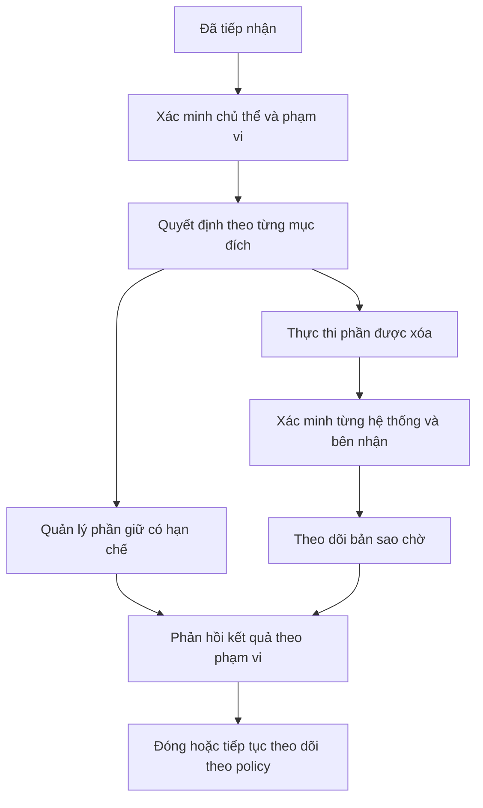

# Data deletion

## 1. Yêu cầu xóa dữ liệu trong thiết kế quyền riêng tư

Data deletion là khả năng tiếp nhận, đánh giá, thực hiện và chứng minh việc xóa dữ liệu theo phạm vi, mục đích xử lý và điều kiện áp dụng. Trong thiết kế quyền riêng tư, yêu cầu này bao gồm cả cách phục vụ chủ thể dữ liệu, quyết định giữ lại phần nào và điều phối các hệ thống đang xử lý dữ liệu.

Ví dụ, một khách hàng yêu cầu xóa thông tin đã cung cấp cho dịch vụ. Khóa đăng nhập của khách hàng không tự xử lý hồ sơ CRM, phản hồi hỗ trợ, dữ liệu phân tích hoặc bản sao đã gửi sang nhà cung cấp. Ngược lại, một yêu cầu xóa hồ sơ quảng bá có thể không yêu cầu đóng toàn bộ tài khoản.

Đặc tả cần trả lời được:

- Ai yêu cầu, yêu cầu liên quan đến chủ thể nào và bằng chứng xác minh nào là đủ?
- Dữ liệu nào thuộc phạm vi, đang phục vụ mục đích gì và nằm ở những hệ thống nào?
- Phần nào được xóa, phần nào cần quyết định riêng, ai chịu trách nhiệm?
- Khi nào phải dừng sử dụng, khi nào hoàn tất ở kho vận hành và các bản sao còn lại?
- Làm thế nào để ngăn nhập lại dữ liệu và thông báo kết quả đúng với những gì đã thực hiện?

NIST Privacy Framework 1.0 đề cập khả năng truy cập phần tử dữ liệu để xóa, hủy dữ liệu theo policy, tối thiểu hóa audit và kiểm tra các biện pháp kỹ thuật tại nhóm CT.DM-P. Đây là các điểm tham khảo để chuyển mục tiêu quyền riêng tư thành yêu cầu hệ thống. Xem [NIST Privacy Framework 1.0 — Core](https://www.nist.gov/system/files/documents/2021/05/05/NIST-Privacy-Framework-V1.0-Core-PDF.pdf).

Việc xác định nghĩa vụ và thời hạn pháp lý cần theo phạm vi áp dụng của dự án. Ngôn ngữ tiếng Việt của bài học không tự xác định hệ thống chịu quy định của quốc gia nào.

## 2. Xóa dữ liệu, đóng tài khoản và các hành động liên quan

| Hành động | Kết quả trực tiếp | Quyết định còn cần làm rõ |
|---|---|---|
| Vô hiệu hóa tài khoản | Người dùng không còn đăng nhập theo luồng đó | Dữ liệu hồ sơ, lịch sử và bản sao được xử lý thế nào? |
| Thu hồi phiên hoặc token | Hạn chế khả năng sử dụng credential | Dữ liệu đã lưu hoặc đã xuất có còn tồn tại không? |
| Xóa nội dung do người dùng chọn | Xử lý một tài liệu, bài viết hoặc bản ghi | Dữ liệu liên quan đến chủ thể ở nơi khác có thuộc yêu cầu không? |
| Xóa dữ liệu cá nhân theo yêu cầu | Xử lý các nhóm dữ liệu đã được quyết định | Có ngoại lệ, bản sao chờ hoặc bên nhận cần theo dõi không? |
| Xóa theo retention | Xử lý dữ liệu khi đạt điều kiện hết hạn | Mốc tính, hold và việc gia hạn đã được quản lý ra sao? |
| Hạn chế sử dụng | Giữ dữ liệu trong phạm vi được phép nhưng ngừng một số xử lý | Ai được đọc và khi nào cần đánh giá lại? |
| Ẩn danh dữ liệu | Biến đổi dữ liệu theo mục tiêu ẩn danh đã đánh giá | Kết quả có thực sự đáp ứng mục tiêu và quyết định được phê duyệt không? |

Thay email bằng UUID hoặc đặt `deleted = true` không tự chứng minh hoàn tất yêu cầu xóa dữ liệu cá nhân. Mỗi hành động cần một ý nghĩa sản phẩm và một mức bảo đảm có thể kiểm tra.

Trong bối cảnh GDPR, hướng dẫn EDPB mô tả quyền xóa có điều kiện áp dụng và các trường hợp ngoại lệ. Chẳng hạn, việc rút consent gắn với xem xét có còn cơ sở khác cho xử lý hay không; không phải mọi yêu cầu đều dẫn đến xóa mọi dữ liệu. Xem [EDPB — Right to erasure](https://www.edpb.europa.eu/sme/be-compliant/respect-individuals-rights_en#right-to-erasure-right-to-be-forgotten). Đây là ví dụ theo một khuôn khổ cụ thể, không phải quy tắc pháp lý chung cho mọi dự án.

Từ góc độ kỹ thuật, hệ thống cần biểu diễn được các quyết định khác nhau theo từng nhóm dữ liệu. Một cờ “đã xóa tài khoản” khó đáp ứng nhu cầu này nếu nó che khuất phần còn đang giữ hoặc chờ xử lý.

## 3. Phạm vi dữ liệu phải được xác định theo chủ thể và mục đích

### 3.1. Lập bản đồ dữ liệu và nơi nhận

Một chủ thể có thể xuất hiện dưới nhiều ID: mã tài khoản, mã khách hàng CRM, mã giao dịch, ID thiết bị hoặc mã do đối tác cấp. Muốn thực hiện đúng yêu cầu, dự án cần biết quan hệ giữa các ID và chất lượng của phép đối chiếu.

Danh mục phục vụ xóa cần ghi ít nhất nhóm dữ liệu, mục đích xử lý, hệ thống chứa, chủ sở hữu, thời hạn giữ, bên nhận và cơ chế xử lý yêu cầu.

Ví dụ tự xây dựng cho một dịch vụ đăng ký:

| Nhóm dữ liệu | Mục đích được ghi nhận | Nơi lưu minh họa | Quyết định cần có |
|---|---|---|---|
| Hồ sơ hiển thị | Cung cấp tính năng tài khoản | Dịch vụ hồ sơ, cache | Xóa những trường nào, thời điểm dừng phục vụ |
| Danh sách tiếp thị | Gửi nội dung theo lựa chọn đã quản lý | CRM, dịch vụ gửi thư | Ngừng sử dụng và xử lý bản sao tại bên nhận |
| Giao dịch | Thực hiện và đối soát giao dịch | Hệ thống nghiệp vụ | Tách phần được xóa và phần có căn cứ giữ cụ thể |
| Phiếu hỗ trợ | Giải quyết yêu cầu hỗ trợ | Helpdesk, tệp đính kèm | Xét nội dung tự do và thông tin của người khác |
| Sự kiện phân tích | Phân tích việc sử dụng dịch vụ | Kho sự kiện, data warehouse | Xử lý ID, dữ liệu dẫn xuất và các lần xuất |
| Tài liệu và bản xuất | Cung cấp tài liệu hoặc báo cáo | Object storage, staging | Xóa phiên bản, preview và ngừng phân phối |
| Hồ sơ yêu cầu xóa | Theo dõi thực thi và giải thích kết quả | Hệ thống quản lý yêu cầu | Chỉ giữ metadata cần thiết theo retention riêng |

Bảng không khẳng định nhóm dữ liệu nào luôn được phép giữ. Mỗi quyết định cần một căn cứ được phê duyệt cho đúng mục đích và bối cảnh.

### 3.2. Dữ liệu không có tài khoản và tài liệu nhiều chủ thể

Một người có thể liên hệ dịch vụ trước khi tạo tài khoản, sử dụng dịch vụ như khách hoặc xuất hiện trong dữ liệu do người khác cung cấp. Luồng xử lý cần có cách tìm và đối chiếu các trường hợp đó theo thông tin sẵn có.

Với phiếu hỗ trợ chứa cả thông tin của người yêu cầu và người khác, cần quyết định ở mức trường, đoạn nội dung hoặc bản sao. Xóa toàn bộ tài liệu chỉ vì có tên của một người có thể làm mất dữ liệu ngoài phạm vi.

Người quản trị một tenant cũng không tự có quyền thay mọi chủ thể yêu cầu xóa dữ liệu ở mọi mục đích. Phải tách quyền quản trị tài nguyên của tổ chức với quyền đại diện cho cá nhân theo quy trình áp dụng.

### 3.3. Xác định đầy đủ các bản sao thuộc trách nhiệm

Ngoài kho chính, cần kiểm kê cache, search index, replica, queue, dead-letter queue, kho phân tích, export, log, snapshot, backup và nhà cung cấp.

Đối với dữ liệu đã tải về thiết bị người nhận, hệ thống cần ghi rõ cơ chế và giới hạn kiểm soát. Không báo “đã xóa mọi bản sao” chỉ vì đã thu hồi một liên kết tải.

## 4. Tiếp nhận và xác minh yêu cầu

### 4.1. Kênh yêu cầu phải rõ và có thể sử dụng

Dự án cần xác định kênh tiếp nhận: trong tài khoản, biểu mẫu, email hoặc quy trình hỗ trợ. Người dùng cần biết cách gửi yêu cầu, thông tin cần cung cấp, cách theo dõi và hậu quả đối với dịch vụ.

Nếu xóa tài khoản có thể làm mất nội dung hoặc dừng một tác vụ đang chạy, hãy giải thích tác động trước bước xác nhận cần thiết. Không buộc người dùng đi qua ưu đãi giữ chân hoặc các bước không phục vụ xác minh và quyết định yêu cầu.

Một luồng xác nhận nên phân biệt “đã nhận yêu cầu” với “đã hoàn tất xóa”. Mã theo dõi không được tự trở thành bằng chứng cho phép người giữ mã xem dữ liệu chi tiết của chủ thể.

### 4.2. Xác minh tương xứng với rủi ro

Yêu cầu giả mạo có thể làm mất dữ liệu của người khác. Mặt khác, thu thêm quá nhiều giấy tờ để xử lý yêu cầu lại tạo thêm dữ liệu cần bảo vệ.

Có thể tận dụng phiên đã xác thực, cơ chế xác thực lại phù hợp hoặc thông tin đã có để kiểm tra. Khi không còn truy cập tài khoản, cần một luồng thay thế được phê duyệt; không mặc định buộc người dùng tạo tài khoản mới.

EDPB nêu trong hướng dẫn GDPR rằng khi có nghi ngờ hợp lý về danh tính, tổ chức có thể yêu cầu thông tin bổ sung để xác nhận. Xem [EDPB — How to handle data subject rights request](https://www.edpb.europa.eu/sme/be-compliant/respect-individuals-rights_en#how-to-handle-data-subject-rights-request).

Đặc tả kỹ thuật cần nêu:

- Tín hiệu nào dẫn đến yêu cầu xác minh bổ sung.
- Loại bằng chứng nào được chấp nhận và ai được đánh giá.
- Kênh truyền, quyền truy cập và thời hạn xử lý bằng chứng.
- Cách xác minh người đại diện khi có áp dụng.
- Cách xử lý không đủ thông tin mà không tiết lộ dữ liệu ngoài quyền.

Không ghi bản giấy tờ hoặc câu trả lời xác minh vào log ứng dụng. Nếu cần lưu chứng cứ, phải có vùng lưu và policy riêng cho chính dữ liệu đó.

### 4.3. Chống lạm dụng mà vẫn duy trì khả năng tiếp nhận

Rate limit có thể bảo vệ biểu mẫu nhưng cần một đường xử lý hợp lệ cho người bị chặn nhầm. Phản hồi công khai không nên tiết lộ một email có tài khoản hay chủ thể đó đã từng yêu cầu xóa.

Yêu cầu qua link email cần cơ chế token, thời hạn và chống phát lại phù hợp. Nếu link có thể kích hoạt hành động không thể hoàn tác, không để một lượt mở link tự động của công cụ quét email thay cho bước xác nhận theo thiết kế.

## 5. Quyết định xóa theo từng nhóm dữ liệu

### 5.1. Một yêu cầu có thể có nhiều kết quả

Người chịu trách nhiệm policy cần quyết định riêng cho mỗi phần dữ liệu:

| Kết quả | Ý nghĩa | Thông tin cần lưu |
|---|---|---|
| Được xóa | Phạm vi đã đủ điều kiện để thực thi | Mục tiêu, phương pháp, mốc thời gian và chủ sở hữu |
| Cần bổ sung thông tin | Chưa đủ căn cứ xác định chủ thể hoặc phạm vi | Thông tin còn thiếu, cách liên hệ và người xử lý |
| Giữ lại một phần | Có căn cứ được phê duyệt cho phần cụ thể | Phạm vi tối thiểu, mục đích được phép, mốc hết giữ hoặc đánh giá lại |
| Chờ xử lý bản sao | Phần vận hành có thể đã xong nhưng còn đích chờ | Nơi còn giữ, biện pháp hạn chế, thời hạn và bằng chứng cần có |
| Không chấp nhận một phần | Quyết định theo quy trình áp dụng | Lý do và cách phản hồi, xem xét lại theo trách nhiệm đã định |

Không dùng “có thể cần cho phân tích sau này” làm một lý do kỹ thuật để giữ mọi thứ. Nhóm triển khai cần nhận quyết định có cấu trúc, thay vì tự suy ra căn cứ giữ từ việc dữ liệu đang nằm trong database.

### 5.2. Dữ liệu giữ lại cần hạn chế đúng mục đích

Giả sử policy của dự án đã xác nhận một phần chứng từ giao dịch phải giữ cho mục đích đối soát cụ thể. Điều đó không tự cho phép tiếp tục dùng cùng dữ liệu để gửi tiếp thị hoặc cá nhân hóa.

Có thể cần tách bản lưu giữ, giới hạn các trường, hạn chế người đọc và ngăn nó đi vào luồng xử lý thông thường. Retention cần có mốc kết thúc hoặc điều kiện đánh giá lại, với chủ sở hữu chịu trách nhiệm.

Một hold phải gắn với phạm vi và phiên bản quyết định. Worker cần kiểm tra lại điều kiện trước thao tác không thể hoàn tác theo thiết kế. Nếu quyết định thay đổi sau khi một phần đã xóa, không hứa có thể tự phục hồi phần đó để đáp ứng hold mới.

### 5.3. Mẫu quyết định phục vụ thực thi

```text
requestId
subjectRef và ngữ cảnh đối chiếu đã xác minh
actorRef / thông tin đại diện theo phạm vi cần thiết
dataCategory + processingPurpose
targetSystems
decision: DELETE / RETAIN_RESTRICTED / NEEDS_REVIEW
decisionReasonRef
policyVersion
receivedAt
executionEligibleAt
responseDueAt
executionDueAt
retentionReviewAt nếu có
```

Mẫu mô tả thông tin cần thiết, không bắt buộc một schema cụ thể. Các reference phải được quản lý như dữ liệu có thể liên kết với chủ thể.

Đặc biệt, ngày nhận yêu cầu và ngày đủ điều kiện thực thi là hai mốc khác nhau. Việc worker chạy muộn hoặc xác minh kéo dài không được tự đặt lại đồng hồ phản hồi của toàn yêu cầu.

## 6. Trạng thái workflow và trách nhiệm

### 6.1. Tách xử lý yêu cầu khỏi xử lý các bản sao



Đã gửi phản hồi không đồng nghĩa mọi tác vụ kỹ thuật đều hoàn tất. Hệ thống cần thể hiện riêng trạng thái vụ việc, kết quả từng nhóm dữ liệu và trạng thái từng đích thực thi.

Một trường hợp có thể đã phản hồi cho người dùng, đã xử lý kho vận hành và vẫn còn backup chờ hết retention. Nếu contract cho phép cách xử lý đó, thông báo và hồ sơ cần phản ánh đúng phần còn theo dõi.

### 6.2. Phân vai

- Bộ phận tiếp nhận theo dõi thời hạn và liên hệ với chủ thể.
- Chủ sở hữu dữ liệu xác nhận hệ thống, mục đích và các quan hệ định danh.
- Chủ sở hữu policy hoặc vai trò được giao quyết định điều kiện, ngoại lệ và phạm vi giữ.
- Dịch vụ điều phối và các worker thực thi kế hoạch đã được chấp nhận.
- Chủ sở hữu hệ thống hạ nguồn xác nhận kết quả và xử lý lỗi.
- Vai trò xác minh hoặc kiểm toán kiểm tra bằng chứng theo trách nhiệm.

Với người xử lý yêu cầu bằng giao diện quản trị, cần authorization, tenant isolation và audit. Quyền xem vụ việc không mặc nhiên cho quyền xóa hoặc thay đổi căn cứ giữ.

Một ca quá hạn cần chủ sở hữu và cơ chế escalation. Không để nó biến mất trong hàng đợi vì một hệ thống hạ nguồn chưa tích hợp xong.

## 7. Chuyển quyết định thành tác vụ kỹ thuật có thể kiểm soát

### 7.1. Kế hoạch phải liên kết với inventory

Với mỗi phần được xóa, coordinator cần xác định các hệ thống đích và thao tác được phê duyệt. Không chỉ phát một sự kiện “user deleted” rồi mặc định mọi consumer đã xử lý đúng.

Một tác vụ cần gắn với yêu cầu, chủ thể đã được đối chiếu, tenant, thế hệ đối tượng, nhóm dữ liệu, mục đích và policy. Payload chỉ nên chứa thông tin cần cho định tuyến và xác minh; không sao chép toàn bộ hồ sơ cá nhân vào message.

Mã giả minh họa:

```text
for each decisionPart in approvedPlan:
    if decisionPart.action == DELETE:
        createScopedTasks(decisionPart, knownTargetSystems)

    if decisionPart.action == RETAIN_RESTRICTED:
        applyApprovedRestrictions(decisionPart)
        scheduleRetentionReview(decisionPart)

trackEachTaskUntilItsRequiredEvidenceIsAvailable()
```

Tác vụ bị timeout chưa có kết quả xác minh. Coordinator cần phân biệt chưa gửi, đã tiếp nhận, đang chạy, đã xử lý, đã xác minh và lỗi theo contract của từng đích.

### 7.2. Chặn sử dụng trong thời gian thực thi

Nếu một quyết định yêu cầu ngừng một mục đích xử lý, phải áp dụng cho đường đọc, tác vụ nền, export và tích hợp tương ứng. Việc dữ liệu còn chờ dọn không phải lý do để tiếp tục sử dụng ngoài phạm vi đã quyết định.

Ví dụ, bản ghi tiếp thị đang chờ xóa tại dịch vụ gửi thư phải bị loại khỏi job xây danh sách gửi mới. Một tác vụ đã có bản sao danh sách trước đó cũng cần chính sách kiểm tra hoặc hủy phù hợp.

Ngược lại, phần dữ liệu được giữ hạn chế cho mục đích riêng cần có đường truy cập đúng với quyết định giữ. Không dùng một cơ chế chặn toàn tài khoản để thay cho mọi quyền theo mục đích nếu điều đó làm hỏng phạm vi nghiệp vụ đã được chấp nhận.

### 7.3. Retry, đồng thời và chống nhập lại

Tác vụ cần chạy lại an toàn khi mạng lỗi hoặc worker dừng. Cùng một request không được mở rộng phạm vi sang tenant khác; một tác vụ cũ cũng không được xóa dữ liệu của tài khoản mới dùng lại email.

Cần xử lý các nguồn có thể tái tạo dữ liệu: queue cũ, CRM đồng bộ lại, import định kỳ, replica hoặc backup. Một deletion ledger hoặc cơ chế tương đương có thể giữ quyết định để các luồng này đối soát.

Dữ liệu dùng chống nhập lại vẫn cần mục đích, quyền truy cập và retention riêng. Không giữ nguyên hồ sơ người dùng trong một bảng tên “suppression” rồi kết luận đã xóa.

Nếu cần một reference để đối chiếu, phải đánh giá khả năng liên kết và khôi phục nó. Hash một email không tự biến reference đó thành dữ liệu ẩn danh. Quyết định lưu reference cần được phê duyệt theo đúng mục đích giới hạn.

## 8. Bản sao, dữ liệu dẫn xuất và phục hồi

### 8.1. Xử lý theo từng loại bản sao

| Loại đích | Điều cần kiểm chứng |
|---|---|
| Database và replica | Các trường, dòng và quan hệ thuộc quyết định đã được xử lý; replica chậm không trả dữ liệu ngoài policy |
| Cache và tìm kiếm | Nội dung, đoạn trích và kết quả cũ không tiếp tục được phục vụ; rebuild không đưa dữ liệu quay lại |
| Tệp và object | Version, preview, thumbnail, staging và artifact xuất liên quan được đưa vào kế hoạch |
| Queue và dead-letter queue | Payload có retention phù hợp; replay không làm mất hiệu lực quyết định xóa |
| Kho phân tích | Các ID và dữ liệu liên quan được xử lý theo phạm vi; pipeline không lấy lại từ nguồn cũ |
| Log, trace và audit | Tối thiểu hóa từ thiết kế; dữ liệu thuộc phạm vi được xử lý theo policy đã xác định |
| Backup và snapshot | Theo dõi retention, quyền phục hồi và cách áp dụng lại quyết định xóa trước khi mở sử dụng |
| Dữ liệu dẫn xuất | Đánh giá khả năng còn liên quan đến chủ thể và biện pháp cần áp dụng cho mục đích cụ thể |

Không tự coi mọi số liệu tổng hợp là ngoài phạm vi dữ liệu cá nhân. Một nhóm nhỏ hoặc một chuỗi hoạt động có thể vẫn cho phép liên kết. Nếu giữ dữ liệu bằng cách ẩn danh, cần quyết định và bằng chứng cho kết quả đó.

Tương tự, xóa bản ghi huấn luyện không chứng minh mọi ảnh hưởng đã biến mất khỏi mô hình. Nếu có mô hình trong phạm vi, dự án phải đánh giá và xác định yêu cầu riêng, thay vì cam kết một thao tác kỹ thuật không được hỗ trợ.

### 8.2. Backup không xóa được từng hồ sơ cần xử lý rõ

Dự án phải biết backup có cho phép xử lý chọn lọc không. Khi không hỗ trợ, kế hoạch cần xác định thời hạn tồn tại, hạn chế truy cập, điều kiện restore và cách đối soát yêu cầu xóa.

Một bản sao chờ hết retention cần có trạng thái và thời hạn. Sự tồn tại của backup không được dùng để giữ dữ liệu trong kho phục vụ thông thường ngoài quyết định.

Quy trình cũng cần bao phủ bản sao dùng thử restore, archive và snapshot vùng khác. Sao chép backup cũ sang vị trí mới không được tự làm mất dấu phạm vi dữ liệu và thời hạn cần xử lý.

### 8.3. Phục hồi phải giữ hiệu lực quyết định quyền riêng tư

Tình huống giả lập:

```text
Ngày 1: tạo snapshot có dữ liệu của chủ thể P
Ngày 2: yêu cầu xóa của P được quyết định và thực thi
Ngày 3: khôi phục snapshot ngày 1
```

Môi trường phục hồi cần được cách ly khỏi luồng phục vụ và xử lý thông thường cho đến khi đối soát các quyết định phát sinh sau snapshot. Những hệ thống được rebuild từ dữ liệu phục hồi cũng phải tuân theo quyết định đó.

Nếu nguồn quyết định xóa bị phục hồi về ngày 1, thông tin về yêu cầu ngày 2 có thể mất. Vì vậy, ledger hoặc nguồn quyết định tương đương cần có cơ chế độ bền, phục hồi và mốc đủ mới được kiểm tra.

Nếu chưa xác minh được nguồn quyết định đủ mới, không mở dữ liệu phục hồi cho người dùng theo một giả định rằng job dọn sẽ chạy sau.

## 9. Nhà cung cấp, bên nhận và trách nhiệm theo dõi

### 9.1. Một tổ chức có thể có nhiều vai trò

Cần xác định bên nào quyết định mục đích xử lý, bên nào xử lý theo chỉ dẫn và bên nào tự chịu trách nhiệm cho xử lý của mình theo bối cảnh áp dụng.

Từ đó, contract phải nêu cơ chế gửi yêu cầu, phạm vi, mã đối soát, thời hạn, bằng chứng và đường escalation. Không giả định mọi bên nhận đều có cùng API hoặc cùng quyền thực hiện một lệnh xóa.

Trong một tích hợp, có thể phải gửi yêu cầu xử lý hoặc thông báo kết quả theo trách nhiệm đã xác định. Việc lựa chọn nội dung và căn cứ thuộc quy trình được phê duyệt, không do worker tự suy đoán.

### 9.2. Xác nhận tiếp nhận khác với xác nhận thực hiện

Một webhook trả HTTP 202 có thể chỉ xác nhận đã nhận tác vụ. Hệ thống cần biết phản hồi nào là bằng chứng hoàn tất và nó bao phủ dữ liệu, bản sao hoặc mục đích nào.

Một mô hình theo dõi có thể gồm:

```text
NOT_REQUESTED
    → REQUEST_SENT
    → ACCEPTED
    → EXECUTION_REPORTED
    → VERIFIED_TO_CONTRACT

Nhánh khác:
    → RETRY_PENDING / NEEDS_REVIEW / OVERDUE
```

Các trạng thái này là lựa chọn thiết kế minh họa. Dự án phải đối chiếu ý nghĩa phản hồi thực tế của đối tác và điều kiện xác minh đã thống nhất.

Nếu đối tác lỗi, yêu cầu còn phần chưa hoàn tất. Cần theo dõi retry, cảnh báo, chủ sở hữu và cách thông báo giới hạn, đồng thời giữ các hạn chế xử lý liên quan theo quyết định.

### 9.3. Chỉ gửi thông tin cần thiết cho xử lý

Yêu cầu tới đối tác nên dùng mã đối tác đã được quản lý hoặc reference đủ để xác định đúng dữ liệu. Không gửi cả tập hồ sơ cá nhân qua nhiều hệ thống để yêu cầu họ xóa.

Cần bảo vệ kênh, danh tính workload và quyền gọi API xóa. Phản hồi hoặc bằng chứng của đối tác cũng có thể chứa dữ liệu cần bảo vệ; không đưa nguyên nội dung vào log công khai hoặc công cụ hỗ trợ có quyền quá rộng.

## 10. Ví dụ đặc tả đo được và ma trận rủi ro

### 10.1. Bối cảnh và các mốc minh họa

Giả sử một dịch vụ đăng ký có hồ sơ, CRM tiếp thị, helpdesk, kho phân tích và nhà cung cấp gửi thư. Một phần dữ liệu giao dịch chỉ được giữ nếu đã có quyết định căn cứ riêng.

Nhóm dự án chọn các mục tiêu nội bộ sau:

- Gửi xác nhận đã nhận yêu cầu trong tối đa 24 giờ từ receivedAt.
- Phân công người xử lý và đánh giá ban đầu trong tối đa 3 ngày từ receivedAt.
- Quản lý responseDueAt theo policy áp dụng cho vụ việc; worker không tự sửa thời hạn này.
- t0 là thời điểm kế hoạch xóa đã đủ điều kiện và được ghi bền vững.
- Ngừng xử lý mới cho các mục đích nằm trong quyết định từ t0 + 60 giây trên các kênh do dịch vụ kiểm soát.
- Xử lý kho vận hành trong tối đa 24 giờ từ t0.
- Backup trong ví dụ có bản cuối chứa dữ liệu được tạo trước t0 + 24 giờ, giữ tối đa 30 ngày và xử lý hết hạn trong 24 giờ tiếp theo; giới hạn theo dõi tổng là 32 ngày từ t0.
- Gửi tác vụ cho đối tác trong 24 giờ từ t0; mục tiêu xác minh theo contract là 7 ngày, quá hạn phải escalation.
- Audit vụ việc giữ 90 ngày với schema metadata được phê duyệt.

**Đây là giả định minh họa, không phải thời hạn pháp lý chung.** receivedAt, responseDueAt và t0 phải được tách rõ. Đạt mục tiêu kỹ thuật tính từ t0 không tự chứng minh đã đáp ứng nghĩa vụ phản hồi tính từ lúc nhận yêu cầu.

Giới hạn backup chỉ đúng nếu toàn bộ chuỗi bản sao thỏa các giả định; bản sao thử restore cũng cần được đưa vào vòng đời đó. Phần có căn cứ giữ hoặc đối tác chưa xác minh phải có trạng thái riêng.

### 10.2. Ma trận yêu cầu

| Mã | Rủi ro | Hành vi bắt buộc | Bằng chứng nghiệm thu |
|---|---|---|---|
| DD-01 | Xóa nhầm người hoặc ngoài quyền | Xác minh chủ thể và người đại diện; kiểm tra quyền tác động tới phạm vi | Yêu cầu giả mạo, đổi tenant hoặc tham chiếu sang chủ thể khác không tạo tác vụ xóa hợp lệ |
| DD-02 | Bỏ sót dữ liệu ngoài tài khoản | Kế hoạch liên kết inventory, mục đích, ID và hệ thống đích | Bộ dữ liệu thử có bản ghi CRM, khách chưa có tài khoản và tệp hỗ trợ được xác định theo phạm vi đã duyệt |
| DD-03 | Giữ quá mức hoặc xóa phần cần giữ | Quyết định theo nhóm dữ liệu; phần giữ có phạm vi, quyền đọc và mốc đánh giá lại | Chỉ phần đã được quyết định giữ còn tồn tại; không đưa phần đó trở lại luồng tiếp thị hoặc phân tích ngoài quyền |
| DD-04 | Tiếp tục xử lý ngoài quyết định | Ngừng xử lý mới cho mục đích bị chấm dứt trong 60 giây từ t0 | Job tiếp thị và export mới không lấy dữ liệu thuộc quyết định; node có trạng thái quá cũ không được bỏ kiểm soát |
| DD-05 | Báo hoàn tất khi đích chưa xong | Theo dõi và xác minh từng đích; xử lý kho vận hành trong 24 giờ | Mô phỏng một đích timeout; toàn phạm vi chưa được đánh dấu hoàn tất và có retry theo policy |
| DD-06 | Import hoặc replay làm sống lại hồ sơ | Áp dụng quyết định xóa cho dữ liệu cũ theo đúng thế hệ đối tượng | Replay sự kiện và đồng bộ CRM không tái tạo dữ liệu cũ; tài khoản mới dùng lại email không bị xóa nhầm |
| DD-07 | Backup mở lại dữ liệu đã xử lý | Quản lý bản sao theo giới hạn 32 ngày và đối soát quyết định trước restore phục vụ | Phục hồi snapshot trước t0 trong môi trường thử; dữ liệu mục tiêu không quay lại khi mở sử dụng |
| DD-08 | Mất dấu phần tại nhà cung cấp | Theo dõi tác vụ đối tác, ý nghĩa phản hồi và thời hạn contract | HTTP 202 chỉ ở trạng thái tiếp nhận; đối tác quá 7 ngày được escalation, không ghi thành đã xác minh |
| DD-09 | Bằng chứng làm phát sinh bản sao mới | Log và audit chỉ có metadata đã duyệt; bằng chứng xác minh có vùng lưu riêng | Đường thành công và lỗi không ghi payload hồ sơ hoặc giấy tờ xác minh vào telemetry |
| DD-10 | Thời hạn bị kéo dài không kiểm soát | Giữ receivedAt, responseDueAt và lịch sử quyết định; mọi thay đổi hạn cần căn cứ theo policy | Retry, đổi worker hoặc bổ sung đích không tự đặt lại đồng hồ; vụ việc gần quá hạn có cảnh báo |
| DD-11 | Thông báo kết quả gây hiểu nhầm | Phân biệt đã tiếp nhận, đã xử lý vận hành, phần giữ và phần đang chờ | Thông báo không tuyên bố mọi dữ liệu đã biến mất khi backup hoặc đối tác còn trạng thái chờ |
| DD-12 | Ngoại lệ không được đánh giá lại | Có chủ sở hữu, mốc review và tác vụ khi căn cứ giữ hết hiệu lực | Hold thử hết hạn tạo đánh giá hoặc tác vụ tiếp theo; không giữ vô thời hạn vì cờ trạng thái cũ |

Mỗi yêu cầu cần liên kết tới thành phần thực thi, người chịu trách nhiệm, policy và bằng chứng. Các mã trên chỉ dùng cho ví dụ, không phải chứng nhận hệ thống đã đáp ứng.

### 10.3. Tiêu chí chấp nhận cho giữ một phần

```gherkin
Given yeu cau R da duoc xac minh
And policy cho phep xoa ho so tiep thi cua P
And mot phan du lieu giao dich co quyet dinh giu han che duoc phe duyet
When ke hoach cua R duoc thuc thi
Then ho so tiep thi duoc xu ly theo pham vi da duyet
And du lieu giu lai chi duoc truy cap cho muc dich da dinh
And ket qua cua R neu ro phan giu va moc danh gia lai
And khong co thong bao rang moi du lieu cua P da bi xoa
```

### 10.4. Tiêu chí chấp nhận cho đối tác chưa hoàn tất

```gherkin
Given kho van hanh noi bo da duoc xac minh xu ly
And doi tac moi xac nhan tiep nhan yeu cau
When he thong tao bao cao ket qua
Then phan doi tac van co trang thai dang cho
And co chu so huu va han theo doi theo contract
And bao cao khong doi ACCEPTED thanh VERIFIED
```

Đây là tiêu chí để xây dựng kiểm thử cho dự án, không phải thông báo rằng việc xóa trên một dịch vụ thực tế đã được thực hiện.

## 11. Kiểm thử toàn luồng và quản lý thay đổi

### 11.1. Các tình huống cần bao phủ

Một kế hoạch kiểm thử có thể dùng dữ liệu giả lập với các quan hệ đã biết:

1. **Xác minh và authorization:** chủ thể hợp lệ, người đại diện hợp lệ, yêu cầu giả mạo, tenant khác và quyền quản trị thiếu.
2. **Độ đầy đủ của phạm vi:** bản ghi không có tài khoản, nhiều ID, trường lồng nhau, nội dung tự do và tệp nhiều chủ thể.
3. **Quyết định hỗn hợp:** phần được xóa, phần cần giữ, phần cần thêm thông tin và thay đổi quyết định.
4. **Lỗi kỹ thuật:** timeout, message trùng, worker crash, đích offline và retry sau thành công chưa nhận phản hồi.
5. **Chống tái tạo:** CRM import cũ, queue replay, dựng lại search và snapshot trước yêu cầu.
6. **Bên nhận:** tiếp nhận nhưng chưa xử lý, xác nhận một phần, quá hạn và phản hồi thiếu bằng chứng.
7. **Thời gian:** sát deadline, các mốc khác nhau, tác vụ chạy qua ngày và việc thay đổi cấu hình policy.
8. **Minh bạch:** thông báo, giao diện theo dõi và hồ sơ audit khớp cùng một trạng thái.

Một lần không tìm thấy email trong database chưa đủ để kết luận không còn dữ liệu liên quan. Kiểm tra cần dựa trên inventory, các quan hệ đối chiếu và đường đọc thực tế.

Đồng thời, bài kiểm thử không nên giữ nguyên dữ liệu thật trong báo cáo lỗi. Dữ liệu giả lập và reference được kiểm soát giúp xác minh hành vi mà không tạo thêm bản sao không cần thiết.

### 11.2. Bằng chứng phục vụ giải thích kết quả

Có thể lưu request ID, schema và policy version, các mốc thời gian, kết quả từng đích, quyết định giữ, tham chiếu bằng chứng và lịch sử phản hồi. Không cần lưu toàn bộ hồ sơ nguồn để chứng minh nó đã được xử lý.

Cần phân biệt bằng chứng máy báo thực thi thành công với kết quả xác minh theo contract. Ví dụ, có receipt từ worker nhưng inventory cho thấy một object version chưa được xử lý thì chưa đủ điều kiện kết luận toàn phần đó hoàn tất.

Thời hạn giữ audit, hồ sơ xác minh danh tính và ledger chống tái tạo có thể khác nhau vì phục vụ các mục đích khác nhau. Mỗi loại cần lý do, chủ sở hữu và quy tắc dọn riêng.

### 11.3. Quy trình phải đi theo thay đổi kiến trúc

Khi thêm SDK, nhà cung cấp, bảng mới, field ghi chú hoặc pipeline phân tích, cần cập nhật inventory và khả năng xử lý yêu cầu xóa trước khi dữ liệu thật đi vào luồng mới.

Một yêu cầu phát triển hữu ích là mọi nơi lưu dữ liệu cá nhân mới phải khai báo chủ sở hữu, ID liên kết, mục đích, retention và cách tham gia workflow. Việc chỉ cập nhật privacy notice không tạo ra cơ chế kỹ thuật để xử lý dữ liệu đã lan truyền.

Khi phát hiện bỏ sót một hệ thống, cần khoanh vùng các vụ việc bị ảnh hưởng, đánh giá lại trạng thái, thực hiện phần còn thiếu và điều chỉnh thông báo theo quy trình. Không giữ trạng thái hoàn tất cũ chỉ vì nó đã từng được hiển thị.

## 12. Phản hồi kết quả và những lỗi đặc tả phổ biến

### 12.1. Thông báo cần đúng với phạm vi

Ví dụ thông báo cho một vụ việc giả lập:

> Phần hồ sơ và dữ liệu tiếp thị trong phạm vi được chấp nhận đã được xử lý ở các hệ thống vận hành. Một phần dữ liệu giao dịch đang được giữ với mục đích và thời hạn đã thông báo. Các bản sao lưu còn lại được theo dõi theo lịch xử lý; dữ liệu từ đó không được đưa lại vào sử dụng trước khi áp dụng quyết định của yêu cầu này.

Thông báo thực tế cần nêu thông tin phù hợp vụ việc, mốc dự kiến hoặc điều kiện đánh giá lại, phần chưa đáp ứng và kênh liên hệ. Không đưa chi tiết bảo mật nội bộ hoặc thông tin của người khác vào thông báo.

Kênh phản hồi phải còn sử dụng được sau khi tài khoản đóng. Cần xác định cách người yêu cầu nhận kết quả hoặc tra cứu với quyền phù hợp mà không mở lại tài khoản đã xử lý.

### 12.2. Các câu cần viết rõ hơn

| Câu còn mơ hồ | Điều cần bổ sung |
|---|---|
| “Người dùng có thể xóa dữ liệu” | Kênh, xác minh, phạm vi, điều kiện quyết định và người chịu trách nhiệm |
| “Đóng tài khoản là đã xóa” | Những nhóm dữ liệu còn lại, mục đích và trạng thái từng hệ thống |
| “Phải đăng nhập mới yêu cầu được” | Luồng thay thế cho người không có hoặc không còn truy cập tài khoản |
| “Giữ dữ liệu vì nghiệp vụ” | Phạm vi tối thiểu, căn cứ được phê duyệt, quyền dùng và mốc review |
| “Đã gửi yêu cầu cho đối tác” | Ý nghĩa xác nhận, bằng chứng hoàn tất, hạn và escalation |
| “Xóa trong 24 giờ” | Mốc tính, các đích, phần ngoại lệ, backup và cách xác minh |
| “Không còn dữ liệu cá nhân” | Inventory, dữ liệu dẫn xuất, reference còn giữ và giới hạn kết luận |
| “Lưu hồ sơ để chứng minh” | Metadata cần thiết, vùng lưu bằng chứng, quyền truy cập và retention |

Một đặc tả data deletion hoàn chỉnh cần nối được **yêu cầu của chủ thể → xác minh → quyết định theo mục đích → phạm vi hệ thống và bên nhận → thực thi và chống tái tạo → bằng chứng → phản hồi đúng trạng thái**. Chuỗi này giúp nhóm phát triển biến một cam kết quyền riêng tư thành hành vi có thể đo và kiểm chứng trong vòng đời sản phẩm.
