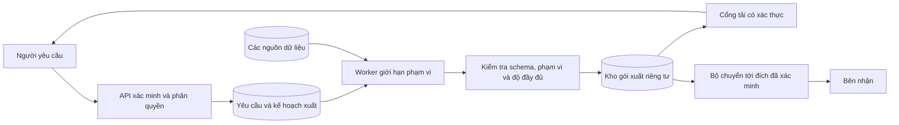

# Data portability

## 1. Từ quyền kiểm soát dữ liệu đến yêu cầu hệ thống

Data portability là khả năng nhận dữ liệu trong định dạng có thể tái sử dụng và chuyển dữ liệu đó sang một hệ thống hoặc bên nhận khác trong phạm vi được xác định. Một chức năng tải báo cáo chỉ đáp ứng mục tiêu này nếu dữ liệu đúng phạm vi, có cấu trúc, giữ được ý nghĩa và có thể được hệ thống khác xử lý.

Trong chương **Privacy requirement**, đây đồng thời là một yêu cầu sản phẩm và một vấn đề bảo vệ dữ liệu. Gói xuất thường tập hợp nhiều thông tin cá nhân vốn nằm rải rác ở các dịch vụ. Nếu cấp sai người, sai phạm vi hoặc sai đích, chức năng phục vụ người dùng có thể trở thành đường lấy dữ liệu hàng loạt.

Thiết kế cần chuyển mục tiêu “người dùng có thể mang dữ liệu đi” thành câu trả lời kiểm chứng được:

- Ai được yêu cầu, cho chủ thể nào và theo phạm vi nào?
- Những dữ liệu nào được đưa vào, loại trừ hoặc xử lý riêng?
- Định dạng có giữ kiểu dữ liệu, quan hệ và ý nghĩa để tái sử dụng không?
- Dữ liệu được chốt tại thời điểm nào và cách phát hiện thiếu phần ra sao?
- Ai được tải hoặc nhận trực tiếp, trong bao lâu và với cách xác minh nào?
- Làm sao chứng minh đã hoàn thành mà không làm lộ thêm dữ liệu trong log, thông báo hoặc tệp tạm?

Bài học dùng nền tảng học trực tuyến nhiều tenant làm ví dụ. Người học muốn nhận hồ sơ, danh sách học và các dữ liệu hoạt động thuộc phạm vi đã duyệt để sử dụng ở dịch vụ khác. Các mã, thời hạn và ngưỡng kỹ thuật trong bài là ví dụ thiết kế, không phải chuẩn bắt buộc cho mọi tổ chức.

## 2. Xác định phạm vi trước khi thiết kế nút Export

### 2.1. Phân biệt các nhu cầu gần nhau

| Nhu cầu | Mục đích | Điều không được suy ra |
|---|---|---|
| Truy cập dữ liệu cá nhân | Cho cá nhân biết dữ liệu đang được xử lý và thông tin liên quan theo phạm vi áp dụng | Không mặc định cùng tập dữ liệu và định dạng với portability |
| Data portability | Nhận và chuyển dữ liệu đủ điều kiện trong dạng tái sử dụng | Không có nghĩa được nhận toàn bộ cơ sở dữ liệu hoặc bí mật hệ thống |
| Backup tài khoản | Tạo bản dùng để khôi phục trạng thái theo thiết kế | Định dạng riêng của nhà cung cấp chưa chắc dùng được ở hệ thống khác |
| Export báo cáo | Phục vụ một tác vụ xem hoặc phân tích cụ thể | PDF tổng hợp không tự đáp ứng việc tái sử dụng dữ liệu chi tiết |
| Xóa hoặc đóng tài khoản | Kết thúc sử dụng và xử lý vòng đời dữ liệu | Tạo hoặc tải gói portability không tự thực hiện xóa |
| Chia sẻ dữ liệu liên tục | Cho bên nhận truy cập theo thời gian | Yêu cầu xuất một lần không tự cấp quyền tích hợp vô thời hạn |

Cần cho người dùng hiểu họ đang thực hiện thao tác nào. Không gắn nút “chuyển dữ liệu” với việc tự đóng tài khoản, hoặc coi nó là consent cho mục đích tiếp thị ở bên nhận.

### 2.2. Ví dụ pháp lý phải có điều kiện áp dụng

Trong phạm vi GDPR, Điều 20 quy định quyền nhận dữ liệu cá nhân liên quan đến chủ thể mà họ đã cung cấp, ở dạng có cấu trúc, thông dụng và máy đọc được, với các điều kiện như xử lý tự động và căn cứ consent hoặc hợp đồng được nêu trong điều khoản. Điều này cũng đề cập chuyển trực tiếp khi khả thi về kỹ thuật và bảo vệ quyền của người khác. [GDPR, Điều 20 trên EUR-Lex](https://eur-lex.europa.eu/eli/reg/2016/679)

Không suy ra rằng mọi dữ liệu của mọi dịch vụ tiếng Việt đều thuộc quyền này. Dự án phải xác định chế độ áp dụng, loại yêu cầu và phạm vi nghĩa vụ. Sản phẩm cũng có thể cung cấp khả năng chuyển dữ liệu rộng hơn phạm vi pháp lý tối thiểu bằng quyết định riêng, nhưng vẫn phải kiểm soát quyền và dữ liệu của người khác.

Không dùng một quy tắc của portability để tự động từ chối phần dữ liệu có thể thuộc một yêu cầu truy cập khác. Nếu người dùng gửi yêu cầu hỗn hợp, cần phân loại và xử lý rõ từng phần.

### 2.3. Dữ liệu được cung cấp không chỉ là ô người dùng nhập

Hướng dẫn WP242 rev.01 giải thích phạm vi dữ liệu được cung cấp có thể bao gồm dữ liệu quan sát từ hoạt động của chủ thể, đồng thời phân biệt với dữ liệu do tổ chức suy luận hoặc tạo ra từ phân tích. Vì vậy, không nên thiết kế quy tắc máy móc “chỉ xuất trường nhập tay”. [WP29: Guidelines on the right to data portability, WP242 rev.01](https://www.cnil.fr/sites/default/files/atoms/files/wp242_rev01_en-data-portability.pdf)

Đội phụ trách cần quyết định phạm vi theo hoạt động và chế độ áp dụng. Nhãn trong cơ sở dữ liệu như `generated`, `event` hoặc `profile` không tự quyết định một trường có được xuất hay không.

## 3. Lập bản đồ dữ liệu và quy tắc chọn phạm vi

### 3.1. Bảng quyết định theo nhóm dữ liệu

| Nhóm dữ liệu ví dụ | Nguồn | Quyết định cần làm rõ | Điều kiện bảo vệ |
|---|---|---|---|
| Hồ sơ người học tự khai | Dịch vụ tài khoản | Trường nào thuộc phạm vi và phiên bản nào được lấy | Chỉ đúng chủ thể; không kèm bí mật xác thực |
| Danh sách khóa học đã lưu | Dịch vụ danh sách học | Có xuất thứ tự, ngày thêm và nhãn tự đặt không? | Giữ liên kết và kiểu dữ liệu để tái sử dụng |
| Lịch sử hoạt động quan sát | Dịch vụ sự kiện | Những sự kiện nào thuộc phạm vi đã duyệt? | Không bỏ mặc định chỉ vì không nhập tay; không kèm dữ liệu người khác |
| Điểm hoặc hồ sơ do hệ thống suy luận | Dịch vụ phân tích | Phân loại riêng theo yêu cầu áp dụng | Không tự suy ra phải xuất hoặc phải từ chối chỉ từ tên trường |
| Tin nhắn, thảo luận có nhiều người | Dịch vụ cộng tác | Phần nào liên quan chủ thể và phần nào ảnh hưởng người khác? | Đánh giá từng loại, xử lý phần cần bảo vệ và giữ ý nghĩa hợp lệ |
| Nội dung khóa học có quyền sở hữu riêng | Kho nội dung | Phân biệt dữ liệu cá nhân với tài sản nội dung | Không xuất toàn bộ nội dung chỉ vì có liên kết trong lịch sử học |
| Token, khóa API, password hash | Hệ thống xác thực | Loại khỏi gói portability của ví dụ | Không tái sử dụng bí mật như dữ liệu chuyển dịch |
| Audit và dữ liệu an ninh nội bộ | Hệ thống giám sát | Đánh giá riêng, không tự đưa cả kho vào gói | Tránh lộ người khác và thông tin có thể phá cơ chế bảo vệ |

Mỗi dòng cần người chịu trách nhiệm, căn cứ quyết định, điểm truy xuất và kiểm thử. Đặc tả nên dùng mã trường hoặc hợp đồng dữ liệu cụ thể, thay vì yêu cầu “xuất mọi thông tin liên quan” mà không có danh mục.

### 3.2. Nhận diện đúng chủ thể và tenant

Một người có thể học trong nhiều tổ chức, dùng nhiều địa chỉ liên hệ hoặc có nhiều tài khoản được liên kết. Phải xác định quyền yêu cầu cho từng phạm vi, thay vì dùng email làm khóa duy nhất hoặc tìm mọi bản ghi chứa chuỗi tên người dùng.

`tenantId` và `subjectRef` cần được giải quyết từ ngữ cảnh, quan hệ đã xác minh và quy tắc của yêu cầu. Client có thể đề nghị phạm vi nhưng không tự quyết định tenant hoặc danh tính mà worker sẽ xuất.

Không dùng quyền quản trị tenant để mặc định xuất gói cá nhân thay mọi thành viên. Nếu có đại diện được ủy quyền, cần xác định chủ thể dữ liệu, người thao tác, bằng chứng thẩm quyền, phạm vi và hạn hiệu lực riêng.

### 3.3. Bảo vệ quyền của người khác mà không bỏ qua toàn bộ yêu cầu

Một hội thoại có dữ liệu của nhiều người không nên được xử lý bằng hai cực đoan: xuất nguyên mọi thông tin hoặc từ chối toàn bộ chỉ vì có bên thứ ba.

Đặc tả cần quy tắc có thể giải thích: chọn phần liên quan, loại thông tin không cần thiết, thay tham chiếu khi phù hợp và chuyển phần cần đánh giá sang quy trình riêng. Những biến đổi này phải giữ được ý nghĩa cần thiết và không tạo kết luận sai về dữ liệu nguồn.

Nếu không thể xuất một phần, cần ghi phạm vi chưa cung cấp và lý do theo quy trình áp dụng. Không âm thầm bỏ dữ liệu rồi vẫn thông báo “đầy đủ”.

## 4. Mô hình đe dọa cho luồng portability

| Mã rủi ro | Kịch bản | Yêu cầu cần phát sinh |
|---|---|---|
| R-PORT-01 | Chiếm phiên rồi yêu cầu toàn bộ dữ liệu | Xác minh theo rủi ro, thông báo phù hợp và kiểm tra quyền tại các mốc quan trọng |
| R-PORT-02 | Sửa mã job để lấy gói người khác hoặc tenant khác | Phân quyền theo đối tượng cho tạo, trạng thái, hủy và tải |
| R-PORT-03 | URL tải bị lộ trong email, log hoặc bên trung gian | Giao nhận có kiểm soát, hạn dùng, bảo vệ token và kho không công khai |
| R-PORT-04 | Worker dùng quyền rộng, truy vấn thiếu điều kiện phạm vi | Kế hoạch xuất đã duyệt, bộ lọc phía server và kiểm tra dữ liệu ngoài phạm vi |
| R-PORT-05 | Dữ liệu xuất thiếu phần hoặc không cùng mốc | Manifest, điểm chốt dữ liệu và điều kiện hoàn tất rõ ràng |
| R-PORT-06 | Client nhập URL nhận trỏ vào mạng nội bộ | Kiểm soát đích chuyển và đường mạng ra, phòng SSRF |
| R-PORT-07 | Tệp xuất kích hoạt nội dung hoặc công thức ở bên nhận | Định dạng và cơ chế biểu diễn dữ liệu không thực thi ngoài ý muốn |
| R-PORT-08 | Tệp tạm tồn tại lâu hoặc restore làm sống lại gói hết hạn | Retention riêng, dọn bản dẫn xuất và đối soát trạng thái sau phục hồi |
| R-PORT-09 | Retry chuyển tạo bản lặp hoặc báo thành công sai | Định danh lần chuyển, idempotency, biên nhận và trạng thái không chắc chắn |



Đường tới người dùng và đường tới bên nhận trực tiếp có các ranh giới khác nhau. Một URL tải an toàn không thay thế kiểm tra đích chuyển, và TLS không tự chứng minh bên nhận đúng là bên người dùng muốn chọn.

## 5. Đặc tả gói dữ liệu có thể tái sử dụng

### 5.1. Định dạng phải có hợp đồng dữ liệu

Trong ví dụ, gói có thể gồm các thành phần sau. Đây là cấu trúc minh họa trong tài liệu, không phải yêu cầu tạo thêm tệp tại workspace:

```text
manifest.json
profile.json
saved-learning.jsonl
activity.jsonl
attachments/
schema/
```

JSON hoặc CSV chỉ là tên định dạng. Cần đặc tả thêm:

- Encoding, quy tắc newline, phân tách bản ghi và phiên bản schema.
- Kiểu định danh: dùng chuỗi nếu cần giữ số 0 đầu hoặc tránh mất độ chính xác.
- Ý nghĩa thời gian, múi giờ, đơn vị đo, giá trị enum và quy tắc null.
- Quan hệ giữa bản ghi và tệp đính kèm, cách biểu diễn đối tượng không có trong gói.
- Phạm vi dữ liệu, thời điểm chốt và những biến đổi đã áp dụng.
- Cách phân trang hoặc chia phần mà không trùng, thiếu hay mất thứ tự cần thiết.

Không chỉ cung cấp ảnh chụp màn hình hoặc PDF khi yêu cầu là nhận dữ liệu máy có thể tái sử dụng. Tài liệu hướng dẫn đọc có thể đi kèm nhưng không thay hợp đồng dữ liệu.

### 5.2. Manifest minh họa

```json
{
  "exportId": "portability-test-042",
  "formatVersion": "learning-portable-v2",
  "scopeProfile": "learner-portability-v3",
  "subjectRef": "export-subject-01",
  "asOf": "2026-11-27T03:00:00Z",
  "consistencyProfile": "coordinated-cut-v1",
  "generatedAt": "2026-11-27T03:12:00Z",
  "status": "COMPLETE",
  "files": [
    {
      "path": "saved-learning.jsonl",
      "recordCount": 23,
      "mediaType": "application/x-ndjson",
      "digestAlgorithm": "SHA-256",
      "digest": "<computed-from-exact-file-bytes>"
    }
  ],
  "scopeAdjustments": [
    { "category": "third_party_fields", "ruleRef": "privacy-scope-v2" }
  ]
}
```

Các giá trị là fixture tổng hợp. Chuỗi digest là chỗ biểu diễn trong ví dụ, không phải checksum hợp lệ. Gói thực tế phải có đủ mục cho từng thành phần được phát hành.

Manifest cũng là dữ liệu cần bảo vệ: nó có thể cho biết chủ thể có những nhóm dữ liệu nào. Không công khai manifest trong khi chỉ bảo vệ tệp nội dung.

### 5.3. Toàn vẹn không đồng nghĩa đầy đủ hoặc đúng người

Digest giúp phát hiện nội dung khác với giá trị tham chiếu. Nếu cả tệp và manifest đều bị sửa, đối chiếu giữa chúng không tự chứng minh nguồn gốc. Khi cần thuộc tính này, phải có điểm tin cậy như cơ chế chữ ký và quản lý khóa phù hợp.

Dù digest đúng, gói vẫn có thể thiếu một nguồn hoặc chứa nhầm tenant. Cần kiểm tra phạm vi và độ đầy đủ riêng. Định dạng chỉ có thể gọi là hữu dụng khi một bộ đọc độc lập hiểu được dữ liệu theo schema mà không cần logic bí mật của hệ thống nguồn.

### 5.4. Tránh tự làm biến dạng dữ liệu để có tệp dễ mở

CSV chứa dữ liệu người dùng có thể bị phần mềm bảng tính diễn giải thành công thức. OWASP lưu ý rủi ro CSV Injection và các khác biệt theo ứng dụng; việc chỉ đặt trường trong dấu ngoặc kép không tạo bảo đảm chung. [OWASP: CSV Injection](https://community.owasp.org/attacks/CSV_Injection)

Một lựa chọn thiết kế là dùng JSON có kiểu dữ liệu được mô tả làm bản máy đọc chính, đồng thời cung cấp bản xem bảng tính với profile bảo vệ riêng nếu cần. Phải công bố biến đổi và kiểm tra với ứng dụng đích đã xác định; không âm thầm thêm ký tự vào dữ liệu gốc rồi tuyên bố không có thay đổi.

Tệp đính kèm cũng cần loại nội dung, tên an toàn và đường dẫn tương đối được kiểm soát. Không biến tên do người dùng nhập thành đường dẫn hệ thống hoặc lệnh thực thi.

## 6. Thiết kế luồng xuất và điều kiện hoàn thành

### 6.1. Các mốc cần phân quyền và kiểm tra

1. **Tiếp nhận:** ghi yêu cầu, loại yêu cầu và phạm vi mong muốn; chưa coi đó là quyền xuất mọi dữ liệu.
2. **Xác minh:** xác định chủ thể và thẩm quyền đại diện nếu có bằng phương pháp phù hợp rủi ro.
3. **Lập kế hoạch:** chốt profile dữ liệu, nguồn, điểm chốt, quy tắc bên thứ ba và hình thức giao nhận.
4. **Tạo gói:** worker đọc dữ liệu trong phạm vi, tạo đầu ra tại vùng không thể tải công khai.
5. **Kiểm chứng:** kiểm tra schema, trường bị cấm, tenant, thành phần bắt buộc, quan hệ và manifest.
6. **Phát hành:** chỉ đánh dấu sẵn sàng khi gói hợp lệ và yêu cầu vẫn được phép thực hiện.
7. **Giao nhận:** kiểm tra quyền tải hoặc thẩm quyền chuyển, ghi bằng chứng đúng mức.
8. **Hết hạn và dọn:** chặn truy cập rồi xử lý bản dẫn xuất theo vòng đời đã định.

Worker có quyền đọc nhiều nguồn không được tự mở rộng kế hoạch. Trạng thái job và API hủy cũng chứa thông tin nhạy cảm và phải có kiểm tra quyền theo đối tượng.

### 6.2. Trạng thái phải phản ánh mức bằng chứng

| Trạng thái ví dụ | Ý nghĩa |
|---|---|
| `REQUESTED` | Đã tiếp nhận, có thể còn chờ xác minh |
| `QUEUED` | Đã đủ điều kiện vào hàng đợi theo kế hoạch |
| `BUILDING` | Đang tạo gói ở vùng nội bộ |
| `VALIDATING` | Đang kiểm tra, chưa cho phép tải |
| `READY` | Gói đầy đủ theo profile và có thể giao cho đúng chủ thể |
| `TRANSFERRING` | Đang chuyển tới đích đã được xác minh |
| `DELIVERED` | Đạt điều kiện giao nhận cụ thể đã định, không có nghĩa đã nhập thành công |
| `DELIVERY_UNKNOWN` | Chưa xác định bên nhận đã chấp nhận hay chưa sau lỗi kết nối |
| `EXPIRED` | Không được bắt đầu tải hoặc chuyển mới |
| `CANCELLED` | Đã hủy phần việc còn có thể ngăn chặn |
| `FAILED` | Không đạt điều kiện tạo hoặc giao gói; cần xử lý lỗi rõ ràng |

Không đánh dấu `READY` khi chỉ một vài nguồn đã xong. Nếu sản phẩm hỗ trợ gói một phần, phải có profile, trạng thái và giải thích riêng; không phát hành âm thầm dưới nhãn đầy đủ.

`DELIVERED` phải được định nghĩa theo kênh. Hoàn tất ghi dữ liệu vào một kết nối HTTP không chứng minh người dùng đã mở, xác minh hoặc nhập được gói. Với bên nhận trực tiếp, một phản hồi chấp nhận giao nhận cũng chưa chứng minh dữ liệu đã được sử dụng đúng.

### 6.3. Chốt dữ liệu và xử lý thay đổi đồng thời

Một job chạy 30 phút có thể gặp dữ liệu thay đổi trong lúc phân trang. Nếu mỗi trang dùng trạng thái mới nhất không có quy tắc ổn định, bản ghi có thể bị lặp, thiếu hoặc quan hệ không nhất quán.

Cần định nghĩa profile nhất quán: snapshot được hỗ trợ, vị trí log, watermark phối hợp hoặc mốc riêng theo từng nguồn được giải thích. Chỉ ghi `asOf` không tự tạo ra snapshot nhất quán giữa nhiều dịch vụ.

Nếu hợp đồng yêu cầu một điểm chốt phối hợp, các nguồn phải đáp ứng cách chốt và kiểm chứng tương ứng. Nếu chỉ bảo đảm mốc theo nguồn, manifest phải nêu đúng đặc tính đó; không ghi “toàn bộ dữ liệu tại cùng thời điểm” khi thực tế không đạt.

Xóa hoặc hạn chế dữ liệu trong lúc job chạy cần chính sách xử lý riêng. Trước phát hành, phải kiểm tra lại yêu cầu và các thay đổi có thể làm gói không còn được phép cung cấp. Không dùng snapshot cũ như lý do bỏ qua một quyết định hạn chế đã có hiệu lực.

### 6.4. Pseudocode cho worker

```text
function buildPortabilityPackage(jobId):
    job = loadJob(jobId)
    requireAuthorizedPlan(job)
    requireNotCancelledOrExpired(job)
    cuts = establishSourceCuts(job.consistencyProfile, job.scope)
    staging = createPrivateStagingArea(job.id)

    for source in job.approvedSources:
        for record in source.readAt(cuts[source], job.serverResolvedScope):
            requireRecordWithinScope(record, job.serverResolvedScope)
            projected = selectApprovedFields(record, job.scopeProfile)
            safeRecord = applyApprovedThirdPartyRules(projected)
            staging.writeTypedRecord(safeRecord)

    manifest = buildManifest(staging, cuts, job.scopeProfile)
    validation = validateSchemaScopeRelationsAndCompleteness(staging, manifest)
    if not validation.passed:
        markFailedWithoutPublishing(job, validation.safeReason)
        scheduleProtectedCleanup(staging)
        return

    requireReleaseStillPermitted(job)
    packageRef = sealPrivatePackage(staging, manifest)
    publishReadyIfJobStillEligible(job, packageRef)
```

`publishReadyIfJobStillEligible` phải xử lý cạnh tranh với hủy, hết hạn hoặc thay đổi quyền. Một lần đọc trạng thái trước đó không đủ bảo đảm job vẫn hợp lệ khi công bố.

Nếu công bố thất bại, gói còn trong kho vẫn phải không truy cập được từ bên ngoài và được dọn theo vòng đời. Không trả đường dẫn staging hoặc chi tiết truy vấn nguồn trong thông báo lỗi.

## 7. Xác minh người yêu cầu và giao gói an toàn

### 7.1. Xác minh theo rủi ro và có đường xử lý ngoại lệ

Gói chứa nhiều dữ liệu hơn một màn hình thông thường nên có thể cần xác thực lại hoặc bước xác minh bổ sung phù hợp. Phương pháp phải gắn với chủ thể và loại dữ liệu, không mặc định yêu cầu tải thêm giấy tờ cho mọi trường hợp.

Tài khoản đã khóa hoặc không đăng nhập được không tự giải quyết câu hỏi cá nhân có quyền yêu cầu hay không. Cần đường xử lý được kiểm soát cho việc xác minh và tiếp nhận ngoài luồng tự phục vụ, tránh vừa gây cản trở không cần thiết vừa bỏ qua kiểm tra danh tính.

Không gửi nguyên gói tới một email mới chỉ vì người gọi nhập địa chỉ đó. Thay địa chỉ nhận hoặc đổi bên nhận là thay đổi có rủi ro, cần kiểm tra thẩm quyền và có thể yêu cầu xác nhận lại theo chính sách.

### 7.2. Kiểm tra quyền ở mọi đối tượng và thời điểm quan trọng

Phải kiểm tra quyền khi tạo, xem trạng thái, hủy, lấy manifest, tải từng phần và yêu cầu chuyển trực tiếp. Mã job khó đoán chỉ giảm khả năng tìm ra mã, không thay thế kiểm tra quyền.

Với job chạy nền, cần kiểm tra khi xử lý và trước phát hành nếu quyền hoặc phạm vi đã thay đổi. Lúc tải, phải kiểm tra người tải đúng chủ thể hoặc đại diện còn hiệu lực, gói chưa hết hạn và không bị hủy.

Việc hủy sau khi một phần dữ liệu đã tải hoặc chuyển không thu hồi được byte đã tiết lộ. Giao diện và audit phải phản ánh phạm vi ngăn chặn thực tế, không hứa xóa dữ liệu đã nằm ở máy bên nhận.

### 7.3. Cổng tải, token và kho tệp

Một thiết kế mẫu dùng kho riêng tư và cổng tải có xác thực. Cổng kiểm tra job hiện hành trước khi bắt đầu tải và kiểm soát các yêu cầu tải từng phần theo chính sách.

Nếu sử dụng URL ký có thời hạn, phải hiểu nó có thể là bearer capability: ai có URL có thể tải trong điều kiện được cấp. Cần hạn dùng ngắn, phạm vi object chính xác, bảo vệ khỏi log và cơ chế thu hồi phù hợp yêu cầu. Không khẳng định hủy job lập tức thu hồi một URL đã phát hành nếu công nghệ không hỗ trợ điều đó.

Thông báo email có thể chỉ cho biết gói đã sẵn sàng và dẫn tới trang có xác thực. Không đính kèm mặc định cả gói dữ liệu cá nhân hoặc đưa token tải vào hệ thống phân tích liên kết.

Đường truyền cần được bảo vệ; dữ liệu lưu và bản tạm cần mã hóa, phân quyền, quản lý khóa phù hợp. Không gửi khóa giải mã cùng chính gói qua một kênh bị chiếm dụng rồi coi đó là hai lớp độc lập.

## 8. Chuyển trực tiếp tới bên nhận

### 8.1. Tách xác minh bên nhận với xác minh người yêu cầu

Người dùng có quyền yêu cầu dữ liệu không có nghĩa một URL bất kỳ họ nhập là đích đủ tin cậy. Luồng chuyển cần ràng buộc chủ thể, phạm vi gói, bên nhận và yêu cầu cụ thể.

Một thiết kế có thể dùng danh bạ đích đã xác minh hoặc quy trình đăng ký, xác nhận đích theo chính sách. Nếu có cấp quyền tích hợp, quyền phải giới hạn hoạt động và thời hạn; không yêu cầu người dùng cung cấp mật khẩu của dịch vụ bên nhận cho dịch vụ nguồn.

Yêu cầu xuất một lần không tự trở thành kết nối đồng bộ lâu dài. Bên nhận cần đánh giá riêng điều kiện cho việc nhận và sử dụng; thao tác portability không tự cấp consent cho mọi mục đích mới của họ.

### 8.2. Ngăn SSRF và chuyển sai đích

Không để worker tổng quát tự gọi URL bất kỳ bằng quyền mạng của backend. Thành phần chuyển cần chính sách đích, xác minh endpoint và kiểm soát đường ra phù hợp:

- Chỉ dùng giao thức, cổng và endpoint được chấp nhận theo hợp đồng.
- Không cho phép đi tới địa chỉ nội bộ, loopback, metadata hoặc tài nguyên quản trị ngoài phạm vi.
- Kiểm tra cả redirect và kết quả phân giải tên miền theo cơ chế thực thi; không chỉ kiểm tra chuỗi URL ban đầu.
- Ràng buộc endpoint đã xác minh với lần kết nối, tránh khoảng trống giữa kiểm tra và sử dụng đích.
- Xác minh danh tính đầu bên kia bằng cơ chế phù hợp, cùng giới hạn thời gian, kích thước và retry.
- Không ghi thông tin xác thực hoặc toàn bộ URL nhạy cảm vào log.

Các yêu cầu phải được thực thi ở thành phần truyền và hạ tầng mạng, không chỉ tại form nhập URL. Việc thử kết nối cũng có thể gây truy cập ngoài ý muốn nên cần thuộc cùng kiểm soát.

### 8.3. Timeout, retry và biên nhận

Nếu nguồn gửi xong nhưng mất phản hồi, không thể biết chắc bên nhận chưa nhận dữ liệu. Cần trạng thái `DELIVERY_UNKNOWN`, mã lần chuyển và giao thức hỏi trạng thái hoặc retry có idempotency nếu bên nhận hỗ trợ.

Không retry vô hạn một lần chuyển có trạng thái chưa rõ. Cũng không đánh dấu thành công chỉ vì ghi được thông báo vào hàng đợi nội bộ.

Biên nhận nên gắn với bên nhận, mã gói, phiên bản định dạng, phạm vi và kết quả giao nhận phù hợp. Không đưa toàn bộ nội dung vào audit để chứng minh đã gửi. Nếu bên nhận không hỗ trợ nhập định dạng, cần thông báo giới hạn kỹ thuật và cung cấp phương án hợp lệ theo phạm vi áp dụng; không tự đổi sang bản dữ liệu thiếu ý nghĩa chỉ để báo đã chuyển.

## 9. Bộ yêu cầu có thể nghiệm thu

| ID | Phát biểu yêu cầu minh họa | Tiêu chí chấp nhận và bằng chứng |
|---|---|---|
| REQ-PORT-01 | Mọi yêu cầu phải có chủ thể, người thao tác, loại yêu cầu và phạm vi do server giải quyết theo quy tắc đã duyệt. | Thử giả subject, sửa tenant, đại diện hết hạn; không tạo kế hoạch xuất ngoài thẩm quyền. |
| REQ-PORT-02 | Profile dữ liệu phải ánh xạ trường, nguồn, quy tắc bên thứ ba và phần loại trừ trước khi phát hành. | Đối chiếu fixture theo danh mục; phần không cung cấp được giải thích, không bỏ âm thầm. |
| REQ-PORT-03 | Gói máy đọc phải tuân schema có phiên bản, giữ kiểu, quan hệ và encoding đã định. | Bộ đọc độc lập xử lý được fixture; ID có số 0 đầu, null, Unicode và thời gian không đổi nghĩa. |
| REQ-PORT-04 | READY chỉ được đặt sau khi kiểm chứng đủ thành phần, phạm vi, toàn vẹn và profile nhất quán đạt. | Mô phỏng thiếu nguồn, sai tenant hoặc thiếu tệp; không công bố gói là đầy đủ. |
| REQ-PORT-05 | Tạo, trạng thái, hủy, manifest, tải và chuyển đều phải kiểm tra quyền theo đối tượng. | Dùng tài khoản khác và tenant khác với mã job hợp lệ; không nhận metadata hoặc nội dung trái quyền. |
| REQ-PORT-06 | Gói và tệp tạm phải nằm trong vùng riêng tư, được bảo vệ khi truyền, lưu và giải mã theo quyền. | Kiểm tra âm tính vào kho, staging và đường tải; audit không chứa token hoặc dữ liệu nghiệp vụ. |
| REQ-PORT-07 | Quyền và trạng thái job phải được kiểm tra lại trước phát hành và bắt đầu mỗi lượt tải theo hợp đồng. | Thu hồi quyền hoặc hủy khi đang BUILDING, READY; chặn bước tiếp theo chưa thực hiện. |
| REQ-PORT-08 | Đích chuyển trực tiếp phải được xác minh, ràng buộc với yêu cầu và chịu chính sách mạng ra. | Thử sai bên nhận, địa chỉ nội bộ, redirect và đổi kết quả phân giải; không tạo kết nối bị cấm. |
| REQ-PORT-09 | Hệ thống phải phân biệt sẵn sàng, đã giao và chưa rõ kết quả; retry không tạo lần chuyển không kiểm soát. | Tiêm timeout sau khi bên nhận đã chấp nhận; kiểm tra mã lần chuyển và trạng thái đúng. |
| REQ-PORT-10 | Gói hết hạn phải chặn truy cập mới và được dọn cùng bản dẫn xuất theo lịch đã định. | Kiểm tra mốc biên, yêu cầu tải từng phần, bản staging và trường hợp restore dữ liệu cũ. |
| REQ-PORT-11 | Dữ liệu do người dùng kiểm soát không được vô tình trở thành công thức, đường dẫn hệ thống hoặc nội dung thực thi trong profile đã hỗ trợ. | Kiểm thử ký tự điều khiển, tên tệp, trường CSV và bộ đọc đích; không âm thầm làm sai bản máy đọc chính. |
| REQ-PORT-12 | Thời gian xử lý và giới hạn tải phải được đo trên quy mô đã định, không làm mất quyền hoặc bỏ dữ liệu âm thầm. | Bài đo tải có kích thước, số bản ghi, mốc bắt đầu và trường hợp vượt giới hạn được xử lý rõ. |

Các điều kiện pháp lý về thời hạn và phản hồi cần được xác định riêng trong bối cảnh áp dụng. Một mục tiêu kỹ thuật nội bộ không thay thế nghĩa vụ đó, và biện pháp chống lạm dụng không được trở thành cơ chế từ chối mọi yêu cầu lớn một cách máy móc.

## 10. Kiểm thử theo rủi ro và hợp đồng dữ liệu

### 10.1. Ma trận kiểm thử

| Ca thử | Thiết lập hoặc thao tác | Kết quả mong đợi |
|---|---|---|
| TC-PORT-01 | Người dùng A gửi request với subject của B | Không xuất dữ liệu B; không tạo bằng chứng thẩm quyền giả |
| TC-PORT-02 | Truy cập trạng thái, manifest, hủy và tải job của tenant khác | Tất cả đường truy cập áp dụng phân quyền; không lộ metadata ngoài quyền |
| TC-PORT-03 | Xuất fixture có dữ liệu tự khai, quan sát, suy luận và bên thứ ba | Đúng profile đã duyệt; không dùng một quy tắc tên cột để bỏ hoặc lấy tất cả |
| TC-PORT-04 | Fixture có token, password hash và khóa API | Không có bí mật trong nội dung, manifest, tên tệp hoặc thông báo lỗi |
| TC-PORT-05 | Dữ liệu có tiếng Việt, emoji, ID số 0 đầu, null và số lớn | Bộ đọc theo schema giữ nguyên ý nghĩa và không mất độ chính xác |
| TC-PORT-06 | Một nguồn ngừng đáp ứng hoặc một tệp tham chiếu bị thiếu | Không READY theo profile đầy đủ; lỗi được giải thích ở mức an toàn |
| TC-PORT-07 | Thêm, sửa hoặc xóa bản ghi khi worker đang phân trang | Kết quả đúng profile nhất quán; không thiếu hoặc lặp ngoài hợp đồng |
| TC-PORT-08 | Hủy hoặc thay quyền trước khi worker công bố | Không phát hành gói mới ngoài quyền; tệp đã tạo vẫn riêng tư |
| TC-PORT-09 | Hủy hoặc hết hạn rồi bắt đầu tải, tiếp tục tải từng phần | Kết quả đúng quy tắc tải đã định; không dùng cache hoặc token cũ để vượt kiểm soát |
| TC-PORT-10 | Gửi đích chuyển bị cấm hoặc redirect tới mạng nội bộ | Bộ chuyển không kết nối tới tài nguyên ngoài chính sách |
| TC-PORT-11 | Bên nhận đã nhận nhưng phản hồi bị mất | Không tự kết luận chưa gửi; trạng thái chưa rõ và retry được kiểm soát |
| TC-PORT-12 | Xuất tên tệp chứa đường dẫn và trường bắt đầu như công thức | Không tạo đường dẫn ngoài gói hoặc thực thi ngoài profile; bản chính giữ đúng dữ liệu |
| TC-PORT-13 | Thay byte trong một tệp sau khi tạo manifest | Bộ kiểm chứng phát hiện sai toàn vẹn và không coi gói hợp lệ |
| TC-PORT-14 | Dùng bộ đọc độc lập trên toàn bộ gói fixture | Đọc được schema, quan hệ, phạm vi và tệp; không cần phần mềm bí mật của nguồn |
| TC-PORT-15 | Restore snapshot chứa job READY đã hết hạn | Đối soát chặn truy cập và áp dụng dọn dữ liệu, không tự gia hạn |
| TC-PORT-16 | Chạy lại cùng yêu cầu hoặc vượt hạn mức tài nguyên | Hành vi idempotency và điều phối đúng; không xuất thiếu rồi báo hoàn tất |

Cần kiểm tra cả điều phải có và điều bị cấm. Một kiểm thử thấy đủ 23 mục đã lưu chưa chứng minh gói không đồng thời chứa email của người khác hoặc bí mật trong metadata.

Dữ liệu kiểm thử nên có nhãn nhận biết cho từng chủ thể và tenant, nhưng phải là dữ liệu tổng hợp. Thử SSRF và lỗi bên nhận cần đích thử được kiểm soát, không dùng tài nguyên thật ngoài phạm vi kiểm thử.

### 10.2. Tiêu chí Given–When–Then

```gherkin
Scenario: Hủy job trước phát hành không để lộ gói đã tạo
  Given yêu cầu portability-test-042 thuộc người dùng A
    And worker đã tạo tệp ở staging nhưng chưa chuyển sang READY
  When người dùng A hủy yêu cầu và thay đổi được commit
    And worker thử công bố kết quả bằng trạng thái cũ
  Then job không trở thành READY
    And cổng tải không cấp quyền truy cập gói
    And staging không có đường công khai
    And bản dẫn xuất được đưa vào vòng đời dọn dữ liệu đã định
```

Đây là ca kiểm tra cạnh tranh ở bước công bố, cần cơ chế kiểm soát phiên bản hoặc cập nhật có điều kiện tương ứng. Hai thao tác chạy tuần tự ở cách xa nhau không đủ chứng minh không có lỗi giữa lần kiểm tra và lần sử dụng.

### 10.3. Phép đo độ đầy đủ phải có mẫu đối chiếu

Có thể dùng bộ fixture với tập bản ghi kỳ vọng theo phạm vi, đối chiếu số lượng cùng định danh và quan hệ. Không lấy số bản ghi worker tự đọc làm giá trị kỳ vọng duy nhất: nếu truy vấn đã bỏ một nguồn, số đếm và nội dung vẫn có thể tự khớp nhưng đều thiếu.

Kiểm thử phải bao phủ nguồn, quy tắc chọn trường, điều kiện tenant, bộ lọc thời gian và trang cuối. Khi profile thay đổi, cập nhật ca đối chiếu theo quyết định phạm vi đã duyệt, không chỉ sửa số đếm cho khớp kết quả mới.

## 11. Thời gian xử lý, hạn dùng và dọn dữ liệu

### 11.1. Mục tiêu hiệu năng cần quy mô và mốc đo

Ví dụ, dự án có thể đặt mục tiêu xử lý kỹ thuật trong 24 giờ đối với yêu cầu đã đủ điều kiện, tối đa 100.000 bản ghi và 2 GB tệp trên cấu hình tham chiếu. Báo cáo phải nói rõ đo từ lúc yêu cầu đã xác minh hay từ lúc tiếp nhận, và thời gian chờ nào nằm trong phép đo.

Đây chỉ là mục tiêu kỹ thuật minh họa. Thời hạn phản hồi áp dụng cho yêu cầu thực tế cần được theo dõi riêng; không được làm mất thời gian đã tiếp nhận bằng cách reset đồng hồ khi chuyển trạng thái.

Yêu cầu lớn hơn cần cơ chế chia gói, điều phối hoặc xử lý riêng. Rate limit, hàng đợi công bằng và quota giúp chống lạm dụng tài nguyên nhưng không được tự cắt bớt dữ liệu rồi trả gói như đã đầy đủ.

### 11.2. Tách thời hạn yêu cầu, gói, token và bằng chứng

| Đối tượng | Ví dụ chính sách kỹ thuật | Điều phải kiểm chứng |
|---|---|---|
| Gói READY | Cho bắt đầu tải trong 72 giờ từ lúc sẵn sàng | Qua hạn không tạo lượt tải mới; không tự gia hạn vì polling |
| Quyền tải ngắn hạn | Nếu có token, hiệu lực tối đa 5 phút và không vượt hạn gói | Kiểm tra mốc biên, quyền hiện hành và khả năng thu hồi thực tế |
| Staging hoặc đầu ra job thất bại | Đưa vào dọn trong tối đa 24 giờ từ trạng thái kết thúc theo ví dụ | Vẫn riêng tư trong thời gian chờ, có giám sát dọn lỗi |
| Audit và quyết định phạm vi | Theo mục đích cùng retention riêng được phê duyệt | Không giữ cả payload chỉ vì cần chứng minh đã xử lý yêu cầu |

Các thời hạn trong bảng là lựa chọn minh họa. Truy cập bị chặn và tệp bị xóa vật lý là hai mốc khác nhau; hệ thống cần theo dõi đúng cả hai, cùng các bản sao do cache, replication hoặc backup tạo ra.

Phải định nghĩa hành vi của phiên tải đang mở tại thời điểm hết hạn. Ví dụ chặn mọi lượt tải mới sau hạn nhưng cho kết thúc một luồng đã được cấp phép trong thời gian tối đa đã định. Nếu yêu cầu cần chấm dứt ngay, cơ chế truyền phải hỗ trợ điều đó; không giả định kiểm tra lúc bắt đầu có thể thu hồi byte đã gửi.

### 11.3. Phục hồi không làm sống lại quyền tải

Sau restore, job từng READY có thể đã hết hạn, bị hủy hoặc không còn được phép tải. Cần đối soát thời gian hiện tại, trạng thái quyền và lịch sử cần thiết trước khi mở cổng tải.

Gói xuất là bản dẫn xuất để giao dữ liệu, không phải backup vĩnh viễn của tài khoản. Chính sách có thể chọn tạo lại từ nguồn khi cần thay vì giữ gói lâu dài, nhưng phải xử lý được trường hợp dữ liệu nguồn đã thay đổi và giải thích mốc của gói mới.

## 12. Audit và thông báo không tạo thêm đường tiết lộ

Những sự kiện đáng ghi gồm tiếp nhận, xác minh, quyết định phạm vi, bắt đầu tạo, lỗi kiểm chứng, sẵn sàng, cấp lượt tải, chuyển trực tiếp, hủy, hết hạn và dọn tệp.

```json
{
  "event": "portability_release_decision",
  "requestRef": "portability-test-042",
  "subjectRef": "learner-test-17",
  "actorRef": "learner-test-17",
  "scopeProfile": "learner-portability-v3",
  "packageRef": "private-package-test-08",
  "deliveryMode": "authenticated_download",
  "decision": "allowed",
  "policyVersion": "portability-policy-v4",
  "correlationId": "trace-test-29"
}
```

Không ghi gói dữ liệu, khóa, cookie, URL ký hoặc token bên nhận vào log. Các tham chiếu cũng cần giới hạn quyền vì có thể liên kết chủ thể với hoạt động xuất dữ liệu.

Thông báo cho người dùng cần phân biệt “đã tiếp nhận”, “đang xử lý”, “gói sẵn sàng”, “đã giao theo kênh” và “giao nhận chưa rõ”. Không gửi một thông báo khẳng định bên nhận đã nhập thành công nếu chỉ có bằng chứng truyền xong.

Theo dõi tỷ lệ lỗi theo nguồn, thời gian chờ, thất bại phân quyền, lượng dữ liệu bất thường, gói quá hạn chưa dọn và chuyển trực tiếp chưa có kết quả. Cảnh báo phải hỗ trợ điều tra mà không kèm payload cá nhân không cần thiết.

## 13. Truy vết từ rủi ro đến bằng chứng

| Rủi ro | Yêu cầu | Quyết định kiến trúc | Bằng chứng chính | Chủ sở hữu ví dụ |
|---|---|---|---|---|
| R-PORT-01, R-PORT-02 | REQ-PORT-01, REQ-PORT-05, REQ-PORT-07 | Xác minh theo rủi ro, phân quyền theo job và kiểm tra lại | TC-PORT-01, TC-PORT-02, TC-PORT-08, TC-PORT-09 | Nhóm danh tính, nhóm ứng dụng |
| R-PORT-03 | REQ-PORT-06, REQ-PORT-10 | Kho riêng tư, cổng tải, hạn dùng và dọn dữ liệu | Kiểm tra âm tính, TC-PORT-09, TC-PORT-15 | Nhóm nền tảng |
| R-PORT-04 | REQ-PORT-01, REQ-PORT-02 | Kế hoạch xuất phía server, chọn trường và quy tắc bên thứ ba | TC-PORT-01 đến TC-PORT-04 | Chủ sở hữu dữ liệu |
| R-PORT-05 | REQ-PORT-03, REQ-PORT-04 | Schema, profile nhất quán, manifest và phát hành có điều kiện | TC-PORT-05 đến TC-PORT-07, TC-PORT-13, TC-PORT-14 | Nhóm dữ liệu |
| R-PORT-06 | REQ-PORT-08 | Bộ chuyển có chính sách đích và mạng ra | TC-PORT-10 | Nhóm nền tảng, an toàn thông tin |
| R-PORT-07 | REQ-PORT-11 | Profile máy đọc chính, biểu diễn an toàn và đường dẫn kiểm soát | TC-PORT-12, TC-PORT-14 | Nhóm ứng dụng |
| R-PORT-09 | REQ-PORT-09 | Mã lần chuyển, idempotency, trạng thái chưa rõ | TC-PORT-11, TC-PORT-16 | Nhóm tích hợp |

Thêm nguồn dữ liệu, schema, tenant model, hệ thống nhận, cơ chế ký URL hoặc quy tắc xóa đều có thể làm thay đổi giả định. Cần đánh giá yêu cầu liên quan khi thiết kế, triển khai và vận hành, không chỉ vào lần phát hành đầu tiên.

Bằng chứng kiểm thử phải chỉ rõ phiên bản, fixture, hệ thống đích và giới hạn. Một gói được một bộ đọc xử lý thành công không chứng minh tương thích với mọi nhà cung cấp; kết luận cần gắn với hợp đồng và profile đã kiểm tra.

## 14. Bài tập áp dụng

Một nền tảng học có nút “Tải toàn bộ dữ liệu”. Backend nhận `userId` và `tenantId` từ body, tạo ZIP bằng tài khoản quản trị rồi gửi URL công khai qua email. Gói có hồ sơ, lịch sử học, tin nhắn nhóm và token tích hợp. Nếu một nguồn lỗi, worker bỏ qua nguồn đó rồi vẫn báo hoàn tất. Người dùng còn có thể nhập URL bất kỳ để hệ thống gửi gói trực tiếp.

Hãy lập đặc tả thay thế:

1. Phân biệt loại yêu cầu và lập danh mục dữ liệu được cung cấp, xử lý riêng hoặc loại khỏi gói.
2. Xác định chủ thể, phạm vi tenant và người đại diện; viết quy tắc phân quyền cho từng API.
3. Đề xuất schema, manifest, profile nhất quán và cách kiểm tra độ đầy đủ.
4. Viết ít nhất sáu yêu cầu có mã, hành vi khi lỗi và tiêu chí chấp nhận.
5. Thiết kế cổng tải, thời hạn, hủy và dọn bản dẫn xuất.
6. Thiết kế luồng chuyển trực tiếp có xác minh đích, phòng SSRF và xử lý timeout chưa rõ kết quả.
7. Nêu ca thử dữ liệu bên thứ ba, CSV, phân trang đồng thời, restore và quyền bị thu hồi.
8. Chỉ ra giới hạn còn lại, nhất là dữ liệu đã tải và khả năng nhập, sử dụng của bên nhận.

Một thiết kế đạt mục tiêu phải cho người dùng nhận được dữ liệu có ý nghĩa và tái sử dụng được, đồng thời giữ đúng chủ thể, phạm vi, điểm giao nhận và vòng đời. Đó là cách chuyển data portability thành tập yêu cầu quyền riêng tư và bảo mật cụ thể, đo được và có thể kiểm chứng.
