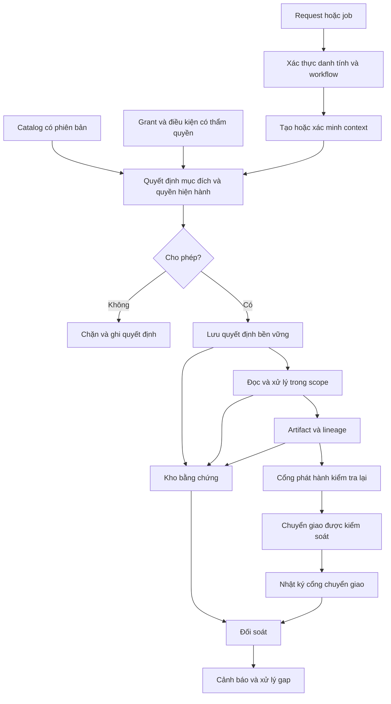

# Purpose tracking — Theo dõi mục đích xử lý dữ liệu

## 1. Mục tiêu và phạm vi

Purpose tracking là khả năng liên kết một hoạt động xử lý dữ liệu với mục đích đã xác định, điều kiện cho phép, nguồn dữ liệu, chủ thể thực hiện và kết quả quan sát được. Hệ thống cần trả lời được: **dữ liệu nào đã được dùng, để làm gì, qua những bước nào, theo quyết định nào và đã đi tới đâu?**

Trong chương **Privacy requirement** của module `SECURITY_SECURITY_DESIGN_SECURITY_REQUIREMENTS`, bài học chuyển khả năng đó thành yêu cầu bảo mật cụ thể, đo được và có thể kiểm chứng. Nội dung bao gồm:

- Mô hình mục đích, quyền sử dụng, ngữ cảnh thực thi và sự kiện theo dõi.
- Liên kết API, tác vụ nền, dữ liệu dẫn xuất, bản xuất và bên nhận.
- Gắn theo dõi với kiểm tra quyền, vô hiệu hóa, logging và phục hồi.
- Đối soát bằng chứng để phát hiện hoạt động thiếu mục đích hoặc không khớp phạm vi.
- Xác định giới hạn của nhãn, trace và hồ sơ do chính ứng dụng tự báo cáo.

Các mã, schema và ngưỡng thời gian dưới đây là **thiết kế minh họa cho một nền tảng giả định**. Căn cứ cho phép xử lý và nghĩa vụ áp dụng cần được tổ chức xác định riêng; không phải mọi hoạt động đều dùng consent làm điều kiện.

## 2. Theo dõi mục đích cần chứng minh điều gì?

### 2.1. Ba lớp thông tin phải phân biệt

| Lớp | Câu hỏi | Ví dụ |
| --- | --- | --- |
| Mục đích khai báo và được phê duyệt | Hệ thống dự định dùng dữ liệu để đạt kết quả gì? | Gửi cảnh báo đăng nhập đáng ngờ tới chủ tài khoản |
| Quyền xử lý hiện hành | Chủ thể, dữ liệu và thao tác này hiện còn được phép không? | Worker đúng danh tính; sự kiện thuộc tài khoản; quyền chưa bị thu hồi |
| Hoạt động quan sát được | Thao tác nào thực sự bắt đầu, hoàn tất hoặc chuyển dữ liệu ra ngoài? | Cổng gửi đã chuyển mẫu cảnh báo tới bên nhận tương ứng |

Một dòng log `purpose=SECURITY` chỉ ghi nhận một khai báo. Nó chưa chứng minh phạm vi đã được phê duyệt, quyền còn hiệu lực hoặc hành vi thực tế phù hợp.

Ngược lại, thấy một lệnh gửi thành công cũng chưa giải thích được vì sao dữ liệu được phép gửi. Purpose tracking cần nối các lớp bằng định danh và bằng chứng, đồng thời chỉ rõ nguồn nào có thẩm quyền với thông tin nào.

### 2.2. Quan hệ với các kiểm soát khác

| Khả năng | Vai trò |
| --- | --- |
| Purpose limitation | Đặt ranh giới và ngăn sử dụng ngoài mục đích được phép |
| Purpose tracking | Theo dõi và đối chiếu mục đích với từng hoạt động trong phạm vi |
| Authorization | Quyết định chủ thể được làm gì với dữ liệu trong ngữ cảnh hiện hành |
| Data lineage | Mô tả nguồn và phép biến đổi tạo ra dữ liệu hoặc đầu ra |
| Audit | Lưu bằng chứng quyết định, hoạt động và thay đổi để kiểm tra |
| Distributed tracing | Liên kết các bước kỹ thuật của request hoặc công việc phân tán |

Các khả năng này hỗ trợ nhau nhưng không thay thế nhau. Một trace đầy đủ không tự cấp quyền; lineage đúng không tự cho phép mục đích mới; một quyết định `ALLOW` không chứng minh thao tác đã hoàn tất.

### 2.3. Theo dõi không phải suy đoán ý định con người

Hệ thống không đọc được ý định trong đầu người sử dụng. Một nhân viên có thể chọn đúng nhãn nhưng dùng dữ liệu cho việc khác sau khi tải về.

Thiết kế cần ràng buộc những gì quan sát và kiểm soát được: workflow phía máy chủ, thao tác, trường dữ liệu, template, tài nguyên, bên nhận, đường xuất và quyền tải. Bằng chứng giúp phát hiện sai lệch trong phạm vi đó; không nên tuyên bố chứng minh được mọi cách sử dụng bên ngoài hệ thống.

## 3. Tình huống xuyên suốt: nền tảng học tập

Nền tảng phục vụ nhiều tổ chức; mỗi tổ chức là một `tenant`. Hệ thống có dữ liệu tài khoản, tiến độ học tập và phiếu hỗ trợ.

| Mã mục đích | Kết quả nghiệp vụ | Workflow tương ứng | Giới hạn chính |
| --- | --- | --- | --- |
| `ACCOUNT_SECURITY_ALERT` | Cảnh báo chủ tài khoản về sự kiện đáng ngờ | `suspicious-login-alert` | Chỉ gửi mẫu bảo mật cho tài khoản có sự kiện hợp lệ |
| `SUPPORT_CASE_RESOLUTION` | Giải quyết phiếu hỗ trợ được giao | `assigned-case-resolution` | Chỉ dữ liệu cần cho phiếu trong tenant được phép |
| `COURSE_COMPLETION_REPORT` | Báo cáo hoàn thành theo khóa học và tuần | `weekly-course-report` | Phạm vi và đầu ra theo hồ sơ báo cáo đã duyệt |
| `OPTIONAL_COURSE_RECOMMENDATION` | Gợi ý khóa học cho chính người học | `learner-recommendation` | Cần điều kiện lựa chọn hiện hành theo thiết kế ví dụ |

Một email có thể phục vụ cảnh báo và hỗ trợ theo những điều kiện khác nhau. Việc email đã được dùng hợp lệ cho cảnh báo không tự tạo quyền dùng cho quảng cáo. Tương tự, pipeline báo cáo có thể đọc tiến độ nhưng không mặc định được đọc nội dung phiếu hỗ trợ.

Nhóm cần trả lời các câu hỏi vận hành:

- Một file báo cáo bắt nguồn từ dataset và phiên bản nào?
- Job nào sử dụng dữ liệu sau khi quyền đã đổi?
- Một request tự khai mục đích hỗ trợ có thật sự gắn với phiếu được giao không?
- Có đường xuất nào không đi qua cổng ghi bằng chứng không?
- Khi một mục đích bị đình chỉ, những workflow và đầu ra nào bị ảnh hưởng?

## 4. Mô hình thông tin để liên kết mục đích và xử lý

### 4.1. Phân tách khái niệm

DPV phân biệt mục đích, dữ liệu, thao tác xử lý và căn cứ liên quan thay vì gộp thành một nhãn chung. Bài học tham khảo cách phân tách này; DPV Primer là báo cáo Community Group, không phải W3C Standard, và không bắt buộc hệ thống dùng RDF hoặc DPV. [DPV Primer, mục 3.1](https://www.w3.org/community/reports/dpvcg/CG-FINAL-primer-20240801/#structure-of-dpv).

Mô hình minh họa sử dụng các loại hồ sơ sau:

| Loại hồ sơ | Nội dung | Không được suy ra từ hồ sơ này |
| --- | --- | --- |
| `PurposeDefinition` | Mã, phiên bản, kết quả, chủ sở hữu, phạm vi, phê duyệt | Có định nghĩa không có nghĩa mọi service được sử dụng |
| `WorkflowBinding` | Liên kết workflow, danh tính, thao tác với mục đích | Vai trò chung không cấp mọi thao tác của workflow |
| `DataUseGrant` | Phạm vi dữ liệu, bên nhận, điều kiện và revision cho phép sử dụng | Quyền cũ không chứng minh quyền hiện hành |
| `ProcessingActivity` | Một lần xử lý logic với mục đích hiệu lực và ngữ cảnh | Tạo activity không chứng minh đã đọc hoặc đã gửi dữ liệu |
| `ActivityAttempt` | Một lần thực thi hoặc retry của activity | Retry không được tự mở rộng phạm vi |
| `DatasetVersion` | Phiên bản nguồn, partition, schema và ràng buộc | Một nhãn cấp dataset không bao phủ mọi bản ghi nếu điều kiện khác nhau |
| `DerivationLink` | Nguồn, phép biến đổi và phiên bản đầu ra | Dẫn xuất không tự có quyền dùng cho mục đích mới |
| `ProcessingEvent` | Quyết định, bắt đầu, kết quả, chuyển giao hoặc lỗi | Một event tự báo cáo không phải bằng chứng độc lập tuyệt đối |
| `TransferRecord` | Phạm vi chuyển giao, bên nhận, quyết định và kết quả quan sát | Bên nhận xác nhận không chứng minh mọi xử lý về sau đúng mục đích |

Trong ví dụ, mỗi bước xử lý logic có **một mục đích hiệu lực**. Nếu một sự kiện nghiệp vụ tạo cả cảnh báo và báo cáo, hệ thống tạo hai activity với điều kiện và bằng chứng riêng. Không gắn danh sách mọi mục đích vào một activity rồi cho phép khi chỉ một mục đích hợp lệ.

### 4.2. Định danh phải ổn định và có phạm vi

Các định danh nên là mã tham chiếu không chứa email, token hay nội dung nghiệp vụ:

```text
purpose_id + purpose_version
workflow_id + workflow_version
tenant_ref
activity_id
attempt_id
event_id
decision_id
grant_ref + grant_revision
source_manifest_ref
artifact_ref + artifact_version
transfer_ref
```

`activity_id` giữ nguyên cho công việc logic; mỗi retry có `attempt_id` mới. `event_id` nhận diện một sự kiện để chống ghi lặp do chuyển tiếp. Không dùng một ID chung cho mọi event của activity vì sẽ làm mất các bước thực sự khác nhau.

Mã tham chiếu vẫn có thể liên quan tới cá nhân khi nối với kho khác. Cần quyền truy cập, thời hạn lưu và mục đích riêng cho chính metadata theo dõi.

## 5. Danh mục mục đích và lịch sử phiên bản

### 5.1. Mục đích phải cụ thể và được quản lý

Hồ sơ cần có kết quả nghiệp vụ, dữ liệu và thao tác cho phép, bên nhận, điều kiện, trường hợp ngoài phạm vi, người phê duyệt, thời điểm hiệu lực và trạng thái.

```yaml
purpose_id: COURSE_COMPLETION_REPORT
version: 3
state: ACTIVE
owner: learning-reporting-team
approval_ref: APR-REPORT-042
outcome: Báo cáo tỷ lệ hoàn thành theo khóa học và tuần trong tenant
allowed_workflows:
  - weekly-course-report-v2
allowed_sources:
  - learning-progress
allowed_operations:
  - read_approved_progress_projection
  - produce_approved_completion_report
allowed_fields:
  - tenant_ref
  - course_ref
  - completion_week
  - completion_state
recipient_rule: assigned_reporting_role_in_same_tenant
forbidden_sources:
  - support_case_content
  - account_contact_directory
```

Đây là cấu trúc minh họa trong bài, không phải schema chuẩn hoặc cấu hình chạy được của dự án. Các quy tắc phải có logic xác minh và điểm thực thi tương ứng.

### 5.2. Không sửa quá khứ bằng cách đổi tên

Có thể quản lý trạng thái theo chuỗi:

```text
DRAFT -> APPROVED -> ACTIVE -> SUSPENDED hoặc RETIRED
```

Đây là vòng đời của danh mục trong ví dụ. Runtime chỉ dùng những phiên bản được policy hiện hành chấp nhận.

Khi thay đổi phạm vi, tạo phiên bản mới và liên kết hồ sơ phê duyệt. Sự kiện đã xảy ra tiếp tục tham chiếu phiên bản cũ. Không sửa mô tả cũ để khiến hoạt động trước đây trông như đã được phép.

Cần phân biệt:

- **Tra cứu lịch sử:** xem định nghĩa và điều kiện tại thời điểm quyết định cũ.
- **Cho phép xử lý mới:** kiểm tra trạng thái và điều kiện hiện hành.
- **Đánh giá thay đổi:** xác định workflow và dataset có cần chuyển phiên bản hay dừng.

Giữ phiên bản cũ phục vụ audit không đồng nghĩa cho runtime tiếp tục dùng nó. Mục đích mới cũng không được tự gán ngược vào dữ liệu cũ để bỏ qua đánh giá điều kiện sử dụng.

## 6. Từ rủi ro tới yêu cầu theo dõi

| Rủi ro | Kịch bản | Hậu quả | Hướng kiểm soát |
| --- | --- | --- | --- |
| R-01 | Client tự khai mục đích đặc quyền | Có log đẹp nhưng quyền bị giả mạo | Ràng buộc với workflow và danh tính máy chủ |
| R-02 | Service sau tự đổi purpose hoặc tenant | Mất ranh giới giữa hai hoạt động | Xác minh nguồn, audience và phạm vi ở mỗi chặng |
| R-03 | Job dùng grant lúc tạo dù đã thu hồi | Xử lý ngoài điều kiện hiện hành | Kiểm tra lại tại điểm thực thi |
| R-04 | Metadata bị mất khi ETL hoặc export | Không biết đầu ra được phép dùng để làm gì | Manifest, lineage và cổng phát hành |
| R-05 | Nhãn dataset quá rộng che bản ghi không đủ điều kiện | Cả batch được coi là hợp lệ | Theo dõi ở độ hạt phù hợp với điều kiện thực tế |
| R-06 | Audit được tạo sau tác dụng phụ rồi tiến trình chết | Không có bằng chứng cho hoạt động đã xảy ra | Ghi bền vững trước bước được bảo vệ và đối soát kết quả |
| R-07 | Chỉ lưu trace có sampling | Hoạt động quan trọng không có hồ sơ | Audit bắt buộc tách khỏi chính sách sampling của trace |
| R-08 | Đổi định nghĩa mục đích tại chỗ | Lịch sử mất khả năng giải thích | Phiên bản bất biến và lịch sử thay đổi |
| R-09 | Log lưu email, nội dung phiếu hoặc mọi hành vi chi tiết | Purpose tracking tạo thêm rủi ro riêng tư | Metadata tối thiểu và quyền tra cứu hạn chế |
| R-10 | Chỉ đếm log ứng dụng để kết luận không có đường đi vòng | Bỏ sót xuất trực tiếp hoặc service không đăng ký | Đối soát cổng dữ liệu và nguồn quan sát độc lập |
| R-11 | Bên nhận bỏ metadata hoặc dùng dữ liệu tiếp ngoài phạm vi | Mất theo dõi sau chuyển giao | Hợp đồng, cấu hình và bằng chứng chuyển giao có giới hạn |
| R-12 | Backup cũ khôi phục grant và lịch sử sai trạng thái | Quyền cũ quay lại hoạt động | Khóa phục hồi và đối soát nguồn hiện hành |

Không phải rủi ro nào cũng được giải quyết bằng thêm field vào log. Ví dụ, R-01 cần quyết định quyền đáng tin và R-10 cần kiểm soát đường đọc/xuất để hoạt động không thể tùy ý bỏ qua cổng theo dõi.

## 7. Đưa ngữ cảnh mục đích qua ranh giới dịch vụ

### 7.1. Ngữ cảnh có thẩm quyền được tạo ở đâu?

Tại đầu vào, hệ thống xác thực chủ thể và xác minh workflow. Mục đích hiệu lực được lấy từ liên kết workflow đã được phê duyệt. Tham số client chỉ là đề xuất cần kiểm tra.

Ngữ cảnh tối thiểu có thể gồm:

```json
{
  "context_id": "ctx-example-081",
  "issuer": "processing-context-service",
  "audience": "report-worker",
  "tenant_ref": "tenant-example",
  "workflow_id": "weekly-course-report-v2",
  "purpose_id": "COURSE_COMPLETION_REPORT",
  "purpose_version": 3,
  "activity_id": "act-example-204",
  "parent_activity_id": "act-example-190",
  "source_manifest_ref": "manifest-example-v7",
  "operation_scope": "produce_approved_completion_report",
  "grant_ref": "grant-example-025",
  "grant_revision_at_issue": 18,
  "expires_at": "2026-01-01T00:05:00Z"
}
```

`grant_revision_at_issue` phục vụ truy vết thời điểm cấp ngữ cảnh, không thay thế kiểm tra grant hiện hành khi xử lý. Ngữ cảnh chưa hết hạn cũng có thể không còn được phép.

Một thiết kế có thể bảo vệ ngữ cảnh bằng tham chiếu phía máy chủ hoặc phong bì có xác thực toàn vẹn. Nếu dùng chữ ký, phải quy định issuer tin cậy, audience, hạn, phạm vi và cách kiểm tra. Chữ ký hợp lệ chỉ chứng minh người phát đã tạo nội dung đó; người phát vẫn phải có quyền cấp ngữ cảnh tương ứng.

### 7.2. Kiểm tra khi nhận ở chặng sau

Bên nhận cần:

1. Xác thực workload gọi hoặc nguồn message.
2. Kiểm tra issuer, audience, hạn và phạm vi của ngữ cảnh.
3. Đối chiếu tenant, workflow, source manifest và thao tác.
4. Xác minh phiên bản mục đích được runtime hiện hành chấp nhận.
5. Đọc điều kiện quyền hiện hành từ nguồn có thẩm quyền.
6. Chỉ cho phép phần việc thuộc phạm vi; tạo activity con nếu chuyển mục đích.
7. Ghi quyết định và kết quả theo hợp đồng bằng chứng.

Nếu payload không khớp tài nguyên hoặc phiên bản được tham chiếu, không được chỉ tin nhãn bên ngoài. Cần ràng buộc payload với manifest, resource version hoặc cơ chế toàn vẹn đã được định nghĩa.

Không cho một service tùy ý thêm mục đích rồi coi đó là mở rộng hợp lệ. Chuyển sang mục đích khác cần workflow, điều kiện và hồ sơ riêng.

### 7.3. Trace context và baggage

OpenTelemetry baggage truyền metadata giữa các dịch vụ nhưng không có kiểm tra toàn vẹn tích hợp để chứng minh giá trị do bên tin cậy tạo. Baggage cũng có thể bị chuyển tiếp tới bên thứ ba qua instrumentation. [OpenTelemetry: Baggage security considerations](https://opentelemetry.io/docs/concepts/signals/baggage/#baggage-security-considerations).

Vì vậy, thiết kế ví dụ dùng trace để liên kết chẩn đoán, còn quyền dựa vào ngữ cảnh đã xác minh riêng. Không đưa token, email hoặc thông tin nhạy cảm vào baggage. Metadata nội bộ chỉ được chuyển ra ngoài theo danh sách cho phép; `trace_id` từ client không được dùng làm ID quyết định có thẩm quyền.

## 8. Sự kiện theo dõi: phân biệt quyết định, thực thi và kết quả

### 8.1. Các sự kiện có ý nghĩa khác nhau

| Loại sự kiện | Điều được khẳng định | Điều chưa được khẳng định |
| --- | --- | --- |
| `AUTHORIZATION_DECIDED` | Có quyết định cho phép hoặc từ chối với phạm vi cụ thể | Thao tác đã bắt đầu |
| `OPERATION_STARTED` | Worker đã bắt đầu lần thực thi | Thao tác đã hoàn tất |
| `OPERATION_SUCCEEDED` | Nguồn ghi sự kiện báo phần việc hoàn thành | Dữ liệu đã tới mọi bên nhận |
| `OPERATION_FAILED` | Biết một bước thất bại | Chắc chắn không có tác dụng phụ nào |
| `OUTPUT_RELEASE_AUTHORIZED` | Cổng đã chấp nhận quyền phát hành theo phạm vi và điểm quyết định | Truyền thành công hoặc bên nhận đã xử lý |
| `TRANSFER_OBSERVED` | Có bằng chứng chuyển giao qua cổng quan sát | Mục đích sử dụng tiếp theo được bảo đảm |
| `DELIVERY_ACKNOWLEDGED` | Có phản hồi nhận theo hợp đồng của bên nhận | Toàn bộ vòng đời dữ liệu ở bên nhận đã hoàn tất |

Khi chưa biết kết quả, dùng trạng thái `UNKNOWN` hoặc `PENDING_RECONCILIATION` theo mô hình nghiệp vụ. Không đổi timeout thành “chưa gửi” nếu bên nhận có thể đã chấp nhận lệnh.

### 8.2. Ví dụ sự kiện quyết định

```json
{
  "event_id": "evt-example-918",
  "event_type": "AUTHORIZATION_DECIDED",
  "producer_id": "report-policy-gateway",
  "activity_id": "act-example-204",
  "attempt_id": "attempt-example-002",
  "decision_id": "dec-example-610",
  "tenant_ref": "tenant-example",
  "principal_ref": "workload-report-worker",
  "purpose_id": "COURSE_COMPLETION_REPORT",
  "purpose_version": 3,
  "policy_revision": 24,
  "grant_ref": "grant-example-025",
  "grant_revision": 19,
  "source_manifest_ref": "manifest-example-v7",
  "operation": "read_approved_progress_projection",
  "decision": "DENY",
  "reason_code": "PROCESSING_GRANT_REVOKED",
  "occurred_at": "2026-01-01T00:00:00Z",
  "received_at": "2026-01-01T00:00:01Z"
}
```

Dữ liệu minh họa không chứa payload tiến độ. Hai thời điểm giúp nhận diện độ trễ chuyển sự kiện, nhưng thứ tự thu hồi phải dựa vào revision và cơ chế chấp nhận hoạt động ở nguồn có thẩm quyền, không chỉ so đồng hồ giữa hai máy.

### 8.3. Ghi bền vững và đối soát

Ở điểm được bảo vệ, cần lưu quyết định hoặc ý định cần thiết một cách bền vững trước khi cho phép thao tác tương ứng. Kết quả thực thi được ghi riêng và đối soát với nguồn quan sát.

Có thể dùng outbox gắn với giao dịch nghiệp vụ khi phù hợp. Tuy nhiên, outbox trong database không tạo giao dịch nguyên tử với mọi API bên ngoài. Hệ thống vẫn phải xét tiến trình chết, phản hồi mất và lệnh đã được bên nhận chấp nhận.

Với retry, `activity_id` giữ quan hệ công việc, `attempt_id` phân biệt lần chạy và `event_id` hỗ trợ khử trùng lặp event. Nếu thao tác cần idempotency, khóa idempotency phải có scope và semantics riêng; không tự cho rằng retry sẽ an toàn chỉ vì event được deduplicate.

## 9. Theo dõi nguồn, batch và dữ liệu dẫn xuất

### 9.1. Nguồn và phép biến đổi

PROV dùng các khái niệm entity, activity và agent để mô tả nguồn gốc; dữ liệu đầu ra có thể được liên kết với hoạt động tạo ra nó và các nguồn đã sử dụng. Bài học tham khảo cách suy nghĩ đó, không yêu cầu triển khai toàn bộ PROV. [W3C PROV Model Primer](https://www.w3.org/TR/prov-primer/).

Ví dụ tự xây dựng cho báo cáo:

```text
dataset progress-v7
    -> activity act-204, purpose COURSE_COMPLETION_REPORT v3
    -> artifact completion-report-v2
    -> transfer transfer-046 tới assigned-reporting-role
```

Một `DerivationLink` nên ghi source version, partition hoặc manifest, phép biến đổi, phiên bản mã/schema, activity, mục đích đầu ra và policy đã áp dụng.

Không cần log từng giá trị nguồn để có lineage. Cần chọn mức tham chiếu đủ để xác định đầu vào và ảnh hưởng khi quyền thay đổi.

### 9.2. Theo dõi đúng độ hạt

Một batch có thể chứa người học với điều kiện sử dụng khác nhau. Nhãn `purpose=RECOMMENDATION` ở đầu file không chứng minh mọi dòng đều đủ điều kiện.

Có thể chia batch thành các cohort có cùng điều kiện và có manifest thành viên kiểm chứng được. Khi một chủ thể rút lựa chọn, cần xác định được phần dữ liệu, artifact và công việc chịu ảnh hưởng.

Nếu điều kiện thay đổi theo từng bản ghi nhưng hệ thống chỉ lưu lineage cấp toàn bảng, yêu cầu theo dõi chưa đủ độ hạt. Ngược lại, không mặc định ghi toàn bộ lịch sử hành vi chỉ để theo dõi: cần tối thiểu hóa và giới hạn quyền tra cứu metadata.

### 9.3. Kết hợp nhiều nguồn và nhiều mục đích

Không lấy hợp các mục đích của nguồn A và B rồi coi mọi mục đích đều hợp lệ cho đầu ra. Hoạt động đầu ra phải được phép đối với tất cả nguồn cần sử dụng, đáp ứng các ràng buộc kết hợp và có phê duyệt tương ứng.

Dữ liệu tổng hợp, hash hoặc embedding vẫn cần đánh giá nguồn, quyền và khả năng liên kết. Một phép biến đổi không tự loại bỏ nghĩa vụ theo dõi hoặc tạo căn cứ cho mục đích mới.

### 9.4. Cache, export và bản tải xuống

Cache entry cần giữ hoặc tham chiếu ngữ cảnh đủ để đối chiếu tài nguyên, phiên bản và phạm vi; cache hit vẫn qua kiểm tra quyền hiện hành. File xuất phải có artifact reference và transfer record tại cổng phát hành.

Metadata có thể bị tách khỏi file sau tải xuống. Vì thế, kiểm soát tại cổng và điều kiện của bên nhận quan trọng hơn việc chỉ nhúng một nhãn trong tên file. Không coi nhãn có thể bị xóa là cơ chế thực thi đầy đủ.

## 10. Bộ yêu cầu purpose tracking có thể nghiệm thu

Các ngưỡng của thiết kế minh họa: ngữ cảnh cấp tối đa 5 phút; đối soát các luồng đã đăng ký mỗi 15 phút; cảnh báo trong 5 phút từ khi phát hiện sai lệch; lưu audit 90 ngày theo phạm vi đã phê duyệt. Hạn ngữ cảnh không phải thời gian được tiếp tục xử lý sau thu hồi.

| Mã | Yêu cầu | Tiêu chí nghiệm thu chính |
| --- | --- | --- |
| PT-01 | Mọi mục đích runtime phải có ID, phiên bản, chủ sở hữu, phạm vi và phê duyệt; nội dung phiên bản đã tham chiếu trong audit không được sửa tại chỗ | Mục đích chưa duyệt không kích hoạt; lịch sử cũ vẫn giải thích được sau thay đổi |
| PT-02 | Mỗi activity phải xác định một mục đích hiệu lực từ workflow phía máy chủ đã được phê duyệt | Client đổi header hoặc body không tự đổi mục đích; thiếu hoặc không xác định được mục đích thì chặn hoạt động tương ứng |
| PT-03 | Mỗi chặng phải xác minh danh tính nguồn, ngữ cảnh, audience, hạn tối đa 5 phút và phạm vi tenant/tài nguyên/thao tác | Context giả, hết hạn, sai đích, sai tenant hoặc không khớp payload bị từ chối trước xử lý |
| PT-04 | Quyền xử lý phải được kiểm tra từ trạng thái hiện hành ở từng thao tác bảo vệ; context và quyết định lịch sử không tự cấp quyền mới | Thu hồi trước điểm chấp nhận làm thao tác mới bị chặn dù context còn hạn |
| PT-05 | API, queue, worker và các nhánh retry trong phạm vi phải bảo toàn liên kết activity, mục đích, source manifest và parent khi có | Thiếu hoặc mâu thuẫn metadata làm dừng hoạt động; retry có attempt mới và không mở rộng phạm vi |
| PT-06 | Quyết định tại điểm đọc/xuất bắt buộc theo dõi phải được lưu bền vững trước cho phép; audit này không phụ thuộc sampling trace | Tắt sampling hoặc exporter trace không làm mất bản ghi quyết định; lỗi kho audit không tạo đường cho phép không có bằng chứng |
| PT-07 | Kết quả thực thi và chuyển giao phải được ghi riêng với quyết định, activity, attempt và transfer; kết quả chưa xác minh phải được biểu diễn đúng | Timeout không bị ghi chắc chắn chưa gửi; đối soát phát hiện tác dụng phụ thiếu kết quả hoặc không có quyết định liên kết |
| PT-08 | Dataset, batch và artifact phải có lineage ở độ hạt đủ để xác định nguồn và điều kiện ảnh hưởng | Batch trộn điều kiện không được hợp thức hóa bằng một nhãn; truy ra được artifact chịu tác động từ manifest cụ thể |
| PT-09 | Khi mục đích đình chỉ, grant thu hồi hoặc điều kiện thay đổi, phải chặn công việc mới tại điểm quyết định và đánh giá công việc/đầu ra còn chờ | Queue, retry, cache và export không tiếp tục bằng revision cũ; hồ sơ lịch sử vẫn được giữ theo policy |
| PT-10 | Luồng đã đăng ký phải được đối soát với nguồn quan sát tại cổng dữ liệu mỗi 15 phút; sai lệch phải cảnh báo trong 5 phút từ phát hiện | Transfer hoặc hoạt động thiếu liên kết tạo gap có người phụ trách; báo cáo không tự kết luận 100% chỉ từ log ứng dụng |
| PT-11 | Audit chỉ lưu metadata tối thiểu, không chứa token, email hoặc payload nghiệp vụ thô; quyền đọc được giới hạn và audit giữ 90 ngày theo policy | Sự kiện mẫu không có dữ liệu cấm; xóa đúng hạn; định nghĩa lịch sử cần để hiểu audit được giữ khi còn tham chiếu |
| PT-12 | Thay mục đích, field, nguồn, workflow hoặc bên nhận phải được đánh giá và phiên bản hóa trước áp dụng | Không tự gán mục đích mới cho dữ liệu cũ; thay đổi chưa duyệt không được runtime dùng |
| PT-13 | Mỗi chuyển giao ra ngoài phải có transfer reference, bên nhận, artifact/scope, quyết định và trạng thái xác nhận phù hợp hợp đồng | Không phát hành nếu không đủ điều kiện; xác nhận nhận không được báo là đã chứng minh mọi sử dụng tiếp theo |
| PT-14 | Phục hồi phải khóa luồng tới khi đối soát catalog, grant, lựa chọn hiện hành và lịch sử còn tham chiếu với nguồn có thẩm quyền | Snapshot cũ không làm sống lại quyền; event chuyển tiếp được khử trùng lặp mà không mất các attempt khác |
| PT-15 | Chỉ workload được chỉ định được tạo hoặc sửa thành phần có thẩm quyền; việc quản trị, tra cứu và xóa metadata phải có quyền riêng và bằng chứng | Service không thể tự cấp grant, đổi lịch sử hoặc đọc metadata tenant khác bằng quyền nghiệp vụ thường |

PT-06 có đánh đổi khả dụng. Nếu dùng bộ đệm audit bền vững cục bộ, phải đặc tả quyền truy cập, dung lượng, chuyển tiếp và hành vi khi đầy. Một lần ghi vào RAM không đủ. Nếu không ghi được quyết định từ chối, hệ thống vẫn từ chối và báo lỗi bằng telemetry độc lập; lỗi audit không phải lý do chuyển sang cho phép.

PT-10 cho phép một sai lệch chỉ được nhận diện ở lần đối soát kế tiếp. Vì vậy mốc cảnh báo 5 phút từ phát hiện không đồng nghĩa mọi sự cố đều được phát hiện trong 5 phút từ lúc xảy ra. Các mục tiêu thời gian phải ghi rõ điểm bắt đầu.

## 11. Kiến trúc và mã giả thực thi

### 11.1. Các trách nhiệm chính



Sơ đồ thể hiện trách nhiệm, không bắt buộc một dịch vụ riêng cho mỗi hộp. Quyền database, object storage và mạng phải hỗ trợ để ứng dụng không có đường xuất tùy ý bỏ qua cổng.

### 11.2. Mã giả cho một bước xử lý

```text
executeStep(envelope, workloadIdentity):
    require authenticate(workloadIdentity)
    context = verifyTrustedEnvelope(envelope, workloadIdentity)
    require context.audience matches this worker

    binding = loadApprovedWorkflowBinding(workloadIdentity, context.workflow)
    purpose = loadRuntimeAcceptedPurpose(context.purposeId, context.version)
    grant = loadAuthoritativeCurrentGrant(context.grantRef)
    manifest = loadAndValidateSourceManifest(context.sourceManifestRef)

    decision = evaluate(
        binding, purpose, grant,
        context.tenant, context.operation,
        manifest.resources, manifest.fields, expectedRecipient
    )

    persistDecisionDurably(decision, context)
    deny if decision is not allowed

    attempt = startNewAttempt(context.activityId)
    recordStarted(attempt, decision)

    result = executeWithinApprovedScope(decision, manifest)

    if result creates artifact:
        registerArtifactAndDerivationBeforeRelease(result, context, decision)

    recordKnownOutcomeOrMarkPendingReconciliation(attempt, result)
    return result reference
```

Các hàm là hợp đồng cần triển khai, không phải API sẵn có. Nếu ghi quyết định thất bại thì nhánh được phép không chạy. Trước phát hành đầu ra, cổng phải đánh giá lại điều kiện cần thiết và lưu bằng chứng theo PT-04, PT-06 và PT-13.

Nếu cả bước xử lý và ghi kết quả gặp lỗi, cần giữ đúng trạng thái chưa biết và đối soát. Không để khối bắt exception xóa dấu vết hoặc tạo một sự kiện thành công mặc định.

### 11.3. Thời điểm có hiệu lực của thu hồi

Quyết định thu hồi và điểm chấp nhận thao tác phải có cách xác định thứ tự. Một thiết kế có thể dùng revision và cơ chế phối hợp tại cổng để không nhận thao tác mới dựa trên revision đã thu hồi.

Không chỉ so `occurred_at` giữa các máy vì đồng hồ có thể lệch. Hoạt động đã được chấp nhận hợp lệ trước thu hồi cần trạng thái riêng, cùng quy tắc dừng hoặc hủy các bước chưa hoàn tất.

Bằng chứng phải giúp phân biệt trường hợp được chấp nhận trước thu hồi với trường hợp sử dụng quyền cũ sau thu hồi. Nếu hệ thống chấp nhận độ trễ đồng bộ, độ trễ và rủi ro tương ứng phải được đặc tả rõ.

## 12. Đối soát và truy vấn bằng chứng

### 12.1. Bắt đầu từ câu hỏi cần trả lời

| Câu hỏi | Dữ liệu cần nối |
| --- | --- |
| Ai dùng nguồn X cho mục đích Y? | Source manifest, activity, principal, purpose và quyết định |
| Artifact này được tạo từ đâu? | Artifact version, derivation, source version và activity |
| Có gì bị ảnh hưởng khi grant đổi? | Grant revision, cohort/member manifest, job và artifact còn hiệu lực |
| Dữ liệu đã chuyển cho ai? | Transfer record, recipient, scope, quyết định và trạng thái quan sát |
| Có đường xuất thiếu bằng chứng không? | Nhật ký cổng dữ liệu đối chiếu kho quyết định và lineage |
| Tại sao thao tác trước đây được cho phép? | Phiên bản mục đích, policy, grant và điều kiện tại thời điểm quyết định |

Không chỉ tra theo `trace_id`. Một công việc chạy qua nhiều request, nhiều lần retry hoặc batch có thể cần chuỗi activity và artifact độc lập với cấu trúc trace kỹ thuật.

### 12.2. Ví dụ truy vấn phát hiện transfer thiếu quyết định

SQL sau minh họa trên mô hình dữ liệu giả định:

```sql
SELECT
    t.transfer_ref,
    t.tenant_ref,
    t.recipient_ref,
    t.observed_at
FROM observed_transfer t
WHERE t.tenant_ref = :authorized_tenant_ref
  AND t.observed_at < :reconciliation_cutoff
  AND NOT EXISTS (
      SELECT 1
      FROM processing_event e
      WHERE e.tenant_ref = t.tenant_ref
        AND e.transfer_ref = t.transfer_ref
        AND e.decision_id = t.decision_id
        AND e.event_type = 'OUTPUT_RELEASE_AUTHORIZED'
        AND e.decision = 'ALLOW'
  );
```

`observed_transfer` đến từ cổng chuyển giao được kiểm soát; `processing_event` là kho bằng chứng. Cutoff phải xét độ trễ chuyển event đã được đặc tả để tránh coi event đang truyền là mất. Gap vẫn cần phân loại: mất event, scope không khớp, lỗi đối soát hoặc đường đi vòng.

Truy vấn này chỉ phát hiện thiếu liên kết theo mô hình, chưa kiểm tra mọi field, quyền, thời điểm và nội dung. Các kiểm tra scope và phiên bản phải được bổ sung. Nếu cả hai nguồn đều do cùng một thành phần không tin cậy tự ghi, độ độc lập của bằng chứng bị hạn chế.

### 12.3. Coverage không được dùng mẫu số tự xác nhận

Nếu hệ thống có 100 log và cả 100 có purpose, chỉ kết luận được các log đó có field. Không thể suy ra mọi hoạt động dữ liệu đều được theo dõi.

Mẫu số cần dựa trên danh sách luồng đã nhận diện, cấu hình quyền, cổng truy cập/xuất và quan sát độc lập trong phạm vi kiểm soát. Luồng chưa được đăng ký phải được ghi là khoảng trống cần điều tra, không bị loại để làm tỷ lệ đẹp hơn.

## 13. Truy vết yêu cầu và nghiệm thu

### 13.1. Ma trận rủi ro — điểm thực thi — bằng chứng

| Yêu cầu | Rủi ro chính | Điểm thực thi | Bằng chứng |
| --- | --- | --- | --- |
| PT-01 | R-08 | Catalog và quyền quản trị | Phiên bản, lịch sử và phê duyệt |
| PT-02 | R-01 | API, workflow binding | Giả mạo purpose không đổi quyền |
| PT-03 | R-01, R-02 | Cổng nhận và verifier | Sai issuer, audience, tenant, hạn và payload |
| PT-04 | R-03 | Nguồn quyền và PEP | Thu hồi với context còn hạn |
| PT-05 | R-02, R-04 | Queue, worker, retry | Chuỗi activity/attempt và kiểm tra thiếu metadata |
| PT-06 | R-06, R-07 | Kho audit bền vững, điểm đọc/xuất | Thử lỗi audit, tắt sampling và tiến trình chết |
| PT-07 | R-06 | Worker, cổng chuyển giao | Trạng thái chưa biết và đối soát với nguồn quan sát |
| PT-08 | R-04, R-05 | Manifest và lineage registry | Truy ngược và ảnh hưởng theo cohort/bản ghi |
| PT-09 | R-03, R-12 | Cổng chấp nhận, worker, export | Dừng queue/retry, kiểm tra revision |
| PT-10 | R-10 | Reconciler và nhật ký cổng | Transfer thiếu quyết định, lịch chạy và cảnh báo |
| PT-11 | R-09 | Schema audit, quyền đọc, lịch xóa | Không có dữ liệu cấm; kiểm tra hết hạn |
| PT-12 | R-08, R-11 | Quy trình thay đổi | Mục đích mới không tự hợp thức dữ liệu cũ |
| PT-13 | R-04, R-11 | Cổng phát hành, adapter | Transfer reference, scope và xác nhận có giới hạn |
| PT-14 | R-12 | Runbook phục hồi | Snapshot cũ, event phát lại, quyền hiện hành |
| PT-15 | R-01, R-08, R-09 | Danh tính, quyền quản trị và tra cứu | Từ chối tự cấp grant, sửa lịch sử, đọc chéo tenant |

### 13.2. Các ca nghiệm thu quan trọng

| Ca | Điều kiện và thao tác | Kết quả mong đợi |
| --- | --- | --- |
| AT-01 | Luồng báo cáo đúng workflow, tenant, scope và grant | Truy được từ quyết định tới activity, nguồn, artifact và transfer |
| AT-02 | Client gắn mục đích hỗ trợ vào API xuất dữ liệu | Bị chặn hoặc dùng đúng mục đích máy chủ; không mở quyền theo nhãn client |
| AT-03 | Service thay purpose, audience hoặc tenant trên envelope | Bị từ chối trước xử lý |
| AT-04 | Context hợp lệ về chữ ký nhưng issuer không có quyền cấp scope | Bị từ chối theo binding và policy |
| AT-05 | Context hết 5 phút hoặc payload không khớp manifest | Không thực thi; có lý do phù hợp |
| AT-06 | Thu hồi grant trong khi context chưa hết hạn | Không nhận thao tác mới bằng revision cũ |
| AT-07 | Message thiếu purpose hoặc source manifest | Không xử lý tiếp theo mục đích mặc định rộng hơn |
| AT-08 | Retry sau lỗi và nhận lặp cùng event | Retry có attempt mới; event lặp không nhân bản bằng chứng, không mất attempt thật |
| AT-09 | Batch có một cohort không còn đủ điều kiện | Phần không hợp lệ bị chặn; không dùng nhãn toàn batch để cho qua |
| AT-10 | ETL hoặc export bỏ lineage | Không phát hành artifact chưa đủ metadata bắt buộc |
| AT-11 | Tắt trace sampling hoặc exporter telemetry | Audit bắt buộc vẫn đầy đủ trong phạm vi thiết kế |
| AT-12 | Kho audit hoặc bộ đệm bền vững không ghi được | Thao tác được bảo vệ không chạy khi thiếu bằng chứng; lỗi được quan sát độc lập |
| AT-13 | Bên nhận có thể đã nhận lệnh nhưng phản hồi timeout | Trạng thái chưa biết được đối soát; không tự khẳng định chưa có tác dụng phụ |
| AT-14 | Tiến trình chết sau chuyển giao và trước ghi kết quả ứng dụng | Cổng và reconciler phát hiện, bổ sung kết quả với nguồn và dấu thời gian rõ |
| AT-15 | Sửa định nghĩa cũ hoặc dùng mục đích chưa được duyệt | Bị chặn; lịch sử không bị viết lại |
| AT-16 | Tạo transfer thử thiếu liên kết quyết định | Lần đối soát theo lịch phát hiện; cảnh báo trong 5 phút từ phát hiện |
| AT-17 | Baggage từ client có purpose đặc quyền và thông tin nhạy cảm | Không dùng làm quyền; metadata cấm không bị chuyển ra bên ngoài |
| AT-18 | Người dùng audit tra tenant khác hoặc service tự cấp grant | Bị từ chối và có bằng chứng truy cập quản trị |
| AT-19 | Khôi phục snapshot trước thời điểm thu hồi và phát lại event | Luồng khóa đến đối soát; không làm sống lại grant hoặc đếm lặp event |
| AT-20 | Thử qua mốc lưu audit 90 ngày | Xử lý hết hạn theo policy; không giữ payload thô hoặc mất định nghĩa khi audit còn tham chiếu |

Ca kiểm thử cần quan sát cả side effect: database, artifact, queue và cổng chuyển giao. Một API trả lỗi không chứng minh chưa có dữ liệu đi ra. Dùng dữ liệu giả và bên nhận kiểm thử để tạo bằng chứng an toàn.

## 14. Vận hành, bảo vệ metadata và phục hồi

### 14.1. Chỉ số phù hợp

| Chỉ số | Diễn giải |
| --- | --- |
| Luồng có binding và điểm kiểm soát / tổng luồng đã nhận diện | Độ bao phủ thiết kế trong phạm vi, cần phát hiện luồng mới |
| Hoạt động quan sát được liên kết quyết định hợp lệ / tổng hoạt động tại cổng | Độ bao phủ bằng chứng, kiểm tra thêm scope và thời điểm |
| Artifact có lineage kiểm chứng được / tổng artifact phát hành | Khả năng truy nguồn đầu ra |
| Số gap theo loại và tuổi gap | Phân biệt event trễ, thiếu quyết định, mismatch và đường đi vòng |
| Khoảng cách giữa các lần đối soát thành công | So với mốc 15 phút; lỗi job đối soát cũng cần cảnh báo |
| Thời gian từ phát hiện tới cảnh báo | So với 5 phút, không thay cho chỉ số thời gian phát hiện |
| Hoạt động mới dùng revision đã thu hồi | Phải bằng 0 theo điểm quyết định được đặc tả |

Không dùng `activity_id`, mã người học hoặc transfer reference làm label metric không giới hạn. Có thể tạo cardinality lớn và đưa metadata nhạy cảm tới hệ thống giám sát. Truy vấn chi tiết nằm ở kho có phân quyền; metric chỉ tổng hợp theo chiều đã duyệt.

### 14.2. Hạn chế sự theo dõi do chính cơ chế tracking tạo ra

Mục đích của ledger là kiểm chứng việc sử dụng dữ liệu trong phạm vi, không tạo hồ sơ toàn bộ hành vi người học. Chỉ thu metadata cần thiết, tránh suy diễn mới từ lịch sử theo dõi và giới hạn người được nối mã tham chiếu với cá nhân.

Tra cứu ledger cũng là hoạt động truy cập dữ liệu. Cần xác định mục đích, phạm vi tenant, vai trò, lịch giữ và bằng chứng truy cập. Cơ chế chống sửa đổi hỗ trợ tính toàn vẹn nhưng không cho phép lưu vô hạn hoặc đọc tùy ý.

### 14.3. Phục hồi và xử lý sai lệch

Trước mở lại sau phục hồi, cần đối soát catalog và lịch sử tham chiếu, grant hiện hành, lựa chọn khi áp dụng, công việc đang chờ, artifact và trạng thái chuyển giao.

Nếu không có nguồn hiện hành đáng tin, giữ khóa hoạt động tương ứng. Khi phát hiện gap, không tự viết event giả để làm khớp số liệu. Bản ghi bổ sung phải thể hiện nguồn phục dựng, thời điểm bổ sung, điều còn chưa biết và người hoặc hệ thống thực hiện.

Với đường đi vòng, chặn quyền hoặc đường xuất liên quan trước, rồi sửa kiến trúc và kiểm thử lại. Chỉ thêm một log sau sự cố không bảo đảm lần sau hoạt động sẽ được kiểm soát.

## 15. Lỗi thường gặp và bài tập vận dụng

### 15.1. Các lỗi cần tránh

| Lỗi | Vì sao không đáp ứng | Cách sửa |
| --- | --- | --- |
| Dùng chuỗi purpose tự do trong request | Người gọi tự khai lý do có quyền rộng hơn | ID có catalog, binding và xác minh máy chủ |
| Có nhãn là coi được phép | Nhãn không kiểm tra quyền hiện hành | Kiểm tra grant, workflow, scope và điều kiện |
| Sao chép context xuống mọi service | Audience và phạm vi có thể không phù hợp | Xác minh hoặc cấp context con với scope tương ứng |
| Dùng trace có sampling làm ledger | Có thể thiếu hoạt động bắt buộc theo dõi | Audit riêng với chính sách bền vững và đối soát |
| Dùng log `ALLOW` đếm số hoạt động thành công | Nhầm quyết định với thực thi | Sự kiện kết quả và nguồn quan sát độc lập |
| Sửa mục đích cũ cho phù hợp hiện tại | Không giải thích được lịch sử thực tế | Phiên bản bất biến, hiệu lực và thay đổi rõ |
| Một nhãn cho batch trộn điều kiện | Che dữ liệu không đủ điều kiện | Manifest và kiểm tra đúng độ hạt |
| Giữ toàn payload để dễ audit | Tạo thêm kho dữ liệu nhạy cảm | Tham chiếu tối thiểu và quyền tra cứu |
| Bổ sung event giả khi đối soát thiếu | Làm mất tính trung thực của bằng chứng | Trạng thái chưa biết và bản phục dựng có nguồn |
| Chỉ phục hồi dữ liệu và mở worker | Grant, lựa chọn và transfer có thể bị lùi | Khóa, đối soát trạng thái hiện hành trước thực thi |

### 15.2. Bài tập

Một pipeline đọc tiến độ học tập để tạo báo cáo tuần. Nhóm khác muốn dùng cùng dataset để gửi gợi ý khóa học qua nhà cung cấp bên ngoài. Hệ thống hiện chỉ có field `purpose=analytics` ở đầu file và một trace cho mỗi lần chạy; trace được lấy mẫu.

Hãy xây dựng:

1. Danh mục mục đích và workflow binding cho hai hoạt động, nêu rõ dữ liệu và đầu ra ngoài phạm vi.
2. Mô hình ID cho activity, attempt, decision, manifest, artifact và transfer.
3. Năm yêu cầu có mã, bao phủ context đáng tin, quyền hiện hành, lineage, bằng chứng bền vững và chuyển giao.
4. Luồng thu hồi cho một nhóm người học khi job đang chờ hoặc đang retry.
5. Các ca nghiệm thu cho giả mạo purpose, mất metadata, batch trộn điều kiện, timeout bên nhận và phục hồi snapshot.
6. Một truy vấn hoặc quy tắc đối soát tìm transfer thiếu quyết định mà không dựa duy nhất vào log ứng dụng.

Gợi ý tự kiểm tra: theo dõi tốt phải giải thích được cả quyết định và hoạt động thực tế, nêu điều chưa biết, và phát hiện được khoảng trống trong phạm vi đã xác định. Mỗi lời khẳng định cần gắn với nguồn có thẩm quyền, điểm thực thi và bằng chứng phù hợp.
