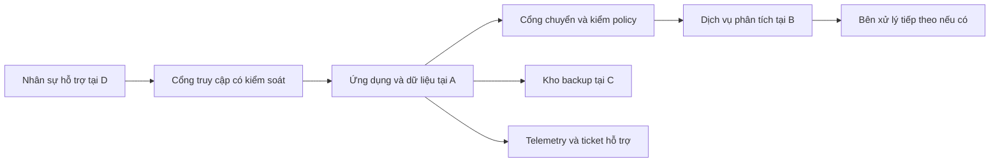

# Cross-border data transfer

## 1. Chuyển dữ liệu xuyên biên giới là một yêu cầu về toàn bộ luồng xử lý

**Cross-border data transfer** trong bài học này chỉ nhóm hoạt động đưa dữ liệu, bản sao hoặc khả năng truy cập dữ liệu qua ranh giới quốc gia hoặc vùng pháp lý cần được kiểm soát. Đây là phạm vi kỹ thuật để lập bản đồ và quản trị rủi ro; việc một hoạt động có phải là chuyển dữ liệu theo một chế độ pháp luật cụ thể hay không phải được phân loại riêng.

Ví dụ, database đặt tại khu vực đã chọn nhưng hệ thống vẫn có thể gửi dữ liệu sang nơi khác qua backup, dịch vụ email, phân tích, công cụ quan sát, hỗ trợ từ xa hoặc nhà thầu phụ. Vì vậy, yêu cầu “chọn đúng region” chưa đủ mô tả nghĩa vụ và cách thực thi.

Mục tiêu của chương Privacy requirement là chuyển các quyết định về dữ liệu và hoạt động xử lý thành yêu cầu cụ thể:

> Chỉ cho phép luồng đã được xác định rõ về dữ liệu, mục đích, bên nhận, nơi xử lý và điều kiện bảo vệ; phát hiện thay đổi, ngăn chuyển ngoài phạm vi và lưu được bằng chứng cần thiết.

Bài học tập trung vào đặc tả hệ thống, liên kết yêu cầu với rủi ro, kiến trúc và tiêu chí kiểm thử. Các địa điểm A/B/C, tên dịch vụ, thời hạn và ngưỡng vận hành dưới đây là ví dụ giả định. Phê duyệt nội bộ trong ví dụ là một kiểm soát của tổ chức, không mặc nhiên có nghĩa là mọi luồng đều phải xin phép cơ quan nhà nước trước khi chuyển.

## 2. Phân biệt vị trí lưu, truy cập và phân loại pháp lý

| Khái niệm | Câu hỏi cần trả lời | Điều không được tự suy ra |
|---|---|---|
| Data residency | Những bản dữ liệu nào được lưu tại đâu? | Database chính đúng region không chứng minh mọi bản sao cũng ở đó |
| Data localization | Có yêu cầu lưu hoặc xử lý trong một phạm vi cụ thể không? | Không phải mọi hệ thống đều có cùng nghĩa vụ nội địa hóa |
| Nơi xử lý | Compute, phân tích, gửi email hoặc suy luận diễn ra ở đâu? | Không ghi xuống ổ đĩa vẫn có thể có hoạt động xử lý cần đánh giá |
| Truy cập từ xa | Ai từ đâu được làm dữ liệu sẵn có hoặc đọc dữ liệu? | Không tải file không đồng nghĩa không có tiết lộ dữ liệu |
| Chủ thể pháp lý nhận dữ liệu | Pháp nhân nào nhận, với vai trò và trách nhiệm gì? | Cùng thương hiệu hoặc cùng tập đoàn không mặc nhiên là cùng một bên |
| Chuyển dữ liệu theo luật áp dụng | Hoạt động nào đáp ứng tiêu chí pháp lý của từng chế độ? | Không thể quyết định chỉ từ quốc gia của địa chỉ IP |

Trong profile GDPR, EDPB xác định ba tiêu chí đồng thời: bên xuất chịu GDPR cho hoạt động đó; làm dữ liệu sẵn có cho một controller/processor khác; bên nhận ở nước thứ ba hoặc là tổ chức quốc tế. Nhân viên thuộc cùng controller truy cập khi đi công tác có thể khác với cung cấp dữ liệu cho pháp nhân khác. Xem [EDPB Guidelines 05/2021](https://www.edpb.europa.eu/system/files/documents/2023-02/edpb_guidelines_05-2021_interplay_between_the_application_of_art3-chapter_v_of_the_gdpr_v2_en_0.pdf).

Do đó, inventory kỹ thuật nên bao phủ rộng các đường dữ liệu và truy cập, sau đó gắn kết quả phân loại pháp lý tương ứng. Không loại một luồng khỏi đánh giá an toàn chỉ vì nó không thuộc khái niệm chuyển dữ liệu của một điều khoản cụ thể.

## 3. Xác định profile pháp lý trước khi đặt điều kiện kỹ thuật

### 3.1. Một luồng có thể chịu nhiều nhóm điều kiện

Tổ chức cần xác định quy định áp dụng theo hoạt động, vai trò, dữ liệu và phạm vi liên quan. Chỉ biết quốc tịch người dùng hoặc quốc gia của máy chủ chưa đủ để xác định toàn bộ nghĩa vụ.

Các đầu vào cần được người có trách nhiệm xác lập gồm:

- Phạm vi dữ liệu và loại hoạt động xử lý.
- Vai trò của bên chuyển, bên nhận và bên xử lý tiếp theo.
- Căn cứ xử lý dữ liệu và nghĩa vụ minh bạch liên quan.
- Cơ chế hoặc điều kiện cho việc chuyển, nếu được yêu cầu.
- Hồ sơ đánh giá, thông báo, thủ tục, hợp đồng và nghĩa vụ cập nhật theo chế độ áp dụng.
- Các ràng buộc theo hợp đồng khách hàng hoặc theo ngành có liên quan.

Một cơ chế chuyển hợp lệ không tự tạo quyền xử lý cho mọi mục đích. Tương tự, có căn cứ xử lý không có nghĩa mọi bên nhận và địa điểm đều được phép.

### 3.2. Ví dụ đối chiếu Việt Nam

Tại thời điểm tham chiếu 27/11/2026 của bài học, [Luật Bảo vệ dữ liệu cá nhân số 91/2025/QH15](https://vanban.chinhphu.vn/?docid=214590&pageid=27160) và [Nghị định 356/2025/NĐ-CP](https://chinhphu.vn/?docid=216387&pageid=27160) có ngày hiệu lực từ 01/01/2026. Với hệ thống thuộc phạm vi áp dụng, cần đối chiếu quy định về chuyển dữ liệu xuyên biên giới, hồ sơ và trường hợp áp dụng/loại trừ theo các văn bản liên quan.

Điều 20 của Luật đề cập cả chuyển tới hệ thống lưu trữ ngoài Việt Nam, cung cấp cho bên ở nước ngoài và sử dụng nền tảng ngoài Việt Nam để xử lý dữ liệu được thu thập tại Việt Nam. Xem [bản Luật đăng Công báo](https://congbao.cdnchinhphu.vn/CongBaoCP/VanBan/2025/6/45578/57730-1-2025971-97291-2025-qh15.pdf). Vì vậy, chỉ rà vị trí của database không bao phủ đủ các dạng luồng cần phân tích.

Các thời hạn và nội dung hồ sơ phải được lấy từ profile pháp lý đang hiệu lực. Không hard-code một quy trình cũ rồi coi đó là quy tắc bất biến cho mọi dịch vụ.

### 3.3. Ví dụ đối chiếu GDPR

Ủy ban châu Âu liệt kê các công cụ như adequacy decision, standard contractual clauses — SCC, binding corporate rules — BCR và những ngoại lệ có điều kiện. Xem [quy tắc chuyển dữ liệu quốc tế](https://commission.europa.eu/law/law-topic/data-protection/international-dimension-data-protection/rules-international-data-transfers_en).

Không dùng một checkbox “đồng ý chuyển” hoặc một mẫu hợp đồng như cơ chế mặc định cho mọi trường hợp. Cần xác định công cụ có phù hợp với vai trò, hoạt động và bên nhận thực tế hay không. [Quyết định 2021/914 về SCC](https://eur-lex.europa.eu/legal-content/EN/TXT/?uri=celex%3A32021D0914) cũng xác định vai trò của các điều khoản đối với bảo đảm cho chuyển dữ liệu, không thay thế toàn bộ nghĩa vụ bảo vệ dữ liệu.

Việc dựa vào một quyết định hoặc hồ sơ không nên được đóng cứng thành danh sách quốc gia “luôn an toàn”. Policy cần có nguồn, ngày đánh giá, phạm vi, điều kiện và cơ chế xem xét lại.

## 4. Tình huống: nền tảng học tập có nhiều dịch vụ bên ngoài

Giả sử một nền tảng quản lý hồ sơ và kết quả học tập tại miền A. Nhóm muốn dùng dịch vụ phân tích tại miền B, lưu bản phục hồi tại C và thuê hỗ trợ vận hành từ địa điểm D.



Mỗi mũi tên là một luồng cần đưa vào inventory để xác định dữ liệu, bên nhận và kiểm soát. Sơ đồ không tự khẳng định mọi mũi tên đều có cùng phân loại pháp lý.

| Luồng | Câu hỏi dễ bị bỏ sót |
|---|---|
| Sự kiện học tập gửi tới analytics | Có email, IP, ID ổn định hoặc nội dung tự do không? |
| Backup tại miền C | Repository, replica, khóa và nơi restore được kiểm soát ra sao? |
| Hỗ trợ từ địa điểm D | Nhân sự thuộc pháp nhân nào, có đọc plaintext hay tải bản sao không? |
| Log và crash report | URL, header, truy vấn hoặc payload có dữ liệu cá nhân không? |
| Email thông báo | Nhà cung cấp nhận địa chỉ và nội dung gì, xử lý tiếp ở đâu? |
| Dịch vụ AI nếu được dùng | Prompt, file, embedding, log và việc sử dụng tiếp dữ liệu thuộc phạm vi nào? |
| Control plane hoặc công cụ quản trị | Metadata nào có thể nhận diện người dùng hoặc tiết lộ nội dung? |

Thiết kế nên bắt đầu từ nhu cầu tối thiểu. Nếu analytics chỉ cần số lượng hoàn thành theo nhóm, không mặc định gửi toàn bộ hồ sơ học viên. Nếu hỗ trợ có thể dùng dữ liệu tổng hợp hoặc mẫu tổng hợp, không mở quyền đọc database production cho tiện.

## 5. Mô hình đe dọa và bất biến

| Mã | Tình huống | Rủi ro cần hạn chế |
|---|---|---|
| R1 | Chuyển tới sai region, endpoint hoặc bên nhận | Dữ liệu rời phạm vi đã được chấp thuận |
| R2 | Luồng ẩn qua log, SDK, support hoặc backup | Inventory và hồ sơ không phản ánh thực tế |
| R3 | Bên nhận dùng thêm nhà thầu phụ hoặc mục đích mới | Mất kiểm soát chuyển tiếp và sử dụng dữ liệu |
| R4 | Policy, hợp đồng hoặc điều kiện đánh giá hết hiệu lực nhưng job vẫn chạy | Tiếp tục chuyển dựa trên điều kiện cũ |
| R5 | Mã hóa được mô tả quá mức trong khi bên nhận vẫn có quyền giải mã | Đánh giá sai khả năng tiếp cận plaintext |
| R6 | Failover, retry hoặc restore tự đổi địa điểm | Tính sẵn sàng làm vượt ranh giới dữ liệu |
| R7 | Payload có dữ liệu ngoài schema hoặc nhầm tenant | Gửi quá mức hoặc gửi dữ liệu không thuộc profile |
| R8 | Không thể truy vết, dừng hoặc xử lý dữ liệu đã gửi | Thiếu bằng chứng và khả năng ứng phó |

Bất biến của hệ thống giả định:

1. Một luồng chỉ được chạy khi có policy hợp lệ cho đúng dữ liệu, mục đích, bên nhận và địa điểm liên quan.
2. Client không tự quyết định quốc gia, bên nhận, classification hoặc phiên bản policy được chấp nhận.
3. Luồng phụ và luồng phục hồi phải có cùng mức kiểm soát thích hợp với dữ liệu chúng xử lý.
4. Thay đổi điều kiện quan trọng phải kích hoạt đánh giá lại, không kế thừa chấp thuận vô thời hạn.
5. Khi không chứng minh được điều kiện chuyển, hệ thống phải dừng hoặc giữ dữ liệu trong vùng được phép theo contract.

## 6. Transfer register: đặc tả một luồng bằng dữ liệu có thể đối chiếu

Một transfer register là danh mục các luồng và điều kiện của chúng. Nó cần liên kết với kiến trúc, vendor register, cấu hình triển khai và policy thực thi, thay vì chỉ là một bảng tài liệu nằm ngoài vận hành.

Mỗi luồng nên ghi rõ:

| Nhóm | Thuộc tính minh họa |
|---|---|
| Nhận diện | Transfer ID, hệ thống nguồn, owner, phiên bản |
| Dữ liệu | Dataset, schema, chủ thể liên quan, classification, khối lượng |
| Mục đích | Hoạt động cần thực hiện, sự cần thiết, thời hạn |
| Các bên | Pháp nhân chuyển, nhận, vai trò và bên xử lý tiếp theo |
| Địa điểm | Nơi lưu, xử lý, backup, hỗ trợ truy cập và phạm vi cần xác minh |
| Pháp lý/quản trị | Profile áp dụng, kết luận đánh giá, tài liệu và thời điểm rà soát |
| Kỹ thuật | Endpoint được phê duyệt, danh tính workload, khóa, cách giới hạn dữ liệu |
| Vòng đời | Retention, xóa, dừng chuyển, sự cố và điều kiện thay đổi |
| Bằng chứng | Tham chiếu cấu hình, hợp đồng, đánh giá, log và kết quả kiểm thử |

Ví dụ cấu hình trừu tượng:

```yaml
transferId: learning-analytics-demo
policyVersion: 7
sourceDataset: course-progress-events
purpose: completion-statistics
recipientLegalEntity: analytics-provider-demo
approvedService: analytics-service-demo
allowedProcessingZones:
  - zone-b-approved
approvedSchema: progress-minimized-v3
legalProfileRef: legal-review-demo-12
assessmentRef: transfer-assessment-demo-4
onwardTransferProfileRef: subprocessors-demo-2
keyProfileRef: data-key-profile-demo-6
state: APPROVED
reviewDueAt: "2026-12-15T00:00:00Z"
```

Các ID và zone ở đây là tên giả định, không phải mã quốc gia hay region của một nhà cung cấp cụ thể. Registry thực tế phải phân biệt region kỹ thuật với phạm vi quốc gia hoặc vùng pháp lý mà quyết định áp dụng.

Một trường `state: APPROVED` chỉ có giá trị nếu có người hoặc quy trình được ủy quyền tạo quyết định, phạm vi khớp và hệ thống kiểm trạng thái đó. Không để workload tự ghi `APPROVED` cho luồng mà chính nó muốn thực hiện.

## 7. Đánh giá bên nhận và biện pháp bảo vệ

### 7.1. Từ chứng từ tới hoạt động thực tế

Đánh giá cần hiểu dịch vụ sẽ làm gì, ai có thể truy cập dữ liệu, công nghệ nào được dùng và bên nào có thể yêu cầu hoặc thực hiện việc cung cấp dữ liệu. Chỉ xem nhãn chứng nhận của nhà cung cấp không đủ để chứng minh từng luồng đã đáp ứng điều kiện.

Trong profile GDPR sử dụng công cụ theo Điều 46, [EDPB Recommendations 01/2020](https://www.edpb.europa.eu/system/files/documents/2021-06/edpb_recommendations_202001vo.2.0_supplementarymeasurestransferstools_en.pdf) hướng dẫn đánh giá hiệu quả bảo đảm trong bối cảnh chuyển cụ thể và biện pháp bổ sung khi cần. Đánh giá tác động chuyển dữ liệu không nên bị nhầm với một bản kiểm tra lỗ hổng kỹ thuật hoặc thay thế mọi đánh giá quyền riêng tư khác.

Các câu hỏi thiết kế cần chuyển thành bằng chứng gồm:

- Nhà cung cấp có cần plaintext để thực hiện dịch vụ không?
- Bản sao và quyền vận hành có giới hạn theo phạm vi đã thỏa thuận không?
- Có thể hạn chế trường dữ liệu hoặc giảm khả năng nhận diện trước khi gửi không?
- Hợp đồng và vận hành xử lý thay đổi bên nhận, sự cố và yêu cầu tiếp cận dữ liệu ra sao?
- Có phương án dừng, chuyển dịch vụ hoặc xử lý dữ liệu khi điều kiện không còn phù hợp không?

### 7.2. Mã hóa không tự loại mọi rủi ro

TLS bảo vệ kênh trong phạm vi cơ chế đó; mã hóa lưu trữ bảo vệ những tình huống lưu trữ tương ứng. Nếu dịch vụ bên nhận phải đọc plaintext hoặc có quyền dùng khóa, không thể suy rằng mã hóa đã ngăn bên nhận tiếp cận nội dung.

Cần phân biệt ai tạo khóa, ai giữ khóa, ai được gọi giải mã, nơi thực hiện thao tác và người quản trị nào có thể đổi policy. Nhãn “customer-managed key” không tự chứng minh rằng không ai khác có khả năng giải mã.

EDPB cũng phân tích khác biệt giữa lưu trữ dữ liệu đã mã hóa với dịch vụ cần xử lý plaintext trong các use case của [Recommendations 01/2020](https://www.edpb.europa.eu/system/files/documents/2021-06/edpb_recommendations_202001vo.2.0_supplementarymeasurestransferstools_en.pdf). Lựa chọn biện pháp phải phù hợp khả năng truy cập thực tế, không chỉ tên thuật toán.

Pseudonymization có thể giảm phơi lộ nếu thông tin liên kết được bảo vệ riêng và người nhận không có đường nhận diện tương đương. Không tự coi dữ liệu đã hash hoặc bỏ tên là dữ liệu vô danh, không còn cần đánh giá luồng chuyển.

## 8. Cổng chuyển phải thực thi đúng quyết định đã được phê duyệt

### 8.1. Policy phải gắn với cả luồng và dữ liệu

Một mẫu thiết kế là chỉ cho workload gửi dữ liệu qua đường được quản trị. Cổng chuyển kiểm identity, profile, schema và bên nhận trước khi gửi, không chỉ kiểm một cờ bật/tắt ở giao diện quản trị.

```text
sendApprovedTransfer(workloadIdentity, transferId, sourceBatch):
    workload = authenticate(workloadIdentity)
    policy = loadCurrentTransferPolicy(transferId)
    require policy is valid and approved
    require workload may use this policy

    context = resolveTrustedSourceContext(sourceBatch)
    require context.dataset, tenant and purpose match policy

    payload = minimizeUsingApprovedTransform(sourceBatch, policy)
    require payload conforms to the approved schema and classification

    destination = resolveApprovedRecipientService(policy)
    require destination and selected failover target satisfy policy
    require required safeguards and credentials are available

    record authorization evidence without raw payload
    transmit using the approved protected channel
    record delivery outcome and transfer manifest reference
```

Đây là mã giả cho contract, không phải triển khai hoàn chỉnh của một sản phẩm. `loadCurrentTransferPolicy` phải kiểm trạng thái, điều kiện và độ mới, không chỉ tìm thấy một bản cấu hình bất kỳ.

`transferId` do người gọi gửi không đủ làm bằng chứng được phép. Policy phải giới hạn workload, dữ liệu và mục đích. Một batch có nội dung nhầm tenant hoặc có field mới không được gửi chỉ vì nó mang một Transfer ID hợp lệ.

### 8.2. Giảm dữ liệu trước điểm rời phạm vi

Phép biến đổi cần dùng allowlist. Ví dụ, analytics chỉ nhận mã giả danh theo scope, mã khóa học và khoảng thời gian đã giảm độ chi tiết; không nhận email, token phiên, nội dung hỗ trợ hay hồ sơ đầy đủ.

Kiểm soát phải xảy ra trước khi dữ liệu tới bên không được nhận phần đó. Không gửi cả payload tới nhà cung cấp rồi yêu cầu họ tự bỏ field nhạy cảm để coi là đã giảm phơi lộ tại nguồn.

Dữ liệu không có nhãn, không phân loại được hoặc không khớp schema cần bị chặn hay đưa vào vùng cách ly được bảo vệ. Không dùng một classification mặc định ít nhạy cảm hơn để tránh làm gián đoạn pipeline.

### 8.3. Chặn đường vòng

Nếu backend bị giới hạn egress nhưng trình duyệt vẫn gửi PII tới SDK bên ngoài, contract chuyển vẫn bị phá vỡ. Cần đánh giá SDK frontend, mobile, tag manager, webhook, upload trực tiếp, công cụ debug và những workload có đường mạng riêng.

Link chia sẻ hoặc quyền đọc object cũng có thể làm dữ liệu sẵn có cho bên nhận. Không giới hạn inventory vào các HTTP request có payload lớn do chính server chủ động gửi.

## 9. Thực thi giới hạn địa điểm và bên nhận

### 9.1. Kiểm soát nhiều lớp

Yêu cầu có thể được thực thi bằng phối hợp:

- Policy triển khai và cấu hình hạ tầng giới hạn region, replica và repository.
- Danh tính workload, quyền dịch vụ và phạm vi tài khoản của nhà cung cấp.
- Egress gateway hoặc đường kết nối được phép, với endpoint và dịch vụ đã được quản trị.
- Cấu hình của nhà cung cấp cho processing location, retention và truy cập hỗ trợ.
- Phát hiện drift cùng quy trình đối chiếu bằng chứng từ các bên liên quan.

Chỉ kiểm GeoIP không đủ xác định pháp nhân nhận, nơi dữ liệu được lưu hoặc nơi nhân sự xử lý. VPN, proxy, mạng phân phối và endpoint dùng chung có thể làm vị trí mạng quan sát được khác với phạm vi cần quản trị.

Xác thực TLS của endpoint cũng không chứng minh dữ liệu không bị chuyển tiếp phía sau endpoint. Cần phân biệt bằng chứng mà hệ thống mình quan sát được với bằng chứng phụ thuộc cấu hình, hợp đồng hoặc đánh giá nhà cung cấp.

### 9.2. Phát hiện drift so với register

Inventory phải được đối chiếu với cấu hình thực tế: tài nguyên mới, bật tính năng analytics, đổi region backup, thêm endpoint log hoặc thay đổi default của SDK có thể tạo luồng mới.

Các thuộc tính quan trọng có thể được đưa vào kiểm tra trước deploy và kiểm tra sau triển khai. Nếu không quan sát trực tiếp được một thuộc tính bên nhà cung cấp, phải chỉ rõ owner, nguồn chứng minh và thời điểm rà soát thay vì đánh dấu tự động “đã kiểm chứng”.

Không lấy một cam kết chung “dữ liệu ở trong khu vực X” làm bằng chứng cho cả control plane, support access, backup và mọi subprocessor nếu phạm vi cam kết không bao phủ chúng.

## 10. Truy cập từ xa và đặc quyền hỗ trợ

Truy cập từ xa có thể công bố dữ liệu mà không tạo một file export rõ ràng. Contract cần nêu pháp nhân sử dụng nhân sự, nhóm người được phép, địa điểm/phạm vi truy cập, loại dữ liệu, mục đích và thời gian.

Một profile hỗ trợ minh họa có thể yêu cầu:

- Ưu tiên dữ liệu tổng hợp, đã làm sạch hoặc màn hình giới hạn trước khi cấp plaintext.
- Danh tính cá nhân, xác thực phù hợp và quyền có thời hạn gắn với ticket.
- Quyền theo tenant, tài nguyên và thao tác; không dùng tài khoản chung toàn production.
- Kiểm soát download, clipboard, công cụ chuyển file và session recording theo phạm vi phù hợp.
- Theo dõi việc cấp, dùng và thu hồi quyền; kiểm cả phiên đang hoạt động khi hết thời hạn.

Các biện pháp giao diện không bảo đảm tuyệt đối rằng không thể chụp lại dữ liệu bằng phương tiện khác. Yêu cầu phải nói đúng mức bảo vệ và phối hợp kỹ thuật, quản trị cùng đánh giá bên nhận.

Nếu nguồn vị trí của nhân sự không đáng tin cậy, không suy rằng kiểm một địa chỉ IP đã xác nhận họ ở quốc gia được phép. Cần cơ chế tin cậy phù hợp hoặc không cấp truy cập đòi hỏi điều kiện mà hệ thống không thể chứng minh.

Đường truy cập khẩn cấp cũng phải được đặc tả. Tên gọi “break glass” không tự cho phép bỏ ràng buộc chuyển hoặc cam kết với khách hàng; phạm vi ngoại lệ phải có căn cứ, thẩm quyền, thời hạn và bằng chứng.

## 11. Chuyển tiếp, quyền của chủ thể và kết thúc dịch vụ

### 11.1. Onward transfer cần một đồ thị trách nhiệm

Bên nhận có thể dùng dịch vụ lưu trữ, hỗ trợ hoặc analytics khác. Register cần nêu bên xử lý tiếp theo, hoạt động, nơi xử lý và điều kiện thay đổi. Nếu chỉ ghi nhà cung cấp cấp một, tổ chức có thể mất dấu phần còn lại của chuỗi.

Hợp đồng và quy trình vận hành cần xử lý việc thêm hoặc thay subprocessor theo profile áp dụng. Không mặc định chấp thuận nhà cung cấp A đồng nghĩa chấp thuận mọi bên mà A sẽ sử dụng trong tương lai.

Khi phát hiện bên nhận mới ngoài phạm vi, hệ thống cần có cách ngừng luồng hoặc hạn chế dữ liệu trong thời gian đánh giá. Một thông báo của vendor không tự trở thành quyết định mở rộng policy của tổ chức.

### 11.2. Phối hợp thực hiện quyền và xử lý sự cố

Thiết kế phải duy trì được liên kết giữa dữ liệu đã chuyển và nguồn, nhằm hỗ trợ truy xuất, sửa, xóa hoặc hạn chế theo quyết định hợp lệ. Pseudonymization không được làm mất toàn bộ khả năng phối hợp mà nghiệp vụ và profile vẫn cần.

Các mốc phối hợp với bên nhận cần tách thời gian tiếp nhận, phản hồi, thực hiện, xác nhận và các bản sao có retention khác. Thời hạn thông báo sự cố hoặc hỗ trợ quyền được lấy theo profile và thỏa thuận áp dụng, không dùng một con số chung cho mọi quốc gia và mọi vai trò.

Yêu cầu từ cơ quan có thẩm quyền cần có đường tiếp nhận, đánh giá, quyết định và lưu bằng chứng phù hợp. Quy tắc thông báo cho bên chuyển hoặc chủ thể phải phản ánh điều kiện pháp luật thực tế; không cam kết rằng luôn có thể thông báo mọi yêu cầu trong mọi tình huống.

### 11.3. Hết hạn hoặc kết thúc hợp đồng

Ngừng gửi dữ liệu mới không tự xóa dữ liệu đã giao. Exit plan phải xác định việc trả lại, chuyển sang dịch vụ khác, xóa bản online, xử lý backup và bằng chứng mà bên nhận có thể cung cấp.

Hủy credential chỉ chặn một đường truy cập; nó không chứng minh payload đã mất khỏi queue, object, replica hoặc snapshot bên nhận. Từng nghĩa vụ phải có cơ chế và bằng chứng riêng.

Không mô tả việc thu hồi khóa dùng chung như phương án xóa theo từng người nếu nó không thực sự đạt phạm vi đó. Cũng cần tính tới bên nào đã có plaintext hoặc bản sao trước khi khóa bị thu hồi.

## 12. Retry, failover và phục hồi không được mở rộng phạm vi

### 12.1. Job trong queue phải được đánh giá lại

Một job được đưa vào queue khi policy còn hiệu lực có thể chạy sau khi luồng đã bị đình chỉ. Do đó, việc kiểm quyền chỉ lúc enqueue là không đủ; cần kiểm lại ở điểm gửi theo contract về độ mới.

Retry không được tự chọn endpoint toàn cầu, region mặc định hoặc nhà cung cấp dự phòng ngoài profile. Giới hạn idempotency và chống trùng lặp nghiệp vụ cũng cần giữ, nhưng chúng không thay thế kiểm điều kiện chuyển.

Nếu policy service, khóa hoặc biện pháp bảo vệ bắt buộc không hoạt động, luồng cần dừng hoặc giữ dữ liệu trong queue được bảo vệ tại phạm vi được phép. Dead-letter queue và dữ liệu lỗi phải có cùng kiểm soát phù hợp; không gửi raw payload sang hệ thống giám sát toàn cầu để debug.

### 12.2. DR phải được phê duyệt như một luồng

Disaster recovery có thể sao chép dữ liệu sang địa điểm khác, mở khóa tại nơi khác hoặc cấp quyền hỗ trợ bổ sung. Các khả năng đó cần được xác định trước, không coi là chi tiết vận hành nằm ngoài mô hình dữ liệu.

RTO và RPO phải được thiết kế cùng ràng buộc dữ liệu. Nếu mọi điểm phục hồi được phép đều không khả dụng, đặc tả phải nêu hành vi suy giảm phù hợp; không tự failover xuyên ranh giới chưa được phép chỉ để giữ dịch vụ hoạt động.

Diễn tập restore cần xác nhận region, tài khoản, quyền, khóa, logging và policy hiện tại trước khi phục vụ. Restore một cấu hình cũ không được làm sống lại luồng đã bị loại bỏ.

### 12.3. Ngân sách dừng chuyển phải đo được

Ví dụ yêu cầu kỹ thuật:

> Sau khi quyết định đình chỉ một Transfer ID được ghi bền vững tại T0, mọi lần gửi mới thuộc luồng đó phải bị từ chối từ T0 + 60 giây; job tồn đọng và retry cũng nằm trong phạm vi.

Con số 60 giây là lựa chọn minh họa. Muốn cam kết phải giới hạn cache, thời hạn quyền, đường gửi trực tiếp và hành vi của worker khi không cập nhật được trạng thái. Một cảnh báo sau vài giờ không đáp ứng yêu cầu này.

Đặc tả phải nói rõ xử lý request đang truyền hoặc phiên hỗ trợ đang mở. Ngừng phát hành yêu cầu mới không thu hồi được dữ liệu đã tới bên nhận; việc xử lý dữ liệu trước đó là luồng ứng phó riêng.

## 13. Quản lý thay đổi, audit và ứng phó

### 13.1. Khi nào phải xem xét lại?

Các trigger có thể gồm đổi bên nhận hoặc pháp nhân, thêm quốc gia/region, thêm mục đích, đổi loại dữ liệu, mở quyền plaintext, thêm subprocessor, đổi cách quản lý khóa, thay hồ sơ pháp lý hoặc thay đổi điều kiện được viện dẫn.

Không phải mọi thay đổi nhỏ đều cần cùng một quy trình, nhưng policy phải phân loại được điều gì ảnh hưởng tới quyết định chuyển. Một phiên bản schema tăng thêm địa chỉ email có thể quan trọng hơn nhiều so với một bản sửa tên field thuần túy.

Registry cần lưu lịch sử quyết định và thời điểm hiệu lực. Không sửa đè một kết luận cũ khiến không thể biết vì sao một batch trước đó đã được cho phép.

### 13.2. Audit cần đủ điều tra mà không nhân bản dữ liệu

Một sự kiện minh họa:

```yaml
eventType: CROSS_BORDER_TRANSFER_EVALUATED
transferId: learning-analytics-demo
policyVersion: 7
workloadAuditId: learning-worker-demo
recipientProfileId: analytics-service-demo
schemaVersion: progress-minimized-v3
decision: DENY
reasonCode: TRANSFER_POLICY_SUSPENDED
batchAuditRef: batch-demo-321
correlationId: trace-demo-914
```

Audit không chứa raw payload, secret, token truy cập hoặc thông tin nhận diện không cần thiết. Log cũng có nơi lưu và bên xử lý; chính audit pipeline phải nằm trong inventory tương ứng.

Một transfer manifest có thể giúp đối chiếu batch, scope, bên nhận, thời điểm, policy và kết quả. “Đã gửi” phải được định nghĩa rõ: bắt đầu truyền, được endpoint chấp nhận hay được bên nhận xác nhận xử lý. Không dùng một trạng thái duy nhất cho mọi mốc.

### 13.3. Xử lý phát hiện chuyển ngoài phạm vi

Quy trình cần xác định cách chặn luồng, thu hồi quyền liên quan, bảo toàn bằng chứng, xác định dữ liệu/bên nhận chịu tác động và phối hợp xử lý bản sao đã giao. Việc thông báo và báo cáo theo profile áp dụng phải được giao cho owner rõ ràng.

Sửa endpoint hiện tại không chứng minh sự cố đã được khắc phục hoàn toàn. Phải kiểm cả queue cũ, retry, backup, SDK, công cụ hỗ trợ và đường chuyển tiếp đã hoạt động trong giai đoạn ảnh hưởng.

## 14. Bộ yêu cầu bảo mật mẫu liên kết với rủi ro

| ID | Yêu cầu | Rủi ro và bằng chứng nghiệm thu |
|---|---|---|
| XFER-01 | Mỗi luồng dữ liệu hoặc quyền truy cập qua ranh giới cần kiểm soát có inventory, owner và kết quả phân loại theo profile | R1, R2; đối chiếu sơ đồ, tài nguyên, SDK và vendor register |
| XFER-02 | Policy chuyển xác định dữ liệu, mục đích, bên nhận, địa điểm, cơ sở đánh giá và thời điểm rà soát | R1, R4; hồ sơ quyết định có phiên bản và scope khớp |
| XFER-03 | Payload được giảm theo allowlist trước khi gửi; thiếu classification hoặc sai schema dẫn đến chặn/cách ly | R7; dữ liệu canary, schema mới và kiểm payload tại ranh giới |
| XFER-04 | Chỉ workload được cấp mới dùng Transfer ID; client không tự mở rộng bên nhận hoặc region | R1, R7; ca giả mạo metadata, đổi endpoint và workload khác |
| XFER-05 | Cấu hình triển khai, egress, vendor service và quyền storage phù hợp registry; phát hiện drift có owner xử lý | R1, R2; kiểm cấu hình hiệu lực và đường truy cập trực tiếp |
| XFER-06 | Biện pháp mã hóa và quản lý khóa được mô tả theo khả năng truy cập thực tế của từng bên | R5; ma trận quyền khóa, đường giải mã và đánh giá plaintext |
| XFER-07 | Truy cập hỗ trợ có danh tính, scope, thời hạn và điều kiện địa điểm phù hợp; không có tài khoản chung vượt phạm vi | R2, R5; thử cấp/thu hồi quyền và kiểm phiên hỗ trợ |
| XFER-08 | Bên xử lý tiếp theo và thay đổi mục đích/địa điểm được đánh giá theo policy trước khi mở rộng luồng | R3, R4; thay subprocessor và kiểm kết quả gate |
| XFER-09 | Policy đình chỉ hoặc hết hiệu lực ngăn gửi mới trong ngân sách đã công bố, gồm queue và retry | R4, R8; đo end-to-end trên mọi worker và đường gửi |
| XFER-10 | Backup, failover, restore và telemetry giữ ràng buộc dữ liệu; không fallback sang đích ngoài profile | R2, R6; diễn tập DR, lỗi phụ thuộc và kiểm vùng trung gian |
| XFER-11 | Có cơ chế phối hợp quyền của chủ thể, retention, kết thúc dịch vụ và xử lý dữ liệu đã giao | R3, R8; diễn tập yêu cầu, exit plan và bằng chứng từ bên nhận |
| XFER-12 | Audit truy vết quyết định và kết quả theo policy mà không tạo bản sao PII ngoài phạm vi; thay đổi quan trọng kích hoạt rà soát | R2, R4, R8; kiểm log, manifest, lịch sử và trigger thay đổi |

Ví dụ đặc tả chi tiết cho chống mở rộng phạm vi khi lỗi:

```yaml
id: XFER-10
asset: learning-analytics-transfer
precondition: Primary recipient endpoint is unavailable
requiredBehavior:
  - Use only a fallback destination listed in the effective policy
  - Revalidate recipient, processing zone and required safeguards
  - Keep unsent data in the approved protected queue
forbiddenBehavior:
  - Switch to an unapproved global endpoint
  - Forward raw payload to an external debug service
measurement:
  unauthorizedDestinationDispatches: 0
  failedBatchesWithRecordedOutcomePercent: 100
evidence:
  - Recipient outage and fallback test report
  - Egress and queue configuration inspection
owner: data-platform
```

Thước đo trên chỉ có giá trị khi xác định được những điểm gửi nằm trong phạm vi thực thi. Một gateway báo không có lần vi phạm không chứng minh SDK hoặc service khác không có đường gửi vòng.

## 15. Ma trận kiểm thử và bằng chứng ở đúng ranh giới

Đây là tiêu chí thiết kế kiểm thử, chưa phải kết quả QA của một triển khai cụ thể. Dùng dữ liệu tổng hợp và tài khoản có thẩm quyền.

| Tình huống | Kết quả mong đợi |
|---|---|
| Luồng đúng workload, schema, bên nhận và policy | Được gửi, có quyết định và kết quả truy vết được |
| Client đổi Transfer ID hoặc giả tenant/classification | Không vượt phạm vi dữ liệu và workload được cấp |
| Payload xuất hiện email, token hoặc field ngoài schema | Bị loại đúng profile hoặc chặn trước ranh giới, không âm thầm gửi |
| Endpoint đúng tên miền nhưng cấu hình service/region đổi | Drift được phát hiện; hành vi theo contract đã định |
| Primary endpoint lỗi, chỉ có fallback ngoài profile | Không gửi tới fallback đó |
| Policy service lỗi, policy hết hạn hoặc không đủ mới | Không bỏ kiểm tra để tiếp tục chuyển |
| Job được enqueue trước khi policy bị đình chỉ | Khi chạy vẫn bị chặn theo ngân sách dừng chuyển |
| Worker retry sau restart với cấu hình cache cũ | Không khôi phục quyền chuyển đã bị thu hồi |
| Nhân sự hỗ trợ thử đọc ngoài tenant hoặc sau hết thời hạn | Bị từ chối theo scope và quy tắc phiên |
| Người gọi thử đi thẳng object storage, webhook hoặc API phụ | Không vượt cổng và quyền đã đặc tả |
| SDK frontend hoặc crash report có canary dữ liệu cá nhân | Không phát tán canary qua đường ngoài profile |
| Thay khóa hoặc policy cho phép bên nhận giải mã thêm | Kích hoạt đánh giá theo mức thay đổi và kiểm quyền thực tế |
| Vendor thêm subprocessor hoặc nơi hỗ trợ mới | Không tự kế thừa chấp thuận ngoài phạm vi |
| Failover/restore chọn region hoặc cấu hình cũ không được phép | Bị chặn trước khi dữ liệu được chuyển hoặc phục vụ |
| Yêu cầu sửa/xóa/hạn chế dữ liệu đã chuyển được chấp nhận | Có phối hợp, trạng thái và bằng chứng theo phạm vi công bố |
| Hết hạn hợp đồng nhưng queue, backup hoặc credential còn tồn tại | Ngừng gửi mới và xử lý bản sao theo exit plan |
| Kiểm audit, error log và vùng cách ly | Có bằng chứng cần thiết, không lộ payload/secret ngoài policy |
| Thay profile pháp lý hoặc điều kiện được viện dẫn | Có quyết định phiên bản mới và tác động tới luồng liên quan |

Bằng chứng kỹ thuật có thể gồm policy hiệu lực, cấu hình cloud, log quyết định, quan sát egress, trạng thái queue và kết quả diễn tập. Bằng chứng từ bên nhận có thể gồm cấu hình được xác nhận, phạm vi dịch vụ, hồ sơ đánh giá hoặc kết quả kiểm tra theo thỏa thuận.

Phải ghi rõ giới hạn quan sát. Hệ thống nguồn có thể chứng minh nó không gửi field bị cấm qua đường đã kiểm soát, nhưng không tự chứng minh mọi hoạt động nội bộ của nhà cung cấp chỉ bằng packet capture ở nguồn.

## 16. Những lỗi đặc tả thường gặp

- **“Máy chủ chính ở đúng nước là đủ.”** Bỏ sót replica, backup, support, telemetry và bên xử lý tiếp theo.
- **“Mọi truy cập từ nước ngoài đều có cùng phân loại pháp lý.”** Không phân biệt hoạt động, chủ thể pháp lý và chế độ áp dụng.
- **“Đã ký SCC hoặc đã có đồng ý thì chuyển gì cũng được.”** Không kiểm scope, điều kiện, mục đích và hiệu quả bảo đảm.
- **“Có TLS và mã hóa ổ đĩa nên bên nhận không đọc được.”** Bỏ qua nhu cầu xử lý plaintext và quyền sử dụng khóa.
- **“GeoIP đúng là đã chứng minh residency.”** Nhầm vị trí mạng với nơi lưu, xử lý và pháp nhân nhận.
- **“Queue đã được cho phép lúc tạo nên cứ gửi.”** Không kiểm đình chỉ, hết hiệu lực hoặc thay đổi policy tại điểm thực thi.
- **“DR là ngoại lệ tự động.”** Cho phép tính sẵn sàng vượt ranh giới chưa được xác định.
- **“Ngừng gọi API là đã xóa dữ liệu bên nhận.”** Không xử lý dữ liệu đã giao, chuyển tiếp và backup.

Một yêu cầu chuyển dữ liệu xuyên biên giới tốt nối được quyết định pháp lý và quản trị với một luồng kỹ thuật cụ thể: dữ liệu nào, từ đâu, tới pháp nhân và dịch vụ nào, với mục đích, quyền truy cập và biện pháp bảo vệ nào. Khi phạm vi, điều kiện thay đổi, hành vi khi lỗi và bằng chứng được đặc tả rõ, tổ chức mới có thể kiểm chứng rằng kiến trúc thực tế tiếp tục tuân theo quyết định đã đưa ra.
