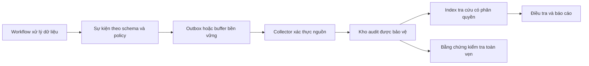

# Privacy audit trail

## 1. Audit trail cần giải thích được việc xử lý dữ liệu cá nhân

Privacy audit trail là chuỗi bằng chứng có cấu trúc giúp giải thích ai hoặc thành phần nào đã xử lý dữ liệu cá nhân, xử lý phần nào, cho mục đích gì, theo quyết định nào và với kết quả nào.

Ví dụ, khách hàng phản ánh vẫn nhận được nội dung tiếp thị sau khi thay đổi lựa chọn. Nhóm xử lý cần xác định lựa chọn được ghi nhận lúc nào, dịch vụ gửi thư đã nhận thay đổi chưa, một job cũ có tiếp tục chạy không và bản ghi nào chứng minh các bước đó. Một dòng access log có HTTP 200 thường không trả lời đủ các câu hỏi này.

Yêu cầu audit trong module bảo mật cần nối được:

> Rủi ro quyền riêng tư → sự kiện cần chứng minh → trường dữ liệu cần thiết → nguồn bằng chứng → cơ chế bảo vệ → thời hạn và phép kiểm tra.

NIST Privacy Framework 1.0, mục CT.DM-P8, đề cập việc xác định, lập tài liệu, triển khai và xem xét audit/log theo policy, đồng thời áp dụng tối thiểu hóa dữ liệu. Xem [NIST Privacy Framework 1.0 — Core](https://www.nist.gov/system/files/documents/2021/05/05/NIST-Privacy-Framework-V1.0-Core-PDF.pdf).

Điều này dẫn tới hai mục tiêu cần được thiết kế cùng nhau: đủ bằng chứng để giải thích hành vi và không biến audit thành một kho dữ liệu cá nhân quá rộng.

Bài học tập trung vào yêu cầu kỹ thuật và quản trị bằng chứng. Phạm vi nghĩa vụ, căn cứ xử lý và thời hạn pháp lý phải do dự án xác định theo bối cảnh áp dụng.

## 2. Xác định mục đích và giới hạn của bằng chứng

### 2.1. Phân biệt các loại dấu vết

| Loại thông tin | Câu hỏi thường trả lời | Giới hạn |
|---|---|---|
| Access log hạ tầng | Endpoint nào được gọi, status và thời lượng | Có thể thiếu ngữ cảnh chủ thể, mục đích và quyết định nghiệp vụ |
| Debug log và trace | Lỗi xảy ra ở bước hoặc dependency nào | Không phù hợp để mặc định lưu payload cá nhân dài hạn |
| Security event | Có dấu hiệu truy cập ngoài quyền hoặc thay đổi kiểm soát nào? | Cần liên kết với ngữ cảnh xử lý dữ liệu khi điều tra quyền riêng tư |
| Privacy audit event | Hành động nào tác động dữ liệu, dựa vào quyết định nào và kết quả ra sao? | Cần schema, ý nghĩa trạng thái và phạm vi bằng chứng rõ |
| Hồ sơ policy hoặc xử lý dữ liệu | Tổ chức đã quy định mục đích và trách nhiệm nào? | Không tự chứng minh từng lần thực thi thực tế |

Các nguồn có thể liên kết qua reference được quản lý. Không cần sao chép toàn bộ trace hoặc hồ sơ cá nhân vào mọi audit event.

### 2.2. Một log không tự chứng minh mọi kết luận

Phải phân biệt các mức như yêu cầu được nhận, quyết định cho phép, tác vụ bắt đầu, thực thi được báo thành công và kết quả đã được xác minh.

Ví dụ:

- `EXPORT_ALLOWED` chưa chứng minh artifact đã được tạo hoặc đã được tải.
- `DOWNLOAD_STARTED` chưa chứng minh người dùng đã lưu hoặc đọc tệp.
- `DELETION_REQUEST_ACCEPTED` chưa chứng minh dữ liệu đã được xử lý ở mọi hệ thống.
- `CONSENT_CHANGE_RECORDED` chưa chứng minh mọi bên nhận đã áp dụng thay đổi.

Một sự kiện có chữ ký chứng minh được những thuộc tính liên quan đến nguồn và tính toàn vẹn trong phạm vi thiết kế. Nó không tự chứng minh tiến trình phát sinh sự kiện luôn trung thực hoặc việc xử lý là hợp lệ về mọi mặt.

## 3. Mô hình đe dọa và phạm vi cần ghi nhận

### 3.1. Những rủi ro chính

| Rủi ro | Tình huống | Mục tiêu yêu cầu |
|---|---|---|
| R1: thiếu bằng chứng | Hành động xảy ra nhưng không có event cần thiết | Phát sinh và ghi bền các sự kiện bắt buộc theo contract |
| R2: bằng chứng sai nguồn | Client tự khai actor, tenant hoặc kết quả | Ràng buộc với danh tính và ngữ cảnh từ nguồn đáng tin |
| R3: thay đổi hoặc xóa dấu vết | Tài khoản quản trị sửa log để che hành động | Hạn chế quyền và phát hiện thay đổi, khoảng trống bất thường |
| R4: rò rỉ từ audit | Log chứa token, nội dung hồ sơ hoặc giấy tờ | Schema tối thiểu, loại bỏ dữ liệu không cần trước khi gửi |
| R5: suy diễn sai thứ tự | Đồng hồ lệch, event đến trễ hoặc retry | Lưu thời gian, quan hệ nhân quả và quy tắc đối soát |
| R6: truy cập chéo tenant | Công cụ tìm log trả thông tin của tổ chức khác | Kiểm soát quyền trên truy vấn và kết quả audit |
| R7: giữ quá lâu | Index hoặc backup audit kéo dài dữ liệu ngoài policy | Retention, hold có phạm vi và vòng đời mọi bản sao |
| R8: báo hoàn tất sai | Collector nhận event nhưng kết quả nghiệp vụ chưa đạt | Tách trạng thái thu thập với trạng thái xử lý thực tế |

Một mô hình cần nói rõ bên tấn công có thể kiểm soát client, workload, collector, tài khoản vận hành hay kho audit. Một thiết kế chỉ hạn chế quyền update trong database khó bảo vệ khi cùng tài khoản đó có thể thay toàn bộ kho hoặc khóa xác minh.

### 3.2. Lập danh mục sự kiện bắt buộc

Không có danh sách dùng chung cho mọi sản phẩm. Dự án cần chọn theo loại dữ liệu, hành động và tác động, ví dụ:

| Nhóm hành động | Sự kiện cần cân nhắc |
|---|---|
| Truy cập dữ liệu nhạy cảm | Quyết định cho phép hoặc từ chối, truy cập bắt đầu hoặc hoàn tất theo contract |
| Thay đổi lựa chọn và quyền xử lý | Phiên bản lựa chọn, mục đích, mốc hiệu lực và trạng thái áp dụng |
| Chia sẻ và export | Người yêu cầu, phạm vi, bên nhận, artifact và kết quả phân phối |
| Yêu cầu của chủ thể | Tiếp nhận, xác minh, quyết định, thực thi, phần còn chờ và phản hồi |
| Retention và xóa | Policy, phạm vi, kết quả từng đích và bằng chứng xác minh |
| Quyền quản trị | Cấp quyền audit, đổi policy, dùng quyền khẩn cấp, thay retention |
| Xem và xuất audit | Người đọc, phạm vi tìm kiếm, mục đích điều tra và kết quả được xuất |

Một thao tác từ dịch vụ nội bộ vẫn có thể tác động dữ liệu cá nhân. Không bỏ qua nó chỉ vì nguồn được đặt tên là “trusted”.

Sự kiện audit bắt buộc phải có quy tắc đầy đủ riêng. Sampling có thể phù hợp cho telemetry tùy chọn, nhưng không được âm thầm áp dụng lên nhóm đã cam kết ghi nhận từng hành động.

## 4. Thiết kế schema để trả lời đúng câu hỏi

### 4.1. Các nhóm trường cần thiết

| Nhóm | Trường minh họa | Ý nghĩa cần quy định |
|---|---|---|
| Định danh event | `eventId`, `eventType`, `schemaVersion` | Phân biệt sự kiện, loại và cách diễn giải |
| Nguồn | `producerId`, `producerVersion`, `sourceEpoch` | Thành phần phát sinh và phiên làm việc hoặc thế hệ nguồn |
| Thời gian | `occurredAt`, `receivedAt` | Khi nguồn ghi nhận hành động và khi collector tiếp nhận |
| Người thực hiện | `actorRef`, `actorType` | Người hoặc workload thực hiện; không mặc định trùng chủ thể |
| Phạm vi | `tenantRef`, `subjectRef`, `dataCategory` | Tổ chức, chủ thể và nhóm dữ liệu trong phạm vi |
| Hành động và mục đích | `action`, `purposeCode` | Việc đã yêu cầu hoặc thực hiện và mục đích từ workflow |
| Quyết định | `decision`, `policyVersion`, `reasonCode` | Kết quả đánh giá cùng phiên bản policy có thể tra cứu |
| Kết quả thực thi | `executionStatus`, `evidenceRef` | Mức thực thi và nơi có bằng chứng bổ sung được quản lý |
| Liên kết | `requestId`, `correlationId`, `causationId` | Vụ việc, chuỗi xử lý và sự kiện hoặc lệnh dẫn tới bước này |

Danh sách là mẫu để lựa chọn, không phải yêu cầu phải ghi mọi trường ở mọi event. Một event tác động cả tập dữ liệu có thể dùng reference của phạm vi và số lượng thay cho danh sách toàn bộ chủ thể.

Cần phân biệt actor và subject. Khi nhân viên hỗ trợ xử lý hồ sơ của khách hàng, hai reference này phục vụ hai câu hỏi khác nhau. Khi worker xử lý thay yêu cầu của người dùng, nên giữ được liên kết tới người khởi tạo và quyết định ủy quyền cần thiết.

### 4.2. Ví dụ sự kiện giả lập

```json
{
  "eventId": "evt-example-104",
  "eventType": "PRIVACY_EXPORT_DECISION",
  "schemaVersion": 1,
  "producerId": "customer-export-service",
  "sourceEpoch": "epoch-example-8",
  "occurredAt": "2026-11-27T08:00:00Z",
  "tenantRef": "tenant-example-a",
  "actorRef": "staff-example-7",
  "actorType": "HUMAN",
  "scopeRef": "scope-example-31",
  "dataCategories": ["CONTACT_PROFILE"],
  "purposeCode": "APPROVED_CUSTOMER_SUPPORT",
  "action": "EXPORT",
  "decision": "DENIED",
  "reasonCode": "EXPORT_PERMISSION_MISSING",
  "policyVersion": "privacy-policy-example-4",
  "correlationId": "request-example-83"
}
```

Tất cả ID là dữ liệu giả lập. Trong hệ thống thật, reference có thể liên kết với cá nhân và cần quyền truy cập, retention phù hợp.

`purposeCode` phải lấy từ workflow được kiểm soát. Việc một request tự ghi “hỗ trợ khách hàng” không chứng minh mục đích đó được phép. Tương tự, lưu `policyVersion` chỉ hữu ích nếu tổ chức còn truy xuất được nội dung phiên bản và ngữ cảnh quyết định.

### 4.3. Trạng thái phải có định nghĩa thống nhất

Không dùng cùng một `SUCCESS` cho “đã tạo yêu cầu”, “worker đã chạy” và “đã xác minh mọi đích”. Có thể dùng các loại event hoặc các trường trạng thái tách biệt.

Cần tài liệu hóa ý nghĩa `DENIED`, `FAILED`, `PARTIAL`, `PENDING` và `VERIFIED` nếu chúng có trong schema. HTTP 200 từ một hệ thống hạ nguồn không tự xác định mọi ý nghĩa nghiệp vụ đó.

## 5. Tối thiểu hóa dữ liệu trong audit

### 5.1. Chọn metadata thay cho nội dung khi đủ mục đích

Để chứng minh ai đã xem một nhóm dữ liệu, có thể chỉ cần actor, phạm vi, loại dữ liệu, thời điểm, quyết định và kết quả. Không mặc định cần giữ toàn bộ response hoặc phiên bản trước và sau của hồ sơ.

Schema cần quy định các trường bị cấm hoặc hạn chế:

- Mật khẩu, access token, session credential, khóa và bí mật truy cập.
- Raw request hoặc response chứa dữ liệu cá nhân ngoài mục đích audit.
- Nội dung tự do, giấy tờ xác minh và bản đính kèm không cần thiết.
- URL hoặc query mang token, định danh hoặc thông tin nhạy cảm.
- Stack trace hoặc thông báo lỗi có chèn nội dung nguồn.

OWASP đề cập việc loại trừ hoặc xử lý dữ liệu nhạy cảm khi thiết kế logging. Xem [OWASP Logging Cheat Sheet — Data to exclude](https://cheatsheetseries.owasp.org/cheatsheets/Logging_Cheat_Sheet.html#data-to-exclude).

Việc loại bỏ dữ liệu cần thực hiện trước khi nó rời ranh giới được phép. Chỉ che trên màn hình xem log không xử lý bản thô đã gửi sang collector, index hoặc dịch vụ bên ngoài.

### 5.2. Reference và hash vẫn cần quản lý

Thay email bằng hash không tự bảo đảm ẩn danh. Miền email có thể dò từ danh sách ứng viên; một giá trị ổn định còn hỗ trợ liên kết nhiều hoạt động.

Nếu cần reference để điều tra, hãy xác định ai có thể nối nó về chủ thể, thời hạn của thông tin nối và mục đích sử dụng. Có thể tách quyền tra cứu audit khỏi quyền mở bảng ánh xạ theo kiến trúc.

Không xóa mọi reference một cách máy móc nếu điều đó làm mất khả năng đáp ứng mục tiêu bằng chứng đã được phê duyệt. Cũng không giữ thông tin nối vô thời hạn chỉ vì tiện truy vấn.

### 5.3. Dữ liệu đầu vào không đáng tin

Audit không được cho phép người gửi chèn dòng giả, phá cấu trúc JSON hoặc làm công cụ xem log thực thi nội dung.

Cần kiểm tra schema, kiểu, độ dài và giới hạn số phần tử; encode theo định dạng khi ghi và khi hiển thị. Với một trường đầu vào không hợp lệ, ghi mã lỗi và ngữ cảnh an toàn có giới hạn theo contract, tránh sao chép lại payload lỗi.

Một phần nội dung event có thể do người dùng cung cấp, nhưng actor, tenant và kết quả thực thi phải có nguồn đáng tin phù hợp. Collector cần biết producer được phép phát loại event nào cho phạm vi nào.

## 6. Kiến trúc thu thập và độ bền

### 6.1. Luồng minh họa



Đây là một mô hình lựa chọn. Dự án cần xác định ranh giới tin cậy, quyền ghi/đọc, nơi giữ dữ liệu tạm và thời điểm một sự kiện được coi là đã lưu bền.

NIST SP 800-92 cung cấp góc nhìn về hạ tầng và quá trình quản lý log trong tổ chức. Có thể tham khảo [NIST SP 800-92 — Guide to Computer Security Log Management](https://csrc.nist.gov/pubs/sp/800/92/final) để gắn các thành phần này với trách nhiệm vận hành.

### 6.2. Tránh khoảng trống giữa nghiệp vụ và bằng chứng

Nếu database nghiệp vụ commit nhưng lời gọi ghi log thất bại, có thể xuất hiện hành động không có audit. Nếu ghi log trước rồi nghiệp vụ rollback, một event đặt tên “đã hoàn tất” cũng có thể sai.

Khi cùng ranh giới giao dịch cho phép, một thiết kế có thể ghi thay đổi nghiệp vụ và outbox event trong cùng giao dịch. Event phản ánh đúng việc đã commit; publisher chuyển tiếp và xác nhận theo contract.

Không phải mọi hành động đều nằm trong một database. Với tác vụ ngoài hệ thống, cần chuỗi event cho yêu cầu, quyết định, thực thi và kết quả quan sát; không giả định có giao dịch nguyên tử xuyên tất cả dịch vụ.

Với đọc dữ liệu nhạy cảm hoặc bắt đầu phân phối, dự án có thể yêu cầu ghi bền sự kiện ở một mốc trước khi trả dữ liệu. Sự kiện ở mốc đó phải gọi đúng là quyết định hoặc bắt đầu phục vụ, không phải bằng chứng người nhận đã đọc xong.

### 6.3. Retry và sự kiện trùng

Một cơ chế chuyển tiếp có thể gửi lại sau timeout. Consumer nên có quy tắc nhận diện trùng bằng event ID và nguồn phù hợp, đồng thời giữ được thông tin lần nhận khi cần.

Sự kiện nghiệp vụ khác nhau không được bị gộp chỉ vì cùng correlation ID. Một vụ việc có thể có nhiều lần thử và nhiều kết quả hợp lệ.

Cam kết “exactly once” cần được kiểm tra theo toàn luồng và ranh giới cụ thể. Đối với nhiều hệ thống, cách mô tả thực tế hơn là chuyển tiếp có retry, nhận diện trùng và đối soát đầy đủ theo các ID đã định.

## 7. Bảo vệ nguồn và tính toàn vẹn của chuỗi bằng chứng

### 7.1. Phân tách quyền ghi, đọc và quản trị

Workload phát event chỉ cần quyền gửi loại sự kiện được phép. Người điều tra cần quyền tra cứu đúng vụ việc. Quyền đổi retention, xóa kho, đổi khóa hoặc tắt thu thập cần được giới hạn và theo dõi riêng.

Nếu một tài khoản có thể sửa hành vi nghiệp vụ, sửa toàn bộ audit và xóa bằng chứng của chính thay đổi đó, hệ thống thiếu một ranh giới quan trọng. Cần đánh giá sự độc lập của tài khoản, kho hoặc miền quản trị dùng bảo vệ bằng chứng.

Mã hóa bảo vệ tính bí mật khi lưu hoặc truyền. Nó không tự phát hiện việc một chủ thể có quyền hợp lệ sửa nội dung hoặc loại bỏ cả một tập log.

### 7.2. Append-only và phát hiện can thiệp

Một kho append-only hoặc cơ chế bất biến có thể hạn chế một số thao tác sửa/xóa trong thời hạn đã cấu hình. Cần kiểm tra ai có thể thay cấu hình, xóa tài nguyên bên dưới hoặc tác động đến bản sao.

Nếu dùng checksum, hash chain, manifest hoặc chữ ký, phải xác định:

- Phạm vi bảo vệ: từng event, lô, partition hay chuỗi của một producer.
- Cách biểu diễn dữ liệu được kiểm tra và quản lý phiên bản schema.
- Nơi giữ khóa, trạng thái tin cậy và reference kiểm tra độc lập.
- Cách phát hiện sửa nội dung, mất đoạn, replay và thay cả tập bằng chứng.
- Cách xử lý lỗi xác minh, hết retention và thay khóa.

Một hash chain cùng nằm trong kho có thể bị thay lại nếu bên tấn công kiểm soát cả dữ liệu và điểm tin cậy. Xóa phần đuôi cũng có thể khó phát hiện nếu không có checkpoint hoặc nguồn đối soát độc lập.

RFC 5848 mô tả cơ chế cho syslog có xác thực nguồn, toàn vẹn, thứ tự, chống replay và phát hiện thông điệp thiếu. Đây là ví dụ về các thuộc tính cần xem xét, không phải yêu cầu mọi hệ thống phải dùng syslog. Xem [RFC 5848 — Signed Syslog Messages](https://www.rfc-editor.org/rfc/rfc5848.html).

### 7.3. Bảo vệ không đồng nghĩa mọi sự thật đều được quan sát

Một producer bị chiếm có thể phát sự kiện sai hoặc không phát sự kiện. Chữ ký của producer vẫn không chứng minh dữ liệu đầu vào của nó đúng.

Vì vậy, phạm vi bảo đảm cần nói rõ điều gì được phát hiện từ collector trở đi, điều gì được ràng buộc ở giao dịch nguồn và phần nào cần đối soát bằng nguồn khác. Không đặt mục tiêu “không thể chối bỏ tuyệt đối” chỉ từ việc bật tính năng ký.

Khi phát hiện sự kiện sai, có thể thêm sự kiện đính chính liên kết tới bản gốc theo policy. Nếu sự kiện chứa nhầm bí mật hoặc dữ liệu không được phép giữ, cần quy trình xử lý riêng cho nội dung đó; không dùng bất biến làm lý do duy trì rò rỉ ngoài quyết định.

## 8. Thời gian, thứ tự và độ đầy đủ

### 8.1. Lưu riêng các mốc thời gian

`occurredAt` phản ánh thời điểm producer ghi nhận hành động. `receivedAt` do collector ghi nhận. `searchableAt` nếu được quản lý cho biết khi event có thể được tra cứu.

Ba thời điểm có thể khác nhau khi queue tồn, mạng gián đoạn hoặc producer offline. Không sửa thời gian nguồn thành thời gian nhận để che mất độ trễ.

Cần thống nhất định dạng, múi giờ và nguồn đồng bộ. Nếu không kiểm soát được đồng hồ client, phải ghi mức tin cậy hoặc xử lý timestamp đó như dữ liệu do client khai, thay vì bằng chứng thời gian chuẩn của máy chủ.

### 8.2. Thứ tự thời gian không đủ cho quan hệ nhân quả

Hai event ở các dịch vụ có thể có timestamp gần nhau hoặc bị đảo thứ tự khi tới collector. Correlation ID liên kết chuỗi, còn causation ID hoặc sequence theo phạm vi nguồn giúp diễn giải quan hệ.

Nếu dùng sequence, cần định nghĩa phạm vi như producer, partition và source epoch. Sau restart, không được tạo cùng khóa nhận diện khiến event mới bị coi là bản trùng của event cũ.

Một khoảng sequence thiếu là tín hiệu cần đối soát. Nó có thể do đến trễ, lỗi chuyển tiếp hoặc mất event. Không tự bỏ qua bằng cách sắp xếp lại các event đã có.

### 8.3. Đối soát độ đầy đủ

Có thể so sánh bản ghi nguồn cần audit, outbox, số nhận ở collector và kết quả kiểm tra theo các ID đã định. Quy tắc cần bao phủ sự kiện trùng, đến trễ, bị từ chối schema và đường lỗi.

Tỷ lệ thành công ở collector không chứng minh mọi hành động nghiệp vụ đã phát event. Kế hoạch cần xác định tập hành động kỳ vọng ở nguồn và cách liên kết với tập event thực tế.

Không dùng số lượng đơn thuần nếu các event có thể bị trùng hoặc gắn sai phạm vi. Số đếm bằng nhau vẫn có thể chứa một event thừa và một event thiếu.

## 9. Quyền tra cứu và vòng đời của dữ liệu audit

### 9.1. Tra cứu audit là một hành động nhạy cảm

Audit có thể tiết lộ quan hệ khách hàng, lịch sử liên hệ, hoạt động nhân viên hoặc việc một người đã gửi yêu cầu quyền riêng tư. Dịch vụ tra cứu phải kiểm tra danh tính, tenant, phạm vi vụ việc và quyền xem trường dữ liệu.

Không lấy tenant filter do giao diện gửi rồi coi đó là toàn bộ authorization. Cần thử cả API tìm kiếm, truy vấn trực tiếp được cung cấp, phân trang, số đếm và export kết quả.

Quyền xem metadata có thể tách với quyền giải reference về danh tính hoặc mở bằng chứng bổ sung. Truy cập khẩn cấp cần có phạm vi, thời hạn và audit theo thiết kế.

### 9.2. Ghi nhận việc đọc và xuất audit

Nên xác định những thao tác quản trị, truy vấn hoặc export nào cần ghi lại: ai, phạm vi, mục đích điều tra, thời điểm và kết quả. Không ghi nguyên câu truy vấn nếu nó chứa dữ liệu cá nhân không cần thiết.

Cần tránh một vòng lặp tự tạo vô hạn: ghi một sự kiện xem audit không được kéo theo thao tác xem tự động rồi lại ghi mãi. Cơ chế audit của công cụ tra cứu cần có ranh giới và cách đối soát riêng.

Bản xuất audit cần quyền truy cập, schema được phép, thời hạn tải và retention tương ứng. Không cho phép người dùng lấy dữ liệu chéo tenant qua một chức năng báo cáo được coi là “nội bộ”.

### 9.3. Retention và yêu cầu của chủ thể

Mỗi loại event hoặc trường có thể có thời hạn khác nhau theo mục đích. Có thể cần giới hạn ngắn hơn cho IP hoặc dữ liệu nối danh tính so với metadata sự kiện, nếu dự án xác định như vậy.

Policy phải bao phủ kho gốc, index tìm kiếm, archive, buffer, bản export và backup. Xóa khỏi index không chứng minh dữ liệu đã hết vòng đời ở mọi nơi.

Nếu có hold, cần phạm vi tối thiểu, chủ sở hữu và mốc đánh giá lại. Audit không tự được miễn mọi yêu cầu xóa hoặc mọi giới hạn giữ chỉ vì tên của nó là “bằng chứng”.

Nếu dùng các chuỗi toàn vẹn theo partition có retention, thiết kế phải cho phép xử lý hết hạn theo policy mà vẫn giải thích được phần bằng chứng còn giữ. Một giải pháp yêu cầu giữ mãi mọi event để xác minh chuỗi có thể xung đột với mục tiêu vòng đời dữ liệu.

## 10. Hành vi khi collector hoặc lưu trữ gặp sự cố

### 10.1. Định nghĩa mốc xác nhận ghi bền

Cần quy định producer được xác nhận ở lúc event nằm trong bộ nhớ, đã commit outbox, đã được queue nhận hay đã vào kho audit. Những mốc này cung cấp mức bảo đảm khác nhau.

Một buffer cần có dung lượng, quyền truy cập, mã hóa nếu phù hợp, khả năng tồn tại qua restart và cơ chế xử lý khi đầy. Retry phải có giới hạn tốc độ và cách phát hiện backlog, tránh làm cạn tài nguyên.

Không trả trạng thái “audit đã lưu an toàn” chỉ vì thư viện logging đã nhận một lệnh gọi không đồng bộ.

### 10.2. Chọn hành vi theo loại hành động

Hành vi khi audit lỗi phải theo rủi ro và tính sẵn sàng của từng luồng.

Trong một thiết kế minh họa, thao tác xuất dữ liệu nhạy cảm chỉ bắt đầu phân phối sau khi sự kiện quyết định hoặc bắt đầu phân phối đã được ghi bền tại nơi được phê duyệt. Nếu không đạt điều kiện đó, hệ thống giữ tác vụ chờ hoặc từ chối theo policy.

Luồng khác có thể dùng outbox bền vững để tiếp tục hoạt động khi collector tạm mất kết nối. Cần giới hạn thời gian, dung lượng và điều kiện ngừng nhận thêm, thay vì giả định có thể buffer vô hạn.

Không áp dụng một quyết định chặn toàn hệ thống cho mọi lỗi debug log. Hợp đồng audit bắt buộc và log tùy chọn phải được xác định từ trước để phản ứng phù hợp.

### 10.3. Khôi phục và kiểm tra sau sự cố

Sau khi collector hoạt động trở lại, cần chuyển backlog, nhận diện trùng, đối soát event thiếu và đánh dấu khoảng thời gian chất lượng bằng chứng bị ảnh hưởng.

Restore kho audit phải bảo toàn những tham chiếu và trạng thái tin cậy cần xác minh. Không khôi phục bản cũ rồi kết luận không có sự kiện xảy ra trong khoảng dữ liệu bị thiếu.

Nếu mất event hoặc không đủ bằng chứng để kết luận, báo cáo cần ghi rõ phạm vi không xác định. Không tạo event giả mang timestamp cũ để làm chuỗi trông đầy đủ.

## 11. Ví dụ đặc tả đo được và ma trận nghiệm thu

### 11.1. Bối cảnh và các ngưỡng minh họa

Giả sử một cổng quản trị nhiều tenant quản lý quyền xử lý dữ liệu, export và yêu cầu xóa. Dự án chọn:

- Mọi quyết định export nhạy cảm, thay đổi lựa chọn, chuyển trạng thái yêu cầu xóa và thay đổi quyền audit nằm trong danh mục event bắt buộc.
- Với thay đổi dữ liệu trong cùng database, event tương ứng được ghi vào outbox trong cùng giao dịch khi thiết kế cho phép.
- Khi hệ thống thu thập hoạt động bình thường, event có thể tra cứu trong tối đa 60 giây từ lúc ghi bền tại producer.
- Backlog của một nguồn vượt 5 phút phải tạo cảnh báo vận hành.
- Đồng hồ máy chủ lệch quá 2 giây so với nguồn tham chiếu đã chọn phải được gắn cờ và cảnh báo.
- Checkpoint hoặc manifest của cơ chế toàn vẹn được tạo mỗi phút; sai lệch được phát hiện bởi kiểm tra định kỳ trong tối đa 5 phút.
- Metadata audit ở kho chính và index được giữ 90 ngày từ mốc ghi bền đáng tin đầu tiên, rồi xử lý hết hạn trong 24 giờ.
- Backup audit có retention và giới hạn dọn riêng; tổng thời gian tồn tại của các bản sao phải được tính và phê duyệt trước khi đưa vào vận hành.

**Các con số là lựa chọn minh họa của dự án, không phải ngưỡng bắt buộc do NIST, OWASP hoặc RFC quy định.** Cơ chế lấy mốc thời gian phải có độ tin cậy phù hợp; không để client tự đặt ngày cũ hoặc mới nhằm làm thay đổi retention.

Yêu cầu 60 giây áp dụng trong điều kiện bình thường đã mô tả. Khi có sự cố, hệ thống phải thể hiện độ trễ và trạng thái đối soát; không che sự cố bằng cách đổi định nghĩa mốc tính.

### 11.2. Ma trận rủi ro, yêu cầu và bằng chứng

| Mã | Rủi ro | Yêu cầu cụ thể | Bằng chứng nghiệm thu |
|---|---|---|---|
| PA-01 | R1 | Mỗi hành động trong danh mục bắt buộc phát event đúng loại; không sampling nhóm này | Đối chiếu tập hành động thử ở nguồn với event ID kỳ vọng, gồm thành công, từ chối và lỗi theo contract |
| PA-02 | R2 | Actor, tenant, quyết định và producer phải được ràng buộc từ nguồn đáng tin | Sửa các trường tương ứng trong request hoặc gửi event từ workload ngoài quyền không tạo bằng chứng hợp lệ |
| PA-03 | R4 | Schema chỉ cho phép trường đã duyệt; không ghi raw token hoặc payload hồ sơ | Dữ liệu thử có token, email và nội dung nhận biết không xuất hiện ngoài các trường được phép ở outbox, collector, index và lỗi |
| PA-04 | R1, R8 | Thay đổi nghiệp vụ và outbox dùng cùng giao dịch ở luồng đã chọn; loại event phản ánh đúng trạng thái | Rollback không để event “đã commit” sai; crash sau commit vẫn chuyển tiếp được event khi phục hồi |
| PA-05 | R1, R5 | Retry không gây mất hoặc gộp nhầm event; nhận diện trùng theo event ID và nguồn | Gửi lại cùng event và nhiều event cùng correlation ID; không mất sự kiện nghiệp vụ riêng biệt |
| PA-06 | R3 | Quyền sửa/xóa trực tiếp audit bị giới hạn; cơ chế toàn vẹn phát hiện can thiệp theo phạm vi | Sửa nội dung, loại một đoạn hoặc thay manifest bị phát hiện trong điều kiện đã định; không kết luận chỉ từ quyền append |
| PA-07 | R5 | Lưu thời gian nguồn và nhận riêng; có source epoch, quan hệ và thông tin lệch giờ cần thiết | Event đến trễ, đảo thứ tự và restart được diễn giải đúng; đồng hồ lệch trên 2 giây được gắn cờ |
| PA-08 | R1 | Event tra cứu được trong 60 giây khi bình thường; backlog trên 5 phút có cảnh báo | Đo từ mốc ghi bền producer đến truy vấn được; mô phỏng mất collector và xác minh cảnh báo |
| PA-09 | R6 | Mọi đường truy vấn và export audit kiểm tra quyền theo tenant, vụ việc và trường dữ liệu | Đổi tenant, ID, filter, phân trang hoặc endpoint không làm lộ dữ liệu ngoài quyền |
| PA-10 | R7 | Hết retention được xử lý trên mọi lớp theo policy, kể cả mapping và backup | Kiểm thử sát hạn 90 ngày, cửa sổ dọn 24 giờ và lịch bản sao; hold chỉ giữ đúng phạm vi đã duyệt |
| PA-11 | R3, R6 | Đọc, xuất audit và thay cấu hình kiểm soát có dấu vết theo danh mục | Có event cho hành động quản trị; không tạo vòng lặp ghi vô hạn và không lộ nội dung truy vấn nhạy cảm |
| PA-12 | R8 | Báo cáo tách quyết định, thực thi, xác minh và khoảng thiếu bằng chứng | Job xóa chỉ được tiếp nhận không hiển thị thành đã xác minh; kỳ mất dữ liệu được báo đúng phạm vi không xác định |

Mỗi yêu cầu cần chủ sở hữu, nơi thực thi, phương pháp kiểm tra và reference bằng chứng. Cơ chế toàn vẹn phải được kiểm thử trong mô hình đe dọa cụ thể; không suy ra chống mọi kiểu can thiệp từ một ca kiểm tra thành công.

### 11.3. Tiêu chí chấp nhận cho giao dịch và outbox

```gherkin
Given thay doi lua chon xu ly va outbox nam trong cung giao dich duoc thiet ke
When giao dich rollback
Then khong co event mo ta thay doi do da commit
When giao dich commit va publisher bi dung ngay sau do
Then event con trong outbox ben vung
And sau phuc hoi event duoc chuyen tiep
And retry khong lam mat cac event khac cung correlation ID
```

### 11.4. Tiêu chí chấp nhận cho tối thiểu hóa và phân quyền

```gherkin
Given mot request thu chua raw token va noi dung ho so co dau hieu nhan biet
When workflow tao privacy audit event
Then event chi co cac truong theo schema da duyet
And token va payload khong co trong cac ban sao audit thuoc pham vi
When nguoi dung tenant B truy van audit cua tenant A
Then API va export ket qua tu choi truy cap ngoai quyen
```

Các đoạn trên là tiêu chí để xây dựng kiểm thử dự án, không phải thông báo rằng một hệ thống thực tế đã vượt qua chúng.

## 12. Sử dụng bằng chứng và quản lý thay đổi

### 12.1. Một báo cáo cần giữ giới hạn kết luận

Khi điều tra phản ánh về tiếp thị, có thể dựng chuỗi:

```text
Thay đổi lựa chọn được ghi bền
    → quyết định áp dụng cho mục đích tiếp thị
    → lệnh gửi tới nhà cung cấp
    → xác nhận nhà cung cấp theo contract
    → job gửi cụ thể và kết quả quan sát
```

Nếu chỉ có xác nhận tiếp nhận lệnh, báo cáo phải giữ trạng thái đó. Nếu không có event từ một nhà cung cấp trong khoảng mất kết nối, không kết luận họ chắc chắn không xử lý dữ liệu.

Khi xuất bằng chứng, cần giữ reference, ý nghĩa trường, phiên bản policy và thông tin kiểm tra toàn vẹn cần thiết. Đồng thời giới hạn dữ liệu của người khác, thông tin nội bộ và thời gian người nhận được phép truy cập.

### 12.2. Audit cần được bảo trì cùng sản phẩm

Thêm một mục đích xử lý, SDK, worker hoặc bên nhận mới cần đánh giá lại danh mục sự kiện, schema, quyền, retention và quy tắc đối soát.

Thay schema phải có phiên bản và cách đọc dữ liệu lịch sử. Không đổi ý nghĩa `SUCCESS` trong code mới rồi dùng cùng truy vấn để diễn giải sai các sự kiện cũ.

Một cơ chế audit có đủ event nhưng không có ai xem cảnh báo hoặc xử lý chênh lệch vẫn không đáp ứng mục tiêu vận hành. Cần xác định người xem xét, tần suất và thời hạn phản ứng theo rủi ro.

### 12.3. Những câu đặc tả cần viết rõ hơn

| Câu còn mơ hồ | Điều cần bổ sung |
|---|---|
| “Ghi log đầy đủ” | Danh mục event, nguồn, schema, điều kiện và phép đối soát với hành động thật |
| “Lưu ai làm gì” | Actor, subject, tenant, mục đích, policy và ý nghĩa kết quả |
| “Log không chứa dữ liệu cá nhân” | Các reference còn liên kết được, trường được phép và mục đích giữ |
| “Log không thể sửa” | Ranh giới quyền, kỹ thuật phát hiện, điểm tin cậy và phạm vi tấn công |
| “Có chữ ký là bằng chứng đúng” | Nguồn nào được tin, producer có thể bị chiếm không và điều gì thực sự được xác minh |
| “Đã gửi sang collector” | Mốc ghi bền, retry, backlog, dữ liệu bị từ chối và trách nhiệm đối soát |
| “Lưu 90 ngày” | Mốc tính, index, archive, backup, export, hold và thời hạn dọn |
| “Đã xóa theo audit” | Sự kiện nào chứng minh yêu cầu, thực thi hay kết quả đã xác minh ở từng đích |

Một đặc tả privacy audit trail cần nối được **mục tiêu giải trình → sự kiện và dữ liệu tối thiểu → nguồn đáng tin → độ bền và toàn vẹn → quyền tra cứu → vòng đời → giới hạn kết luận**. Chuỗi này giúp audit cung cấp bằng chứng hữu ích mà vẫn được quản lý như một hoạt động xử lý dữ liệu cần bảo vệ.
