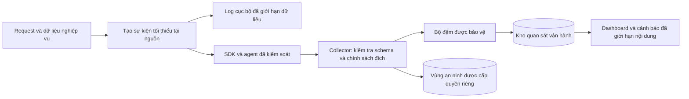

# PII trong telemetry

## 1. Telemetry cũng là một luồng xử lý dữ liệu

Telemetry là dữ liệu được phát sinh hoặc thu thập để quan sát hành vi của phần mềm và hạ tầng: log, trace, metric, báo lỗi và các dạng chẩn đoán liên quan. Dữ liệu này có thể đi qua SDK, agent, bộ đệm, collector, kho tìm kiếm, dashboard và dịch vụ bên ngoài trước khi người vận hành nhìn thấy.

PII, viết tắt của Personally Identifiable Information, trong bài được dùng theo nghĩa thực hành: thông tin có thể nhận diện hoặc hỗ trợ liên kết hoạt động với một cá nhân trong bối cảnh cụ thể. Phạm vi dữ liệu cá nhân theo chế độ áp dụng cần được xác định riêng; không dùng một danh sách trường cố định để thay mọi đánh giá.

Trong chương **Privacy requirement**, mục tiêu không phải chỉ thêm một bộ lọc email ở cuối pipeline. Cần chuyển nhu cầu quan sát và bảo vệ dữ liệu thành yêu cầu cụ thể:

- Sự kiện nào cần để vận hành hoặc phát hiện sự cố?
- Trường nào được phép thu thập và vì mục đích gì?
- Biến đổi ở đâu để bản gốc không đi qua một ranh giới không được phép?
- Ai được truy vấn, xuất, chia sẻ và giữ dữ liệu trong bao lâu?
- Khi bộ lọc, exporter hoặc collector lỗi, hệ thống phải xử lý thế nào?
- Kiểm thử nào chứng minh vừa hạn chế dữ liệu vừa giữ được tín hiệu cần thiết?

Bài học dùng nền tảng học trực tuyến nhiều tenant làm ví dụ. Các mã sự kiện, vai trò, thời hạn và ngưỡng là quyết định minh họa cho thiết kế yêu cầu bảo mật, không phải cấu hình mặc định hoặc chuẩn pháp lý chung.

## 2. Nhận diện PII và dữ liệu nhạy cảm trong từng loại tín hiệu

### 2.1. Không chỉ có tên, email và số điện thoại

| Nhóm dữ liệu | Ví dụ | Câu hỏi đánh giá |
|---|---|---|
| Định danh trực tiếp | Họ tên, email, số điện thoại, số giấy tờ | Có thật sự cần giá trị gốc để giải quyết mục tiêu quan sát không? |
| Định danh gián tiếp | User ID, IP, mã thiết bị, cookie ổn định | Ai có thể nối dữ liệu này về người thật hoặc liên kết nhiều hoạt động? |
| Nội dung người dùng | Ô tìm kiếm, ghi chú, tin nhắn, tên tệp | Người dùng có thể nhập thông tin cá nhân hoặc bí mật ngoài dự kiến không? |
| Dữ liệu ngữ cảnh | Đường dẫn, thời điểm, vị trí, khóa học, nhóm nhỏ | Kết hợp thuộc tính có làm lộ cá nhân hoặc hoạt động nhạy cảm không? |
| Bí mật xác thực | Access token, cookie phiên, mật khẩu, khóa API | Có thể dùng để chiếm quyền hoặc gọi dịch vụ không? |
| Thông tin hạ tầng | Hostname, resource label, đường dẫn máy người dùng | Có chứa tên cá nhân hoặc làm lộ cấu trúc nội bộ không? |

Bí mật xác thực không chỉ là vấn đề PII. Nó cần quy tắc cấm thu thập hoặc xử lý riêng ngay cả khi không chỉ rõ một người. Không giữ token trong log chỉ vì đã thay email bằng dấu sao.

User ID hoặc trace ID không mặc nhiên là dữ liệu vô danh. Nếu một kho khác liên kết được chúng với tài khoản, dữ liệu vẫn có rủi ro nhận diện hoặc theo dõi. Tính ngẫu nhiên của ID và việc không chứa tên là những thuộc tính hữu ích nhưng chưa đủ để kết luận ẩn danh.

### 2.2. Các vị trí dễ bị bỏ sót

| Tín hiệu hoặc thành phần | Nơi dữ liệu có thể xuất hiện | Quy tắc cần đặc tả |
|---|---|---|
| Log ứng dụng | Message tự do, object serialize, MDC hoặc context của logger | Schema trường được phép; không ghi toàn bộ request hoặc entity |
| Distributed trace | Tên span, attribute, event, exception, span link | Chọn dữ liệu và chuẩn hóa tên trước khi export |
| Metric | Tên metric, label, thuộc tính tài nguyên, exemplar | Không đưa định danh cá nhân hoặc giá trị không giới hạn vào nhãn chung |
| Baggage | Header và context truyền qua nhiều dịch vụ | Danh sách trường cho phép và ranh giới truyền riêng |
| Proxy, gateway, CDN | URL, query string, header và access log | Không giả định bộ lọc trong ứng dụng đã bảo vệ lớp phía trước |
| RUM và session replay | URL trang, DOM, ô nhập, sự kiện trình duyệt | Quy tắc thu nhận trước khi SDK gửi; kiểm tra cả nội dung hiển thị |
| Báo lỗi và profiling | Stack trace, local variable, dump, đường dẫn | Cấu hình tối thiểu và vùng chẩn đoán được bảo vệ |
| Collector và exporter | Queue, tệp đệm, dead-letter, log tự chẩn đoán | Chỉ lưu dữ liệu đã được phép ở vùng tương ứng; bảo vệ mọi bản sao |

Một hệ thống chỉ kiểm tra log văn bản có thể vẫn lộ email trong tên span hoặc IP trong nhãn metric. Phải kiểm kê cả dữ liệu và metadata của từng tín hiệu.

### 2.3. Công cụ không tự biết dữ liệu nào nhạy cảm

OpenTelemetry nêu rõ công cụ không thể tự xác định đầy đủ độ nhạy cảm theo bối cảnh của người triển khai; cần hiểu và rà soát cả dữ liệu do thư viện instrumentation phát ra. Đây là lý do yêu cầu phải bao phủ auto-instrumentation và cấu hình của SDK, không chỉ các câu lệnh log do nhóm tự viết. [OpenTelemetry: Handling sensitive data](https://opentelemetry.io/docs/security/handling-sensitive-data/)

Bật một bộ quy tắc có sẵn không thay thế danh mục dữ liệu của ứng dụng. Trường `note`, `url`, `resource.name` hoặc `error.detail` có thể chứa dữ liệu mà bộ lọc dựa trên tên `email` không nhận ra.

## 3. Từ mô hình đe dọa đến phạm vi yêu cầu

### 3.1. Những kịch bản cần kiểm soát

| Mã rủi ro | Kịch bản | Yêu cầu phát sinh |
|---|---|---|
| R-TEL-01 | Request body hoặc exception đưa hồ sơ người học vào log | Không thu body mặc định; lỗi có cấu trúc và tập trường được duyệt |
| R-TEL-02 | URL chứa email, token hoặc định danh được ghi ở gateway, trace và RUM | Dùng route template, loại query không cần và kiểm tra từng lớp phát sinh |
| R-TEL-03 | Baggage mang định danh tới API bên ngoài | Chặn trường nhạy cảm và kiểm soát propagation qua ranh giới |
| R-TEL-04 | Metric gắn user ID tạo chuỗi thời gian theo từng người | Danh mục nhãn hữu hạn; cấm định danh cá nhân ở metric vận hành chung |
| R-TEL-05 | Người xem dashboard hoặc exporter đọc dữ liệu nhiều tenant | Phân quyền phía truy vấn và API, không chỉ bộ lọc giao diện |
| R-TEL-06 | Collector lỗi rồi ghi payload thô xuống tệp hoặc debug log | Hành vi lỗi không fallback sang bản gốc; queue và tệp đệm được kiểm soát |
| R-TEL-07 | SDK hoặc cấu hình mới tự bật thu thập thuộc tính | Quản lý phiên bản schema, kiểm tra thay đổi và chặn trường chưa được duyệt |
| R-TEL-08 | Alert, ticket hoặc tệp xuất sao chép PII ra nơi quyền rộng | Quy tắc nội dung cho đường chia sẻ và vòng đời bản dẫn xuất |
| R-TEL-09 | Sampling hoặc hash bị coi là đã ẩn danh | Nêu thuộc tính thật, rủi ro liên kết và quyền giữ dữ liệu sau biến đổi |

### 3.2. Xác định ranh giới trước khi chọn processor



Nếu ứng dụng đã ghi payload gốc vào stdout, việc xóa trường tại collector chỉ bảo vệ phần sau collector. Bản gốc vẫn có thể nằm trong runtime log, log của nền tảng container hoặc tệp quay vòng.

Ngược lại, chỉ kiểm soát một hàm log của ứng dụng chưa bao phủ proxy và auto-instrumentation. Mỗi đường phát sinh cần đi qua kiểm soát phù hợp trước lần tiết lộ không được phép của đường đó.

Bộ đệm trong sơ đồ nhận dữ liệu đã qua chính sách của vùng đích. Những buffer tồn tại sớm hơn ở SDK hoặc agent cũng phải có danh mục và mức bảo vệ riêng; không được bỏ qua chỉ vì không xuất hiện trên dashboard.

## 4. Lập hợp đồng dữ liệu và chia vùng theo mục đích

### 4.1. Một trường được phép cần có lý do

Với mỗi loại sự kiện, cần ghi tên trường, kiểu, nguồn, độ nhạy cảm, mục đích, phép biến đổi, đích được phép, thời hạn và kiểm thử. Nên quy định cả giá trị hợp lệ, không chỉ tên trường.

Ví dụ, `outcome` là enum hữu hạn; nó không được nhận một thông báo lỗi tùy ý chứa email. `route_template` phải đến từ router đã xác định, không phải raw URL đổi tên thành một trường có vẻ an toàn.

| Trường trong telemetry vận hành mẫu | Chính sách ví dụ |
|---|---|
| `event_type` | Mã sự kiện từ danh mục, không ghép tên hoặc nội dung người dùng |
| `service_name` | Tên dịch vụ đã duyệt, không lấy từ header client tùy ý |
| `route_template` | Mẫu như `/learners/{learnerId}/enrollments`, không chứa giá trị tham số |
| `outcome` | Một trong các kết quả hữu hạn đã định nghĩa |
| `duration_ms` | Giá trị số có đơn vị rõ ràng, không chứa payload |
| `correlation_id` | Tham chiếu ngẫu nhiên cho tương quan trong phạm vi được duyệt |
| `user_email`, `request_body`, `access_token` | Không được có trong luồng vận hành chung của ví dụ |
| `subject_ref` hoặc `source_ip` | Chỉ xem xét ở sự kiện và vùng có mục đích an ninh cụ thể, không tự sao chép sang mọi tín hiệu |

Không chấp nhận object lồng hoặc chuỗi JSON tự do chỉ vì trường cha nằm trong danh sách cho phép. Schema cần kiểm tra đệ quy, kiểu và giới hạn, hoặc chỉ nhận các trường có cấu trúc đã biết.

### 4.2. Tách nhu cầu vận hành, an ninh và chẩn đoán đặc biệt

| Vùng ví dụ | Nhu cầu | Cách giới hạn |
|---|---|---|
| Quan sát vận hành chung | Tỷ lệ lỗi, độ trễ, tài nguyên, tương quan request | Không định danh trực tiếp; nhóm giá trị hữu hạn; quyền đọc theo trách nhiệm |
| Sự kiện an ninh hoặc audit | Phát hiện lạm dụng, điều tra và truy vết thao tác | Chỉ giữ định danh cần thiết; quyền chặt hơn, mục đích và retention riêng |
| Chẩn đoán đặc biệt | Điều tra một lỗi không giải quyết được bằng tín hiệu thường | Phạm vi, người truy cập, thời hạn, đích lưu và tự hết hiệu lực |

Tách vùng phải có cơ chế thực thi ở kho, API và exporter. Hai dashboard trên cùng một API có quyền đọc toàn bộ không tạo ra cách ly dữ liệu.

Không loại bỏ sự kiện đăng nhập thất bại chỉ để tránh PII. Có thể giữ mã sự kiện, thời điểm, kết quả và những thông tin tối thiểu được duyệt ở vùng thích hợp, đồng thời loại payload không cần thiết. Tối thiểu dữ liệu phải được thiết kế cùng yêu cầu phát hiện và điều tra.

### 4.3. Đánh giá mục đích và điều kiện thu nhận

Gắn nhãn `observability` không tự tạo điều kiện hợp lệ cho mọi thu thập. Cần xác định mục đích và các điều kiện áp dụng cho telemetry vận hành, an ninh, phân tích sản phẩm hoặc replay.

Không mặc định mọi telemetry phải xin consent, cũng không dùng một consent phân tích để bật toàn bộ capture trên mọi màn hình. Nếu một hoạt động cụ thể phụ thuộc consent hoặc lựa chọn của người dùng, điểm thu nhận phải thực thi điều kiện trước khi gửi dữ liệu tương ứng.

## 5. Chọn phép biến đổi theo thuộc tính cần bảo vệ

### 5.1. Thứ tự ưu tiên thiết kế

1. Không thu trường không cần thiết.
2. Thay nội dung tự do bằng mã hoặc nhóm hữu hạn nếu đủ mục đích.
3. Giảm chi tiết, che hoặc dùng định danh thay thế trong phạm vi có nhu cầu.
4. Bảo vệ quyền, đường truyền, kho và vòng đời của dữ liệu còn lại.

Mã hóa hoặc giới hạn quyền không thay thế việc giảm dữ liệu thu thập. Ngược lại, dữ liệu đã che vẫn cần được bảo vệ nếu còn khả năng liên kết.

### 5.2. Giới hạn của từng biện pháp

| Biện pháp | Có thể giúp gì? | Không chứng minh điều gì? |
|---|---|---|
| Che hoặc bỏ trường | Giảm tiết lộ trực tiếp tại vị trí được xử lý | Không bao phủ bản sao đã ghi trước đó hoặc nội dung cùng giá trị ở trường khác |
| Tổng quát hóa | Giảm độ chi tiết như nhóm thời gian hoặc nhóm địa bàn | Nhóm hiếm hoặc kết hợp thuộc tính vẫn có thể nhận diện |
| Hash không khóa | Tạo giá trị ổn định để đối chiếu | Không bảo vệ tốt dữ liệu dễ đoán trước phép thử từ điển |
| Định danh thay thế có phạm vi | Hỗ trợ tương quan trong phạm vi cần thiết | Không tự làm dữ liệu vô danh hoặc cho phép chia sẻ công khai |
| Sampling | Giảm số sự kiện được giữ | Một sự kiện được chọn vẫn có thể chứa nguyên PII |
| Mã hóa | Hạn chế đọc khi thiếu quyền hoặc khóa | Không hạn chế người đã có quyền truy vấn hợp lệ dùng quá mục đích |

Nếu cần định danh thay thế ổn định, phải xác định miền liên kết, thời hạn, ai được ánh xạ ngược và cơ chế quản lý khóa hoặc bảng ánh xạ. Có thể dùng cơ chế mật mã đã được chấp nhận cho mục đích thích hợp; không tự thiết kế thuật toán và không gọi một chuỗi hash là “ẩn danh” theo mặc định.

Trace ID ngẫu nhiên theo giao dịch có thể hỗ trợ tương quan lỗi mà không cần email. Tuy nhiên, nếu trace đi kèm dữ liệu khác cho phép nhận diện, quyền truy cập và retention vẫn phải phù hợp.

## 6. Kiểm soát dữ liệu ngay tại điểm phát sinh

### 6.1. Tạo sự kiện có cấu trúc thay vì ghi object nghiệp vụ

Ví dụ dưới đây dùng dữ liệu tổng hợp để minh họa một bản ghi không phù hợp cho luồng vận hành chung:

```json
{
  "event": "enrollment_failed",
  "url": "/learners/learner-test-17/enroll?email=lan.test@example.invalid",
  "requestBody": {
    "fullName": "Nguyễn Lan Mẫu",
    "note": "Nội dung tự do do người dùng nhập"
  },
  "error": "Không thể xử lý hồ sơ lan.test@example.invalid"
}
```

Che trường email trong body vẫn để lại giá trị ở URL và error. Với nhu cầu biết tỷ lệ lỗi và điều tra luồng xử lý, sự kiện có thể được đặc tả lại như sau:

```json
{
  "schema_version": "ops-event-v2",
  "event_type": "enrollment.failed",
  "service_name": "learning-api",
  "route_template": "/learners/{learnerId}/enrollments",
  "outcome": "rejected",
  "reason_code": "COURSE_CAPACITY_REACHED",
  "duration_ms": 27,
  "correlation_id": "corr-test-042"
}
```

`correlation_id` phải được sinh hoặc xác minh theo quy tắc đáng tin cậy, không sao chép nguyên một header tùy ý chứa dữ liệu người dùng. Mã lý do và tên sự kiện cũng phải đến từ danh mục, không phải thông báo lỗi tự do được đổi tên.

Sự kiện an ninh cần định danh chủ thể sẽ có hợp đồng và đích riêng. Không thêm `user_email` vào mọi sự kiện để xử lý một vài ca điều tra cần đối chiếu danh tính.

### 6.2. Pseudocode cho điểm phát sự kiện

```text
function emitEnrollmentFailure(trustedContext, failureCode, duration):
    safeEvent = {
        schema_version: "ops-event-v2",
        event_type: "enrollment.failed",
        service_name: configuredServiceName(),
        route_template: trustedRouterTemplate(trustedContext),
        outcome: "rejected",
        reason_code: mapToApprovedFailureCode(failureCode),
        duration_ms: checkedDuration(duration),
        correlation_id: approvedCorrelationId(trustedContext)
    }

    if not validateApprovedSchemaAndValues(safeEvent):
        incrementBoundedCounter("telemetry_policy_rejected", "schema_error")
        return NOT_RECORDED

    publishToApprovedTelemetryPath(safeEvent)
```

Hàm không nhận một entity để serialize và không ghép đầu vào gốc vào thông báo khi validation lỗi. Bộ đếm từ chối chỉ dùng mã hữu hạn, tránh tạo nhãn mới từ tên trường hoặc nội dung không tin cậy.

Pseudocode minh họa sự kiện vận hành thông thường. Với sự kiện audit bắt buộc, cần quy trình bảo đảm ghi nhận riêng: giữ được sự kiện tối thiểu hợp lệ hoặc áp dụng hành vi nghiệp vụ đã đặc tả khi không ghi được. Không dùng lỗi schema như một cách làm biến mất mọi dấu vết của thao tác quan trọng.

### 6.3. Xử lý exception, URL và nội dung tự do

Thông báo exception có thể chứa tham số SQL, nội dung phản hồi từ dịch vụ khác, tên tệp hoặc giá trị người dùng. Stack trace có thể hữu ích, nhưng không mặc định mọi trường kèm theo đều an toàn.

Có thể đặc tả một profile lỗi gồm loại lỗi đã ánh xạ, mã lỗi, stack frame được chấp nhận và correlation ID. Nếu cần thông tin chi tiết hơn, chuyển sang quy trình chẩn đoán được cấp quyền, không bật capture toàn bộ cho mọi request.

Với URL, dùng route template nếu đủ mục tiêu; loại query không cần và kiểm soát cả path có tham số. Không chỉ xóa query rồi giữ `/users/lan.test@example.invalid` trong path. Nếu router không nhận diện được tuyến, dùng nhóm cố định như `unmatched` thay vì raw path.

Với nội dung tự do, lựa chọn an toàn thường là không thu ở luồng vận hành chung. Regex là lớp hỗ trợ phát hiện hoặc giảm rủi ro còn sót, không phải bằng chứng đã bao phủ mọi ngôn ngữ, kiểu mã hóa, cấu trúc lồng và dữ liệu bất thường.

## 7. Yêu cầu riêng cho metric, trace và baggage

### 7.1. Không dùng định danh cá nhân làm nhãn metric chung

Mỗi tập giá trị nhãn có thể tạo chuỗi thời gian riêng. Prometheus cảnh báo tránh dùng các chiều có cardinality cao như user ID, email hoặc tập giá trị không giới hạn. Trong thiết kế quyền riêng tư, điều này còn tránh biến kho metric thành lịch sử hoạt động theo từng người. [Prometheus: Metric and label naming](https://prometheus.io/docs/practices/naming/)

Ví dụ nhãn không phù hợp cho metric vận hành chung:

```text
learning_requests_total{email="lan.test@example.invalid",path="/learners/learner-test-17"}
```

Một thiết kế có thể dùng tập nhãn hữu hạn theo hợp đồng:

```text
learning_requests_total{route="enrollment",method="POST",outcome="rejected"}
```

Ngay cả các nhóm hữu hạn cũng cần xét độ chi tiết. Một nhóm chỉ có một người hoặc một tenant rất nhỏ vẫn có thể tiết lộ hoạt động khi kết hợp với thời gian. Không kết luận “đã tổng hợp nên vô danh” chỉ từ việc không có email.

Cần kiểm tra exemplar và liên kết từ metric sang trace. Nhãn metric an toàn chưa chứng minh trace được dẫn tới cũng có quyền và nội dung phù hợp.

### 7.2. Trace không chỉ có attribute

Tên span như `GET /learners/learner-test-17` có thể tạo cùng rủi ro với URL trong log. Yêu cầu phải bao phủ span name, attribute, event, exception, resource metadata và dữ liệu bổ sung do instrumentation tự ghi.

Sampling giảm khối lượng nhưng không làm sạch phần được giữ. Tail sampling còn có thể đệm trace trước khi quyết định giữ, nên cần biết dữ liệu đã đi qua bộ nhớ, queue hoặc tệp nào trước bước đó.

Khi thêm liên kết log–trace, không nhân bản định danh người dùng sang mọi tín hiệu chỉ để dễ tìm kiếm. Dùng tham chiếu tương quan phù hợp và cơ chế đối chiếu có kiểm soát khi thật sự cần.

### 7.3. Baggage là đường truyền dữ liệu qua ranh giới

OpenTelemetry lưu ý baggage nhạy cảm có thể theo header tới tài nguyên ngoài dự kiến, kể cả API bên thứ ba; baggage cũng không có kiểm tra toàn vẹn tích hợp để chứng minh các giá trị thuộc về hệ thống của mình. Do đó, không coi baggage đầu vào là nguồn đáng tin cậy cho tenant, quyền hoặc danh tính. [OpenTelemetry: Baggage security considerations](https://opentelemetry.io/docs/concepts/signals/baggage/#baggage-security-considerations)

Trong hệ thống mẫu:

- Không đưa email, thông tin liên hệ, cookie, token hoặc payload người dùng vào baggage.
- Chỉ cho phép một tập khóa và giá trị phục vụ mục đích đã xác định; giới hạn kích thước.
- Kiểm tra context nhận từ client hoặc dịch vụ ngoài trước khi dùng cho tương quan.
- Có chính sách propagation theo đích; không tự chuyển toàn bộ context nội bộ sang mọi endpoint.
- Kiểm tra cả các client HTTP, RPC, message và cơ chế retry có thể tự truyền context.

Baggage không tự trở thành attribute trong mọi tín hiệu; instrumentation hoặc mã bổ sung có thể sao chép nó. Vì thế cần kiểm tra cả bước truyền lẫn bước biến đổi thành attribute, không chỉ nhìn trace của dịch vụ đầu tiên.

## 8. Pipeline, lưu trữ và hành vi khi lỗi

### 8.1. Nhiều lớp bảo vệ với trách nhiệm rõ ràng

Kiểm soát ở nguồn giảm việc thu thập không cần thiết. Agent hoặc collector kiểm tra chính sách là lớp bổ sung cho dữ liệu từ nhiều nguồn, routing và ranh giới xuất. Kho đích thực thi quyền, retention và giới hạn chia sẻ.

Thứ tự processor có ý nghĩa. Nếu một exporter debug hoặc queue thô nhận dữ liệu trước bộ lọc, dữ liệu có thể đã bị tiết lộ dù exporter chính chỉ nhận bản đã xử lý. Cần mô tả cả fan-out, pipeline phụ, đường replay và log nội bộ của collector.

Không dùng tên trường đã được duyệt như bảo đảm duy nhất. Collector có thể kiểm tra schema, kiểu và giá trị theo profile, nhưng không tự hiểu mọi ngữ nghĩa nghiệp vụ. Yêu cầu ở nguồn và kiểm thử dữ liệu thực tế vẫn cần thiết.

### 8.2. Không fallback sang dữ liệu thô

Ví dụ hành vi lỗi cần đặc tả:

| Điều kiện | Hành vi trong thiết kế mẫu |
|---|---|
| Trường không được phép hoặc sai kiểu ở sự kiện vận hành | Bỏ trường hoặc từ chối payload theo profile; tạo tín hiệu tối thiểu với mã lỗi hữu hạn |
| Chính sách mới không hợp lệ | Không kích hoạt cấu hình có thể bỏ kiểm soát; giữ hoặc dừng theo phương án đã duyệt |
| Không biến đổi được giá trị | Không trả nguyên đầu vào như một cách khắc phục |
| Exporter hoặc collector mất kết nối | Dùng buffer dữ liệu đã được phép, có giới hạn và bảo vệ; vượt giới hạn xử lý theo mức quan trọng |
| Buffer đầy | Không ghi payload thô sang tệp không quản lý; có cảnh báo và số liệu mất tín hiệu phù hợp |
| Audit bắt buộc không thể ghi bền vững | Áp dụng quy tắc của thao tác liên quan, có thể từ chối thao tác nếu yêu cầu đã quy định |

Không mặc định dừng toàn bộ nghiệp vụ chỉ vì mất metric vận hành. Cũng không mặc định tiếp tục mọi thao tác nhạy cảm khi mất audit bắt buộc. Đây là hai quyết định cần được thiết kế theo loại tín hiệu và rủi ro.

Quarantine không phải ngoại lệ để giữ payload nhạy cảm vô thời hạn. Nếu có vùng cách ly dữ liệu lỗi, phải xác định rõ loại dữ liệu được nhận, quyền, bảo vệ, hạn dùng và quy trình xử lý; không tự động sao chép mọi bản bị từ chối vào đó.

### 8.3. Quyền, mã hóa và vòng đời

Cần bảo vệ đường truyền, xác thực nguồn gửi và đích nhận, mã hóa lưu trữ, quyền truy vấn, quyền export và thông tin xác thực của pipeline. Collector có thể giữ token truy cập nhà cung cấp nên cấu hình và secret của nó cũng là tài sản cần bảo vệ.

Giới hạn theo tenant hoặc môi trường phải được thực thi ở API và kho, không chỉ qua một filter trên dashboard. Người có quyền sửa truy vấn hoặc dùng API trực tiếp không được vượt phạm vi đã cấp.

Retention phải bao phủ index, object thô, cache, alert, ticket, tệp tải, buffer, replay và backup liên quan. Dữ liệu biến mất khỏi kết quả tìm kiếm không tự chứng minh mọi bản sao đã được loại bỏ.

## 9. Bộ yêu cầu bảo mật có thể nghiệm thu

| ID | Phát biểu yêu cầu mẫu | Tiêu chí chấp nhận và bằng chứng |
|---|---|---|
| REQ-TEL-01 | Mỗi luồng telemetry phải có chủ sở hữu, mục đích, schema, đích và retention được xác định trước khi mở. | Đối chiếu danh mục với các SDK, agent, proxy và exporter đang hoạt động; không có đường phát sinh không được quản lý. |
| REQ-TEL-02 | Luồng vận hành chung chỉ nhận trường và giá trị theo profile; không nhận body, bí mật xác thực hoặc định danh trực tiếp trong ví dụ. | Fixture có dữ liệu nhận biết không xuất hiện ở nội dung, metadata hoặc bản sao thuộc phạm vi cấm. |
| REQ-TEL-03 | URL và tên span phải dùng biểu diễn đã duyệt, không giữ tham số định danh hoặc query không cần. | Thử route có ID, email trong path, tuyến không khớp và query có token; kiểm tra từng lớp phát sinh. |
| REQ-TEL-04 | Nhãn metric vận hành phải thuộc tập hữu hạn đã duyệt, không dùng email, user ID hoặc raw URL. | Thu fixture nhiều chủ thể; các định danh không thành nhãn, tên metric hay resource attribute ngoài profile. |
| REQ-TEL-05 | Baggage và context truyền tới đích ngoài phải tuân chính sách riêng; dữ liệu đầu vào không được dùng thay xác minh quyền. | Bơm baggage chứa định danh và giá trị giả; kiểm tra header ra và quyết định tenant, phân quyền không bị thay đổi. |
| REQ-TEL-06 | Mọi đường xuất, queue và log nội bộ phải áp dụng mức bảo vệ phù hợp; lỗi không được fallback sang payload thô. | Tiêm lỗi lọc, exporter, cấu hình và buffer; kiểm tra stdout, disk, retry và exporter phụ. |
| REQ-TEL-07 | Quyền đọc và export phải giới hạn theo vùng dữ liệu, vai trò và tenant đã xác định. | Thử truy vấn trực tiếp, dashboard, API tải và liên kết chia sẻ bằng danh tính ngoài quyền. |
| REQ-TEL-08 | Chẩn đoán đặc biệt phải có phạm vi và thời hạn, tự hết hiệu lực; không tắt bộ quy tắc cấm bí mật xác thực. | Kích hoạt profile thử, chờ mốc hết hạn và thử rollback; không duy trì capture ngoài cửa sổ đã duyệt. |
| REQ-TEL-09 | Nội dung alert, ticket và export phải theo hợp đồng riêng, không sao chép payload hoặc URL có token. | Gây lỗi bằng fixture; kiểm tra thông báo và hệ thống nhận, không chỉ kho telemetry chính. |
| REQ-TEL-10 | Schema, SDK, agent hoặc cấu hình thay đổi phải chạy kiểm chứng liên quan trước khi phụ thuộc vào bản mới. | Thêm trường, đổi instrumentation hoặc bật tính năng; đường phát sinh mới không tự được chấp nhận. |
| REQ-TEL-11 | Vòng đời và xử lý sau restore phải ngăn dữ liệu hoặc cấu hình thu nhận đã hết hạn trở lại trạng thái hoạt động. | Kiểm tra dọn theo các lớp, restore snapshot và đối soát chính sách trước mở luồng. |
| REQ-TEL-12 | Tín hiệu vận hành và an ninh cần thiết phải vẫn hữu ích sau biến đổi theo tiêu chí đã định. | Diễn tập phát hiện lỗi hoặc lạm dụng bằng dữ liệu tổng hợp; đánh giá cả chất lượng điều tra và phạm vi dữ liệu. |

Không dùng việc bật một processor làm bằng chứng duy nhất cho các yêu cầu. Bằng chứng cần thể hiện cấu hình hiệu lực, đường dữ liệu thực tế, trường hợp lỗi và những bản sao đã được quan sát.

## 10. Kiểm thử cả rò rỉ dữ liệu và giá trị quan sát

### 10.1. Tạo corpus dữ liệu tổng hợp

Bộ fixture nên có email thử nghiệm, định danh chủ thể và tenant, chuỗi giả làm bí mật xác thực, nội dung tiếng Việt, ký tự đặc biệt, URL có tham số và object lồng nhau. Mỗi nhóm dữ liệu có dấu hiệu nhận biết để đối chiếu đường đi.

Không dùng thông tin thật của nhân viên hoặc khách hàng làm canary. Các đích nhận và exporter thử phải được kiểm soát để chính phép thử không phát tán dữ liệu nhạy cảm ra ngoài.

Cần tạo cả nhánh thành công, từ chối quyền, sai định dạng, timeout và lỗi không xử lý thông thường. PII thường đi qua nhánh exception hoặc debug mà ca chạy thành công không chạm tới.

### 10.2. Ma trận ca thử

| Ca thử | Thiết lập hoặc thao tác | Kết quả mong đợi |
|---|---|---|
| TC-TEL-01 | Request fixture có email, ghi chú và chuỗi bí mật | Luồng vận hành không có trường cấm ở log, trace, metadata hoặc thông báo |
| TC-TEL-02 | Email và ID nằm trong path, query, route không khớp | Chỉ biểu diễn tuyến đã duyệt được xuất; không fallback sang raw URL |
| TC-TEL-03 | Exception chứa object lồng, tham số dữ liệu và nội dung dịch vụ ngoài | Lỗi vận hành giữ mã cần thiết, không serialize payload bị cấm |
| TC-TEL-04 | Dữ liệu ở JSON lồng, mảng, tên tệp và chuỗi serialize | Quy tắc schema và đường phát sinh không chỉ kiểm tra trường cấp đầu |
| TC-TEL-05 | Nhiều người dùng tạo cùng loại request | Không sinh nhãn hoặc tên metric theo từng người; số liệu vẫn đếm đúng |
| TC-TEL-06 | Gắn baggage giả hoặc header correlation chứa email | Không thay tenant hoặc quyền; context đầu ra không mang trường bị cấm |
| TC-TEL-07 | Gọi đích ngoài qua nhiều HTTP client, RPC hoặc message | Propagation đúng chính sách cho từng đích, kể cả retry |
| TC-TEL-08 | Bật auto-instrumentation và tính năng thu exception | Không phát sinh trường ngoài profile mà chưa được phát hiện |
| TC-TEL-09 | Collector mất kết nối, exporter lỗi hoặc buffer đầy | Không ghi payload thô sang stdout, tệp dự phòng hoặc pipeline phụ |
| TC-TEL-10 | Bộ lọc lỗi hoặc cấu hình chính sách không hợp lệ | Không bỏ qua bảo vệ; có tín hiệu tối thiểu và trạng thái vận hành đúng |
| TC-TEL-11 | Người dùng tenant A truy vấn dữ liệu tenant B qua API trực tiếp | Không vượt quyền bằng cách bỏ filter của dashboard |
| TC-TEL-12 | Alert, ticket và export được tạo từ sự kiện fixture | Không mang payload hoặc URL có token ra kênh quyền rộng hơn |
| TC-TEL-13 | Profile chẩn đoán hết hạn hoặc bị rollback cấu hình | Capture không tự duy trì hoặc bật lại ngoài cửa sổ |
| TC-TEL-14 | Dữ liệu hết retention hoặc được restore từ snapshot cũ | Áp dụng chính sách vòng đời và thu nhận hiện hành trước mở truy cập |
| TC-TEL-15 | Diễn tập một chuỗi lỗi và một kịch bản lạm dụng | Tín hiệu đủ để phát hiện, tương quan và điều tra theo tiêu chí đã định |
| TC-TEL-16 | Trường hoặc label mới được thêm cùng bản SDK mới | Bước kiểm chứng nhận ra thay đổi; không tự chấp nhận dữ liệu chưa phân loại |

Kiểm tra cần quan sát tại nhiều ranh giới: đầu ra ứng dụng, agent, buffer, collector, kho đích và kênh chia sẻ. Chỉ tìm trong giao diện đã che dữ liệu có thể bỏ qua payload vẫn còn trong API hoặc index thô.

### 10.3. Sampling và kiểm tra vắng mặt

Trong môi trường thử, có thể chọn chế độ giữ toàn bộ tín hiệu cho tập fixture để kiểm tra đường dữ liệu xác định, rồi thử riêng cấu hình sampling vận hành. Nếu một marker không xuất hiện vì sự kiện bị sampling loại bỏ, chưa thể kết luận bộ lọc đã làm đúng.

Tìm marker là kỹ thuật hỗ trợ, không phải chứng minh tổng quát. Chuỗi có thể bị mã hóa, tách nhỏ hoặc biến đổi; ngược lại, một marker nằm ở đúng vùng an ninh được cấp phép không nhất thiết là vi phạm. Kết quả phải được đánh giá theo vị trí, mục đích và profile áp dụng.

Báo cáo nên nêu nguồn, phiên bản SDK, cấu hình, đích, nhánh lỗi và những lớp bản sao đã kiểm tra. Không dùng câu “không tìm thấy PII” mà không nói phạm vi quan sát.

### 10.4. Tiêu chí Given–When–Then

```gherkin
Scenario: Exporter lỗi không làm xuất hiện request body trong log dự phòng
  Given sự kiện vận hành được tạo theo ops-event-v2
    And request fixture có email và chuỗi bí mật giả
    And exporter không kết nối được tới đích thử
  When ứng dụng phát sinh lỗi và thực hiện cơ chế retry
  Then buffer chỉ chứa dữ liệu được phép của profile
    And stdout và log tự chẩn đoán không chứa request body hoặc chuỗi bí mật
    And tín hiệu lỗi exporter dùng mã hữu hạn, không sao chép payload
    And hành vi mất hoặc giữ tín hiệu phù hợp chính sách đã định
```

Ca thử cần kiểm tra đúng cơ chế buffer và fallback của phiên bản đang triển khai. Một mock chỉ xác nhận đã gọi hàm `redact()` không chứng minh các đường dữ liệu khác không làm lộ bản gốc.

### 10.5. Kiểm chứng tính hữu ích sau tối thiểu hóa

Từ dữ liệu tổng hợp, đội vận hành phải vẫn trả lời được những câu hỏi đã chọn: lỗi thuộc route và phiên bản nào, tỷ lệ tăng bao nhiêu, mất bao lâu và các thành phần nào cùng tham gia một request.

Với vùng an ninh, cần diễn tập khả năng phát hiện hoặc điều tra theo mục tiêu riêng. Nếu thiếu một trường thật sự cần thiết, phải đánh giá và bổ sung có phạm vi, thay vì bật thu toàn bộ dữ liệu cho mọi tín hiệu.

Có thể đặt ngân sách hiệu năng minh họa cho điểm kiểm tra: ở tải 1.000 sự kiện mỗi giây, tối đa 20 trường thuộc schema và cấu hình tham chiếu, p95 phần dựng và kiểm tra sự kiện không quá 5 ms trong bài đo 15 phút sau làm nóng. Nếu không đạt, tối ưu hoặc điều chỉnh kiến trúc; không bỏ kiểm soát để đạt chỉ số.

## 11. Vòng đời, chẩn đoán và xử lý sự cố

### 11.1. Chọn thời hạn theo loại dữ liệu

| Phạm vi ví dụ | Chính sách minh họa | Điều cần phân biệt |
|---|---|---|
| Log vận hành chung | Giữ 14 ngày | Thời gian truy vấn và thời gian loại bỏ các bản sao không nhất thiết cùng mốc |
| Trace chẩn đoán thường | Giữ 7 ngày | Sampling không thay retention cho trace được giữ |
| Sự kiện an ninh có định danh | Theo mục đích và hạn được phê duyệt riêng | Không tự dùng thời hạn log chung hoặc giữ vô hạn |
| Chế độ chẩn đoán đặc biệt | Tự tắt sau 30 phút trong ví dụ | Hết thời gian thu nhận không tự chứng minh dữ liệu đã lưu được xóa |
| Dữ liệu chẩn đoán đã thu | Có hạn lưu, quyền và quy trình loại bỏ riêng | Phải quản lý cả export, ticket và snapshot liên quan |

Những con số là lựa chọn minh họa. Dự án phải xác định thời hạn phù hợp hoạt động và nghĩa vụ áp dụng, có người chịu trách nhiệm cùng bằng chứng thực thi.

Hết hạn phải tác động tới dữ liệu và đường truy cập liên quan. Nếu backup chưa thể loại bỏ ngay, cần chính sách bảo vệ, giới hạn sử dụng và xử lý khi phục hồi; không gọi việc xóa index là xóa sạch mọi bản sao.

### 11.2. Chẩn đoán tăng cường cần điều kiện kết thúc

Một profile chẩn đoán cần nêu sự cố, dịch vụ, tập request hoặc phạm vi được phép, dữ liệu bổ sung, người đọc, đích và thời hạn. Thời hạn phải được thực thi ở cấu hình hiệu lực, không chỉ trong mô tả ticket.

Không cho một cờ `debug=true` từ client tự bật capture payload. Quyền thay mức thu nhận thuộc hệ thống quản trị được kiểm soát, có audit và cơ chế trở lại trạng thái thường.

Ngay cả khi được phê duyệt chẩn đoán, bí mật xác thực vẫn không được tự động ghi vào kho. Heap dump hoặc session replay có thể vượt profile telemetry thường và phải được đánh giá như loại dữ liệu chẩn đoán riêng, với biện pháp tương ứng.

### 11.3. Khi phát hiện PII đã vào telemetry

Quy trình cần xác định phạm vi bằng chứng, điểm phát sinh, thời gian, dữ liệu, bên nhận và người có thể truy cập. Chặn đường thu hoặc chia sẻ gây lỗi trước khi chỉ sửa bộ lọc hiển thị.

Các bước xử lý có thể gồm hạn chế truy cập, khắc phục instrumentation, xử lý bản sao và phối hợp quy trình sự cố dữ liệu của tổ chức. Nếu token hoặc khóa bị lộ, cần xử lý nguy cơ chiếm quyền theo loại bí mật; xóa một log không làm bí mật đó an toàn trở lại.

Không sao chép payload nhạy cảm vào ticket công khai để chứng minh sự cố. Dùng tham chiếu tới bằng chứng được bảo vệ và chỉ đưa thông tin tối thiểu cần cho người xử lý.

Khi loại bỏ hoặc giữ bằng chứng, cần phối hợp yêu cầu điều tra và vòng đời áp dụng. Không tự xóa mọi dấu vết rồi mất khả năng xác định phạm vi sự cố, cũng không giữ toàn bộ dữ liệu vô thời hạn với lý do điều tra chung chung.

### 11.4. Khôi phục và thay đổi cấu hình

Snapshot có thể chứa dữ liệu đã hết hạn hoặc cấu hình từng bật capture quá mức. Trước mở lại luồng, áp dụng chính sách hiện hành, đối soát dữ liệu và kiểm tra các đường export. Không để rollback ứng dụng âm thầm quay về mức thu nhận không còn được chấp nhận.

Thay SDK, agent, semantic convention, tính năng replay, nhà cung cấp, tuyến endpoint hoặc pipeline alert đều là tác nhân cần đánh giá lại. Theo dõi schema và cấu hình hiệu lực giúp phát hiện sai lệch giữa tài liệu với triển khai.

## 12. Truy vết yêu cầu trong vòng đời phát triển

| Rủi ro | Yêu cầu liên quan | Quyết định kiến trúc | Bằng chứng chính | Chủ sở hữu ví dụ |
|---|---|---|---|---|
| R-TEL-01, R-TEL-02 | REQ-TEL-01 đến REQ-TEL-03 | Dựng sự kiện tại nguồn, schema giá trị và route template | TC-TEL-01 đến TC-TEL-04 | Nhóm ứng dụng, chủ sở hữu dữ liệu |
| R-TEL-03 | REQ-TEL-05 | Propagation theo đích, không tin baggage để phân quyền | TC-TEL-06, TC-TEL-07 | Nhóm nền tảng, danh tính |
| R-TEL-04 | REQ-TEL-04 | Danh mục nhãn hữu hạn và kiểm tra exemplar | TC-TEL-05 | Nhóm quan sát hệ thống |
| R-TEL-05 | REQ-TEL-07 | Cách ly truy vấn và export theo vùng, vai trò, tenant | TC-TEL-11 | Nhóm nền tảng, an toàn thông tin |
| R-TEL-06 | REQ-TEL-06 | Buffer đã giới hạn dữ liệu, không fallback thô | TC-TEL-09, TC-TEL-10 | Nhóm nền tảng |
| R-TEL-07 | REQ-TEL-08, REQ-TEL-10 | Quản lý profile và kiểm tra thay đổi instrumentation | TC-TEL-08, TC-TEL-13, TC-TEL-16 | Nhóm ứng dụng, vận hành |
| R-TEL-08 | REQ-TEL-09, REQ-TEL-11 | Hợp đồng chia sẻ và vòng đời các bản dẫn xuất | TC-TEL-12, TC-TEL-14 | Nhóm vận hành, chủ sở hữu dữ liệu |
| R-TEL-09 | REQ-TEL-12 | Đánh giá thuộc tính bảo vệ và chất lượng tín hiệu riêng | TC-TEL-15, báo cáo phạm vi kiểm thử | Chủ sở hữu quyền riêng tư, nhóm an ninh |

Các chỉ số kiểm soát có thể gồm số sự kiện bị từ chối theo mã hữu hạn, đường xuất chưa đúng profile, lần bật chẩn đoán quá hạn, lỗi dọn dữ liệu và thay đổi schema chưa được duyệt. Bản thân các chỉ số đó không được chứa giá trị PII bị phát hiện như một nhãn hoặc một thông báo tự do.

Bằng chứng kiểm thử và vận hành cần gắn với phiên bản. Một lần không tìm thấy marker trước khi nâng cấp agent không chứng minh cấu hình mới vẫn đúng. Khi giả định đổi, cập nhật yêu cầu, quyết định và ca kiểm thử liên quan thay vì chỉ chỉnh dashboard.

## 13. Bài tập áp dụng

Một nền tảng học đang ghi toàn bộ request khi có lỗi. Agent tự thu raw URL và exception. Metric gắn `userId`, baggage chứa email và được truyền tới nhà cung cấp thanh toán. Collector có bộ lọc ở exporter chính nhưng exporter debug cùng tệp queue nhận dữ liệu trước bộ lọc. Alert gửi nguyên message tới một nhóm có quyền rộng. Không ai biết khi bật debug thì dữ liệu được giữ bao lâu.

Hãy lập đặc tả cải tiến:

1. Kiểm kê các tín hiệu, trường, bản sao và ranh giới nhận dữ liệu; chỉ ra ít nhất sáu rủi ro.
2. Xác định mục đích, schema và vùng dữ liệu cho vận hành, an ninh và chẩn đoán.
3. Thiết kế biểu diễn URL, lỗi, correlation ID và nhãn metric mà không cần định danh trực tiếp ở luồng chung.
4. Viết ít nhất sáu yêu cầu có mã, hành vi khi lỗi, chủ sở hữu và tiêu chí chấp nhận.
5. Thiết kế chính sách baggage và propagation cho cả dịch vụ nội bộ lẫn bên ngoài.
6. Lập ma trận kiểm thử tại nguồn, buffer, collector, kho đích, alert và lúc mất kết nối.
7. Đề xuất vòng đời cho profile chẩn đoán, dữ liệu đã thu và bản sao sau restore.
8. Nêu cách kiểm chứng vẫn phát hiện và điều tra được sự cố sau tối thiểu hóa, cùng các rủi ro còn lại.

Một đặc tả tốt phải cho biết dữ liệu nào được thu, vì sao cần, qua đâu, ai được dùng và tồn tại bao lâu. Khi các giới hạn đó đi cùng hành vi lỗi và bằng chứng kiểm thử, yêu cầu bảo vệ PII trong telemetry mới có thể được triển khai, đo lường và duy trì xuyên vòng đời hệ thống.
