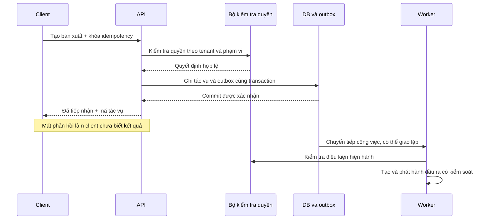

# Secure error handling — Đặc tả xử lý lỗi an toàn

## 1. Mục tiêu và phạm vi

Xử lý lỗi an toàn là khả năng đưa hệ thống về trạng thái được xác định khi có thất bại, đồng thời kiểm soát thông tin tiết lộ, quyền truy cập, tác dụng phụ và bằng chứng phục vụ điều tra. Một thông báo ngắn như “Có lỗi xảy ra” chưa đủ nếu hệ thống vẫn gửi dữ liệu sai người, bỏ qua kiểm tra quyền hoặc ghi token vào log.

Trong chương **Error handling** của module `SECURITY_SECURITY_DESIGN_SECURITY_REQUIREMENTS`, bài học chuyển mục tiêu an toàn thông tin và mô hình đe dọa thành yêu cầu xử lý lỗi cụ thể, đo được và có thể kiểm chứng. Người học cần đặc tả được:

- Thông tin trả cho người gọi và thông tin dành cho vận hành.
- Hành vi khi xác thực, phân quyền hoặc thành phần phụ thuộc thất bại.
- Trạng thái trước thực thi, sau commit và khi chưa biết kết quả.
- Điều kiện retry, idempotency, logging, cảnh báo và phục hồi.
- Liên kết giữa rủi ro, điểm kiểm soát và tiêu chí nghiệm thu.

Các mã, thời hạn và ngưỡng trong bài thuộc **một thiết kế minh họa**. Khi áp dụng, nhóm phải lựa chọn theo mức rủi ro, kiến trúc và cam kết vận hành. Không có một thông điệp lỗi hay một khối catch đáp ứng được mọi yêu cầu bảo mật.

## 2. Tình huống xuyên suốt và mô hình đe dọa

Một nền tảng học tập phục vụ nhiều tổ chức; mỗi tổ chức là một `tenant`. Quản trị viên có quyền có thể tạo tác vụ xuất báo cáo, tra trạng thái và tải kết quả trong phạm vi được cấp.

Luồng gồm API, bộ kiểm tra quyền, cơ sở dữ liệu, hàng đợi, worker, kho tệp và cổng tải. Tài sản cần bảo vệ là dữ liệu người học, bản xuất, thông tin xác thực và metadata của tổ chức.

### 2.1. Khảo sát các điểm lỗi

| Điểm lỗi | Tình huống | Câu hỏi cần đặc tả |
| --- | --- | --- |
| Đọc request | JSON hỏng, body quá lớn, sai kiểu dữ liệu | Có dừng sớm, giới hạn tài nguyên và tránh phản chiếu input không? |
| Xác thực | Token không hợp lệ, kho phiên lỗi | Có từ chối khi chưa xác lập được danh tính không? |
| Phân quyền | Timeout, kết quả thiếu, quyền đã cũ | Có thao tác nào được thực hiện trước khi đủ quyền không? |
| Ghi tác vụ | Rollback hoặc commit rồi mất phản hồi | Trạng thái thực tế có được đối soát không? |
| Worker | Message hỏng, giao lặp, tiến trình chết | Có tạo đầu ra lặp hoặc dùng quyền đã bị thu hồi không? |
| Kho tệp | Ghi dở, xóa lỗi, link tải đã cấp | Có phát hành tệp chưa hoàn chỉnh hoặc sai phạm vi không? |
| Logging | Collector lỗi, đĩa đầy, input có ký tự điều khiển | Có mất bằng chứng, rò dữ liệu hoặc giả mạo log không? |
| Phục hồi | Snapshot cũ, phát lại message | Có làm sống lại quyền hoặc chạy lại tác dụng phụ không? |

### 2.2. Danh mục rủi ro

| Mã | Rủi ro | Tài sản hoặc thuộc tính bị ảnh hưởng |
| --- | --- | --- |
| R-01 | Stack trace, SQL hoặc cấu hình xuất hiện trong phản hồi | Bí mật hệ thống, cấu trúc dữ liệu |
| R-02 | Suy ra tài khoản hoặc tài nguyên qua khác biệt lỗi | Thông tin nhận dạng, ranh giới tenant |
| R-03 | Gây lỗi bộ kiểm tra quyền để được cho qua | Tính bí mật và quyền truy cập |
| R-04 | Retry sau timeout tạo tác vụ hoặc chuyển dữ liệu lặp | Tính toàn vẹn, quyền riêng tư, tài nguyên |
| R-05 | Token, payload hoặc dữ liệu cá nhân xuất hiện trong log | Thông tin xác thực và dữ liệu người học |
| R-06 | Vòng retry, lỗi hàng loạt hoặc log không giới hạn | Khả năng sẵn sàng |
| R-07 | Mất audit hoặc không biết tác dụng phụ đã xảy ra đến đâu | Khả năng truy vết và phục hồi |
| R-08 | Phục hồi trạng thái cũ làm tái kích hoạt quyền | Quyền truy cập hiện hành |

Đầu vào độc hại và sự cố vận hành có thể tạo cùng một loại exception. Kiểm soát phải có hiệu lực trong cả hai trường hợp, không đợi xác nhận có tấn công.

## 3. Bốn chiều của một yêu cầu xử lý lỗi

Mỗi đường lỗi cần được xem xét trên bốn chiều:

1. **Thông tin:** ai được biết điều gì?
2. **Quyền:** thao tác nào còn được phép khi thiếu dữ liệu quyết định?
3. **Trạng thái:** có thay đổi bền vững hoặc dữ liệu đã đi ra ngoài chưa?
4. **Vận hành:** phát hiện, giới hạn và phục hồi bằng cách nào?

Ví dụ, API tạo tác vụ đã commit nhưng kết nối bị ngắt trước khi trả response. Client thấy timeout; cơ sở dữ liệu vẫn có tác vụ. Yêu cầu “khi exception thì trả lỗi và rollback” bỏ sót việc transaction có thể đã kết thúc và không còn khả năng rollback.

| Cách viết mơ hồ | Cách viết có thể nghiệm thu |
| --- | --- |
| Không lộ thông tin khi lỗi | Mọi phản hồi lỗi trong phạm vi chỉ chứa trường công khai đã duyệt; không có stack trace, SQL, bí mật hoặc đường dẫn nội bộ |
| Khi lỗi phải an toàn | Thiếu quyết định quyền hợp lệ thì không đọc dữ liệu báo cáo, tạo bản xuất hoặc cấp quyền tải mới |
| Có log đầy đủ | Mỗi thất bại tại ranh giới API có mã tương quan, loại kết quả và hành động; chỉ ghi các trường được phép |
| Retry khi cần | Chỉ retry nhóm lỗi tạm thời đã phân loại, trong giới hạn số lần, thời gian và điều kiện chống lặp |
| Không mất tác vụ | Mất phản hồi sau commit vẫn cho phép đối soát tác vụ bằng định danh ổn định trong phạm vi có quyền |

Yêu cầu cần nêu phạm vi, điều kiện kích hoạt, hành vi, giới hạn và bằng chứng. Những từ như “luôn” hoặc “đầy đủ” chỉ có ý nghĩa khi xác định rõ phạm vi quan sát.

## 4. Phân loại lỗi và quyết định xử lý

### 4.1. Lỗi dự kiến và lỗi ngoài dự kiến

**Lỗi dự kiến** có ý nghĩa đã biết: thiếu trường bắt buộc, phiên hết hạn, không đủ quyền, xung đột phiên bản. Hệ thống ánh xạ chúng sang mã công khai ổn định.

**Lỗi ngoài dự kiến** gồm bug, cấu hình sai hoặc exception chưa được phân loại. Ranh giới ứng dụng trả lỗi tổng quát, ghi chẩn đoán đã kiểm soát và chuyển việc phục hồi tới thành phần phù hợp.

Không biến mọi exception thành lỗi dữ liệu đầu vào. Cách làm đó che lỗi máy chủ, làm sai chỉ số và khiến người dùng sửa một request vốn hợp lệ.

### 4.2. Khả năng retry là một quyết định riêng

Một lỗi máy chủ không mặc nhiên là tạm thời. Timeout không chứng minh request chưa thực thi. Quyết định retry phải xét trạng thái và tác dụng phụ của thao tác.

| Nhóm | Ví dụ | Hướng xử lý minh họa |
| --- | --- | --- |
| Không hợp lệ, chưa thực thi | Bộ lọc sai định dạng | Trả hướng dẫn sửa trong phạm vi được công khai |
| Không được phép | Thiếu quyền xuất dữ liệu | Từ chối; không tự retry để chờ được cho qua |
| Tạm thời, chắc chắn chưa bắt đầu | Thành phần cần thiết chưa sẵn sàng trước khi ghi tác vụ | Retry có giới hạn nếu hợp đồng cho phép |
| Kết quả chưa xác định | Mất kết nối khi chờ xác nhận ghi | Tra trạng thái hoặc gửi lại cùng khóa idempotency |
| Không thể sửa bằng retry | Message sai phiên bản schema | Cách ly; sửa nguyên nhân trước khi phát lại |
| Ngoài dự kiến | Bug khi tạo báo cáo | Lỗi tổng quát; điều tra theo chính sách phục hồi |

Không dựa duy nhất vào tên exception hoặc mã HTTP để tự động chạy lại tác dụng phụ.

## 5. Hợp đồng lỗi công khai

### 5.1. Cấu trúc ổn định, thông tin tối thiểu

Ví dụ lỗi validation:

```json
{
  "error": {
    "code": "INVALID_REQUEST",
    "message": "Bộ lọc báo cáo không hợp lệ.",
    "requestId": "req_f7d2a901",
    "fields": [
      {
        "name": "dateRange",
        "code": "INVALID_RANGE"
      }
    ]
  }
}
```

Các trường có trách nhiệm khác nhau:

- `code` lấy từ danh mục mã công khai, không lấy từ tên lớp exception.
- `message` giúp người dùng hành động, không mô tả nội bộ hệ thống.
- `requestId` là mã tương quan do hạ tầng tin cậy tạo hoặc chuẩn hóa, không mang quyền truy cập.
- `fields` chỉ dùng cho lỗi validation được công khai; tên trường nằm trong danh sách cho phép, không phản chiếu giá trị input.

Không dùng email, token hoặc đường dẫn kho tệp làm mã tương quan. Nếu nhận mã từ client, phải giới hạn định dạng và độ dài trước khi dùng trong log hoặc header.

### 5.2. Bảng ánh xạ cho API minh họa

| Tình huống | HTTP theo hợp đồng ví dụ | Mã công khai | Thông tin cần tránh |
| --- | --- | --- | --- |
| Request sai cấu trúc | 400 | `INVALID_REQUEST` | Body gốc, chi tiết parser có đường dẫn nội bộ |
| Chưa xác thực hợp lệ | 401 | `AUTHENTICATION_REQUIRED` | Chi tiết bí mật về token hoặc tài khoản |
| Từ chối quyền được phép công khai | 403 | `ACCESS_DENIED` | Cấu hình vai trò và chính sách nội bộ |
| Không có tài nguyên hoặc cần che sự tồn tại | 404 | `RESOURCE_NOT_FOUND` | Dấu hiệu khác nhau làm lộ tài nguyên ngoài quyền |
| Xung đột trạng thái hoặc khóa idempotency | 409 | `STATE_CONFLICT` | Nội dung request trước hoặc dữ liệu ngoài quyền |
| Vượt hạn mức | 429 | `RATE_LIMITED` | Hướng dẫn retry dồn dập hoặc bỏ qua kiểm soát |
| Lỗi chưa phân loại | 500 | `INTERNAL_ERROR` | Stack trace, SQL, tên package, thông báo exception thô |
| Phụ thuộc cần thiết tạm không sẵn sàng | 503 | `SERVICE_UNAVAILABLE` | Khẳng định chắc chắn chưa có tác dụng phụ |

Đây là hợp đồng của ví dụ, không phải bảng ánh xạ bắt buộc cho mọi hệ thống. Triển khai vẫn cần đáp ứng hành vi giao thức tương ứng, bao gồm các header xác thực hoặc hướng dẫn retry khi áp dụng.

Chọn 403 hay 404 để che sự tồn tại phải được quyết định theo họ endpoint và mô hình đe dọa. Nếu endpoint danh sách, tra trạng thái hoặc tải tệp vẫn lộ tài nguyên thì chỉ thay mã ở endpoint chi tiết không đủ.

### 5.3. Bao phủ các đường lỗi ngoài controller

Hợp đồng phải bao phủ gateway, parser, middleware xác thực, route không tồn tại và handler ứng dụng. Trang lỗi mặc định của proxy hoặc framework cũng thuộc phạm vi triển khai.

Với giao diện web, hiển thị thông điệp qua cơ chế mã hóa đầu ra phù hợp. Không chèn input hay thông báo exception vào HTML chưa xử lý.

Phản hồi lỗi có ngữ cảnh người dùng và luồng tải tệp cần chính sách cache phù hợp. Kiểm tra cấu hình ở proxy, trình duyệt và CDN thực tế để tránh phục vụ dữ liệu của người này cho người khác.

## 6. Chống lộ thông tin và suy đoán sự tồn tại

### 6.1. Không trả exception thô

Ví dụ không đạt yêu cầu:

```text
HTTP 500
Cannot query learner_report on db-internal-03:
SELECT ... WHERE tenant_id = ...
Stack: com.example.report.ExportRepository...
```

Dù chưa có mật khẩu, thông tin này vẫn tiết lộ cấu trúc dữ liệu và topology. Không dùng trực tiếp `exception.getMessage()` để tạo response. Cần ánh xạ từ lỗi nội bộ sang danh mục công khai đã duyệt.

### 6.2. Thông điệp giống nhau chưa loại bỏ mọi kênh suy đoán

Hai trường hợp “không tồn tại” và “không có quyền” có thể khác ở mã HTTP, kích thước body, header, redirect, thời gian hoặc tác dụng phụ quan sát được.

Yêu cầu phải xác định endpoint nào che sự tồn tại, với nhóm người gọi nào và những thuộc tính công khai nào cần thống nhất. Cần xét cả endpoint tìm kiếm, danh sách, trạng thái và tải, kết hợp hạn chế dò quét theo tần suất.

Không đặt yêu cầu “thời gian phản hồi bằng nhau tuyệt đối” trên hệ thống phân tán. Với endpoint nhạy cảm, kiểm thử thống kê trên tập mẫu dưới điều kiện tải đã nêu giúp phát hiện khác biệt đáng kể. Một lần đo không chứng minh không có kênh suy đoán; kết quả chỉ có giá trị trong phạm vi kiểm thử.

### 6.3. Kênh hỗ trợ cũng có ranh giới quyền

Nhân viên hỗ trợ có thể được xem mã lỗi và trạng thái tác vụ thuộc tenant được giao. Quyền hỗ trợ không tự cấp quyền đọc stack trace, token hoặc toàn bộ payload.

Không bật debug qua query parameter hoặc header tùy ý từ người gọi. Kênh chẩn đoán cần xác thực, quyền theo nhiệm vụ, theo dõi truy cập và thời hạn lưu phù hợp.

## 7. Từ chối an toàn khi xác thực hoặc phân quyền lỗi

### 7.1. Bất biến của luồng xuất dữ liệu

> Không đọc dữ liệu báo cáo, tạo bản xuất hoặc cấp quyền tải khi chưa có quyết định cho phép hợp lệ cho danh tính, tenant, hành động và tài nguyên tương ứng.

Timeout của bộ kiểm tra quyền là trạng thái **không có quyết định hợp lệ**. Đường lỗi không được bỏ tenant filter, dùng danh tính mặc định đặc quyền hoặc chuyển sang truy vấn không kiểm soát.

Nếu kiến trúc cho dùng quyết định cache, yêu cầu phải nêu nguồn tin cậy, phạm vi, độ mới tối đa và cơ chế thu hồi. Trong ví dụ này, tạo và phát hành bản xuất yêu cầu quyết định hiện hành; cache hết hạn không đủ điều kiện.

### 7.2. Phân biệt từ chối với không thể quyết định

```text
ALLOW       -> tiếp tục trong đúng phạm vi quyết định
DENIED      -> kết thúc theo hợp đồng lỗi quyền
UNAVAILABLE -> không thực thi thao tác được bảo vệ; trả lỗi phù hợp
```

Nội bộ phải phân biệt `DENIED` và `UNAVAILABLE` để nhận biết sự cố phụ thuộc. Mã công khai vẫn theo chính sách tiết lộ của endpoint.

Không khởi tạo `allowed = true` rồi chỉ đổi khi nhận `DENIED`. Thiết kế đó biến exception thành quyền truy cập.

Nếu có cơ chế truy cập khẩn cấp, cần luồng riêng với danh tính, phạm vi, thời hạn, phê duyệt và audit. Không tự bật cơ chế đó trong nhánh bắt lỗi.

## 8. Transaction, tác dụng phụ và kết quả chưa biết

### 8.1. Phân biệt các mốc

| Mốc lỗi | Điều có thể khẳng định | Hành vi cần đặc tả |
| --- | --- | --- |
| Trước thao tác được bảo vệ | Chưa có tác dụng phụ của thao tác đó | Trả lỗi và bằng chứng từ chối phù hợp |
| Trong transaction chưa commit | Thay đổi thuộc transaction có thể rollback | Rollback; xét riêng tác dụng phụ ngoài transaction |
| Chưa biết commit thành công hay chưa | Kết quả ghi chưa xác định từ góc nhìn người gọi | Đối soát bằng định danh ổn định |
| Sau commit, trước response | Thay đổi bền vững có thể đã tồn tại | Tra cứu hoặc nhận lại kết quả bằng idempotency |
| Sau khi dữ liệu ra ngoài | Bên nhận có thể đã có dữ liệu | Hạn chế tác động tiếp theo, đối soát và xử lý sự cố |

Rollback cơ sở dữ liệu không thu hồi được email đã gửi, tệp đã tải hoặc dữ liệu đã chuyển. Thao tác bù có thể giảm tác động nhưng không chứng minh bên nhận chưa từng có dữ liệu.

### 8.2. Tạo tác vụ và outbox

Thiết kế minh họa ghi **bản ghi tác vụ và outbox trong cùng transaction**. API chỉ thông báo đã tiếp nhận khi commit được xác nhận. Bộ chuyển tiếp đọc outbox rồi đưa công việc sang hàng đợi.



Outbox giúp tránh khoảng trống “ghi tác vụ nhưng mất lệnh gửi”. Nó không tự tạo bảo đảm exactly-once cho toàn bộ luồng. Bộ chuyển tiếp có thể giao lặp; worker và các tác dụng phụ vẫn cần kiểm soát riêng.

### 8.3. Idempotency gắn với quyền và phạm vi

Hợp đồng minh họa yêu cầu:

- Khóa có phạm vi theo danh tính gọi, tenant và loại thao tác.
- Nội dung request được chuẩn hóa theo quy tắc cố định và gắn dấu vân tay để phát hiện cùng khóa nhưng khác nội dung.
- Cùng khóa, cùng nội dung và còn đủ quyền trả cùng mã tác vụ, không tạo tác vụ logic thứ hai.
- Cùng khóa nhưng khác nội dung trả xung đột, không tiết lộ request cũ.
- Request đồng thời được xử lý nguyên tử, không dùng hai bước “kiểm tra rồi ghi” thiếu bảo vệ.
- Trả lại kết quả vẫn kiểm tra quyền hiện hành; khóa idempotency không phải vé truy cập.

Trong ví dụ, metadata chống lặp giữ **24 giờ**; giới hạn retry tự động của client nằm trong cửa sổ đó. Sau 24 giờ, hợp đồng không bảo đảm nhận diện lần gửi cũ chỉ bằng khóa. Người gọi phải đối soát trước khi tạo mới. Nếu cần chống lặp lâu hơn, phải tăng thời hạn hoặc có định danh nghiệp vụ bền vững phù hợp.

## 9. Retry, timeout và tài nguyên trên đường lỗi

### 9.1. Có ngân sách retry

Nhiều tầng cùng retry có thể khuếch đại sự cố. Ba tầng, mỗi tầng tối đa ba lần thử, có thể tạo tới 27 lần gọi tầng cuối cho một yêu cầu nếu không phối hợp.

Chính sách minh họa cho bộ chuyển tiếp outbox:

| Thuộc tính | Giá trị ví dụ | Ý nghĩa |
| --- | --- | --- |
| Số lần thử | Tối đa 5 lần, gồm lần đầu | Có điểm kết thúc để điều tra |
| Lịch thử lại | Backoff tăng dần có jitter | Tránh nhiều tác vụ gọi lại đồng loạt |
| Tổng ngân sách | Không quá 10 phút | Hết ngân sách thì chuyển trạng thái cần xử lý |
| Nhóm được retry | Lỗi kết nối tạm thời đã phân loại | Không tự retry sai schema hoặc thiếu quyền |
| Chống lặp | Giữ ID tác vụ qua các lần thử | Không tạo công việc logic mới ở mỗi lần |

Số lần và thời gian là hai giới hạn độc lập. Cần timeout cho từng lần gọi và deadline xuyên suốt; không để một lời gọi con treo vượt ngân sách toàn luồng.

### 9.2. Giới hạn đầu vào và đầu ra lỗi

Yêu cầu cần bao phủ kích thước request, độ sâu parser, số lỗi validation, kích thước log, hàng đợi và mức đồng thời. Bắt exception sau khi cấp phát bộ nhớ không giới hạn không đủ chống cạn tài nguyên.

Trong ví dụ, phản hồi lỗi công khai tối đa **2 KiB**, gồm tối đa **10 lỗi trường**. Khi vượt giới hạn, dùng thông tin tóm tắt theo schema; không cắt tùy ý giữa cấu trúc JSON hoặc chuỗi mã hóa.

Log cũng phải có giới hạn và chỉ số báo phần bị lược bỏ. Không dùng mã request, mã người học hoặc thông điệp tự do làm nhãn metric vì có thể làm tăng số chuỗi thời gian không kiểm soát.

### 9.3. Fallback không mở rộng quyền

Circuit breaker có thể ngừng gọi phụ thuộc đang lỗi để bảo vệ tài nguyên. Khi nó mở, luồng được bảo vệ vẫn tuân theo chính sách quyền. Không trả dữ liệu cache ngoài phạm vi hoặc bỏ qua phân quyền để tiếp tục phục vụ.

## 10. Logging, audit và chẩn đoán

### 10.1. Phân tách mục đích và dữ liệu

| Kênh | Mục đích | Dữ liệu phù hợp |
| --- | --- | --- |
| Phản hồi công khai | Giúp người gọi hiểu kết quả và bước tiếp theo | Mã ổn định, thông điệp an toàn, mã tương quan |
| Log vận hành | Chẩn đoán lỗi và hiệu năng | Loại lỗi đã duyệt, thành phần, thời gian, tham chiếu tối thiểu |
| Audit bắt buộc | Chứng minh quyết định và thao tác nhạy cảm | Chủ thể tham chiếu, tenant, hành động, quyết định, kết quả và nguồn |

Log nội bộ không được mặc nhiên chứa mọi dữ liệu. Stack trace chỉ thu trong kênh chẩn đoán có kiểm soát; cần xét cả thông báo nguyên nhân vì driver hoặc thư viện có thể chèn dữ liệu nhạy cảm vào đó.

Ví dụ log có cấu trúc:

```json
{
  "eventType": "EXPORT_REQUEST_FAILED",
  "requestId": "req_f7d2a901",
  "operationRef": "exp_4b27",
  "tenantRef": "ten_opaque_31",
  "stage": "AUTHORIZATION",
  "outcome": "NOT_EXECUTED",
  "internalReason": "POLICY_SERVICE_UNAVAILABLE",
  "publicCode": "SERVICE_UNAVAILABLE",
  "severity": "WARN"
}
```

Chỉ ghi `NOT_EXECUTED` khi điểm quan sát có căn cứ khẳng định thao tác được bảo vệ chưa bắt đầu. Nếu chưa biết, dùng `UNKNOWN` và tham chiếu đối soát. Không điền thành công hoặc thất bại chỉ để làm đủ schema.

### 10.2. Giới hạn dữ liệu và chống giả mạo log

Không ghi token, cookie phiên, mật khẩu, khóa bí mật, nội dung báo cáo hoặc toàn bộ request/response vào log lỗi thông thường. Tham chiếu giả danh vẫn có thể liên quan tới cá nhân và cần bảo vệ.

Dùng log có cấu trúc, mã hóa phù hợp, chuẩn hóa ký tự điều khiển, giới hạn độ dài và danh sách trường cho phép. Ghép chuỗi tùy ý có thể cho phép input tạo dòng trông như sự kiện hệ thống.

Kho log và audit cần quyền tối thiểu, bảo vệ tính toàn vẹn, lịch lưu và kiểm soát truy vấn. Truy cập dữ liệu chẩn đoán nhạy cảm cũng cần được theo dõi.

### 10.3. Khi cơ chế ghi bằng chứng lỗi

Không áp dụng một hành vi chung cho mọi loại log:

- Telemetry thông thường có thể dùng bộ đệm hữu hạn hoặc bỏ mẫu theo chính sách, đồng thời có chỉ số mất dữ liệu.
- Với phát hành bản xuất trong ví dụ, phải có bằng chứng audit bền vững theo thiết kế trước khi mở quyền tải mới.
- Nếu cả kho đích và bộ đệm audit được phê duyệt đều không ghi được, giữ trạng thái chưa phát hành; phát tín hiệu sức khỏe qua kênh độc lập nếu còn hoạt động.

Không tạo vòng lặp “logger lỗi rồi ghi lỗi đó vào cùng logger vô hạn”. Bộ đệm không được tăng vô hạn hoặc tự chuyển sang nơi lưu dễ đọc công khai.

## 11. Ranh giới exception, worker và streaming

### 11.1. Trách nhiệm tại ranh giới API

Mã giả sau mô tả trách nhiệm, không phụ thuộc framework:

```text
handle(request):
    requestId = createOrValidateCorrelationId(request)
    try:
        input = parseAndValidateWithinLimits(request)
        principal = authenticate(request)
        decision = requireCurrentAuthorization(principal, input.scope)
        result = executeWithDeclaredTransactionAndIdempotency(input, decision)
        return successResponse(result, requestId)
    catch KnownPublicFailure failure:
        recordAllowedFailureMetadata(failure, requestId)
        return mapUsingApprovedPublicContract(failure, requestId)
    catch ApplicationException failure:
        recordSanitizedDiagnostic(failure, requestId)
        return genericInternalError(requestId)
    finally:
        releaseOwnedResources()
```

Ranh giới này không thay thế thiết kế transaction. Thao tác thực thi phải xác định riêng mốc trước commit, sau commit và chưa biết kết quả.

Ghi log cũng có thể thất bại; áp dụng chính sách ở mục 10 và không để lỗi logger lộ ra response. Giải phóng tài nguyên không được che lỗi gốc.

Các sự cố làm tiến trình không thể tiếp tục đáng tin, như cạn tài nguyên nghiêm trọng, cần giám sát và khởi động lại phù hợp. Không hứa một khối catch phục hồi được mọi sự cố.

### 11.2. Message và công việc bất đồng bộ

Worker không có người gọi HTTP để nhận lỗi ngay. Đặc tả phải nêu:

- Khi nào xác nhận message, khi nào có thể nhận lại.
- ID công việc logic giữ nguyên, ID lần thử đổi theo mỗi lần chạy.
- Message không hợp lệ được cách ly với lý do và quyền truy cập hạn chế.
- Dữ liệu nhạy cảm trong hàng đợi lỗi có lịch lưu và quyền phù hợp.
- Phát lại phải qua validation và kiểm tra quyền hiện hành.

Hàng đợi lỗi không tự giải quyết nguyên nhân. Cần chủ sở hữu, thời hạn xử lý, phương pháp đối soát và điều kiện phát lại. Endpoint tra trạng thái chỉ trả thông tin công khai đã duyệt, không trả payload của message lỗi.

### 11.3. Streaming và tải tệp

Khi đã gửi header thành công hoặc một phần nội dung, server thường không thể đổi sang phản hồi lỗi JSON thông thường. Hợp đồng cần cách ngắt stream, báo trạng thái và nhận biết đầu ra chưa hoàn chỉnh.

Với bản xuất, tạo tệp ở trạng thái chưa công khai; chỉ phát hành sau khi hoàn tất, đủ quyền và đủ điều kiện audit. Xóa tệp sau lỗi không thu hồi được phần người dùng đã tải.

## 12. Bộ yêu cầu bảo mật mẫu

Các yêu cầu sau áp dụng cho luồng tạo, xử lý, tra trạng thái và tải bản xuất. Chủ sở hữu chịu trách nhiệm phối hợp triển khai và cung cấp bằng chứng.

| Mã | Yêu cầu và tiêu chí đo | Rủi ro | Chủ sở hữu, điểm thực thi |
| --- | --- | --- | --- |
| EH-01 | Mọi đường lỗi API trong phạm vi dùng schema đã duyệt; body và header không có stack trace, SQL, bí mật hoặc đường dẫn nội bộ | R-01, R-05 | Nhóm API; gateway, parser, middleware, handler |
| EH-02 | Các endpoint được đánh dấu che sự tồn tại dùng cùng chính sách mã, thông điệp và metadata cho tài nguyên ngoài quyền và không tồn tại | R-02 | Nhóm danh tính và API; danh sách, chi tiết, trạng thái, tải |
| EH-03 | Không có quyết định quyền hiện hành hợp lệ thì không đọc dữ liệu báo cáo, tạo bản xuất hoặc cấp quyền tải mới | R-03, R-08 | Nhóm phân quyền; API, worker, cổng tải |
| EH-04 | Lỗi validation không phản chiếu giá trị input; response tối đa 2 KiB, tối đa 10 lỗi trường theo danh sách cho phép | R-01, R-05, R-06 | Nhóm API; parser, mapper lỗi |
| EH-05 | Cùng khóa idempotency trong cùng scope, cùng nội dung và cửa sổ 24 giờ không tạo tác vụ logic thứ hai, kể cả đồng thời | R-04 | Nhóm tác vụ; transaction và ràng buộc duy nhất |
| EH-06 | Ghi tác vụ và outbox cùng transaction; kết quả commit chưa biết có đường đối soát, không khẳng định chắc chắn chưa thực thi | R-04, R-07 | Nhóm dữ liệu; transaction, API trạng thái |
| EH-07 | Dispatcher thử tối đa 5 lần trong 10 phút, chỉ với lỗi tạm thời đã định nghĩa; hết ngân sách chuyển trạng thái cần xử lý | R-06, R-07 | Nhóm tích hợp; outbox dispatcher |
| EH-08 | Mỗi thất bại tại ranh giới API có mã tương quan và phân loại kết quả; chỉ ghi trường được duyệt, không có token, cookie hoặc nội dung báo cáo | R-05, R-07 | Nhóm nền tảng; logger, collector, kho log |
| EH-09 | Trước khi mở quyền tải mới phải có bằng chứng audit bền vững theo thiết kế; thiếu điều kiện thì giữ chưa phát hành | R-03, R-07 | Nhóm xuất dữ liệu; cổng phát hành, kho audit |
| EH-10 | Message lặp không tạo đầu ra hoặc phát hành lặp ngoài hợp đồng; phát lại kiểm tra quyền và trạng thái hiện hành | R-04, R-08 | Nhóm worker; consumer, kho trạng thái |
| EH-11 | Theo dõi sức khỏe phân quyền, audit và đối soát; lỗi audit bắt buộc hoặc gap được cảnh báo trong 5 phút từ lúc phát hiện | R-03, R-07 | Nhóm vận hành; health signal, cảnh báo |
| EH-12 | Sau phục hồi, tác vụ nhạy cảm chưa đối soát không được phát hành; xác minh quyền, đầu ra, chống lặp và audit trước mở lại | R-04, R-07, R-08 | Nhóm vận hành và dữ liệu; runbook |

EH-02 cần danh sách endpoint cụ thể trong đặc tả triển khai. EH-06 cần nguồn đối soát có thẩm quyền. EH-09 cần xác định điểm bảo đảm bền vững và khoảng trống giữa ghi audit với mở quyền tải; thêm một lệnh logger là chưa đủ.

Trong ví dụ, bộ đối soát chạy ít nhất một lần mỗi **5 phút** khi vận hành bình thường. EH-11 đo thời gian cảnh báo từ lúc phát hiện, không thay cho độ trễ phát hiện. Bộ đối soát ngừng chạy phải có cảnh báo sức khỏe riêng.

## 13. Nghiệm thu bằng bằng chứng và fault injection

Kiểm thử phải quan sát **phản hồi và tác dụng phụ**. Response 403 hoặc 500 không chứng minh database chưa đổi, message chưa gửi hay tệp chưa công khai.

Dùng dữ liệu giả và môi trường có kiểm soát. Fault injection chủ động tạo sự cố ở ranh giới cần kiểm chứng; không chỉ giả lập exception rồi kiểm tra chuỗi thông báo.

| Ca | Điều kiện và thao tác | Kết quả mong đợi | Yêu cầu |
| --- | --- | --- | --- |
| AT-01 | Gây lỗi parser, middleware, route và ứng dụng | Schema đã duyệt; không có trang debug hoặc stack trace mặc định | EH-01 |
| AT-02 | Exception chứa chuỗi đánh dấu bí mật giả và SQL giả | Không có nội dung cấm trong response; log đúng chính sách dữ liệu | EH-01, EH-08 |
| AT-03 | So sánh tài nguyên không tồn tại với tài nguyên tenant khác | Thuộc tính công khai khớp chính sách; không lộ qua danh sách, trạng thái, tải | EH-02 |
| AT-04 | Bộ kiểm tra quyền timeout hoặc trả kết quả không hợp lệ | Không đọc dữ liệu báo cáo, tạo tác vụ hay cấp quyền tải mới | EH-03 |
| AT-05 | Input có CR/LF, markup và nhiều lỗi trường | Không giả mạo log, không thực thi markup, không vượt giới hạn response | EH-04, EH-08 |
| AT-06 | Nhiều request đồng thời cùng khóa, scope và nội dung | Một tác vụ logic; phản hồi theo hợp đồng | EH-05 |
| AT-07 | Cùng khóa nhưng đổi nội dung hoặc người gọi | Xung đột hoặc scope độc lập theo hợp đồng; không trả kết quả ngoài quyền | EH-05 |
| AT-08 | Commit xong rồi ngắt kết nối trước response | Gửi lại trong cửa sổ hoặc tra cứu có quyền nhận đúng tác vụ cũ | EH-05, EH-06 |
| AT-09 | Mất kết nối khi kết quả commit chưa rõ | Giữ kết quả chưa biết tới khi đối soát; không tự tạo tác vụ thay thế | EH-06 |
| AT-10 | Dispatcher lỗi kéo dài, worker nhận message lặp | Không vượt ngân sách retry; không phát hành lặp ngoài hợp đồng | EH-07, EH-10 |
| AT-11 | Ngừng collector rồi làm đầy bộ đệm audit bắt buộc | Telemetry suy giảm có giới hạn; không mở tải mới nếu thiếu audit | EH-08, EH-09 |
| AT-12 | Worker chết sau ghi tệp, trước xác nhận message | Tệp chưa đủ điều kiện không công khai; lần sau đối soát trạng thái cũ | EH-09, EH-10 |
| AT-13 | Thu hồi quyền khi tác vụ chờ hoặc trước phát hành | Không phát hành theo quyền cũ; tra trạng thái không lộ dữ liệu ngoài quyền | EH-03, EH-10 |
| AT-14 | Tạo gap audit và dừng đối soát ở hai thí nghiệm | Đo được độ trễ phát hiện, cảnh báo và tín hiệu sức khỏe | EH-11 |
| AT-15 | Phục hồi snapshot trước lần thu hồi rồi phát lại message | Không phát hành trước đối soát; không làm sống lại quyền cũ | EH-12 |
| AT-16 | Ngắt stream hoặc ngắt lúc ghi tệp | Đầu ra dở được nhận biết, không giả thành tải hoặc phát hành hoàn tất | EH-09, EH-10 |

Kiểm thử suy đoán theo thời gian cần tập mẫu, tải và phương pháp đánh giá định trước. Kiểm thử không lộ bí mật nên dùng chuỗi đánh dấu giả tại nhiều nguồn lỗi; một từ khóa không đại diện cho toàn bộ chính sách dữ liệu.

Bằng chứng gồm request/response đã làm sạch, trạng thái, số tác vụ, audit và kết quả kiểm tra kho đầu ra. Chỉ giữ phần cần thiết theo quyền và lịch lưu của môi trường kiểm thử.

## 14. Vận hành và phục hồi

### 14.1. Chỉ số không được nhầm với trạng thái nghiệp vụ

Cần theo dõi tỷ lệ lỗi theo nhóm, độ trễ phụ thuộc, số tác vụ chưa biết kết quả, tuổi tác vụ chờ đối soát, số retry và tỷ lệ mất log.

Không dùng số response 2xx làm số tác vụ hoàn tất. Không dùng số 5xx làm số tác vụ chưa tạo. Các chỉ số đó mô tả phản hồi API; trạng thái nghiệp vụ có nguồn thẩm quyền riêng.

Một lần nhập sai bộ lọc không có mức tác động như bộ phân quyền ngừng hoạt động hoặc bản xuất thiếu audit bắt buộc. Cảnh báo phải phản ánh ảnh hưởng tới bất biến bảo mật.

### 14.2. Xử lý kết quả chưa xác định

1. Giữ ID tác vụ, tham chiếu đối soát và mốc thời gian; không yêu cầu người dùng gửi dữ liệu nhạy cảm vào kênh hỗ trợ.
2. Tra nguồn trạng thái bền vững và outbox.
3. Kiểm tra worker, artifact, quyền phát hành và sự kiện chuyển giao.
4. Ghi kết luận với nguồn bằng chứng; nếu còn chưa biết, giữ trạng thái đó và hạn chế tác động tiếp theo.
5. Chỉ retry hoặc thực hiện thao tác bù khi đủ điều kiện an toàn.

Không bổ sung event giả để làm khớp số lượng. Bản ghi phục dựng phải nêu nguồn, thời điểm bổ sung và giới hạn điều có thể khẳng định.

### 14.3. Điều kiện mở lại sau phục hồi

Snapshot có thể chứa trạng thái quyền, khóa chống lặp và tác vụ cũ. Trước khi mở worker nhạy cảm, đối soát với nguồn quyền hiện hành và trạng thái ngoài snapshot như kho tệp hoặc bên nhận.

Nếu chưa có nguồn quyền đáng tin, giữ phát hành bị khóa. Nếu thiếu metadata chống lặp hoặc audit, không tự coi tác vụ chưa chạy để chạy lại. Runbook phải nêu người chịu trách nhiệm và điều kiện mở lại từng luồng.

Tệp tạm, message cách ly và dữ liệu chẩn đoán tạo trong sự cố cũng cần xử lý hết hạn, tránh thành kho dữ liệu phụ tồn tại vô thời hạn.

## 15. Lỗi thiết kế thường gặp

| Lỗi | Hậu quả | Hướng sửa |
| --- | --- | --- |
| Trả `exception.getMessage()` | Nội dung bị lớp thấp hoặc input chi phối | Ánh xạ qua danh mục công khai |
| Catch mọi lỗi rồi trả 200 với mảng rỗng | Che sự cố, sai hợp đồng và chỉ số | Tách kết quả hợp lệ, từ chối và lỗi hệ thống |
| Phân quyền lỗi thì cho qua | Sự cố thành đường truy cập đặc quyền | Cần quyết định hợp lệ trước thao tác |
| Timeout thì gửi request mới | Lặp tác dụng phụ có thể đã xảy ra | Idempotency, trạng thái chưa biết, đối soát |
| Tin rằng rollback thu hồi mọi dữ liệu | Bỏ sót tác dụng phụ ngoài transaction | Xác định mốc phát hành và xử lý sự cố |
| Khóa idempotency dùng như vé truy cập | Lộ kết quả cho người không có quyền | Scope và kiểm tra quyền hiện hành |
| Log toàn payload để debug | Tạo thêm điểm lộ dữ liệu và bí mật | Danh sách trường và kênh chẩn đoán hạn chế |
| Retry mọi tầng thiếu ngân sách | Khuếch đại tải khi suy giảm | Phối hợp deadline, số lần thử, backoff |
| Chỉ bảo vệ controller | Proxy, parser hoặc worker vẫn lộ lỗi | Bao phủ ranh giới vào và ra |
| Không có log lỗi nghĩa là bình thường | Logger hoặc đối soát có thể đã chết | Tín hiệu sức khỏe và kiểm tra độ tươi |

## 16. Bài tập vận dụng

Một API xuất báo cáo trả mọi exception qua trường `message` gốc. Khi bộ kiểm tra quyền timeout, nó dùng cache không giới hạn tuổi. Sau lỗi mạng, client gửi lại với khóa mới. Worker log toàn bộ bộ lọc và phát hành tệp trước khi ghi audit.

Hãy thực hiện:

1. Chọn ít nhất năm rủi ro, nêu tài sản và đường lỗi tương ứng.
2. Viết sáu yêu cầu có mã, điều kiện, hành vi, giới hạn và bằng chứng.
3. Thiết kế mã lỗi cho validation, xác thực, phân quyền, xung đột và lỗi ngoài dự kiến.
4. Vẽ các mốc ghi tác vụ, commit, vào hàng đợi, ghi tệp và mở quyền tải; đánh dấu chỗ kết quả có thể chưa biết.
5. Đặc tả scope, thời hạn và xử lý đồng thời của idempotency, kể cả lúc thu hồi quyền.
6. Đề xuất kiểm thử lỗi phân quyền, mất phản hồi sau commit, message lặp, audit không ghi được và snapshot cũ.

Khi tự đánh giá, kiểm tra từng đường lỗi trên bốn chiều: thông tin, quyền, trạng thái và vận hành. Mỗi yêu cầu phải gắn với điểm thực thi và bằng chứng đủ để kết luận trong phạm vi đã định.
