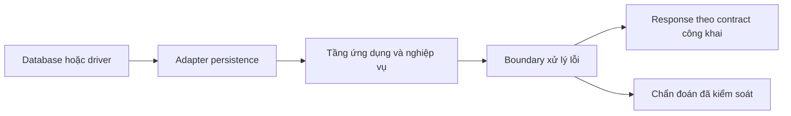

# Không lộ database detail

## 1. Mục tiêu bảo mật của thông báo lỗi database

**Không lộ database detail** nghĩa là bên gọi không được nhận các chi tiết lưu trữ và chẩn đoán vượt quyền hoặc vượt nhu cầu xử lý lỗi của họ. Những chi tiết này gồm câu truy vấn, cấu trúc schema, tên bảng/cột/ràng buộc, mã lỗi nhà cung cấp, địa chỉ kết nối, tài khoản database, stack trace và giá trị dữ liệu xuất hiện trong lỗi.

Ví dụ, API đăng ký khóa học bị lỗi khi ghi dữ liệu. Người dùng cần biết thao tác chưa được xác nhận và cách theo dõi phù hợp. Họ không cần biết câu `INSERT`, tên constraint, tên database hay địa chỉ máy chủ nội bộ.

Thông báo lỗi chi tiết có thể hỗ trợ nhận diện công nghệ, tìm cấu trúc dữ liệu hoặc suy ra dữ liệu đang tồn tại. [OWASP Error Handling Cheat Sheet](https://cheatsheetseries.owasp.org/cheatsheets/Error_Handling_Cheat_Sheet.html) khuyến nghị xử lý lỗi bất ngờ qua phản hồi phù hợp cho người gọi và giữ chẩn đoán ở phía được kiểm soát.

Yêu cầu này không có nghĩa là mọi lỗi đều phải trả một chuỗi vô nghĩa. Một lỗi nghiệp vụ đã được thiết kế có thể cung cấp thông tin cần thiết để người dùng sửa yêu cầu. Điều phải giữ là ranh giới giữa **contract công khai** và **cách database triển khai contract đó**.

Trong chương Error handling của module yêu cầu bảo mật, mục tiêu là chuyển nguyên tắc trên thành quy tắc đo được: trường nào được phép xuất hiện, nơi nào phải áp dụng, khi nào cần từ chối an toàn và bằng chứng nào xác nhận không rò rỉ. Các mã lỗi, ID và tình huống dưới đây là ví dụ giả định.

## 2. Chi tiết nào có thể làm lộ database?

### 2.1. Danh mục thông tin cần kiểm soát

| Nhóm | Ví dụ cần tránh đưa ra cho người gọi thông thường |
|---|---|
| Nhận diện công nghệ | Tên, phiên bản database, driver, lớp ORM hoặc pool kết nối |
| Cấu trúc lưu trữ | Database, schema, table, column, index, sequence, constraint |
| Câu truy vấn | SQL đầy đủ, vị trí lỗi cú pháp, kế hoạch thực thi, tham số bind |
| Dữ liệu trong lỗi | Giá trị khóa trùng, dữ liệu dòng, email, số định danh, nội dung bản ghi |
| Kết nối và hạ tầng | JDBC URL, DSN, hostname, IP, port, username, đường dẫn chứng nhận |
| Credential | Mật khẩu, token, secret hoặc thông tin khóa trong cấu hình kết nối |
| Dấu vết thực thi | Stack trace, tên class, package, file, dòng mã, chuỗi cause |
| Mã chẩn đoán | SQLState, vendor code hoặc thông điệp nguyên gốc của driver |

Không phải mọi giá trị trong bảng đều bí mật trong mọi hệ thống. Tuy nhiên, chúng không nên tự động trở thành một phần response chỉ vì driver hoặc framework cung cấp sẵn.

Trong Java, `SQLException` có message, SQLState, mã lỗi nhà cung cấp, exception kế tiếp và quan hệ cause. Xem [tài liệu Java về SQLException](https://docs.oracle.com/en/java/javase/25/docs/api/java.sql/java/sql/SQLException.html). Vì vậy, bỏ một field `stackTrace` chưa đủ nếu serializer vẫn trả message hoặc exception lồng bên trong.

### 2.2. Ví dụ phản hồi không đạt yêu cầu

```json
{
  "code": "DATABASE_ERROR",
  "message": "duplicate key violates constraint uk_demo_enrollment",
  "query": "INSERT INTO demo_enrollment (...) VALUES (...)",
  "connection": "jdbc:vendor://db-demo.internal:5432/learning_demo",
  "cause": {
    "class": "demo.jdbc.DriverException",
    "detail": "conflicting value: learner-demo-17"
  }
}
```

Các tên trên đều là dữ liệu giả. Ví dụ cho thấy đổi code bên ngoài thành `DATABASE_ERROR` không giúp gì nếu phần còn lại vẫn chép chi tiết lưu trữ.

Tương tự, bọc lỗi thành HTML hoặc dịch sang tiếng Việt không làm dữ liệu an toàn hơn. Một chuỗi “Bảng demo_enrollment không tồn tại” vẫn công bố cấu trúc nội bộ.

## 3. Mô hình đe dọa và bất biến cần giữ

| Mã | Tình huống | Hậu quả cần hạn chế |
|---|---|---|
| R1 | Client làm phát sinh lỗi và đọc thông tin driver/schema | Nhận diện công nghệ, cấu trúc và điểm yếu để khai thác tiếp |
| R2 | Lỗi constraint hoặc dữ liệu dòng chứa giá trị của người khác | Lộ dữ liệu cá nhân hoặc dữ liệu giữa tenant |
| R3 | Lỗi khác nhau theo sự tồn tại của tài khoản hoặc tài nguyên | Enumeration qua code, thông điệp hoặc tín hiệu khác |
| R4 | Một endpoint, protocol hoặc proxy không qua handler chuẩn | Rò rỉ ở đường lỗi chưa được bao phủ |
| R5 | Response sạch nhưng log/APM/debug endpoint giữ dữ liệu quá mức | Tạo thêm đường đọc thông tin nhạy cảm |
| R6 | Handler tự lỗi, gọi lại database hoặc bật debug khi phụ thuộc hỏng | Mất lớp bảo vệ đúng lúc xảy ra sự cố |
| R7 | Ánh xạ lỗi sai hoặc chỉ yêu cầu client retry | Báo sai thành công, ghi lặp hoặc che giấu trạng thái chưa xác định |

Bất biến minh họa:

1. Output cho client chỉ chứa các field và giá trị đã được phê duyệt trong contract lỗi.
2. Không có đường truyền thẳng exception database, query hoặc connection detail tới client.
3. Lỗi chưa được nhận diện rơi về một phản hồi an toàn, không rơi về trang debug mặc định.
4. Chẩn đoán nội bộ có quyền truy cập và mức dữ liệu phù hợp, không phải nơi ghi tùy ý mọi secret.
5. Giảm thông tin lỗi không được làm hệ thống bỏ phân quyền, xác nhận thành công sai hoặc thực hiện lại thao tác không an toàn.

Một yêu cầu chỉ ghi “ẩn stack trace” chưa bao phủ được các bất biến này.

## 4. Đặc tả contract lỗi công khai

### 4.1. Xây response từ allowlist

Một contract nên định nghĩa schema, mã lỗi ổn định, thông điệp được duyệt, HTTP status hoặc trạng thái giao thức tương ứng, định danh hỗ trợ và cách client xử lý.

Ví dụ cho một lỗi gián đoạn tạm thời đã được phân loại:

```http
HTTP/1.1 503 Service Unavailable
Content-Type: application/problem+json
Cache-Control: no-store

{
  "type": "https://api.example.invalid/problems/service-unavailable",
  "title": "Tạm thời chưa thể xử lý yêu cầu",
  "status": 503,
  "detail": "Chưa thể xác nhận thao tác. Vui lòng theo dõi trạng thái bằng mã yêu cầu.",
  "code": "SERVICE_TEMPORARILY_UNAVAILABLE",
  "requestId": "req-demo-8a71"
}
```

Đây là lựa chọn của API giả định, không phải template bắt buộc cho mọi lỗi. `requestId` phải liên kết được với luồng xử lý thích hợp; thông điệp về theo dõi trạng thái chỉ được dùng khi sản phẩm thật sự có cơ chế đó.

[RFC 9457](https://www.rfc-editor.org/rfc/rfc9457.html) mô tả Problem Details, các member và extension cho HTTP API. Tiêu chuẩn cũng nhấn mạnh rủi ro lộ implementation detail. Dùng định dạng này không tự làm nội dung `detail` hoặc extension an toàn; chúng vẫn cần policy.

Không đặt tên class exception, SQLState, tên shard hoặc địa chỉ database vào `type`, `code`, `requestId` hay URI `instance`. Mã hỗ trợ không được là credential hoặc đường đọc log không kiểm quyền.

### 4.2. Giá trị thông điệp phải đến từ nguồn an toàn

Các trường công khai nên được tạo từ catalog hữu hạn hoặc dữ liệu nghiệp vụ đã được kiểm tra quyền. Không dùng `exception.getMessage()`, `getLocalizedMessage()` hay `toString()` để điền tự động vào message/detail.

Cần quy định fallback khi mã chưa được ánh xạ hoặc bản dịch bị thiếu. Fallback là thông điệp chung được duyệt, không phải message gốc của driver. Các bản dịch phải giữ cùng mức tiết lộ thông tin.

Định danh tương quan có thể do server tạo hoặc tiếp nhận theo quy tắc tin cậy đã xác định. Nếu lấy từ client, cần kiểm kiểu, độ dài, ký tự và không coi nó là bằng chứng danh tính. Không phản chiếu tùy ý giá trị header vào response hoặc log.

### 4.3. Không chỉ kiểm JSON body

Contract cần bao phủ body, header, cookie, redirect, trailer, tên file export và metadata khác. Một response body chung nhưng header `X-Database-Host` chứa hostname vẫn vi phạm mục tiêu.

Với API dùng Problem Details, giá trị `status` nếu có phải khớp status thực do server tạo. Không đổi mọi lỗi thành HTTP `200` chỉ để giấu lỗi; client và hệ thống vận hành vẫn cần hiểu kết quả theo ngữ nghĩa giao thức.

## 5. Ánh xạ lỗi lưu trữ sang lỗi nghiệp vụ

### 5.1. Phân loại theo ngữ cảnh thay vì sao chép thông điệp

Một lỗi database không tự quyết định điều gì người gọi được biết. Tầng ứng dụng cần biết thao tác, quyền người gọi và ý nghĩa nghiệp vụ của thất bại.

| Trường hợp | Cách đáp ứng minh họa | Điểm phải kiểm soát |
|---|---|---|
| Input không hợp lệ đã phát hiện theo contract | Lỗi validation như `INVALID_REQUEST` | Dùng field nghiệp vụ, không trả tên cột database |
| Xung đột trạng thái nghiệp vụ đã xác minh | Lỗi như `ENROLLMENT_STATE_CONFLICT`, có thể dùng HTTP 409 | Không suy mọi lỗi integrity đều là xung đột mà client được biết |
| Không tìm thấy tài nguyên trong scope được phép | `RESOURCE_NOT_FOUND` theo policy | Không xác nhận tài nguyên ở tenant khác |
| Phụ thuộc tạm thời không khả dụng đã phân loại | Lỗi dịch vụ tạm thời, có thể dùng HTTP 503 | Không trả hostname, pool, replica hoặc lý do kết nối chi tiết |
| Lỗi cấu hình, schema hoặc lỗi chưa biết | Lỗi phía server theo contract, thường HTTP 500 | Không tự đổ lỗi cho client hoặc tiết lộ chi tiết để họ debug |
| Kết quả ghi chưa xác định sau mất kết nối | Luồng trạng thái thao tác theo contract | Không khẳng định rollback hoặc yêu cầu ghi lại mù quáng |

Bảng là một thiết kế minh họa. Từng API phải chọn status và code phù hợp với hành vi đã công bố, không ánh xạ toàn bộ `SQLException` thành một lỗi 4xx cố định.

### 5.2. Không phân loại bằng cách match chuỗi driver

Một quy tắc như “message chứa duplicate thì trả `EMAIL_ALREADY_EXISTS`” có thể sai do thay driver, ngôn ngữ, schema hoặc ngữ cảnh. Nó cũng dễ trả một tín hiệu tồn tại mà người gọi không được biết.

Có thể dùng thông tin cấu trúc ở tầng adapter, như nhóm exception hoặc mã chẩn đoán phù hợp với driver đã chọn, để tạo một lỗi nội bộ được kiểm soát. Sau đó, tầng nghiệp vụ mới quyết định lỗi công khai. Mã chẩn đoán không được tự động chuyển sang payload bên ngoài.

Nếu cần mapping constraint nội bộ sang invariant nghiệp vụ, mapping đó phải có owner và được kiểm cùng migration. Một constraint mới chưa được biết phải về fallback an toàn, không về tên constraint gốc.

### 5.3. Client cần mã ổn định

Client nên dựa vào code hoặc problem type đã công bố, không parse đoạn message. Khi database hoặc ORM thay đổi, contract công khai không nên đổi theo tên bảng, SQLState hay cách viết của nhà cung cấp.

Thông điệp hướng dẫn người dùng nên nói hành động có ích và đúng sự thật. Nếu hệ thống không biết giao dịch đã commit hay chưa, không ghi “Dữ liệu chưa được lưu, hãy gửi lại ngay”.

## 6. Kiến trúc xử lý lỗi và ví dụ Java

Một cách phân chia trách nhiệm:



Adapter hiểu lỗi lưu trữ. Tầng ứng dụng hiểu ngữ cảnh và quyền. Boundary bảo đảm response chỉ chứa phần đã được phép. Chẩn đoán có thể giữ tham chiếu nội bộ phù hợp nhưng không đi chung object được serialize cho client.

Ví dụ Java minh họa cấu trúc response cho lỗi bất ngờ:

```java
final class PublicErrors {
    private PublicErrors() {}

    record PublicError(String code, String message, String requestId) {}

    static PublicError unexpected(String trustedRequestId) {
        return new PublicError(
            "INTERNAL_ERROR",
            "Chưa thể xử lý yêu cầu. Vui lòng cung cấp mã hỗ trợ khi cần.",
            trustedRequestId
        );
    }
}
```

Đoạn mã chỉ minh họa DTO theo allowlist; nó chưa phải một HTTP handler hoàn chỉnh. `trustedRequestId` là giá trị đã được tạo hoặc kiểm tra theo contract. Không thêm `Throwable`, `SQLException`, `cause`, `query` hay object ORM vào DTO này.

Mã giả cho boundary:

```text
onFailure(error, trustedContext):
    internalClass = classifyForInternalHandling(error, trustedContext)
    publicFailure = chooseApprovedPublicFailure(internalClass, trustedContext)

    recordSanitizedDiagnostic(
        requestId = trustedContext.requestId,
        category = internalClass.safeCategory,
        operation = trustedContext.approvedOperationName
    )

    return serializeOnlyApprovedFields(publicFailure)
```

Không phải mọi lỗi đều phải có cùng nội dung; mọi nhánh đều phải qua cùng quy tắc công bố. Nếu implementation vẫn giữ cause để debug, phải bảo đảm nó không trở thành field tự động của response, GraphQL extension hoặc kết quả job.

## 7. Bao phủ mọi đường trả lỗi

### 7.1. Handler toàn cục không bao phủ mọi thời điểm

Một handler ở tầng controller có thể không xử lý lỗi phát sinh trong filter, xác thực, middleware, proxy, serialization, xử lý bất đồng bộ hoặc lúc kết thúc transaction. Cần lập danh sách boundary thực tế của ứng dụng.

| Đường lỗi | Rủi ro cần kiểm |
|---|---|
| REST/JSON hoặc trang HTML | Trang lỗi mặc định hoặc serializer trả exception |
| GraphQL | `errors`, extension hoặc dữ liệu trả một phần có chi tiết database |
| RPC hoặc WebSocket | Status description, metadata, trailer hoặc close reason chứa lỗi gốc |
| Bulk API | Từng item có message gốc dù lỗi tổng đã được chuẩn hóa |
| Job bất đồng bộ | Endpoint trạng thái, callback hoặc email lỗi chứa stack trace |
| Export/stream | Thông tin database bị chèn vào nội dung file hoặc phần cuối stream |
| Gateway/proxy | Trang lỗi upstream hoặc thông tin nội bộ được chuyển nguyên |
| Health/debug/admin endpoint | Credential hoặc connection detail vượt quyền người xem |

API dành cho đối tác hoặc mạng nội bộ vẫn cần contract phù hợp với người gọi. “Internal” không đồng nghĩa được xem mọi chẩn đoán và secret.

### 7.2. Khi response đã bắt đầu được gửi

Nếu headers hoặc một phần body đã được gửi, ứng dụng có thể không còn thay cả response bằng JSON lỗi mới. Với stream hoặc export, cần thiết kế trước cách kết thúc, đánh dấu kết quả chưa hoàn chỉnh và phần lỗi được phép xuất hiện.

Không nối raw stack trace vào cuối CSV hoặc JSON đang truyền. Cũng không đánh dấu file là hoàn chỉnh nếu quá trình đọc database đã lỗi giữa chừng. Nếu dùng kết quả job, phải có trạng thái chưa hoàn tất và đường nhận thông báo lỗi an toàn.

Các lỗi phát sinh khi commit hoặc lazy loading cần được kiểm ở đúng vị trí xảy ra, không chỉ ở lời gọi repository ban đầu.

## 8. Chẩn đoán nội bộ không đồng nghĩa ghi mọi thứ vào log

### 8.1. Bảo vệ log theo mức dữ liệu

Một response đã làm sạch vẫn có thể đi kèm log chứa SQL, bind value, credential hoặc dữ liệu dòng. Các bản log đó có thể được chuyển tới APM, hệ thống tập trung, dashboard hỗ trợ hoặc nhà cung cấp khác.

[OWASP Logging Cheat Sheet](https://cheatsheetseries.owasp.org/cheatsheets/Logging_Cheat_Sheet.html) nêu những loại dữ liệu cần loại bỏ hoặc bảo vệ, như mật khẩu, access token và connection string. Với lỗi database, cần áp policy cho toàn bộ đường telemetry, không chỉ phần code logger do ứng dụng tự viết.

Một diagnostic event minh họa:

```yaml
eventType: DATA_OPERATION_FAILED
requestId: req-demo-8a71
operation: CREATE_ENROLLMENT
errorCategory: DEPENDENCY_UNAVAILABLE
publicCode: SERVICE_TEMPORARILY_UNAVAILABLE
retryAssessment: RESULT_UNKNOWN
deploymentVersion: demo-release-12
correlationId: trace-demo-301
```

Event không chứa SQL, tham số bind, host, DSN hoặc giá trị dữ liệu. Các field như `operation` và `errorCategory` phải đến từ tập giá trị được kiểm soát, không phải cắt một đoạn exception message rồi gán vào.

Nếu cần chẩn đoán sâu hơn, phải xác định rõ ai được mở, ở đâu, có thể giữ trường nào, thời hạn và cách xử lý dữ liệu nhạy cảm. Quyền xem log thông thường không mặc nhiên bao gồm quyền xem mọi chi tiết hỗ trợ database.

### 8.2. Stack trace cũng có thể mang dữ liệu

Một lệnh kiểu `logger.error("Database failed", exception)` có thể ghi cả message và cause. Đổi template log thành chuỗi cố định không tự làm phần exception an toàn.

Cần kiểm driver logging, ORM SQL logging, bind logging, connection pool, APM auto-instrumentation và cơ chế ghi unhandled exception. Chỉ tắt một câu log trong controller có thể không ảnh hưởng những nguồn còn lại.

Policy có thể cho phép metadata chẩn đoán nội bộ có kiểm soát, nhưng phải loại secret và dữ liệu không cần thiết trước điểm xuất sang hệ thống có mức bảo vệ thấp hơn. Lọc lúc hiển thị dashboard không xóa những bản thô đã được lưu và truyền trước đó.

### 8.3. Log phải chịu được dữ liệu không tin cậy

Thông điệp lỗi có thể chứa giá trị từ input, gồm ký tự xuống dòng hoặc chuỗi rất dài. Nếu giữ bất kỳ dữ liệu này trong chẩn đoán, cần giới hạn kích thước và encode theo định dạng log.

Không dùng nội dung client làm template log hoặc metric label tùy ý. Metric nên có nhóm lỗi hữu hạn, không đặt raw SQL, email, request ID hoặc message gốc vào nhãn gây lộ dữ liệu và tăng cardinality không kiểm soát.

## 9. Fallback khi handler, logger hoặc hạ tầng lỗi

### 9.1. Handler lỗi cần ít phụ thuộc

Một handler gọi database để lấy bản dịch, cấu hình hay thông tin hỗ trợ có thể tiếp tục lỗi khi database đang hỏng. Lớp trả lỗi tối thiểu nên có template và quy tắc đủ dùng mà không phụ thuộc chính dịch vụ vừa thất bại.

Nếu việc ghi chẩn đoán lỗi, không được phản hồi message của logger, địa chỉ sink hoặc cấu hình kết nối. Cần có fallback phù hợp và giới hạn tài nguyên; không rơi sang trang exception mặc định.

Đối với hành động bắt buộc có audit, quy tắc tiếp tục hay từ chối phải được đặc tả riêng. Không suy rằng luôn được bỏ audit, cũng không làm mọi đường xử lý lỗi phụ thuộc vào một database log đang mất kết nối.

### 9.2. Môi trường phục vụ phải có cấu hình an toàn

Yêu cầu triển khai nên kiểm:

- Debug page, stack trace và hiển thị exception message không được bật trên đường truy cập ngoài phạm vi chẩn đoán đã cấp.
- Query parameter hoặc header như `debug=true` không tự mở chi tiết database cho người gọi.
- Lỗi bootstrap, migration hoặc kết nối ban đầu không bị ingress/proxy đưa nguyên ra endpoint công khai.
- Thay cấu hình hoặc rollback không làm mất catalog lỗi và fallback an toàn.
- Môi trường thử nghiệm có dữ liệu thật áp mức bảo vệ phù hợp, không mặc định mở debug cho mọi người.

Các công cụ chẩn đoán riêng vẫn có thể tồn tại, nhưng cần xác thực, phân quyền, giới hạn dữ liệu và audit. Không gắn quyền xem debug chỉ với việc request đi từ một địa chỉ được coi là “nội bộ”.

### 9.3. Không cam kết quá mức cho mọi sự cố tiến trình

Một lỗi runtime nghiêm trọng có thể làm ứng dụng không trả response bình thường. Mục tiêu là những thành phần còn phục vụ được không tiết lộ chẩn đoán qua response lỗi hoặc trang thay thế.

Không cần bắt mọi `Throwable` rồi tiếp tục chạy như hệ thống vẫn khỏe. Cần xác định trách nhiệm của framework, process manager và gateway, cùng trang hoặc response lỗi tối thiểu của chúng.

## 10. Không lộ chi tiết còn bao gồm chống dò dữ liệu

### 10.1. Xóa tên database chưa loại được enumeration

Giả sử một API công khai trả `ACCOUNT_NOT_FOUND` khi email chưa tồn tại, nhưng trả `PASSWORD_WRONG` khi email đã có. Dù không có SQL hoặc stack trace, kết quả vẫn giúp phân biệt tài khoản.

Hoặc một thao tác tạo hồ sơ trả tên trường bị trùng và giá trị hiện có của người khác. Đó là rò rỉ dữ liệu dù message đã được viết bằng ngôn ngữ nghiệp vụ.

Yêu cầu cần nêu rõ những thông tin tồn tại nào người gọi được phép biết. Với luồng phải chống enumeration, các trường hợp tương đương theo policy cần có contract nhất quán về status, code, nội dung, redirect và tín hiệu liên quan.

Không suy rằng mọi lỗi trên mọi API đều phải giống nhau. Ví dụ, người đã có quyền trên một tài nguyên có thể được biết xung đột phiên bản của chính tài nguyên đó. Quyết định phải dựa trên quyền và rủi ro của luồng.

### 10.2. Thực hiện kiểm quyền trước khi công bố thông tin

Các lỗi ràng buộc có thể tham chiếu bản ghi ở tenant khác. Không trả lời “khóa học đã được người X đăng ký” chỉ vì database báo xung đột mà chưa kiểm scope của người gọi.

Nếu policy muốn che sự tồn tại tài nguyên trái quyền, code và message phải giữ policy đó ở mọi đường, kể cả khi lỗi phát sinh từ foreign key hoặc constraint. Không để một handler chung vô tình biến thông tin nội bộ thành một xác nhận tồn tại.

### 10.3. Thời gian và kích thước cũng có thể là tín hiệu

Cùng một chuỗi message chưa chứng minh không phân biệt được hai trường hợp. Thời gian xử lý, độ dài response, số redirect hoặc cách retry có thể khác nhau.

Cần chọn ca thử và mức khác biệt phù hợp với mô hình đe dọa. Không khẳng định API chạy “constant time” chỉ vì thêm một khoảng sleep hoặc làm message giống nhau. Chậm ngẫu nhiên cũng không thay thế việc thiết kế và kiểm soát tín hiệu theo contract.

## 11. Phục hồi và retry phải giữ tính đúng đắn

### 11.1. Lỗi kết nối không luôn chứng minh thao tác chưa xảy ra

Client hoặc server có thể mất kết nối sau khi database đã commit nhưng trước khi nhận được xác nhận. Nếu chỉ nhìn exception rồi báo “thất bại, gửi lại”, hệ thống có thể tạo tác động lặp.

Đặc tả cần phân biệt:

- Thao tác chắc chắn chưa bắt đầu hoặc đã được hủy theo cơ chế có bằng chứng.
- Thao tác chắc chắn đã hoàn tất.
- Kết quả chưa xác định đối với người đang xử lý lỗi.

Trong trường hợp chưa xác định, có thể cần operation ID, idempotency contract và đường kiểm tra trạng thái có phân quyền. Những mã này mô tả giao thức nghiệp vụ; chúng không cần tiết lộ transaction ID nội bộ, tên node hoặc câu SQL.

Không gắn `retryable: true` cho mọi exception tạm thời mà không xét tính chất của thao tác và trạng thái đã thực thi. Nếu API công bố hướng dẫn retry, client phải có đủ điều kiện để làm đúng.

### 11.2. Không dùng che lỗi để bỏ qua kiểm soát

Nếu kiểm quyền phụ thuộc database bị lỗi, không trả dữ liệu từ một nhánh không kiểm quyền chỉ để tránh HTTP 500. Nếu validation hoặc transaction không hoàn tất, không báo thành công với object do client gửi lại như thể đã được lưu.

Bulk API cần mô tả rõ phần nào đã hoàn tất, phần nào thất bại hoặc chưa xác định trong phạm vi người gọi được biết. Không cần dùng thông điệp driver để giải thích các trạng thái đó.

### 11.3. Không thay thế các biện pháp bảo vệ database khác

Che chi tiết lỗi làm giảm thông tin công bố, không tự ngăn SQL injection, thiếu phân quyền hoặc quyền database quá rộng. Các yêu cầu về truy vấn tham số hóa, validation, least privilege và quản lý secret vẫn cần được đặc tả theo phạm vi tương ứng.

Một endpoint không còn lộ SQL nhưng vẫn thực thi truy vấn không an toàn chưa thể coi là đã được bảo vệ đầy đủ.

## 12. Bộ yêu cầu bảo mật mẫu có thể nghiệm thu

| ID | Yêu cầu | Rủi ro và bằng chứng |
|---|---|---|
| DBERR-01 | Mọi response lỗi có schema công khai theo allowlist; không serialize exception hoặc object persistence | R1, R2; schema test và response qua các boundary |
| DBERR-02 | Message, problem type và code công khai đến từ mapping được duyệt; lỗi chưa biết có fallback an toàn | R1, R6; ca lỗi chưa ánh xạ và thay catalog/bản dịch |
| DBERR-03 | SQL, schema, constraint, giá trị dòng, connection detail, SQLState và vendor message không xuất hiện ngoài contract được cấp | R1, R2; canary trong nhiều phần của lỗi và kiểm toàn bộ output |
| DBERR-04 | Ánh xạ lỗi nghiệp vụ xét thao tác, quyền và scope; không tự biến mọi lỗi integrity thành lỗi client | R2, R3, R7; thử xung đột đã biết, chưa biết và khác tenant |
| DBERR-05 | Lỗi trong filter, serialization, commit, async, bulk và gateway vẫn giữ mức công bố đã đặc tả | R4; fault injection ở từng giai đoạn và protocol được mở |
| DBERR-06 | Log/APM/driver/ORM áp chính sách dữ liệu, quyền truy cập và retention; không tự ghi raw exception chứa secret | R5; kiểm luồng telemetry, cấu hình và dữ liệu lưu thực tế |
| DBERR-07 | Handler hoặc sink chẩn đoán lỗi không làm lộ lỗi thứ cấp; fallback tối thiểu không gọi lại database vừa lỗi | R6; ngắt sink, catalog lỗi và dịch vụ phụ thuộc |
| DBERR-08 | Production không mở debug qua tham số client, cấu hình mặc định, proxy hoặc endpoint không được cấp | R4, R6; kiểm cấu hình hiệu lực và đường trực tiếp |
| DBERR-09 | Luồng có yêu cầu chống enumeration có phản hồi và tín hiệu nhất quán trong phạm vi đã công bố | R3; so các trường hợp tồn tại/không tồn tại/trái quyền |
| DBERR-10 | Hướng dẫn retry và kết quả thao tác phản ánh trạng thái thực; không báo rollback hoặc thành công khi chưa xác định | R7; thử mất kết nối quanh commit và gửi lại theo contract |
| DBERR-11 | Mã tương quan không chứa dữ liệu database hoặc tạo quyền đọc log; việc tra cứu chẩn đoán được phân quyền | R2, R5; kiểm định danh và endpoint hỗ trợ |
| DBERR-12 | Thay driver, ORM, migration hoặc cấu hình lỗi phải giữ contract và được kiểm trên đường lỗi liên quan | R1, R4; regression theo thay đổi và bằng chứng triển khai |

Ví dụ một yêu cầu chi tiết:

```yaml
id: DBERR-03
asset: enrollment-api-error-output
precondition: A persistence operation produces an error
requiredBehavior:
  - Construct the public response from an approved error catalog
  - Exclude raw query, bind values and connection information
  - Apply the same disclosure policy to nested and per-item errors
coverage:
  - Body, headers and protocol metadata
  - Async status and export error output
measurement:
  forbiddenCanaryMatchesInPublicOutputs: 0
  unexpectedPublicErrorFields: 0
evidence:
  - Error-response schema verification
  - Nested-cause and dependency-failure tests
owner: application-platform
```

Các con số trong mẫu là tiêu chí của phạm vi kiểm thử đã xác định. “Không thấy từ SQL” không đủ chứng minh không rò rỉ: email, tên máy chủ hoặc giá trị bản ghi có thể xuất hiện mà không chứa từ khóa đó.

Allowlist của response, nguồn gốc giá trị và test canary cần phối hợp. Không coi một bộ regex xóa vài từ như `SELECT`, `table` hoặc tên driver là ranh giới bảo mật hoàn chỉnh.

## 13. Ma trận kiểm thử để chứng minh đúng thuộc tính

Đây là tiêu chí thiết kế kiểm thử, chưa phải kết quả QA của một triển khai cụ thể. Chỉ tạo lỗi và dữ liệu canary trong môi trường kiểm thử có thẩm quyền.

| Tình huống | Kết quả mong đợi |
|---|---|
| Lỗi cú pháp hoặc tên đối tượng không hợp lệ được mô phỏng trong adapter | Không trả câu SQL, vị trí lỗi hoặc tên schema |
| Database không kết nối được | Code công khai phù hợp; không có URL, host, port hoặc username |
| Credential database sai trong cấu hình test | Không lộ secret hoặc connection detail ở response và telemetry ngoài policy |
| Lỗi constraint đã biết trong một thao tác có quyền | Lỗi nghiệp vụ đã duyệt, không kèm constraint/message gốc |
| Lỗi integrity chưa được ánh xạ | Fallback an toàn; không tự công bố tên constraint mới |
| Giá trị khóa trùng là canary của tenant khác | Không công bố canary hoặc xác nhận tồn tại ngoài scope |
| Message ở cause, exception kế tiếp hoặc suppressed exception có canary | Không xuất hiện trong output công khai |
| Serializer gặp object chứa exception hoặc lỗi lazy loading | Không serialize lỗi gốc hoặc trang debug |
| Lỗi phát sinh lúc kết thúc transaction | Vẫn qua contract và không báo kết quả sai |
| Bulk API có một item database lỗi | Error từng item không lộ dữ liệu dù response tổng hợp lệ |
| Async job hoặc callback lỗi | Endpoint trạng thái và thông báo không chứa stack trace/SQL |
| Export đã truyền một phần rồi nguồn đọc lỗi | Không chèn lỗi gốc; đánh dấu/kết thúc theo contract chưa hoàn tất |
| Client thay Accept, ngôn ngữ, route hoặc protocol được hỗ trợ | Không mở trang HTML hoặc nhánh lỗi chi tiết hơn |
| Client gửi debug flag, trace header lạ hoặc request ID rất dài | Không tăng quyền chẩn đoán hoặc phản chiếu dữ liệu không kiểm soát |
| Handler, logger, catalog hoặc APM lỗi | Fallback an toàn, không rò rỉ lỗi thứ cấp |
| Hai trường hợp nhạy cảm có/không tồn tại dữ liệu | Mức tiết lộ và tín hiệu đáp ứng policy chống enumeration |
| Mất kết nối sau commit, trước xác nhận | Không yêu cầu ghi lặp mù quáng; xử lý trạng thái theo contract |
| Proxy hoặc container tự tạo response lỗi | Không có default stack trace hoặc nội dung upstream nhạy cảm |
| Rà log, trace và metric sau cả ca thành công/lỗi | Không có secret/PII ngoài policy, vẫn có bằng chứng cần thiết |
| Thay driver, migration hoặc rollback phiên bản | Contract lỗi và fallback không đổi ngoài thay đổi đã duyệt |

Canary nên được đặt riêng ở query text, bind value, constraint, hostname, exception lồng và bản ghi của chủ thể khác. Khi tìm thấy một giá trị, cần xác định chính xác đường làm lộ thay vì chỉ sửa chuỗi cuối response.

Kiểm cả response nguyên gốc từ server, response sau gateway và dữ liệu mà SDK/UI nhận được. Không chỉ đọc thông báo trên màn hình: UI có thể đã ẩn một field nhưng dữ liệu vẫn nằm trong network response.

So sánh status và body cần đi cùng kiểm header, metadata, output job và artifact. Với tín hiệu thời gian, thiết kế phép đo theo mô hình đe dọa và điều kiện kiểm thử; không kết luận an toàn từ một vài lần gọi riêng lẻ.

## 14. Vận hành và thay đổi mà không làm mất ranh giới lỗi

Danh mục lỗi và mapping cần có owner. Khi thêm constraint hoặc thay driver, nhóm phát triển phải biết mapping nào được tác động và nhánh chưa nhận diện sẽ xử lý ra sao.

Theo dõi tăng bất thường của nhóm lỗi, tần suất fallback và những route hay trả lỗi, nhưng không đưa message gốc vào dashboard công khai để thuận tiện điều tra. Một lỗi mới chưa được phân loại là việc cần xem xét nội bộ, không phải lý do bật stack trace cho người dùng.

Khi phát hiện rò rỉ, cần chặn đường trả lỗi bị ảnh hưởng, xác định dữ liệu và response đã được giao, kiểm cache/log/APM và thu hồi credential nếu secret đã lộ. Chỉ thay câu message hiện tại không xóa bản đã nằm trong telemetry hoặc bản sao của client.

Những lỗi đặc tả thường gặp:

- **“Chỉ cần tắt stack trace.”** Message, query, constraint, header và cause vẫn có thể làm lộ dữ liệu.
- **“Ghi toàn bộ exception vào log là an toàn.”** Bỏ qua secret, bind value, quyền đọc và nơi log được chuyển tới.
- **“Mọi SQLException đều là input sai.”** Trả sai ngữ nghĩa và che lỗi hạ tầng/cấu hình.
- **“Lỗi duplicate cứ nói dữ liệu đã tồn tại.”** Có thể tạo đường enumeration hoặc lộ dữ liệu khác tenant.
- **“Đổi mọi lỗi thành 200.”** Làm client hiểu sai kết quả mà không tạo thêm ranh giới công bố.
- **“Global handler đã xử lý hết.”** Bỏ qua filter, async, commit, stream, gateway và trang lỗi mặc định.
- **“Xóa tên database bằng regex.”** Không kiểm nguồn giá trị, nested object và đường trả lỗi mới.
- **“Lỗi tạm thời thì cứ retry.”** Chưa xác định tác động đã xảy ra hay chưa.

Một yêu cầu tốt giúp client hiểu trạng thái và bước xử lý hợp lệ bằng contract ổn định, đồng thời giữ chi tiết lưu trữ trong ranh giới chẩn đoán có kiểm soát. Khi schema response, mapping, telemetry, fallback và kiểm thử đều xuất phát từ cùng bất biến, hệ thống có thể xử lý sự cố mà không biến lỗi database thành một kênh công bố dữ liệu ngoài ý muốn.
