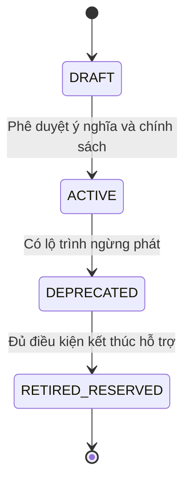
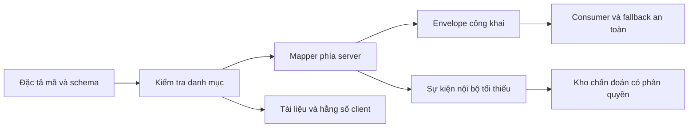

# Error code ổn định — Đặc tả mã lỗi như một hợp đồng bảo mật

## 1. Mục tiêu và phạm vi

Mã lỗi ổn định là định danh công khai có ý nghĩa được xác định, được quản lý theo thời gian và có thể được bên tiêu thụ dùng để đưa ra hành động phù hợp. Ổn định không chỉ là giữ nguyên một chuỗi. Nếu chuỗi không đổi nhưng điều kiện phát sinh, mức tiết lộ hoặc hướng xử lý thay đổi âm thầm, hợp đồng vẫn đã bị thay đổi.

Trong chương **Error handling** của module `SECURITY_SECURITY_DESIGN_SECURITY_REQUIREMENTS`, bài học chuyển mục tiêu an toàn thông tin và mô hình đe dọa thành yêu cầu về mã lỗi cụ thể, đo được và có thể kiểm chứng. Nội dung tập trung vào:

- Phân biệt mã công khai, mã nguyên nhân nội bộ, trạng thái giao thức và mã tương quan.
- Đặc tả ngữ nghĩa, phạm vi và hành vi khách hàng có thể dựa vào.
- Tránh dùng mã lỗi để lộ tài khoản, tenant, cấu hình quyền hoặc dữ liệu.
- Quản lý danh mục, tương thích, phiên bản và việc ngừng sử dụng.
- Liên kết yêu cầu với kiến trúc, logging, retry và kiểm thử.

Các tên mã, cấu trúc và thời hạn trong bài là ví dụ cho một hệ thống giả định. Chúng không phải một danh mục chuẩn bắt buộc áp dụng cho mọi dịch vụ.

## 2. Tình huống xuyên suốt và rủi ro

Một nền tảng học tập phục vụ nhiều tổ chức, mỗi tổ chức là một `tenant`. API cho phép người có quyền tạo bản xuất tiến độ, xem trạng thái và tải kết quả. Các bên tiêu thụ gồm giao diện web, ứng dụng của khách hàng và công cụ vận hành.

Ban đầu, API dùng các chuỗi do lập trình viên tự chọn:

```text
EXPORT_ERROR
ExportNotFoundException
REPORT_ERROR_12
Không tìm thấy báo cáo
```

Sau một đợt refactor, tên exception thay đổi. Giao diện không còn hiển thị đúng hướng dẫn. Một công cụ tích hợp coi mọi lỗi chưa biết là có thể thử lại, tạo thêm nhiều công việc xuất. Ở một endpoint khác, mã `REPORT_OF_OTHER_TENANT` xác nhận sự tồn tại của dữ liệu ngoài quyền.

Đây là vấn đề bảo mật và hợp đồng, không chỉ là quy ước đặt tên.

| Mã rủi ro | Tình huống | Hệ quả |
| --- | --- | --- |
| R-01 | Mã công khai phụ thuộc tên exception hoặc cấu trúc lưu trữ | Refactor làm đổi hành vi của bên tiêu thụ |
| R-02 | Mã phân biệt tài nguyên không tồn tại với tài nguyên ngoài quyền | Suy đoán tài khoản, báo cáo hoặc tenant |
| R-03 | Mã không đổi nhưng ý nghĩa hoặc điều kiện retry đổi | Gửi lại sai cách, lặp tác dụng phụ |
| R-04 | Dùng lại mã đã bỏ cho một nghĩa mới | Client cũ thực hiện hành động không còn phù hợp |
| R-05 | Thông điệp, ngôn ngữ hoặc HTTP status được dùng thay mã | Hành vi thay đổi theo bản dịch hoặc lớp trung gian |
| R-06 | Chi tiết nội bộ được nhúng vào mã hoặc metadata | Lộ cấu hình quyền, bí mật và dữ liệu |
| R-07 | Ghi log không liên kết được mã công khai với nguyên nhân nội bộ | Chẩn đoán sai hoặc phải mở chi tiết nhạy cảm cho người gọi |
| R-08 | Mã chưa biết làm client mặc định cho phép hoặc retry vô hạn | Mở rộng quyền hoặc gây cạn tài nguyên |

Yêu cầu cần giải quyết cả hành vi server lẫn cách client sử dụng hợp đồng. Một danh mục đẹp nhưng không được thực thi tại ranh giới API không ngăn được mã tùy ý đi ra ngoài.

## 3. Phân biệt bốn loại định danh

| Thành phần | Trả lời câu hỏi | Ví dụ | Tính chất |
| --- | --- | --- | --- |
| Mã lỗi công khai | Người gọi được biết loại thất bại nào? | `REPORT.NOT_AVAILABLE` | Ổn định trong phạm vi hợp đồng |
| Mã nguyên nhân nội bộ | Thành phần quan sát được nguyên nhân gì? | `TENANT_SCOPE_MISMATCH` | Chỉ dành cho kênh có quyền phù hợp |
| Trạng thái giao thức | Yêu cầu thất bại theo lớp giao tiếp nào? | HTTP 404 | Phải nhất quán với hợp đồng endpoint |
| Mã tương quan | Lần xử lý nào cần được tra cứu? | `req_c84e17` | Khác nhau theo lần xử lý; không cấp quyền |

Một mã công khai có thể gom nhiều nguyên nhân nội bộ. Chẳng hạn, `REPORT.NOT_AVAILABLE` được dùng cho cả “bản xuất không tồn tại” và “người gọi không được biết bản xuất đó có tồn tại hay không”.

Ngược lại, HTTP 409 có thể đi với nhiều mã nghiệp vụ khác nhau nếu hợp đồng có các loại xung đột cần hành động khác nhau. HTTP status không thay thế toàn bộ danh mục mã.

Mã tương quan không phải mã lỗi và không phải khóa bí mật. Việc có `requestId` không cho phép người dùng đọc log hoặc xem tài nguyên của người khác.

### 3.1. Không biến nguyên nhân nội bộ thành hợp đồng

Ví dụ không phù hợp:

```json
{
  "code": "POSTGRES_EXPORT_ROW_TENANT_42_NOT_MATCHED",
  "message": "ExportRepository.findById failed",
  "requestId": "req_c84e17"
}
```

Mã này gắn với công nghệ, dữ liệu tenant và cách truy vấn. Khi thay kho lưu trữ hoặc sửa lỗi cách ly tenant, mã có thể đổi dù điều người gọi được phép biết không đổi.

Thiết kế nên tách lớp ánh xạ:

```text
Nguyên nhân có kiểm soát -> chính sách tiết lộ -> mã công khai -> phản hồi
                         -> sự kiện nội bộ có phân quyền
```

Server không nhận mã lỗi do client gửi rồi dùng nó làm kết quả có thẩm quyền. Mã công khai là kết quả của xử lý và chính sách, không phải chỉ thị cấp quyền.

## 4. “Ổn định” cần được định nghĩa ở những chiều nào?

### 4.1. Các phần của hợp đồng

| Chiều | Nội dung phải được đặc tả | Ví dụ thay đổi gây rủi ro |
| --- | --- | --- |
| Định danh | Chuỗi và phạm vi duy nhất | Đổi chữ hoa thành chữ thường |
| Ngữ nghĩa | Loại thất bại mà mã biểu thị | Đổi từ lỗi đầu vào sang lỗi phụ thuộc |
| Điều kiện áp dụng | Khi nào mã được phát ra | Dùng lỗi “chưa bắt đầu” cho thao tác có thể đã commit |
| Tiết lộ | Thông tin người gọi có thể suy ra | Tách mã để lộ bản xuất thuộc tenant khác |
| Hành động client | Dừng, sửa dữ liệu, xác thực lại, đối soát hoặc retry có điều kiện | Chuyển từ dừng sang retry tác dụng phụ |
| Binding giao thức | Status và envelope trong từng endpoint, phiên bản | Đổi 403 thành 200 khiến client coi là thành công |
| Chi tiết có cấu trúc | Trường, kiểu, độ nhạy và tính tùy chọn | Thêm bắt buộc một trường mà client cũ không biết |

Thông điệp hiển thị có thể được cải thiện hoặc dịch mà không đổi mã nếu giữ đúng ý nghĩa. Client phải dựa vào `code` và các trường máy đọc đã được đặc tả, không tách chuỗi từ `message`.

### 4.2. Ranh giới cam kết

Ví dụ cam kết của `REPORT.NOT_AVAILABLE`:

> Với endpoint tra hoặc tải một bản xuất trong hợp đồng Report API v1, người gọi không được cung cấp bản xuất được yêu cầu. Mã không xác nhận bản xuất có tồn tại hay không. Client dừng yêu cầu hiện tại; không tự đổi tenant hoặc dò ID khác.

Cam kết không nói rằng tài nguyên đã bị xóa, không nói lỗi là vĩnh viễn và không tiết lộ nguyên nhân nội bộ cụ thể.

Từ “ổn định” cũng không có nghĩa giữ nguyên một hành vi có lỗ hổng. Khi phát hiện rò thông tin, cần sửa chính sách và triển khai thay đổi bảo mật. Nhóm phải phân tích tác động, cập nhật hợp đồng và kiểm thử; không giữ lỗ hổng chỉ vì client từng dựa vào thông tin không nên công khai.

## 5. Thiết kế danh mục mã có chủ sở hữu

### 5.1. Quy tắc đặt tên minh họa

Danh mục ví dụ sử dụng:

- Hai thành phần `NAMESPACE.REASON`, chỉ dùng chữ hoa ASCII, chữ số và dấu gạch dưới trong từng thành phần.
- Độ dài toàn mã từ 3 đến 64 ký tự.
- Namespace phản ánh khả năng hoặc miền công khai, không phản ánh hostname, thư viện, bảng dữ liệu hay tên lớp.
- Mỗi mã có đúng một định nghĩa trong phạm vi hợp đồng.
- Mã đã ngừng dùng được giữ chỗ, không tái sử dụng với nghĩa khác.

Không cần cho từng exception một mã công khai riêng. Chỉ tách mã khi người gọi được phép biết sự khác biệt và có hành động hợp lệ khác nhau dựa trên khác biệt đó.

### 5.2. Hồ sơ danh mục

Ví dụ hồ sơ dưới đây là dữ liệu thiết kế, không phải cấu hình quyền:

```yaml
code: REPORT.NOT_AVAILABLE
meaning: Người gọi không được cung cấp bản xuất được yêu cầu.
scope: Report API v1
audience: report-api-client
conditions:
  - Bản xuất không tồn tại
  - Chính sách không cho phép tiết lộ bản xuất cho người gọi
disclosurePolicy: HIDE_REPORT_EXISTENCE_V1
clientAction: STOP_CURRENT_REQUEST
httpBindings:
  - operation: getReport
    status: 404
  - operation: downloadReport
    status: 404
detailsSchema: NONE
owner: report-api-team
introducedIn: v1
lifecycle: ACTIVE
reusePolicy: RESERVED_AFTER_RETIREMENT
```

Danh mục nên ghi cả ví dụ hợp lệ, ví dụ bị cấm, yêu cầu bảo mật liên quan và các consumer quan trọng. Tên nhóm là ví dụ; triển khai thực tế cần người chịu trách nhiệm cụ thể.

Cần phân biệt định nghĩa công khai với tài liệu vận hành nội bộ. Không tự xuất toàn bộ bảng ánh xạ nguyên nhân nội bộ vào tài liệu dành cho khách hàng.

### 5.3. Một tập mã đủ dùng

| Mã | Ý nghĩa công khai | Hành động có thể dựa vào |
| --- | --- | --- |
| `REQUEST.INVALID` | Dữ liệu yêu cầu không đạt hợp đồng | Sửa dữ liệu theo chi tiết được phép |
| `AUTH.AUTHENTICATION_REQUIRED` | Chưa có trạng thái xác thực hợp lệ để tiếp tục | Thực hiện luồng xác thực được hỗ trợ |
| `ACCESS.DENIED` | Thao tác bị từ chối tại nơi được phép công khai quyết định quyền | Dừng; không tự mở rộng phạm vi |
| `REPORT.NOT_AVAILABLE` | Không được cung cấp bản xuất; không xác nhận sự tồn tại | Dừng yêu cầu hiện tại |
| `REPORT.STATE_CONFLICT` | Trạng thái không cho phép thao tác hiện tại | Đọc lại trạng thái bằng quyền hiện hành rồi quyết định |
| `COMMON.RATE_LIMITED` | Yêu cầu bị giới hạn theo hợp đồng | Chờ theo chỉ dẫn có hiệu lực và ngân sách retry |
| `COMMON.TEMPORARILY_UNAVAILABLE` | Chức năng cần thiết đang không sẵn sàng | Theo quy tắc của thao tác; không suy ra chưa có tác dụng phụ |
| `COMMON.INTERNAL_ERROR` | Có lỗi ngoài dự kiến không được công khai chi tiết | Hiển thị lỗi an toàn, giữ mã tương quan; không tự retry vô hạn |

`ACCESS.DENIED` không dùng tại endpoint đã cam kết che sự tồn tại nếu sự khác biệt đó tiết lộ tài nguyên. Luồng xác thực lại cũng không được lặp vô hạn khi chính hệ thống danh tính đang lỗi.

## 6. Envelope, bản dịch và chi tiết lỗi

### 6.1. Ví dụ phản hồi

```json
{
  "error": {
    "code": "REQUEST.INVALID",
    "message": "Khoảng thời gian báo cáo không hợp lệ.",
    "requestId": "req_c84e17",
    "details": {
      "fields": [
        {
          "name": "dateRange",
          "code": "INVALID_RANGE"
        }
      ]
    }
  }
}
```

Mã chính mô tả nhóm thất bại. Mã chi tiết như `INVALID_RANGE` cũng là hợp đồng nếu client dùng nó; cần định nghĩa và quản lý thay đổi tương tự. Không để phần `details` thành nơi chứa tùy ý mọi dữ liệu còn lại.

Yêu cầu ví dụ giới hạn tối đa **10 lỗi trường** và tối đa **2 KiB cho toàn bộ body lỗi**. Tên trường và mã chi tiết nằm trong danh sách cho phép; không phản chiếu giá trị nhạy cảm người gọi nhập. Khi vượt giới hạn, trả bản tóm tắt đúng schema, không cắt thô chuỗi JSON.

### 6.2. Bản dịch chỉ thay đổi lớp hiển thị

Cùng một tình huống có thể trả:

```text
code: REQUEST.INVALID
message (vi): Dữ liệu yêu cầu không hợp lệ.
message (en): The request data is invalid.
```

Mã giữ nguyên khi chỉ đổi ngôn ngữ. Thông điệp không được thêm chi tiết nội bộ trong một bản dịch ít được kiểm tra hơn.

Client không so sánh `message == "Dữ liệu yêu cầu không hợp lệ."` để quyết định hành động. Message có thể đổi dấu câu hoặc diễn đạt mà ngữ nghĩa mã vẫn giữ nguyên.

### 6.3. Không rò dữ liệu qua mã hoặc metadata

Cấm các dạng mã chứa dữ liệu động:

```text
USER_nguyen@example.com_NOT_FOUND
REPORT_TENANT_928_DENIED
SQL_STATE_..._TOKEN_...
```

Các định danh request, thời gian chờ hoặc lỗi trường phải nằm ở trường có kiểu và chính sách riêng khi cần. Không nhúng dữ liệu vào tên mã để tránh phải khai báo schema.

Một trường mới là “tùy chọn” về cú pháp vẫn có thể phá ranh giới riêng tư. Thêm `actualTenant`, `requiredRole` hoặc tên bảng có thể làm lộ điều mã công khai đang cố che.

## 7. Ánh xạ lỗi tại ranh giới tin cậy

### 7.1. Điểm ánh xạ có thẩm quyền

Một thư viện chung có thể cung cấp danh mục và schema, nhưng chính sách tiết lộ cần ngữ cảnh endpoint và danh tính gọi. Không áp dụng một ánh xạ thiếu ngữ cảnh cho mọi nơi.

Ví dụ:

```text
mapFailure(internalReason, endpointPolicy, callerContext):
    if endpointPolicy.hidesReportExistence
       and internalReason in {REPORT_ABSENT, TENANT_SCOPE_MISMATCH, REPORT_READ_DENIED}:
        return REPORT.NOT_AVAILABLE

    if internalReason is KNOWN_PUBLIC_VALIDATION_FAILURE:
        return REQUEST.INVALID with allowlisted details

    if internalReason is APPROVED_PUBLIC_FAILURE:
        return codeFromCatalog

    return COMMON.INTERNAL_ERROR with no internal details
```

Mã giả thể hiện chính sách, không thay thế kiểm tra quyền. Khi kiểm tra quyền không trả quyết định hợp lệ, thao tác được bảo vệ phải bị chặn theo yêu cầu; việc chọn mã chỉ quyết định thông tin trả ra.

### 7.2. Phụ thuộc bên ngoài không quyết định hợp đồng công khai

Nhà cung cấp có thể trả `VENDOR_ACCOUNT_771_BLOCKED` hoặc stack trace. API không chuyển nguyên mã và payload đó cho client. Adapter phân loại kết quả trong phạm vi đã biết, rồi ánh xạ sang danh mục của hệ thống.

Nếu chưa biết lỗi nhà cung cấp thuộc nhóm nào, dùng lỗi tổng quát và giữ nguyên tắc không mở rộng quyền. Không mặc định coi mọi mã chưa biết là lỗi tạm thời có thể retry.

Gateway, parser, middleware và worker cũng có thể tạo lỗi ngoài controller. Phải xác định kênh nào dùng envelope công khai, kênh nào dùng schema sự kiện nội bộ và cách liên kết chúng.

### 7.3. Endpoint và phiên bản là một phần ngữ cảnh

Một mã có thể được dùng ở nhiều endpoint nếu giữ cùng ý nghĩa công khai. Binding HTTP và hành động theo thao tác phải được ghi rõ. Không giả định mọi lần gặp cùng mã đều cho phép cùng một chiến lược retry, bất kể đó là thao tác đọc hay ghi.

Sự thống nhất giữa các endpoint không có nghĩa phải công khai cùng mức chi tiết. Nếu cần mức tiết lộ khác, phải đặc tả rõ chính sách và tránh khiến client suy ra điều ngoài quyền từ việc so sánh các đường gọi.

## 8. Mã lỗi, retry và kết quả thực thi là các khái niệm riêng

### 8.1. Mã lỗi không chứng minh chưa có tác dụng phụ

Giả sử API tạo bản xuất đã commit tác vụ nhưng mất kết nối trước khi trả response. Lần gọi có thể kết thúc với timeout hoặc `COMMON.TEMPORARILY_UNAVAILABLE`. Client không được suy ra rằng tác vụ chưa tồn tại.

Cần tách:

| Thông tin | Ví dụ | Vai trò |
| --- | --- | --- |
| Loại thất bại công khai | `COMMON.TEMPORARILY_UNAVAILABLE` | Mô tả lớp lỗi được phép biết |
| Trạng thái nghiệp vụ | `QUEUED`, `RUNNING`, `COMPLETED` | Do nguồn trạng thái tác vụ có thẩm quyền cung cấp |
| Mức chắc chắn về thực thi | Chưa bắt đầu, đã xác nhận, chưa biết | Định hướng đối soát và kiểm soát lặp |
| Chính sách gửi lại | Cùng khóa idempotency, trong cửa sổ cho phép | Hạn chế tác dụng phụ lặp |

Không đưa `RUNNING` vào danh mục lỗi chỉ vì thao tác chưa hoàn tất. Trạng thái xử lý bình thường cần mô hình riêng.

Nếu công khai mức chắc chắn hoặc chỉ dẫn retry trong envelope, các trường đó cũng phải có schema, ngữ nghĩa và chính sách tiết lộ. Không thêm một boolean `retryable: true` mà bỏ qua loại thao tác, idempotency và tình trạng thực thi.

### 8.2. Điều kiện cho retry tác vụ ghi

Ví dụ API tạo bản xuất dùng khóa idempotency trong phạm vi danh tính gọi, tenant và loại thao tác:

- Cùng khóa, cùng nội dung trong cửa sổ hỗ trợ không tạo tác vụ logic thứ hai.
- Cùng khóa nhưng khác nội dung trả xung đột theo hợp đồng.
- Trả lại mã tác vụ hoặc kết quả phải kiểm tra quyền hiện hành.
- Khi chưa biết kết quả, client đối soát hoặc gửi lại cùng khóa theo hợp đồng; không tự đổi khóa để né xung đột.
- Lỗi thiếu quyền không được chuyển thành vòng retry chờ được phép.

Danh mục mã phải liên kết tới hợp đồng retry của thao tác. Nó không thay thế yêu cầu idempotency, transaction hay đối soát.

## 9. Client phải xử lý mã chưa biết an toàn

### 9.1. Không giả định danh mục sẽ không mở rộng

Một mã mới có thể xuất hiện trước khi client cập nhật. Response cũng có thể đến từ proxy và không đúng schema mong đợi. Client cần hai nhánh riêng: mã chưa biết trong envelope hợp lệ và phản hồi không đọc được theo hợp đồng.

Mã giả:

```text
handleFailure(response):
    parsed = parseErrorWithinSizeAndSchemaLimits(response)

    if parsed is invalid:
        showGenericFailure()
        stopAutomaticSideEffectRetry()
        keepApprovedSupportReferenceIfAvailable()
        return

    switch parsed.error.code:
        case REQUEST.INVALID:
            showAllowlistedValidationDetails()
        case AUTH.AUTHENTICATION_REQUIRED:
            offerSupportedAuthenticationFlowWithoutLoop()
        case REPORT.NOT_AVAILABLE:
            showUnavailableMessage()
        case REPORT.STATE_CONFLICT:
            offerAuthorizedStateRefresh()
        default:
            showGenericFailure()
            stopAutomaticSideEffectRetry()
            keepApprovedSupportReference()
```

Đây là logic ở mức hợp đồng; các trường hợp rate limit hay lỗi tạm thời phải dùng quy tắc endpoint nếu được hỗ trợ. Nhánh mặc định không chuyển lỗi thành thành công, không cấp quyền và không tự gửi lại vô hạn.

Thông điệp server vẫn cần hiển thị qua cơ chế an toàn. Không render HTML tùy ý hoặc thực thi dữ liệu trả về vì envelope có mã hợp lệ.

### 9.2. Tương thích với mã bổ sung không tự có

Thêm mã thường có thể triển khai mà không đổi phiên bản nếu client đã cam kết xử lý giá trị chưa biết và mức tiết lộ không tăng. Nhưng client dùng enum đóng, bộ giải mã nghiêm ngặt hoặc switch không có nhánh mặc định có thể bị lỗi.

Vì vậy, kết luận “chỉ thêm mã nên không breaking” phải có bằng chứng từ hợp đồng và kiểm thử consumer. Nếu không có cơ chế tương thích, cần điều chỉnh lộ trình phát hành hoặc phiên bản.

Trong ví dụ, **Report API v1 yêu cầu consumer dùng fallback an toàn cho mã chưa biết ngay từ đầu**. Tập mã công khai là tập có thể mở rộng; schema envelope xác định rõ phần bắt buộc và cách xử lý trường tùy chọn chưa biết.

## 10. Quản lý vòng đời và phiên bản

### 10.1. Các trạng thái của một mã



- **DRAFT:** chưa được phát ra ngoài.
- **ACTIVE:** được sử dụng đúng phạm vi đã công bố.
- **DEPRECATED:** còn phải giữ nghĩa cũ trong thời gian chuyển tiếp.
- **RETIRED_RESERVED:** ngừng phát trong phạm vi xác định nhưng định danh được giữ chỗ vĩnh viễn, không dùng cho nghĩa mới.

Consumer có thể vẫn gặp mã cũ từ bản ghi lịch sử hoặc môi trường chưa nâng cấp. Ngừng phát mới không đồng nghĩa được xóa mọi khả năng đọc dữ liệu cũ.

### 10.2. Đánh giá loại thay đổi

| Thay đổi | Đánh giá | Cách xử lý |
| --- | --- | --- |
| Sửa chính tả message, giữ nghĩa và mức tiết lộ | Thường tương thích | Kiểm thử bản dịch và xác nhận client không parse message |
| Đổi tên exception nội bộ, giữ ánh xạ công khai | Tương thích nếu ánh xạ giữ đúng | Kiểm thử hồi quy mapper và consumer |
| Thêm mã với fallback an toàn đã được cam kết | Có thể tương thích | Kiểm thử client cũ, xem xét tiết lộ và hành động |
| Đổi tên mã công khai | Thay đổi hợp đồng | Giữ mã cũ hoặc phát hành phiên bản theo lộ trình |
| Dùng cùng mã nhưng đổi hướng xử lý từ dừng sang retry | Thay đổi ngữ nghĩa | Thiết kế mã hoặc phiên bản mới và chuyển tiếp rõ ràng |
| Tách mã tổng quát thành hai mã xác nhận tồn tại | Thay đổi chính sách tiết lộ | Đánh giá rủi ro; có thể không được phép dù client đọc được |
| Gộp mã làm mất hướng dẫn sửa lỗi cần thiết | Có thể phá hành vi consumer | Đánh giá ca sử dụng, không chỉ kiểm tra schema |
| Thêm trường tùy chọn chứa tenant thật | Có thể tăng tiết lộ | Kiểm tra quyền và chính sách dữ liệu trước khi thêm |
| Đổi binding HTTP khiến client đi nhánh thành công | Thay đổi giao thức quan trọng | Kiểm thử toàn hợp đồng, chọn lộ trình phù hợp |
| Tái dùng mã đã bỏ cho nghĩa khác | Không được phép trong ví dụ | Tạo định danh mới |

Ổn định là yêu cầu về cả producer lẫn consumer. Tài liệu không thể sửa được một client thực tế đang suy luận bằng tiền tố hoặc thông điệp.

### 10.3. Chuyển tiếp không phát hai nghĩa cùng lúc

Giả sử mã cũ `EXPORT.ERROR` đang gộp nhiều lỗi và muốn thay bằng danh mục rõ hơn. Có thể giữ cách ánh xạ cũ cho hợp đồng v1, đồng thời dùng mã mới trong phiên bản hợp đồng mới. Mỗi hợp đồng phải xác định một mã chính có thẩm quyền cho mỗi lỗi.

Nếu có alias, alias chỉ liên kết các định danh **thật sự cùng nghĩa và cùng chính sách tiết lộ**. Không alias lỗi “chưa thực thi” sang lỗi có thể đã commit. Không đưa hai mã chính có nghĩa khác nhau vào một response để client tự chọn.

Thông tin phiên bản hợp đồng không được cho client vượt quyền. Việc yêu cầu phiên bản cũ không phải lý do để tiếp tục tiết lộ thông tin đã xác định là lỗ hổng.

### 10.4. Điều kiện ngừng hỗ trợ

Kế hoạch cần ghi phạm vi consumer, thời hạn cam kết, kênh thông báo đã được thống nhất và bằng chứng nâng cấp. Không dùng “không thấy traffic hôm qua” làm bằng chứng rằng không còn client cũ.

Lịch sử danh mục cần giữ định nghĩa, binding và thời điểm hiệu lực để diễn giải sự kiện cũ. Không sửa ngược mô tả khiến lỗi đã phát trong quá khứ bị hiểu thành một nghĩa khác.

## 11. Kiến trúc thực thi và logging

### 11.1. Danh mục không chỉ nằm trong tài liệu

Một kiến trúc có thể dùng:



Các thành phần có thể sinh từ cùng nguồn hoặc được đối chiếu tự động. Yêu cầu quan trọng là truy được mã triển khai tới định nghĩa đã duyệt; không bắt buộc dùng một công cụ sinh code cụ thể.

Không bắt client và server luôn nâng cấp đồng thời. Thư viện dùng chung giúp giảm lỗi gõ nhưng không thay thế khả năng xử lý phiên bản khác nhau.

### 11.2. Liên kết công khai và nội bộ bằng mã tương quan

Ví dụ sự kiện nội bộ:

```json
{
  "eventType": "PUBLIC_ERROR_MAPPED",
  "requestId": "req_c84e17",
  "publicCode": "REPORT.NOT_AVAILABLE",
  "internalReason": "TENANT_SCOPE_MISMATCH",
  "contractVersion": "report-v1",
  "operation": "getReport",
  "outcome": "DENIED"
}
```

Sự kiện không chứa token, body đầy đủ hoặc nội dung bản xuất. `internalReason` lấy từ tập kiểm soát và chỉ xuất hiện trong kênh có quyền phù hợp. Không cho người gọi tra cứu sự kiện bằng `requestId` mà bỏ xác thực, tenant và quyền hỗ trợ.

Khi lỗi chưa biết, có thể ghi nhóm nội bộ `UNCLASSIFIED` kèm tham chiếu chẩn đoán đã bảo vệ. Không dùng tên exception hoặc chuỗi message tự do làm mã công khai hay nhãn metric.

### 11.3. Quan sát drift và phục hồi danh mục

Metric theo `publicCode` hữu ích khi tập giá trị được kiểm soát. Mã không nằm trong danh mục phải đi vào nhóm theo dõi hữu hạn và cảnh báo, tránh sinh chuỗi metric mới từ dữ liệu tùy ý.

Nhóm cần phát hiện cả mã sai và ánh xạ sai: mọi mã đều hợp lệ nhưng timeout phân quyền bị ánh xạ thành `REPORT.NOT_AVAILABLE` có thể che sự cố vận hành. Log nội bộ cần giữ đúng phân loại được phép, dù các nguyên nhân được gom chung bên ngoài.

Khi rollback phần mềm, phải khôi phục cấu hình mapper tương thích với phiên bản đang chạy. Lịch sử danh mục và chỗ giữ mã đã nghỉ không bị xóa theo rollback. Phát lại event cũ cần đọc theo phiên bản hợp đồng lúc event được tạo.

## 12. Bộ yêu cầu bảo mật có thể kiểm chứng

Bộ yêu cầu sau dành cho Report API v1 của ví dụ. “Đã duyệt” nghĩa là có định nghĩa, chủ sở hữu và chính sách được xác định trước khi phát mã ra ngoài.

| Mã yêu cầu | Yêu cầu và tiêu chí đo | Rủi ro | Điểm thực thi, chủ sở hữu |
| --- | --- | --- | --- |
| EC-01 | Mỗi mã phát trong envelope lỗi có đúng một hồ sơ danh mục; không có mã ngoài danh mục ở các luồng được kiểm thử | R-01, R-06 | Danh mục và mapper; nhóm API |
| EC-02 | Mã ASCII dạng NAMESPACE.REASON, dài 3–64 ký tự, không chứa dữ liệu động; kiểm tra quy tắc ở bước xác nhận hợp đồng | R-01, R-06 | Kiểm tra danh mục; nhóm nền tảng |
| EC-03 | Refactor nội bộ, đổi ngôn ngữ hoặc message không đổi code, nghĩa, binding và hành động đã cam kết của cùng tình huống | R-01, R-05 | Mapper và contract test; nhóm API, giao diện |
| EC-04 | Endpoint getReport và downloadReport gom trường hợp vắng mặt và ngoài phạm vi tiết lộ thành REPORT.NOT_AVAILABLE; không rò nguyên nhân qua details, header hoặc endpoint liên quan | R-02, R-06 | Ranh giới API, chính sách tra cứu; nhóm phân quyền |
| EC-05 | Không dùng lại mã RETIRED_RESERVED, không sửa nghĩa của mã cũ trong cùng hợp đồng; mọi thay đổi có phân loại tác động | R-03, R-04 | Lịch sử danh mục, review thay đổi; chủ hợp đồng |
| EC-06 | Consumer v1 có fallback cho mã chưa biết và response sai schema: không coi là thành công, không tự cấp quyền hoặc retry tác dụng phụ vô hạn | R-08 | Client chính thức và bộ kiểm thử tương thích; nhóm consumer |
| EC-07 | Mỗi mã có hướng hành động và binding theo thao tác; mã lỗi không tự chứng minh chưa có tác dụng phụ hoặc thay thế điều kiện idempotency | R-03, R-08 | Đặc tả thao tác, client retry; nhóm tác vụ |
| EC-08 | Chỉ trả details theo schema được duyệt; tối đa 10 lỗi trường, body lỗi tối đa 2 KiB; không phản chiếu token, input nhạy cảm hay nguyên nhân nội bộ | R-05, R-06 | Serializer lỗi; nhóm API |
| EC-09 | Mọi ánh xạ lỗi tại ranh giới ứng dụng có sự kiện tối thiểu nối publicCode, requestId, phiên bản hợp đồng và nhóm nguyên nhân; log không chứa bí mật | R-07 | Logger và quyền tra cứu; nhóm vận hành |
| EC-10 | Mã nhà cung cấp hoặc exception chưa phân loại không đi nguyên trạng ra ngoài; dùng fallback công khai và giữ kiểm soát quyền | R-01, R-06, R-08 | Adapter, gateway, handler; nhóm tích hợp |
| EC-11 | Thay đổi bổ sung mã chỉ coi là tương thích khi kiểm thử consumer cũ và chính sách tiết lộ đạt; không suy luận từ việc schema vẫn parse được | R-02, R-03, R-08 | Kiểm thử phiên bản; chủ hợp đồng |
| EC-12 | Khôi phục hoặc rollback giữ được định nghĩa mã cũ, mã đã giữ chỗ và mapping phù hợp; event lịch sử được giải thích theo phiên bản gốc | R-04, R-07 | Kho phiên bản và runbook; nhóm vận hành |

EC-01 không chỉ dựa vào số lần chạy test. Bằng chứng triển khai còn cần đường fallback, giới hạn nơi tạo mã và kiểm soát phát hành. EC-04 cần kiểm thử các thuộc tính phản hồi và đường truy cập liên quan; giống chuỗi mã chưa đủ.

EC-09 mô tả bằng chứng vận hành, không mặc định mọi lỗi validation đều là audit giao dịch bắt buộc. Nếu một hành động nhạy cảm cần audit bền vững trước thực thi hoặc phát hành, phải có yêu cầu riêng về thời điểm ghi và hành vi khi kho audit lỗi.

## 13. Ma trận kiểm thử và bằng chứng nghiệm thu

| Ca | Thao tác | Kết quả mong đợi | Yêu cầu |
| --- | --- | --- | --- |
| AT-01 | Quét danh mục để tìm trùng, sai định dạng và mã không có owner | Không có lỗi; mã đã nghỉ vẫn được giữ chỗ | EC-01, EC-02, EC-05 |
| AT-02 | Đổi tên exception hoặc adapter mà giữ nguyên tình huống nghiệp vụ | Mã công khai, nghĩa và binding đã cam kết không đổi | EC-03 |
| AT-03 | Gửi cùng lỗi với ngôn ngữ vi và en | Code và schema giữ nguyên; message được dịch, không thêm dữ liệu nội bộ | EC-03, EC-08 |
| AT-04 | So sánh báo cáo không tồn tại và báo cáo tenant khác | Cùng lớp thông tin công khai; không lộ qua details, header, danh sách hay tải | EC-04 |
| AT-05 | Tạo đề xuất dùng lại mã đã nghỉ hoặc đổi clientAction của mã cũ | Bị phát hiện là không phù hợp hoặc thay đổi hợp đồng cần xử lý | EC-05 |
| AT-06 | Cho client cũ nhận mã mới hợp lệ và lần khác nhận body HTML từ proxy | Fallback an toàn; không parse message để suy ra quyền hoặc retry | EC-06, EC-11 |
| AT-07 | Commit tác vụ rồi mất phản hồi trước client | Không suy ra chưa thực thi; đối soát hoặc cùng khóa theo hợp đồng | EC-07 |
| AT-08 | Gửi validation có token giả, nhiều trường và input dài | Không lộ token; đúng schema và giới hạn body 2 KiB, tối đa 10 lỗi trường | EC-08 |
| AT-09 | Nhà cung cấp trả mã chứa ID tài khoản và thông báo nội bộ | Mã/payload thô không ra công khai; sự kiện nội bộ có giới hạn | EC-09, EC-10 |
| AT-10 | Bộ kiểm tra quyền timeout hoặc trả lỗi không biết | Thao tác vẫn bị chặn khi chưa đủ quyền; mã chỉ mô tả kết quả được phép công khai | EC-07, EC-10 |
| AT-11 | Triển khai mã mới với consumer dùng enum đóng | Phát hiện lỗi tương thích; không tự coi là thay đổi an toàn | EC-11 |
| AT-12 | Rollback server và đọc event của phiên bản trước | Mapping tương thích; diễn giải event theo định nghĩa gốc, không tái dùng mã | EC-12 |
| AT-13 | Gây lỗi parser, middleware, gateway và handler | Mỗi ranh giới có hành vi đã đặc tả; không có tên exception hay trang debug ngoài hợp đồng | EC-01, EC-10 |
| AT-14 | Tra requestId bằng người dùng không có quyền hỗ trợ hoặc sai tenant | Không lộ log, nguyên nhân nội bộ hoặc dữ liệu người khác | EC-09 |

Kiểm thử contract cần so sánh trường máy đọc và thuộc tính có ý nghĩa, không snapshot toàn response gồm timestamp, requestId và message rồi coi mọi khác biệt là breaking. Ngược lại, chỉ kiểm tra code bằng nhau sẽ bỏ sót thay đổi về HTTP status, details hoặc tác dụng phụ.

Với che sự tồn tại, cần xét thêm kích thước, cache, redirect, thời gian và kênh liên quan theo mô hình đe dọa. Kiểm thử thời gian dùng tập mẫu và điều kiện tải định trước; không khẳng định không có rò rỉ chỉ từ một cặp request.

Bằng chứng nghiệm thu nên gồm danh mục đã duyệt, kết quả producer/consumer test, response đã làm sạch và sự kiện nội bộ tối thiểu. Dùng dữ liệu giả; không đưa bí mật thật vào bộ test để tìm rò rỉ.

## 14. Áp dụng trong vòng đời phát triển

### 14.1. Khi phân tích yêu cầu và thiết kế

Với mỗi lỗi công khai dự kiến, nhóm trả lời:

1. Người gọi được phép biết sự khác biệt nào?
2. Mã có dẫn tới một hành động client hợp lệ, khác với mã đang có không?
3. Điều kiện thực thi và tác dụng phụ có được mô tả chính xác không?
4. Endpoint, phiên bản và nhóm người gọi nào nằm trong phạm vi?
5. Consumer cũ sẽ làm gì nếu gặp mã mới?

Đưa mã và chính sách vào thiết kế API trước khi nhiều consumer phụ thuộc. Liên kết chúng với rủi ro, yêu cầu và test ID.

### 14.2. Khi triển khai và phát hành

Lập trình viên chọn mã từ danh mục, không tự tạo từ chuỗi exception. Review cần kiểm tra ngữ nghĩa và tiết lộ, ngoài việc kiểm tra tên và định dạng.

Bản phát hành phải có danh mục, mapper và tài liệu tương thích. Nếu sinh hằng số client, cần kiểm tra việc sinh không biến tập mã mở thành enum đóng không có fallback.

Thay đổi bảo mật khẩn cấp vẫn cần ghi lại tác động, triển khai sửa và kiểm tra các consumer liên quan. Mục tiêu là ngăn tiết lộ hoặc truy cập sai, đồng thời giữ mức tương thích có thể duy trì an toàn.

### 14.3. Khi vận hành

Theo dõi mã ngoài danh mục, tỷ lệ fallback, thay đổi phân bố mã và phản ánh từ consumer. Không dùng publicCode làm nguồn duy nhất để kết luận nguyên nhân: cùng mã có thể gom nhiều lỗi vì chính sách riêng tư.

Khi có sai ánh xạ, xác định dữ liệu đã tiết lộ và hành động client đã thực hiện. Chỉ đổi chuỗi mã không thu hồi được thông tin hoặc tác dụng phụ đã xảy ra.

## 15. Lỗi thường gặp

| Lỗi | Vì sao không đáp ứng | Cách sửa |
| --- | --- | --- |
| Giữ chuỗi nhưng đổi nghĩa | Client thực hiện hành động theo hợp đồng cũ | Đánh giá ngữ nghĩa, tạo mã hoặc phiên bản khi cần |
| Dùng tên exception làm code | Refactor nội bộ thành thay đổi công khai | Mapper qua danh mục có chủ sở hữu |
| Mỗi nguyên nhân nội bộ có một mã riêng | Tiết lộ quá nhiều và tăng gánh nặng tương thích | Gom theo hành động hợp lệ và chính sách tiết lộ |
| Client suy luận bằng tiền tố mã | Namespace không bảo đảm mọi mã có cùng hướng xử lý | Dùng từng định nghĩa và fallback được đặc tả |
| Dùng message dịch để phân nhánh | Sửa câu chữ làm thay đổi hành vi | Phân nhánh theo code và schema |
| Mã chưa biết thì tự retry | Có thể lặp tác dụng phụ hoặc khuếch đại tải | Fallback an toàn, áp dụng hợp đồng thao tác |
| Thêm details nhưng không review | Trường mới có thể tiết lộ điều code đang che | Schema, danh sách trường, phân tích quyền |
| Tái sử dụng mã đã bỏ | Consumer cũ hiểu nghĩa cũ | Giữ chỗ vĩnh viễn, tạo mã mới |
| Cùng thư viện nghĩa là tương thích | Client/server có thể chạy khác phiên bản | Kiểm thử chéo phiên bản và mã chưa biết |
| Log chứa mọi thứ để giữ API gọn | Chuyển điểm rò từ response sang kho log | Log tối thiểu, kênh chẩn đoán có quyền |

## 16. Bài tập vận dụng

Một API dùng `EXPORT_404` cho cả không tìm thấy và thiếu quyền. Nhóm muốn đổi thành `EXPORT_NOT_FOUND` và `EXPORT_WRONG_TENANT`. Client hiện retry mọi mã có tiền tố `EXPORT_`, còn bản dịch tiếng Anh thêm tên bảng trong message. Một mã đã bỏ đang được đề xuất dùng lại cho lỗi timeout.

Hãy xây dựng:

1. Bảng rủi ro cho các thay đổi trên, nêu tài sản và hành vi bị ảnh hưởng.
2. Định nghĩa một mã công khai che sự tồn tại, kèm scope, điều kiện, hành động client và binding.
3. Schema details không phản chiếu dữ liệu nhạy cảm và quy tắc bản dịch.
4. Kế hoạch chuyển tiếp cho consumer cũ, có xử lý enum đóng và mã chưa biết.
5. Năm yêu cầu đo được, liên kết với điểm thực thi và ca kiểm thử.
6. Cách logging nối mã công khai với nguyên nhân nội bộ mà không mở kho log cho người gọi.

Gợi ý tự đánh giá: một mã ổn định phải giúp consumer hành động đúng qua nhiều phiên bản, giữ giới hạn tiết lộ và không làm thay cho kiểm tra quyền hoặc xác định kết quả thực thi. Bằng chứng cần kiểm tra cả ngữ nghĩa, tương thích và tác động quan sát được.
