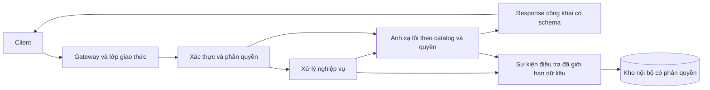

# Error message cho client

## 1. Thông báo lỗi là một phần của hợp đồng bảo mật

Error message cho client là thông tin hệ thống trả cho bên gọi khi một yêu cầu không thể hoàn thành theo hợp đồng. Client có thể là giao diện web, ứng dụng di động, một dịch vụ tích hợp hoặc công cụ tự động. Thông báo cần đủ để bên gọi hiểu tình huống và chọn hành động phù hợp, đồng thời không tiết lộ dữ liệu hoặc cấu trúc nội bộ ngoài quyền.

Trong chương **Error handling**, mục tiêu “không lộ stack trace” mới giải quyết một phần vấn đề. Một phản hồi không có stack trace vẫn có thể tiết lộ tài khoản tồn tại, tài nguyên của tenant khác, tên bảng, địa chỉ dịch vụ, token hoặc việc một giao dịch đã xảy ra.

Thiết kế yêu cầu bảo mật phải làm rõ:

- Client cần biết điều gì để sửa yêu cầu hoặc tiếp tục công việc?
- Với quyền hiện tại, client có được biết tài nguyên hoặc tài khoản tồn tại không?
- Mã máy đọc, HTTP status và nội dung cho người dùng liên hệ thế nào?
- Khi lỗi không xác định hoặc đã xảy ra tác động một phần, hướng dẫn nào là chính xác?
- Dữ liệu nào chỉ được ghi ở hệ thống điều tra có kiểm soát?
- Những tầng nào có thể tự sinh lỗi ngoài handler của ứng dụng?

Bài học sử dụng nền tảng học trực tuyến nhiều tenant làm ví dụ. Các mã lỗi, schema, giới hạn và ngưỡng là lựa chọn thiết kế minh họa, cần điều chỉnh theo hợp đồng và mô hình đe dọa thực tế.

## 2. Xuất phát từ rủi ro và nhu cầu của bên gọi

### 2.1. Các kịch bản đe dọa

| Mã rủi ro | Kịch bản | Hậu quả | Yêu cầu cần phát sinh |
|---|---|---|---|
| R-ERR-01 | Exception được serialize trực tiếp ra response | Lộ SQL, đường dẫn, dữ liệu cá nhân hoặc bí mật | Ánh xạ lỗi qua catalog, không trả object exception |
| R-ERR-02 | Đăng nhập trả lỗi khác cho tài khoản không tồn tại và sai mật khẩu | Dò danh sách tài khoản | Chính sách phản hồi không phân biệt những trường hợp cần bảo vệ |
| R-ERR-03 | API báo tài nguyên thuộc tenant khác nhưng không cho truy cập | Lộ sự tồn tại và quan hệ dữ liệu | Kiểm tra quyền trước tiết lộ; chính sách ẩn tài nguyên nhất quán |
| R-ERR-04 | Client quyết định bằng chuỗi dịch đã thay đổi | Retry sai hoặc xử lý nhầm nghiệp vụ | Mã máy đọc ổn định, không phụ thuộc thông điệp hiển thị |
| R-ERR-05 | Timeout được diễn đạt như chắc chắn chưa ghi nhận | Client gửi lại và tạo tác động lặp | Phân biệt thất bại đã biết với kết quả chưa xác định |
| R-ERR-06 | Nội dung đầu vào được chèn vào HTML hoặc header lỗi | Thực thi ngoài ý muốn hoặc chèn nội dung | Mã hóa theo ngữ cảnh, không phản chiếu dữ liệu tùy ý |
| R-ERR-07 | Gateway, proxy hoặc trang lỗi mặc định lộ chi tiết | Bỏ qua kiểm soát ở ứng dụng | Phạm vi yêu cầu bao phủ toàn đường phản hồi |
| R-ERR-08 | URL tra cứu lỗi hoặc request ID trở thành quyền đọc log | Lộ thông tin điều tra | Tham chiếu không cấp quyền, API hỗ trợ có xác thực và phân quyền |
| R-ERR-09 | Client hiển thị thông báo từ bên ngoài hoặc fallback không kiểm soát | Lộ dữ liệu và hướng dẫn sai | Lớp trình bày dùng catalog, fallback và quy tắc tin cậy rõ ràng |

### 2.2. Hữu ích và tiết lộ vừa đủ là hai yêu cầu phải cùng đạt

Lỗi nhập số lượng ngoài khoảng có thể chỉ rõ trường cần sửa và giới hạn được công bố. Lỗi phát sinh trong cơ sở dữ liệu không cần trả tên constraint, câu SQL hoặc hostname để người học biết thao tác chưa hoàn thành.

OWASP khuyến nghị xử lý tập trung lỗi bất ngờ, trả phản hồi chung phù hợp cho bên gọi và giữ thông tin điều tra ở phía server có kiểm soát. Điều này giúp giảm việc các lỗi chưa xử lý tự tiết lộ chi tiết triển khai. [OWASP: Error Handling Cheat Sheet](https://cheatsheetseries.owasp.org/cheatsheets/Error_Handling_Cheat_Sheet.html)

“Chung” không có nghĩa mọi lỗi đều có cùng một thông điệp. Cần phân loại lỗi, quyền được biết và hành động cần thiết trước khi quyết định mức chi tiết.

## 3. Xây chính sách tiết lộ theo loại lỗi và quyền

### 3.1. Mức thông tin phù hợp với bối cảnh

| Bối cảnh | Có thể cần trả | Không nên tự động trả |
|---|---|---|
| Request sai cú pháp | Mã lỗi định dạng và hướng dẫn gửi lại đúng hợp đồng | Parser stack, đường dẫn file, đoạn body có bí mật |
| Validation nghiệp vụ đã được phép | Trường công khai, mã quy tắc, giới hạn an toàn | Giá trị gốc nhạy cảm hoặc tên constraint nội bộ |
| Đăng nhập, khôi phục tài khoản công khai | Thông báo theo chính sách chống dò tài khoản | Trạng thái tồn tại, khóa hoặc nguyên nhân xác thực chi tiết ngoài quyền |
| Truy cập đối tượng | Kết quả phù hợp quyền được biết tài nguyên | Tên chủ sở hữu, tenant hoặc nội dung của đối tượng bị cấm |
| Xung đột trạng thái được phép biết | Mã xung đột và cách tải lại hoặc chọn hành động khác | Dữ liệu của người khác gây ra xung đột |
| Lỗi bất ngờ | Mã chung, thông báo an toàn, tham chiếu hỗ trợ | Exception, SQL, cấu hình, token, địa chỉ hạ tầng |
| Công cụ hỗ trợ nội bộ | Chi tiết cần thiết theo quyền riêng và mục đích | Toàn bộ dữ liệu chỉ vì người gọi được gắn vai trò support |

Đặc quyền đọc một tài nguyên không mặc nhiên cấp quyền xem toàn bộ lỗi hạ tầng. Không mở chi tiết nhạy cảm bằng tham số `debug=true`, một header do client tự đặt hoặc tên vai trò chưa được kiểm chứng.

### 3.2. Chống dò tài khoản phải bao phủ nhiều dấu hiệu

Đổi câu chữ thành “Không thể đăng nhập” chưa đủ nếu tài khoản không tồn tại trả một status, tài khoản khóa trả status khác hoặc mỗi trường hợp có đường chuyển hướng riêng.

OWASP nhấn mạnh phản hồi xác thực có thể tạo khác biệt để dò tài khoản qua nội dung, HTTP code và thời gian xử lý. Cần đánh giá các dấu hiệu này cùng luồng đăng nhập, khôi phục và đăng ký phù hợp mô hình đe dọa. [OWASP: Authentication and Error Messages](https://cheatsheetseries.owasp.org/cheatsheets/Authentication_Cheat_Sheet.html#authentication-and-error-messages)

Trong ví dụ, request khôi phục có thể nhận cùng thông báo đã tiếp nhận cho các trường hợp được chọn để bảo vệ. Hệ thống vẫn thực hiện hành vi nội bộ đúng, có giới hạn lạm dụng và audit phù hợp; không giả gửi thư tới địa chỉ không tồn tại chỉ để làm response giống nhau.

Không cam kết “thời gian bằng nhau tuyệt đối” bằng cách thêm một khoảng sleep cố định. Cần tránh đường xử lý bỏ qua bước nhạy cảm gây khác biệt rõ, đo phân bố thời gian và kết hợp biện pháp chống tự động hóa theo rủi ro.

### 3.3. Thứ tự kiểm tra có thể làm lộ thông tin

Nếu API kiểm tra “khóa học này có tồn tại không” rồi trả tên khóa học trong lỗi trước khi kiểm tra tenant, chính lỗi đã vượt quyền.

Phải xác định lỗi nào được phép xuất hiện ở từng giai đoạn. Kiểm tra dữ liệu công khai như cú pháp JSON có thể cần làm sớm; validation liên quan dữ liệu riêng phải tuân quyền đối với dữ liệu đó. Không bắt buộc mọi kiểm tra theo một thứ tự duy nhất, nhưng phải chứng minh thông tin quan sát được không vượt chính sách.

## 4. Giữ đúng ngữ nghĩa HTTP và hành động của client

### 4.1. Status không thay thế mã nghiệp vụ

HTTP status mô tả kết quả ở lớp giao thức. Mã lỗi của ứng dụng giúp phân biệt các trường hợp thuộc cùng nhóm và hướng dẫn xử lý ổn định. Không trả `200` cho mọi lỗi rồi bắt client đọc một câu chữ để biết có thất bại.

| Nhóm tình huống | Lựa chọn thường gặp trong hợp đồng | Điều cần đặc tả |
|---|---|---|
| Request không hợp lệ ở mức cú pháp | `400` | Không trả parser nội bộ hoặc nội dung nhạy cảm |
| Thiếu hoặc sai thông tin xác thực cho tài nguyên | `401` | Header challenge phù hợp cơ chế xác thực |
| Hiểu request nhưng từ chối thực hiện | `403` | Không phải mọi từ chối đều do chưa đăng nhập |
| Không tìm thấy hoặc không muốn tiết lộ sự tồn tại | `404` theo chính sách | Không để body, header hoặc đường khác phá mục tiêu ẩn |
| Xung đột với trạng thái hiện tại | `409` | Client cần tải lại hoặc đổi hành động nào? |
| Nội dung hợp lệ về cú pháp nhưng không đáp ứng quy tắc | `422` nếu hợp đồng chọn | Không dùng lẫn tùy controller mà thiếu quy ước |
| Giới hạn tốc độ | `429` | Phạm vi giới hạn và hướng dẫn đợi an toàn |
| Lỗi server hoặc upstream | Nhóm `5xx` phù hợp | Không chuyển nguyên response nội bộ ra client |

RFC 9110 phân biệt các ngữ nghĩa HTTP; ví dụ response `401` phải có `WWW-Authenticate` phù hợp, và có thể dùng `404` thay `403` khi cần ẩn sự tồn tại của tài nguyên bị cấm. Đây là quyết định cần nhất quán với mục tiêu bảo mật của API. [RFC 9110: HTTP Semantics](https://www.rfc-editor.org/info/rfc9110/)

Bảng là định hướng thiết kế, không buộc một mã nghiệp vụ duy nhất cho mọi hệ thống. Cần ghi status thực tế, header bắt buộc và chính sách liên quan trong catalog lỗi của dự án.

### 4.2. Không hướng dẫn retry khi chưa biết tác động

Một timeout có thể xảy ra sau khi ghi danh hoặc thanh toán đã được ghi nhận nhưng trước khi client nhận kết quả. Thông điệp “Thất bại, hãy gửi lại” có thể gây tác động lặp.

Cần phân biệt:

- **Đã biết chưa thực hiện:** có thể hướng dẫn sửa hoặc thử lại theo điều kiện đã định.
- **Đã biết bị từ chối:** giải thích hành động phù hợp mà không hứa retry sẽ thành công.
- **Chưa xác định kết quả:** hướng dẫn kiểm tra trạng thái hoặc dùng cơ chế idempotency đã hỗ trợ.

`retryable` nếu có phải mang ngữ nghĩa cụ thể: thao tác nào, dưới điều kiện nào, có giữ cùng idempotency key không. Không suy ra “mọi 5xx đều retry an toàn”.

Với `Retry-After` ở tình huống phù hợp, thời gian là hướng dẫn chờ, không phải bảo đảm lần sau sẽ thành công. Client cần backoff, giới hạn số lần thử và giữ đúng đặc tính an toàn của thao tác.

## 5. Thiết kế hợp đồng lỗi ổn định và có giới hạn

### 5.1. Sử dụng cấu trúc thay vì một chuỗi tùy ý

RFC 9457 định nghĩa Problem Details cho HTTP API, gồm dạng JSON với media type `application/problem+json`. Mục tiêu là mô tả vấn đề ở giao diện HTTP, không cung cấp công cụ debug nội bộ. Dự án có thể chọn mô hình này thay vì tạo một envelope lỗi mới. [RFC 9457: Problem Details for HTTP APIs](https://www.rfc-editor.org/rfc/rfc9457.html)

| Thành phần | Ý nghĩa trong thiết kế |
|---|---|
| `type` | URI nhận diện loại vấn đề; là định danh chính của Problem Details |
| `title` | Tóm tắt ngắn cho con người, có thể bản địa hóa |
| `status` | Status tương ứng do bên phát sinh đưa vào, phải nhất quán theo hợp đồng |
| `detail` | Giải thích an toàn cho lần xảy ra cụ thể |
| `instance` | Tham chiếu lần xảy ra nếu cần; không phải quyền đọc log |
| Extension của dự án | Dữ liệu có schema như mã ứng dụng hoặc request ID, không phải object exception |

Client không dùng `detail` hoặc chuỗi dịch để rẽ nhánh. Nếu dự án thêm `code`, phải quy định quan hệ ổn định với `type`, tránh hai định danh mâu thuẫn. Các extension và ví dụ dưới đây là lựa chọn của hệ thống mẫu.

### 5.2. Ví dụ lỗi nghiệp vụ đã được phép tiết lộ

```http
HTTP/1.1 409 Conflict
Content-Type: application/problem+json
Content-Language: vi
Cache-Control: no-store
X-Request-ID: req-test-042

{
  "type": "https://api.example.invalid/problems/course-capacity-reached",
  "title": "Không thể ghi danh",
  "status": 409,
  "detail": "Lớp học đã đủ chỗ. Hãy chọn lớp khác hoặc kiểm tra lại sau.",
  "code": "COURSE_CAPACITY_REACHED",
  "requestId": "req-test-042"
}
```

Đây là dữ liệu minh họa. Việc lớp đủ chỗ chỉ được tiết lộ trong luồng mà người gọi được phép biết trạng thái đó. Không sao chép thông điệp này cho một request trái tenant trước khi kiểm tra quyền.

`requestId` là tham chiếu do server tạo hoặc xác minh theo quy tắc đã duyệt. Có request ID không cho phép đọc hồ sơ, log hoặc trạng thái của người khác. Kênh tra cứu hỗ trợ vẫn cần phân quyền riêng.

Trong ví dụ, `no-store` là chính sách cho phản hồi lỗi thuộc luồng có dữ liệu người dùng. Không coi đây là giá trị bắt buộc cho mọi loại lỗi công khai, nhưng phải quyết định chính sách cache để tránh chia sẻ nhầm phản hồi theo người dùng.

### 5.3. Lỗi validation không cần phản chiếu giá trị đã nhập

Một extension có thể biểu diễn trường và quy tắc như sau:

```json
{
  "code": "VALIDATION_FAILED",
  "errors": [
    {
      "path": "/quantity",
      "code": "OUT_OF_RANGE",
      "params": { "min": 1, "max": 10 }
    }
  ]
}
```

Đoạn này chỉ minh họa extension của hợp đồng, không phải một Problem Details đầy đủ. `path` và mã quy tắc phải đến từ schema đã duyệt. Không trả mật khẩu, token, email hoặc chuỗi đầu vào trong `rejectedValue` để giúp client đánh dấu ô lỗi.

Cần giới hạn số lỗi, độ dài và dữ liệu tham số. Nếu nhiều lỗi bị rút gọn, phản hồi phải có ngữ nghĩa được mô tả, không âm thầm cắt giữa một tài liệu JSON hoặc tạo payload không hợp lệ.

## 6. Kiến trúc ánh xạ lỗi và các ranh giới thực thi

### 6.1. Tách lỗi nội bộ khỏi biểu diễn công khai



Lớp ánh xạ nhận thông tin nội bộ nhưng chỉ tạo response từ các trường được phép. Không serialize exception rồi xóa một vài thuộc tính; object có thể chứa nguyên nhân lồng, tham số hoặc dữ liệu do thư viện bổ sung.

Catalog lỗi nên có loại nội bộ được nhận diện, mã công khai, status, thông điệp theo ngôn ngữ, điều kiện tiết lộ, header, hướng dẫn hành động và mức log. Một lỗi nội bộ có thể ánh xạ về cùng mã công khai với các lỗi khác nếu cần chống phân biệt.

Không bắt mọi exception thành một mã nghiệp vụ cụ thể. Một lỗi lập trình không nên bị diễn giải như “khóa học không tồn tại” chỉ vì cả hai đi qua cùng `catch`.

### 6.2. Pseudocode cho adapter lỗi

```text
function createClientError(failure, trustedContext):
    requestId = serverControlledRequestId(trustedContext)
    classification = classifyKnownFailure(failure)
    policy = publicErrorCatalog.resolve(
        classification,
        trustedContext.disclosureScope
    )

    if policy is missing or invalid:
        policy = minimalInternalErrorPolicy()

    response = constructAllowedProblemFields(
        policy = policy,
        safeParameters = selectApprovedParameters(failure, policy),
        requestId = requestId,
        language = chooseSupportedLanguage(trustedContext)
    )

    recordProtectedDiagnosticEvent(
        requestId,
        classification.safeInternalCode,
        trustedContext.authorizedDiagnosticScope
    )

    if not validatePublicErrorContract(response):
        return minimalStaticErrorResponse(requestId)

    return response
```

Đây là pseudocode kiến trúc, không phải handler hoàn chỉnh. Các hàm dựng response không gọi `exception.toString()` hoặc đưa `exception.message` trực tiếp vào `detail`. Tham số an toàn được chọn theo từng loại lỗi, không phải một map tùy ý.

Sự kiện điều tra có thể cần thêm chi tiết được phép ở một vùng riêng, nhưng phải có chính sách tối thiểu hóa và bảo vệ. “Chỉ log ở server” không có nghĩa có thể ghi mọi bí mật hoặc body.

Nếu ghi log thất bại, adapter không được tự trả exception của logger cho client hoặc đệ quy vô hạn. Cần fallback và chỉ số lỗi có giới hạn; với audit bắt buộc, quyết định có cho thao tác nghiệp vụ tiếp tục phải được đặc tả riêng.

### 6.3. Handler toàn cục chưa bao phủ mọi lỗi

Cần kiểm kê lỗi phát sinh tại:

- Gateway, WAF, reverse proxy, giới hạn kích thước và rate limiter.
- Parser, router, bộ lọc xác thực, serializer và validation trước controller.
- Controller, service, transaction và client gọi upstream.
- Tác vụ bất đồng bộ cùng API tra cứu trạng thái job.
- Nhánh streaming, WebSocket hoặc giao thức khác đang được sản phẩm sử dụng.

Với các tầng do tổ chức kiểm soát, yêu cầu phải xác định format và nội dung an toàn. Với một thành phần không thể trả cùng schema, cần quy định rõ lớp phản hồi đó và fallback tương thích ở client, đồng thời kiểm tra không lộ chi tiết.

Không tuyên bố mọi lỗi trên Internet đều có body JSON của ứng dụng. Mất mạng, lỗi TLS hoặc CORS có thể khiến client không nhận được nội dung đó. Client vẫn cần thông báo cục bộ an toàn và không coi thiếu body là bằng chứng server chưa xử lý request.

### 6.4. Phản hồi đã bắt đầu và giao thức khác

Sau khi status cùng header đã gửi, server thường không thể đổi một response streaming thành lỗi JSON mới theo cách thông thường. Không nối thêm stack trace hoặc một object lỗi vào cuối nội dung rồi coi đó là phản hồi hợp lệ.

Đặc tả cần nêu hành vi theo giao thức: kết thúc stream có kiểm soát, frame lỗi theo hợp đồng hoặc trạng thái job có thể tra cứu. Mã nghiệp vụ có thể được ánh xạ qua nhiều giao thức, nhưng không áp nguyên HTTP status vào một kênh không dùng ngữ nghĩa đó.

Một thông báo lỗi cũng không tự rollback dữ liệu. Trạng thái transaction và tác động bên ngoài phải được xử lý ở lớp nghiệp vụ; adapter chỉ mô tả đúng mức đã biết để client không làm sai bước tiếp theo.

## 7. Yêu cầu cho client hiển thị và xử lý lỗi

### 7.1. Tách định danh lỗi khỏi câu chữ

Client rẽ nhánh bằng `type` hoặc mã đã được hợp đồng quy định, không bằng cách tìm từ trong `title` hoặc `detail`. Bản dịch, dấu câu hoặc nội dung giải thích có thể thay đổi mà không làm sai logic.

Khi gặp loại lỗi chưa biết, client hiển thị fallback an toàn, giữ request ID phù hợp để liên hệ hỗ trợ và tránh tự suy ra hành động nguy hiểm. Không tự tải URI `type` hoặc đường dẫn từ body để thực thi hướng dẫn; các liên kết hỗ trợ cần chính sách đích và cách mở rõ ràng.

Không tự chuyển mọi response `401` thành gửi lại nguyên request sau đăng nhập. Cần tránh vòng lặp xác thực và chỉ phát lại thao tác khi hợp đồng cho biết an toàn, đặc biệt với nghiệp vụ có tác động không lặp.

### 7.2. Không đưa thông điệp vào ngữ cảnh thực thi

Thông điệp từ API vẫn là dữ liệu. Trình duyệt hiển thị bằng cơ chế text hoặc mã hóa phù hợp; không đưa thẳng vào HTML, script, template tùy ý hoặc thông báo có liên kết lấy từ đầu vào chưa kiểm chứng.

Đặc biệt không đưa raw URL, header hoặc tên tệp từ request vào header phản hồi hay dòng HTML của trang lỗi. Việc dùng một serializer JSON đúng giúp tránh một số lỗi cú pháp, nhưng không tự bảo vệ khi client lấy chuỗi rồi chèn vào HTML.

Nếu cho phép một tập thông điệp có định dạng phong phú, cần hợp đồng thành phần và sanitization riêng. Không dùng việc nguồn là “API nội bộ” để bỏ qua ranh giới hiển thị ở client.

### 7.3. Bản địa hóa và khả năng tiếp cận

Trong hệ thống mẫu, mã máy đọc không đổi theo ngôn ngữ. Server hoặc client chọn thông điệp từ tập ngôn ngữ được hỗ trợ, có fallback rõ khi thiếu bản dịch. Locale không được chọn file hoặc template tùy ý từ dữ liệu client.

Thông báo cần ngắn, diễn đạt hành động thực hiện được và không đổ lỗi mơ hồ. Với validation, đánh dấu đúng trường, có tóm tắt nếu cần và hỗ trợ đọc bằng công nghệ trợ giúp. Không chỉ dùng màu hoặc một toast biến mất quá nhanh để thông báo lỗi quan trọng.

Khi cần người dùng đăng nhập lại hoặc xử lý xung đột, phải giải thích bước tiếp theo phù hợp. Không yêu cầu họ gửi mật khẩu, token hoặc toàn bộ ảnh chụp chứa dữ liệu cá nhân cho hỗ trợ.

### 7.4. Cache, state và thông báo phía client

Thông báo chứa ngữ cảnh của một người không được tái sử dụng cho người khác qua cache chung hoặc state sau đăng xuất. Client cần xóa ngữ cảnh phù hợp khi đổi tài khoản hoặc tenant.

Nếu cần giữ bản nháp khi lỗi, phải xác định trường nào được giữ và giữ ở đâu. Không lưu mật khẩu hoặc thông tin nhạy cảm vào bộ nhớ bền vững chỉ để tiện thử lại.

Nếu response không đọc được, client dùng thông báo cục bộ; không hiển thị nguyên HTML hoặc text nhận được từ proxy. Trạng thái “không xác định kết quả” cần được phân biệt với “server chắc chắn từ chối thao tác”.

## 8. Viết yêu cầu bảo mật có thể nghiệm thu

### 8.1. Cấu trúc phát biểu

> Khi **[lớp lỗi]** xảy ra trong **[ngữ cảnh và quyền]**, hệ thống phải trả **[status, schema, mã và mức thông tin]**. Không được tiết lộ **[nhóm dữ liệu bị cấm]**. Client phải **[hành động phù hợp]**. Kiểm chứng bằng **[ca thử và điểm quan sát]**.

Yêu cầu yếu: “Lỗi phải thân thiện và không lộ thông tin”. Câu này chưa xác định được người nhận, loại thông tin, format, hành động hoặc bằng chứng.

Yêu cầu cụ thể hơn: “Với exception không được catalog nhận diện ở luồng API công khai, response phải dùng mã INTERNAL_ERROR và thông điệp fallback; body cùng header không chứa message exception, tên lớp, SQL, đường dẫn nội bộ hoặc bí mật trong fixture”.

### 8.2. Bộ yêu cầu mẫu

| ID | Phát biểu yêu cầu | Tiêu chí chấp nhận và bằng chứng |
|---|---|---|
| REQ-ERR-01 | Mỗi mã công khai phải có status, schema, thông điệp, quyền tiết lộ và hướng dẫn hành động trong catalog. | Đối chiếu endpoint và các lớp phát sinh lỗi; mã mới chưa định nghĩa không tự phát hành chi tiết. |
| REQ-ERR-02 | Lỗi bất ngờ phải dùng fallback an toàn, không trả exception hoặc dữ liệu nội bộ ngoài profile. | Tiêm lỗi chứa marker SQL, path, bí mật và dữ liệu cá nhân; kiểm tra body, header và trang lỗi thực tế. |
| REQ-ERR-03 | Các tình huống xác thực cần chống dò phải không phân biệt bằng các thuộc tính công khai đã xác định. | So sánh trường hợp tài khoản không tồn tại, sai thông tin và bị khóa qua nội dung, status, header, redirect và đo thời gian. |
| REQ-ERR-04 | Lỗi đối tượng phải tuân chính sách quyền được biết sự tồn tại, kể cả xuyên tenant. | Thử ID thật ngoài quyền, ID không tồn tại và lỗi validation phụ thuộc dữ liệu; không lộ thông tin bị cấm. |
| REQ-ERR-05 | Mã máy đọc không phụ thuộc locale; Problem Details nếu dùng phải giữ quan hệ type, code và status theo hợp đồng. | Thay ngôn ngữ và bản dịch; client vẫn xử lý đúng; phát hiện status trong body không khớp lớp phát sinh. |
| REQ-ERR-06 | Validation chỉ trả trường, mã và tham số an toàn đã duyệt; không phản chiếu giá trị nhạy cảm. | Fixture có mật khẩu, token, email, nội dung lồng và tên khóa tùy ý; response đúng schema và giới hạn. |
| REQ-ERR-07 | Hướng dẫn retry phải phù hợp trạng thái tác động và cơ chế idempotency của thao tác. | Timeout sau commit và lỗi trước commit tạo phản hồi hoặc hành vi tra cứu đúng, không tự gửi lại mù quáng. |
| REQ-ERR-08 | Client phải có fallback cho lỗi không biết hoặc không có body và hiển thị dữ liệu như text an toàn. | Thử JSON sai, HTML proxy, mã mới, nội dung có markup và mất mạng; không thực thi hoặc lộ nguyên nội dung ngoài profile. |
| REQ-ERR-09 | Request ID công khai không cấp quyền đọc chi tiết; API hỗ trợ và log phải có kiểm soát riêng. | Thử dùng ID của người khác, ID giả và header client chứa dữ liệu; không đọc được hồ sơ điều tra trái quyền. |
| REQ-ERR-10 | Gateway, parser, xác thực và serializer phải có chính sách lỗi an toàn; ngoại lệ format phải được client xử lý. | Gây lỗi trước controller, response quá lớn và lỗi serialization; không có trang debug hoặc stack trace mặc định. |
| REQ-ERR-11 | Fallback không được mở quyền, thay quy tắc nghiệp vụ hoặc báo rollback chưa được xác minh. | Tiêm lỗi policy, dependency và logger; thao tác nhạy cảm không tiếp tục chỉ vì handler đã trả lỗi. |
| REQ-ERR-12 | Cache, locale và thay đổi tài khoản không được làm lộ phản hồi của người hoặc tenant khác. | Đổi principal, tenant, ngôn ngữ và đi qua cache; thông báo và tham chiếu không bị dùng sai ngữ cảnh. |

### 8.3. Định lượng những phần cần giới hạn

Dự án có thể đặt giới hạn mẫu: tối đa 20 mục validation, mỗi detail tối đa 500 ký tự và body lỗi ứng dụng không quá 8 KiB trong profile đã định. Đây là ví dụ kỹ thuật, cần phù hợp yêu cầu thực tế và được thực thi trước serialize.

Không cắt mù dữ liệu gốc để đạt giới hạn: một đoạn token bị cắt vẫn có thể nhạy cảm. Hệ thống phải dựng lại bằng trường được phép, giữ tài liệu hợp lệ và có ngữ nghĩa rõ khi rút gọn.

Với thời gian xử lý adapter, có thể đo trên tải và cấu hình tham chiếu cùng số lỗi trong phạm vi. Nếu không đạt ngân sách, tối ưu đường xử lý; không bỏ ánh xạ an toàn hoặc trả exception thô để giảm chi phí.

## 9. Liên kết response công khai với điều tra nội bộ

### 9.1. Một sự kiện có hai mức thông tin

Response cho client cần tối thiểu và đúng quyền. Sự kiện nội bộ cần đủ để đội vận hành điều tra nhưng vẫn phải được phân loại, giới hạn truy cập và retention.

Một audit hoặc diagnostic event có thể ghi request ID, mã lỗi công khai, phân loại nội bộ an toàn, phiên bản dịch vụ, thời điểm và kết quả xử lý đã xác định. Dữ liệu chi tiết hơn chỉ được đưa vào vùng có mục đích và quyền tương ứng.

Không log toàn bộ request hoặc exception chain theo mặc định rồi coi đó là giải pháp cho việc đã che response. Thông tin nhạy cảm có thể được sao chép từ log sang alert, ticket hoặc công cụ báo lỗi.

### 9.2. Fallback phải ít phụ thuộc và không gây vòng lỗi

Đường fallback nên có nội dung tối thiểu đã biết, serializer hoặc cơ chế phản hồi đáng tin cậy và giới hạn bộ nhớ. Không bắt buộc truy cập cơ sở dữ liệu hoặc dịch vụ dịch thuật từ xa chỉ để tạo một lỗi bất ngờ.

Nếu catalog hoặc bản dịch không dùng được, trả thông điệp an toàn trong ngôn ngữ fallback được quy định. Nếu đã mất kết nối tới client, ghi nhận trạng thái truyền phù hợp; không cố hứa client đã nhận lỗi.

Cần giám sát số lỗi fallback, lỗi schema, status không nhất quán, retry lặp và lỗi sinh trước controller. Các chỉ số dùng mã hữu hạn, không gắn exception message, email hoặc raw URL làm label.

## 10. Kiểm thử thông báo lỗi như một bề mặt bảo mật

### 10.1. Kiểm tra điều phải có và điều không được xuất hiện

Một response có `code = INTERNAL_ERROR` chưa chứng minh an toàn nếu cùng body còn trường `cause` chứa stack trace. Kiểm thử cần kết hợp schema trường được phép với fixture có dấu hiệu nhận biết cho dữ liệu bị cấm.

Fixture nên là dữ liệu tổng hợp: địa chỉ thử nghiệm, tên lớp giả, path giả, chuỗi giả làm token và nội dung có markup. Không dùng bí mật thật để chứng minh đã che bí mật.

Các điểm quan sát gồm status, body, header, cookie, redirect, trang lỗi, thông báo UI và liên kết hỗ trợ. Với ứng dụng di động hoặc tích hợp dịch vụ, kiểm tra cả adapter client và cơ chế retry.

### 10.2. Ma trận ca thử

| Ca thử | Thiết lập hoặc thao tác | Kết quả mong đợi |
|---|---|---|
| TC-ERR-01 | Exception có marker SQL, path, token giả và PII fixture | Response công khai không có trường hoặc giá trị bị cấm ở mọi phần đã xác định |
| TC-ERR-02 | Tài khoản không tồn tại, sai thông tin hoặc bị khóa trong nhóm cần bảo vệ | Không tạo khác biệt trái chính sách ở nội dung, status, header hoặc redirect |
| TC-ERR-03 | Đo nhiều lần các trường hợp xác thực trong cùng điều kiện | Phát hiện và đánh giá khác biệt thời gian; không dùng một lần đo để kết luận |
| TC-ERR-04 | ID thật ngoài tenant so với ID không tồn tại | Tuân chính sách quyền được biết; không lộ tên, tenant hoặc thuộc tính riêng |
| TC-ERR-05 | Validation với mật khẩu, token, email và object lồng | Chỉ trả path, mã và tham số được duyệt; không phản chiếu giá trị |
| TC-ERR-06 | Đổi locale và làm thiếu bản dịch | Mã máy đọc ổn định; fallback an toàn, không có lỗi template hoặc đường dẫn |
| TC-ERR-07 | Status body khác status dự kiến của lớp sinh lỗi | Bước kiểm chứng phát hiện sai hợp đồng; không mặc định coi body là status mạng |
| TC-ERR-08 | Client gặp mã mới, JSON sai hoặc HTML từ proxy | Fallback cục bộ; không render nguyên nội dung hoặc thực thi markup |
| TC-ERR-09 | Timeout sau khi nghiệp vụ đã commit | Không hướng dẫn hoặc tự retry theo giả định chưa thực hiện; có cách đối soát phù hợp |
| TC-ERR-10 | Retry theo hợp đồng của thao tác có idempotency | Giữ ngữ nghĩa khóa và giới hạn retry; không tạo tác động lặp ngoài hợp đồng |
| TC-ERR-11 | Request ID của người khác, ID giả hoặc header quá dài | Không cấp quyền đọc log; không phản chiếu nội dung không được phép |
| TC-ERR-12 | Lỗi gateway, parser, auth filter và serializer | Không có trang debug hoặc chi tiết nội bộ; client xử lý đúng lớp format đã định |
| TC-ERR-13 | Logger, catalog hoặc dịch vụ bản dịch lỗi | Không đệ quy, không lộ exception mới, không mở quyền hoặc thay nghiệp vụ |
| TC-ERR-14 | Đổi tài khoản, tenant hoặc đi qua cache chung | Không hiện thông báo và tham chiếu của người khác |
| TC-ERR-15 | Lỗi xảy ra sau khi stream bắt đầu | Theo hợp đồng stream, không nối thêm JSON hoặc stack trace tùy ý |
| TC-ERR-16 | Quá giới hạn số lỗi và độ dài tham số | Tài liệu vẫn hợp lệ, rút gọn đúng quy tắc, không cắt từ payload nhạy cảm |
| TC-ERR-17 | Controller mới hoặc cấu hình framework thay đổi | Lỗi mới đi qua chính sách đã duyệt, không rơi về response debug mặc định |

Cần thử qua ingress thực tế trong môi trường kiểm thử, không chỉ gọi trực tiếp handler bằng một exception đã biết. Lỗi của proxy hoặc parser có thể xảy ra trước khi handler đó được gọi.

### 10.3. So sánh phản hồi chống dò đúng cách

Không yêu cầu mọi byte của hai response giống nhau nếu chúng có request ID ngẫu nhiên hoặc thời điểm được phép khác nhau. Định nghĩa trước phần biến thiên hợp lệ và phần có thể phân biệt trạng thái nhạy cảm.

Sau khi loại biến thiên hợp lệ để phân tích, so sánh schema, mã, độ dài theo profile, header, redirect và đường hành vi tiếp theo. Một thông báo chung nhưng chỉ trường hợp tài khoản thật tạo cookie đặc biệt vẫn có thể là tín hiệu dò.

Với thời gian, dùng nhiều mẫu, môi trường kiểm soát, mô tả tải và xem phân bố thay vì chỉ trung bình. Tiêu chí và phương pháp đánh giá cần được nhóm an ninh xác định theo mô hình đối thủ. Không xem việc hai giá trị p95 gần nhau là chứng minh tuyệt đối không có kênh suy luận.

### 10.4. Tiêu chí Given–When–Then

```gherkin
Scenario: Lỗi đối tượng không tiết lộ tài nguyên của tenant khác
  Given người dùng thuộc tenant-test-a
    And tài nguyên resource-test-b thuộc tenant-test-b
    And chính sách không cho người dùng biết tài nguyên đó tồn tại
  When người dùng gọi API với resource-test-b
  Then response tuân chính sách che sự tồn tại đã định
    And không có tên hoặc tenant của tài nguyên trong body, header hay redirect
    And request ID không cho phép đọc log nội bộ ngoài quyền
    And dữ liệu hoặc thao tác của resource-test-b không được cấp thêm quyền
```

Có thể bổ sung ca song song giữa việc thu hồi quyền và một request đang xử lý. Bảo đảm quyền và kết quả phải dựa trên ranh giới nghiệp vụ đã thiết kế, không chỉ nội dung thông báo ở cuối.

### 10.5. Giới hạn của bằng chứng

Tìm marker giúp phát hiện một số rò rỉ nhưng không bao phủ mọi cách biến đổi hoặc mọi lỗi chưa biết. Cần kết hợp danh mục dữ liệu cấm, schema, kiểm tra cấu hình hiệu lực, các nhánh lỗi và đánh giá quyền tiết lộ.

Báo cáo phải chỉ rõ endpoint, client, locale, tầng hạ tầng, phiên bản và fixture. Không kết luận toàn bộ hệ thống an toàn từ một màn hình không thấy stack trace.

## 11. Quản lý catalog, cấu hình và vận hành

### 11.1. Catalog lỗi là một hợp đồng có vòng đời

Mỗi mục catalog nên có định danh ổn định, mô tả nội bộ, type hoặc code công khai, status, mẫu thông báo, tham số được phép, phạm vi tiết lộ, hướng dẫn retry và chủ sở hữu.

Khi thêm mã mới, đánh giá tác động tới client cũ và fallback. Khi đổi nghĩa mã, cần chiến lược tương thích hoặc phiên bản phù hợp; không giữ cùng mã nhưng chuyển từ “chắc chắn chưa thực hiện” sang “chưa biết kết quả” mà không cập nhật hợp đồng.

Bản dịch có thể thay đổi cách diễn đạt nhưng không được thêm thông tin ngoài quyền hoặc hướng dẫn khác nghĩa. Cần kiểm tra các placeholder, nhất là những vị trí dễ đưa dữ liệu tự do vào thông điệp.

### 11.2. Cấu hình production và đường hỗ trợ

Chế độ debug, trang lỗi mặc định và tính năng hiển thị exception của framework phải có trạng thái được quản lý. Không chỉ dựa vào việc từng lập trình viên nhớ tắt một tùy chọn trước phát hành.

Nếu có môi trường hoặc công cụ chẩn đoán được phép xem chi tiết hơn, cần xác thực, phân quyền, mục đích, thời hạn và audit riêng. Không biến cùng endpoint công khai thành endpoint debug bằng một cờ client tự khai.

Hỗ trợ có thể yêu cầu request ID, thời điểm và mô tả thao tác tối thiểu. Không yêu cầu người dùng gửi mật khẩu hoặc token để tra lỗi. Tài liệu hỗ trợ cần chỉ rõ cách cung cấp thông tin an toàn.

### 11.3. Theo dõi lỗi hợp đồng và phản ứng khi rò rỉ

Có thể giám sát số lần fallback, phản hồi không qua catalog, mã lạ ở client, lỗi schema, lỗi sinh tại proxy và chuỗi retry bất thường. Chỉ số có tên và nhãn hữu hạn, không đưa raw detail vào label.

Khi phát hiện response lộ dữ liệu, cần xác định lớp phát sinh, phạm vi người nhận, thời gian, cache và bản sao liên quan. Sửa thông báo ở UI không đủ nếu API hoặc proxy vẫn trả dữ liệu đó.

Nếu bí mật bị lộ, cần xử lý nguy cơ của bí mật theo quy trình sự cố; xóa thông điệp hoặc đổi template không tự vô hiệu hóa token đã bị người khác thấy. Bằng chứng điều tra phải được bảo vệ, không sao chép payload vào ticket quyền rộng.

### 11.4. Khôi phục và thay đổi phụ thuộc

Rollback ứng dụng, restore cấu hình, nâng framework, đổi gateway hoặc bật tính năng instrumentation có thể làm lỗi đi qua đường khác. Trước mở lại luồng, kiểm tra các cấu hình error page, debug, cache và ánh xạ còn đúng chính sách hiện hành.

Việc cùng dùng một thư viện chung không chứng minh mọi dịch vụ đã cấu hình giống nhau. Cần bằng chứng phiên bản, cấu hình hiệu lực và ca thử tại ranh giới thực tế của dịch vụ.

## 12. Truy vết yêu cầu từ rủi ro tới bằng chứng

| Rủi ro | Yêu cầu | Quyết định kiến trúc | Bằng chứng chính | Chủ sở hữu ví dụ |
|---|---|---|---|---|
| R-ERR-01 | REQ-ERR-01, REQ-ERR-02 | Catalog và DTO công khai, fallback không serialize exception | TC-ERR-01, TC-ERR-05 | Nhóm ứng dụng, an toàn thông tin |
| R-ERR-02 | REQ-ERR-03 | Chính sách nhóm phản hồi xác thực và đường xử lý phù hợp | TC-ERR-02, TC-ERR-03 | Nhóm danh tính |
| R-ERR-03 | REQ-ERR-04 | Quyền được biết tài nguyên và kiểm tra theo tenant | TC-ERR-04 | Nhóm phân quyền, chủ sở hữu dữ liệu |
| R-ERR-04 | REQ-ERR-05, REQ-ERR-08 | Mã ổn định, client fallback và locale tách biệt | TC-ERR-06 đến TC-ERR-08, TC-ERR-17 | Nhóm API, web và mobile |
| R-ERR-05 | REQ-ERR-07 | Mô hình trạng thái tác động, tra cứu và idempotency | TC-ERR-09, TC-ERR-10 | Nhóm nghiệp vụ |
| R-ERR-06 | REQ-ERR-06, REQ-ERR-08 | Tham số cho phép và hiển thị theo ngữ cảnh | TC-ERR-05, TC-ERR-08, TC-ERR-16 | Nhóm ứng dụng |
| R-ERR-07 | REQ-ERR-10, REQ-ERR-11 | Kiểm soát lỗi nhiều tầng và fallback ít phụ thuộc | TC-ERR-12, TC-ERR-13, TC-ERR-15 | Nhóm nền tảng |
| R-ERR-08 | REQ-ERR-09 | Request ID chỉ để tương quan, truy vấn hỗ trợ có quyền riêng | TC-ERR-11 | Nhóm vận hành, an toàn thông tin |
| R-ERR-09 | REQ-ERR-08, REQ-ERR-12 | Client không tin raw response, tách state và cache | TC-ERR-08, TC-ERR-14 | Nhóm client, nền tảng |

Một yêu cầu cần được đánh giá lại khi thay endpoint, cơ chế xác thực, mô hình tenant, schema, ngôn ngữ hoặc lớp proxy. Bằng chứng đạt ở phiên bản trước không chứng minh mọi phản hồi ở phiên bản mới vẫn đúng.

Truy vết giúp người triển khai hiểu vì sao một lỗi cần thông điệp chung, trong khi lỗi khác cần chỉ rõ trường. Nó cũng giúp reviewer kiểm tra thay đổi có làm mất khả năng khắc phục của client hoặc mở thêm kênh tiết lộ hay không.

## 13. Bài tập áp dụng

Một API ghi danh trả `exception.getMessage()` trong trường `message` và luôn dùng status `200`. Màn hình đăng nhập báo riêng “tài khoản không tồn tại”, “sai mật khẩu” và “tài khoản bị khóa”. Endpoint tài nguyên trả tên tenant trong lỗi cấm truy cập. Khi timeout, ứng dụng di động tự gửi lại request. Gateway có trang lỗi HTML mặc định và client chèn nguyên response vào thông báo.

Hãy lập đặc tả cải tiến:

1. Xác định ít nhất sáu rủi ro và các tầng có thể sinh lỗi.
2. Lập catalog cho validation, xác thực, phân quyền, xung đột, giới hạn tốc độ và lỗi bất ngờ.
3. Thiết kế schema công khai, quan hệ giữa type, code, status, locale và request ID.
4. Viết ít nhất sáu yêu cầu có mã, phạm vi tiết lộ, hành vi fallback và tiêu chí chấp nhận.
5. Định nghĩa thông điệp và hành vi client cho timeout sau commit, gồm điều kiện retry hoặc tra cứu.
6. Thiết kế ca thử chống dò tài khoản, xuyên tenant, markup, cache và lỗi trước controller.
7. Nêu cách giữ thông tin điều tra cần thiết mà không đưa exception hoặc bí mật ra client.
8. Chỉ ra giới hạn còn lại, nhất là tác động đã xảy ra, kết nối bị mất và khác biệt do hạ tầng ngoài quyền kiểm soát.

Một thiết kế tốt phải giữ được cả tính hữu ích và giới hạn tiết lộ: client biết bước tiếp theo hợp lệ, mã máy đọc ổn định, thông tin công khai đúng quyền và đội vận hành có bằng chứng được bảo vệ để điều tra. Đó là nền tảng để biến yêu cầu về error message thành hành vi bảo mật có thể triển khai, đo lường và kiểm chứng.
