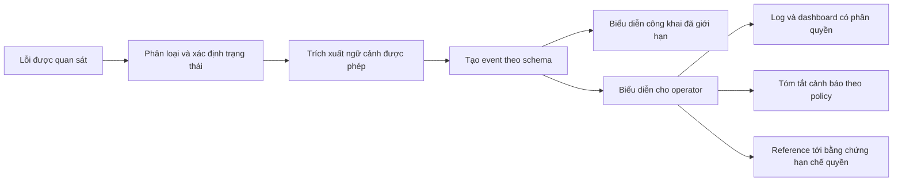

# Error message cho operator

## 1. Thông báo lỗi phải hỗ trợ một quyết định vận hành

Operator là người hoặc nhóm chịu trách nhiệm giám sát, tiếp nhận sự cố và khôi phục hoạt động theo quyền được giao. Thông báo lỗi cho operator cần giúp họ hiểu điều đã quan sát, phạm vi ảnh hưởng, trạng thái của tác vụ và bước xử lý tiếp theo.

Ví dụ, một dịch vụ không gọi được hệ thống kiểm tra phân quyền. Dòng “Internal error” thiếu thông tin để phân biệt lỗi này với database chậm. Nhưng việc đưa toàn bộ exception, token và cấu hình kết nối vào một kênh chat vận hành cũng có thể làm lộ dữ liệu.

Trong module yêu cầu bảo mật, mục tiêu cần được đặc tả thành một contract:

> Với từng nhóm lỗi có ý nghĩa vận hành, hệ thống cung cấp mã ổn định, ngữ cảnh đủ để đối soát, tác động đã biết, trạng thái thực thi và hướng dẫn được phê duyệt; dữ liệu chỉ được hiển thị cho đúng chủ thể và kênh được phép.

Một operator cần trả lời được ít nhất:

- Hành động hoặc thành phần nào đang gặp vấn đề?
- Điều gì đã được quan sát và điều gì còn chưa xác định?
- Dữ liệu, người dùng hoặc chức năng nào có thể bị ảnh hưởng?
- Tác vụ chưa bắt đầu, đã thất bại hay kết quả còn chưa biết?
- Có thể thử lại theo điều kiện nào, cần đối soát gì trước?
- Xem bằng chứng ở đâu và chuyển cho nhóm nào nếu chưa xử lý được?

OWASP mô tả rủi ro lộ chi tiết triển khai qua thông báo lỗi và nhu cầu xử lý lỗi có kiểm soát. Xem [OWASP Error Handling Cheat Sheet](https://cheatsheetseries.owasp.org/cheatsheets/Error_Handling_Cheat_Sheet.html). Thiết kế cho operator cần bảo toàn khả năng chẩn đoán trong một ranh giới truy cập phù hợp.

## 2. Phân biệt người nhận và kênh nhận thông tin

### 2.1. “Nội bộ” chưa đủ để quyết định mức chi tiết

Một nhân viên hỗ trợ, kỹ sư trực vận hành và người điều tra bảo mật có nhu cầu khác nhau. Quyền đọc dashboard không mặc nhiên bao gồm quyền xem dữ liệu khách hàng, thông tin xác thực hoặc mọi trace.

| Người nhận hoặc kênh | Thông tin thường cần | Kiểm soát cần đặc tả |
|---|---|---|
| Client hoặc người dùng dịch vụ | Thông báo phù hợp hành động, mã hỗ trợ nếu cần | Không trả chi tiết nội bộ ngoài contract của API |
| Nhân viên hỗ trợ | Mã lỗi, tác động tới vụ việc, trạng thái xử lý | Giới hạn tenant, trường dữ liệu và khả năng mở bằng chứng |
| Operator trực hệ thống | Dịch vụ, môi trường, thời gian, phạm vi, runbook | Xác thực, phân quyền, mức chi tiết theo vai trò |
| Kỹ sư điều tra | Ngữ cảnh kỹ thuật và bằng chứng bổ sung đã được xử lý dữ liệu | Quyền nâng cao có phạm vi, thời hạn và audit |
| Kênh cảnh báo dùng chung | Tóm tắt tác động và đường dẫn tra cứu được bảo vệ | Nội dung tối thiểu, người nhận được quản lý |
| Công cụ bên ngoài | Dữ liệu phục vụ mục đích đã được chấp thuận | Kiểm soát chuyển dữ liệu, retention và quyền truy cập |

Thông tin phù hợp trong kho điều tra hạn chế quyền có thể không phù hợp trên pager, email, màn hình lớn hoặc ticket được chia sẻ rộng.

### 2.2. Tách biểu diễn theo audience từ một phân loại lỗi

Cùng một lỗi có thể có biểu diễn công khai và biểu diễn vận hành. Hai biểu diễn cần liên kết qua reference, nhưng không nên trả cả hai trong cùng response rồi trông chờ giao diện che phần nội bộ.

Ví dụ API công khai có thể trả một phản hồi lỗi đã đặc tả, còn operator xem sự kiện có mã nguyên nhân kỹ thuật và runbook qua dịch vụ có authorization.

RFC 9457 mô tả Problem Details cho HTTP API và nhấn mạnh định dạng này không phải công cụ debug cho triển khai bên dưới. Nếu dùng nó, nội dung phản hồi vẫn phải được giới hạn theo interface và người nhận. Xem [RFC 9457, mục 4 và 5](https://www.rfc-editor.org/rfc/rfc9457.html#section-4).

Một instance ID hoặc correlation ID là khóa đối soát, không phải credential cho phép bất kỳ ai mở chi tiết lỗi. API hoặc trang tra cứu vẫn phải kiểm tra quyền.

## 3. Nội dung tối thiểu của một thông báo hữu ích

### 3.1. Các thành phần cần được chọn có chủ đích

| Thành phần | Ví dụ giả lập | Ý nghĩa cần quy định |
|---|---|---|
| Mã lỗi | `AUTHZ_DEPENDENCY_TIMEOUT` | Nhóm lỗi ổn định để tra cứu và tự động hóa |
| Tóm tắt | “Không nhận được quyết định phân quyền trong thời hạn” | Mô tả quan sát, tránh khẳng định nguyên nhân chưa được chứng minh |
| Nguồn | Dịch vụ, môi trường, vùng, phiên bản triển khai | Xác định đúng thành phần và phạm vi |
| Thời gian | Thời điểm xảy ra và thời điểm được quan sát | Phân biệt lỗi mới với dữ liệu đến trễ |
| Tác động | Yêu cầu export bị từ chối trước khi tạo job | Nêu ảnh hưởng đã biết, không tự suy rộng toàn hệ thống |
| Trạng thái thực thi | `NOT_STARTED`, `FAILED`, `UNKNOWN` | Giúp quyết định đối soát hoặc retry |
| Liên kết | Event ID, request ID, trace ID nếu có | Tra cứu bằng chứng với quyền phù hợp |
| Hành động tiếp theo | Kiểm tra sức khỏe dependency theo runbook | Bước cụ thể và giới hạn thao tác |
| Điều kiện retry | Chỉ sau khi đáp ứng kiểm tra đã định | Không suy ra chỉ từ HTTP status hoặc tên exception |
| Chủ sở hữu | Nhóm trực hoặc mã dịch vụ trong danh mục | Xác định nơi xử lý và escalation |
| Bằng chứng bổ sung | Reference tới chi tiết đã được kiểm soát | Tách nội dung lớn hoặc hạn chế quyền khỏi tóm tắt |

Không phải event nào cũng cần mọi trường. Dự án cần danh mục nhóm lỗi và schema tương ứng, với cách biểu diễn trường chưa biết.

### 3.2. Nêu đúng mức chắc chắn

“Timeout khi gọi dịch vụ phân quyền” là một quan sát. “Database phân quyền đã chết” là kết luận cần bằng chứng khác. Thông báo có thể nêu giả thuyết hoặc dependency nghi vấn, nhưng phải phân biệt với nguyên nhân đã xác minh.

Tương tự, chưa thấy lỗi trên các node khác không chứng minh tác động chỉ giới hạn một node. Có thể ghi “đã quan sát trên node X, phạm vi toàn dịch vụ chưa xác định” khi đó là trạng thái thực tế.

Không lấp chỗ trống bằng các giá trị như “không ảnh hưởng dữ liệu” hoặc “retry an toàn” nếu hệ thống không đủ bằng chứng để kết luận.

## 4. Ví dụ thông báo lỗi cho operator

### 4.1. Tình huống kiểm tra quyền bị timeout

Giả sử ứng dụng yêu cầu quyết định phân quyền trước khi tạo export. Dependency không trả lời trong thời hạn, nên ứng dụng không tạo job.

Thông báo tóm tắt có thể là:

```text
[ERROR] AUTHZ_DEPENDENCY_TIMEOUT
Dịch vụ: customer-export / production / region-example-a
Quan sát: không nhận được quyết định phân quyền trong 2.000 ms.
Tác động: yêu cầu hiện tại bị từ chối trước khi tạo job export.
Trạng thái tác vụ: NOT_STARTED.
Theo dõi: event-example-104 / request-example-83.
Bước tiếp theo: mở runbook AUTHZ-DEP-01, kiểm tra sức khỏe dependency
và lỗi kết nối trong cùng khoảng thời gian.
Giới hạn: không bỏ qua kiểm tra quyền để tiếp tục export.
```

Thời hạn 2.000 ms là giả định của ví dụ. Trạng thái `NOT_STARTED` chỉ được dùng nếu hệ thống thực sự biết không tạo job hoặc tác động nghiệp vụ liên quan.

### 4.2. Biểu diễn có cấu trúc

```json
{
  "schemaVersion": 1,
  "eventId": "event-example-104",
  "errorCode": "AUTHZ_DEPENDENCY_TIMEOUT",
  "severity": "ERROR",
  "summary": "Không nhận được quyết định phân quyền trong thời hạn",
  "occurredAt": "2026-11-27T08:00:00Z",
  "service": "customer-export",
  "environment": "production",
  "region": "region-example-a",
  "release": "release-example-17",
  "operation": "CREATE_EXPORT",
  "requestId": "request-example-83",
  "dependency": "authorization-service",
  "timeoutMs": 2000,
  "executionState": "NOT_STARTED",
  "impactCode": "CURRENT_REQUEST_REJECTED",
  "retryPolicyRef": "AUTHZ-RETRY-01",
  "runbookRef": "AUTHZ-DEP-01",
  "ownerRef": "team-example-platform",
  "diagnosticRef": "diagnostic-example-31"
}
```

Schema là lựa chọn của ứng dụng, không phải định dạng OpenTelemetry bắt buộc. Các giá trị đều giả lập. Reference phải được giải quyết qua các dịch vụ kiểm tra quyền, không trở thành link công khai chứa token.

Thông điệp phục vụ con người có thể được dịch; `errorCode` và ý nghĩa các trường dùng cho máy cần ổn định. Không buộc automation phải phân tích câu tiếng Việt để nhận biết loại lỗi.

### 4.3. Liên kết log và trace

OpenTelemetry Logs Data Model phân biệt thời gian sự kiện với thời gian hệ thống quan sát, đồng thời có các trường trace context và severity. Có thể dùng các khái niệm này để chuẩn hóa việc liên kết. Xem [OpenTelemetry — Logs Data Model](https://opentelemetry.io/docs/specs/otel/logs/data-model/).

Trace ID giúp tìm một chuỗi xử lý nhưng không chứng minh trace luôn có sẵn. Sampling, lỗi thu thập hoặc tác vụ không có trace cần một đường đối soát thay thế đã định.

Request ID nhận từ bên ngoài cần được kiểm tra định dạng và độ dài. Danh tính người gọi, tenant và quyền truy cập bằng chứng phải lấy từ ngữ cảnh được xác thực phù hợp, không suy ra từ ID do client tự khai.

## 5. Mức chi tiết và bảo vệ dữ liệu

### 5.1. Operator vẫn cần nguyên tắc quyền tối thiểu

Không mặc định đưa vào thông báo:

- Mật khẩu, access token, cookie phiên, khóa hoặc chuỗi kết nối có credential.
- Request hoặc response nguyên vẹn chứa dữ liệu cá nhân.
- URL có chữ ký, query chứa bí mật hoặc nội dung tài liệu.
- Thông tin của tenant khác không thuộc phạm vi xử lý.
- Environment dump, cấu hình đầy đủ hoặc bộ nhớ tiến trình.

Một số thông tin kỹ thuật như tên thành phần, vùng hoặc phiên bản có thể cần thiết cho operator. Dự án phải xác định chúng được phép xuất hiện ở kênh nào, thay vì mở mọi chi tiết vì kênh được gọi là “nội bộ”.

### 5.2. Exception không phải nội dung đã được làm sạch

Thông điệp exception có thể chứa SQL, địa chỉ người dùng, endpoint có credential hoặc một phần payload. Việc gọi `exception.getMessage()` trong Java không tự tạo một thông báo an toàn.

Stack trace và các exception lồng nhau cũng cần chính sách. Có thể giữ một phần bằng chứng đã được xử lý ở kho hạn chế quyền, với reference từ thông báo tóm tắt. Không gửi toàn bộ chain tới mọi kênh cảnh báo theo mặc định.

Cần kiểm tra cả thư viện và middleware tự ghi lỗi. Việc handler của ứng dụng đã làm sạch không xử lý bản raw mà reverse proxy hoặc SDK đã gửi trước đó.

### 5.3. Dữ liệu không đáng tin và đường dẫn hỗ trợ

Thông báo lỗi có thể chứa giá trị do client hoặc dependency cung cấp. Cần schema, giới hạn kích thước, encode theo kênh hiển thị và quy tắc loại bỏ dữ liệu nhạy cảm.

Không render HTML từ exception như nội dung đáng tin. Không tự tải hoặc mở một runbook URL do upstream trả về. Ưu tiên `runbookRef` trong danh mục được kiểm soát và kiểm tra quyền khi truy cập.

Nếu nội dung bị giới hạn độ dài, hãy thực hiện xử lý dữ liệu nhạy cảm trước khi phân phối; cắt ngắn không phải biện pháp bảo mật. Phần bị cắt cũng không được tự chuyển nguyên vẹn sang log dự phòng.

## 6. Phân loại lỗi, severity và danh mục thông báo

### 6.1. Mã lỗi cần có ý nghĩa lâu dài

Một danh mục có thể gồm:

| Mã minh họa | Điều kiện nhận diện | Điều operator cần biết |
|---|---|---|
| `AUTHZ_DEPENDENCY_TIMEOUT` | Không nhận được quyết định quyền trong thời hạn | Hành động có bị chặn, phạm vi ảnh hưởng và kiểm tra dependency |
| `CREDENTIAL_PROVIDER_UNAVAILABLE` | Không lấy được credential hợp lệ từ nguồn được phép | Tác vụ có bắt đầu chưa; không dùng credential mặc định để tiếp tục |
| `UPSTREAM_RESULT_UNKNOWN` | Đã gửi tác vụ có tác động nhưng không biết kết quả | Đối soát trước khi thử lại theo contract |
| `EXPORT_ARTIFACT_WRITE_FAILED` | Không hoàn tất ghi artifact | Có object một phần không, còn cho tải không và đường dọn dữ liệu |
| `AUDIT_DURABILITY_UNAVAILABLE` | Không đạt điều kiện ghi bền audit bắt buộc | Hành động nào đang chờ hoặc bị từ chối theo policy |
| `INTEGRITY_CHECK_FAILED` | Bằng chứng kiểm tra toàn vẹn không đạt | Cách cô lập phạm vi, bảo toàn bằng chứng và chuyển nhóm phù hợp |

Danh mục cần chủ sở hữu, ý nghĩa, schema, biểu diễn theo audience, điều kiện retry và runbook. Một mã không nên đổi sang nghĩa khác chỉ vì triển khai nội bộ thay đổi.

Lỗi chưa phân loại vẫn cần fallback có mã ổn định, reference và nội dung an toàn. Không đưa raw exception cho operator thay cho một nhánh chưa được thiết kế.

### 6.2. Severity khác với mức ưu tiên sự cố

Một event ở mức `ERROR` cho biết có lỗi theo quy ước logging. Mức ưu tiên sự cố còn phụ thuộc tác động, phạm vi, thời gian, chức năng và khả năng khôi phục.

Một lỗi lặp lại trên nhiều request có thể cần gom thành một incident. Một lỗi đơn lẻ liên quan toàn vẹn hoặc truy cập trái quyền có thể cần xử lý riêng. HTTP 500 hoặc tên exception không đủ để tự quyết định mọi mức khẩn cấp.

Cần tài liệu hóa cách ánh xạ severity giữa các nguồn và điều kiện tạo cảnh báo. Không tăng mọi lỗi lên mức khẩn cấp chỉ để chắc chắn operator nhìn thấy.

## 7. Hướng dẫn xử lý phải đi cùng trạng thái tác vụ

### 7.1. Timeout không tự có nghĩa là chưa thực hiện

Giả sử dịch vụ đã gửi lệnh tạo giao dịch sang một dependency và không nhận được phản hồi. Có thể dependency chưa nhận lệnh, đang xử lý, đã hoàn tất hoặc đã thất bại. Chỉ từ timeout, bên gọi chưa biết trường hợp nào đúng.

Nếu thông báo ghi “giao dịch thất bại, tạo lại ngay”, operator có thể tạo tác động lặp. Trạng thái phù hợp có thể là `UNKNOWN`, cùng hướng dẫn đối soát bằng reference của thao tác trước đó.

| Trạng thái được xác minh | Thông tin cần nêu | Điều kiện cho bước tiếp theo |
|---|---|---|
| `NOT_STARTED` | Chưa phát sinh tác động nghiệp vụ thuộc contract | Retry chỉ theo policy và sau khi điều kiện gây lỗi được xử lý |
| `FAILED` | Bước nào đã thất bại và có tác động phụ nào còn lại | Xác minh việc rollback hoặc dọn phần chưa hoàn tất nếu có |
| `PARTIAL` | Những đích hoặc phần nào đã xong, phần nào chưa | Tiếp tục theo kế hoạch có khả năng chạy lại an toàn |
| `UNKNOWN` | Đã gửi thao tác nhưng chưa xác định được kết quả | Đối soát hoặc dùng cơ chế idempotency đã được chứng minh |
| `SUCCEEDED_WITH_FOLLOWUP_FAILURE` | Nghiệp vụ đã xong nhưng bước sau bị lỗi | Không tự phát lại toàn bộ nghiệp vụ chỉ để sửa bước sau |

Tên trạng thái là lựa chọn minh họa. Cần có bằng chứng để gắn trạng thái, không suy ra máy móc từ lớp exception.

### 7.2. Retry cần dựa trên ngữ nghĩa thao tác

Thông báo nên tham chiếu một policy retry đã định, bao gồm điều kiện, giới hạn số lần, khoảng chờ và cách tránh khuếch đại tải. Với tác vụ có tác động, phải xác định idempotency và cách xử lý kết quả chưa biết.

RFC 9110 phân biệt tính idempotent của phương thức và giới hạn việc tự động retry request không idempotent nếu chưa biết thao tác có thể lặp an toàn hoặc chưa được áp dụng. Xem [RFC 9110, mục 9.2.2](https://www.rfc-editor.org/rfc/rfc9110.html#section-9.2.2).

Một header hoặc thông điệp “thử lại sau” không tự bảo đảm tác động nghiệp vụ sẽ không bị lặp. Nếu hệ thống có idempotency key, việc dùng lại, thời hạn và phạm vi của key phải theo contract; không tạo key mới theo phản xạ để vượt qua kết quả cũ chưa được đối soát.

Thông báo có thể dùng `retryPolicyRef` hoặc một trường có cấu trúc như `retryMode: RECONCILE_FIRST`. Automation cần dựa trên schema đã định, không dựa vào một câu mô tả tự do.

### 7.3. Không hướng dẫn bỏ qua kiểm soát bảo mật

Khi dịch vụ phân quyền lỗi, không gợi ý “cho phép tạm mọi người dùng”. Khi không lấy được khóa, không ghi plaintext ra đĩa để giữ tiến trình chạy. Khi kiểm tra chữ ký token lỗi, không tắt xác minh để khôi phục lưu lượng.

Runbook có thể có nhánh khôi phục khẩn cấp được phê duyệt, nhưng phải nêu điều kiện, quyền, phạm vi, thời hạn, audit và cách trở về trạng thái bình thường. Một message không tự cấp quyền làm theo mọi hành động mà nó nhắc tới.

Nút thao tác trong dashboard hoặc CLI hỗ trợ operator cũng cần kiểm tra quyền phía máy chủ. Việc người dùng đọc được thông báo không đồng nghĩa họ được chạy tác vụ khôi phục có tác động rộng.

## 8. Thiết kế pipeline tạo và phân phối thông báo

### 8.1. Một luồng xử lý minh họa



Luồng cần xử lý dữ liệu trước khi phân phối. Các kênh có thể nhận những tập trường khác nhau theo audience; không mặc định dùng cùng một object đầy đủ cho API, pager và kho điều tra.

### 8.2. Handler cần có fallback an toàn

Mã giả dưới đây mô tả trách nhiệm, không phải implementation đầy đủ:

```text
onFailure(error, trustedContext):
    classification = classifyObservedFailure(error)
    safeFacts = extractApprovedFacts(classification, trustedContext)

    operatorEvent = buildOperatorEvent(safeFacts)
    validateAndBound(operatorEvent)

    publishToApprovedChannels(operatorEvent)
    return buildPublicError(classification.publicCode, safeFacts.requestRef)
```

Việc trích xuất không có nghĩa lấy mọi thuộc tính của exception. Các trường cần allowlist, kiểu rõ ràng và giới hạn kích thước.

Nếu khâu phân loại hoặc tạo thông báo cũng lỗi, fallback chỉ nên chứa mã chung, reference hợp lệ và hướng dẫn tra cứu tối thiểu. Không dùng raw exception của handler làm response dự phòng.

Một lỗi ghi log không được biến quyết định từ chối thành cho phép. Hành vi tiếp tục, giữ chờ hay từ chối một tác vụ khi telemetry hoặc audit lỗi phải theo contract của chính tác vụ đó.

### 8.3. Liên kết phải bền nhưng không tạo quyền truy cập

Event ID nhận diện một quan sát. Request ID nối các bước của một request. Incident ID có thể gom nhiều event. Những ID này không nhất thiết có cùng vòng đời hoặc quan hệ một-một.

Nếu không có trace vì sampling hoặc gián đoạn, message cần nêu khả năng tra cứu thay thế. Không hiển thị một nút “xem trace” như thể chắc chắn dữ liệu đã tồn tại.

Một link trong thông báo nên trỏ tới dịch vụ tra cứu có authorization. Tránh URL chứa token hoặc thông tin cá nhân. Người có ID vẫn phải được kiểm tra quyền đối với nội dung và tenant liên quan.

## 9. Từ error event đến cảnh báo có thể hành động

### 9.1. Tách sự kiện riêng lẻ với incident

Một lỗi có thể được ghi nhận mà chưa cần gọi người trực ngay. Một incident có thể được tạo từ nhiều event, metric và kiểm tra tác động.

Tóm tắt cảnh báo nên có:

- Chức năng hoặc dịch vụ bị ảnh hưởng và phạm vi đã quan sát.
- Khoảng thời gian, số lần xảy ra và thông tin dữ liệu có còn mới hay không.
- Mức ưu tiên theo policy, trạng thái tác vụ và điều còn chưa biết.
- Owner, runbook và đường dẫn tới chi tiết được bảo vệ.
- Hành động ưu tiên hoặc điều kiện escalation.

Google SRE nhấn mạnh tính có thể hành động của cảnh báo và tác động của việc cảnh báo quá nhiều lên người trực. Có thể tham khảo [Google SRE — Monitoring Distributed Systems](https://sre.google/sre-book/monitoring-distributed-systems/) khi thiết kế điều kiện gọi operator.

### 9.2. Gom nhóm và giới hạn tải

Có thể gom cảnh báo theo mã lỗi, dịch vụ, môi trường và vùng. Không tạo một nhóm riêng cho mỗi token, email hoặc request ID. Các giá trị có độ phân biệt cao vừa tăng chi phí vừa có thể làm dữ liệu nhạy cảm lan ra hệ thống giám sát.

Gom nhóm không được xóa mất bằng chứng cần giữ. Tóm tắt có thể có số lượng, lần đầu, lần cuối và reference tới các event thuộc nhóm theo quyền.

Cần kiểm soát một lỗi tạo bão cảnh báo, đồng thời có đường riêng cho trường hợp cần xử lý ngay theo rủi ro. Việc mute một nhóm phải có phạm vi, thời hạn và dấu vết thay đổi; không làm mất tín hiệu ở mọi kênh ngoài ý định.

Không kết luận sự cố đã hết chỉ vì không nhận thêm event. Có thể producer hoặc collector đã ngừng hoạt động. Trạng thái phục hồi cần tín hiệu kiểm tra phù hợp với thiết kế.

### 9.3. Runbook là một phần của contract vận hành

Một runbook hữu ích cần nêu cách xác nhận lỗi, tác động đã biết, bước đối soát, hành động trong quyền, dấu hiệu phải dừng, kiểm tra sau khôi phục và nhóm escalation.

Reference cần trỏ tới phiên bản phù hợp hoặc tài liệu có cơ chế quản lý phiên bản. Runbook của bản triển khai cũ có thể hướng operator tới thao tác không còn đúng.

Một câu “restart service” không đủ nếu restart có thể làm mất tác vụ chưa đối soát hoặc che bằng chứng. Hướng dẫn phải gắn với điều kiện và cách xác minh trạng thái nghiệp vụ.

## 10. Cấu hình, quyền xem và vòng đời dữ liệu chẩn đoán

### 10.1. Không dùng một công tắc debug để mở mọi chi tiết

Đặc tả cần kiểm soát việc thay log level, mở chẩn đoán bổ sung hoặc xem stack trace. Có thể yêu cầu quyền riêng, phạm vi dịch vụ, thời hạn tự hết và audit.

Chẩn đoán bổ sung vẫn phải loại bỏ bí mật và tôn trọng ranh giới dữ liệu. Không cho phép bật một cờ làm API công khai trả cấu hình hoặc exception nguyên vẹn trong production.

Nếu chế độ điều tra hết hạn, cần chứng minh hệ thống trở về mức thu thập bình thường. Các dữ liệu đã thu trước đó vẫn cần retention và quyền truy cập phù hợp.

### 10.2. Retention theo loại thông tin

Thông báo tóm tắt, chi tiết kỹ thuật, trace, attachment điều tra và báo cáo incident có thể cần thời hạn khác nhau. Phải xét các bản sao tại collector, index, kênh cảnh báo, ticket, export và backup.

Không giữ mọi chi tiết chỉ vì một incident còn mở. Nếu cần hold, phải xác định phạm vi dữ liệu, chủ sở hữu và thời điểm đánh giá lại.

Một message chỉ chứa reference vẫn có thể liên quan tới cá nhân hoặc sự kiện nhạy cảm. Quyền tra cứu và retention của mapping cũng cần được quản lý.

### 10.3. Đảm bảo công cụ vận hành không tạo thêm sự cố

Thông báo và nội dung từ dependency cần được encode đúng khi hiển thị. Tệp hoặc nội dung được đính kèm không được tự chạy, còn hành động gợi ý không được thực thi chỉ vì nó có mặt trong trường văn bản.

Hệ thống phải giới hạn kích thước và tần suất, bảo vệ kho lưu trước tình huống lỗi lặp gây đầy đĩa hoặc queue. Thông báo fallback cũng cần hoạt động trong các điều kiện đó theo phạm vi đã thiết kế.

## 11. Ví dụ yêu cầu đo được và ma trận nghiệm thu

### 11.1. Bối cảnh và các ngưỡng minh họa

Giả sử một cổng quản trị có API công khai, dashboard operator, kho log và kênh trực vận hành. Dự án chọn:

- Mỗi nhóm lỗi quan trọng có mã, owner, schema, trạng thái tác vụ và runbook trong danh mục.
- Tóm tắt không quá 200 ký tự Unicode theo quy tắc đếm đã thống nhất; event JSON sau xử lý không quá 16 KiB UTF-8.
- Event thuộc phạm vi bắt buộc có thể tra cứu trong 60 giây từ mốc ghi bền tại nguồn khi hệ thống hoạt động bình thường.
- Với điều kiện sự cố đã đạt ngưỡng tạo page trong policy, cảnh báo đến kênh trực trong tối đa 2 phút theo mô hình lỗi và kênh được kiểm tra.
- Metadata vận hành giữ 30 ngày; dữ liệu chẩn đoán chi tiết giữ 7 ngày, trừ phần có quyết định giữ riêng.
- Chế độ chẩn đoán bổ sung có phạm vi và tự hết trong 15 phút theo cấu hình minh họa.

**Đây là các lựa chọn của ví dụ, không phải ngưỡng bắt buộc từ OWASP, OpenTelemetry hoặc RFC.** Dự án cần xác định các mốc đo, kiểu lỗi và điều kiện áp dụng, kể cả khi kênh thu thập bị gián đoạn.

Giới hạn kích thước không được làm mất mã lỗi, trạng thái tác vụ hoặc reference tối thiểu. Nếu cần bỏ bớt chi tiết, sự kiện phải thể hiện điều đó thay vì tạo ra nội dung có vẻ đầy đủ.

### 11.2. Ma trận rủi ro, yêu cầu và bằng chứng

| Mã | Rủi ro | Yêu cầu cụ thể | Bằng chứng nghiệm thu |
|---|---|---|---|
| OE-01 | Operator không biết xử lý từ đâu | Mỗi lỗi quan trọng có mã ổn định, tóm tắt quan sát, nguồn, owner và runbook | Gây từng loại lỗi trong danh mục; thông báo có đủ trường và dẫn tới tài liệu phù hợp |
| OE-02 | Chi tiết nội bộ đi ra client | Tạo biểu diễn riêng theo audience; không đưa trường operator ngoài quyền vào response công khai | So sánh API và dashboard cho cùng một request; response không có stack trace, topology hoặc chi tiết hạn chế |
| OE-03 | Bí mật hoặc dữ liệu cá nhân bị ghi | Chỉ trích xuất trường cho phép; xử lý mọi kênh và nhánh fallback | Dùng token, URL ký và payload giả lập có dấu hiệu nhận biết; không tìm thấy giá trị raw ở các đích không được phép |
| OE-04 | Thử lại gây tác động lặp | Chỉ gợi ý retry theo trạng thái và policy; kết quả chưa biết yêu cầu đối soát | Timeout sau khi dependency đã commit tạo trạng thái UNKNOWN; message không hướng dẫn tạo thao tác mới ngay |
| OE-05 | Khôi phục bằng cách bỏ kiểm soát | Hướng dẫn không cấp quyền tạm hoặc tắt kiểm tra ngoài quy trình được phê duyệt | Mô phỏng lỗi authorization, credential và integrity; không có nhánh gợi ý bỏ kiểm soát để thành công |
| OE-06 | Không nối được các quan sát | Có event ID và reference theo contract; trace thiếu có đường đối soát thay thế | Kiểm tra khi có và không có trace, event đến trễ và request ID đầu vào không hợp lệ |
| OE-07 | Người đọc ngoài phạm vi mở chi tiết | Dashboard, API chẩn đoán và export kiểm tra vai trò, tenant và quyền trên bằng chứng | Người biết diagnostic ID nhưng thiếu quyền không xem được nội dung; đổi tenant không mở rộng phạm vi |
| OE-08 | Nội dung lỗi giả mạo hoặc làm hỏng công cụ | Encode, kiểm tra schema và giới hạn độ dài; link hành động lấy từ danh mục đáng tin | Chuỗi CR/LF, HTML, delimiter và URL lạ không tạo dòng giả, script hoặc link tự động được tin |
| OE-09 | Bão cảnh báo che khuất tác động | Gom nhóm và rate control theo policy; giữ đường điều tra các event liên quan | Sinh nhiều lỗi cùng nhóm; có cảnh báo được gom, số đếm và thời gian đúng, không mất sự kiện bắt buộc |
| OE-10 | Telemetry lỗi làm thay đổi quyết định bảo mật | Fallback không trả raw exception hoặc biến từ chối thành cho phép | Làm hỏng serializer, mất collector và đầy buffer; kiểm tra response, trạng thái tác vụ và đường đối soát |
| OE-11 | Chi tiết chẩn đoán bị giữ hoặc mở quá lâu | Retention theo lớp; debug bổ sung tự hết sau 15 phút và có audit | Kiểm tra hết hạn ở log, index và các bản sao thuộc policy; quyền debug không tồn tại ngoài thời hạn |
| OE-12 | Thông báo khiến operator kết luận sai | Phân biệt quan sát, giả thuyết, phạm vi chưa biết và trạng thái UNKNOWN | Diễn tập lỗi dependency với nhiều kết quả; operator xác định đúng bằng chứng cần kiểm tra trước khi hành động |

Mỗi yêu cầu cần gắn với thành phần thực thi, người sở hữu và bằng chứng kiểm tra. Không kết luận chỉ từ việc thông báo “trông đủ chi tiết” trên một ảnh chụp dashboard.

### 11.3. Tiêu chí chấp nhận cho kết quả chưa xác định

```gherkin
Given dependency da ghi nhan thao tac co tac dong
And phan hoi bi mat truoc khi dich vu goi nhan duoc
When handler tao thong bao cho operator
Then executionState la UNKNOWN theo contract cua luong
And huong dan yeu cau doi soat thao tac cu truoc
And khong goi y tao thao tac moi voi dinh danh moi de thu lai ngay
And thong bao chi co reference duoc phep, khong co credential
```

### 11.4. Tiêu chí chấp nhận cho lỗi phân quyền

```gherkin
Given he thong phai co quyet dinh phan quyen truoc khi tao export
When dependency phan quyen timeout
Then job export khong duoc tao
And operator nhan ma AUTHZ_DEPENDENCY_TIMEOUT voi trang thai NOT_STARTED
And response cong khai chi chua cac truong theo contract API
And runbook khong huong dan bo qua kiem tra quyen
```

Các đoạn trên là tiêu chí để dự án xây dựng kiểm thử, không phải thông báo rằng một hệ thống thực tế đã vượt qua chúng.

## 12. Kiểm thử khả năng sử dụng và quản lý thay đổi

### 12.1. Kiểm tra nhiều hơn đường thành công của handler

Kế hoạch nên bao phủ lỗi chưa phân loại, exception có dữ liệu nhạy cảm, exception lồng nhau, failure khi render, mất trace, message đến trễ, retry, task hoàn tất một phần và dịch vụ chẩn đoán không hoạt động.

Cần kiểm tra cả API công khai, log cục bộ, collector, dashboard, pager, ticket và export thuộc phạm vi. Một kênh được làm sạch không chứng minh mọi kênh khác cũng đúng.

Diễn tập có thể yêu cầu operator xác định mã lỗi, phạm vi đã biết, trạng thái tác vụ, runbook và điều kiện retry từ một thông báo. Kết quả cho biết thông báo có phục vụ quyết định thực tế hay chỉ chứa nhiều thuật ngữ.

### 12.2. Thay đổi mã và runbook cần được quản lý

Khi thêm dependency, đổi transaction boundary, triển khai idempotency hoặc chuyển từ xử lý đồng bộ sang job nền, ý nghĩa trạng thái có thể thay đổi. Cần cập nhật classifier, thông điệp, schema, runbook và kiểm thử tương ứng.

Nếu một mã từng mang nghĩa “chưa bắt đầu” nhưng nay lỗi có thể xảy ra sau tác động, không giữ nguyên hướng dẫn retry cũ. Phiên bản triển khai trong event giúp đối chiếu cách diễn giải lịch sử.

Owner và runbook cũng cần được kiểm tra khi tổ chức thay đổi. Một reference không còn người chịu trách nhiệm làm tăng thời gian xử lý ngay cả khi schema vẫn hợp lệ.

### 12.3. Những câu đặc tả cần viết rõ hơn

| Câu còn mơ hồ | Điều cần bổ sung |
|---|---|
| “Log lỗi đầy đủ cho operator” | Nhóm lỗi, dữ liệu cho phép, audience, kênh và mục tiêu quyết định |
| “Hiển thị exception chi tiết” | Phần nào cần cho chẩn đoán, cách xử lý dữ liệu và quyền xem |
| “Lỗi tạm thời thì thử lại” | Trạng thái tác động, idempotency, đối soát, giới hạn và điều kiện retry |
| “Có request ID để hỗ trợ” | Nguồn ID, kiểm tra đầu vào, đường tra cứu và authorization |
| “Mọi lỗi đều báo trực” | Severity, tác động, điều kiện tạo page và cơ chế gom nhóm |
| “Runbook hướng dẫn khôi phục” | Điều kiện áp dụng, quyền, điểm dừng, kiểm tra kết quả và escalation |
| “Bật debug khi có sự cố” | Phạm vi, thời hạn, audit, dữ liệu bị cấm và cách tự trở về cấu hình thường |
| “Handler an toàn” | Nhánh fallback, lỗi logging, dữ liệu không đáng tin và hành vi bảo mật khi lỗi |

Một đặc tả error message cho operator cần nối được **quan sát lỗi → tác động và trạng thái tác vụ → dữ liệu được phép → người nhận → bằng chứng → hành động an toàn → kiểm thử**. Với chuỗi này, thông báo giúp người vận hành khôi phục dịch vụ mà vẫn duy trì các yêu cầu bảo mật của hệ thống.
