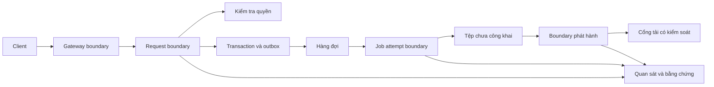

# Error boundary — Đặc tả ranh giới xử lý và cô lập lỗi

## 1. Mục tiêu và phạm vi

Error boundary là ranh giới được thiết kế để tiếp nhận một tập lỗi xác định, kết thúc hoặc chuyển trạng thái đơn vị công việc liên quan, giải phóng tài nguyên và đưa ra kết quả phù hợp cho bên ngoài. Ranh giới đó cần giữ các bất biến bảo mật ngay cả khi đường xử lý bình thường không hoàn tất.

Trong chương **Error handling** của module `SECURITY_SECURITY_DESIGN_SECURITY_REQUIREMENTS`, bài học sử dụng khái niệm này ở cấp thiết kế hệ thống: request API, tác vụ nền, bước tích hợp, luồng dữ liệu và giao diện. Không mặc định “error boundary” chỉ là một tính năng của framework giao diện.

Mục tiêu là chuyển mô hình đe dọa thành yêu cầu cụ thể, đo được và có thể kiểm chứng về:

- Phạm vi lỗi được tiếp nhận và phần hệ thống cần được cô lập.
- Xác thực, phân quyền và ngữ cảnh tenant khi lỗi xảy ra.
- Trạng thái dữ liệu, tác dụng phụ và thông tin công khai.
- Giải phóng tài nguyên, logging, audit và phục hồi.
- Bằng chứng cho thấy lỗi không vượt quá phạm vi được phép.

Các tên trạng thái, ngưỡng và thời hạn trong bài là **thiết kế minh họa**. Triển khai thực tế cần chọn theo rủi ro, tải và kiến trúc của hệ thống.

## 2. Error boundary bảo đảm điều gì?

Một khối `try/catch` có thể là một phần của boundary, nhưng tự nó chưa xác định được phạm vi quyền, transaction, công việc bất đồng bộ hoặc trạng thái của dữ liệu đã gửi ra ngoài.

Ví dụ, controller bắt exception và trả `500`, trong khi worker được khởi chạy trước đó vẫn tiếp tục xuất dữ liệu. Request đã kết thúc theo góc nhìn HTTP nhưng hoạt động nhạy cảm chưa được kiểm soát trong cùng hợp đồng.

Một boundary cần trả lời ít nhất sáu câu hỏi:

1. Đơn vị nào được bảo vệ: request, tác vụ, một lần thử hay một bước phát hành?
2. Những lỗi nào đi tới boundary này, và lỗi nào phải do boundary khác xử lý?
3. Ai sở hữu danh tính, tenant, deadline và tài nguyên của đơn vị công việc?
4. Trạng thái và tác dụng phụ có thể ở mốc nào khi lỗi được tiếp nhận?
5. Boundary được phép trả hoặc ghi thông tin gì?
6. Khi chính việc xử lý lỗi thất bại, thành phần nào tiếp nhận tiếp theo?

### 2.1. Phân biệt với các cơ chế lân cận

| Cơ chế | Trách nhiệm chính | Không tự bảo đảm |
| --- | --- | --- |
| Khối catch | Tiếp nhận một loại lỗi trong phạm vi thực thi cụ thể | Cô lập tenant, hoàn tác mọi tác dụng phụ |
| Transaction | Tính nguyên tử của thay đổi thuộc phạm vi giao dịch | Thu hồi dữ liệu đã chuyển ra ngoài |
| Circuit breaker | Giảm gọi một phụ thuộc đang suy giảm | Cho phép bỏ qua phân quyền |
| Giới hạn đồng thời, hàng đợi và tài nguyên | Giảm tác động lan do cạn tài nguyên | Ánh xạ lỗi công khai hoặc kiểm tra danh tính |
| Sandbox hoặc cách ly tiến trình | Hạn chế quyền và tác động trong phạm vi được cấu hình | Đúng ngữ nghĩa nghiệp vụ hoặc đủ audit |
| Error boundary | Kết hợp chính sách kết thúc, trạng thái, thông tin và chuyển trách nhiệm khi lỗi | Thay thế toàn bộ các cơ chế trên |

Boundary ở cấp ứng dụng không biến thành một sandbox chỉ vì nó bắt được exception. Nếu cùng tiến trình chia sẻ bộ nhớ, kết nối hoặc pool, cần kiểm soát bổ sung để hạn chế ảnh hưởng lan.

## 3. Tình huống xuyên suốt và mô hình đe dọa

Một nền tảng học tập phục vụ nhiều tổ chức. Mỗi tổ chức là một `tenant`. Người có quyền có thể tạo bản xuất tiến độ, theo dõi tác vụ và tải tệp.

Luồng gồm gateway, API, bộ kiểm tra quyền, cơ sở dữ liệu, outbox, hàng đợi, worker và kho tệp. Một lỗi có thể xuất hiện ở mọi giai đoạn, kể cả trước khi ứng dụng xác thực xong.

| Mã rủi ro | Tình huống | Hệ quả |
| --- | --- | --- |
| R-01 | Lỗi parser, middleware hoặc handler đi ra ngoài không được kiểm soát | Lộ stack trace, cấu hình, token hoặc dữ liệu |
| R-02 | Boundary coi lỗi xác thực hoặc phân quyền là lý do dùng quyền mặc định | Truy cập vượt quyền |
| R-03 | Ngữ cảnh tenant hoặc danh tính cũ còn trên tài nguyên dùng lại | Đọc dữ liệu chéo tenant |
| R-04 | Boundary kết luận thất bại dù thao tác đã commit rồi tự chạy lại | Lặp tác vụ, lặp phát hành hoặc sai trạng thái |
| R-05 | Tài nguyên không được giải phóng hoặc fallback tiếp tục gọi phụ thuộc lỗi | Cạn tài nguyên và lỗi lan rộng |
| R-06 | Log lỗi chứa dữ liệu nhạy cảm hoặc chính logger thất bại | Rò thông tin, mất bằng chứng, lỗi đệ quy |
| R-07 | Công việc bất đồng bộ nằm ngoài phạm vi catch ban đầu | Tác vụ mất kiểm soát, thiếu kết quả hoặc ack sai |
| R-08 | Khôi phục và reset đưa tác vụ về ngữ cảnh quyền cũ | Làm sống lại quyền bị thu hồi |

Tài sản cần bảo vệ gồm dữ liệu người học, tệp xuất, thông tin xác thực, tính toàn vẹn trạng thái và năng lực xử lý của tenant khác.

Không chỉ hỏi “exception có được bắt không?”. Cần hỏi lỗi có làm dữ liệu đi sai nơi, quyền thay đổi, tài nguyên bị giữ hoặc trạng thái mất khả năng đối soát hay không.

## 4. Thiết kế bản đồ boundary

### 4.1. Xác định từng đơn vị thực thi



Các boundary không nhất thiết tương ứng một service riêng. Đây là cách xác định trách nhiệm và điểm chuyển giao, không phải yêu cầu tách hệ thống thành nhiều tiến trình.

| Boundary | Đơn vị kết thúc | Đầu vào phải xác minh | Kết quả cần quản lý |
| --- | --- | --- | --- |
| Gateway | Một trao đổi ở ranh giới mạng | Kích thước, cấu trúc giao thức, thông tin định tuyến được tin | Phản hồi an toàn hoặc ngắt kết nối theo hợp đồng |
| Request API | Một lần xử lý request | Dữ liệu, danh tính, tenant, hành động | Kết quả công khai và trạng thái thao tác |
| Transaction | Một nhóm thay đổi bền vững | Phiên bản, ràng buộc và quyền ở điểm yêu cầu | Commit, rollback hoặc kết quả cần đối soát |
| Job attempt | Một lần chạy của công việc logic | Message, phạm vi, điều kiện hiện hành | Trạng thái lần thử, xác nhận message, retry |
| Phát hành | Một quyết định mở đầu ra cho bên nhận | Tệp hoàn tất, người nhận, quyền, audit | Chưa phát hành, đã xác nhận hoặc chưa biết |
| Giao diện | Một vùng tương tác đã xác định | Trạng thái và dữ liệu được phép hiển thị | Fallback có giới hạn, không tự tạo quyền hoặc tác vụ mới |

### 4.2. Chuyển giao trách nhiệm phải có bằng chứng

Khi API ghi tác vụ vào hàng đợi, boundary của request không thể tiếp tục chịu trách nhiệm xử lý exception của worker theo cách đồng bộ. Hợp đồng phải chỉ ra điểm công việc đã được tiếp nhận bền vững và boundary mới chịu trách nhiệm.

Trong ví dụ, API ghi tác vụ và outbox cùng transaction. Khi commit được xác nhận, công việc tồn tại độc lập với kết nối client. Worker có boundary riêng cho từng lần thử và liên kết về cùng ID công việc logic.

Ngắt kết nối HTTP không mặc nhiên hủy công việc đã tiếp nhận. Nếu sản phẩm hỗ trợ hủy, cần một giao thức hủy với điều kiện, trạng thái và giới hạn tác dụng phụ riêng.

### 4.3. Boundary cha tiếp nhận loại lỗi nào?

Cần tránh hai cực đoan: mọi tầng cùng xử lý toàn bộ lỗi, hoặc không tầng nào nhận trách nhiệm.

Boundary gần công việc nhất xử lý khi có đủ ngữ cảnh và khả năng kết thúc an toàn. Boundary cha xử lý lỗi còn lại, lỗi của mapper hoặc sự cố làm boundary con không thể hoàn tất.

Ví dụ, API dùng mapper lỗi công khai. Nếu mapper lỗi, boundary ngoài cùng trả phản hồi tối thiểu theo hợp đồng, không gọi lại cùng mapper đang hỏng. Với tiến trình không còn đáng tin, giám sát có thể cần cách ly và khởi động lại thay vì tiếp tục phục vụ.

## 5. Đặc tả hợp đồng của một boundary

### 5.1. Hồ sơ thiết kế mẫu

| Thuộc tính | Ví dụ cho request tạo bản xuất |
| --- | --- |
| Mục đích | Kết thúc request mà không mở rộng quyền hoặc lộ dữ liệu |
| Phạm vi | Từ nhận đầu vào ở API tới trước khi commit phản hồi |
| Danh tính ban đầu | Chưa xác thực; không có tenant hay quyền mặc định |
| Điều kiện thực thi | Danh tính và quyết định quyền hợp lệ cho scope yêu cầu |
| Tài nguyên sở hữu | Ngữ cảnh request, transaction, kết nối hoặc stream được mở cho request |
| Lỗi tiếp nhận | Validation, từ chối quyền, phụ thuộc lỗi, lỗi ứng dụng ngoài dự kiến |
| Trạng thái thao tác | Chưa bắt đầu, đã xác nhận hoặc chưa biết; nguồn có thẩm quyền được chỉ rõ |
| Đầu ra | Schema thành công hoặc lỗi công khai; tối đa 2 KiB cho body lỗi |
| Bằng chứng | Mã tương quan, giai đoạn, kết quả, nhóm nguyên nhân tối thiểu |
| Chuyển tiếp | Boundary ngoài cùng hoặc supervisor khi không thể kết thúc đáng tin |
| Phục hồi | Đối soát tác vụ, retry theo hợp đồng, không tự đổi khóa công việc |

Phạm vi request không bao gồm mọi lỗi của hệ điều hành hay mọi tác dụng phụ trong hệ thống. Một cam kết chỉ có ý nghĩa khi chỉ rõ phần nằm ngoài khả năng của boundary.

### 5.2. Bốn loại trạng thái không được trộn lẫn

1. **Trạng thái thực thi:** đang chạy, kết thúc hoặc bị hủy.
2. **Trạng thái nghiệp vụ:** tác vụ đã được tạo, tệp hoàn tất hay đã phát hành.
3. **Quyết định quyền:** cho phép, từ chối hoặc chưa có quyết định hợp lệ.
4. **Độ chắc chắn:** đã xác nhận hoặc chưa biết từ điểm quan sát.

Một request kết thúc với lỗi không chứng minh tác vụ nghiệp vụ chưa tồn tại. Một lần chạy bị hủy không chứng minh không có dữ liệu đã chuyển. Một danh tính đã được xác thực cũng không chứng minh quyền tải còn hiệu lực.

## 6. Giữ bất biến xác thực, phân quyền và tenant

### 6.1. Bắt đầu từ trạng thái không có đặc quyền

Boundary tạo ngữ cảnh mới với danh tính và scope chưa được xác lập. Chỉ sau xác thực và phân quyền thành công mới được thực thi thao tác tương ứng.

Nếu bộ kiểm tra quyền timeout hoặc trả dữ liệu không hợp lệ, boundary không được:

- Dùng quyền của request trước.
- Chuyển sang tài khoản nội bộ đặc quyền.
- Bỏ điều kiện tenant để truy vấn dễ hơn.
- Trả tệp cache không còn được xác minh phạm vi.
- Tự bật chế độ truy cập khẩn cấp.

Phản hồi có thể là lỗi tạm thời hoặc từ chối theo hợp đồng endpoint. Bất biến quan trọng là không thực thi thao tác được bảo vệ khi thiếu quyết định hợp lệ.

### 6.2. Ngữ cảnh là tài nguyên có vòng đời

Trong pool luồng hoặc worker dùng lại, ngữ cảnh tenant, danh tính, mã tương quan và quyền có thể nằm trong vùng lưu cục bộ hoặc được gắn vào tác vụ.

Yêu cầu cần chỉ rõ:

- Nguồn nào được phép tạo hoặc truyền ngữ cảnh.
- Thành phần nào sở hữu việc cài đặt và khôi phục ngữ cảnh.
- Lúc nào ngữ cảnh được hủy hoặc trả về trạng thái trước đó.
- Cách ngăn tái sử dụng đơn vị thực thi khi dọn dẹp không hoàn tất.

Không chỉ xóa biến ở nhánh thành công. Mọi đường kết thúc trong phạm vi kiểm soát, kể cả lỗi validation, timeout và hủy, phải tuân theo vòng đời.

Không xóa tùy tiện tài nguyên hay ngữ cảnh toàn cục do thành phần khác sở hữu. Boundary khôi phục phần mà nó đã cài đặt và chuyển lỗi dọn dẹp theo chính sách.

### 6.3. Truyền ngữ cảnh không đồng nghĩa truyền quyền

Worker có thể nhận tham chiếu danh tính, tenant và ID công việc từ message, nhưng không được mặc định mọi thông tin đó còn hợp lệ. Nó phải xác minh nguồn, phạm vi và điều kiện hiện hành theo yêu cầu.

Một quyết định quyền cũ có thể chỉ chứng minh vì sao tác vụ được tiếp nhận trước đây. Việc đọc hoặc phát hành ở thời điểm sau cần đáp ứng chính sách tương ứng, nhất là khi quyền đã bị thu hồi.

## 7. Giữ đúng trạng thái khi có tác dụng phụ

### 7.1. Ranh giới catch không phải ranh giới rollback

| Điểm lỗi | Trạng thái có thể có | Hành vi boundary cần quy định |
| --- | --- | --- |
| Trước kiểm tra quyền | Chưa có thao tác được bảo vệ | Trả lỗi, không tạo tác dụng phụ nhạy cảm |
| Trong transaction chưa commit | Có thay đổi chưa bền vững trong transaction | Rollback phần thuộc giao dịch |
| Không nhận được kết quả commit | Có thể đã ghi thành công | Giữ trạng thái chưa biết, đối soát |
| Sau commit, trước phản hồi | Tác vụ bền vững đã có thể tồn tại | Không tự tạo tác vụ mới; dùng định danh chống lặp |
| Sau ghi tệp, trước phát hành | Có artifact chưa được công khai | Giữ cách ly, đối soát hoặc xóa theo lịch |
| Sau chuyển giao | Bên nhận có thể có dữ liệu | Không tuyên bố đã hoàn tác toàn bộ; điều tra và hạn chế tác động |

Đặt một khối catch bên ngoài không kéo dài transaction và không làm mọi hệ thống ngoài transaction trở nên nguyên tử.

### 7.2. Idempotency theo công việc logic

ID công việc logic giữ nguyên qua các lần thử. ID lần thử thay đổi để phân biệt thực thi, chẩn đoán và retry. Khóa idempotency phải có scope rõ, chẳng hạn danh tính gọi, tenant và loại thao tác.

Ví dụ yêu cầu: trong cửa sổ chống lặp đã công bố, nhiều request đồng thời cùng khóa và cùng nội dung không tạo công việc logic thứ hai. Trả lại trạng thái hoặc kết quả vẫn kiểm tra quyền hiện hành.

Boundary không tự đổi khóa sau lỗi để “thử lại từ đầu”. Khi kết quả chưa biết, đối soát trước hoặc dùng lại cùng khóa theo hợp đồng.

### 7.3. Ý định, thực thi và kết quả là bằng chứng khác nhau

Với phát hành dữ liệu nhạy cảm, có thể cần ghi nhận bền vững ý định hoặc quyết định trước khi mở quyền tải. Tuy nhiên, bản ghi “được phép phát hành” không chứng minh người nhận đã tải thành công.

Thiết kế cần phân biệt các mốc, định danh thao tác và nguồn quan sát. Nếu tiến trình chết giữa hai mốc, reconciler đối soát và giữ trạng thái chưa biết khi chưa đủ bằng chứng. Không bổ sung sự kiện thành công giả để lấp khoảng trống.

## 8. Công việc bất đồng bộ, hủy và streaming

### 8.1. Catch ở nơi lên lịch không bao phủ mọi lần thực thi

Ví dụ thiếu boundary cho công việc thực sự:

```text
try:
    executor.submit(createReport)
catch:
    return safeError
```

Khối catch này có thể xử lý lỗi lên lịch trong phạm vi đồng bộ. Nó không tự tiếp nhận exception phát sinh sau đó khi `createReport` chạy ở đơn vị thực thi khác.

Cần một boundary tại nơi thực thi hoặc cơ chế quan sát kết quả công việc được bảo đảm có người tiếp nhận. Promise, future, callback hoặc message phải có hợp đồng kết thúc, thất bại và hủy rõ ràng.

Một công việc bị tách khỏi request cần ID, chủ sở hữu, trạng thái bền vững và chính sách truy cập của nó. Không truyền đối tượng request sống hoặc ngữ cảnh quyền ngầm định rồi giữ vô hạn.

### 8.2. Boundary của mỗi lần chạy worker

Một lần chạy cần thực hiện theo chính sách đã định:

1. Xác minh message, công việc logic và scope.
2. Xác lập ngữ cảnh mới, deadline và giới hạn tài nguyên.
3. Kiểm tra quyền và điều kiện hiện hành ở các điểm yêu cầu.
4. Xử lý tác vụ, cập nhật trạng thái và kiểm soát lặp.
5. Ghi nhận kết quả phù hợp trước khi xác nhận message theo hợp đồng.
6. Giải phóng phần tài nguyên sở hữu, khôi phục ngữ cảnh và quyết định khả năng tái sử dụng.

Message giao lặp không tạo công việc logic mới. Message sai schema hoặc không đủ điều kiện không bị retry vô hạn chỉ vì boundary đã bắt được lỗi.

Nếu đưa message vào khu vực cách ly, cần quyền truy cập, lịch lưu và chủ sở hữu xử lý. Khu vực cách ly cũng có thể chứa dữ liệu cá nhân hoặc bí mật.

### 8.3. Hủy là một trạng thái của hợp đồng

Boundary phải phân biệt hủy do người dùng, hết deadline, ngắt kết nối và tiến trình dừng. Mỗi nguyên nhân có thể dẫn tới hành vi khác nhau.

Không nuốt tín hiệu hủy hoặc ngắt rồi tiếp tục gọi phụ thuộc như bình thường. Cơ chế hủy cần được truyền theo API và môi trường thực thi đang dùng; phần công việc đã hoàn tất hoặc tác dụng phụ đã xảy ra vẫn phải được đối soát.

Ví dụ, client ngắt kết nối sau khi tác vụ xuất đã được tiếp nhận bền vững không đồng nghĩa người dùng yêu cầu xóa tác vụ. Giao diện phải hiển thị trạng thái từ nguồn có thẩm quyền khi kết nối lại.

### 8.4. Streaming có điểm không thể thay đổi phản hồi

Trước khi gửi header và nội dung, API có thể trả lỗi theo envelope đã duyệt. Sau khi stream bắt đầu, thường không thể thay bằng một response JSON mới.

Hợp đồng cần xác định cách ngắt stream, báo đầu ra không hoàn chỉnh và điều kiện thử lại. Không nối stack trace hoặc JSON lỗi vào cuối tệp báo cáo.

Với dữ liệu nhạy cảm, ưu tiên hoàn tất artifact ở khu vực chưa công khai rồi mới mở tải theo điều kiện đã xác định. Phát hành từng phần cần thiết kế riêng về phạm vi dữ liệu và bằng chứng; không coi xóa tệp sau đó là thu hồi phần đã gửi.

## 9. Dọn dẹp, giới hạn tài nguyên và lỗi của boundary

### 9.1. Trách nhiệm sở hữu tài nguyên

Mỗi tài nguyên cần có chủ sở hữu vòng đời: kết nối, transaction, stream, tệp tạm, semaphore, lease hoặc ngữ cảnh thực thi. Boundary đóng hoặc trả phần nó sở hữu, không đóng tùy tiện pool dùng chung.

Yêu cầu dọn dẹp cần áp dụng cho thành công, thất bại và hủy trong phạm vi kiểm soát. Không chỉ kiểm tra kết nối; ngữ cảnh quyền cũ hoặc tệp tạm nhạy cảm cũng là trạng thái còn sót.

Nếu dọn dẹp thất bại:

- Giữ nguyên thông tin lỗi gốc và ghi nhận lỗi dọn dẹp theo kênh phù hợp.
- Không tái sử dụng đơn vị thực thi có ngữ cảnh nhạy cảm chưa được khôi phục an toàn.
- Giao supervisor hoặc cơ chế vận hành chịu trách nhiệm cách ly, thu hồi hoặc khởi động lại.
- Đối soát tài nguyên ngoài tiến trình bằng lease hoặc lịch xử lý khi thiết kế có áp dụng.

Không giả định khối finally luôn chạy khi tiến trình bị dừng đột ngột hoặc hệ thống gặp sự cố nghiêm trọng.

### 9.2. Dọn dẹp cũng cần giới hạn

Một thao tác cleanup chờ vô hạn có thể giữ luồng phục vụ và làm lỗi lan. Cần ngân sách thời gian phù hợp, trạng thái chưa hoàn tất và người tiếp nhận sau khi vượt ngân sách.

Không ép một hành động nhạy cảm thành “đã dọn xong” chỉ để kết thúc deadline. Ví dụ xóa tệp timeout cần giữ tham chiếu đối soát; không khẳng định tệp đã biến mất.

### 9.3. Fallback không được làm lỗi lan rộng hơn

Fallback nên có phụ thuộc tối thiểu và tài nguyên hữu hạn. Ví dụ, khi dịch vụ báo cáo lỗi, giao diện hiển thị trạng thái không khả dụng mà không gọi lại cùng dịch vụ ở mọi lần render.

Không dùng fallback đọc từ tenant khác, trả toàn bộ dữ liệu cache hoặc bỏ qua kiểm tra quyền. Nếu không thể xác minh dữ liệu cache còn thuộc đúng danh tính và scope, không hiển thị dữ liệu đó.

Boundary không bảo vệ được tenant khác nếu toàn hệ thống dùng một hàng đợi không giới hạn và một pool bị chiếm hết. Các luồng cần giới hạn đồng thời, deadline, kích thước và khả năng cách ly tải phù hợp với rủi ro.

### 9.4. Tiến trình không còn đáng tin

Một lỗi ứng dụng có thể được kết thúc trong phạm vi request. Sự cố làm runtime hoặc trạng thái chia sẻ không còn đáng tin có thể yêu cầu dừng phục vụ và khởi động lại.

Không bắt mọi loại lỗi rồi tiếp tục xử lý như thể hệ thống khỏe mạnh. Phạm vi phục hồi cần dựa trên môi trường thực thi; boundary ngoài cùng và supervisor phải có trách nhiệm rõ đối với các trường hợp không thể phục hồi tại chỗ.

## 10. Thông tin công khai, logging và audit

### 10.1. Kết quả công khai phải có hợp đồng

Ví dụ lỗi ngoài dự kiến trước khi response được commit:

```json
{
  "error": {
    "code": "COMMON.INTERNAL_ERROR",
    "message": "Không thể hoàn tất yêu cầu.",
    "requestId": "req_18dca7"
  }
}
```

Không đưa stack trace, SQL, token, đường dẫn kho tệp hoặc thông báo exception thô ra response. Mã tương quan phải được tạo hoặc chuẩn hóa từ nguồn tin cậy, không mang quyền truy cập.

Một mã lỗi tổng quát không chứng minh thao tác chưa chạy. Với thao tác ghi, hướng xử lý phải liên kết tới trạng thái, idempotency và đối soát.

Boundary ngoài cùng cần phản hồi tối thiểu khi mapper hoặc serializer chính thất bại, trong giới hạn giao thức còn cho phép. Không lặp vô hạn việc gọi cùng thành phần xử lý lỗi đang hỏng.

### 10.2. Bằng chứng tối thiểu theo giai đoạn

Ví dụ sự kiện nội bộ:

```json
{
  "eventType": "BOUNDARY_EXIT",
  "boundary": "REPORT_JOB_ATTEMPT",
  "jobRef": "job_48bc",
  "attemptRef": "try_03",
  "requestId": "req_18dca7",
  "stage": "ARTIFACT_CREATION",
  "outcome": "FAILED_BEFORE_PUBLICATION",
  "cleanupState": "COMPLETED",
  "publicCode": "COMMON.INTERNAL_ERROR",
  "internalReason": "STORAGE_WRITE_FAILED"
}
```

Chỉ ghi `FAILED_BEFORE_PUBLICATION` khi có bằng chứng phù hợp về mốc phát hành. Nếu chưa biết, giữ trạng thái chưa biết và tham chiếu đối soát.

Log theo danh sách trường cho phép; không ghi toàn bộ input, message hàng đợi, token hoặc nội dung báo cáo. Nhóm nguyên nhân nội bộ cần được kiểm soát, quyền tra cứu giới hạn theo nhiệm vụ và tenant khi áp dụng.

Một boundary tiếp nhận lỗi có thể ghi sự kiện kết thúc có thẩm quyền. Thành phần bên trong có thể cung cấp ngữ cảnh chẩn đoán, nhưng tránh mỗi tầng ghi lại toàn bộ cùng một stack trace và payload.

### 10.3. Logger lỗi và audit bắt buộc

Cần phân biệt:

| Kênh | Khi kênh lỗi | Điều phải giữ |
| --- | --- | --- |
| Telemetry vận hành thông thường | Dùng bộ đệm hữu hạn hoặc bỏ mẫu theo chính sách | Không tạo vòng lỗi hoặc cạn tài nguyên |
| Chẩn đoán nhạy cảm | Giảm thu thập, ghi tham chiếu hoặc tín hiệu sức khỏe phù hợp | Không chuyển bí mật sang kênh công khai |
| Audit bắt buộc cho phát hành | Giữ chưa phát hành nếu chưa đủ bằng chứng bền vững theo thiết kế | Không mở quyền tải mới bằng đường fallback |

Không gọi cùng logger lỗi theo đệ quy vô hạn. Nếu không ghi được sự kiện, dùng tín hiệu sức khỏe độc lập khi còn khả năng; không giả định không có log nghĩa là không có lỗi.

Audit về ý định, quyết định và kết quả cần được phân biệt. Mất phản hồi từ cổng tải hoặc hệ thống ngoài phải được đối soát, không tự ghi kết quả thành công hay thất bại tuyệt đối.

## 11. Mẫu tổ chức boundary ở mức mã giả

```text
runBoundary(rawInput):
    frame = enterIsolatedExecutionFrame()
    candidate = NONE
    cleanupReport = NOT_RUN

    try:
        input = validateWithinLimits(rawInput)
        principal = authenticate(input)
        scope = requireValidAuthorization(principal, input)
        candidate = executeWithDeclaredStateAndSideEffects(frame, input, scope)
    catch ExpectedApplicationFailure failure:
        candidate = classifyKnownFailureWithoutLeakingDetails(failure, frame)
    catch UnexpectedApplicationFailure failure:
        candidate = classifyUnknownFailureWithStateEvidence(failure, frame)
    finally:
        cleanupReport = releaseOwnedResourcesWithoutMaskingPrimaryFailure(frame)
        restoreReport = restorePriorExecutionContext(frame)

    return finalizeOutcomeUnderApprovedPolicy(
        candidate, cleanupReport, restoreReport, frame
    )
```

Đây là mô hình trách nhiệm, không phải mã chạy nguyên trạng và không tuyên bố bắt được mọi lỗi runtime.

Các hàm cần hợp đồng riêng:

- `enterIsolatedExecutionFrame` không cài danh tính hoặc tenant mặc định có quyền.
- Hàm thực thi nêu rõ transaction, idempotency, điểm commit và phát hành.
- Phân loại lỗi giữ được sự khác nhau giữa chưa bắt đầu, đã xác nhận và chưa biết.
- Cleanup và khôi phục có kết quả rõ, không che nguyên nhân gốc.
- Finalization chỉ đưa ra kết quả được phép theo trạng thái thực tế; không coi cleanup thất bại sau commit là bằng chứng transaction đã rollback.
- Nếu khôi phục ngữ cảnh thất bại, đơn vị thực thi không được dùng cho công việc tiếp theo cho tới khi đủ điều kiện an toàn.
- Nếu chính các bước boundary không thể hoàn tất, boundary cha hoặc supervisor tiếp nhận.

Các bước finalization bắt buộc của hợp đồng phải hoàn tất trước khi commit phản hồi thành công tương ứng. Với dữ liệu đã stream hoặc tác dụng phụ đã xảy ra, áp dụng hợp đồng ở các mốc đó; không hứa đổi lại được response hoặc hoàn tác toàn bộ.

## 12. Bộ yêu cầu bảo mật mẫu

Các yêu cầu áp dụng cho luồng xuất báo cáo trong ví dụ. Chủ sở hữu chịu trách nhiệm phối hợp triển khai và cung cấp bằng chứng; không có nghĩa chỉ một thành phần tham gia.

| Mã | Yêu cầu và tiêu chí đo | Rủi ro | Điểm thực thi, chủ sở hữu |
| --- | --- | --- | --- |
| EB-01 | Mỗi điểm vào API, job attempt và điểm phát hành có hồ sơ boundary nêu phạm vi lỗi, ngữ cảnh, tài nguyên, trạng thái và nơi chuyển tiếp | R-01, R-07 | Bản đồ kiến trúc; nhóm thiết kế và API |
| EB-02 | Không có quyết định quyền hợp lệ thì không đọc dữ liệu báo cáo, tạo bản xuất hoặc cấp quyền tải mới; lỗi phụ thuộc không kích hoạt quyền mặc định | R-02, R-08 | API, worker, cổng tải; nhóm phân quyền |
| EB-03 | Mỗi đơn vị công việc xác lập scope riêng; mọi đường kết thúc trong phạm vi kiểm soát khôi phục ngữ cảnh trước tái sử dụng; thất bại khôi phục thì cách ly | R-03 | Executor, middleware, worker; nhóm nền tảng |
| EB-04 | Boundary phân biệt chưa bắt đầu, đã xác nhận và chưa biết; không tự retry bằng khóa công việc mới khi kết quả chưa xác định | R-04 | Kho trạng thái, API, worker; nhóm tác vụ |
| EB-05 | Không trả stack trace, SQL, token hoặc đường dẫn nội bộ; body lỗi API tối đa 2 KiB và theo schema công khai đã duyệt | R-01, R-06 | Gateway, parser, handler, serializer; nhóm API |
| EB-06 | Mỗi tác vụ bất đồng bộ có boundary lúc thực thi và bên tiếp nhận kết quả; message lặp giữ cùng ID công việc logic, không phát hành lặp ngoài hợp đồng | R-04, R-07 | Scheduler, consumer, kho trạng thái; nhóm worker |
| EB-07 | Tài nguyên do boundary sở hữu được giải phóng hoặc chuyển giao có theo dõi trên mọi đường kết thúc có kiểm soát; lỗi cleanup không che lỗi gốc | R-03, R-05 | Quản lý tài nguyên và supervisor; nhóm nền tảng |
| EB-08 | Mỗi luồng có deadline, giới hạn đồng thời và hàng đợi hữu hạn; fallback không bỏ quyền hoặc gọi lặp vô hạn vào phụ thuộc lỗi | R-02, R-05 | Pool, queue, adapter; nhóm vận hành và nền tảng |
| EB-09 | Sự kiện kết thúc liên kết boundary, giai đoạn, ID công việc/lần thử và kết quả; log theo danh sách trường, không có bí mật hay payload đầy đủ | R-06, R-07 | Logger, collector, quyền tra cứu; nhóm vận hành |
| EB-10 | Thiếu điều kiện audit bền vững bắt buộc thì không mở quyền tải mới; lỗi logger không tạo đệ quy hoặc tự chuyển bí mật sang kênh công khai | R-02, R-06 | Cổng phát hành, kho audit, fallback; nhóm xuất dữ liệu |
| EB-11 | Sau khi stream bắt đầu, lỗi không được nối stack trace hoặc envelope JSON vào nội dung; hợp đồng cho phép nhận biết đầu ra dở | R-01, R-04 | Cổng tải và client; nhóm dữ liệu và giao diện |
| EB-12 | Sau reset, rollback hoặc phục hồi, tác vụ nhạy cảm chưa đối soát giữ chưa phát hành; quyền và trạng thái ngoài snapshot được xác minh trước mở lại | R-04, R-08 | Runbook, reconciler, supervisor; nhóm vận hành |

EB-01 cần danh sách điểm vào thực tế, không chỉ một sơ đồ khái niệm. EB-08 phải được cụ thể hóa theo môi trường. Ví dụ, request nhận tác vụ có deadline **2 giây** và job attempt có deadline riêng; không áp giới hạn request đó cho cả quá trình tạo tệp dài.

Giá trị giới hạn đồng thời phải được kiểm thử bằng tải có kiểm soát. Một con số không gắn cấu hình, phạm vi tenant hoặc năng lực tài nguyên không đủ để nghiệm thu cô lập tải.

## 13. Nghiệm thu bằng quan sát lỗi và tác dụng phụ

Kiểm thử cần quan sát response, ngữ cảnh, trạng thái dữ liệu, tài nguyên và đầu ra. Chỉ thấy “exception đã được bắt” là chưa đủ.

| Ca | Lỗi được tạo có kiểm soát | Kết quả mong đợi | Yêu cầu |
| --- | --- | --- | --- |
| AT-01 | Lỗi parser, middleware, handler và serializer | Mỗi đường có bên tiếp nhận; không trang debug, token hay stack trace công khai | EB-01, EB-05 |
| AT-02 | Bộ kiểm tra quyền timeout hoặc trả kết quả không hợp lệ | Không có thao tác được bảo vệ hoặc quyền fallback | EB-02 |
| AT-03 | Chạy liên tiếp tenant A rồi tenant B trên cùng đơn vị thực thi, xen lỗi và hủy | B không nhận danh tính, scope, dữ liệu hay mã tương quan của A | EB-03, EB-07 |
| AT-04 | Làm khôi phục ngữ cảnh thất bại | Đơn vị đó không phục vụ công việc tiếp theo cho tới khi đủ điều kiện an toàn | EB-03 |
| AT-05 | Commit tác vụ rồi mất response | Tác vụ vẫn đối soát được; không tự tạo tác vụ logic thứ hai | EB-04 |
| AT-06 | Mất kết nối tại lúc kết quả commit chưa rõ | Giữ kết quả chưa biết tới khi đủ bằng chứng | EB-04 |
| AT-07 | Tác vụ ném lỗi sau khi đã được lên lịch thành công | Boundary lúc thực thi nhận lỗi, có trạng thái và bên tiếp nhận | EB-06 |
| AT-08 | Worker chết sau ghi tệp, trước xác nhận message; sau đó nhận lặp | Tệp chưa đủ điều kiện không công khai; không phát hành lặp ngoài hợp đồng | EB-06, EB-10 |
| AT-09 | Kết nối, stream hoặc lease cleanup lỗi | Lỗi gốc còn truy vết; phần chưa giải phóng có người tiếp nhận và trạng thái | EB-07 |
| AT-10 | Phụ thuộc chậm kéo dài và tải từ một tenant tăng | Deadline, queue và giới hạn được thực thi; tác động tới tenant khác trong ngưỡng đã duyệt | EB-08 |
| AT-11 | Logger hoặc mapper lỗi ngay khi xử lý lỗi gốc | Fallback hữu hạn, không đệ quy, không rò chi tiết nội bộ | EB-05, EB-09, EB-10 |
| AT-12 | Kho audit và bộ đệm được duyệt đều không ghi được | Không mở tải mới khi thiếu điều kiện audit | EB-10 |
| AT-13 | Ngắt trong lúc stream tệp | Client nhận biết đầu ra dở; không có stack trace hoặc JSON lỗi bị chèn vào tệp | EB-11 |
| AT-14 | Phục hồi snapshot trước thời điểm thu hồi quyền rồi phát lại job | Không phát hành theo quyền cũ; đối soát trước mở lại | EB-12 |
| AT-15 | Vùng giao diện báo cáo lỗi, trong khi có dữ liệu cache từ danh tính trước | Fallback không hiển thị dữ liệu sai danh tính hoặc tự tạo tác vụ mới | EB-02, EB-03, EB-08 |
| AT-16 | Dừng tiến trình đột ngột ở các mốc quan trọng | Hệ thống bên ngoài hoặc reconciler nhận việc chưa hoàn tất; không dựa hoàn toàn vào finally | EB-06, EB-07, EB-12 |

AT-10 cần môi trường, tải nền, loại request và ngưỡng tác động cụ thể. Ví dụ một bài đo có thể yêu cầu tỷ lệ lỗi của tenant đối chứng không tăng quá mức đã duyệt khi tenant thử nghiệm chạm giới hạn. Không dùng kết quả của một máy thử để hứa cô lập tuyệt đối trên mọi hạ tầng.

Với AT-03, cần cả thử dùng lại tuần tự và chạy đồng thời. Với kiểm thử mất phản hồi, kiểm tra kho dữ liệu, hàng đợi, tệp và quyền tải; response lỗi không chứng minh không có tác dụng phụ.

Dùng dữ liệu giả và môi trường có kiểm soát cho fault injection. Bằng chứng chỉ giữ phần cần thiết, có quyền và lịch lưu phù hợp.

## 14. Quan sát vận hành và phục hồi

### 14.1. Chỉ số phản ánh giới hạn boundary

Nhóm vận hành nên theo dõi:

- Số lỗi theo boundary, giai đoạn và nhóm kết quả được kiểm soát.
- Số đơn vị bị cách ly do ngữ cảnh hoặc cleanup không hoàn tất.
- Tác vụ chưa biết kết quả và tuổi tác vụ chờ đối soát.
- Queue, thời gian chờ, mức đồng thời và số lần quá deadline.
- Mất log, trạng thái audit bắt buộc và độ tươi lần đối soát thành công.

Không dùng requestId, mã người học hoặc chuỗi exception tự do làm nhãn metric. Truy vấn chi tiết nằm trong kho có quyền phù hợp.

Một tỷ lệ lỗi thấp không chứng minh boundary an toàn nếu lỗi bị nuốt hoặc background task không được quan sát. Cần tín hiệu sức khỏe cho chính supervisor, logger và bộ đối soát.

### 14.2. Điều kiện phục hồi

Khi một boundary không thể kết thúc đáng tin:

1. Xác định đơn vị ảnh hưởng và chặn hoạt động nhạy cảm còn chưa được kiểm chứng.
2. Giữ ID, mốc trạng thái và bằng chứng tối thiểu, tránh yêu cầu người dùng gửi lại bí mật.
3. Đối soát transaction, outbox, worker, artifact, quyền tải và nguồn quyền hiện hành.
4. Phân biệt trạng thái đã xác nhận với điều chưa biết.
5. Khôi phục tài nguyên hoặc khởi động lại theo runbook.
6. Chỉ mở lại khi các điều kiện của boundary đã được xác minh.

Reset giao diện không xóa trạng thái server. Khởi động lại worker không chứng minh message trước đó chưa thực thi. Restore database không tự đồng bộ trạng thái kho tệp, quyền tải hoặc bên nhận ngoài hệ thống.

### 14.3. Phục dựng phải trung thực

Nếu cần bổ sung bằng chứng sau sự cố, ghi rõ nguồn phục dựng, thời điểm bổ sung và điều còn chưa biết. Không viết sự kiện giả để làm khớp số lần chạy với số tệp.

Tệp tạm và message cách ly cần lịch hết hạn. Khôi phục dịch vụ thành công không có nghĩa mọi dữ liệu chẩn đoán phát sinh được phép giữ vô thời hạn.

## 15. Lỗi thiết kế thường gặp

| Lỗi | Vì sao nguy hiểm | Hướng sửa |
| --- | --- | --- |
| Một catch lớn được coi là đủ cô lập | Không bao phủ công việc khác luồng, tài nguyên hoặc quyền | Xác định đơn vị, lỗi, sở hữu và chuyển tiếp |
| Phân quyền lỗi thì dùng tài khoản hệ thống | Mở đường vượt quyền | Cần quyết định hợp lệ trước thao tác |
| Chỉ xóa tenant context khi thành công | Request sau có thể thừa hưởng scope cũ | Khôi phục trên mọi đường kết thúc; cách ly khi thất bại |
| Bắt lỗi rồi chạy lại toàn công việc | Có thể lặp phần đã commit hoặc chuyển giao | Idempotency và đối soát theo trạng thái |
| Cleanup che exception gốc | Mất nguyên nhân và kết luận sai trạng thái | Giữ cả lỗi gốc lẫn báo cáo cleanup |
| Fallback gọi cùng phụ thuộc lỗi không giới hạn | Làm sự cố kéo dài, chiếm tài nguyên | Phụ thuộc tối thiểu và ngân sách hữu hạn |
| Logger lỗi thì ghi lại vào chính logger mãi | Lỗi đệ quy và cạn tài nguyên | Kênh suy giảm có giới hạn, health signal độc lập |
| Trả 200 kèm dữ liệu rỗng sau mọi lỗi | Che thất bại và làm client hiểu sai nghiệp vụ | Kết quả công khai đúng hợp đồng |
| Xóa tệp được coi là thu hồi dữ liệu | Không thu hồi phần đã tải | Mốc phát hành, kiểm soát quyền và xử lý sự cố |
| Tin finally luôn chạy | Bỏ sót tiến trình chết và sự cố hạ tầng | Reconciler, lease và phục hồi bên ngoài |
| Reset boundary là đủ an toàn để tiếp tục | Quyền, context hoặc trạng thái có thể đã cũ | Kiểm tra điều kiện mở lại rõ ràng |

## 16. Bài tập vận dụng

Một API bắt mọi exception và trả lỗi tổng quát. Tuy nhiên, nó truyền tenant qua ngữ cảnh luồng, chỉ xóa ở nhánh thành công và lên lịch worker trong cùng khối try. Worker phát hành tệp trước khi ghi audit. Khi client timeout, giao diện tạo tác vụ mới bằng khóa mới.

Hãy thiết kế:

1. Bản đồ boundary từ gateway tới tải tệp, chỉ rõ đơn vị và nơi chuyển giao.
2. Các bất biến về danh tính, tenant, quyền và phát hành dữ liệu.
3. Trạng thái cho lỗi trước commit, sau commit và chưa biết kết quả.
4. Sáu yêu cầu có mã, điều kiện, hành vi, giới hạn và bằng chứng.
5. Kiểm thử context dùng lại, lỗi bất đồng bộ, cleanup thất bại, logger lỗi và message lặp.
6. Điều kiện phục hồi sau khi tiến trình chết giữa ghi tệp và phát hành.

Khi tự đánh giá, kiểm tra xem boundary có giữ đúng quyền, giới hạn thông tin, quản lý tài nguyên và phản ánh trung thực trạng thái hay không. Mỗi lời khẳng định về cô lập lỗi cần gắn với điểm thực thi, phạm vi quan sát và bằng chứng kiểm chứng được.
