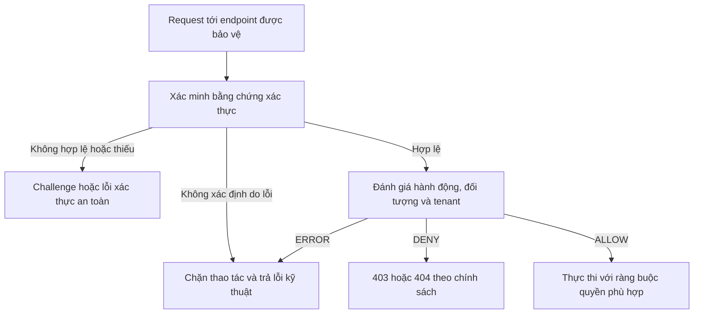

# Lỗi xác thực và lỗi authorization

## 1. Phân biệt đúng để xử lý đúng

Lỗi xác thực và lỗi authorization đều có thể làm một request bị chặn, nhưng chúng trả lời hai câu hỏi khác nhau:

- **Authentication — xác thực:** hệ thống có đủ bằng chứng đáng tin cậy để chấp nhận danh tính hoặc phiên của bên gọi trong request này không?
- **Authorization — phân quyền:** chủ thể với ngữ cảnh đã xác định có được thực hiện hành động này trên tài nguyên, trong tenant và điều kiện hiện tại không?

Một access token hợp lệ không cấp quyền đọc mọi hồ sơ. Ngược lại, tài nguyên công khai có thể cho phép người chưa đăng nhập theo chính sách rõ ràng. Cần xác định loại endpoint trước khi quyết định có bắt buộc xác thực hay không.

Trong module thiết kế yêu cầu bảo mật, mục tiêu không chỉ là nhớ “401 hay 403”. Cần đặc tả điều kiện nhận diện lỗi, điểm chặn tác động, mức thông tin công khai, hành động của client, bằng chứng điều tra và cách kiểm thử khi cơ chế kiểm soát gặp lỗi.

Bài học dùng nền tảng học trực tuyến nhiều tenant làm ví dụ. Người học truy cập hồ sơ và bài nộp; giảng viên chấm bài trong phạm vi được giao; quản trị tenant điều hành tổ chức của mình. Các mã, ngưỡng và thời hạn dưới đây là lựa chọn minh họa, cần được chốt theo hệ thống thực tế.

## 2. Mô hình quyết định trước khi chọn thông báo lỗi

### 2.1. Ba kết quả nội bộ cần tách biệt

| Kết quả | Ý nghĩa | Hành vi với thao tác được bảo vệ |
|---|---|---|
| `ALLOW` | Có căn cứ đủ và chính sách cho phép | Chỉ thực hiện hành động, dữ liệu và phạm vi đã được cấp |
| `DENY` | Có kết quả xác định rằng điều kiện không được đáp ứng | Không thực hiện tác động được bảo vệ |
| `INDETERMINATE` hoặc `ERROR` | Không thể xác lập kết quả đáng tin cậy do lỗi hoặc thiếu dữ liệu kiểm soát | Không tự cho phép; phân loại lỗi kỹ thuật để xử lý đúng |

Hai kết quả sau đều không được biến thành quyền truy cập. Tuy nhiên, chúng không phải cùng nguyên nhân và không nên bị gộp thành “người dùng nhập sai mật khẩu” trong audit hoặc điều tra.

Ví dụ: token được xác định đã hết hạn là một kết quả kiểm tra không hợp lệ. Dịch vụ introspection không kết nối được là tình huống không xác minh được trạng thái theo phương án đang dùng. Không được gọi cả hai là “token đã bị thu hồi”, cũng không cho qua tình huống thứ hai vì chưa thấy bằng chứng từ chối.

### 2.2. Ngữ cảnh dùng để phân quyền

Một quyết định có thể phụ thuộc:

```text
subject + action + resource + tenant + environment + policyVersion
```

Trong đó, `subject` và tenant phải đến từ ngữ cảnh được xác minh; `action` được ánh xạ từ thao tác thật; `resource` phải liên quan đúng đối tượng; điều kiện môi trường có thể gồm thời điểm, trạng thái tài nguyên hoặc mức bảo đảm xác thực.

Không tin `userId`, `role`, `tenantId` hoặc `isAdmin` do client tự khai. Các giá trị client đề nghị phải được đối chiếu với quan hệ và thẩm quyền phía server trước khi dùng.

### 2.3. Chặn hành vi, không chỉ đổi response

Trả `403` sau khi đã đọc và gửi dữ liệu, ghi thay đổi, xuất tệp hoặc xếp một job có tác động không đáp ứng yêu cầu phân quyền.

Cần xác định ranh giới được bảo vệ: trước khi tiết lộ dữ liệu hoặc tạo tác động không được phép. Đối với thao tác nhiều bước, có thể cần kiểm tra lại hoặc ràng buộc giao dịch để tránh quyền hay trạng thái thay đổi giữa lần kiểm tra và lần sử dụng.

OWASP khuyến nghị mặc định từ chối và kiểm tra quyền trên từng request. Trong đặc tả, phải chỉ rõ các điểm thực thi và đường truy cập cần bao phủ để nguyên tắc này có thể được kiểm chứng. [OWASP: Authorization Cheat Sheet](https://cheatsheetseries.owasp.org/cheatsheets/Authorization_Cheat_Sheet.html)

## 3. Chuyển mô hình đe dọa thành yêu cầu

| Mã rủi ro | Kịch bản | Hướng yêu cầu |
|---|---|---|
| R-AA-01 | Token không hợp lệ vẫn được đọc claim để tạo principal | Chỉ tạo danh tính đáng tin cậy sau kiểm tra cần thiết; không dùng dữ liệu chưa xác minh để cấp quyền |
| R-AA-02 | Người dùng đã đăng nhập đổi ID để đọc bài của người khác | Phân quyền theo đối tượng và quan hệ, không chỉ kiểm tra đăng nhập |
| R-AA-03 | Quản trị tenant A truy cập dữ liệu tenant B | Ràng buộc tenant tại truy vấn, quyết định và đường xuất |
| R-AA-04 | Policy service hoặc nguồn xác minh lỗi rồi ứng dụng cho qua | Không cấp quyền khi kết quả không xác định; có lỗi kỹ thuật và audit phù hợp |
| R-AA-05 | Thông báo xác thực hoặc phân quyền làm lộ tài khoản, tài nguyên, vai trò | Chính sách tiết lộ theo bối cảnh; kiểm tra body, header, timing và hành vi |
| R-AA-06 | Cache giữ grant sau khi quyền đã bị thu hồi | Giới hạn độ cũ, vô hiệu hóa và đo hiệu lực thu hồi |
| R-AA-07 | Client refresh vô hạn hoặc gửi lại thao tác sau lỗi | Tách lỗi xác thực, thiếu quyền và kết quả chưa biết; retry có giới hạn và điều kiện |
| R-AA-08 | Gateway kiểm tra nhưng service tin header danh tính từ nguồn bất kỳ | Ranh giới tin cậy và xác thực caller nội bộ rõ ràng |
| R-AA-09 | Log ghi token, cookie hoặc claim giả như danh tính đã xác thực | Audit tối thiểu, phân biệt dữ liệu xác minh với dữ liệu tự khai |
| R-AA-10 | Download, batch, job nền hoặc endpoint cũ bỏ qua kiểm tra | Kiểm kê đường truy cập; kiểm tra ở điểm thực thi phù hợp từng loại |

Mỗi rủi ro phải liên kết tới yêu cầu, quyết định kiến trúc và bằng chứng. Không xem việc một middleware đã được cài đặt là đủ chứng minh tất cả đường xử lý đều được bảo vệ.

## 4. Phân loại lỗi xác thực theo cơ chế

### 4.1. Các trường hợp thường gặp

| Tình huống | Kết luận nội bộ | Yêu cầu xử lý |
|---|---|---|
| Endpoint bắt buộc danh tính nhưng không có credential | Chưa có bằng chứng xác thực cần thiết | Chặn thao tác, phản hồi theo cơ chế endpoint |
| Credential sai hoặc token được xác định không hợp lệ | Xác thực không thành công | Không tạo principal được tin cậy; không trả bí mật hoặc nguyên nhân nội bộ chi tiết |
| Phiên hết hạn hoặc bị vô hiệu hóa | Phiên không còn được chấp nhận theo chính sách | Dừng dùng phiên; client theo luồng xác thực lại đã định |
| Chưa hoàn thành bước xác thực bắt buộc | Chưa đạt điều kiện của luồng hiện tại | Không coi phiên tạm là phiên có đầy đủ quyền |
| Không truy cập được phụ thuộc cần để xác minh | Chưa xác định được kết quả | Không cho qua; phản ánh lỗi kỹ thuật phù hợp |
| Request tới tài nguyên công khai được khai báo | Không nhất thiết cần danh tính | Chỉ cho phần công khai; không vô tình gắn thêm dữ liệu riêng |

Không áp một error code cho mọi cơ chế. Resource server nhận OAuth Bearer token, endpoint cấp token, trang đăng nhập bằng cookie và kết nối service-to-service có các hợp đồng khác nhau.

### 4.2. Token có định dạng đúng chưa chắc hợp lệ

Một JWT có thể giải mã được phần payload nhưng chưa được hệ thống chấp nhận. Đặc tả kiểm tra cần bao phủ các điều kiện của profile được dùng, như nguồn phát hành, đối tượng nhận, thời hạn, loại token và tính xác thực bằng cơ chế được chấp nhận.

Không dùng ID token, token cho dịch vụ khác hoặc claim tự khai thay cho access token phù hợp endpoint. Thuật toán, nguồn khóa, chính sách lệch đồng hồ và hành vi khi làm mới khóa phải được xác định, không để client tùy chọn cách tin cậy.

Nếu có cache khóa hoặc kết quả xác minh, cần ghi rõ khi nào dữ liệu đó còn được chấp nhận. Không coi việc mất kết nối tới hệ thống phát hành là lý do bỏ chữ ký, bỏ hạn hoặc dùng cache vô thời hạn.

### 4.3. Không làm lộ tình trạng tài khoản ngoài quyền

Ở luồng đăng nhập hoặc khôi phục công khai, các câu “tài khoản không tồn tại”, “đúng mật khẩu nhưng bị khóa” hoặc “đang chờ phê duyệt” có thể cung cấp thông tin để dò tài khoản.

OWASP lưu ý cả thông điệp, status và thời gian có thể tạo dấu hiệu phân biệt. Chính sách phản hồi cần bao phủ nhóm trường hợp cần bảo vệ, không chỉ đổi cùng một câu trên giao diện. [OWASP: Authentication and Error Messages](https://cheatsheetseries.owasp.org/cheatsheets/Authentication_Cheat_Sheet.html#authentication-and-error-messages)

Thông tin chi tiết có thể cần trong audit nội bộ được cấp quyền, nhưng dữ liệu tự khai ở request xác thực thất bại không được ghi như một danh tính đã xác thực. Thay vào đó, phân biệt rõ chủ thể đã xác minh với thông tin được người gọi khẳng định.

## 5. Lỗi authorization và quyền được biết tài nguyên

### 5.1. Đã xác thực vẫn có thể bị từ chối

Các lý do có thể gồm thiếu scope, thiếu quan hệ với đối tượng, khác tenant, thao tác không thuộc vai trò, dữ liệu không nằm trong phạm vi được giao hoặc điều kiện chính sách không đạt.

Không đồng nhất authorization với role. Một giảng viên có thể chấm bài trong lớp được phân công nhưng không được đọc mọi bài nộp của toàn hệ thống. Một quản trị tenant vẫn cần bị giới hạn trong tenant của mình.

Không đồng nhất scope với quyền cuối cùng. Scope cho phép một nhóm thao tác không tự chứng minh quyền đối với từng đối tượng; vẫn cần kiểm tra quan hệ, tenant và điều kiện liên quan.

### 5.2. Quyền được biết sự tồn tại là một phần của chính sách

Người gọi không có quyền đọc hồ sơ B có thể cũng không được biết hồ sơ đó tồn tại. Lỗi “bài nộp thuộc Nguyễn Lan ở tenant B” đã tiết lộ dữ liệu dù không trả nội dung bài.

RFC 9110 cho phép dùng `404` thay `403` khi muốn ẩn sự tồn tại của tài nguyên bị cấm. Dự án cần quyết định khi nào áp dụng và kiểm tra cả các dấu hiệu ngoài status. [RFC 9110: HTTP Semantics](https://www.rfc-editor.org/info/rfc9110/)

Không dùng `404` cho mọi lỗi phân quyền một cách máy móc. Với thao tác mà người dùng được phép biết tồn tại, `403` cùng hướng dẫn an toàn có thể hữu ích hơn. Điều quan trọng là chính sách nhất quán với mô hình đe dọa.

### 5.3. Lỗi điều kiện và nhu cầu nâng mức xác thực

Một chủ thể đã xác thực có thể chưa đạt mức bảo đảm mà thao tác nhạy cảm yêu cầu. Cần có luồng nâng mức xác thực và challenge theo cơ chế đã chọn, cùng phạm vi và thời hạn rõ ràng.

Không mặc định refresh access token sẽ giải quyết thiếu quyền hoặc thiếu mức bảo đảm. Client phải nhận biết loại hành động được hợp đồng cho phép, không tự liên tục đăng nhập lại khi người dùng thật sự không có quyền.

Nếu lỗi policy service khiến hệ thống chưa biết có đạt điều kiện hay không, đó là lỗi kỹ thuật của phép đánh giá, không phải bằng chứng người dùng thiếu một vai trò cụ thể.

## 6. Hợp đồng phản hồi cho HTTP API

### 6.1. Tách ngữ nghĩa HTTP với nguyên nhân nội bộ

| Trường hợp | Phản hồi định hướng | Giới hạn |
|---|---|---|
| Thiếu bằng chứng cần thiết cho endpoint được bảo vệ | `401` với challenge phù hợp | Không mặc định dùng Bearer cho mọi cơ chế xác thực |
| Bearer token được xác định không hợp lệ | `401`, lỗi `invalid_token` theo profile | Không cần nêu thuật toán, khóa hoặc lý do xác minh chi tiết |
| Bearer request sai cấu trúc theo giao thức | Có thể là `400` với `invalid_request` | Phân biệt lỗi cấu trúc request với token không hợp lệ |
| Token không có scope cần thiết | `403`, lỗi `insufficient_scope` theo profile | Không suy ra mọi lỗi object-level đều là thiếu scope |
| Không có quyền đối tượng hoặc thao tác | `403` hoặc `404` theo chính sách tiết lộ | Không liệt kê dữ liệu, role hoặc tenant ngoài quyền |
| Không xác minh được do lỗi phụ thuộc | Mã `5xx` phù hợp hợp đồng, ví dụ `503` cho phụ thuộc tạm không khả dụng | Vẫn chặn thao tác; không gắn nhãn sai rằng credential chắc chắn không hợp lệ |

RFC 6750 mô tả các lỗi của OAuth Bearer ở resource server, gồm `invalid_request`, `invalid_token` và `insufficient_scope`. Khi request không có thông tin xác thực, hướng dẫn là không thêm error code hoặc thông tin lỗi xác thực không cần thiết vào challenge. Cần áp dụng đúng phạm vi giao thức này. [RFC 6750: Bearer Token Usage, mục 3.1](https://www.rfc-editor.org/info/rfc6750/)

Với response `401`, HTTP yêu cầu `WWW-Authenticate` chứa challenge phù hợp tài nguyên. Không chỉ đổi số status trong body hoặc trả `200` kèm chuỗi “unauthorized”. [RFC 9110: HTTP authentication](https://www.rfc-editor.org/info/rfc9110/)

### 6.2. Ví dụ Bearer tại resource server

Request chưa có credential có thể nhận phản hồi tối thiểu:

```http
HTTP/1.1 401 Unauthorized
WWW-Authenticate: Bearer realm="learning-api"
Cache-Control: no-store
Content-Length: 0
```

Với token đã được xác định không hợp lệ, hệ thống mẫu có thể trả:

```http
HTTP/1.1 401 Unauthorized
WWW-Authenticate: Bearer realm="learning-api", error="invalid_token"
Content-Type: application/json
Cache-Control: no-store

{
  "code": "AUTHENTICATION_REQUIRED",
  "message": "Không thể xác thực yêu cầu. Hãy tiếp tục theo hướng dẫn xác thực của ứng dụng.",
  "requestId": "req-test-012"
}
```

Khi token hợp lệ nhưng thiếu scope cho một thao tác được phép công bố:

```http
HTTP/1.1 403 Forbidden
WWW-Authenticate: Bearer realm="learning-api", error="insufficient_scope"
Content-Type: application/json
Cache-Control: no-store

{
  "code": "ACCESS_DENIED",
  "message": "Bạn không có quyền thực hiện thao tác này.",
  "requestId": "req-test-013"
}
```

Các body, mã ứng dụng và request ID là thiết kế minh họa, không phải trường bắt buộc của RFC 6750. Không đưa raw token, cookie, claim nhạy cảm hoặc role nội bộ vào `message` hay `error_description`.

Nếu công bố scope cần thiết, phải chắc rằng scope đó phù hợp hợp đồng và quyền được biết; không sao chép toàn bộ policy vào header. Ví dụ thiếu scope không thay thế chính sách `404` cho đối tượng cần che sự tồn tại.

### 6.3. Không trộn lỗi của các thành phần khác nhau

Endpoint cấp token có thể dùng các mã riêng của giao thức cấp token. Không sao chép nguyên lỗi resource server vào endpoint đăng nhập hoặc coi mọi lỗi OAuth đều phải là `401`.

Nếu API dùng credential của chính dịch vụ để gọi upstream và upstream từ chối credential đó, người dùng chưa chắc có lỗi xác thực. Không tự chuyển nguyên `401` của upstream thành yêu cầu người dùng đăng nhập lại. Cần phân loại lỗi dịch vụ và trả mức công khai phù hợp, giữ chi tiết vận hành ở vùng nội bộ.

Luồng web có thể điều hướng tới đăng nhập theo hợp đồng, trong khi API cần phản hồi máy đọc. Không trả HTML đăng nhập bất ngờ cho client đang chờ JSON. URL trở về sau đăng nhập phải được kiểm soát, không dùng tham số tùy ý để tạo open redirect.

## 7. Thiết kế điểm thực thi và xử lý lỗi kỹ thuật

### 7.1. Chuỗi quyết định cho endpoint bắt buộc xác thực



Tài nguyên công khai phải có quy tắc riêng, không vô tình đi qua nhánh cho phép vì cơ chế xác thực lỗi. Sơ đồ cũng không có nghĩa mọi dữ liệu nghiệp vụ được phép đọc toàn bộ chỉ để thực hiện kiểm tra quyền; truy xuất metadata cần được giới hạn.

### 7.2. Pseudocode minh họa

```text
function handleProtectedRequest(request):
    requestId = serverControlledRequestId(request)
    authn = authenticateUsingConfiguredMechanism(request)

    if authn.isIndeterminate:
        recordSafeControlFailure(requestId, "AUTHN_DEPENDENCY_ERROR")
        return publicControlUnavailableResponse(requestId)

    if not authn.isAccepted:
        recordSafeAuthenticationFailure(requestId, authn.safeReason)
        return authenticationResponseForMechanism(authn, requestId)

    context = buildTrustedContext(authn)
    action = mapEndpointToApprovedAction(request)
    resourceScope = resolveResourceWithinTrustedScope(request, context)
    decision = evaluateAuthorization(context, action, resourceScope)

    if decision.isIndeterminate:
        recordSafeControlFailure(requestId, "AUTHZ_EVALUATION_ERROR")
        return publicControlUnavailableResponse(requestId)

    if not decision.isExplicitAllow:
        recordProtectedDenial(context, action, decision.safeReason, requestId)
        return deniedResponseUnderDisclosurePolicy(context, requestId)

    return executeProtectedOperationWithRequiredBinding(
        context, action, resourceScope, decision
    )
```

Pseudocode tập trung vào ranh giới bảo mật, không phải thư viện hoàn chỉnh. Việc xác minh input cơ bản vẫn cần thiết, nhưng không được tạo response tiết lộ dữ liệu riêng trước kiểm tra tương ứng.

`executeProtectedOperationWithRequiredBinding` phải thực hiện yêu cầu về cạnh tranh của thao tác, ví dụ điều kiện giao dịch hoặc kiểm tra phiên bản khi quyền phụ thuộc trạng thái thay đổi. Gọi hàm kiểm tra một lần không tự giải quyết mọi lỗi giữa kiểm tra và sử dụng.

### 7.3. Không bắt mọi lỗi thành 401 hoặc 403

Một `catch` bao quanh xác thực có thể nhận cả timeout, lỗi parser, lỗi lập trình và kết quả credential không hợp lệ. Nếu đổi tất cả thành `401`, hệ thống khiến người dùng đăng nhập lại vô ích và che mất sự cố hạ tầng.

Tương tự, database lỗi khi lấy thuộc tính policy không chứng minh người dùng thiếu quyền. Response công khai có thể vẫn ngắn và không lộ phụ thuộc, nhưng phân loại nội bộ phải đúng để theo dõi và xử lý.

Không được fallback sang `ALLOW`. Nếu có phương án dự phòng bằng cache hoặc bộ policy cục bộ, phải chỉ rõ nguồn tin cậy, phiên bản, tuổi tối đa, phạm vi thao tác và điều kiện dùng. Đó là một phương án kiểm soát được thiết kế, không phải bỏ kiểm soát khi có lỗi.

### 7.4. Bao phủ nhiều tầng và đường thực thi

Gateway có thể kiểm tra credential, nhưng service cần biết vì sao ngữ cảnh truyền tới là đáng tin cậy. Header danh tính không được nhận từ Internet rồi coi như do gateway phát hành.

Quyền phải bao phủ truy cập qua API cũ, batch, GraphQL nếu có, tệp tải, liên kết export và tác vụ nền. Không chỉ bảo vệ nút trên giao diện hoặc controller thường dùng.

Với job nền, cần xác định bên thực hiện là dịch vụ theo quyền riêng hay được ủy quyền từ người dùng. Phạm vi và thời hạn ủy quyền, thời điểm đánh giá quyền cùng hành vi khi quyền thay đổi phải được ghi thành yêu cầu. Không giữ token người dùng vô thời hạn trong payload job.

## 8. Hành vi client, cache và hiệu lực thu hồi

### 8.1. Client phải phân biệt các đường khắc phục

| Loại kết quả công khai | Hành vi client có thể được đặc tả | Hành vi cần tránh |
|---|---|---|
| Cần xác thực theo cơ chế | Thực hiện refresh hoặc đăng nhập theo hợp đồng, có giới hạn | Refresh vô hạn hoặc gửi credential tới đích không được xác minh |
| Thiếu quyền | Hiển thị từ chối và cách yêu cầu hỗ trợ phù hợp | Giả định đăng nhập lại luôn giải quyết được |
| Cần nâng mức xác thực | Mở luồng challenge đã được xác định | Chỉ đổi role ở client hoặc refresh token thông thường |
| Không có tài nguyên trong phạm vi được công bố | Hiển thị trạng thái không khả dụng theo hợp đồng | Dò các endpoint khác để tìm tài nguyên ngoài quyền |
| Kiểm soát tạm không khả dụng | Thông báo lỗi dịch vụ; retry theo tính chất thao tác | Xóa phiên người dùng hoặc chuyển sang endpoint không kiểm soát |

Khi nhiều request cùng nhận lỗi token, client có thể cần phối hợp một lượt refresh thay vì tạo nhiều request cạnh tranh. Sau số lần được phép, phải kết thúc vòng lặp và hướng dẫn người dùng, không duy trì retry nền vô hạn.

Việc phát lại thao tác có tác động phải tuân idempotency và trạng thái đã biết. Nếu lỗi đến từ trung gian hoặc kết nối bị mất, không mặc định thao tác chắc chắn chưa chạy chỉ vì client thấy một lỗi liên quan xác thực.

### 8.2. Cache của phản hồi và cache của quyết định là hai lớp khác nhau

Cache phản hồi có thể làm lỗi của người A xuất hiện cho người B. Cache quyết định có thể giữ một quyền đã bị thu hồi. Cả hai cần khóa, phạm vi, thời hạn và cơ chế vô hiệu hóa phù hợp.

Không cache kết quả theo mỗi URL mà bỏ principal và tenant nếu nội dung phụ thuộc quyền. Với quyết định authorization, còn có thể cần action, resource, thuộc tính ảnh hưởng, phiên bản policy và phiên bản quyền.

Một JWT còn hạn có thể chứa role cũ. Nếu hệ thống yêu cầu thu hồi nhanh, phải có thiết kế kiểm chứng hiệu lực thu hồi phù hợp; không hứa “ngay lập tức” chỉ vì đã đổi role trong cơ sở dữ liệu trong khi service vẫn tin claim cũ.

### 8.3. Viết ngưỡng thu hồi có thể đo

Ví dụ: với thao tác đọc hồ sơ trong hệ thống mẫu, quyền bị thu hồi tại nguồn có thẩm quyền ở mốc t0 phải ngừng cấp quyết định cho phép mới tại mọi điểm thực thi liên quan trong tối đa 30 giây. Với thao tác đặc quyền rủi ro cao, có thể cần kiểm tra nguồn nhất quán thay vì chấp nhận cùng cửa sổ cache.

Con số 30 giây là mục tiêu minh họa, không phải mức an toàn chung. Đặc tả phải nêu cách đo, điểm thực thi, hành vi khi không nhận cập nhật và giới hạn đối với request đã bắt đầu hoặc dữ liệu đã gửi.

Nếu không chứng minh được cache còn trong điều kiện chấp nhận, không dùng một grant cũ như giá trị mặc định. Khi restore hoặc rollback, phải kiểm tra lại trạng thái quyền và policy trước mở luồng được bảo vệ.

## 9. Bộ yêu cầu có tiêu chí chấp nhận

| ID | Phát biểu yêu cầu mẫu | Tiêu chí chấp nhận và bằng chứng |
|---|---|---|
| REQ-AA-01 | Mỗi endpoint phải khai báo công khai hay được bảo vệ, cơ chế xác thực, action và phạm vi authorization. | Đối chiếu inventory với mọi đường truy cập; endpoint mới thiếu quy tắc không tự nhận quyền mặc định. |
| REQ-AA-02 | Chỉ tạo principal đáng tin cậy từ bằng chứng đã qua kiểm tra theo profile; claim hoặc header tự khai không cấp quyền. | Thử token không hợp lệ, sai đối tượng nhận, sai nguồn và header giả; không thực hiện thao tác được bảo vệ. |
| REQ-AA-03 | Mỗi request được bảo vệ phải kiểm tra hành động, đối tượng và tenant theo chính sách; chỉ explicit ALLOW mới được thực thi. | Dùng principal hợp lệ nhưng sai vai trò, quan hệ, tenant hoặc action; mọi đường bị cấm đều không có tác động. |
| REQ-AA-04 | Kết quả không xác định do lỗi xác thực hoặc phân quyền không được fallback thành ALLOW hoặc bị ghi sai là lỗi credential xác định. | Tiêm lỗi phụ thuộc và policy; thao tác bị chặn, response cùng audit đúng phân loại. |
| REQ-AA-05 | Phản hồi phải tuân cơ chế giao thức, gồm challenge phù hợp cho 401 và ánh xạ Bearer đúng phạm vi. | Kiểm tra thiếu credential, request Bearer sai cấu trúc, invalid_token và insufficient_scope; status, header, body nhất quán. |
| REQ-AA-06 | Nội dung công khai phải hạn chế dò tài khoản, đối tượng và policy theo quyền được biết đã định. | So sánh nhóm xác thực, ID ngoài tenant, ID không tồn tại, body, header, redirect và phân bố thời gian. |
| REQ-AA-07 | Từ chối hoặc lỗi kiểm soát phải xảy ra trước tiết lộ và tác động được bảo vệ; cạnh tranh phải theo ranh giới đã chốt. | Kiểm tra dữ liệu, ghi thay đổi, job và tệp khi lỗi; không chỉ xác nhận status cuối cùng. |
| REQ-AA-08 | Client phải có hành vi riêng cho xác thực lại, thiếu quyền, step-up và lỗi dịch vụ; refresh có giới hạn. | Thử nhiều request đồng thời, 403 và 503; không loop refresh, mất phiên vô lý hoặc gửi lại tác động mù quáng. |
| REQ-AA-09 | Quyền thu hồi và thay policy phải có ngưỡng hiệu lực được đo, bao phủ cache và các điểm thực thi. | Đo từ t0 tới quyết định mới trên từng instance; thử mất cập nhật, cache hết hạn và restore. |
| REQ-AA-10 | Audit không ghi credential; dữ liệu tự khai và danh tính đã xác minh phải phân biệt được. | Fixture chứa token, cookie và claim giả không xuất hiện ngoài profile; audit không gán actor đã xác thực cho claim chưa tin cậy. |
| REQ-AA-11 | Gateway, service, đường tải và worker phải thực thi đúng ranh giới tin cậy cùng quyền của mình. | Gọi service trực tiếp, sửa header, dùng link cũ và chạy job sau thay quyền; không vượt kiểm soát. |
| REQ-AA-12 | Lỗi upstream liên quan credential dịch vụ không được tự chuyển thành lỗi xác thực của người dùng. | Làm credential service-to-service bị từ chối; client không bị yêu cầu refresh phiên sai nguyên nhân, alert tới đúng bên chịu trách nhiệm. |

Mỗi yêu cầu cần người chịu trách nhiệm, bằng chứng và phạm vi phiên bản. Những thuật ngữ như “chặn”, “thu hồi” hoặc “không lộ” phải được gắn với hành vi quan sát được thay vì chỉ tên middleware hay trạng thái dashboard.

## 10. Thiết kế kiểm thử theo danh tính, quyền và trạng thái kiểm soát

### 10.1. Xây ma trận quyền trước khi thử mã lỗi

Bộ fixture phải biểu diễn quan hệ có ý nghĩa, không chỉ hai role `USER` và `ADMIN`:

| Chủ thể thử | Hành động và phạm vi | Kết quả kỳ vọng theo chính sách mẫu |
|---|---|---|
| Người học A trong tenant A | Đọc bài nộp của chính mình | ALLOW nếu tài nguyên và điều kiện liên quan hợp lệ |
| Người học A trong tenant A | Đọc bài của người học B | DENY theo quan hệ, kể cả cùng tenant |
| Giảng viên được phân công lớp A1 | Chấm bài thuộc lớp A1 | ALLOW theo quyền thao tác và trạng thái được chấm |
| Cùng giảng viên | Chấm bài lớp A2 chưa được phân công | DENY, không dùng role giảng viên như quyền toàn cục |
| Quản trị tenant A | Thao tác quản trị được cấp trong tenant A | ALLOW trong phạm vi đã định |
| Quản trị tenant A | Thao tác tương ứng trong tenant B | DENY, không lộ thuộc tính tenant B ngoài quyền |
| Dịch vụ tích hợp | Tác vụ thuộc quyền riêng đã cấp cho workload | Chỉ ALLOW đúng action, resource và tenant được cấp |

Mỗi tình huống cần biến thể credential hợp lệ, không hợp lệ, thiếu, hết hiệu lực và trạng thái kiểm soát không xác định. Không chỉ chạy happy path với token quản trị.

### 10.2. Ma trận ca thử

| Ca thử | Thiết lập hoặc thao tác | Kết quả mong đợi |
|---|---|---|
| TC-AA-01 | Gọi endpoint được bảo vệ mà thiếu credential | Không thực thi; challenge đúng cơ chế và không thêm dữ liệu xác thực ngoài profile |
| TC-AA-02 | Gọi endpoint công khai đã khai báo khi chưa đăng nhập | Chỉ trả phần công khai, không yêu cầu danh tính không cần hoặc gắn thêm dữ liệu riêng |
| TC-AA-03 | Token sai tính xác thực, nguồn, đối tượng nhận hoặc loại | Không tạo principal được tin cậy; không cấp quyền từ claim đọc được |
| TC-AA-04 | Token tại các mốc hết hạn và điều kiện lệch đồng hồ đã chốt | Đúng quy tắc biên, không nới hạn âm thầm theo từng instance |
| TC-AA-05 | Bearer request sai cấu trúc so với token không hợp lệ | Phân loại theo giao thức; không dùng cùng catch thiếu ngữ nghĩa |
| TC-AA-06 | Token hợp lệ nhưng thiếu scope cần thiết | Từ chối theo hợp đồng, không tự nâng scope hoặc quyền |
| TC-AA-07 | Đủ scope nhưng sai chủ sở hữu hoặc quan hệ | Vẫn DENY ở cấp đối tượng, không chỉ dựa trên scope |
| TC-AA-08 | Đổi tenant trong URL, body, header hoặc ID đối tượng | Không vượt tenant ở đọc, ghi, danh sách, export hoặc metadata |
| TC-AA-09 | Policy service, introspection hoặc nguồn thuộc tính lỗi | Không ALLOW; phân loại kỹ thuật đúng và không lộ thông tin phụ thuộc |
| TC-AA-10 | Cache grant đã quá điều kiện chấp nhận trong lúc nguồn chính lỗi | Không tiếp tục dùng grant vô thời hạn; áp dụng phương án đã duyệt |
| TC-AA-11 | Thu hồi quyền khi nhiều instance đang phục vụ | Quyết định mới dừng ALLOW trong ngưỡng; không chỉ một instance cập nhật đúng |
| TC-AA-12 | Role cũ trong token hoặc job đang chờ sau khi quyền thay đổi | Đáp ứng yêu cầu hiệu lực thu hồi và ủy quyền, không mặc định tin trạng thái cũ |
| TC-AA-13 | Gọi service trực tiếp với header danh tính giả | Không tin ngữ cảnh ngoài ranh giới đã xác minh |
| TC-AA-14 | Client nhận nhiều 401, một 403 hoặc lỗi kiểm soát 503 | Refresh, thông báo và retry đúng loại; không có vòng lặp hoặc xóa phiên sai nguyên nhân |
| TC-AA-15 | Upstream từ chối credential của dịch vụ | Không tự chuyển lỗi thành yêu cầu người dùng xác thực lại |
| TC-AA-16 | ID ngoài quyền so với ID không tồn tại | Đúng chính sách tiết lộ trên body, status, header, redirect và các dấu hiệu đã chọn |
| TC-AA-17 | Token, cookie và claim giả đi qua nhánh lỗi | Không vào response hoặc log ngoài profile; claim giả không trở thành actor đã xác minh |
| TC-AA-18 | Lỗi hoặc DENY xảy ra trước thao tác nhiều bước | Không có dữ liệu, thay đổi, job hoặc tệp được tạo ngoài quyền |

Các token và tài khoản phải thuộc môi trường kiểm thử được kiểm soát. Không dùng credential thật của người khác làm fixture hoặc ghi chúng vào báo cáo.

### 10.3. Kiểm tra tác động thực tế

Với request bị từ chối, phải xác nhận dữ liệu không được gửi trong response, stream, header hoặc tệp. Với thao tác ghi, kiểm tra cả dữ liệu đã thay đổi, message, job và lời gọi bên ngoài có thể đã được kích hoạt.

Một controller có thể trả `403` đúng nhưng vẫn gọi service trước khi kiểm tra. Vì vậy, status chỉ là một phần bằng chứng. Ca thử cần quan sát ranh giới nghiệp vụ và hệ thống đích phù hợp.

Đối với cạnh tranh giữa thay quyền và thực thi, phải xác định mốc mà quyết định có hiệu lực, thao tác nào đã bắt đầu và điều kiện giao dịch. Không đòi thu hồi dữ liệu đã gửi như thể có thể đảo ngược mọi byte, nhưng cũng không dùng lý do đó để bỏ kiểm soát các thao tác mới.

### 10.4. Tiêu chí Given–When–Then

```gherkin
Scenario: Policy service lỗi không tạo quyền từ cache đã hết điều kiện
  Given người dùng có danh tính đã được xác thực
    And endpoint yêu cầu quyết định quyền cho submission.read
    And cache không còn đáp ứng điều kiện sử dụng đã định
    And policy service không khả dụng
  When người dùng gửi request tới tài nguyên được bảo vệ
  Then hệ thống không thực hiện thao tác đọc được bảo vệ
    And không trả dữ liệu hoặc metadata ngoài chính sách tiết lộ
    And response phản ánh lỗi kiểm soát theo hợp đồng
    And audit không ghi nhầm rằng token chắc chắn không hợp lệ
    And client không tự refresh phiên chỉ vì lỗi kỹ thuật này
```

Ca thử cần chạy qua điểm thực thi thật trong môi trường thử, không chỉ kiểm tra một hàm mapper trả `503`. Nếu có phương án policy cục bộ được chấp nhận, phải có ca riêng chứng minh điều kiện sử dụng và giới hạn của phương án đó.

### 10.5. Kiểm chứng chống suy luận và giới hạn kết luận

Với nhóm lỗi xác thực cần bảo vệ, so sánh các thuộc tính công khai theo chính sách. Không yêu cầu request ID ngẫu nhiên giống nhau; phải tách biến thiên hợp lệ khỏi khác biệt làm lộ trạng thái nhạy cảm.

Đo timing cần nhiều mẫu, cấu hình và tải được ghi nhận. Không chứng minh an toàn chỉ bằng một request hoặc việc thêm độ trễ cố định. Kiểm tra thời gian cũng không thay thế giới hạn tự động hóa và giám sát theo rủi ro.

Báo cáo phải nêu endpoint, cơ chế credential, principal, quan hệ, tenant, phiên bản policy, cấu hình cache và các nhánh lỗi đã chạy. Không suy ra mọi đường đã an toàn từ việc middleware xác thực hoạt động ở một controller.

## 11. Audit, giám sát và thay đổi trong vận hành

### 11.1. Ghi đúng điều đã biết

Ví dụ audit cho một từ chối authorization sau khi xác thực thành công:

```json
{
  "event": "access_control_decision",
  "principalState": "AUTHENTICATED",
  "actorRef": "teacher-test-a",
  "action": "submission.read",
  "resourceRef": "submission-test-42",
  "tenantRef": "tenant-test-a",
  "decision": "DENY",
  "reasonCode": "RELATION_NOT_ALLOWED",
  "policyVersion": "authz-policy-v4",
  "requestId": "req-test-013"
}
```

Các tham chiếu vẫn cần được bảo vệ vì có thể liên kết người với tài nguyên và hoạt động. Không log access token, refresh token, cookie phiên, mật khẩu hoặc toàn bộ header xác thực.

Nếu chưa xác thực được, `actorRef` không được lấy từ claim tự khai rồi gắn nhãn đã xác minh. Có thể cần thông tin đối chiếu tối thiểu phục vụ phát hiện lạm dụng, nhưng phải phân loại rõ độ tin cậy, mục đích và quyền truy cập.

Không cố tra cứu tài nguyên ngoài phạm vi chỉ để tạo thông điệp log chi tiết. Nếu hệ thống chỉ biết “không có tài nguyên trong phạm vi được phép”, audit nên phản ánh đúng mức đó, không suy diễn thêm.

### 11.2. Phân biệt hành vi tấn công và sự cố kiểm soát

Tăng số token không hợp lệ có thể khác với tăng lỗi kết nối tới hệ thống xác minh. Tăng từ chối quan hệ có thể khác với việc mọi principal đều bị từ chối sau một lần deploy policy.

Giám sát nên tách tỷ lệ lỗi xác thực xác định, DENY authorization, lỗi đánh giá, cache quá hạn, độ trễ thu hồi và vòng lặp refresh. Nhãn dùng mã hữu hạn, không chứa user ID, token hoặc raw URL.

Thông báo công khai có thể chung nhưng đội vận hành phải có tín hiệu đủ để nhận biết sự cố kỹ thuật. Không vô hiệu hóa kiểm soát để giảm số lỗi trên dashboard.

### 11.3. Thay đổi khóa, policy và mô hình quyền

Rotation khóa, đổi nhà cung cấp danh tính, thay audience, thêm scope, đổi role, sửa quan hệ đối tượng hoặc cấu hình cache đều có thể thay hành vi lỗi. Cần kiểm chứng các trường hợp liên quan trước khi phụ thuộc vào trạng thái mới.

Khi policy chưa tải được hoặc cấu hình mới sai, phương án rollback phải giữ ranh giới kiểm soát và hiệu lực thu hồi đã chốt. Không quay lại một grant cũ hoặc cấu hình cho phép rộng chỉ vì nó từng giúp dịch vụ hoạt động.

Sau restore, dữ liệu quyền có thể cũ hơn các sự kiện thu hồi. Cần đối soát nguồn có thẩm quyền, phiên bản policy và trạng thái credential trước mở thao tác được bảo vệ.

### 11.4. Bằng chứng và trách nhiệm

Chủ sở hữu cơ chế danh tính chịu trách nhiệm điều kiện chấp nhận credential; chủ sở hữu dữ liệu và nghiệp vụ xác định quyền; nhóm dịch vụ chịu trách nhiệm thực thi; nhóm client xử lý phản hồi; vận hành theo dõi và phản ứng sự cố.

Việc chia trách nhiệm không cho phép một tầng giả định tầng khác đã kiểm tra mà không có hợp đồng. Cần chỉ rõ đâu là nguồn quyết định, đâu là điểm thực thi và bằng chứng nào xác nhận đường truyền ngữ cảnh đáng tin cậy.

## 12. Truy vết từ rủi ro tới bằng chứng

| Rủi ro | Yêu cầu liên quan | Quyết định kiến trúc | Bằng chứng chính | Chủ sở hữu ví dụ |
|---|---|---|---|---|
| R-AA-01 | REQ-AA-02, REQ-AA-05 | Profile xác minh và tạo principal sau kiểm tra | TC-AA-01, TC-AA-03 đến TC-AA-05 | Nhóm danh tính |
| R-AA-02, R-AA-03 | REQ-AA-03, REQ-AA-07 | Quyền theo action, đối tượng, tenant và ràng buộc thực thi | TC-AA-06 đến TC-AA-08, TC-AA-18 | Nhóm ứng dụng, chủ sở hữu dữ liệu |
| R-AA-04 | REQ-AA-04 | Kết quả không xác định không cho phép; fallback có điều kiện rõ | TC-AA-09, TC-AA-10 | Nhóm nền tảng, an toàn thông tin |
| R-AA-05 | REQ-AA-06 | Chính sách tiết lộ và phản hồi theo cơ chế | TC-AA-16, đánh giá timing | Nhóm danh tính, quyền riêng tư |
| R-AA-06 | REQ-AA-09 | Ngưỡng thu hồi, vô hiệu hóa và đối soát sau restore | TC-AA-11, TC-AA-12 | Nhóm phân quyền, vận hành |
| R-AA-07 | REQ-AA-08, REQ-AA-12 | Client phân loại lỗi, refresh có giới hạn, tách credential upstream | TC-AA-14, TC-AA-15 | Nhóm client, tích hợp |
| R-AA-08, R-AA-10 | REQ-AA-01, REQ-AA-11 | Inventory điểm thực thi, ngữ cảnh nội bộ và quyền job rõ ràng | TC-AA-02, TC-AA-08, TC-AA-12, TC-AA-13 | Nhóm nền tảng, ứng dụng |
| R-AA-09 | REQ-AA-10 | Audit tối thiểu, phân biệt danh tính đã xác minh với tự khai | TC-AA-17 | Nhóm an ninh, vận hành |

Khi thêm endpoint hoặc đổi cách xác thực và phân quyền, cập nhật cả catalog lỗi, hành vi client và kiểm thử. Đúng status nhưng sai tác động, sai quyền được biết hoặc sai khả năng khắc phục vẫn là chưa đáp ứng yêu cầu.

## 13. Bài tập áp dụng

Một nền tảng học giải mã JWT rồi dùng trường `role` để cho phép truy cập. Quản trị tenant được đọc bài của mọi tổ chức. Nếu policy service timeout, ứng dụng dùng giá trị cache không có hạn. Tất cả lỗi trả `401`; client refresh token liên tục. Log ghi nguyên header Authorization và dùng `sub` của token chưa xác minh làm actor. Job xuất bài được chạy sau nhiều giờ bằng token lưu trong payload.

Hãy lập đặc tả thay thế:

1. Phân biệt lỗi xác thực, DENY authorization và kết quả chưa xác định trong từng tình huống.
2. Lập ma trận chủ thể, action, đối tượng và tenant; chỉ ra nơi phải chặn trước tiết lộ hoặc tác động.
3. Thiết kế hợp đồng HTTP theo cơ chế, gồm challenge, mã công khai, chính sách che sự tồn tại và thông tin chỉ dành nội bộ.
4. Viết ít nhất sáu yêu cầu có mã, điều kiện lỗi, chủ sở hữu và tiêu chí chấp nhận.
5. Định nghĩa cache, ngưỡng thu hồi, phương án khi nguồn chính lỗi và đối soát sau restore.
6. Thiết kế hành vi client cho token không hợp lệ, thiếu quyền, step-up và lỗi dịch vụ.
7. Lập ca thử claim giả, sai tenant, quan hệ đối tượng, lỗi phụ thuộc, header giả và job chạy trễ.
8. Nêu giới hạn còn lại, đặc biệt thao tác đã bắt đầu, dữ liệu đã gửi và các quyết định dựa trên cache còn trong cửa sổ được chấp nhận.

Một thiết kế đầy đủ phải nối được nguyên nhân nội bộ, quyết định kiểm soát, phản hồi công khai và tác động nghiệp vụ. Khi các phần này rõ ràng và có bằng chứng, việc xử lý lỗi xác thực và authorization mới trở thành yêu cầu bảo mật cụ thể, đo được và có thể kiểm chứng trong vòng đời hệ thống.
