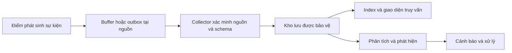

# Security logging requirement

## 1. Yêu cầu security logging phải chứng minh điều gì?

**Security logging requirement** là đặc tả về những sự kiện liên quan đến an toàn thông tin phải được ghi nhận, dữ liệu cần có, cách thu thập và bảo vệ, khả năng sử dụng cùng hành vi khi không duy trì được bảo đảm.

Câu “hệ thống phải có log bảo mật” chưa đủ. Nó không chỉ ra hành động nào cần ghi, ghi khi nào, ai được đọc, làm sao biết log bị thiếu và điều gì xảy ra nếu kho log không hoạt động.

Ví dụ, một quản trị viên đổi quyền của tài khoản học viên. Khi cần điều tra, tổ chức muốn trả lời:

- Danh tính nào đã yêu cầu và danh tính nào được phép thực thi thay mặt người khác?
- Quyền nào đã được thay đổi, trên tài nguyên và tenant nào?
- Đó là một yêu cầu, quyết định cho phép hay thay đổi đã commit?
- Sự kiện xảy ra lúc nào, được thu nhận lúc nào và liên quan request/workflow nào?
- Dữ liệu bằng chứng có còn đầy đủ, có bị sửa hoặc bị đọc trái phép không?

Bài học thuộc chương Logging và audit của module yêu cầu bảo mật. Trọng tâm là biến mục tiêu phát hiện, điều tra và truy vết thành yêu cầu cụ thể, đo được và kiểm chứng được trong vòng đời phát triển.

[NIST SP 800-92](https://csrc.nist.gov/pubs/sp/800/92/final) tiếp cận quản lý log như một hoạt động có quy trình và hạ tầng, bao gồm tạo, truyền, lưu, phân tích và xử lý vòng đời. Vì vậy, nghiệm thu không nên dừng ở việc một câu lệnh logger đã chạy.

Mọi tên sự kiện, định danh, ngưỡng thời gian và retention trong bài là lựa chọn của hệ thống giả định, không phải ngưỡng bắt buộc áp dụng chung.

## 2. Phân biệt log vận hành, security log và audit trail

| Loại | Câu hỏi thường phục vụ | Ví dụ |
|---|---|---|
| Log vận hành | Thành phần có khỏe không, tại sao chậm hoặc lỗi? | Timeout, lỗi kết nối, khởi động dịch vụ |
| Security log | Có sự kiện hoặc dấu hiệu liên quan kiểm soát an toàn nào? | Xác thực thất bại, từ chối quyền, token bị dùng lại |
| Audit trail | Ai thực hiện thay đổi/hành động quan trọng nào và kết quả ra sao? | Cấp quyền, xuất dữ liệu, thay policy, dùng quyền khẩn cấp |
| Trace/metric | Những bước nào liên quan và tải/tỷ lệ thay đổi thế nào? | Luồng request phân tán, số lần từ chối, độ trễ |

Các loại có thể dùng chung hạ tầng hoặc liên kết với nhau. Tuy nhiên, log vận hành có stack trace không tự thay thế được bằng chứng thay đổi quyền; metric tổng số cũng không cho biết tài nguyên nào đã bị tác động.

Security logging rộng hơn việc ghi tất cả lỗi HTTP 500. Một lần cấp quyền thành công hoặc tạo credential thành công có thể quan trọng hơn một lỗi validation thông thường.

Cũng không phải mọi sự kiện bảo mật đều là tấn công. Một lần bị từ chối quyền có thể là hệ thống hoạt động đúng. Yêu cầu cần tách sự kiện, severity, quyết định phát hiện và hành động ứng phó.

## 3. Từ rủi ro tới danh mục sự kiện bắt buộc

### 3.1. Xây event catalog theo tài sản và luồng

Một event catalog nên định nghĩa tên, ý nghĩa, điểm phát sinh, trường bắt buộc, mức dữ liệu, độ tin cậy cần thiết, owner và mục đích sử dụng của từng sự kiện.

| Nhóm | Sự kiện cần xem xét | Mục đích minh họa |
|---|---|---|
| Xác thực | Đăng nhập thành công/thất bại, thay phương thức xác thực, khôi phục tài khoản | Điều tra chiếm tài khoản và sử dụng bất thường |
| Phân quyền | Từ chối quyền, cấp/thu hồi role, thay policy, thay tenant context | Truy vết thay đổi đặc quyền và truy cập trái scope |
| Vòng đời credential | Tạo, thu hồi, rotation, phát hiện reuse | Xác định thời điểm và phạm vi credential bị ảnh hưởng |
| Dữ liệu nhạy cảm | Truy xuất được phân loại quan trọng, export, tải gói dữ liệu | Điều tra tiết lộ hoặc lấy dữ liệu hàng loạt |
| Quản trị | Đổi cấu hình an toàn, dùng quyền khẩn cấp, đổi tích hợp | Truy vết việc mở rộng bề mặt và đặc quyền |
| Kiểm soát bảo mật | Từ chối input theo quy tắc, vi phạm giới hạn, kiểm tra toàn vẹn thất bại | Hỗ trợ phát hiện và giải thích quyết định bảo vệ |
| Hệ thống logging | Mất nguồn, schema lỗi, buffer đầy, thay retention, xóa/export log | Phát hiện điểm mù và lạm dụng chính hệ thống log |

Danh sách trên cần được tinh chỉnh theo mô hình đe dọa của service. Không bắt mọi endpoint ghi toàn bộ request/response chỉ để tăng số lượng log.

Các thành phần tự động, tài khoản dịch vụ và quản trị viên vẫn thuộc phạm vi. Không bỏ ghi một sự kiện bắt buộc chỉ vì nguồn là hệ thống được tin cậy hoặc tài khoản có quyền cao.

### 3.2. Phân biệt ý định, quyết định và kết quả

Ví dụ thay quyền có thể có ba mốc:

```text
ROLE_ASSIGNMENT_REQUESTED   -> đã nhận yêu cầu
AUTHORIZATION_DECISION     -> cho phép hoặc từ chối theo policy
ROLE_ASSIGNMENT_COMMITTED  -> thay đổi đã được xác nhận bền vững
```

Một log “assign role requested” không chứng minh quyền đã được thay đổi. Một quyết định `ALLOW` cũng không chứng minh database đã commit. Nếu mất xác nhận, cần giữ trạng thái chưa xác định hoặc đối soát thay vì ghi thành công theo suy đoán.

Event catalog phải quy định rõ điều kiện phát sinh. Đặt tên `SUCCESS` nhưng ghi trước tác động thực tế sẽ tạo bằng chứng sai.

### 3.3. Liên kết với rủi ro

| Mã | Rủi ro | Điều yêu cầu logging cần giải quyết |
|---|---|---|
| R1 | Không tái dựng được hành động quan trọng | Bao phủ sự kiện, danh tính, tài nguyên và kết quả |
| R2 | Log chứa secret hoặc dữ liệu vượt nhu cầu | Allowlist, giảm dữ liệu và kiểm soát nơi xuất |
| R3 | Client giả mạo actor, tenant, thời điểm hoặc dòng log | Nguồn context tin cậy, xác minh producer và encode |
| R4 | Sự kiện bị mất, bị ghi đè hoặc đến chậm mà không biết | Độ bền, phát hiện khoảng trống, đo độ trễ |
| R5 | Người có quyền ứng dụng sửa/xóa hoặc đọc log vượt scope | Tách quyền, bảo vệ toàn vẹn và audit truy cập log |
| R6 | Flood log làm đầy đĩa hoặc kéo sập dịch vụ | Giới hạn tài nguyên, ưu tiên và hành vi khi quá tải |
| R7 | Có log nhưng không truy vấn, cảnh báo hoặc điều tra được | Schema, thời gian, index, detection và owner |
| R8 | Retention hoặc thay cấu hình làm mất bằng chứng/quá giữ dữ liệu | Vòng đời, quản lý thay đổi và dọn dữ liệu có kiểm soát |

## 4. Đặc tả nội dung một security event

### 4.1. Bộ trường tối thiểu theo mục đích

[OWASP Logging Cheat Sheet](https://cheatsheetseries.owasp.org/cheatsheets/Logging_Cheat_Sheet.html) đề cập thông tin về thời điểm, nơi phát sinh, chủ thể và hành động. Với một service, cần chuyển các nhóm đó thành schema cụ thể và nguồn gốc giá trị.

| Nhóm | Trường minh họa | Nguồn cần tin cậy |
|---|---|---|
| Nhận diện | Event ID, loại sự kiện, schema version | Producer hoặc cơ chế cấp ID đã kiểm soát |
| Thời gian | Thời điểm xảy ra, thời điểm thu nhận | Đồng hồ nguồn và collector, có đánh giá sai lệch |
| Nguồn | Service, deployment, workload, environment | Identity/cấu hình triển khai, xác minh khi ingest |
| Chủ thể | Actor type, subject reference, delegate nếu có | Security context đã xác thực |
| Phạm vi | Tenant, tài nguyên, loại tài nguyên | Kết quả phân giải scope và đối tượng đáng tin cậy |
| Hành động | Action, outcome, reason code | Quyết định hoặc kết quả thực tế theo catalog |
| Liên kết | Request, trace, workflow, operation reference | Context được tạo hoặc xác nhận theo contract |
| Policy | Policy/rule version khi cần giải thích quyết định | Phiên bản thực sự được dùng |

Không phải event nào cũng biết actor. Với một yêu cầu chưa xác thực, cần biểu diễn chưa xác định, không gắn một username do client khai thành danh tính đã được xác minh.

Tương tự, một target chưa được phân giải phải được phân biệt với target đã tồn tại trong scope. Log có thể cần tham chiếu yêu cầu theo cách giảm dữ liệu, nhưng không được tự biến input thành một xác nhận sự tồn tại tài nguyên.

### 4.2. Sự kiện minh họa

```json
{
  "eventId": "event-demo-731",
  "eventType": "ROLE_ASSIGNMENT_COMMITTED",
  "schemaVersion": 1,
  "occurredAt": "2026-01-12T09:15:00.123Z",
  "observedAt": "2026-01-12T09:15:00.480Z",
  "serviceId": "identity-service-demo",
  "deploymentVersion": "release-demo-8",
  "tenantRef": "tenant-demo-a",
  "actor": {
    "type": "HUMAN",
    "subjectRef": "operator-demo-4"
  },
  "action": "ASSIGN_ROLE",
  "target": {
    "type": "ACCOUNT",
    "reference": "account-demo-17"
  },
  "change": {
    "roleCode": "COURSE_ADMIN"
  },
  "outcome": "SUCCESS",
  "reasonCode": "APPROVED_ADMIN_OPERATION",
  "policyVersion": 12,
  "requestId": "request-demo-901"
}
```

Đây là schema riêng của ví dụ, không phải bản triển khai đầy đủ một chuẩn telemetry. `observedAt` được bổ sung tại điểm thu nhận đã xác định. `roleCode` chỉ được giữ nếu cần cho mục tiêu kiểm toán và kho log được phép xử lý mức dữ liệu đó.

`reasonCode` đến từ tập giá trị hữu hạn. Không chép nguyên comment người dùng hoặc exception message vào field này. Các tham chiếu không phải raw credential và không cấp quyền truy cập tài nguyên.

### 4.3. Quyền thay mặt và danh tính máy

Nếu một workload thực hiện thay người dùng, cần phân biệt actor thực thi, người khởi tạo và phạm vi ủy quyền theo luồng. Chỉ ghi một trường `user` có thể che mất ai thật sự thao tác bằng đặc quyền nào.

Collector cũng cần kiểm danh tính producer. Một trường `serviceId` tự khai trong JSON không đủ chứng minh sự kiện tới từ dịch vụ đó. Source identity do kênh thu nhận xác minh phải được giữ và xử lý khi không khớp metadata.

## 5. Thời gian, tương quan và tính đúng đắn của ngữ cảnh

### 5.1. Thời điểm xảy ra khác thời điểm nhận

Một sự kiện có thể bị giữ trong buffer rồi đến collector sau vài phút. Chỉ giữ thời điểm ingest sẽ làm mất trình tự nguồn; chỉ giữ thời điểm nguồn lại khó phát hiện chậm trễ hoặc đồng hồ sai.

[OpenTelemetry Logs Data Model](https://opentelemetry.io/docs/specs/otel/logs/data-model/) phân biệt `Timestamp` với `ObservedTimestamp` và có các trường liên kết trace. Một schema ứng dụng có thể ánh xạ theo ý nghĩa đó, nhưng vẫn phải công bố rõ điểm nào đặt thời gian và mức tin cậy.

Yêu cầu cần nêu định dạng thời gian, timezone, độ chính xác, nguồn đồng bộ và hành vi khi sai lệch. Dùng UTC giúp so sánh biểu diễn, nhưng không tự bảo đảm hai đồng hồ đã đồng bộ.

Không giả định có thứ tự toàn cục tuyệt đối giữa mọi service. Với workflow quan trọng, cần operation reference, số thứ tự trong phạm vi producer hoặc quan hệ nhân quả phù hợp, cùng cách biểu diễn bất định về thời gian.

### 5.2. Correlation ID không phải bằng chứng quyền

Request/trace ID giúp nối các sự kiện, nhưng có thể do client hoặc hệ thống ngoài mang tới. Cần quy tắc tạo, kiểm ký tự/độ dài và giữ liên kết qua queue hoặc callback.

Biết một trace ID không được tự tạo quyền xem trace, log hoặc dữ liệu liên quan. Endpoint tìm log theo request ID vẫn phải phân quyền theo vai trò và tenant.

IP, User-Agent hoặc tên thiết bị có thể là tín hiệu hỗ trợ, không mặc định là danh tính đã được xác minh. Header địa chỉ chuyển tiếp chỉ đáng tin trong chuỗi proxy đã được cấu hình; không nhận nguyên `X-Forwarded-For` của client làm bằng chứng nguồn.

### 5.3. Không nhầm độ đầy đủ với vẻ ngoài chi tiết

Một event dài có raw payload chưa chắc trả lời được outcome. Một event ngắn nhưng có actor, action, target, policy và kết quả bền vững có thể có giá trị điều tra cao hơn.

Cần chọn dữ liệu để trả lời mục tiêu đã định, thay vì ghi thêm mọi thứ rồi mong truy vấn sau sẽ tìm ra ý nghĩa.

## 6. Dữ liệu không được ghi và chống log injection

### 6.1. Allowlist trước khi xuất

Thông thường không ghi trực tiếp mật khẩu, access/refresh token, session secret, private key, connection string có secret hoặc toàn bộ request/response. Dữ liệu cá nhân và nội dung nghiệp vụ cũng phải được đánh giá theo mục đích và quyền của kho log. Tham khảo phần dữ liệu cần loại trừ của [OWASP Logging Cheat Sheet](https://cheatsheetseries.owasp.org/cheatsheets/Logging_Cheat_Sheet.html).

Không log một header xác thực chỉ vì cần giải thích tại sao xác thực thất bại. Có thể ghi loại thất bại, credential reference không có khả năng sử dụng lại và policy liên quan nếu phù hợp.

Cần kiểm cả instrumentation tự động, driver/ORM, reverse proxy, APM, file crash, queue lỗi và bản sao được chuyển tới nhà cung cấp. Lọc ở dashboard không loại dữ liệu thô đã được lưu trước đó.

Hash một email hoặc ID không tự làm dữ liệu vô danh. Nếu cần pseudonym để liên kết, phải định nghĩa scope, quyền sử dụng và khả năng tái định danh theo thiết kế.

### 6.2. Xử lý input không tin cậy

Một field do client gửi có thể chứa CR/LF, delimiter, chuỗi giống JSON, markup hoặc dữ liệu rất dài. Cần encode theo định dạng đầu ra, giới hạn kiểu/kích thước và xử lý đúng khi hiển thị.

Structured logging hỗ trợ parser, nhưng không có nghĩa được phép ghép chuỗi tùy ý vào JSON hoặc tin mọi field. Một giá trị được encode đúng vẫn có thể là secret không nên ghi.

Nếu một trường phụ bị sai định dạng, policy có thể loại hoặc thay bằng giá trị an toàn có cờ validation, đồng thời giữ sự kiện bảo mật cốt lõi. Không tự bỏ toàn bộ sự kiện từ chối quyền chỉ vì User-Agent chứa ký tự không hợp lệ.

### 6.3. Schema và giới hạn kích thước

Schema cần có type, danh sách trường được phép, trường bắt buộc và giới hạn. Catalog phải chỉ rõ field nào có thể bị cắt ngắn mà không làm mất bằng chứng thiết yếu, field nào không được cắt âm thầm.

Tách giới hạn một field, một event, một batch và buffer toàn nguồn. Không coi giới hạn số ký tự của message là đã giới hạn tổng dung lượng sau encode và mọi attachment.

Dashboard hoặc công cụ tìm kiếm log cũng cần escape và phân quyền. Không để log injection biến thành dữ liệu điều khiển giao diện hoặc tạo một sự kiện giả có vẻ do hệ thống phát sinh.

## 7. Độ bền và tính đầy đủ phải được đặc tả theo từng chặng

### 7.1. Một câu lệnh logger chưa có nghĩa đã có bằng chứng

Các mốc có thể gồm:



Sự kiện có thể đã nằm trong bộ nhớ nhưng mất khi process chết; đã tới collector nhưng chưa được lưu bền; đã được lưu nhưng index lỗi nên không tìm thấy. Contract cần định nghĩa “đã ghi nhận”, “đã lưu bền”, “đã truy vấn được” và “đã được đánh giá bởi rule”.

Không xóa buffer chỉ vì một thao tác gửi đã được gọi. Acknowledgment phải phản ánh đúng mốc mà bên gửi dựa vào để xóa hoặc đánh dấu hoàn tất.

### 7.2. Chọn bảo đảm trong một phạm vi có giới hạn

Yêu cầu cần nêu tải thiết kế, kích thước event, thời gian phụ thuộc có thể gián đoạn và dung lượng dự phòng. Không cam kết không mất sự kiện trong mọi mức tải và mọi thời gian outage với một buffer hữu hạn.

Ví dụ profile minh họa:

- Hoạt động thay quyền phải có record bền vững tại nguồn theo cơ chế đã định trước khi được coi là đã hoàn tất.
- Trong tải thiết kế và gián đoạn collector tối đa 10 phút, sự kiện bắt buộc được giữ trong vùng buffer được bảo vệ, đủ dung lượng và có kiểm soát đầy.
- Ở điều kiện vận hành bình thường đã xác định, 99% sự kiện thuộc profile có thể truy vấn trong 60 giây sau mốc phát sinh đo được.
- Các sự kiện vượt ngân sách độ trễ hoặc chưa được xác nhận phải có trạng thái và cảnh báo, không âm thầm biến mất.

Mục tiêu p99 không chứng minh mọi sự kiện đều tới trong 60 giây. Nếu một luồng cần thời hạn tối đa, phải có yêu cầu riêng và hành vi khi không bảo toàn được thời hạn đó.

### 7.3. Duplicate, thứ tự và khoảng trống

Retry có thể tạo sự kiện trùng ở downstream. Cần Event ID ổn định cho cùng một sự kiện và quy tắc dedup để một lần cấp quyền không bị đếm thành nhiều lần chỉ vì gửi lại.

Không tạo timestamp mới như thể sự kiện vừa xảy ra khi replay một record cũ. Có thể bổ sung thời điểm replay/ingest theo schema nhưng phải giữ ý nghĩa thời điểm nguồn.

Nếu dùng sequence, cần nói rõ phạm vi producer, partition, thế hệ sau restart và điều kiện phát hiện gap. Không suy từ một dãy ID liên tục trên một node rằng đã đủ dữ liệu toàn cụm.

Có thể đối soát số sự kiện với nguồn bền vững, outbox hoặc các chỉ báo độc lập. Một dashboard không hiển thị lỗi gửi chưa chứng minh không có sự kiện bị bỏ qua trước khi gọi logger.

## 8. Gắn bằng chứng với kết quả của hành động quan trọng

### 8.1. Tránh ghi thành công trước commit

Luồng không đạt yêu cầu:

```text
log("role change succeeded")
update role assignment
commit
```

Nếu commit thất bại, log đã khẳng định một kết quả không xảy ra. Đảo thứ tự cũng có vấn đề: nếu commit thành công rồi process chết trước câu logger, thay đổi đã xảy ra nhưng thiếu event.

Một thiết kế có thể dùng transaction/outbox khi dữ liệu nghiệp vụ và outbox nằm trong cùng phạm vi transaction:

```text
begin transaction
    verify authorization and domain conditions
    update role assignment
    append committed-change event to the protected outbox
commit

publisher reads committed outbox entries
publisher sends each event with its stable Event ID
publisher marks delivery only after the required acknowledgment
```

Mã giả minh họa tính nhất quán của record nguồn, không phải bảo đảm tự động cho mọi chặng downstream. Publisher vẫn cần retry, phát hiện lỗi và xử lý duplicate.

Yêu cầu ghi nhận attempt hoặc decision có thể tồn tại riêng. Không đổi một event `REQUESTED` thành `COMMITTED` chỉ vì chúng có cùng request ID.

### 8.2. Tác động nằm ngoài transaction

Một thay đổi trong hệ thống khác, email hoặc API bên ngoài không tự được bao phủ bởi transaction cục bộ. Cần correlation, trạng thái workflow, xác nhận và đối soát thích hợp.

Khi chưa biết tác động đã xảy ra hay chưa, audit cần biểu diễn trạng thái chưa xác định hoặc mốc đã quan sát được. Không tạo bằng chứng thành công hoặc thất bại chắc chắn chỉ từ một timeout.

Với batch, cần xác định bằng chứng từng phần thay vì ghi một `SUCCESS` tổng nếu chỉ một số tài nguyên được xử lý.

## 9. Bảo vệ tính bí mật, toàn vẹn và quyền truy cập log

### 9.1. Tách quyền producer, reader và quản trị

| Vai trò | Quyền minh họa |
|---|---|
| Workload ứng dụng | Gửi loại sự kiện và scope được cấp; không mặc định sửa/xóa lịch sử |
| Collector | Xác minh nguồn, chuẩn hóa và ghi theo policy; không tự cấp quyền tùy ý |
| Người trực vận hành | Xem phần dữ liệu cần cho nhiệm vụ, theo môi trường và tenant |
| Nhóm điều tra được cấp | Truy vấn/export trong phạm vi case, có audit |
| Quản trị kho log | Thao tác hạ tầng theo nhiệm vụ, có kiểm soát thay retention/xóa |

Tách vai trò phải được thực thi bằng IAM, tài khoản dịch vụ, quyền kho dữ liệu và đường API. Không đủ nếu chỉ đặt tên nhóm khác nhau nhưng một người có thể tự cấp mọi quyền mà không có kiểm soát.

Dashboard, API truy vấn, export, archive và snapshot đều thuộc bề mặt truy cập. Che một field trên giao diện không đủ nếu endpoint export vẫn trả giá trị nguyên.

Bản ghi có tenant cần tránh rò rỉ giữa tenant khi truy vấn. Metadata tenant từ nguồn phải được kiểm tra theo quyền producer; nếu không, một nguồn có thể tự gắn scope khác rồi gây nhầm lẫn hoặc vượt phân quyền của kho log.

### 9.2. Chống sửa/xóa và giới hạn của bằng chứng

Có thể phối hợp quyền ghi bổ sung, lưu trữ bất biến phù hợp, chữ ký/hash hoặc checkpoint để phát hiện sửa trái phép. Cần xác định người nào có thể quản lý policy lưu, khóa và cơ chế xác minh.

Một chuỗi hash không tự phát hiện mọi event chưa bao giờ được tạo. Chữ ký cũng không tự chứng minh actor là con người cụ thể nếu credential đã bị chiếm hoặc được dùng chung. Bằng chứng chỉ có mức tin cậy tương ứng với nguồn, khóa và đường xử lý được bảo vệ.

Do đó, cần phân biệt:

- Ngăn hoặc phát hiện sửa record đã lưu.
- Phát hiện thiếu record, nguồn im lặng hoặc sai ngữ nghĩa event.
- Hạn chế giả mạo producer và metadata.
- Hạn chế việc che giấu bằng chứng bằng thay cấu hình hoặc xóa bản sao.

### 9.3. Mã hóa và bảo vệ bản sao

Bảo vệ kênh truyền và danh tính đầu cuối phù hợp; mã hóa dữ liệu lưu theo profile. Quản lý khóa, quyền giải mã và việc export là một phần của yêu cầu, không chỉ một checkbox “encrypted”.

Mã hóa ổ đĩa không ngăn người có quyền truy vấn đọc dữ liệu khi hệ thống đang chạy. Backup, archive, bản tải về và vùng tạm cũng cần mức bảo vệ tương ứng.

Log có thể chứa dữ liệu cá nhân hoặc thông tin nhạy cảm về vận hành. Nếu sử dụng dịch vụ bên ngoài hoặc nhiều địa điểm, phải đưa luồng telemetry vào phạm vi quản trị dữ liệu liên quan thay vì coi nó là ngoại lệ mặc định.

## 10. Khi logging không hoạt động, hệ thống phải làm gì?

### 10.1. Không dùng một quy tắc duy nhất cho mọi hành động

| Tình huống | Hành vi minh họa cần đặc tả |
|---|---|
| Hành động đặc quyền yêu cầu audit bền vững nhưng không tạo được record nguồn | Từ chối hoặc chưa xác nhận hoàn tất trước khi giữ được bất biến |
| Kho tập trung gián đoạn nhưng outbox nguồn còn bảo đảm | Có thể tiếp tục trong giới hạn profile, giữ record và theo dõi backlog |
| Nhiều lần đăng nhập sai tạo flood | Giữ bằng chứng theo policy ưu tiên, giới hạn tài nguyên và công bố mức chi tiết được giữ |
| Field phụ từ client không hợp lệ | Loại/encode field đó theo quy tắc, giữ event cốt lõi nếu có thể |
| Buffer gần đầy hoặc đầy | Cảnh báo, ưu tiên, chặn/suy giảm chức năng theo mức rủi ro đã định |
| Cấu hình ghi sự kiện bắt buộc bị tắt | Phát hiện và xử lý như thay đổi kiểm soát quan trọng |

Một failure ở logging không được biến kết quả từ chối xác thực/phân quyền thành cho phép. Đồng thời, không tùy tiện kéo sập toàn bộ dịch vụ chỉ vì một log chẩn đoán tùy chọn không gửi được.

### 10.2. Sampling và aggregation phải rõ ràng

Không mặc định áp sampling của trace hoặc debug log cho audit bắt buộc. Nếu cần giảm sự kiện lặp, catalog phải nêu event nào được tổng hợp, thông tin gì còn giữ và hạn chế điều tra phát sinh.

Một record “có 100 lần từ chối” không thay thế được 100 record chi tiết nếu contract yêu cầu truy vết từng hành động. Ngược lại, không đặt yêu cầu ghi chi tiết vô hạn ở mọi mức flood mà không có chiến lược tài nguyên và hành vi suy giảm.

Mọi lần drop hoặc tổng hợp có chủ đích cần chỉ báo thích hợp; không coi việc thiếu event là trạng thái bình thường không cần quan sát. Các lớp bảo vệ tài nguyên phải giữ được mức bằng chứng đã công bố trong phạm vi tải thiết kế.

### 10.3. Giám sát đường log bằng đường phù hợp

Cần theo dõi tình trạng producer, queue, collector, storage, index và detection. Đường cảnh báo về mất log không nên chỉ phụ thuộc vào chính thành phần đang mất khả năng nhận log.

Kiểm thử thiếu dung lượng, hết quyền ghi, lỗi chứng nhận, mất kết nối, schema không tương thích và restart. Không chỉ thử gửi một event khi mọi thành phần đều khỏe.

## 11. Khả năng sử dụng: truy vấn, phát hiện và phản ứng

### 11.1. Từ use case tới truy vấn hoặc rule

Với mỗi mục tiêu, cần chỉ rõ dữ liệu và người sử dụng. Ví dụ:

| Use case | Dữ liệu tối thiểu cần nối | Kết quả mong muốn |
|---|---|---|
| Điều tra đổi quyền | Actor, target, action, policy, outcome, request/workflow | Tái dựng ai đã làm gì và thay đổi đã có hiệu lực chưa |
| Nhiều xác thực thất bại | Tham chiếu phù hợp, nguồn, thời gian, kết quả, phạm vi | Phát hiện mẫu bất thường theo tiêu chí đã định |
| Export nhạy cảm | Người yêu cầu, scope, thời điểm tạo/tải, số lượng hoặc nhóm dữ liệu phù hợp | Đánh giá việc công bố dữ liệu và đường truy cập |
| Kho log mất sự kiện | Source health, backlog, sequence/counter, acknowledgment | Nhận biết điểm mù và lượng dữ liệu còn chờ |

Rule phát hiện cần owner, điều kiện, phạm vi, ngưỡng, xử lý trùng lặp và cách phản ứng. Không biến mọi log mức `ERROR` thành cảnh báo an ninh hoặc ngược lại, bỏ qua sự kiện mức `INFO` liên quan đặc quyền.

### 11.2. Đo riêng các khoảng thời gian

Cần tách thời gian phát sinh tới lưu bền, tới truy vấn được, tới rule đánh giá, tới cảnh báo và tới người xử lý. Một pipeline ingest nhanh nhưng rule bị tắt không đạt mục tiêu phát hiện.

Phép đo phải xét độ tin cậy đồng hồ. Synthetic event hoặc điểm đo được kiểm soát có thể giúp kiểm tra toàn pipeline mà không giả định timestamp client hoàn toàn chính xác.

### 11.3. Diễn tập bằng chứng

Một use case điều tra nên có bài diễn tập: tạo hành động có kiểm soát, tìm event, nối với kết quả ở nguồn, truy xuất bản lưu và kiểm quyền của người điều tra.

Nếu người dùng được cấp quyền không thể tìm một event đã biết do schema hoặc retention sai, hệ thống có log nhưng chưa đáp ứng mục đích sử dụng. Ngược lại, việc truy vấn được quá nhiều tenant là lỗi bảo mật dù query rất nhanh.

## 12. Retention, archive và xử lý dữ liệu hết hạn

Retention phải được chọn theo mục tiêu điều tra, rủi ro, nghĩa vụ áp dụng và mức nhạy cảm. Không mặc định giữ tất cả vĩnh viễn để phòng khi cần.

Một profile minh họa có thể yêu cầu tra cứu trực tiếp 30 ngày và tổng thời gian giữ 180 ngày cho một nhóm event. Tổng 180 ngày đã bao gồm 30 ngày đầu, không phải tự cộng thành 210 ngày. Nhóm event khác có thể có profile khác.

Yêu cầu cần bao phủ bản online, archive, snapshot, buffer, export và file tạm. Xóa index không tự chứng minh archive hoặc bản tải về cũng biến mất.

Nếu cần bảo toàn dữ liệu cho một vụ việc, phải có phạm vi, thẩm quyền và thời điểm xem xét lại. Không biến một yêu cầu giữ dữ liệu có giới hạn thành việc khóa xóa toàn bộ log vô thời hạn.

Phải kiểm khả năng đọc archive, schema cũ, khóa giải mã và thời gian khôi phục. Giữ file nhưng mất khóa hoặc công cụ đọc có thể làm bằng chứng không còn sử dụng được.

Thao tác thay retention, xóa dữ liệu, export và khôi phục cần được ghi nhận phù hợp. Tránh tạo vòng lặp logging không giới hạn khi hệ thống ghi chính mọi bước nội bộ của việc ghi log; catalog phải xác định sự kiện nào có ý nghĩa kiểm soát.

## 13. Bộ yêu cầu security logging mẫu có thể nghiệm thu

| ID | Yêu cầu | Rủi ro và bằng chứng |
|---|---|---|
| SLOG-01 | Có event catalog theo tài sản/rủi ro; mỗi sự kiện bắt buộc có điểm phát sinh, owner và mục đích | R1, R7; catalog liên kết mô hình đe dọa và route/workflow |
| SLOG-02 | Mỗi event có schema, ngữ nghĩa actor/action/target/outcome và nguồn context tin cậy | R1, R3; schema test, giả mạo identity/tenant và đối chiếu nguồn |
| SLOG-03 | Catalog phân biệt attempt, decision và kết quả đã commit; không ghi thành công trước bằng chứng | R1, R4; lỗi trước/sau commit và đối soát nguồn |
| SLOG-04 | Payload theo allowlist; secret, raw credential và dữ liệu vượt mục đích không được xuất vào telemetry | R2; canary trên app, proxy, driver/APM và downstream |
| SLOG-05 | Input được encode/giới hạn đúng định dạng; field phụ lỗi không âm thầm làm mất event cốt lõi | R3, R6; CR/LF, markup, delimiter và event quá kích thước |
| SLOG-06 | Độ bền, ack, retry, dedup và phát hiện thiếu sự kiện có contract theo tải/outage đã xác định | R4; restart, replay, mất collector và đối soát số record |
| SLOG-07 | Thời điểm nguồn, thu nhận và quan hệ tương quan có ngữ nghĩa; sai lệch đồng hồ được xử lý | R1, R7; clock skew, sự kiện trễ và luồng bất đồng bộ |
| SLOG-08 | Producer không tùy ý giả nguồn hoặc sửa/xóa lịch sử; reader/export/admin được tách quyền theo scope | R3, R5; kiểm IAM, API trực tiếp, archive và tenant |
| SLOG-09 | Log và bản sao có biện pháp bảo vệ bí mật/toàn vẹn phù hợp; giới hạn của bằng chứng được công bố | R2, R5; kiểm quyền, key, tamper test và source verification |
| SLOG-10 | Mất logging/buffer đầy có hành vi theo mức rủi ro; không fail-open hoặc drop âm thầm sự kiện bắt buộc | R4, R6; fault injection, tải và cảnh báo độc lập |
| SLOG-11 | Use case điều tra/phát hiện có query/rule, owner và mục tiêu thời gian đo được | R7; synthetic event, kiểm rule và diễn tập phản ứng |
| SLOG-12 | Retention, archive, xóa và thay cấu hình có vòng đời cùng bằng chứng; schema thay đổi có kiểm tra tương thích | R2, R8; diễn tập hết hạn, restore và rollout/rollback |

Ví dụ đặc tả chi tiết:

```yaml
id: SLOG-03
asset: privileged-role-management
trigger: A role assignment change is committed
requiredBehavior:
  - Persist a change event consistently with the authoritative state change
  - Include verified actor, tenant, target and approved role reference
  - Distinguish committed outcome from request and authorization decision
  - Deliver with a stable Event ID for controlled replay
failureBehavior:
  - Do not confirm successful completion without the required durable record
measurement:
  committedChangesWithoutRequiredDurableRecord: 0
  committedEventsWithRequiredFieldsPercent: 100
evidence:
  - State-change and outbox consistency test
  - Crash, acknowledgment-loss and replay test
owner: identity-platform
```

Thước đo này chỉ được nghiệm thu khi xác định đúng nguồn có thẩm quyền, phạm vi transaction và điểm đo. Đếm số câu logger trong code không chứng minh có bằng chứng tương ứng với từng thay đổi đã commit.

## 14. Ma trận kiểm thử theo thuộc tính

Đây là tiêu chí thiết kế kiểm thử, chưa phải kết quả QA của một triển khai cụ thể. Dùng tài khoản, sự kiện và canary tổng hợp trong môi trường được phép.

| Tình huống | Kết quả mong đợi |
|---|---|
| Một hành động bắt buộc thành công, thất bại hoặc bị từ chối | Có event đúng loại/mốc, không suy diễn outcome |
| Actor là người, workload hoặc bên được ủy quyền | Danh tính và phạm vi được biểu diễn đúng |
| Client giả user, tenant, IP hoặc service ID trong payload/header | Không biến dữ liệu tự khai thành context đã xác minh |
| Event từ producer không được cấp hoặc khai sai scope | Bị xử lý theo policy, không nhập như nguồn tin cậy |
| Client đưa CR/LF, delimiter, markup hoặc chuỗi quá dài | Không tạo dòng/event giả hoặc điều khiển giao diện; vẫn giữ bằng chứng cốt lõi |
| Canary secret nằm trong header, input, exception hoặc bind value | Không xuất hiện ở vùng telemetry ngoài policy |
| Transaction lỗi trước commit | Không có event thành công giả |
| Process chết sau commit trước lúc publisher gửi | Record bắt buộc còn và được phát lại đúng contract |
| Mất acknowledgment rồi retry | Không đếm trùng hành động; giữ Event ID và thời gian nguồn |
| Collector/storage/index mất kết nối hoặc hết quyền ghi | Phân biệt từng chặng, giữ dữ liệu hoặc suy giảm đúng policy |
| Buffer đầy và flood vượt ngưỡng thiết kế | Cảnh báo và hành vi ưu tiên/chặn theo contract, không fail-open |
| Một nguồn im lặng hoặc sequence có gap | Có cơ chế phát hiện và điều tra khoảng trống |
| Đồng hồ nguồn lệch, sự kiện đến trễ hoặc đảo thứ tự | Giữ thời gian và mức tin cậy, không dựng timeline chắc chắn sai |
| Reader tenant A tìm/export dữ liệu tenant B | Bị chặn trên UI và API/đường trực tiếp |
| Workload ứng dụng thử sửa/xóa log lịch sử | Bị chặn hoặc phát hiện theo mô hình quyền |
| Một record đã lưu bị sửa trong test | Cơ chế toàn vẹn phát hiện trong phạm vi đã công bố |
| Rule bị tắt hoặc parser schema mới không tương thích | Health/kiểm thử phát hiện; không chỉ báo ingest vẫn khỏe |
| Synthetic event đi qua hệ thống | Đo được mốc lưu, truy vấn, phát hiện và cảnh báo tương ứng |
| Dữ liệu tới hạn hoặc có quyết định bảo toàn theo case | Retention/xóa/giữ đúng scope và có bằng chứng |
| Archive được restore bằng schema/key tương ứng | Đọc được, kiểm quyền đúng, không mở lại dữ liệu trái policy |
| Rollback ứng dụng hoặc cấu hình logging | Không tắt sự kiện bắt buộc hoặc mở raw payload ngoài dự kiến |

Kiểm thử cần so với hành động và trạng thái nguồn, không chỉ kiểm một file log có chữ `SUCCESS`. Với pipeline bất đồng bộ, phải kiểm sau restart, retry và mất ack; với bảo mật dữ liệu, phải kiểm các bản sao và đường export.

Một canary không bị lộ chỉ chứng minh ca thử đó. Cần kết hợp schema, kiểm nguồn giá trị, cấu hình instrumentation và các đường lỗi đại diện theo rủi ro.

## 15. Quản trị yêu cầu trong vòng đời phát triển

Event catalog, schema, rule phát hiện và profile retention cần có phiên bản. Một thay đổi field có thể phá parser, dashboard hoặc điều kiện cảnh báo dù log vẫn được gửi thành công.

Khi thêm tính năng như cấp quyền mới, export hoặc credential mới, cần xác định sự kiện tương ứng trước khi coi chức năng hoàn tất. Khi bỏ một event, phải đánh giá use case điều tra và nghĩa vụ bằng chứng đang dựa vào nó.

Nghiệm thu nên bao gồm cả người sẽ sử dụng log: vận hành, an ninh, owner nghiệp vụ và nhóm quản trị dữ liệu theo phạm vi. Một schema kỹ thuật hợp lệ nhưng không giải thích được thao tác thực tế chưa đạt mục tiêu.

Những lỗi đặc tả thường gặp:

- **“Ghi mọi request/response cho đủ.”** Tăng rò rỉ dữ liệu và chi phí mà chưa chắc tạo bằng chứng có ý nghĩa.
- **“Có stdout là có audit.”** Chưa có bảo đảm lưu bền, quyền, retention hoặc liên kết với commit.
- **“Log mức ERROR mới là security event.”** Bỏ sót hành động đặc quyền thành công và nhiễu hóa lỗi vận hành.
- **“Tài khoản nội bộ không cần ghi.”** Tạo điểm mù cho quyền cao và workload tự động.
- **“Event đã gửi thì có thể xóa buffer.”** Không xác định ack và điểm lưu bền cần thiết.
- **“Hash hoặc mã hóa là log không thể bị làm sai.”** Bỏ qua omission, nguồn bị chiếm và quyền quản lý key/policy.
- **“Giữ mãi để điều tra.”** Không quản lý rủi ro của chính kho log và các bản sao.
- **“Dashboard xanh chứng minh không mất log.”** Chưa đo nguồn, khoảng trống, parser, detection và đường cảnh báo.

Một yêu cầu security logging tốt xác định rõ bằng chứng cần tạo, ranh giới tin cậy, mức dữ liệu được phép và bảo đảm của từng chặng. Khi gắn catalog với trạng thái nghiệp vụ, hành vi khi lỗi và kiểm thử từ nguồn tới người sử dụng, log mới trở thành năng lực phát hiện và điều tra có thể kiểm chứng.
