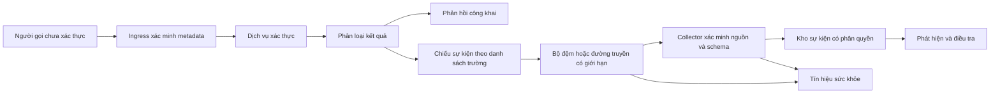

# Authentication failure — Đặc tả logging và audit cho xác thực thất bại

## 1. Mục tiêu và phạm vi

Xác thực thất bại là một kết quả an ninh cần được quan sát có chủ đích. Bản ghi phải giúp xác định **luồng nào thất bại, ở bước nào, theo quyết định nào và với độ tin cậy ra sao**, đồng thời không tạo kho mật khẩu, token hoặc dữ liệu nhận dạng không cần thiết.

Trong chương **Logging và audit** của module `SECURITY_SECURITY_DESIGN_SECURITY_REQUIREMENTS`, bài học chuyển mục tiêu an toàn thông tin và mô hình đe dọa thành yêu cầu logging, audit và kiểm thử cho các lần xác thực thất bại.

Phạm vi gồm đăng nhập tương tác, bước xác thực bổ sung, xác minh token và xác thực service khi các luồng đó được đưa vào thiết kế. Bài học tập trung vào bằng chứng về thất bại, sự liên kết với phân quyền, bảo vệ dữ liệu, giám sát và phục hồi. Đây không phải hướng dẫn triển khai một giao thức xác thực cụ thể.

Các mã sự kiện, schema, ngưỡng và thời hạn dưới đây thuộc **một hệ thống minh họa**. Nhóm triển khai phải điều chỉnh theo rủi ro, kiến trúc, tải và mục đích sử dụng bằng chứng.

## 2. Tình huống xuyên suốt và mô hình đe dọa

Một nền tảng học tập phục vụ nhiều tổ chức. Mỗi tổ chức là một `tenant`. Hệ thống có gateway, dịch vụ xác thực, bộ cung cấp danh tính bên ngoài, bước xác thực bổ sung và kho audit tập trung.

Người vận hành muốn phát hiện dò mật khẩu, thử nhiều tài khoản, tấn công phân tán và sự cố của nhà cung cấp danh tính. Nhân viên hỗ trợ cần giải thích sự cố mà không được đọc thông tin xác thực hoặc dữ liệu tenant khác.

| Mã rủi ro | Tình huống | Hệ quả |
| --- | --- | --- |
| R-01 | Không ghi hoặc làm mất kết quả xác thực thất bại | Không phát hiện được chiến dịch hoặc không dựng lại sự cố |
| R-02 | Ghi mật khẩu, mã dùng một lần, token hoặc cookie | Kho log trở thành nguồn chiếm đoạt tài khoản |
| R-03 | Coi tên người dùng hoặc claim chưa xác minh là danh tính thật | Gán sai hành vi, khóa hoặc điều tra nhầm người |
| R-04 | Tin địa chỉ nguồn và metadata do client tự khai | Sai tương quan, né phát hiện hoặc đổ lỗi cho bên khác |
| R-05 | Log chéo tenant hoặc cho phép đọc nguyên nhân quá chi tiết | Lộ tài khoản, cấu hình và hành vi người dùng |
| R-06 | Đếm lặp, mất ngữ cảnh bước xác thực hoặc đồng hồ sai | Cảnh báo sai, bỏ sót hoặc tái dựng sai trình tự |
| R-07 | Lỗi phụ thuộc bị ghi thành sai mật khẩu | Phản ứng vận hành sai và không nhận ra sự cố dịch vụ |
| R-08 | Tấn công tạo lỗi hàng loạt làm đầy hàng đợi, đĩa hoặc metric | Giảm khả năng sẵn sàng và làm mất bằng chứng |
| R-09 | Phát lại audit sau phục hồi kích hoạt lại hành động kiểm soát | Khóa nhầm, cảnh báo lặp hoặc thay đổi trạng thái tài khoản sai |

Một dòng “Login failed” thường không đủ để giải quyết những rủi ro này. Ngược lại, ghi toàn bộ request để có nhiều ngữ cảnh có thể tạo rủi ro nghiêm trọng hơn.

## 3. Phân biệt thất bại xác thực với các kết quả liên quan

### 3.1. Xác thực và phân quyền

**Xác thực** xác lập danh tính hoặc mức tin cậy của danh tính. **Phân quyền** quyết định danh tính đó được thực hiện hành động nào với tài nguyên nào.

Ví dụ:

- Mật khẩu hoặc bằng chứng không được chấp nhận: thất bại xác thực.
- Token không được xác minh theo chính sách: thất bại tại bước xác minh token.
- Danh tính hợp lệ nhưng không có quyền tải bản xuất: từ chối phân quyền.
- Nhà cung cấp danh tính timeout: không hoàn tất quyết định xác thực.
- Gateway chặn vì hạn mức trước khi kiểm tra mật khẩu: yêu cầu bị chặn, chưa có kết luận về thông tin xác thực.

Gộp tất cả thành “sai mật khẩu” làm sai bằng chứng và các quy tắc phát hiện.

### 3.2. Taxonomy minh họa

| Sự kiện hoặc nhóm kết quả | Ý nghĩa | Không được suy ra |
| --- | --- | --- |
| `AUTH_CHALLENGE_ISSUED` | Hệ thống yêu cầu thêm bằng chứng | Người dùng đã thất bại xác thực |
| `AUTHENTICATION_FAILED` | Bước đánh giá bằng chứng đã kết thúc với từ chối | Người nhập tên tài khoản chính là chủ tài khoản |
| `AUTH_ATTEMPT_BLOCKED` | Bị chính sách chặn trước hoặc ngoài việc đánh giá bằng chứng | Mật khẩu hoặc token chắc chắn sai |
| `AUTH_DEPENDENCY_UNAVAILABLE` | Thành phần cần thiết không cho phép kết luận | Người dùng cung cấp bằng chứng không hợp lệ |
| `AUTH_FLOW_CANCELLED` | Luồng kết thúc do hủy theo hợp đồng | Có hành vi tấn công |
| `AUTHORIZATION_DENIED` | Đã có danh tính nhưng thao tác không được phép | Danh tính chưa xác thực |
| `AUTHENTICATION_SUCCEEDED` | Điều kiện xác thực của bước hoặc luồng đã đạt | Mọi hành động sau đó đều được phép |

Danh mục thực tế cần định nghĩa rõ bước hay luồng mà sự kiện mô tả. Không dùng một tên “thành công” cho cả xác minh một yếu tố và hoàn tất toàn bộ yêu cầu xác thực nếu hai mốc đó khác nhau.

### 3.3. Lỗi kỹ thuật và kết quả chưa biết

Nếu dịch vụ xác thực đã có thể tạo phiên nhưng phản hồi bị mất, caller chưa biết kết quả. Không tự ghi `AUTHENTICATION_FAILED` chỉ vì caller nhận timeout.

Cần đối soát với nguồn trạng thái có thẩm quyền, giữ tham chiếu luồng và ghi sự kiện bổ sung khi có kết luận. Sự kiện bổ sung liên kết với sự kiện ban đầu; không sửa lịch sử để tạo cảm giác ngay từ đầu đã biết kết quả.

## 4. Danh tính trong log có mức tin cậy khác nhau

### 4.1. Ba khái niệm phải tách riêng

| Khái niệm | Nguồn | Cách diễn giải |
| --- | --- | --- |
| Định danh được trình bày | Tên đăng nhập, email hoặc claim do người gọi đưa tới | Dữ liệu chưa chứng minh quyền sở hữu |
| Tài khoản ứng viên được hệ thống xác định | Tra cứu nội bộ hoặc kết quả có thẩm quyền phù hợp | Có thể là tài khoản bị nhắm tới, chưa chắc là người thực hiện |
| Principal đã xác thực ở ngữ cảnh hiện hành | Phiên hoặc bằng chứng đã xác minh với mức tin cậy xác định | Có thể dùng trong phạm vi mức tin cậy hiện có |

Một người gửi tên “alice” và mật khẩu sai chưa được xác lập là Alice. Log kiểu `actor=alice` có thể làm báo cáo quy kết sai.

Với xác thực bổ sung, có thể tồn tại phiên đã xác thực ở mức trước đó. Khi bước bổ sung thất bại, ghi rõ principal đã xác lập và bước chưa đạt; không nâng mức tin cậy vì đã có phiên cũ.

### 4.2. Quy tắc cho token bị từ chối

Claim trong token chưa xác minh không phải sự thật có thẩm quyền. Không lấy `sub`, `tenant` hoặc `role` từ token sai chữ ký rồi ghi thành principal đã xác thực.

Nếu cần giữ một phần thông tin phục vụ phân tích, phải phân loại là dữ liệu do người gọi trình bày, giới hạn trường và xem xét rủi ro dữ liệu. Không ghi toàn bộ token hoặc nội dung payload tùy ý.

Danh tính service phát sự kiện được xác thực qua kênh tiếp nhận audit cũng không chứng minh người đang đăng nhập đã được xác thực. Đây là hai quan hệ tin cậy khác nhau.

### 4.3. Tenant được xác minh và tenant do client gợi ý

`tenant_ref` chỉ biểu thị phạm vi đã được hệ thống xác lập từ nguồn được tin theo hợp đồng. Tham số tenant do client tự gửi cần được xem là gợi ý chưa tin cho đến khi xác minh.

Sự kiện không được đưa vào vùng tenant khác chỉ vì request hoặc token hỏng tự khai tenant đó. Nếu chưa xác định được phạm vi, dùng kênh tiếp nhận có kiểm soát dành cho sự kiện chưa gán tenant, thay vì đoán một tenant mặc định.

## 5. Tối thiểu hóa dữ liệu mà vẫn tương quan được

### 5.1. Danh sách dữ liệu cấm trong log thông thường

Không ghi:

- Mật khẩu, kể cả mật khẩu sai hoặc một phần của mật khẩu.
- Mã dùng một lần, mã khôi phục, câu trả lời bí mật hoặc bí mật thiết bị xác thực.
- Access token, refresh token, session cookie, API key hoặc header xác thực.
- Toàn bộ body đăng nhập, token payload hoặc phản hồi thô của nhà cung cấp.
- Liên kết chứa bí mật, chuỗi truy vấn nhạy cảm hoặc dữ liệu thiết bị không cần thiết.

Hash mật khẩu được nhập không phải cách hợp lệ để giữ mật khẩu trong log. Dữ liệu đó vẫn có thể hỗ trợ suy đoán hoặc tạo thêm bản sao nhạy cảm.

Redaction ở collector là lớp bổ sung. Nguồn phát phải xây sự kiện theo danh sách trường cho phép trước khi dữ liệu tới logger, hàng đợi hoặc tệp tạm.

### 5.2. Tham chiếu giả danh cho định danh được trình bày

Nếu cần phát hiện nhiều lần thử trên cùng định danh mà không giữ email thô, một lựa chọn là tham chiếu bằng HMAC với khóa được bảo vệ, có scope tenant và phiên bản quy tắc chuẩn hóa.

Ví dụ khái niệm:

```text
presented_identity_ref =
    HMAC(protected_key, scope || normalized_presented_identifier)
```

Trong đó, phép ghép cần có mã hóa rõ ràng để không nhập nhằng các thành phần. Quy tắc chuẩn hóa phải theo hợp đồng định danh của hệ thống; không tùy tiện biến mọi loại tên đăng nhập về chữ thường.

Các giới hạn cần ghi rõ:

- Hash thuần của email hoặc tên phổ biến dễ bị thử từ điển; không đồng nghĩa ẩn danh.
- Tham chiếu HMAC vẫn là dữ liệu giả danh có khả năng liên kết và cần bảo vệ.
- Có cùng tham chiếu chỉ chứng minh dữ liệu trình bày khớp theo quy tắc, không chứng minh tài khoản tồn tại.
- Đổi khóa hoặc quy tắc chuẩn hóa có thể làm đứt tương quan; cần ghi phiên bản.
- Không đưa khóa vào log hoặc cấp rộng quyền tính tham chiếu.
- Không tạo khả năng nối dữ liệu giữa tenant nếu nhu cầu đó chưa được cho phép.

Khi cần biết tài khoản nội bộ bị nhắm tới, có thể dùng `account_ref` trong kênh hạn chế nếu được chính sách cho phép và tra cứu đáng tin. Không coi việc có account_ref là bằng chứng người thực hiện sở hữu tài khoản.

### 5.3. Dữ liệu mạng và thiết bị

Địa chỉ nguồn chỉ đáng tin theo chuỗi proxy và ingress được cấu hình. Không lấy tùy ý giá trị đầu tiên trong header chuyển tiếp do client tự gửi.

Nguồn mạng có thể đại diện nhiều người sau NAT, proxy hoặc mạng di động. Địa chỉ giống nhau không chứng minh cùng người; địa chỉ khác nhau không chứng minh người khác.

Thiết kế cần quyết định có lưu IP thô, tham chiếu mạng hay thuộc tính tổng quát nào, theo nhu cầu điều tra và chính sách dữ liệu. Tham chiếu mạng cũng có giới hạn liên kết, vòng đời khóa và rủi ro riêng tư.

User-agent và metadata thiết bị là input chưa tin. Giới hạn độ dài, chuẩn hóa ký tự điều khiển và không dùng chúng làm danh tính có thẩm quyền.

## 6. Schema sự kiện minh họa

### 6.1. Một sự kiện từ chối bằng chứng

```json
{
  "event_id": "evt_9c7a",
  "event_type": "AUTHENTICATION_FAILED",
  "schema_version": "1",
  "occurred_at": "2026-11-27T09:15:30Z",
  "flow_ref": "flow_824d",
  "attempt_ref": "attempt_06",
  "request_ref": "req_8bc2",
  "tenant_ref": "ten_opaque_17",
  "producer": {
    "service_ref": "identity-service",
    "instance_ref": "inst_opaque_09"
  },
  "stage": "PRIMARY_CREDENTIAL",
  "outcome": "REJECTED",
  "reason_code": "CREDENTIAL_REJECTED",
  "actor": {
    "authenticated_principal_ref": null
  },
  "subject": {
    "account_ref": null,
    "presented_identity_ref": "idref_52e7",
    "reference_key_version": "k2"
  },
  "network": {
    "source_ref": "netref_742c",
    "source_confidence": "TRUSTED_INGRESS"
  }
}
```

Các mã tham chiếu chỉ là ví dụ. Trong sự kiện này, không có principal đã xác thực và không có account_ref được công khai trong kênh đó. `tenant_ref` giả định đã được xác lập từ ngữ cảnh ingress đáng tin; nếu chưa xác lập thì không điền một giá trị tự khai.

### 6.2. Trường cốt lõi và trường có điều kiện

| Trường | Yêu cầu thiết kế | Rủi ro nếu hiểu sai |
| --- | --- | --- |
| `event_id` | Một ID cho một sự kiện logic; giữ nguyên khi truyền lại cùng sự kiện | Đếm lặp do retry chuyển tiếp |
| `flow_ref` | Liên kết quá trình xác thực gồm nhiều bước | Nhầm challenge với nhiều lần thất bại |
| `attempt_ref` | Phân biệt một lần gửi bằng chứng hoặc một lần đánh giá đã định nghĩa | Gộp các lần thử khác nhau |
| `stage` | Tập giá trị kiểm soát theo luồng | Trộn sai mật khẩu với lỗi yếu tố bổ sung |
| `outcome` | Kết quả tại điểm quan sát | Biến timeout thành từ chối hoặc thành công |
| `reason_code` | Danh mục nội bộ đã duyệt, không phải message thô | Rò chi tiết hoặc cardinality không giới hạn |
| `occurred_at` | Thời gian do nguồn có thẩm quyền ghi, với chất lượng đồng hồ được quản lý | Sắp xếp sai trình tự |
| `ingested_at` | Collector bổ sung theo đồng hồ tiếp nhận | Không phát hiện được sự kiện trễ |
| `account_ref` | Chỉ khi được xác định đáng tin và kênh được phép giữ | Xác nhận tài khoản hoặc quy kết sai |
| `source_confidence` | Thể hiện nguồn metadata và mức tin cậy theo hợp đồng | Coi header giả là bằng chứng mạng |

Trường tùy chọn vắng mặt cần có ý nghĩa rõ: chưa biết, không áp dụng hoặc chủ động không thu thập. Không điền chuỗi giả “anonymous” vào mọi trường rồi coi là dữ liệu đã xác minh.

### 6.3. Không tạo mã nguyên nhân tùy ý

Danh mục có thể có `CREDENTIAL_REJECTED`, `ADDITIONAL_FACTOR_REJECTED`, `TOKEN_REJECTED` và các mã kỹ thuật riêng. Không nhúng email, ID tài khoản, token hoặc tên exception vào `reason_code`.

Mức chi tiết nội bộ cần theo nhu cầu thực tế. Không mặc định phải phân biệt “không có tài khoản” với “sai mật khẩu” trong mọi kênh. Nếu cần cho điều tra, giữ ở kênh hạn chế và không chuyển sự khác biệt đó sang response công khai hoặc dashboard hỗ trợ rộng.

## 7. Luồng thu thập và ranh giới tin cậy



### 7.1. Nguồn phát

Nguồn phát tạo sự kiện từ kết quả có kiểu và các trường được phép. Không truyền nguyên exception, request hoặc đối tượng token cho logger rồi hy vọng chúng không bị tuần tự hóa.

Bằng chứng từ nhà cung cấp bên ngoài cần xác minh nguồn, hợp đồng và liên kết luồng trước khi được xem là có thẩm quyền. Một webhook có chữ ký hợp lệ chứng minh kênh nguồn theo cấu hình, không tự chứng minh mọi danh tính trình bày trong nội dung là người đã xác thực.

### 7.2. Collector

Collector xác thực nguồn phát, kiểm tra schema, giới hạn kích thước và phân vùng theo phạm vi đã xác lập. Sự kiện sai không được đi thẳng vào kho tin cậy.

Nếu cần cách ly sự kiện không hợp lệ, chỉ giữ phần đã làm sạch theo chính sách. Không đặt nguyên payload chứa token vào hàng đợi lỗi để “xử lý sau”.

### 7.3. Người đọc và hệ thống phát hiện

Nhóm vận hành có thể cần số liệu tổng hợp. Nhóm điều tra có thể cần bản ghi chi tiết. Nhân viên hỗ trợ chỉ cần phạm vi tenant và chức năng được giao.

Quyền đọc log là một quyền truy cập dữ liệu riêng. Nó không được tự suy ra từ quyền đăng nhập nền tảng. Truy vấn, xuất dữ liệu audit và thay đổi quy tắc cần được theo dõi theo mức độ nhạy cảm.

## 8. Đếm đúng giữa nhiều bước, nhiều nguồn và truyền lại

### 8.1. Flow, attempt và event không thay thế nhau

Một luồng đăng nhập có thể có nhiều lần gửi mật khẩu, một challenge bổ sung và nhiều lần gửi bằng chứng tiếp theo. Một attempt có thể sinh sự kiện tại gateway, dịch vụ xác thực và nhà cung cấp danh tính.

Cần định nghĩa:

- `flow_ref` liên kết một luồng nghiệp vụ.
- `attempt_ref` nhận diện một lần đánh giá đã xác định phạm vi.
- `event_id` nhận diện một sự kiện logic.
- Nguồn nào có thẩm quyền ghi quyết định cuối cho attempt đó.
- Những sự kiện nào chỉ bổ sung ngữ cảnh và không được đếm thành thất bại mới.

ID dùng để chống đếm lặp phải được nguồn tin cậy tạo hoặc quản lý. Không cho người gọi tùy ý gắn cùng event_id để làm biến mất các lần thử mới.

### 8.2. Truyền lại khác với thử lại xác thực

Nếu collector timeout sau khi đã nhận sự kiện, nguồn phát có thể gửi lại. Cùng sự kiện giữ nguyên event_id và được khử trùng lặp theo phạm vi nguồn.

Nếu người dùng gửi một bằng chứng mới, đó là attempt mới theo hợp đồng, kể cả khi cùng flow. Không dùng cùng event_id cho mọi lần thất bại của một luồng.

Khử trùng lặp theo timestamp hoặc toàn bộ nội dung có thể làm mất sự kiện thật. Hai lần thử khác nhau có thể cùng thời gian, mã nguyên nhân và nguồn mạng.

Trong ví dụ, dashboard số lần thất bại dựa trên **quyết định cuối có thẩm quyền theo attempt_ref**, không cộng tất cả sự kiện kỹ thuật của mọi hop.

### 8.3. Thời gian và sự kiện đến trễ

Cần giữ thời gian phát sinh và thời gian tiếp nhận. Đồng hồ nguồn phải được quản lý, có cách nhận biết lệch hoặc chất lượng không đạt.

Thời gian log không phải bằng chứng tuyệt đối về thứ tự nhân quả. ID luồng, ID attempt, giai đoạn và quan hệ nguồn cần bổ trợ việc tái dựng.

Bộ phát hiện cần quy tắc xử lý sự kiện đến muộn và thời gian được phép bổ sung vào cửa sổ. Nếu chạy lại trên dữ liệu lịch sử, phải phân biệt kết quả hồi cứu với cảnh báo trực tiếp; không phát lại mọi hành động như thể tấn công vừa xảy ra.

## 9. Độ bền vững, mất log và khả năng sẵn sàng

### 9.1. Xác định điểm nhận bền vững

Một lệnh gọi logger trả về chưa chắc có nghĩa sự kiện đã được ghi bền vững. Đặc tả cần chỉ rõ điểm xác nhận: bộ đệm cục bộ được duyệt, hàng đợi bền vững hoặc kho audit.

Nếu dùng gửi bất đồng bộ, phải có giới hạn bộ đệm, chính sách truyền lại và cách nhận biết phần chưa chuyển thành công. Bảo đảm của từng bước phải được mô tả riêng.

Đối với các sự kiện quyết định cuối thuộc phạm vi audit trong ví dụ, **không sampling**. Log chẩn đoán bổ trợ có thể lấy mẫu theo chính sách. Không dùng trace có sampling làm nguồn duy nhất để đếm thất bại xác thực.

### 9.2. Khi đường ghi log lỗi

Kết quả xác thực không được đổi từ từ chối sang cho phép vì ghi log thất bại. Với lần thử bị từ chối, phản hồi vẫn tuân theo quyết định và chính sách thông tin công khai.

Cần quy định riêng:

- Bộ đệm hữu hạn, dữ liệu đã làm sạch và quyền truy cập.
- Số lần truyền lại, deadline và giới hạn tài nguyên.
- Tín hiệu sức khỏe và chỉ số mất hoặc chưa rõ độ bao phủ.
- Cách đánh dấu gap khi không thể chứng minh đã thu đủ.
- Chủ sở hữu xử lý sự cố pipeline.

Không suy ra rằng mọi đăng nhập hợp lệ phải bị dừng khi telemetry lỗi. Nếu việc cấp phiên thành công cần audit bền vững như một điều kiện bắt buộc, phải có yêu cầu riêng cho luồng cấp phiên, cùng phân tích tính sẵn sàng.

### 9.3. Chống làm đầy log

Kẻ tấn công có thể tạo lượng lớn request bị từ chối. Pipeline cần giới hạn kích thước sự kiện, tốc độ tiếp nhận, tài nguyên và quyền của nguồn phát.

Chặn request trước khi đánh giá bằng chứng tạo nhóm sự kiện `AUTH_ATTEMPT_BLOCKED` theo hợp đồng, không giả thành nhiều lần “sai mật khẩu”. Chỉ số chặn tổng hợp có thể hỗ trợ bảo vệ tải, nhưng không thay thế âm thầm các bản ghi audit đã cam kết.

Nếu quá tải làm mất sự kiện, không báo “không có thất bại” hoặc “đã ghi đủ”. Ghi nhận suy giảm bằng chứng và cảnh báo qua kênh còn hoạt động. Không có thiết kế bộ đệm hữu hạn nào tự bảo đảm lưu vô hạn dữ liệu khi đích ngừng hoạt động vô hạn.

### 9.4. Chỉ tiêu minh họa

Trong điều kiện tải đã công bố và chất lượng đồng hồ đạt yêu cầu, ít nhất **99% sự kiện quyết định cuối đã được nguồn xác nhận ghi bền vững** xuất hiện trong kho truy vấn trong **60 giây**.

Bộ đối soát số lượng và trạng thái chuyển tiếp chạy ít nhất một lần mỗi **5 phút** khi vận hành bình thường. Cần giám sát chính lần đối soát thành công gần nhất.

Chỉ tiêu này không chứng minh nguồn đã sinh mọi sự kiện cần có, và không đồng nghĩa mọi tấn công được phát hiện trong 60 giây. Độ bao phủ nguồn, độ trễ thu thập và độ trễ phát hiện là ba vấn đề riêng.

## 10. Phát hiện bất thường và phản ứng có kiểm soát

### 10.1. Quy tắc cần gắn với ý nghĩa dữ liệu

Các ngưỡng sau chỉ phục vụ thiết kế ví dụ:

| Dấu hiệu | Quy tắc minh họa | Điều phải xem xét |
| --- | --- | --- |
| Nhiều thất bại từ một nguồn mạng | Ít nhất 20 quyết định từ chối trong 5 phút theo source_ref đáng tin | NAT, proxy dùng chung, chất lượng metadata |
| Một nguồn thử nhiều định danh | Ít nhất 10 presented_identity_ref khác nhau trong 10 phút | Cùng scope, phiên bản khóa và quy tắc chuẩn hóa |
| Một định danh bị thử từ nhiều nguồn | Ít nhất 8 source_ref trong 10 phút | Định danh trình bày chưa chứng minh tài khoản tồn tại |
| Lỗi phụ thuộc tăng nhanh | Tăng nhóm AUTH_DEPENDENCY_UNAVAILABLE so với tải luồng | Không quy thành sai mật khẩu hoặc khóa hàng loạt |
| Thất bại rồi thành công đáng chú ý | Tương quan luồng, tài khoản có thẩm quyền và nguồn theo quy tắc | Không kết luận chiếm tài khoản chỉ từ cùng tên tự khai |
| Nhiều lần từ chối yếu tố bổ sung | Tăng theo stage và flow, tách challenge/cancel | Có thể do lỗi người dùng, thiết bị hoặc lạm dụng |

Các quy tắc cần window, cách dedup, nguồn có thẩm quyền và phiên bản quy tắc rõ ràng. Không cộng dữ liệu khác phiên bản tham chiếu rồi giả định mọi giá trị có thể so sánh trực tiếp.

### 10.2. Cảnh báo không phải kết luận danh tính

Một cụm sự kiện cho thấy khả năng lạm dụng; nó không tự chứng minh ai thực hiện. Báo cáo cần giữ cách diễn đạt “định danh bị thử”, “nguồn mạng quan sát được” và “principal đã xác thực” đúng với bằng chứng.

Khóa tài khoản chỉ dựa trên tên do người chưa xác thực đưa tới có thể trở thành công cụ gây gián đoạn cho nạn nhân. Các hành động như hạn chế, yêu cầu bước bổ sung hoặc khóa cần chính sách riêng, kiểm soát tác động và cơ chế khôi phục.

Quy tắc phát hiện không được tự cấp quyền, thay đổi tenant hoặc biến audit event thành lệnh xác thực. Bản ghi sự cố không phải bằng chứng đăng nhập hợp lệ.

### 10.3. Metric và dữ liệu chi tiết

Metric có thể tổng hợp theo stage, nhóm kết quả, nguồn dịch vụ và các chiều đã duyệt. Không dùng email, presented_identity_ref, request_ref hoặc thông điệp lỗi tùy ý làm nhãn metric không giới hạn.

Các phép tương quan cần cardinality cao nên chạy trong kho sự kiện hoặc hệ thống phù hợp, với quyền và giới hạn tài nguyên. Dashboard tổng hợp cũng cần xem xét nguy cơ suy ra cá nhân từ nhóm quá nhỏ.

## 11. Bảo vệ, lưu giữ và phục hồi bằng chứng

### 11.1. Quyền đọc, ghi và xuất

Nguồn phát chỉ được gửi sự kiện trong phạm vi được cấp. Người dùng ứng dụng không được ghi đè kho audit bằng một API log tùy ý.

Quyền đọc chi tiết, xuất dữ liệu và quản lý lưu giữ phải được xác định theo nhiệm vụ. Không mặc định quản trị một tenant được xem lỗi xác thực của tenant khác.

Các truy cập nhạy cảm vào audit và thay đổi quy tắc phát hiện cần được theo dõi. Nếu cơ chế quản trị cho phép sửa hoặc xóa dữ liệu, khả năng đó phải có kiểm soát và bằng chứng riêng.

### 11.2. Tính toàn vẹn có giới hạn

Bảo vệ đường truyền, xác thực nguồn, quyền ghi tối thiểu, phiên bản schema và cơ chế phát hiện thay đổi đều hỗ trợ độ tin cậy.

Hash hoặc chữ ký có thể hỗ trợ phát hiện sửa đổi khi có mốc tin cậy và khóa được bảo vệ. Chúng không tự chứng minh mọi lần thất bại đã được ghi, không chứng minh nguồn không bị chiếm quyền và không loại bỏ việc bỏ sót trước khi phát sự kiện.

Cần đối soát với nguồn quyết định, kiểm tra sức khỏe producer và theo dõi gap. Không dùng một biểu tượng “tamper-proof” để thay thế việc mô tả các giả định tin cậy.

### 11.3. Lưu giữ theo loại dữ liệu

Ví dụ kế hoạch nội bộ có thể đặt:

| Loại | Thời hạn minh họa | Điều kiện |
| --- | --- | --- |
| Sự kiện chi tiết đã tối thiểu hóa | 30 ngày | Quyền điều tra có giới hạn, mục đích rõ |
| Thông tin chẩn đoán bổ trợ | 7 ngày | Không chứa bí mật, chỉ người được giao truy cập |
| Số liệu tổng hợp cần thiết | 90 ngày | Kiểm tra khả năng liên kết và mức chi tiết |
| Message cách ly đã làm sạch | Theo hạn xử lý sự cố được duyệt | Có owner, không giữ vô hạn mặc định |

Đây là lựa chọn thiết kế ví dụ, không phải thời hạn bắt buộc chung. Chính sách thực tế phải chỉ rõ mục đích, bản sao, backup, cache, chỉ mục và dữ liệu xuất.

Xóa sự kiện nhưng giữ bản sao chi tiết ở nơi khác không hoàn tất xử lý hết hạn. Đổi khóa HMAC cũng không tự xóa mọi khả năng liên kết có sẵn trong dữ liệu hoặc bản sao.

### 11.4. Phục hồi và phát lại

Trước mở lại pipeline sau phục hồi, kiểm tra checkpoint, phạm vi dedup, phiên bản schema, lịch sử khóa tham chiếu và các quy tắc phát hiện liên quan.

Sự kiện cũ giữ nguyên event_id khi truyền lại; không giả thành lần thất bại mới. Sự kiện phục dựng phải nêu nguồn và thời điểm bổ sung. Khoảng không thể khôi phục cần được ghi là gap, không lấp bằng sự kiện bịa.

Phát lại dữ liệu để phân tích không được tự tạo phiên, tăng mức xác thực, mở khóa hoặc khóa tài khoản theo quy tắc thời gian thực. Nếu cần tái xử lý hành động, phải có quy trình và kiểm soát chống lặp riêng.

## 12. Bộ yêu cầu bảo mật có thể kiểm chứng

Các yêu cầu dưới đây áp dụng cho những luồng xác thực được liệt kê trong phạm vi của nền tảng minh họa.

| Mã | Yêu cầu và tiêu chí đo | Rủi ro | Điểm thực thi, chủ sở hữu |
| --- | --- | --- | --- |
| AF-01 | Mỗi quyết định xác thực cuối thuộc phạm vi có sự kiện theo schema; challenge, blocked, dependency unavailable và authorization denied được phân loại riêng | R-01, R-07 | Dịch vụ xác thực và adapter; nhóm danh tính |
| AF-02 | Không có mật khẩu, mã dùng một lần, mã khôi phục, token, cookie hoặc body xác thực đầy đủ trong log, buffer và dữ liệu cách ly | R-02 | Projection nguồn, serializer, collector; nhóm nền tảng |
| AF-03 | Định danh trình bày, account ứng viên và principal đã xác thực có trường và ngữ nghĩa riêng; claim chưa xác minh không trở thành principal | R-03 | Ngữ cảnh xác thực và schema; nhóm danh tính |
| AF-04 | Tenant và metadata mạng được gán theo nguồn tin cậy đã định nghĩa; dữ liệu tự khai không ghi đè trường có thẩm quyền | R-04, R-05 | Ingress, proxy, collector; nhóm hạ tầng |
| AF-05 | Tham chiếu định danh có scope, phiên bản khóa và chuẩn hóa rõ; không mặc định dùng email thô hoặc hash thuần làm dữ liệu ẩn danh | R-02, R-03, R-05 | Bộ tạo tham chiếu, quản lý khóa; nhóm dữ liệu |
| AF-06 | Cùng sự kiện truyền lại không tăng số thất bại; attempt mới vẫn được đếm; nguồn quyết định cuối có thẩm quyền được chỉ rõ | R-06 | Producer, dedup và truy vấn; nhóm audit |
| AF-07 | Sự kiện quyết định cuối trong phạm vi audit không sampling; điểm nhận bền vững, giới hạn buffer và hành vi khi mất log được công bố | R-01, R-08 | Buffer, đường truyền, kho audit; nhóm nền tảng |
| AF-08 | Ghi log lỗi không biến từ chối thành cho phép; không retry logger vô hạn hoặc tăng bộ đệm không giới hạn; có tín hiệu suy giảm | R-02, R-08 | Ranh giới xử lý kết quả và health signal; nhóm danh tính |
| AF-09 | Trong tải công bố, ít nhất 99% sự kiện đã nhận bền vững tại nguồn truy vấn được trong 60 giây; đối soát chạy ít nhất mỗi 5 phút | R-01, R-06 | Pipeline và reconciler; nhóm vận hành |
| AF-10 | Quy tắc phát hiện ghi rõ stage, window, nguồn, dedup, ngưỡng và giới hạn diễn giải; dữ liệu đến trễ và phát lại có chính sách riêng | R-03, R-06, R-07 | Detector và kho quy tắc; nhóm an ninh vận hành |
| AF-11 | Truy vấn và xuất audit được phân quyền theo nhiệm vụ, tenant và mức chi tiết; thay đổi quy tắc và truy cập nhạy cảm có bằng chứng | R-05 | Kho audit, dashboard, công cụ hỗ trợ; nhóm quản trị |
| AF-12 | Phục hồi giữ event_id, phiên bản và lịch sử cần thiết; phát lại không tự kích hoạt hành động trực tiếp hoặc tạo trạng thái xác thực mới | R-06, R-09 | Runbook, replay pipeline; nhóm vận hành |
| AF-13 | Mỗi nhóm dữ liệu có lịch giữ và xử lý hết hạn cho bản chính, bản sao, chỉ mục, backup và dữ liệu xuất theo chính sách | R-02, R-05 | Kho dữ liệu và vòng đời; nhóm dữ liệu |
| AF-14 | Response công khai không phản chiếu nguyên nhân nội bộ làm lộ tài khoản; quyền đọc audit không được cấp chỉ vì có request_ref | R-03, R-05 | API đăng nhập, API hỗ trợ; nhóm API và phân quyền |

AF-01 cần danh sách luồng cụ thể, như đăng nhập, bước bổ sung và token verification được đưa vào phạm vi. Không thể chứng minh độ bao phủ chỉ bằng một dòng “mọi auth failure đều có log”.

AF-09 đo độ trễ thu thập trên tập đã ghi bền vững tại nguồn. Cần bằng chứng riêng về độ bao phủ phát sự kiện và gap; chỉ số đẹp không bù được những lần thất bại không hề được ghi.

AF-13 cần quy trình xử lý ngoại lệ lưu giữ nếu có, với phạm vi và thẩm quyền rõ. Không tự giữ dữ liệu vô hạn vì “có thể cần điều tra”.

## 13. Ma trận nghiệm thu và bằng chứng

Dùng tài khoản, token và dữ liệu giả trong môi trường có kiểm soát. Kiểm thử phải quan sát cả phản hồi, phiên được cấp, sự kiện, quyền truy vấn và pipeline.

| Ca | Điều kiện và thao tác | Kết quả mong đợi | Yêu cầu |
| --- | --- | --- | --- |
| AT-01 | Tạo sai bằng chứng, challenge, chặn hạn mức, timeout nhà cung cấp và thiếu quyền tài nguyên | Các nhóm được phân loại đúng; không quy hết thành sai mật khẩu | AF-01 |
| AT-02 | Đưa chuỗi đánh dấu bí mật giả vào password, OTP, token, cookie và body | Không có chuỗi cấm trong log, buffer, collector hoặc dữ liệu cách ly | AF-02 |
| AT-03 | Gửi tên người dùng của người khác với bằng chứng sai | Chỉ ghi định danh trình bày hoặc tài khoản bị nhắm tới; không xác lập actor là chủ tài khoản | AF-03 |
| AT-04 | Gửi token sai chữ ký chứa sub, role và tenant giả | Claim không trở thành principal hoặc tenant có thẩm quyền | AF-03, AF-04 |
| AT-05 | Giả mạo header chuyển tiếp và gợi ý tenant | Trường tin cậy theo cấu hình ingress; không ghi vào tenant tự khai | AF-04 |
| AT-06 | Cùng định danh ở hai tenant, đổi chuẩn hóa hoặc xoay khóa | Scope và phiên bản rõ; không nối sai hoặc ngầm coi ref là tài khoản tồn tại | AF-05 |
| AT-07 | Truyền lại cùng event, gửi attempt mới, và nhận event từ nhiều hop | Dedup đúng sự kiện; đếm đúng attempt theo nguồn quyết định có thẩm quyền | AF-06 |
| AT-08 | Tắt trace sampling rồi tạo thất bại thuộc audit | Sự kiện audit bắt buộc vẫn được thu theo hợp đồng | AF-07 |
| AT-09 | Collector ngừng hoạt động, buffer đầy và logger lỗi | Từ chối vẫn giữ nguyên, tài nguyên hữu hạn, có tín hiệu suy giảm hoặc gap | AF-07, AF-08 |
| AT-10 | Tải trong mức công bố và cố ý làm chậm đường truyền | Đo đúng tỷ lệ 60 giây, độ trễ và lần đối soát; không che phần chưa thu đủ | AF-09 |
| AT-11 | Lệch đồng hồ, event đến trễ và dữ liệu lịch sử được phát lại | Quy tắc xử lý thời gian đúng, không tạo cảnh báo hoặc hành động lặp ngoài hợp đồng | AF-10, AF-12 |
| AT-12 | Tăng lỗi dependency, riêng biệt với tăng credential rejection | Nhận ra sự cố dịch vụ; không khóa hàng loạt như sai mật khẩu | AF-01, AF-10 |
| AT-13 | Hỗ trợ tenant A tra event của tenant B hoặc chỉ dùng request_ref | Bị từ chối; không lộ chi tiết nội bộ hoặc dữ liệu tenant khác | AF-11, AF-14 |
| AT-14 | Khôi phục checkpoint cũ và truyền lại sự kiện | Không tăng đếm sai; không tạo phiên, nâng mức xác thực hoặc kích hoạt khóa trực tiếp | AF-12 |
| AT-15 | Qua mốc lưu giữ trên dữ liệu thử, kể cả bản sao và chỉ mục | Xử lý theo lịch và bằng chứng; không còn bản chi tiết ngoài chính sách | AF-13 |
| AT-16 | So sánh tài khoản tồn tại, không tồn tại và các nguyên nhân từ chối nhạy cảm | Thông tin công khai đúng chính sách; log chi tiết chỉ tới đúng người có quyền | AF-14 |
| AT-17 | Provider hoặc client gửi reason và user-agent chứa CR/LF, chuỗi dài, dữ liệu giả độc hại | Schema, mã hóa và giới hạn được thực thi; không giả mạo dòng log hoặc nổ metric | AF-02, AF-04, AF-08 |
| AT-18 | Lỗi phản hồi sau khi hệ thống có thể đã tạo phiên | Ghi kết quả chưa biết tại điểm quan sát, đối soát; không tự kết luận thất bại bằng chứng | AF-01, AF-06, AF-12 |

AT-02 không chỉ tìm trong response. Bí mật có thể đã rơi vào local log, debug trace, hàng đợi lỗi hoặc công cụ hỗ trợ trước khi collector làm sạch.

AT-16 cần kiểm tra cả body, mã phản hồi, header và các kênh thuộc mô hình đe dọa. Kiểm thử theo thời gian cần tập mẫu, tải và phương pháp định trước; một cặp request không đủ kết luận.

Bằng chứng nên gồm sự kiện đã làm sạch, thống kê theo attempt, trạng thái phiên kiểm thử, kết quả truy vấn quyền và báo cáo độ trễ. Không đưa dữ liệu xác thực thật vào bộ bằng chứng.

## 14. Vận hành và xử lý sự cố

### 14.1. Những câu hỏi hệ thống phải trả lời được

Khi thấy một đợt thất bại tăng, nhóm vận hành cần biết:

1. Có thật sự tăng quyết định từ chối hay chỉ tăng timeout hoặc lượng challenge?
2. Số liệu đã dedup và theo đúng nguồn có thẩm quyền chưa?
3. Định danh nào chỉ do người gọi trình bày, tài khoản nào được xác định nội bộ?
4. Nguồn mạng có đáng tin không, có NAT hoặc proxy dùng chung không?
5. Pipeline có gap, trễ hoặc thay đổi khóa tham chiếu không?
6. Có thành công liên quan nào đã được xác minh và có cần điều tra tiếp không?

Không kết luận “người dùng A tấn công” từ một chuỗi request tự khai tên A. Báo cáo phải diễn đạt đúng chất lượng bằng chứng.

### 14.2. Khi mất bằng chứng

Xác định giai đoạn mất: nguồn không phát, buffer không ghi, truyền không tới, collector từ chối, kho chưa lập chỉ mục hay truy vấn sai.

Giữ các checkpoint, số lượng quyết định từ nguồn và thông tin sức khỏe còn lại. Khôi phục phần có căn cứ; đánh dấu gap không thể chứng minh. Không tạo sự kiện giả để làm khớp dashboard.

Nếu nguồn phát có thể bị chiếm quyền, sự kiện từ nguồn đó phải được đánh giá theo mô hình tin cậy tương ứng. Chữ ký hợp lệ không đủ để khẳng định nội dung là sự thật khách quan.

### 14.3. Điều kiện đóng sự cố

Cần xác nhận pipeline hoạt động, backlog được xử lý có kiểm soát, số liệu đã đối soát và quy tắc phát hiện không phát lại hành động sai. Những khoảng bằng chứng còn thiếu được ghi rõ cùng tác động tới kết luận.

Kiểm tra dữ liệu chẩn đoán phát sinh, message cách ly và bản xuất điều tra. Chúng cần quyền và lịch hết hạn; không trở thành kho bí mật phụ sau khi sự cố kết thúc.

## 15. Lỗi thiết kế thường gặp

| Lỗi | Vì sao nguy hiểm | Cách sửa |
| --- | --- | --- |
| Log cả request đăng nhập để debug | Có thể chứa mật khẩu, token và cookie | Chiếu sự kiện từ danh sách trường cho phép |
| Ghi username vào actor dù xác thực thất bại | Quy kết sai người thực hiện | Tách presented identity, account ứng viên và principal |
| Tin claim trong token sai chữ ký | Kẻ gửi tự quyết định danh tính và tenant trong log | Chỉ dùng dữ liệu đã xác minh cho trường có thẩm quyền |
| Mọi lỗi đều ghi AUTHENTICATION_FAILED | Trộn từ chối, hủy, blocked và sự cố phụ thuộc | Taxonomy theo kết quả và stage |
| Cộng log của gateway, IdP và ứng dụng | Đếm nhiều lần cho một attempt | Nguồn quyết định cuối và dedup rõ |
| Hash email được coi là ẩn danh hoàn toàn | Có thể bị suy đoán hoặc liên kết | Mô hình giả danh, khóa, scope và quyền phù hợp |
| Dùng IP làm danh tính người dùng | NAT và metadata giả dẫn tới kết luận sai | Giữ chất lượng nguồn và giới hạn diễn giải |
| Trace sampling là nguồn audit duy nhất | Bỏ mất các lần thất bại cần ghi | Kênh audit theo hợp đồng riêng |
| Logger lỗi thì cho đăng nhập qua | Gắn tính sẵn sàng logging với mở quyền sai | Giữ quyết định từ chối, xử lý suy giảm độc lập |
| Replay audit chạy lại mọi quy tắc thời gian thực | Khóa hoặc cảnh báo lặp, thay đổi trạng thái sai | Chế độ hồi cứu và hành động có kiểm soát |
| Không thấy event nghĩa là không có tấn công | Producer hoặc pipeline có thể đã hỏng | Theo dõi sức khỏe, độ bao phủ và gap |

## 16. Bài tập vận dụng

Một hệ thống hiện ghi toàn bộ JSON đăng nhập. Nó đặt `actor` bằng email người gọi gửi, lấy IP từ header tùy ý và ghi mọi timeout của nhà cung cấp thành “bad password”. Gateway và dịch vụ xác thực cùng ghi thất bại, dashboard cộng cả hai. Log được lấy mẫu và replay sau phục hồi có thể kích hoạt khóa tài khoản.

Hãy xây dựng:

1. Danh sách rủi ro, tài sản và nguồn thông tin chưa đáng tin.
2. Taxonomy phân biệt thất bại bằng chứng, blocked, dependency unavailable, challenge và authorization denied.
3. Schema tối thiểu không có bí mật, có mức tin cậy danh tính, flow, attempt, event và thời gian.
4. Quy tắc đếm, dedup, nguồn quyết định có thẩm quyền và xử lý sự kiện trễ.
5. Sáu yêu cầu có mã, giới hạn, điểm thực thi và ca nghiệm thu.
6. Chính sách quyền truy vấn, lưu giữ, mất log và replay không gây tác động ngoài ý muốn.

Khi tự đánh giá, kiểm tra sự kiện có phản ánh đúng điều hệ thống biết hay không, có giữ giới hạn riêng tư và có đủ bằng chứng để điều tra trong phạm vi đã định hay không. Logging xác thực thất bại cần hỗ trợ quyết định an ninh mà không tự trở thành nguồn cấp quyền, kho thông tin xác thực hoặc công cụ quy kết sai danh tính.
